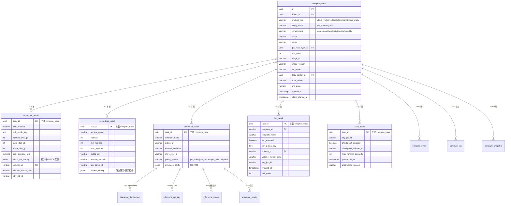

# compute_task 数据库解耦分析与方案

> 分析当前统一 `compute_task` 模型的耦合问题，评估解耦必要性，提出改进方案。
>
> **状态**: ✅ **已采纳**（2026-07-19）— 分层继承（`compute_base` + `*_detail`）为实施基线。  
> **语义对齐**: 产品线 / Spot / 余额以以下权威文档为准（若本节旧表述冲突，以下为准）：
> - `../../business/product-line-taxonomy.md` — Spot **不是** product_line，而是 `billing_mode`
> - `spot-preemption-design.md` — 抢占实现
> - `tenant-balance-unification.md` — 余额

**版本**: v2.1（2026-07-19）— 采纳分层模型 + 对齐 taxonomy

---

## 目录

1. [问题背景](#1-问题背景)
2. [产品线语义澄清](#2-产品线语义澄清)
3. [K8s 原语映射](#3-k8s-原语映射)
4. [当前设计分析](#4-当前设计分析)
5. [耦合问题详解](#5-耦合问题详解)
6. [各产品线差异对比矩阵](#6-各产品线差异对比矩阵)
7. [方案评估](#7-方案评估)
8. [推荐方案：分层继承模型](#8-推荐方案分层继承模型)
9. [详细表结构设计](#9-详细表结构设计)
10. [数据迁移策略](#10-数据迁移策略)
11. [对现有设计的影响](#11-对现有设计的影响)
12. [实施路线图](#12-实施路线图)

---

## 1. 问题背景

当前设计将 GPU 云服务器 (Cloud VM)、弹性服务 (Serverless)、批处理任务 (Job) 等统一存储在 `compute_task` 表中，通过 `task_type` 和 `product_line` 字段区分。虽然这种设计在早期简化了开发，但随着各产品线功能演进，以下问题日益突出：

1. **字段大量为空**：55 个字段中，约 40% 对某些产品线无意义
2. **条件分支膨胀**：42% 的 tRPC 过程需要 `product_line` 条件判断
3. **状态机语义冲突**：13 个共享状态值在不同产品线下含义不同
4. **计费逻辑耦合**：共享计费定时器需要区分处理不同计费模式
5. **产品线语义混淆**：Serverless 和 Serverless Inference 是不同概念；Spot 曾被误建模为独立产品线

---

## 2. 产品线语义澄清

### 2.1 正确定义（与 taxonomy 对齐）

| 产品线 (`product_line`) | 定义 | K8s 原语 | 核心特征 |
|--------|------|----------|---------|
| **cloud_vm** | 基于 K8s Pod 的开发机 | Pod + PVC | 持久化存储、SSH、IDE、可频繁开关机 |
| **serverless** | 无状态 Web 服务 | Deployment | 滚动更新、零停机、自动扩缩容 |
| **inference** | LLM 推理服务 | Deployment(s) | 模型参数、多副本、API 端点、Token 计费 |
| **job** | 批处理任务 | Job | 运行到完成；可设 `billing_mode=spot` |

> **Spot**：`billing_mode=spot` + `commitment=on-demand`（按秒）；抢占**必须通知租户**，见 `spot-preemption-design.md`。  
> **bare_metal** 不走 `compute_base`，走 `bare_metal_order`。

### 2.2 Serverless ≠ Serverless Inference

**关键区别**：

| 维度 | Serverless (Web 服务) | Serverless Inference (LLM 推理) |
|------|----------------------|--------------------------------|
| **用途** | 部署任意 Web 应用 | 专门部署 LLM 模型 |
| **K8s 资源** | 1 个 Deployment | 1~N 个 Deployment（多模型/多副本） |
| **扩缩容** | 基于 CPU/内存/自定义指标 | 基于 GPU 利用率、请求队列深度 |
| **模型管理** | 无 | 模型权重、LoRA 适配器、KV 缓存 |
| **API 暴露** | 用户自定义端口 | 标准 OpenAI 兼容 API |
| **计费** | 按 GPU 时长 | 按 Token/请求数/GPU 时长 |
| **流量管理** | 用户自行配置 | Traefik 网关 + API Key |

### 2.3 Serverless (Web 服务) 的 K8s 实现

```yaml
# Serverless Web 服务 — K8s Deployment
apiVersion: apps/v1
kind: Deployment
metadata:
  name: my-web-app
spec:
  replicas: 3
  strategy:
    type: RollingUpdate
    rollingUpdate:
      maxUnavailable: 0  # 零停机
      maxSurge: 1
  selector:
    matchLabels:
      app: my-web-app
  template:
    spec:
      containers:
        - name: app
          image: my-web-app:latest
          ports:
            - containerPort: 8080
          readinessProbe:  # 就绪探针（流量切换依据）
            httpGet:
              path: /health
              port: 8080
          lifecycle:
            preStop:
              exec:
                command: ["sleep", "10"]  # 等待 iptables 更新
```

**节点迁移流程**：
1. 节点 A 故障 → kubelet 检测到 Pod 终止
2. Deployment 控制器检测到副本数不足
3. 在健康节点 B 创建新 Pod
4. 新 Pod 就绪后，Service 端点自动切换
5. **用户无感知**（通过 preStop + readinessProbe 实现）

**持久化存储**：
- 使用 `ReadWriteMany (RWX)` PVC（NFS/EFS/CephFS）
- 或使用 `StatefulSet` 替代 `Deployment`（需要稳定网络标识时）

### 2.4 Serverless Inference (LLM) 的 K8s 实现

```yaml
# LLM 推理服务 — 多 Deployment 模式
# Deployment 1: 主模型（如 Qwen-72B）
apiVersion: apps/v1
kind: Deployment
metadata:
  name: qwen-72b-primary
spec:
  replicas: 2
  selector:
    matchLabels:
      model: qwen-72b
      role: primary
  template:
    spec:
      containers:
        - name: vllm
          image: vllm/vllm:latest
          args:
            - --model=Qwen/Qwen2-72B-Instruct
            - --tensor-parallel-size=4  # 4 GPU 张量并行
            - --max-model-len=32768
          resources:
            limits:
              nvidia.com/gpu: 4
          ports:
            - containerPort: 8000

# Deployment 2: LoRA 适配器（可选）
apiVersion: apps/v1
kind: Deployment
metadata:
  name: qwen-72b-lora-adapters
spec:
  replicas: 1
  template:
    spec:
      containers:
        - name: vllm
          image: vllm/vllm:latest
          args:
            - --model=Qwen/Qwen2-72B-Instruct
            - --enable-lora
            - --lora-modules=adapter1=/models/adapter1
          resources:
            limits:
              nvidia.com/gpu: 2
```

**多 Deployment 管理**：
- 每个模型/适配器组合是一个独立 Deployment
- 通过 Traefik 网关统一路由
- 独立扩缩容（基于 GPU 利用率、请求队列）

---

## 3. K8s 原语映射

### 3.1 产品线 → K8s 资源映射

```mermaid
flowchart TD
    subgraph 用户产品
        CV[Cloud VM<br/>开发机]
        SL[Serverless<br/>Web 服务]
        SI[Serverless Inference<br/>LLM 推理]
        JB[Job<br/>批处理]
        SP[Spot<br/>抢占式]
    end

    subgraph K8s 资源
        POD[Pod + PVC<br/>持久化存储]
        DEP[Deployment<br/>滚动更新]
        DEPS[Deployment(s)<br/>多模型部署]
        JOB[Job<br/>运行到完成]
        SPOT[Job on Spot<br/>可抢占]
    end

    CV --> POD
    SL --> DEP
    SI --> DEPS
    JB --> JOB
    SP --> SPOT
```

### 3.2 资源生命周期对比

| 维度 | Cloud VM (Pod) | Serverless (Deployment) | Inference (Deployment(s)) | Job (Job) | Spot (Job) |
|------|----------------|------------------------|--------------------------|-----------|------------|
| **副本模型** | 单副本 | 多副本 (1~N) | 多 Deployment × 多副本 | 单/多 completions | 单/多 completions |
| **重启策略** | 用户手动 | 自动（Always） | 自动（Always） | OnFailure/Never | OnFailure/Never |
| **滚动更新** | ❌ | ✅ | ✅ | ❌ | ❌ |
| **节点迁移** | PVC 保留 | 自动（零停机） | 自动（零停机） | 新 Pod（可能丢失） | 新 Pod（可能丢失） |
| **存储持久化** | ✅ PVC | ⚠️ 可选 RWX | ⚠️ 模型权重 RWX | ⚠️ 检查点 RWX | ⚠️ 必须 RWX |

---

## 4. 当前设计分析

### 4.1 compute_task 字段分布

| 字段类别 | 数量 | 占比 | 说明 |
|---------|------|------|------|
| 总字段数 | 55 | 100% | — |
| **共享字段**（所有产品线使用） | 32 | 58% | id, tenant_id, status, created_at 等 |
| **Cloud VM + Job 共享** | 6 | 11% | ssh_enabled, ssh_public_key, sky_job_id 等 |
| **Serverless 专属** | 9 | 16% | serve_mode, endpoint_name, min/max_workers 等 |
| **Cloud VM 专属** | 0 | 0% | 无专属字段 |
| **Job 专属** | 0 | 0% | 无专属字段 |
| **Spot 专属** | 0 | 0% | 未实现 |

### 4.2 字段空值分析

| 产品线 | 字段为 NULL 的数量 | 主要 NULL 字段 |
|--------|------------------|---------------|
| Cloud VM | ~15 个 | serve_mode, endpoint_name, min/max_workers, public_url, internal_endpoint, cuda_version |
| Serverless | ~12 个 | ssh_enabled, ssh_public_key, sky_job_id, system_disk_gb, data_disk_gb, extra_disk_gb |
| Serverless Inference | ~12 个 | 同 Serverless + 缺少 LLM 专属字段 |
| Job | ~15 个 | 同 Cloud VM + volume_id, volume_mount_path |
| Spot | ~15 个 | 同 Job |

### 4.3 条件分支统计

在 tRPC `computeRouter` 的 26 个过程中：

| 类别 | 数量 | 占比 |
|------|------|------|
| 需要 `product_line` 条件判断 | 11 | 42% |
| 产品线专属（天然分离） | 8 | 31% |
| 真正共享（无条件分支） | 7 | 27% |

---

## 5. 耦合问题详解

### 问题 1：状态机语义冲突

**现象**：13 个状态值在不同产品线下含义不同

| 状态 | Cloud VM | Serverless | Serverless Inference | Job | Spot |
|------|----------|------------|---------------------|-----|------|
| `running` | GPU 已分配，SSH 可用 | 服务就绪，可接收流量 | 模型已加载，可推理 | 容器运行中 | 容器运行中 |
| `stopped` | PVC 保留，可重启 | 服务关闭 | 服务关闭 | — | — |
| `succeeded` | — | — | — | 批处理完成（终态） | 批处理完成（终态） |
| `expired` | 包时到期 | — | — | — | — |
| `overdue` | 余额不足 | — | — | — | — |
| `preempted` | — | — | — | — | 被系统回收 |

**风险**：新增状态需要更新所有消费方

### 问题 2：计费定时器碰撞

**现象**：`billingTick()` 每 5 分钟扫描所有 `running + on-demand` 任务

```typescript
// 当前设计：统一计费定时器
async function billingTick() {
  const tasks = await db.query.computeTask.findMany({
    where: and(
      eq(computeTask.status, 'running'),
      eq(computeTask.commitment, 'on-demand'),
    ),
  });
  
  for (const task of tasks) {
    // 问题：不同产品线计费模式完全不同
    if (task.productLine === 'cloud_vm') {
      await billByGpuSeconds(task);  // 秒级
    } else if (task.productLine === 'serverless') {
      await billByGpuMinutes(task);  // 分钟级
    } else if (task.productLine === 'serverless_inference') {
      await billByTokens(task);      // Token 级
    } else if (task.productLine === 'job') {
      await billByGpuHours(task);    // 小时级
    } else if (task.productLine === 'spot') {
      await billByGpuSecondsWithDiscount(task);  // 秒级 + 折扣
    }
  }
}
```

**风险**：计费逻辑越复杂，共享定时器的条件分支越多

### 问题 3：SkyPilot 调度双轨

**现象**：`sky_job_id` 和 `sky_serve_id` 互斥，每次调度需要判断

```typescript
// 每次 SkyPilot 交互都需要条件判断
if (task.skyJobId) {
  // 使用 SkyPilot Jobs API（Cloud VM、Job、Spot）
  await skyPilot.getJobStatus(task.skyJobId);
} else if (task.skyServeId) {
  // 使用 SkyPilot Serve API（Serverless、Serverless Inference）
  await skyPilot.getServeStatus(task.skyServeId);
}
```

**风险**：如果 SkyPilot API 变更，需要同时更新两个分支

### 问题 4：默认值掩盖意图

**现象**：Serverless 字段有默认值，Cloud VM 读取时会获得意外值

```typescript
// 开发者可能写出这样的代码
const scaleConfig = {
  minWorkers: task.minWorkers, // Cloud VM 读取时返回 0（默认值）
  maxWorkers: task.maxWorkers, // Cloud VM 读取时返回 4（默认值）
};
// 静默成功但无效果
```

### 问题 5：查询性能退化

**现象**：共享索引在数据量增长后影响查询效率

```sql
-- 当前索引
CREATE INDEX idx_ct_tenant_status ON compute_task(tenant_id, status);

-- 问题：查询 Cloud VM 实例时，索引包含所有产品线的数据
-- 如果 Serverless Inference 产生百万级记录，Cloud VM 查询也会变慢
```

### 问题 6：Serverless Inference 缺少专属字段

**现象**：LLM 推理需要的字段在当前表中不存在

| 缺失字段 | 说明 |
|---------|------|
| `model_name` | 模型名称（如 Qwen2-72B） |
| `model_path` | 模型权重路径 |
| `tensor_parallel_size` | 张量并行数 |
| `max_model_len` | 最大序列长度 |
| `lora_adapters` | LoRA 适配器列表 |
| `pricing_model` | 计费模式（per_token/per_request/per_minute） |
| `api_key_enabled` | 是否启用 API Key |

---

## 6. 各产品线差异对比矩阵

### 6.1 生命周期对比

| 维度 | Cloud VM | Serverless | Serverless Inference | Job | Spot |
|------|----------|------------|---------------------|-----|------|
| **状态数** | 14 | 8 | 10 | 10 | 12 |
| **可重启** | ✅ stopped → running | ✅ stopped → running | ✅ stopped → running | ❌ 终态 | ❌ 终态 |
| **自动扩缩** | ❌ 固定资源 | ✅ 基于指标 | ✅ 基于 GPU/队列 | ❌ 固定 completions | ❌ |
| **配置升级** | ✅ 在线 GPU/磁盘 | ✅ 滚动更新 | ✅ 滚动更新 | ❌ | ❌ |
| **镜像导出** | ✅ docker commit | ❌ | ❌ | ❌ | ❌ |
| **节点迁移** | ⚠️ PVC 保留 | ✅ 零停机 | ✅ 零停机 | ❌ 新 Pod | ❌ 新 Pod |

### 6.2 计费模型对比

| 维度 | Cloud VM | Serverless | Serverless Inference | Job | Spot |
|------|----------|------------|---------------------|-----|------|
| **计费粒度** | 秒级 | 分钟级 | Token/请求/分钟 | 小时级 | 秒级 |
| **计费周期** | 5 分钟 tick | 5 分钟 tick | 小时聚合 | 完成时结算 | 5 分钟 tick |
| **预付** | 可选（包时） | ❌ | ❌ | 可选（包时） | ❌ |
| **折扣** | 包时折扣 | 无 | 免费额度 | 包时折扣 | 70% 折扣 |
| **算力券** | ✅ | ✅ | ✅ | ✅ | ✅ |

### 6.3 资源模型对比

| 维度 | Cloud VM | Serverless | Serverless Inference | Job | Spot |
|------|----------|------------|---------------------|-----|------|
| **GPU 分配** | 独占 | 共享（按副本） | 独占（按模型） | 独占 | 独占 |
| **存储** | 系统盘+数据盘+S3 | S3（可选） | 模型权重+检查点 | 检查点 | 检查点 |
| **SSH** | ✅ | ❌ | ❌ | 可选 | ✅ |
| **网络** | 端口映射 | Service/Ingress | Traefik 网关 | 端口映射 | 端口映射 |
| **调度** | SkyPilot Job | SkyServe | SkyServe | SkyPilot Job | SkyPilot Job (Spot) |

### 6.4 API 操作对比

| 操作 | Cloud VM | Serverless | Serverless Inference | Job | Spot |
|------|----------|------------|---------------------|-----|------|
| 创建 | ✅ createServer | ✅ createService | ✅ createInference | ✅ createJob | ✅ createSpotJob |
| 启动 | ✅ startInstance | ✅ startService | ✅ startInference | ❌ | ❌ |
| 停止 | ✅ stopInstance | ✅ stopService | ✅ stopInference | ✅ killJob | ✅ killJob |
| 删除 | ✅ deleteInstance | ✅ deleteService | ✅ deleteInference | ✅ deleteJob | ✅ deleteJob |
| 配置升级 | ✅ upgradeConfig | ✅ updateConfig | ✅ updateConfig | ❌ | ❌ |
| 保存镜像 | ✅ saveImage | ❌ | ❌ | ❌ | ❌ |
| API Key 管理 | ❌ | ❌ | ✅ listKeys/createKey | ❌ | ❌ |
| Worker 管理 | ❌ | ✅ scaleWorkers | ✅ scaleWorkers | ❌ | ❌ |
| GPU 监控 | ✅ | ❌ | ✅ | ✅ | ✅ |
| 用量统计 | ❌ | ❌ | ✅ tokens/requests | ❌ | ❌ |
| 模型管理 | ❌ | ❌ | ✅ listModels/deployModel | ❌ | ❌ |

---

## 7. 方案评估

### 7.1 方案 A：保持统一模型（现状）

**优点**：
- 无需迁移
- 单表查询简单
- 共享计费/事件/日志基础设施

**缺点**：
- 字段空值持续增加
- 条件分支持续膨胀
- 状态机语义冲突加剧
- Serverless Inference 缺少专属字段

**适用场景**：产品线差异小、快速原型阶段

**评估**：❌ 不适合商业化阶段

### 7.2 方案 B：完全分离（每产品线独立表）

**优点**：
- 每个产品线独立演进
- 无空值字段
- 状态机语义清晰

**缺点**：
- 跨产品线查询需要 UNION
- 共享逻辑（余额、计费）需要抽象为服务层
- 开发工作量大

**适用场景**：产品线差异极大、团队规模大

**评估**：⚠️ 过度设计，当前阶段不必要

### 7.3 方案 C：分层继承模型（推荐）

**核心思想**：
- 共享基础表 `compute_base`（身份、状态、计费）
- 产品线扩展表 `cloud_vm_detail`、`serverless_detail`、`inference_detail`、`job_detail`、`spot_detail`
- 通过外键关联，查询时 JOIN

**优点**：
- 共享字段统一管理
- 产品线专属字段独立演进
- 状态机可独立定义
- 查询性能可优化（部分索引）

**缺点**：
- 需要数据迁移
- JOIN 查询增加复杂度
- 需要维护多表一致性

**适用场景**：产品线差异明显但有共享基础

**评估**：✅ 推荐方案

---

## 8. 推荐方案：分层继承模型

### 8.1 架构概览



### 8.2 设计原则

1. **共享字段下沉到 base 表**：所有产品线都需要的字段放在 `compute_base`
2. **专属字段上提到 detail 表**：只有特定产品线使用的字段放在对应的 detail 表
3. **base 表只存"是什么"，detail 表存"怎么用"**：base 定义身份和状态，detail 定义行为
4. **状态机可独立扩展**：每个产品线可在 detail 表中增加状态相关字段
5. **查询时按需 JOIN**：简单列表只查 base 表，详情页按 product_line JOIN 对应 detail 表

### 8.3 与当前设计的差异

| 维度 | 当前设计 | 分层继承模型 |
|------|---------|-------------|
| 表数量 | 1 张大表 | 1 张 base + 5 张 detail |
| 字段数/表 | 55 个字段 | base ~30 个，detail ~10 个 |
| 空值字段 | ~15 个/产品线 | ~0 个 |
| 条件分支 | 42% 过程需要 | ~10% 过程需要 |
| 跨产品线查询 | 单表 WHERE | JOIN 查询 |
| 状态机 | 共享 13 个状态 | base 共享 + detail 扩展 |

---

## 9. 详细表结构设计

### 9.1 compute_base — 共享基础表

```sql
CREATE TABLE compute_base (
    -- 身份
    id                  TEXT PRIMARY KEY DEFAULT gen_random_uuid()::text,
    tenant_id           TEXT NOT NULL REFERENCES tenant(id),
    project_id          TEXT,

    -- 产品分类（权威：../../business/product-line-taxonomy.md）
    product_line        VARCHAR(32) NOT NULL,  -- cloud_vm|serverless|inference|job|bare_metal
    billing_mode        VARCHAR(16) NOT NULL DEFAULT 'on_demand',  -- on_demand|spot（spot 仅 job）
    commitment          VARCHAR(16) NOT NULL DEFAULT 'on-demand',
        -- on-demand=按秒计费 | hour=按小时预付 | daily|weekly|monthly
        -- spot ⇒ commitment 必须 on-demand

    -- 基础信息
    name                VARCHAR(255) NOT NULL,
    description         TEXT,

    -- 资源规格（共享部分）
    gpu_card_type_id    TEXT REFERENCES gpu_card_type(id),
    gpu_count           INT NOT NULL DEFAULT 1,
    vcpu_count          INT,
    memory_gb           INT,

    -- 镜像配置（共享部分）
    image_id            VARCHAR(255),
    image_version       VARCHAR(128),
    image_category      VARCHAR(16),
    registry_source     VARCHAR(16) DEFAULT 'platform',
    registry_host       VARCHAR(255),
    registry_credential_id TEXT,
    image_digest        VARCHAR(255),

    -- 部署配置（共享部分）
    env_vars            JSONB,
    start_command       TEXT,
    working_dir         VARCHAR(512),
    ports               INT[],

    -- 调度信息
    idc_name            VARCHAR(128),
    data_center_id      TEXT REFERENCES data_center(id),
    node_name           VARCHAR(256),
    cluster_name        VARCHAR(256),

    -- 计费
    unit_price          NUMERIC(15,4),
    currency            VARCHAR(8) DEFAULT 'CNY',
    voucher_id          TEXT,
    voucher_amount      NUMERIC(15,4) DEFAULT 0,

    -- 状态
    status              VARCHAR(32) NOT NULL DEFAULT 'draft',

    -- 时间线
    created_at          TIMESTAMPTZ DEFAULT NOW(),
    updated_at          TIMESTAMPTZ DEFAULT NOW(),
    scheduled_at        TIMESTAMPTZ,
    billing_started_at  TIMESTAMPTZ,
    started_at          TIMESTAMPTZ,
    stopped_at          TIMESTAMPTZ,
    expired_at          TIMESTAMPTZ,

    -- 审计
    created_by          TEXT,
    last_action_by      TEXT
);

-- 核心索引
CREATE INDEX idx_cb_tenant_status ON compute_base(tenant_id, status);
CREATE INDEX idx_cb_tenant_product ON compute_base(tenant_id, product_line);
CREATE INDEX idx_cb_status ON compute_base(status);
CREATE INDEX idx_cb_billing ON compute_base(tenant_id, billing_started_at)
  WHERE status = 'running' AND commitment = 'on-demand';
CREATE INDEX idx_cb_expired ON compute_base(status, expired_at)
  WHERE status IN ('running', 'stopped');
```

### 9.2 cloud_vm_detail — 云主机扩展表

```sql
CREATE TABLE cloud_vm_detail (
    task_id             TEXT PRIMARY KEY REFERENCES compute_base(id) ON DELETE CASCADE,

    -- 磁盘配置（免费额度 + 付费扩容，见 storage-quota-and-s3-volume.md）
    system_disk_gb      INT DEFAULT 60,
    data_disk_gb        INT DEFAULT 0,
    data_disk_free_gb   INT DEFAULT 50,
    data_disk_paid_gb   INT DEFAULT 0,
    extra_disk_gb       INT DEFAULT 0,
    disk_overage_rate   NUMERIC(9,6) DEFAULT 0.0001,

    -- SSH 配置
    ssh_enabled         BOOLEAN DEFAULT false,
    ssh_public_key      TEXT,

    -- 存储挂载（S3 网络卷）
    volume_id           TEXT,
    volume_mount_path   VARCHAR(255),

    -- SkyPilot 调度
    sky_job_id          VARCHAR(256),

    -- 云主机专属配置（持久化/IDE/Git）
    cloud_vm_config     JSONB,

    -- 自动续费
    auto_renew          BOOLEAN DEFAULT true,
    renew_cycle         VARCHAR(16),

    created_at          TIMESTAMPTZ DEFAULT NOW(),
    updated_at          TIMESTAMPTZ DEFAULT NOW()
);

CREATE INDEX idx_cvd_sky_job ON cloud_vm_detail(sky_job_id)
  WHERE sky_job_id IS NOT NULL;
CREATE INDEX idx_cvd_volume ON cloud_vm_detail(volume_id)
  WHERE volume_id IS NOT NULL;
```

### 9.3 serverless_detail — 弹性服务扩展表

```sql
CREATE TABLE serverless_detail (
    task_id             TEXT PRIMARY KEY REFERENCES compute_base(id) ON DELETE CASCADE,

    -- 服务配置
    service_name        VARCHAR(255) NOT NULL,

    -- 副本配置
    replicas            INT DEFAULT 1,
    min_replicas        INT DEFAULT 1,
    max_replicas        INT DEFAULT 10,

    -- 网络
    public_url          VARCHAR(512),
    internal_endpoint   VARCHAR(512),

    -- SkyPilot 调度
    sky_serve_id        VARCHAR(256),

    -- 可中断跨区调度（≠ billing_mode=spot；默认允许）
    -- 权威设计：serverless-implementation.md
    interruptible          BOOLEAN NOT NULL DEFAULT true,
    preferred_region_id    TEXT,
    allowed_region_ids     TEXT[] NOT NULL DEFAULT '{}',
    region_policy          VARCHAR(32) NOT NULL DEFAULT 'interruptible_failover',
    -- interruptible_failover | pinned | prefer_then_failover
    current_region_id      TEXT,
    last_migration_at      TIMESTAMPTZ,
    migration_count        INT NOT NULL DEFAULT 0,
    drain_grace_seconds    INT NOT NULL DEFAULT 30,
    endpoint_sticky        BOOLEAN NOT NULL DEFAULT true,

    -- 本地数据盘 + S3（见 storage-quota-and-s3-volume.md）
    data_disk_gb           INT NOT NULL DEFAULT 0,
    data_disk_free_gb      INT NOT NULL DEFAULT 0,
    data_disk_paid_gb      INT NOT NULL DEFAULT 0,
    volume_id              TEXT,
    volume_mount_path      VARCHAR(255) DEFAULT '/data',

    -- 服务配置（路由/限流/健康检查）
    service_config      JSONB,

    created_at          TIMESTAMPTZ DEFAULT NOW(),
    updated_at          TIMESTAMPTZ DEFAULT NOW()
);

CREATE INDEX idx_sd_sky_serve ON serverless_detail(sky_serve_id)
  WHERE sky_serve_id IS NOT NULL;
CREATE INDEX idx_sd_service ON serverless_detail(service_name);
CREATE INDEX idx_sd_interruptible ON serverless_detail(interruptible)
  WHERE interruptible = true;
CREATE INDEX idx_sd_current_region ON serverless_detail(current_region_id);
```

### 9.4 inference_detail — LLM 推理扩展表

```sql
CREATE TABLE inference_detail (
    task_id             TEXT PRIMARY KEY REFERENCES compute_base(id) ON DELETE CASCADE,

    -- 端点配置
    endpoint_name       VARCHAR(255) NOT NULL,

    -- 网络
    public_url          VARCHAR(512),
    internal_endpoint   VARCHAR(512),

    -- SkyPilot 调度
    sky_serve_id        VARCHAR(256),

    -- 推理配置
    cuda_version        VARCHAR(32),
    tensor_parallel_size INT DEFAULT 1,
    max_model_len       INT DEFAULT 4096,

    -- 计费模式
    pricing_model       VARCHAR(32) DEFAULT 'per_minute',
    free_quota_requests INT DEFAULT 0,
    free_quota_gpu_hours NUMERIC(9,2) DEFAULT 0,

    -- 推理参数（暴露给用户的参数）
    inference_config    JSONB,

    created_at          TIMESTAMPTZ DEFAULT NOW(),
    updated_at          TIMESTAMPTZ DEFAULT NOW()
);

CREATE INDEX idx_ind_sky_serve ON inference_detail(sky_serve_id)
  WHERE sky_serve_id IS NOT NULL;
CREATE INDEX idx_ind_endpoint ON inference_detail(endpoint_name);
```

### 9.5 inference_deployment — LLM 推理 Deployment 表

```sql
CREATE TABLE inference_deployment (
    id                  TEXT PRIMARY KEY DEFAULT gen_random_uuid()::text,
    task_id             TEXT NOT NULL REFERENCES compute_base(id) ON DELETE CASCADE,
    tenant_id           TEXT NOT NULL REFERENCES tenant(id),

    -- Deployment 配置
    deployment_name     VARCHAR(255) NOT NULL,
    model_name          VARCHAR(255) NOT NULL,        -- 如 Qwen2-72B-Instruct
    model_path          VARCHAR(512),                  -- 模型权重路径
    image_ref           VARCHAR(512) NOT NULL,

    -- 资源配置
    gpu_count           INT NOT NULL DEFAULT 1,
    cpu_count           INT,
    memory_gb           INT,

    -- 副本配置
    replicas            INT DEFAULT 1,
    min_replicas        INT DEFAULT 0,
    max_replicas        INT DEFAULT 4,

    -- 扩缩容指标
    scale_metric        VARCHAR(64),                   -- gpu_utilization / queue_depth / requests_per_second
    scale_target        NUMERIC(9,4),                  -- 扩缩容目标值
    scale_cooldown      INT DEFAULT 300,               -- 扩缩容冷却期（秒）

    -- LoRA 适配器（可选）
    lora_adapters       JSONB,                         -- [{name, path, rank}]

    -- K8s Deployment 信息
    k8s_deployment_name VARCHAR(255),
    k8s_namespace       VARCHAR(128),

    -- 状态
    status              VARCHAR(32) NOT NULL DEFAULT 'pending',

    -- 时间线
    created_at          TIMESTAMPTZ DEFAULT NOW(),
    updated_at          TIMESTAMPTZ DEFAULT NOW(),
    started_at          TIMESTAMPTZ,
    stopped_at          TIMESTAMPTZ
);

CREATE INDEX idx_indep_task ON inference_deployment(task_id);
CREATE INDEX idx_indep_model ON inference_deployment(model_name);
CREATE INDEX idx_indep_status ON inference_deployment(status);
```

### 9.6 inference_api_key — 推理 API Key 表

```sql
CREATE TABLE inference_api_key (
    id                  TEXT PRIMARY KEY DEFAULT gen_random_uuid()::text,
    task_id             TEXT NOT NULL REFERENCES compute_base(id) ON DELETE CASCADE,
    tenant_id           TEXT NOT NULL REFERENCES tenant(id),

    -- Key 信息
    key_prefix          VARCHAR(16) NOT NULL,    -- sk-xxxx (前缀，用于快速查找)
    key_hash            VARCHAR(255) NOT NULL,   -- bcrypt hash (完整 key)
    name                VARCHAR(255),

    -- 状态
    status              VARCHAR(16) DEFAULT 'active',  -- active/revoked/expired
    expires_at          TIMESTAMPTZ,

    -- 用量统计（缓存）
    total_requests      BIGINT DEFAULT 0,
    total_tokens        BIGINT DEFAULT 0,
    last_used_at        TIMESTAMPTZ,

    created_at          TIMESTAMPTZ DEFAULT NOW(),
    revoked_at          TIMESTAMPTZ
);

CREATE INDEX idx_iak_task ON inference_api_key(task_id);
CREATE INDEX idx_iak_prefix ON inference_api_key(key_prefix);
CREATE INDEX idx_iak_hash ON inference_api_key(key_hash);
```

### 9.7 inference_usage_record — 推理用量记录表

```sql
CREATE TABLE inference_usage_record (
    id                  TEXT PRIMARY KEY DEFAULT gen_random_uuid()::text,
    task_id             TEXT NOT NULL REFERENCES compute_base(id),
    api_key_id          TEXT REFERENCES inference_api_key(id),
    deployment_id       TEXT REFERENCES inference_deployment(id),

    -- 用量数据
    request_count       INT DEFAULT 0,
    input_tokens        BIGINT DEFAULT 0,
    output_tokens       BIGINT DEFAULT 0,
    gpu_seconds         NUMERIC(15,6) DEFAULT 0,
    latency_ms          NUMERIC(15,6) DEFAULT 0,

    -- 计费
    cost                NUMERIC(15,6) DEFAULT 0,
    pricing_model       VARCHAR(32),

    -- 聚合维度
    recorded_at         TIMESTAMPTZ NOT NULL,
    hour_bucket         TIMESTAMPTZ NOT NULL,  -- 按小时聚合

    created_at          TIMESTAMPTZ DEFAULT NOW()
);

-- 按小时聚合索引
CREATE INDEX idx_iur_task_hour ON inference_usage_record(task_id, hour_bucket);
CREATE INDEX idx_iur_api_key ON inference_usage_record(api_key_id, hour_bucket);
CREATE INDEX idx_iur_deployment ON inference_usage_record(deployment_id, hour_bucket);
```

### 9.8 job_detail — 批处理任务扩展表

```sql
CREATE TABLE job_detail (
    task_id             TEXT PRIMARY KEY REFERENCES compute_base(id) ON DELETE CASCADE,

    -- 模板配置
    template_id         TEXT,
    template_name       VARCHAR(255),

    -- SSH 配置（可选）
    ssh_enabled         BOOLEAN DEFAULT false,
    ssh_public_key      TEXT,

    -- 存储挂载（本地数据盘 + S3，见 storage-quota-and-s3-volume.md）
    data_disk_gb        INT DEFAULT 0,
    data_disk_free_gb   INT DEFAULT 20,
    data_disk_paid_gb   INT DEFAULT 0,
    volume_id           TEXT,
    volume_mount_path   VARCHAR(255),

    -- SkyPilot 调度
    sky_job_id          VARCHAR(256),

    -- 批处理结果
    finished_at         TIMESTAMPTZ,
    exit_code           INT,
    result_output       TEXT,           -- 结果输出（截断保存）

    created_at          TIMESTAMPTZ DEFAULT NOW(),
    updated_at          TIMESTAMPTZ DEFAULT NOW()
);

CREATE INDEX idx_jd_sky_job ON job_detail(sky_job_id)
  WHERE sky_job_id IS NOT NULL;
```

### 9.9 Spot 运行时字段（原 spot_detail）

> **已收敛**：不再使用独立 `product_line=spot` 或必选的 `spot_detail` 表。  
> Spot = `compute_base.product_line='job'` + `billing_mode='spot'` + `commitment='on-demand'`；抢占须通知租户。  
> checkpoint / preempted_* / retry_* 字段并入 `job_detail` 或可选 `spot_runtime(task_id)`，DDL 与状态机见 **`spot-preemption-design.md`**。

```sql
-- 推荐：扩展 job_detail（节选）
ALTER TABLE job_detail ADD COLUMN IF NOT EXISTS billing_mode VARCHAR(16) NOT NULL DEFAULT 'on_demand';
-- 或在 compute_base 上：billing_mode（权威位置见 ../../business/product-line-taxonomy.md）
-- checkpoint_enabled, preempted_at, preemption_reason, retry_count, max_retries
-- 完整字段列表以 spot-preemption-design.md §5.3 为准
```

<details>
<summary>历史草案 spot_detail（已废弃，仅供对照）</summary>

```sql
-- DEPRECATED: do not create as product_line=spot extension
CREATE TABLE spot_detail (
    task_id             TEXT PRIMARY KEY REFERENCES compute_base(id) ON DELETE CASCADE,
    sky_job_id          VARCHAR(256),
    checkpoint_enabled  BOOLEAN DEFAULT false,
    checkpoint_volume_id TEXT,
    checkpoint_interval_seconds INT DEFAULT 300,
    last_checkpoint_at  TIMESTAMPTZ,
    max_runtime_seconds INT,
    preemptible         BOOLEAN DEFAULT true,
    preempted_at        TIMESTAMPTZ,
    preemption_reason   VARCHAR(255),
    preemption_count    INT DEFAULT 0,
    retry_count         INT DEFAULT 0,
    max_retries         INT DEFAULT 3,
    created_at          TIMESTAMPTZ DEFAULT NOW(),
    updated_at          TIMESTAMPTZ DEFAULT NOW()
);
```

</details>

### 9.10 公共子表（保持不变）

以下表结构保持不变，引用 `compute_base.id`：

```sql
-- 事件时间线（所有产品线共享）
ALTER TABLE compute_task_event 
  ADD CONSTRAINT fk_event_task FOREIGN KEY (task_id) REFERENCES compute_base(id);

-- 容器日志（Cloud VM、Job、Spot、Serverless 共享）
ALTER TABLE compute_task_log
  ADD CONSTRAINT fk_log_task FOREIGN KEY (task_id) REFERENCES compute_base(id);

-- 环境快照（Cloud VM 专属）
ALTER TABLE compute_task_snapshot
  ADD CONSTRAINT fk_snapshot_task FOREIGN KEY (task_id) REFERENCES compute_base(id);
```

---

## 10. 数据迁移策略

### 10.1 迁移原则

> **不做历史错误数据兼容**：新环境直接建 `compute_base` + `*_detail`，字段枚举以 `../../business/product-line-taxonomy.md` 为准。  
> 若从原型库重建，允许 drop 旧表后按规范 DDL 新建，无需双写兼容视图。

### 10.2 实施阶段（绿场）

| 阶段 | 策略 |
|------|------|
| Phase 1 | 创建规范表 + CHECK 约束 |
| Phase 2 | 业务读写切到新表 |
| Phase 3 | 删除原型期废弃表（若有） |

### 10.3 兼容性保障

- **视图兼容**：创建 `compute_task_unified` 视图，兼容旧查询
- **API 兼容**：tRPC 路由层适配，对前端透明
- **数据校验**：迁移后比对 `compute_base` 与原 `compute_task` 的记录数

---

## 11. 对现有设计的影响

### 11.1 需要修改的设计文档

| 文档 | 修改内容 | 影响程度 |
|------|---------|---------|
| `container-cloud-instance-implementation.md` | 更新 §2.2 表结构、§3/4/5 实现、§11 API | 高 |
| `serverless-inference.md` | 采用 `inference_detail` 独立表模型，与 LLM 推理对齐 | 高 |
| `cloud-vm-implementation.md` | 更新数据库设计章节，引用 `cloud_vm_detail` | 中 |
| `00-overview.md` | 更新架构图，反映分层表结构 | 低 |

### 11.2 需要修改的代码

| 文件 | 修改内容 | 影响程度 |
|------|---------|---------|
| `packages/db/src/crm-schema.ts` | 新增 `compute_base` 等表定义 | 高 |
| `apps/gpus/src/lib/server/routers/compute.ts` | 重构查询逻辑，按 product_line JOIN | 高 |
| `apps/gpus/src/components/console-store.tsx` | 更新前端数据模型 | 中 |
| `apps/web/src/lib/server/routers/` | 更新运营后台查询 | 中 |

### 11.3 共享基础设施（无需修改）

| 组件 | 说明 |
|------|------|
| 余额系统 | 通过 `tenant_id` 关联，不受影响 |
| 算力券系统 | 通过 `voucher_id` 关联，不受影响 |
| 镜像管理 | 独立表，通过 `image_id` 关联 |
| 预加载系统 | 独立表，不受影响 |
| S3 存储卷 | 独立表，通过 `volume_id` 关联 |

---

## 12. 实施路线图

### Phase 1: 设计确认 (1 周)

| 任务 | 交付物 |
|------|--------|
| 评审本文档 | 确认方案 |
| 更新相关设计文档 | 产品线语义一致 |
| 确认表结构 | 最终 DDL |

### Phase 2: 表结构创建 (1 周)

| 任务 | 交付物 |
|------|--------|
| 创建 `compute_base` 表 | DDL + 索引 |
| 创建 `cloud_vm_detail` 表 | DDL + 索引 |
| 创建 `serverless_detail` 表 | DDL + 索引 |
| 创建 `inference_detail` 表 | DDL + 索引 |
| 创建 `inference_deployment` 表 | DDL + 索引 |
| 创建 `inference_api_key` 表 | DDL + 索引 |
| 创建 `inference_usage_record` 表 | DDL + 索引 |
| 创建 `job_detail` 表 | DDL + 索引 |
| 创建 `spot_detail` 表 | DDL + 索引 |
| 创建 Drizzle ORM schema | TypeScript 类型 |

### Phase 3: 数据迁移 (1 周)

| 任务 | 交付物 |
|------|--------|
| 编写迁移脚本 | SQL 迁移文件 |
| 数据验证 | 验证脚本 |
| 创建兼容视图 | SQL 视图 |
| 灰度切换 | Feature flag |

### Phase 4: 应用层重构 (2 周)

| 任务 | 交付物 |
|------|--------|
| tRPC 路由重构 | compute router |
| 计费逻辑解耦 | 计费服务 |
| 运营后台适配 | apps/web 查询 |
| 前端适配 | apps/gpus 数据模型 |

### Phase 5: 清理与验证 (1 周)

| 任务 | 交付物 |
|------|--------|
| 删除兼容视图 | 清理 SQL |
| 性能测试 | 性能报告 |
| E2E 测试 | 测试用例 |

**总工期：6 周**

---

## 附录

### A. 决策记录

| 决策点 | 选择 | 理由 |
|--------|------|------|
| 是否完全分离 | 否 | 共享基础设施（余额、计费、事件）有价值 |
| 是否保持统一 | 否 | 字段空值和条件分支已成主要复杂度来源 |
| 采用分层继承 | 是 | 平衡共享与独立，渐进式迁移 |
| Serverless 与 Inference 分离 | 是 | 语义不同：Serverless=Web 服务（Deployment），Inference=LLM 推理（Deployment(s)） |
| Bare Metal 是否纳入 | 否 | 已有 `bare_metal_order`，无需变更 |

### B. 产品线语义速查

| 产品线 | K8s 原语 | 定义 | 与 Serverless 的区别 |
|--------|----------|------|---------------------|
| Cloud VM | Pod + PVC | 开发机 | 持久化存储，可开关机 |
| Serverless | Deployment | Web 服务 | 零停机滚动更新 |
| Serverless Inference | Deployment(s) | LLM 推理 | 多模型部署，Token 计费 |
| Job | Job | 批处理 | 运行到完成 |
| Spot | Job (Spot) | 抢占式 | 可被系统回收 |
| Bare Metal | 物理机 | 裸金属 | 整机租赁 |

### C. 与业界方案对比

| 方案 | 采用者 | 特点 |
|------|--------|------|
| 分层继承 | AWS (EC2/ECS/Lambda) | 共享账单，独立资源模型 |
| 完全分离 | GCP (Compute/Cloud Run/Batch) | 每个产品独立 API 和数据模型 |
| 统一表 | 小型云平台 | 快速原型，但规模受限 |

---

**下一步行动**：请评审本文档，确认方案后修改其他设计文档。
