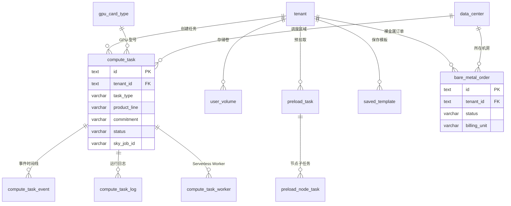
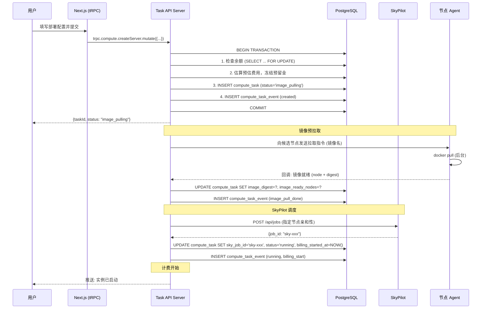
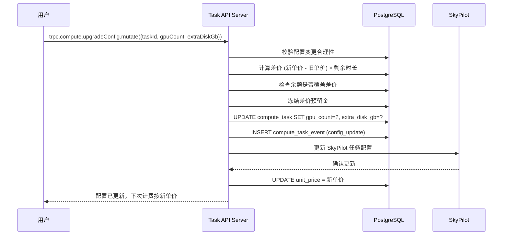
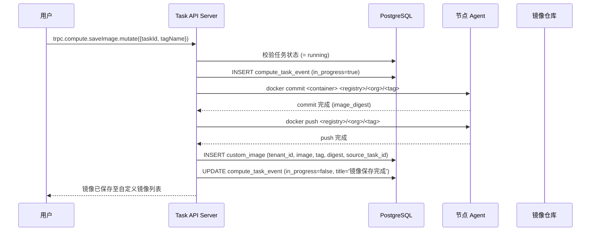
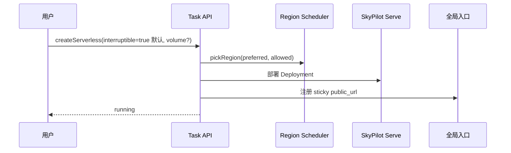
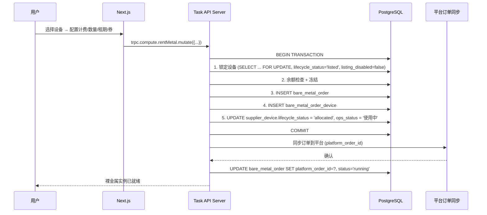
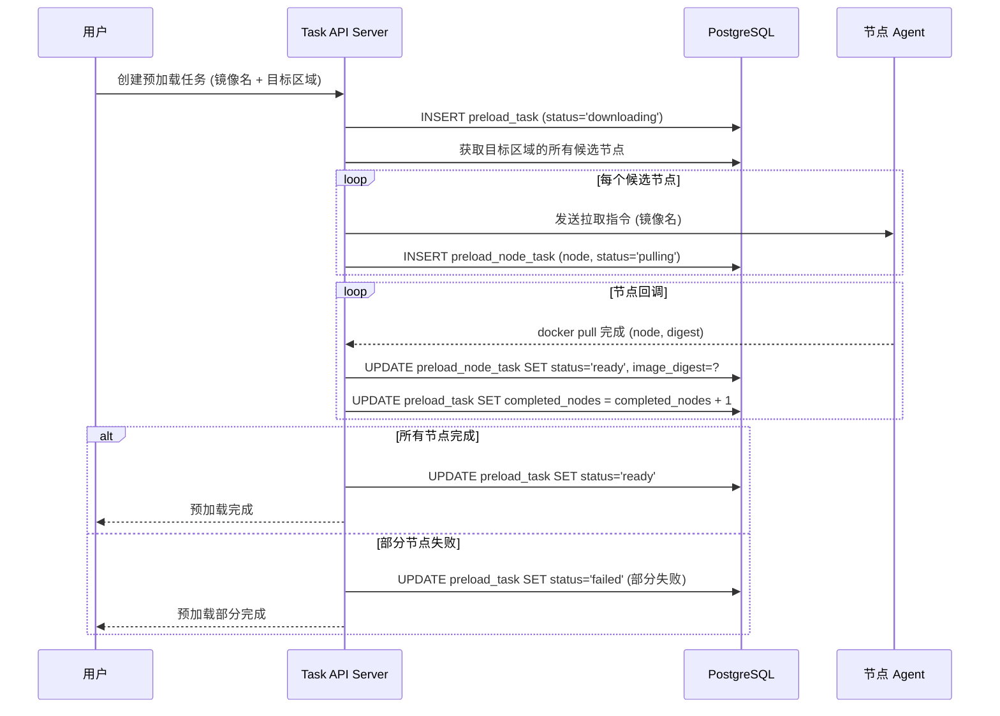

# 容器云实例实现方案

> 基于 `apps/gpus` 前端 UED 的完整功能实现，覆盖以下产品线，面向商业化运行。
> 依赖：认证 (Better Auth)、调度 (SkyPilot)、计量 (OpenMeter)、余额防超额、CRM 三层实体模型。
>
> **语义权威（若与下文冲突，以下为准）**：
> - `../../business/product-line-taxonomy.md` — 产品线 / billing_mode / 券类型
> - `tenant-balance-unification.md` — 余额
> - `spot-preemption-design.md` — Spot 抢占（**替代**本文目录中曾承诺但未成文的 §Spot 专章）
> - `compute-task-decoupling-analysis.md` — 已采纳 `compute_base` + `*_detail`

**产品线定义**：

| 产品线 | K8s 原语 | 定义 | 核心特征 |
|--------|----------|------|---------|
| **Cloud VM** (`cloud_vm`) | Pod + PVC | 开发机 | 持久化存储、SSH、IDE、可频繁开关机 |
| **Serverless** (`serverless`) | Deployment | Web 服务 | 滚动更新、零停机、自动扩缩容 |
| **Inference** (`inference`) | Deployment(s) | LLM 推理 | 模型参数、多副本、API 端点、Token 计费 |
| **Job** (`job`) | Job | 批处理 | 运行到完成；可选 `billing_mode=spot` |
| **Bare Metal** (`bare_metal`) | 物理机 | 裸金属 | 整机租赁、SSH 直连（独立订单模型） |

**版本**: v2.1（2026-07-19）— 对齐 taxonomy；Spot 外置到 `spot-preemption-design.md`

---

## 目录

1. [功能全景与产品线映射](#1-功能全景与产品线映射)
2. [数据库设计](#2-数据库设计)
3. [GPU 云服务器 (Server) 实现](#3-gpu-云服务器-server-实现)（正文标题可能为 Server / Cloud VM）
4. [弹性推理 (Serverless) 实现](#4-弹性推理-serverless-实现)
5. [裸金属 (Metal) 实现](#5-裸金属-metal-实现)
6. [任务管理统一模型](#6-任务管理统一模型)
7. [抢占式实例 Spot](spot-preemption-design.md) ← **外置权威文档**（不在本文展开）
8. [计费与计量集成](#7-计费与计量集成)
9. [余额与算力券集成](#8-余额与算力券集成)
10. [镜像管理实现](#9-镜像管理实现)
11. [日志与监控实现](#10-日志与监控实现)
12. [tRPC 接口设计](#11-trpc-接口设计)
13. [定时任务](#12-定时任务)
14. [商业化运营支撑](#13-商业化运营支撑)
15. [实施路线图](#14-实施路线图)
16. [附录](#附录)

> 正文历史章节编号与上表锚点可能不完全一致；**Spot / 产品线 / 余额** 一律以 INDEX §1.1 三份权威文档为准。

---

## 1. 功能全景与产品线映射

### 1.1 UED 页面 → 实现模块映射

| UED 路由 | 页面功能 | 产品线 | 后端模块 | 核心数据表 |
|----------|---------|--------|---------|-----------|
| `/server/list` | 云服务器市场列表 | Cloud VM | 市场聚合查询 | `supplier_datacenter_sell_price` × `gpu_card_type` × `data_center` |
| `/server/deploy` | 云服务器部署 | Cloud VM | 订单创建 + 调度 | `compute_base` + `cloud_vm_detail` |
| `/server/instances` | 云服务器实例列表 | Cloud VM | 实例生命周期 | `compute_base` + `cloud_vm_detail` |
| `/server/instances/[id]` | 云服务器实例详情 | Cloud VM | 实例管理/日志/配置 | `compute_base` + `cloud_vm_detail` + `compute_event` + `compute_log` |
| `/serverless/deploy` | Serverless 部署 | Serverless | 服务创建 | `compute_base` + `serverless_detail` |
| `/serverless/instances` | 服务列表 | Serverless | 服务生命周期 | `compute_base` + `serverless_detail` |
| `/serverless/instances/[id]` | 服务详情/配置 | Serverless | 服务管理 | `compute_base` + `serverless_detail` |
| `/inference/deploy` | LLM 推理部署 | Serverless Inference | 端点创建 | `compute_base` + `inference_detail` + `inference_deployment` |
| `/inference/instances` | 推理端点列表 | Serverless Inference | 端点生命周期 | `compute_base` + `inference_detail` |
| `/inference/instances/[id]` | 推理端点详情/Workers | Serverless Inference | 端点管理 | `compute_base` + `inference_detail` + `inference_deployment` + `inference_api_key` |
| `/metal/list` | 裸金属市场列表 | Bare Metal | 设备可用性查询 | `supplier_device` × `supplier_gpu_inventory` |
| `/metal/deploy` | 裸金属租赁 | Bare Metal | 订单创建 | `bare_metal_order` |
| `/metal/instances` | 裸金属实例列表 | Bare Metal | 实例生命周期 | `bare_metal_order` |
| `/metal/instances/[id]` | 裸金属实例详情 | Bare Metal | 设备管理 | `bare_metal_order` + `bare_metal_order_device` |
| `/apps` | 应用模板市场 | — | 模板聚合 | `application_template` + `application_template_version` |
| `/tasks` | 批处理任务列表 | Job | 任务生命周期 | `compute_base` + `job_detail` |
| `/billing` | 账单总览 | — | 账单聚合 | `tenant_bill` + `tenant_bill_detail` |
| `/recharge` | 充值 | — | 支付流程 | `payment_order` + `recharge` + `balance_transaction` |
| `/preloaded` | 预加载镜像 | — | 镜像预拉取 | `preload_task` + `preload_node_task` |
| `/storage` | 对象存储 | — | S3 卷管理 | `user_volume` |
| `/templates` | 模板管理 | — | 模板 CRUD | `saved_template` |
| `/settings` | 设置 | — | 用户偏好 | `user_profile` |

### 1.2 前端类型 → 后端表映射

| apps/gpus 前端类型 | 后端表 / 聚合 | 产品线 | 说明 |
|-------------------|-------------|--------|------|
| `Gpu` / `GpuTier` | `gpu_card_type` | — | GPU 卡型字典 |
| `Region` | `data_center` | — | 机房区域 |
| `MarketOffering` | 聚合: `data_center` × `gpu_card_type` × `supplier_datacenter_sell_price` | Cloud VM | 云服务器在售产品 |
| `MetalDevice` / `AggregatedMetalOffering` | 聚合: `supplier_device` × `gpu_card_type` | Bare Metal | 裸金属设备 |
| `Instance` (console-store) | `compute_base` + `job_detail` | Job | Job 类型实例 |
| `ServerInstance` (console-store) | `compute_base` + `cloud_vm_detail` | Cloud VM | 云服务器实例 |
| `ServiceInstance` (console-store) | `compute_base` + `serverless_detail` | Serverless | 弹性服务实例 |
| `InferenceEndpoint` (console-store) | `compute_base` + `inference_detail` | Serverless Inference | 推理端点实例 |
| `MetalInstance` (console-store) | `bare_metal_order` | Bare Metal | 裸金属实例 |
| `ComputeVoucher` | `coupon` (filtered by product_line) | — | 算力券实例 |
| `RechargeTransaction` | `recharge` | — | 充值记录 |
| `BillingCoupon` | `coupon` | — | 算力券 |
| `MonthlyBill` | `tenant_bill` + `tenant_bill_detail` | — | 月度账单 |
| `Task` (tasks-data) | `compute_base` + `job_detail` | Job | 运行任务 |
| `ApplicationTemplate` | `application_template` + `application_template_version` | — | 应用模板 |
| `PreloadTask` | `preload_task` | — | 预加载任务 |
| `Volume` (console-store) | `user_volume` | — | S3 存储卷 |
| `SavedTemplate` | `saved_template` | — | 用户保存的模板 |
| `BillingCreditSummary` | 聚合: `tenant.balance` + `coupon` | — | 账户余额摘要 |
| `BillingVoucher` | `coupon` (type=resource_pack) | — | 资源包 |

---

## 2. 数据库设计

### 2.1 表总览

```
┌──────────────────────────────────────────────────────────────────────┐
│                        计算任务域                                      │
│                                                                       │
│  compute_base              计算任务基础表（所有产品线共享）              │
│  cloud_vm_detail           云主机扩展表（Cloud VM 专属）               │
│  serverless_detail         弹性服务扩展表（Serverless 专属）           │
│  inference_detail          LLM 推理扩展表（Serverless Inference 专属） │
│  inference_deployment      LLM 推理 Deployment 表                     │
│  inference_api_key         推理 API Key 表                            │
│  inference_usage_record    推理用量记录表                              │
│  job_detail                批处理任务扩展表（Job 专属）                 │
│  spot_detail               抢占式实例扩展表（Spot 专属）               │
│  compute_event             任务事件时间线（所有产品线共享）             │
│  compute_log               任务日志（所有产品线共享）                   │
│                                                                       │
│                        裸金属订单域                                     │
│                                                                       │
│  bare_metal_order          裸金属订单（已有，扩展字段）                  │
│  bare_metal_order_device   裸金属订单设备明细                           │
│                                                                       │
│                        存储域                                          │
│                                                                       │
│  user_volume               用户 S3 存储卷                              │
│                                                                       │
│                        镜像预拉取域                                     │
│                                                                       │
│  preload_task              预加载任务                                   │
│  preload_node_task         预加载节点子任务                             │
│  preload_consumption       预加载用量计量                               │
│  preload_quota             用户预加载配额                               │
│                                                                       │
│                        已有依赖表                                      │
│                                                                       │
│  tenant (billing_tenant)   余额/计费主体                               │
│  gpu_card_type             GPU 卡型字典                                │
│  data_center               数据中心                                    │
│  supplier_device           物理设备                                    │
│  supplier_gpu_inventory    GPU 库存                                    │
│  platform_card_price_record  平台销售价                                │
│  supplier_datacenter_sell_price  机房销售价                            │
│  coupon / discount_template   算力券                                   │
│  balance_transaction       余额流水                                    │
└──────────────────────────────────────────────────────────────────────┘
```

### 2.2 compute_base — 计算任务基础表（核心表）

> 统一承载所有产品线的基础信息（身份、状态、计费），产品线专属字段存储在对应的扩展表中。

```sql
CREATE TABLE compute_base (
    -- 身份
    id                  TEXT PRIMARY KEY DEFAULT gen_random_uuid()::text,
    tenant_id           TEXT NOT NULL REFERENCES tenant(id),
    project_id          TEXT,

    -- 产品分类（权威：../../business/product-line-taxonomy.md）
    product_line        VARCHAR(32) NOT NULL,  -- cloud_vm|serverless|inference|job|bare_metal
    billing_mode        VARCHAR(16) NOT NULL DEFAULT 'on_demand',  -- on_demand|spot（spot 仅 job）
    commitment          VARCHAR(16) NOT NULL DEFAULT 'on-demand',
        -- on-demand=按秒计费 | hour=按小时预付 | daily|weekly|monthly
        -- spot ⇒ commitment 必须 on-demand

    -- 基础信息
    name                VARCHAR(255) NOT NULL,
    description         TEXT,

    -- 资源规格（共享部分）
    gpu_card_type_id    TEXT REFERENCES gpu_card_type(id),
    gpu_count           INT NOT NULL DEFAULT 1,
    vcpu_count          INT,
    memory_gb           INT,

    -- 镜像配置（共享部分）
    image_id            VARCHAR(255),
    image_version       VARCHAR(128),
    image_category      VARCHAR(16),
    registry_source     VARCHAR(16) DEFAULT 'platform',
    registry_host       VARCHAR(255),
    registry_credential_id TEXT,
    image_digest        VARCHAR(255),

    -- 部署配置（共享部分）
    env_vars            JSONB,
    start_command       TEXT,
    working_dir         VARCHAR(512),
    ports               INT[],

    -- 调度信息
    idc_name            VARCHAR(128),
    data_center_id      TEXT REFERENCES data_center(id),
    node_name           VARCHAR(256),
    cluster_name        VARCHAR(256),

    -- 计费
    unit_price          NUMERIC(15,4),
    currency            VARCHAR(8) DEFAULT 'CNY',
    voucher_id          TEXT,
    voucher_amount      NUMERIC(15,4) DEFAULT 0,

    -- 状态
    status              VARCHAR(32) NOT NULL DEFAULT 'draft',

    -- 时间线
    created_at          TIMESTAMPTZ DEFAULT NOW(),
    updated_at          TIMESTAMPTZ DEFAULT NOW(),
    scheduled_at        TIMESTAMPTZ,
    billing_started_at  TIMESTAMPTZ,
    started_at          TIMESTAMPTZ,
    stopped_at          TIMESTAMPTZ,
    expired_at          TIMESTAMPTZ,

    -- 审计
    created_by          TEXT,
    last_action_by      TEXT
);
```
    voucher_amount      NUMERIC(15,4) DEFAULT 0,              -- 券抵扣金额

    -- 状态
    status              VARCHAR(32) NOT NULL DEFAULT 'draft',
        -- draft:          草稿（未提交）
        -- image_pulling:  镜像拉取中
        -- pending:        等待调度
        -- provisioning:   资源分配中
        -- running:        运行中
        -- stopping:       停止中
        -- stopped:        已停止
        -- error:          异常
        -- failed:         失败
        -- succeeded:      成功（Job 完成）
        -- cancelled:      已取消
        -- expired:        已过期
        -- overdue:        欠费停机

    -- 时间线
    created_at          TIMESTAMPTZ NOT NULL DEFAULT NOW(),
    updated_at          TIMESTAMPTZ NOT NULL DEFAULT NOW(),
    scheduled_at        TIMESTAMPTZ,                         -- 调度时间
    billing_started_at  TIMESTAMPTZ,                         -- 计费开始时间
    started_at          TIMESTAMPTZ,                         -- 实际启动时间
    finished_at         TIMESTAMPTZ,                         -- 结束时间
    stopped_at          TIMESTAMPTZ,                         -- 停止时间
    expired_at          TIMESTAMPTZ,                         -- 过期时间（包时到期）

    -- 自动续费
    auto_renew          BOOLEAN DEFAULT false,
    renew_cycle         VARCHAR(16),                          -- day / week / month

    -- 审计
    created_by          TEXT,                                 -- 创建人
    last_action_by      TEXT                                  -- 最后操作人
);

-- 索引
CREATE INDEX idx_ct_tenant ON compute_task(tenant_id);
CREATE INDEX idx_ct_tenant_status ON compute_task(tenant_id, status);
CREATE INDEX idx_ct_tenant_product ON compute_task(tenant_id, product_line);
CREATE INDEX idx_ct_status ON compute_task(status);
CREATE INDEX idx_ct_sky_job ON compute_task(sky_job_id) WHERE sky_job_id IS NOT NULL;
CREATE INDEX idx_ct_sky_serve ON compute_task(sky_serve_id) WHERE sky_serve_id IS NOT NULL;
CREATE INDEX idx_ct_billing ON compute_task(tenant_id, billing_started_at DESC) WHERE billing_started_at IS NOT NULL;
CREATE INDEX idx_ct_expired ON compute_task(status, expired_at) WHERE status IN ('running', 'stopped');
```

**状态机**：

```
                    ┌──────────┐
                    │  draft   │
                    └────┬─────┘
                         │ 提交
                         ▼
                ┌────────────────┐
                │ image_pulling  │ ← 镜像预拉取
                └────────┬───────┘
                         │ 镜像就绪
                         ▼
                   ┌──────────┐
                   │ pending  │ ← 等待调度
                   └────┬─────┘
                        │ SkyPilot 调度
                        ▼
                  ┌──────────────┐
                  │ provisioning │ ← 资源分配
                  └──────┬───────┘
                         │ 容器启动
                         ▼
                   ┌──────────┐
         ┌────────│ running  │────────┐
         │        └──────────┘        │
    用户停止                        余额不足/到期
         │                              │
         ▼                              ▼
    ┌──────────┐                  ┌──────────┐
    │ stopping │                  │ overdue  │
    └────┬─────┘                  └──────────┘
         │
         ▼
    ┌──────────┐        ┌──────────┐
    │ stopped  │◄──恢复──│          │
    └──────────┘        └──────────┘
         │
    Job 完成
         │
         ▼
    ┌──────────┐   ┌──────────┐
    │ succeeded│   │ failed   │
    └──────────┘   └──────────┘
```

### 2.3 compute_task_event — 任务事件时间线

```sql
CREATE TABLE compute_task_event (
    id                  TEXT PRIMARY KEY,
    task_id             TEXT NOT NULL REFERENCES compute_task(id),
    event_type          VARCHAR(32) NOT NULL,
        -- created:          任务创建
        -- image_pull_start: 镜像拉取开始
        -- image_pull_done:  镜像拉取完成
        -- scheduled:        调度完成
        -- gpu_allocate:     GPU 分配
        -- container_start:  容器启动
        -- health_check:     健康检查通过
        -- port_mapping:     端口映射
        -- config_update:    配置变更
        -- billing_start:    计费开始
        -- billing_tick:     计费扣款
        -- stopped:          任务停止
        -- auto_stop:        自动停止（余额不足）
        -- expired:          到期停止
        -- error:            异常
        -- restarted:        重启
    category            VARCHAR(16) NOT NULL,                 -- deploy / runtime / billing / system
    title               VARCHAR(255) NOT NULL,
    description         TEXT,
    metadata            JSONB,                                -- 事件附加数据
    is_in_progress      BOOLEAN DEFAULT false,                -- 是否进行中
    operator_type       VARCHAR(16),                          -- system / user / staff
    operator_id         TEXT,                                 -- 操作人 ID
    before_status       VARCHAR(32),                          -- 变更前状态
    after_status        VARCHAR(32),                          -- 变更后状态
    created_at          TIMESTAMPTZ NOT NULL DEFAULT NOW()
);

CREATE INDEX idx_cte_task ON compute_task_event(task_id, created_at DESC);
CREATE INDEX idx_cte_task_type ON compute_task_event(task_id, event_type);
```

### 2.4 compute_task_log — 任务日志

```sql
CREATE TABLE compute_task_log (
    id                  BIGSERIAL PRIMARY KEY,
    task_id             TEXT NOT NULL REFERENCES compute_task(id),
    source              VARCHAR(16) NOT NULL,                 -- stdout / stderr / system
    content             TEXT NOT NULL,                         -- 日志内容（单行）
    timestamp           TIMESTAMPTZ NOT NULL,                 -- 日志时间戳
    sequence_no         BIGINT NOT NULL,                      -- 序号（用于分页拉取）
    created_at          TIMESTAMPTZ NOT NULL DEFAULT NOW()
);

-- 分区表（按月分区，保留 90 天）
-- ALTER TABLE compute_task_log PARTITION BY RANGE (created_at);

CREATE INDEX idx_ctl_task_time ON compute_task_log(task_id, timestamp DESC);
CREATE INDEX idx_ctl_task_seq ON compute_task_log(task_id, sequence_no);
```

> **商业化说明**：日志量大，建议：
> - 热数据保留 7 天（完整日志）
> - 温数据保留 30 天（仅 ERROR 日志）
> - 冷数据归档到对象存储

### 2.5 compute_task_worker — Serverless Worker Pod

```sql
CREATE TABLE compute_task_worker (
    id                  TEXT PRIMARY KEY,
    task_id             TEXT NOT NULL REFERENCES compute_task(id),
    pod_name            VARCHAR(255) NOT NULL,                -- K8s Pod 名称
    node_name           VARCHAR(256),                         -- 调度节点
    status              VARCHAR(16) NOT NULL,                 -- pending / running / terminated
    ip_address          VARCHAR(45),                          -- Pod IP
    gpu_allocated       INT DEFAULT 0,                        -- 分配的 GPU 数
    cpu_allocated       INT,                                  -- 分配的 CPU
    memory_allocated    INT,                                  -- 分配的内存 (MB)
    started_at          TIMESTAMPTZ,
    terminated_at       TIMESTAMPTZ,
    termination_reason  TEXT,
    restart_count       INT DEFAULT 0,
    created_at          TIMESTAMPTZ NOT NULL DEFAULT NOW()
);

CREATE INDEX idx_ctw_task ON compute_task_worker(task_id);
CREATE INDEX idx_ctw_status ON compute_task_worker(task_id, status);
```

### 2.6 saved_template — 用户保存的部署模板

```sql
CREATE TABLE saved_template (
    id                  TEXT PRIMARY KEY,
    tenant_id           TEXT NOT NULL REFERENCES tenant(id),
    name                VARCHAR(255) NOT NULL,
    image               VARCHAR(512) NOT NULL,                -- Docker 镜像
    registry_source     VARCHAR(16) DEFAULT 'platform',
    registry_host       VARCHAR(255),
    registry_username   VARCHAR(255),
    env_vars            JSONB,
    start_command       TEXT,
    ports               INT[],
    gpu_card_type       VARCHAR(64),                          -- 推荐 GPU
    gpu_count           INT,
    created_at          TIMESTAMPTZ NOT NULL DEFAULT NOW(),
    updated_at          TIMESTAMPTZ NOT NULL DEFAULT NOW()
);

CREATE INDEX idx_st_tenant ON saved_template(tenant_id);
```

### 2.7 user_volume — 用户 S3 存储卷

> **完整权威定义**（配额、附件表、三产品线挂载、计费）：[`storage-quota-and-s3-volume.md`](storage-quota-and-s3-volume.md)

```sql
CREATE TABLE user_volume (
    id                  TEXT PRIMARY KEY,
    tenant_id           TEXT NOT NULL REFERENCES tenant(id),
    name                VARCHAR(255) NOT NULL,
    region_id           TEXT,
    size_gb             INT NOT NULL,                         -- 配额上限
    used_gb             NUMERIC(12,4) DEFAULT 0,
    free_quota_gb       INT NOT NULL DEFAULT 20,
    endpoint            VARCHAR(512) NOT NULL,
    bucket              VARCHAR(255) NOT NULL,
    prefix              VARCHAR(512) DEFAULT '',
    access_key_enc      TEXT,
    secret_key_enc      TEXT,
    status              VARCHAR(16) NOT NULL DEFAULT 'creating',
    mount_path_default  VARCHAR(255) DEFAULT '/data',
    created_at          TIMESTAMPTZ NOT NULL DEFAULT NOW(),
    updated_at          TIMESTAMPTZ NOT NULL DEFAULT NOW()
);

CREATE INDEX idx_uv_tenant ON user_volume(tenant_id);
-- user_volume_attachment、storage_quota_policy 见 storage-quota-and-s3-volume.md
```

### 2.8 preload_task — 预加载任务

```sql
CREATE TABLE preload_task (
    id                  TEXT PRIMARY KEY,
    tenant_id           TEXT NOT NULL REFERENCES tenant(id),
    image_name          VARCHAR(512) NOT NULL,                -- 镜像名 (含 tag)
    image_ref           VARCHAR(1024) NOT NULL,               -- 完整镜像引用
    note                TEXT,
    region_id           VARCHAR(64) NOT NULL,                 -- 目标区域
    status              VARCHAR(16) NOT NULL DEFAULT 'downloading',
        -- downloading / ready / failed
    size_gb             NUMERIC(9,2),                         -- 镜像大小
    progress            NUMERIC(5,2) DEFAULT 0,               -- 进度百分比
    total_nodes         INT DEFAULT 0,                        -- 目标节点数
    completed_nodes     INT DEFAULT 0,                        -- 已完成节点数
    created_at          TIMESTAMPTZ NOT NULL DEFAULT NOW(),
    updated_at          TIMESTAMPTZ NOT NULL DEFAULT NOW()
);

CREATE INDEX idx_pt_tenant ON preload_task(tenant_id);
CREATE INDEX idx_pt_region ON preload_task(region_id, status);
```

### 2.9 preload_node_task — 预加载节点子任务

```sql
CREATE TABLE preload_node_task (
    id                  TEXT PRIMARY KEY,
    preload_task_id     TEXT NOT NULL REFERENCES preload_task(id),
    node_name           VARCHAR(256) NOT NULL,
    node_ip             VARCHAR(45),
    status              VARCHAR(16) NOT NULL DEFAULT 'pending',
        -- pending / pulling / ready / failed
    progress            NUMERIC(5,2) DEFAULT 0,
    image_digest        VARCHAR(256),                         -- 拉取后的摘要
    error_message       TEXT,
    started_at          TIMESTAMPTZ,
    completed_at        TIMESTAMPTZ,
    created_at          TIMESTAMPTZ NOT NULL DEFAULT NOW()
);

CREATE INDEX idx_pnt_preload ON preload_node_task(preload_task_id);
CREATE INDEX idx_pnt_node ON preload_node_task(node_name, status);
```

### 2.10 ER 关系图



### 2.11 bare_metal_order 扩展字段

> 已有表在 `database-design.md` 中定义，此处列出需新增的字段：

```sql
ALTER TABLE bare_metal_order ADD COLUMN IF NOT EXISTS
    -- 用户侧
    ssh_enabled         BOOLEAN DEFAULT false,
    ssh_public_key      TEXT,
    auto_renew          BOOLEAN DEFAULT false,
    renew_cycle         VARCHAR(16),
    unit_price_snapshot NUMERIC(15,4),  -- 下单时的单价快照
    available_until     TIMESTAMPTZ,    -- 可用截止时间
    available_hours     NUMERIC(9,2),   -- 剩余可用小时数

    -- 设备信息快照
    gpu_model_name      VARCHAR(128),
    gpu_count_snapshot  INT,
    network_mode        VARCHAR(32),     -- standalone / nvlink / infiniband / roce
    driver_version      VARCHAR(64);
```

---

## 3. GPU 云服务器 (Server) 实现

### 3.1 市场列表聚合查询

```sql
-- /server/list 聚合查询：获取可售云服务器列表
SELECT
    dc.id AS data_center_id,
    dc.name AS region_name,
    dc.region_tags,
    gct.id AS gpu_card_type_id,
    gct.code AS gpu_model_key,
    gct.name AS gpu_model_name,
    gct.memory_gb AS vram,
    gct.compute_capability AS max_cuda,
    sdi.quantity - sdi.online_quantity AS in_stock,
    -- 价格 (优先机房销售价，其次平台价)
    COALESCE(sdcsp.sell_price, pcppr.sell_price) AS hourly_price,
    -- 包日/周/月价格 (平台策略: daily=hourly*20, weekly=hourly*120, monthly=hourly*500)
    COALESCE(sdcsp.sell_price, pcppr.sell_price) * 20 AS daily_price,
    COALESCE(sdcsp.sell_price, pcppr.sell_price) * 120 AS weekly_price,
    COALESCE(sdcsp.sell_price, pcppr.sell_price) * 500 AS monthly_price,
    -- 设备规格
    sdct_spec.device_spec AS spec_text
FROM data_center dc
JOIN supplier_gpu_inventory sdi ON sdi.data_center_id = dc.id
JOIN gpu_card_type gct ON gct.id = sdi.gpu_card_type_id
LEFT JOIN supplier_datacenter_sell_price sdcsp
    ON sdcsp.data_center_id = dc.id
    AND sdcsp.gpu_card_type_id = gct.id
    AND sdcsp.product_line = 'cloud_vm'
    AND sdcsp.status = 'active'
    AND sdcsp.effective_to IS NULL
LEFT JOIN platform_card_price_record pcppr
    ON pcppr.gpu_card_type_id = gct.id
    AND pcppr.product_line = 'cloud_vm'
    AND pcppr.status = 'active'
    AND pcppr.effective_to IS NULL
LEFT JOIN supplier_datacenter_card_type_spec sdct_spec
    ON sdct_spec.data_center_id = dc.id
    AND sdct_spec.gpu_card_type_id = gct.id
WHERE dc.cooperation_status = 'active'
  AND gct.status = 'active'
  AND gct.device_role = 'compute'
  AND sdi.is_internal_test = false
  AND (sdi.quantity - sdi.online_quantity) > 0
ORDER BY dc.name, gct.name;
```

### 3.2 部署流程



### 3.3 实例生命周期操作

| 操作 | 触发 | 后端动作 | 状态变更 |
|------|------|---------|---------|
| **启动** | 用户点击「启动」 | SkyPilot 调度 → 容器启动 | stopped → running |
| **停止** | 用户点击「关机」 | SkyPilot 取消 → 最终结算 | running → stopped |
| **强制停止** | 用户点击「强制关机」 | 直接终止 → 不等待优雅关闭 | running → stopped |
| **重启** | 用户点击「重启」 | SkyPilot 重启容器 | running → running |
| **删除** | 用户点击「删除」 | SkyPilot 取消 → 释放资源 → 删除记录 | any → (deleted) |
| **配置升级** | 用户升级 GPU/磁盘 | SkyPilot 更新配置 → 重建容器 | running → provisioning → running |
| **保存镜像** | 用户保存为自定义镜像 | docker commit → 推送到 registry | running → running |
| **自动停机** | 余额不足 | 定时任务检测 → SkyPilot 取消 | running → overdue → stopped |
| **到期停机** | 包时到期 | 定时任务检测 → SkyPilot 取消 | running → expired → stopped |

### 3.4 配置升级流程



### 3.5 保存镜像流程



---

## 4. 弹性服务 (Serverless) 实现

> **权威实现文档**：[`serverless-implementation.md`](serverless-implementation.md)  
> （含可中断跨区默认开启、商业化计费/SLA/合规定稿、与 Spot 正交。）  
> **存储**：[`storage-quota-and-s3-volume.md`](storage-quota-and-s3-volume.md)  
> **LLM 推理**（`inference`）：[`serverless-inference.md`](serverless-inference.md)

### 4.1 部署流程（摘要）



下单必选：**是否允许中断**（默认允许）；容量紧张或区域异常时可调度到其他授权区域。详情与状态机见权威文档 §2 / §5。

### 4.2 Serverless 专属操作

| 操作 | API | 说明 |
|------|-----|------|
| 扩缩容 | `scaleEndpoint` | min/max workers |
| 配置更新 | `updateEndpointConfig` | 滚动更新 |
| Workers / 日志 | `listWorkers` / `getWorkerLogs` | Pod 级 |
| 数据盘扩容 | `expandDataDisk` | 见存储文档 |
| S3 卷挂载 | `attachVolume` | 见存储文档 |

### 4.3 与本地实现说明

原 SkyServe `scaleEndpoint` 伪代码仍适用；区域字段、迁移审计表、通知 payload 以 `serverless-implementation.md` 为准。`compute_task` 已收敛为 `compute_base` + `serverless_detail`。

---

## 5. 裸金属 (Metal) 实现

### 5.1 市场列表聚合查询

```sql
-- /metal/list 聚合查询
SELECT
    sd.id AS device_id,
    gct.code AS gpu_model_key,
    gct.name AS gpu_model_name,
    gct.memory_gb AS vram,
    gct.compute_capability AS max_cuda,
    sd.driver_version,
    dc.name AS region_name,
    sd.idc_region,
    sd.network_mode,       -- 从设备规格解析
    sd.gpu_count,
    sd.vcpu_count,         -- 从 device_spec 解析
    sd.memory_total_gb,
    sd.external_ip,
    sd.ops_status,
    sd.lifecycle_status,
    -- 价格查询 (裸金属使用 platform_card_price_record)
    pcppr.sell_price AS hourly_price,
    pcppr.sell_price * 20 AS daily_price,
    pcppr.sell_price * 120 AS weekly_price,
    pcppr.sell_price * 500 AS monthly_price,
    -- 可用性
    CASE WHEN sd.lifecycle_status = 'listed' AND sd.listing_disabled = false THEN 1 ELSE 0 END AS in_stock,
    sd.available_until,
    sd.available_hours
FROM supplier_device sd
JOIN gpu_card_type gct ON gct.id = sd.gpu_card_type_id
JOIN data_center dc ON dc.id = sd.data_center_id
LEFT JOIN platform_card_price_record pcppr
    ON pcppr.gpu_card_type_id = gct.id
    AND pcppr.product_line = 'bare_metal'
    AND pcppr.status = 'active'
    AND pcppr.effective_to IS NULL
WHERE sd.lifecycle_status = 'listed'
  AND sd.listing_disabled = false
  AND sd.in_maintenance = false
  AND gct.device_role = 'compute'
  AND dc.cooperation_status = 'active'
ORDER BY gct.name, dc.name;
```

### 5.2 裸金属租赁流程



### 5.3 裸金属租期管理

```typescript
// 裸金属时间计算
const METAL_BILLING_HOURS_PER_UNIT: Record<string, number> = {
  hourly: 1,
  daily: 24,
  weekly: 168,    // 7 × 24
  monthly: 720,   // 30 × 24
};

function calculateRentalEnd(billingUnit: string, quantity: number): Date {
  const hoursPerUnit = METAL_BILLING_HOURS_PER_UNIT[billingUnit];
  const totalHours = hoursPerUnit * quantity;
  return addHours(new Date(), totalHours);
}
```

### 5.4 裸金属自动续费

```typescript
// 定时扫描即将到期的裸金属订单
async function scanMetalRenewal() {
  const expiringOrders = await db.select().from(bareMetalOrder)
    .where(and(
      eq(bareMetalOrder.status, 'running'),
      eq(bareMetalOrder.autoRenew, true),
      lte(bareMetalOrder.availableUntil, addHours(new Date(), 24)), // 24小时内到期
    ));

  for (const order of expiringOrders) {
    try {
      // 1. 检查余额
      const tenant = await db.select().from(tenant)
        .where(eq(tenant.id, order.tenantId))
        .for('update');

      const renewCost = order.unitPriceSnapshot * METAL_BILLING_HOURS_PER_UNIT[order.billingUnit];
      if (tenant.balance < renewCost) {
        // 余额不足 → 停止续费，发送通知
        await notifyInsufficientBalance(order.tenantId, order.id);
        continue;
      }

      // 2. 扣款
      await db.transaction(async (tx) => {
        await tx.update(tenant)
          .set({ balance: sql`${tenant.balance} - ${renewCost}` })
          .where(eq(tenant.id, order.tenantId));

        await tx.insert(balanceTransaction).values({
          tenantId: order.tenantId,
          type: 'auto_deduction',
          amount: -renewCost,
          refType: 'bare_metal_order',
          refId: order.id,
          description: `裸金属自动续费 - ${order.billingUnit}`,
        });

        await tx.update(bareMetalOrder)
          .set({
            availableUntil: addHours(order.availableUntil, METAL_BILLING_HOURS_PER_UNIT[order.billingUnit]),
            availableHours: sql`${order.availableHours} + ${METAL_BILLING_HOURS_PER_UNIT[order.billingUnit]}`,
          })
          .where(eq(bareMetalOrder.id, order.id));
      });
    } catch (err) {
      logger.error('Metal renewal failed', { orderId: order.id, error: err });
    }
  }
}
```

---

## 6. 任务管理统一模型

### 6.1 前端 Task 类型 → 后端映射

| 前端 `Task.type` | 后端 `compute_task` 条件 | 说明 |
|------------------|------------------------|------|
| `Deployment` | `task_type='serve' AND serve_mode='deployment'` | 固定副本推理 |
| `Job` | `task_type='job'` | 批处理任务 |
| `Development` | `task_type='job' AND template_name LIKE '%dev%'` | 开发环境 |

### 6.2 前端 Task 状态 → 后端映射

| 前端 `TaskStatusId` | 后端 `compute_task.status` |
|---------------------|---------------------------|
| `Pending` | `image_pulling` / `pending` / `provisioning` |
| `Running` | `running` |
| `Succeeded` | `succeeded` |
| `Failed` | `failed` / `error` |
| `Cancelled` | `cancelled` / `stopped` |

### 6.3 任务列表聚合查询

```sql
-- /tasks 列表查询
SELECT
    ct.id,
    ct.name AS title,
    ct.task_type,
    ct.product_line,
    ct.status,
    ct.tenant_id AS instance_id,  -- 前端映射为 instanceId
    ct.created_at,
    ct.finished_at AS completed_at
FROM compute_task ct
WHERE ct.tenant_id = :tenant_id
  AND ct.status NOT IN ('draft')
  -- 过滤条件
  AND (:type::text IS NULL OR ct.task_type = :type)
  AND (:status::text IS NULL OR ct.status = :status)
  AND (:start_date::timestamptz IS NULL OR ct.created_at >= :start_date)
  AND (:end_date::timestamptz IS NULL OR ct.created_at <= :end_date)
ORDER BY ct.created_at DESC
LIMIT :page_size OFFSET :offset;
```

---

## 7. 计费与计量集成

### 7.1 计费模式对照

| 前端计费选项 | `commitment` 字段 | 扣款方式 | 说明 |
|-------------|-------------------|---------|------|
| 按量 (按秒) | `on-demand` | 5min 按**实际秒数**扣 reserved | 非预付；Spot 仅允许此值 |
| 包时 | `hour` | 创建时预付 1 小时价 | 见 taxonomy |
| 包日 | `daily` | 创建时预付 | |
| 包周 | `weekly` | 创建时预付 | |
| 包月 | `monthly` | 创建时预付 | |

### 7.2 包时计费流程

```typescript
async function handleCommitmentPayment(task: ComputeTask) {
  // on-demand = 按秒计费，走 freeze/consume_reserved，不在此预付
  if (task.commitment === 'on-demand') return;

  const prepaidUnits: Record<string, number> = {
    hour: 1,
    daily: 24,
    weekly: 168,
    monthly: 720,
  };
  const hours = prepaidUnits[task.commitment];
  if (!hours) throw new Error(`unsupported commitment: ${task.commitment}`);

  // 小时单价 × 小时数；使用 tenant_balance.deduct_available（见 tenant-balance-unification）
  const totalCost = Number(task.unitPrice) * hours;

  await db.transaction(async (tx) => {
    await deductAvailable(tx, task.tenantId, totalCost, {
      refType: 'compute_base',
      refId: task.id,
      description: `预付 ${task.commitment} - ${task.name}`,
    });
    await tx.update(computeBase)
      .set({ expiredAt: addHours(new Date(), hours) })
      .where(eq(computeBase.id, task.id));
  });
}
```

### 7.3 按量计费流程（5分钟定时扣款）

```typescript
async function billingTick() {
  // 1. 获取所有 running 状态且 billing_started_at 不为空的任务
  const runningTasks = await db.select().from(computeTask)
    .where(and(
      eq(computeTask.status, 'running'),
      isNotNull(computeTask.billingStartedAt),
      eq(computeTask.commitment, 'on-demand'),
    ));

  for (const task of runningTasks) {
    try {
      // 2. 从 OpenMeter 查询增量用量
      const usage = await openMeter.queryUsage({
        subject: `compute-task-${task.id}`,
        from: lastBillingTime,
        to: now(),
      });

      // 3. 计算费用
      const gpuCost = usage.gpuSeconds * Number(task.unitPrice) / 3600;
      const diskCost = (Number(task.extraDiskGb) + Number(task.dataDiskGb) - Number(task.systemDiskGb))
        * DISK_OVERAGE_RATE * usage.seconds / 3600;
      const totalCost = gpuCost + diskCost;

      // 4. 券抵扣
      let couponDeduction = 0;
      if (task.voucherId) {
        couponDeduction = await applyCoupon(task.tenantId, task.voucherId, totalCost);
      }
      const actualCost = totalCost - couponDeduction;

      // 5. 扣减余额
      const [tenant] = await db.select().from(tenant)
        .where(eq(tenant.id, task.tenantId)).for('update');

      if (tenant.balance < actualCost) {
        // 余额不足 → 停机
        await stopTask(task, 'overdue');
        await notifyInsufficientBalance(task.tenantId, task.id);
        continue;
      }

      await db.transaction(async (tx) => {
        await tx.update(tenant)
          .set({ balance: sql`${tenant.balance} - ${actualCost}` })
          .where(eq(tenant.id, task.tenantId));

        await tx.insert(balanceTransaction).values({
          tenantId: task.tenantId,
          type: 'auto_deduction',
          amount: -actualCost,
          balanceBefore: tenant.balance,
          balanceAfter: tenant.balance - actualCost,
          refType: 'compute_task',
          refId: task.id,
          scene: 'billing_deduction',
          description: `按量计费 - ${task.name}`,
        });
      });

      // 6. 记录事件
      await db.insert(computeTaskEvent).values({
        taskId: task.id,
        eventType: 'billing_tick',
        category: 'billing',
        title: `计费 ¥${actualCost.toFixed(4)}`,
        metadata: { gpuCost, diskCost, couponDeduction, actualCost, usage },
      });
    } catch (err) {
      logger.error('Billing tick failed', { taskId: task.id, error: err });
    }
  }
}
```

### 7.4 余额不足三层停机

| 层级 | 时机 | 动作 |
|------|------|------|
| **L1 提交时** | 任务创建 | 冻结预估 5 分钟费用，余额不足则拒绝 |
| **L2 定时扣款** | 每 5 分钟 | 扣减实际费用，余额 ≤ 0 则停机 |
| **L3 到期检查** | 每分钟 | 包时到期则停止，释放资源 |

---

## 8. 余额与算力券集成

### 8.1 余额查询

```typescript
async function getBalanceSummary(tenantId: string) {
  const [tenant] = await db.select().from(tenant)
    .where(eq(tenant.id, tenantId));

  // 查询冻结金额（running 任务的预估费用）
  const runningTasks = await db.select().from(computeTask)
    .where(and(
      eq(computeTask.tenantId, tenantId),
      eq(computeTask.status, 'running'),
    ));

  let reservedAmount = 0;
  for (const task of runningTasks) {
    reservedAmount += Number(task.unitPrice) * (task.commitment === 'on-demand' ? 0.0833 : 0); // 预估 5 分钟
  }

  // 查询可用算力券
  const coupons = await db.select().from(coupon)
    .where(and(
      eq(coupon.tenantId, tenantId),
      eq(coupon.status, 'available'),
      gt(coupon.expiredAt, new Date()),
    ));

  return {
    availableCredit: tenant.balance,
    accountBalance: tenant.balance - reservedAmount,
    reservedBalance: reservedAmount,
    vouchers: coupons.map(c => ({
      id: c.id,
      name: c.name,
      balance: c.surplusAmount,
      expiresAt: c.expiredAt,
    })),
    couponCount: coupons.length,
  };
}
```

### 8.2 算力券抵扣流程

```typescript
async function applyCoupon(tenantId: string, couponId: string, totalCost: number): Promise<number> {
  const [coupon] = await db.select().from(coupon)
    .where(and(
      eq(coupon.id, couponId),
      eq(coupon.tenantId, tenantId),
      eq(coupon.status, 'available'),
      gt(coupon.expiredAt, new Date()),
    ));

  if (!coupon) return 0;

  const deduction = Math.min(totalCost, Number(coupon.surplusAmount));

  await db.transaction(async (tx) => {
    // 扣减券余额
    await tx.update(coupon)
      .set({
        surplusAmount: sql`${coupon.surplusAmount} - ${deduction}`,
        status: deduction >= Number(coupon.surplusAmount) ? 'used' : 'available',
        usedAt: deduction >= Number(coupon.surplusAmount) ? new Date() : null,
      })
      .where(eq(coupon.id, couponId));

    // 记录使用明细
    await tx.insert(couponUsage).values({
      couponId,
      originalCost: totalCost,
      couponDeduction: deduction,
      actualPayment: totalCost - deduction,
    });
  });

  return deduction;
}
```

---

## 9. 镜像管理实现

### 9.1 镜像分类

| 分类 | 前端 `ImageCategory` | 来源 | 说明 |
|------|---------------------|------|------|
| 基础镜像 | `base` | `base_image` 表 | 官方维护，可选预拉取 |
| 社区镜像 | `community` | `community_image` 表 | 社区贡献，需审核 |
| 自定义镜像 | `custom` | `custom_image` 表 | 用户保存的实例快照 |

### 9.2 镜像选择查询

```sql
-- 获取用户可用的基础镜像
SELECT
    bi.id,
    bi.name,
    bi.description,
    bi.category,
    biv.version,
    biv.image_ref,
    biv.size_gb,
    biv.is_preloaded  -- 是否已预拉取到目标区域
FROM base_image bi
JOIN base_image_version biv ON biv.base_image_id = bi.id
WHERE bi.status = 'active'
  AND biv.is_latest = true
ORDER BY bi.sort_order, bi.name;

-- 获取用户可用的自定义镜像
SELECT
    ci.id,
    ci.name,
    ci.image_ref,
    ci.digest,
    ci.size_gb,
    ci.source_task_id
FROM custom_image ci
WHERE ci.tenant_id = :tenant_id
  AND ci.status = 'active'
ORDER BY ci.created_at DESC;
```

### 9.3 预加载流程



---

## 10. 日志与监控实现

### 10.1 实例日志查询

```typescript
// 实时日志拉取 (SSE / WebSocket)
async function getTaskLogs(taskId: string, options: {
  source?: 'stdout' | 'stderr' | 'system';
  since?: number;     // 序号，增量拉取
  limit?: number;
}) {
  const query = db.select().from(computeTaskLog)
    .where(and(
      eq(computeTaskLog.taskId, taskId),
      options.source ? eq(computeTaskLog.source, options.source) : undefined,
      options.since ? gt(computeTaskLog.sequenceNo, options.since) : undefined,
    ))
    .orderBy(computeTaskLog.timestamp)
    .limit(options.limit || 100);

  return query;
}
```

### 10.2 日志收集架构

```
容器 stdout/stderr
    │
    ▼
Loki (Grafana Loki)
    │
    ├── REST API 查询
    │   GET /loki/api/v1/query_range?query={job="compute-task-xxx"}
    │
    └── compute_task_log 表（定期同步/按需拉取）
        │
        ▼
    tRPC 接口 → 前端 SSE 推送
```

### 10.3 事件时间线查询

```sql
-- 获取实例事件时间线
SELECT
    id,
    event_type,
    category,
    title,
    description,
    metadata,
    is_in_progress,
    created_at
FROM compute_task_event
WHERE task_id = :task_id
ORDER BY created_at DESC
LIMIT :limit OFFSET :offset;
```

### 10.4 GPU 监控集成

```typescript
// 通过 Prometheus 查询 GPU 指标
async function getGpuMetrics(taskId: string, timeRange: { from: Date; to: Date }) {
  const query = `
    avg(DCGM_FI_DEV_GPU_UTIL{job_id="${taskId}"}) by (gpu)
    / 100
  `;
  const result = await prometheusClient.queryRange(query, timeRange);
  return result;
}
```

---

## 11. tRPC 接口设计

### 11.1 用户端 (apps/gpus) — compute router

```typescript
export const computeRouter = createTRPCRouter({

  // ==================== 市场列表 ====================
  listServerOfferings: protectedProcedure
    .input(z.object({
      billing: z.string().optional(),
      region: z.string().optional(),
      gpuModel: z.string().optional(),
      gpuCount: z.number().optional(),
      inStockOnly: z.boolean().default(false),
      sortBy: z.enum(['default', 'price-asc', 'price-desc']).default('default'),
    }))
    .query(async ({ input }) => offeringService.listServer(input)),

  listMetalOfferings: protectedProcedure
    .input(z.object({
      billing: z.string().optional(),
      region: z.string().optional(),
      gpuModel: z.string().optional(),
      networkMode: z.string().optional(),
      sortBy: z.enum(['default', 'price-asc', 'price-desc']).default('default'),
    }))
    .query(async ({ input }) => offeringService.listMetal(input)),

  // ==================== 创建实例 ====================
  createServer: protectedProcedure
    .input(z.object({
      name: z.string().min(1).max(64),
      offeringId: z.string(),
      commitment: z.enum(['on-demand', 'hour', 'daily', 'weekly', 'monthly']),
      gpuCount: z.number().int().min(1).max(8),
      diskExpandEnabled: z.boolean().default(false),
      extraDiskGb: z.number().int().min(0).default(0),
      imageId: z.string(),
      imageVersion: z.string().optional(),
      sshEnabled: z.boolean().default(false),
      sshPublicKey: z.string().optional(),
      ports: z.array(z.number().int()).optional(),
      volumeId: z.string().optional(),
      voucherId: z.string().optional(),
    }))
    .mutation(async ({ ctx, input }) => serverService.create(ctx.user, input)),

  createServerless: protectedProcedure
    .input(z.object({
      name: z.string().min(1).max(64),
      gpuId: z.string(),
      gpuCount: z.number().int().min(1).max(8),
      region: z.string(),
      commitment: z.enum(['on-demand', 'hour', 'daily', 'weekly', 'monthly']),
      image: z.string(),
      registrySource: z.enum(['platform', 'custom']).default('platform'),
      envVars: z.record(z.string()).optional(),
      startCommand: z.string().optional(),
      ports: z.array(z.number().int()).optional(),
      endpointName: z.string(),
      appName: z.string().optional(),
      minWorkers: z.number().int().min(0).default(0),
      maxWorkers: z.number().int().min(1).max(32).default(4),
      idleTimeout: z.number().int().min(30).max(3600).default(300),
      maxConcurrency: z.number().int().min(1).max(256).default(64),
      cudaVersion: z.string().optional(),
      requestTimeout: z.number().int().min(10).max(600).default(120),
      diskSize: z.number().int().min(0).default(0),
      volumeId: z.string().optional(),
      voucherId: z.string().optional(),
    }))
    .mutation(async ({ ctx, input }) => serverlessService.create(ctx.user, input)),

  rentMetal: protectedProcedure
    .input(z.object({
      name: z.string().min(1).max(64),
      deviceId: z.string(),
      commitment: z.enum(['hourly', 'daily', 'weekly', 'monthly']),
      quantity: z.number().int().min(1).max(10),
      autoRenew: z.boolean().default(false),
      sshEnabled: z.boolean().default(false),
      sshPublicKey: z.string().optional(),
      voucherId: z.string().optional(),
    }))
    .mutation(async ({ ctx, input }) => metalService.rent(ctx.user, input)),

  // ==================== 实例管理 ====================
  listInstances: protectedProcedure
    .input(z.object({
      type: z.enum(['server', 'serverless', 'metal', 'all']).default('all'),
      status: z.string().optional(),
      page: z.number().int().min(1).default(1),
      pageSize: z.number().int().min(1).max(50).default(20),
    }))
    .query(async ({ ctx, input }) => instanceService.list(ctx.user, input)),

  getInstance: protectedProcedure
    .input(z.object({ id: z.string() }))
    .query(async ({ ctx, input }) => instanceService.get(ctx.user, input.id)),

  startInstance: protectedProcedure
    .input(z.object({ id: z.string() }))
    .mutation(async ({ ctx, input }) => instanceService.start(ctx.user, input.id)),

  stopInstance: protectedProcedure
    .input(z.object({ id: z.string(), force: z.boolean().default(false) }))
    .mutation(async ({ ctx, input }) => instanceService.stop(ctx.user, input.id, input.force)),

  deleteInstance: protectedProcedure
    .input(z.object({ id: z.string() }))
    .mutation(async ({ ctx, input }) => instanceService.delete(ctx.user, input.id)),

  // ==================== 配置变更 ====================
  upgradeConfig: protectedProcedure
    .input(z.object({
      id: z.string(),
      gpuCount: z.number().int().optional(),
      extraDiskGb: z.number().int().optional(),
    }))
    .mutation(async ({ ctx, input }) => instanceService.upgradeConfig(ctx.user, input)),

  saveImage: protectedProcedure
    .input(z.object({
      taskId: z.string(),
      tagName: z.string().min(1).max(128),
    }))
    .mutation(async ({ ctx, input }) => imageService.saveFromTask(ctx.user, input)),

  // ==================== Serverless 专属 ====================
  scaleEndpoint: protectedProcedure
    .input(z.object({
      id: z.string(),
      minWorkers: z.number().int().min(0),
      maxWorkers: z.number().int().min(1).max(32),
    }))
    .mutation(async ({ ctx, input }) => serverlessService.scale(ctx.user, input)),

  updateEndpointConfig: protectedProcedure
    .input(z.object({
      id: z.string(),
      idleTimeout: z.number().int().optional(),
      maxConcurrency: z.number().int().optional(),
      requestTimeout: z.number().int().optional(),
    }))
    .mutation(async ({ ctx, input }) => serverlessService.updateConfig(ctx.user, input)),

  listWorkers: protectedProcedure
    .input(z.object({ id: z.string() }))
    .query(async ({ ctx, input }) => serverlessService.listWorkers(ctx.user, input.id)),

  // ==================== 日志与事件 ====================
  getTaskLogs: protectedProcedure
    .input(z.object({
      taskId: z.string(),
      source: z.enum(['stdout', 'stderr', 'system']).optional(),
      since: z.number().optional(),
      limit: z.number().int().min(1).max(500).default(100),
    }))
    .query(async ({ ctx, input }) => logService.getLogs(ctx.user, input)),

  getTaskEvents: protectedProcedure
    .input(z.object({
      taskId: z.string(),
      category: z.string().optional(),
      page: z.number().int().min(1).default(1),
      pageSize: z.number().int().min(1).max(50).default(20),
    }))
    .query(async ({ ctx, input }) => eventService.getEvents(ctx.user, input)),

  // ==================== 镜像 ====================
  listImages: protectedProcedure
    .input(z.object({
      category: z.enum(['base', 'community', 'custom']).optional(),
      search: z.string().optional(),
    }))
    .query(async ({ ctx, input }) => imageService.list(ctx.user, input)),

  // ==================== 预加载 ====================
  listPreloadTasks: protectedProcedure
    .input(z.object({
      region: z.string().optional(),
      status: z.string().optional(),
    }))
    .query(async ({ ctx, input }) => preloadService.list(ctx.user, input)),

  createPreloadTask: protectedProcedure
    .input(z.object({
      imageName: z.string(),
      regionId: z.string(),
      note: z.string().optional(),
    }))
    .mutation(async ({ ctx, input }) => preloadService.create(ctx.user, input)),

  // ==================== 模板 ====================
  listSavedTemplates: protectedProcedure
    .query(async ({ ctx }) => templateService.listByTenant(ctx.user)),

  saveTemplate: protectedProcedure
    .input(z.object({
      name: z.string(),
      image: z.string(),
      registrySource: z.string().optional(),
      envVars: z.record(z.string()).optional(),
      startCommand: z.string().optional(),
      ports: z.array(z.number().int()).optional(),
    }))
    .mutation(async ({ ctx, input }) => templateService.save(ctx.user, input)),

  deleteTemplate: protectedProcedure
    .input(z.object({ id: z.string() }))
    .mutation(async ({ ctx, input }) => templateService.delete(ctx.user, input.id)),

  // ==================== 存储卷 ====================
  listVolumes: protectedProcedure
    .query(async ({ ctx }) => volumeService.listByTenant(ctx.user)),

  createVolume: protectedProcedure
    .input(z.object({
      name: z.string(),
      region: z.string(),
      sizeGb: z.number().int().min(1).max(10000),
    }))
    .mutation(async ({ ctx, input }) => volumeService.create(ctx.user, input)),

  deleteVolume: protectedProcedure
    .input(z.object({ id: z.string() }))
    .mutation(async ({ ctx, input }) => volumeService.delete(ctx.user, input.id)),
})
```

### 11.2 用户端 — billing/account router

```typescript
export const billingRouter = createTRPCRouter({

  getBillingSummary: protectedProcedure
    .query(async ({ ctx }) => billingService.getSummary(ctx.user)),

  listMonthlyBills: protectedProcedure
    .input(z.object({
      page: z.number().int().min(1).default(1),
      pageSize: z.number().int().min(1).max(50).default(20),
    }))
    .query(async ({ ctx, input }) => billingService.listMonthlyBills(ctx.user, input)),

  listCoupons: protectedProcedure
    .input(z.object({
      status: z.enum(['active', 'expired', 'used']).optional(),
    }))
    .query(async ({ ctx, input }) => billingService.listCoupons(ctx.user, input)),
})
```

---

## 12. 定时任务

| 任务 | 频率 | 功能 | SQL/逻辑 |
|------|------|------|---------|
| **按量计费扣款** | 每 5 分钟 | 扫描 `running` + `commitment=on-demand`，按**实际秒数**计费并 `consume_reserved`；Spot 同路径 | taxonomy + balance 权威 |
| **包时到期检查** | 每 1 分钟 | 扫描 expired_at ≤ NOW() 的包时任务，触发停止 | `UPDATE compute_task SET status='expired' WHERE status='running' AND expired_at <= NOW()` |
| **余额不足停机** | 每 5 分钟 | 扫描余额 ≤ 0 的租户，停止其所有 running 任务 | 与计费扣款合并执行 |
| **过期实例清理** | 每小时 | 扫描 stopped 状态超过 7 天的任务，标记删除 | `UPDATE compute_task SET status='cancelled' WHERE status='stopped' AND stopped_at < NOW() - INTERVAL '7 days'` |
| **镜像预拉取扫描** | 每 5 分钟 | 扫描未完成的预加载任务，检查节点回调状态 | 见 §9.3 |
| **裸金属到期扫描** | 每小时 | 扫描即将到期的裸金属订单，触发续费或通知 | 见 §5.4 |
| **裸金属自动续费** | 每小时 | 余额充足则自动续费，不足则停止并通知 | 见 §5.4 |
| **日志清理** | 每日凌晨 | 清理超过 7 天的 compute_task_log 热数据 | `DELETE FROM compute_task_log WHERE created_at < NOW() - INTERVAL '7 days'` |
| **日对账** | 每日凌晨 | 下载微信/支付宝对账文件，与 payment_order 比对 | 见 `recharge-flow-and-database-design.md` §12.3 |

---

## 13. 商业化运营支撑

### 13.1 运营后台新增页面 (apps/web)

| 页面 | 路由 | 功能 |
|------|------|------|
| 实例管理 | `/compute/instances` | 所有租户实例列表、强制停止、详情 |
| 任务监控 | `/compute/tasks` | 任务状态监控、异常告警 |
| 价格管理 | `/compute/pricing` | 平台零售价管理、促销价格 |
| 镜像管理 | `/compute/images` | 基础镜像/社区镜像审核/上下架 |
| 存储管理 | `/compute/storage` | 用户存储卷监控、容量告警 |
| 预加载管理 | `/compute/preload` | 预加载任务监控、节点状态 |
| 实例统计 | `/compute/analytics` | 实例数量、GPU 使用率、收入趋势 |

### 13.2 商业化关键指标

| 指标 | 计算方式 | 告警阈值 |
|------|---------|---------|
| GPU 利用率 | `SUM(running_gpu) / SUM(total_gpu) × 100%` | < 60% |
| 实例启动时长 | `AVG(billing_started_at - created_at)` | > 5min |
| 计费成功率 | `成功扣款 / 总扣款 × 100%` | < 99% |
| 余额不足停机率 | `停机次数 / running实例数 × 100%` | > 5% |
| 预加载命中率 | `已预拉取部署 / 总部署 × 100%` | < 80% |
| 实例存活率 | `1 - (异常终止 / 总运行)` | < 99.9% |

### 13.3 定价策略引擎

```typescript
// 根据产品线、计费单位、区域计算最终价格
function calculatePrice(
  gpuCardTypeId: string,
  dataCenterId: string,
  productLine: string,
  billingUnit: string,
): number {
  // 1. 优先机房销售价
  const dcSellPrice = getDcSellPrice(dataCenterId, gpuCardTypeId, productLine);
  if (dcSellPrice) return dcSellPrice;

  // 2. 其次平台当前价
  const platformPrice = getPlatformPrice(gpuCardTypeId, productLine, billingUnit);
  if (platformPrice) return platformPrice;

  // 3. 兜底刊例价
  const listPrice = getListPrice(gpuCardTypeId, productLine);
  return listPrice;
}

// 包时折扣计算
function applyCommitmentDiscount(hourlyPrice: number, commitment: string): number {
  // hour/日/周/月售价由定价表示现；此处仅作示例折算系数
  const discounts: Record<string, number> = {
    hour: 1,
    daily: 0.98,
    weekly: 0.92,
    monthly: 0.85,
  };
  return hourlyPrice * (discounts[commitment] ?? 1);
}
```

---

## 14. 实施路线图

### Phase 1: 基础框架（4 周）

| 周 | 任务 | 交付物 |
|----|------|--------|
| W1 | 数据库表创建 + tRPC 路由搭建 | `compute_task` 等核心表、路由骨架 |
| W2 | 市场列表 API (Server + Metal) | 聚合查询、价格计算、库存检查 |
| W3 | Server 部署流程 | 余额检查 → 创建任务 → SkyPilot 调度 → 容器启动 |
| W4 | 实例列表 + 详情 + 基础操作 (启动/停止/删除) | 前端对接完成 |

### Phase 2: Serverless + 高级功能（4 周）

| 周 | 任务 | 交付物 |
|----|------|--------|
| W5 | Serverless 部署 + SkyServe 集成 | 端点创建、Traefik 路由 |
| W6 | Serverless 实例管理 + Worker Pod | 扩缩容、配置更新、Pod 列表 |
| W7 | 日志系统 (SSE) + 事件时间线 | 实时日志推送、事件列表 |
| W8 | 镜像管理 + 预加载 | 镜像选择、预拉取流程、保存镜像 |

### Phase 3: 裸金属 + 计费（4 周）

| 周 | 任务 | 交付物 |
|----|------|--------|
| W9 | 裸金属市场 + 租赁流程 | 设备列表、下单、设备锁定 |
| W10 | 裸金属实例管理 + 自动续费 | 生命周期管理、到期扫描 |
| W11 | 按量计费集成 (OpenMeter) | 5 分钟扣款、余额防超额 |
| W12 | 包时计费 + 算力券抵扣 | 预付逻辑、券使用流程 |

### Phase 4: 商业化加固（4 周）

| 周 | 任务 | 交付物 |
|----|------|--------|
| W13 | 运营后台管理页面 | 实例管理、价格管理、镜像管理 |
| W14 | 监控告警 + 对账 | GPU 监控、计费对账、异常告警 |
| W15 | 性能优化 + 安全加固 | 并发控制、SQL 优化、密钥加密 |
| W16 | 集成测试 + 上线准备 | E2E 测试、压力测试、灰度发布 |

---

## 附录

### A. 前端 UED 组件 → 后端 API 对照

| 前端组件 | 触发 API | 说明 |
|---------|---------|------|
| `market-card.tsx` (server) | 读取 `listServerOfferings` 结果 | 市场卡片展示 |
| `market-filters.tsx` (server) | 读取 `listServerOfferings` 查询参数 | 筛选器 |
| `deploy-action-bar.tsx` (server) | 调用 `createServer` | 部署按钮 |
| `instance-summary-card.tsx` (server) | 读取 offering 详情 | 配置摘要 |
| `image-selector.tsx` (server) | 调用 `listImages` | 镜像选择 |
| `ssh-access-step.tsx` (server) | 参数传入 `createServer` | SSH 配置 |
| `voucher-selector.tsx` (server) | 调用 `billingRouter.listCoupons` | 券选择 |
| `s3-volume-mount.tsx` (server) | 调用 `listVolumes` | 存储卷选择 |
| `server-instance-list.tsx` | 调用 `listInstances` | 实例列表 |
| `[id]/page.tsx` (server) | 调用 `getInstance` / `startInstance` / `stopInstance` | 实例详情 |
| `instance-logs-sheet.tsx` | 调用 `getTaskLogs` (SSE) | 实时日志 |
| `node-events-panel.tsx` | 调用 `getTaskEvents` | 事件时间线 |
| `save-image-dialog.tsx` | 调用 `saveImage` | 保存镜像 |
| `upgrade-config-dialog.tsx` | 调用 `upgradeConfig` | 配置升级 |
| `gpu-region-step.tsx` (serverless) | 参数传入 `createServerless` | GPU 区域选择 |
| `template-step.tsx` (serverless) | 调用 `listImages` + `listSavedTemplates` | 模板选择 |
| `worker-config-step.tsx` (serverless) | 参数传入 `createServerless` | Worker 配置 |
| `metal-deploy-action-bar.tsx` | 调用 `rentMetal` | 裸金属下单 |
| `metal-card.tsx` | 读取 `listMetalOfferings` 结果 | 裸金属卡片 |
| `tasks-table.tsx` | 调用 `listInstances` (type=all) | 任务列表 |

### B. 状态枚举汇总

```typescript
// compute_task.status
type ComputeTaskStatus =
  | 'draft' | 'image_pulling' | 'pending' | 'provisioning'
  | 'running' | 'stopping' | 'stopped' | 'error'
  | 'failed' | 'succeeded' | 'cancelled' | 'expired' | 'overdue';

// compute_task.task_type
type TaskType = 'job' | 'serve';

// compute_task.product_line
type ProductLine = 'cloud_vm' | 'serverless' | 'inference' | 'job' | 'bare_metal'
type BillingMode = 'on_demand' | 'spot'  // spot 仅 job
type Commitment = 'on-demand' | 'hour' | 'daily' | 'weekly' | 'monthly'
// on-demand = 按秒计费；hour = 按小时预付；spot ⇒ commitment 必须 on-demand

// compute_task_event.event_type
type EventType =
  | 'created' | 'image_pull_start' | 'image_pull_done'
  | 'scheduled' | 'gpu_allocate' | 'container_start'
  | 'health_check' | 'port_mapping' | 'config_update'
  | 'billing_start' | 'billing_tick'
  | 'stopped' | 'auto_stop' | 'expired' | 'error' | 'restarted';

// compute_task_worker.status
type WorkerStatus = 'pending' | 'running' | 'terminated';
```

### C. 与已有设计文档的交叉引用

| 设计文档 | 关联章节 |
|---------|---------|
| `database-design.md` | 领域 A (供应商)、领域 B (定价)、领域 F (消费者) |
| `payment-flow.md` | 充值支付流程 |
| `recharge-flow-and-database-design.md` | 充值与余额变动 |
| `../../business/bare-metal-order-commercialization.md` | 裸金属订单状态机与自动续费 |
| `image-and-template-management.md` | 镜像管理完整设计 |
| `../../business/image-preload-commercial-and-community-incentive.md` | 预加载商业化与社区激励 |
| `overview.md` | 架构总览、计费模块、余额防超额、券系统 |
| `overview-comprehensive.md` | 平台定位、产品线、用户资金流 |
| `../../../apps/gpus/content/design/gpus-database-and-skypilot.md` | SkyPilot 交互、API 路由、余额三层控制 |
| `crm-database.md` | Customer → Project → Tenant 三层模型 |
