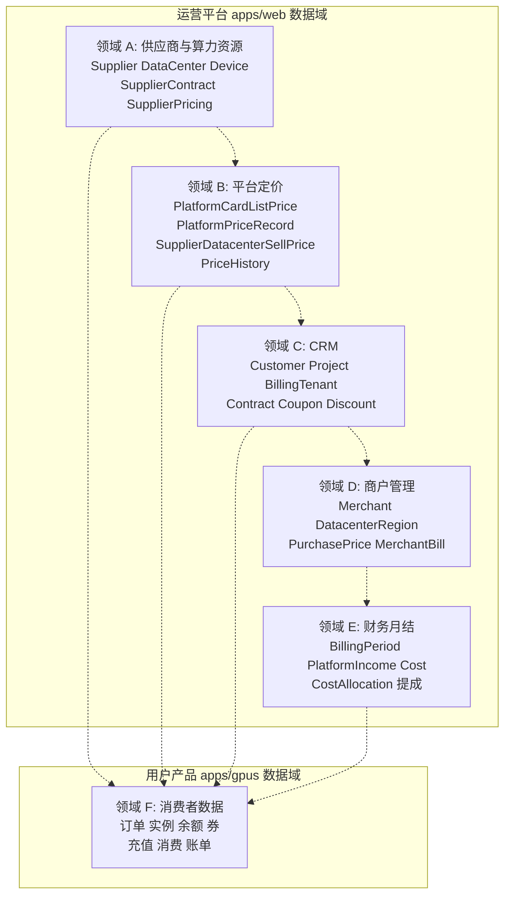
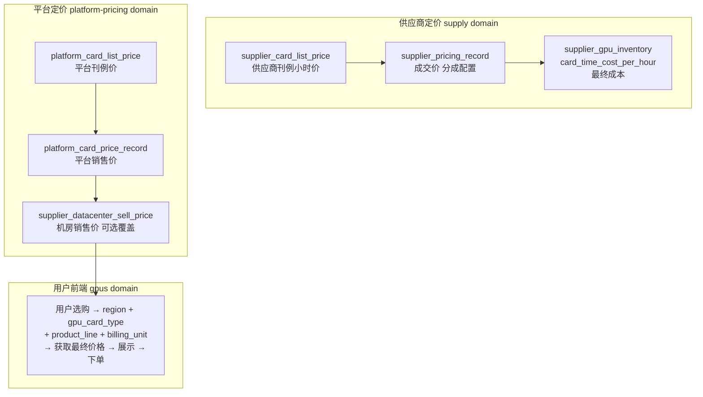

# 算力平台数据库设计

> 数据库：PostgreSQL，使用 Drizzle ORM 管理
> 约定：主键 `text`，金额 `numeric(15,4)`，比例 `numeric(9,6)`，扩展 `jsonb`

---

## 目录

1. [领域划分](#1-领域划分)
2. [领域 A：供应商与算力资源 (supply)](#2-领域-a供应商与算力资源-supply)
3. [领域 B：平台定价 (platform-pricing)](#3-领域-b平台定价-platform-pricing)
4. [领域 C：CRM 客户关系管理 (crm)](#4-领域-ccrm-客户关系管理-crm)
5. [领域 D：商户管理 (merchant)](#5-领域-d商户管理-merchant)
6. [领域 E：财务账期与月结 (finance)](#6-领域-e财务账期与月结-finance)
7. [领域 F：前端用户产品 (gpus 消费者域)](#7-领域-f前端用户产品-gpus-消费者域)
8. [附录：表间关系总图](#8-附录表间关系总图)

---

## 1. 领域划分



---

## 2. 领域 A：供应商与算力资源 (supply)

**对应 `apps/web` 运营平台的供应商管理、机房管理、设备台账、接入批次功能模块。**
**数据表位于 `packages/db/src/supply-schema.ts`。**

### 2.1 供应商主数据

#### supplier — 供应商

| 列名 | 类型 | 说明 |
|------|------|------|
| id | text PK | UUID |
| code | varchar(64) UK | 供应商编码 |
| name | varchar(255) | 供应商名称 |
| short_name | varchar(64) | 供应商简称 |
| status | varchar(32) | 状态 (active/inactive) |
| default_cooperation_mode | varchar(32) | 默认合作模式：card_time / revenue_share / tiered_card_time / tiered_revenue_share |
| business_manager_staff_id | text FK→user_staff | 商务经理 |
| contact_person / phone / email | 联系方式 | 联系人信息 |
| bank_name / bank_account | 银行信息 | 结算银行 |
| onboarding_type | varchar(16) | 入驻主体类型：enterprise / individual |
| platform_tenant_id | varchar(32) UK | 对应平台租户 ID |
| audit_status / audit_remark | 审核状态 | 入驻审核 |

**对应 `apps/web` 功能**: 供应商列表/详情/入驻管理

#### supplier_ops_engineer — 供应商运维工程师

| 列名 | 类型 | 说明 |
|------|------|------|
| id | text PK | UUID |
| supplier_id | text FK→supplier | 所属供应商 |
| data_center_id | text FK→data_center | 所属机房 |
| name / phone / email / wechat_id | 联系方式 | 运维人员信息 |
| sort_order | int | 排序 |

**作用**: 供应商机房级别运维通讯录，用于故障通报和日常对接。

#### gpu_card_type — GPU 卡型字典

| 列名 | 类型 | 说明 |
|------|------|------|
| id | text PK | UUID |
| code | varchar(64) UK | 卡型编码 (如 A100-80G) |
| name | varchar(128) UK | 卡型名称 |
| manufacturer | varchar(32) | 制造商 (NVIDIA/AMD/Intel/Huawei/Other) |
| memory_gb | int | 显存容量 (GB) |
| tdp_watts | int | 功耗 (W) |
| compute_capability | varchar(64) | 计算能力 |
| device_role | varchar(16) | compute=算力卡型 / infra=管控/存储 |
| status | varchar(32) | 状态 (active/disabled) |

**对应 `apps/web` 功能**: GPU 卡型管理（列表/详情/新增/编辑）
**对应 `apps/gpus` 功能**: 用户选购时 GPU 型号筛选器、GPU 规格展示

#### data_center — 数据中心 (机房)

| 列名 | 类型 | 说明 |
|------|------|------|
| id | text PK | UUID |
| supplier_id | text FK→supplier | 所属供应商 |
| code | varchar(64) UK | 机房编码 (供应商内唯一) |
| name | varchar(255) | 机房名称 |
| location | varchar(128) | 机房位置（展示用） |
| region_tags | text[] | 区域标签（K8s 调度用） |
| address | text | 详细地址 |
| status | varchar(32) | 状态 |
| cooperation_status | varchar(32) | 合作状态 (active/pause/inactive) |
| container_instance_region | varchar(128) | 容器实例区域（Karmada 标签值） |
| bare_metal_region | varchar(128) | 裸金属区域（订单匹配用） |
| network_fee_monthly | numeric(15,4) | 月网络费 |
| mgmt_node_fee_monthly | numeric(15,4) | 月管理节点费 |
| public_ip_count | int | 公网 IP 数量 |
| internal_network_cidr | varchar(64) | 内网 CIDR |
| scale | varchar(64) | 规模描述 |

**对应 `apps/web` 功能**: 机房列表/详情/编辑
**对应 `apps/gpus` 功能**: 用户选购时区域选择器、区域标签展示

---

### 2.2 商务合同与条款

#### supplier_card_list_price — 供应商刊例价

| 列名 | 类型 | 说明 |
|------|------|------|
| id | text PK | UUID |
| supplier_id | text FK→supplier | 供应商 |
| data_center_id | text FK→data_center | 机房 |
| gpu_card_type_id | text FK→gpu_card_type | 卡型 |
| list_price_per_hour | numeric(15,4) | 刊例小时价 |
| currency | varchar(8) | 币种 (CNY) |
| effective_from | date | 生效日期 |
| effective_to | date | 失效日期 (NULL=当前生效) |

**作用**: 供应商在不同机房租用不同卡型的刊例价格，是成交价的基准。

#### supplier_contract — 供应商合同

| 列名 | 类型 | 说明 |
|------|------|------|
| id | text PK | UUID |
| supplier_id | text FK→supplier | 供应商 |
| contract_no | varchar(64) UK | 合同编号 |
| type | varchar(32) | 合同类型 |
| status | varchar(32) | 状态 |
| pricing_mode | varchar(32) | 计价方式 (card_time/revenue_share/…) |
| unit_price_per_hour | numeric(15,4) | 小时单价 |
| revenue_share_percent | numeric(7,4) | 分成比例 |
| list_price_per_hour | numeric(15,4) | 刊例小时价 |
| deal_to_list_ratio | numeric(9,6) | 成交/刊例比 |
| start_date / end_date | date | 合同有效期 |
| contract_file_uri | varchar(1024) | 合同文件 |

**对应 `apps/web` 功能**: 合同管理（列表/详情/上传）

#### supplier_pricing_tier — 阶梯定价

| 列名 | 类型 | 说明 |
|------|------|------|
| id | text PK | UUID |
| contract_id | text FK→supplier_contract | 所属合同 |
| tier_order | int | 阶梯序号 |
| list_price_multiplier | numeric(9,6) | 刊例价倍数 |
| deal_unit_price_per_hour | numeric(15,4) | 该阶梯成交小时价 |
| revenue_share_percent | numeric(7,4) | 该阶梯分成比例 |

**作用**: 支持"单卡 8 元/时、满 100 卡 7 元/时"等阶梯定价模型。

#### supplier_unit_cost — 供应商成本价

| 列名 | 类型 | 说明 |
|------|------|------|
| id | text PK | UUID |
| supplier_id / data_center_id / gpu_card_type_id | FK | 供应商×机房×卡型 |
| supplier_terms_version_id | text FK | 合同条款版本 |
| list_price_per_hour | numeric(15,4) | 刊例小时价 |
| deal_unit_price_per_hour | numeric(15,4) | 成交小时价 |
| unit_cost | numeric(15,4) | 单位成本 |
| revenue_share_percent | numeric(7,4) | 分成比例 |
| effective_from / effective_to | date | 有效期 |

**作用**: 财务月结时使用的最终成本依据。

#### supplier_pricing_record — 供应商定价记录

| 列名 | 类型 | 说明 |
|------|------|------|
| id | text PK | UUID |
| supplier_id / data_center_id / gpu_card_type_id | FK | 供应商×机房×卡型 |
| pricing_mode | varchar(32) | 定价模式 |
| config_status | varchar(32) | active / unavailable |
| list_price_per_hour | numeric(15,4) | 刊例小时价 |
| billing_unit | varchar(16) | hour=卡时价 / month=整租月租 |
| unit_price | numeric(15,4) | 单价 |
| cards_per_machine | int | 每台卡数 (默认 8) |
| deal_to_list_ratio | numeric(9,6) | 成交/刊例比 |
| revenue_share_percent | numeric(7,4) | 分成比例 |
| pricing_tiers | jsonb | 定价阶梯 JSON |
| effective_from / effective_to | timestamp | 生效时间段 |
| updated_by_staff_id | text FK→user_staff | 更新人 |

**UK**: (supplier_id, data_center_id, gpu_card_type_id)
**对应 `apps/web` 功能**: 供应商定价配置，定价状态管理

---

### 2.3 接入批次

#### onboarding_batch — 接入批次

| 列名 | 类型 | 说明 |
|------|------|------|
| id | text PK | UUID |
| batch_kind | varchar(32) | 批次类型：inventory / device_changelog / online / retire / order_access |
| supplier_id / data_center_id | FK | 供应商×机房 |
| batch_code | varchar(64) UK | 批次编码 |
| batch_status | varchar(32) | 批次状态 |
| planned_lines_json | jsonb | 上架计划明细 |
| planned_device_count | int | 计划设备数 |
| planned_gpu_count | int | 计划 GPU 数 |
| touched_device_count / online_device_count | int | 触达/在线设备数 |
| work_order_no | varchar(64) | 飞书审批工单号 |
| access_method | varchar(32) | 接入方式 |
| import_status | varchar(32) | 导入状态 |
| retire_action_type | varchar(32) | 退网动作类型 |
| retire_plan_mode | varchar(32) | 退网计划模式 |

**对应 `apps/web` 功能**: 接入批次管理（创建/导入/进度跟踪/退网）

#### onboarding_batch_plan_line — 批次计划明细行

| 列名 | 类型 | 说明 |
|------|------|------|
| id | text PK | UUID |
| onboarding_batch_id | text FK→onboarding_batch | 所属批次 |
| gpu_card_type_id | text FK→gpu_card_type | 卡型 |
| cooperation_type | varchar(32) | 合作类型 (idle_time / whole_rent) |
| planned_quantity | int | 计划数量 |
| touched_quantity / online_quantity | int | 触达/在线数量 |

**UK**: (onboarding_batch_id, gpu_card_type_id, cooperation_type)
**作用**: 按卡型×合作类型拆分批次计划，精确跟踪。

---

### 2.4 物理设备与节点

#### supplier_device — 供应商物理设备

| 列名 | 类型 | 说明 |
|------|------|------|
| id | text PK | UUID |
| supplier_id | text FK→supplier | 所属供应商 |
| data_center_id | text FK→data_center | 所属机房 |
| gpu_card_type_id | text FK→gpu_card_type | GPU 卡型 |
| contract_id | text FK→supplier_contract | 所属合同 |
| onboarding_batch_id | text FK→onboarding_batch | 最近导入批次 |
| external_device_id | varchar(128) | 外部设备 ID |
| asset_no | varchar(64) UK | 资产编号 |
| sn | varchar(64) UK | 序列号 |
| idc_code | varchar(64) | 机房编码 |
| idc_region | varchar(64) | 机房区域 |
| gpu_count | int | GPU 数量 |
| external_ip / internal_ip | varchar(45) | 外网/内网 IP |
| ops_status | varchar(64) | 运维状态 (如"预留闲置中") |
| lifecycle_status | varchar(32) | 生命周期状态 (pending_onboarding, onboarding, online, listed, maintenance, allocated, retired) |
| listing_disabled | boolean | 禁用上架标识 (默认false, 运营手动控制) |
| in_maintenance | boolean | 维护中 |
| cooperation_type | varchar(32) | 合作类型 (idle_time / whole_rent) |
| device_spec | text | 设备规格描述 (结构化文本) |
| device_purpose | varchar(255) | 设备用途 |
| login_username / login_password | 登录凭据 | SSH 登录信息 |
| platform_resource_id | varchar(128) | 平台资源 ID |

**对应 `apps/web` 功能**: 设备台账列表/详情/导入/变更记录
**对应 `apps/gpus` 裸金属产品**: 设备可用性检查、设备规格展示

#### compute_node — 计算节点

| 列名 | 类型 | 说明 |
|------|------|------|
| id | text PK | UUID |
| supplier_device_id | text FK→supplier_device | 对应物理设备 |
| node_role | varchar(32) | 节点角色 |
| mgmt_ip | varchar(45) | 管理 IP |
| cluster_name | varchar(128) | 集群名称 |
| node_name | varchar(128) | 节点名称 |
| cluster_id | varchar(64) | 集群 ID |
| lifecycle_status | varchar(32) | 生命周期状态 |

**作用**: 物理设备在 K8s/K3s 集群中的映射，一个设备可能对应多个计算节点。

#### supplier_gpu_inventory — 供应商 GPU 库存

| 列名 | 类型 | 说明 |
|------|------|------|
| id | text PK | UUID |
| supplier_id / data_center_id / gpu_card_type_id | FK | 供应商×机房×卡型 |
| quantity | int | 总库存量 |
| online_quantity | int | 在线可用量 |
| status | varchar(32) | 状态 |
| is_internal_test | boolean | 是否内部测试 |
| card_time_cost_per_hour | numeric(15,4) | 卡时成本价 |
| revenue_share_cost_per_hour | numeric(15,4) | 分成模式成本价 |

**UK**: (supplier_id, data_center_id, gpu_card_type_id)
**对应 `apps/gpus` 功能**: 用户选购时展示各区域可用的 GPU 数量

#### supplier_datacenter_card_type_spec — 机房×卡型设备配置

| 列名 | 类型 | 说明 |
|------|------|------|
| id | text PK | UUID |
| data_center_id | text FK→data_center | 机房 |
| gpu_card_type_id | text FK→gpu_card_type | 卡型 |
| device_spec | text | 设备规格 (CPU/内存/磁盘/网卡等) |
| remark | text | 备注 |

**UK**: (data_center_id, gpu_card_type_id)
**对应 `apps/web` 功能**: 机房卡型设备规格配置
**对应 `apps/gpus` 功能**: 用户部署时展示设备默认配置

#### supplier_datacenter_infrastructure — 机房基础设施配置

| 列名 | 类型 | 说明 |
|------|------|------|
| id | text PK | UUID |
| data_center_id | text FK→data_center UK | 机房 |
| bandwidth_config | jsonb | 带宽配置 |
| network_config | jsonb | 网络配置 |
| storage_config | jsonb | 存储配置 |
| updated_by_staff_id | text | 更新人 |

**对应 `apps/web` 功能**: 机房基础设施配置管理

#### supplier_device_change_log — 设备变更日志

| 列名 | 类型 | 说明 |
|------|------|------|
| id | text PK | UUID |
| supplier_device_id | text FK→supplier_device | 设备 |
| onboarding_batch_id | text FK→onboarding_batch | 导入批次 |
| internal_ip | varchar(45) | 变更时的内网 IP |
| occurred_at | timestamp | 变更时间 |
| change_action | varchar(64) | 变更动作 |
| change_content | text | 变更内容 |
| previous_ops_status / new_ops_status | varchar(64) | 运维状态变更 |
| previous_lifecycle_status / new_lifecycle_status | varchar(32) | 生命周期变更 |

**作用**: 设备状态变更的完整审计追踪。

---

### 2.5 裸金属订单

#### bare_metal_order — 裸金属订单

| 列名 | 类型 | 说明 |
|------|------|------|
| id | text PK | UUID |
| platform_order_id | varchar(64) UK | 平台订单 ID |
| order_no | varchar(128) UK | 订单编号 |
| tenant_id | text FK→billing_tenant | 租户 |
| merchant_id | text | 商户 ID |
| customer_id | text FK→customer | 客户 |
| project_id | text FK→crm_project | 项目 |
| data_center_id | text FK→data_center | 机房 |
| supplier_id | text FK→supplier | 供应商 |
| idc_code / idc_name | 机房信息 | 机房编码/名称 |
| status | varchar(32) | 订单状态 |
| billing_unit | varchar(16) | 计费单位 (hour/day/week/month) |
| device_count / gpu_count | int | 设备数/GPU 数 |
| order_amount / refund_amount / final_amount | numeric(15,4) | 金额 |
| balance_amount / coupon_amount | numeric(15,4) | 余额支付/券支付 |
| ordered_at / paid_at / rent_starts_at / rent_ends_at | timestamp | 时间线 |
| source | varchar(32) | 来源 (platform_sync/import) |

**对应 `apps/gpus` 裸金属产品**: 裸金属订单创建 → 平台订单同步
**对应 `apps/web` 功能**: 裸金属订单同步/导入/管理

#### bare_metal_order_device — 裸金属订单设备明细

| 列名 | 类型 | 说明 |
|------|------|------|
| id | text PK | UUID |
| bare_metal_order_id | text FK→bare_metal_order | 所属订单 |
| line_no | int | 行号 |
| allocation_status | varchar(32) | 分配状态 |
| gpu_card_type_id | text FK→gpu_card_type | GPU 卡型 |
| gpu_count | int | GPU 数量 |
| platform_device_id | varchar(128) UK | 平台设备 ID |
| supplier_device_id | text FK→supplier_device | 关联物理设备 |
| sn / asset_no / external_ip / internal_ip | 设备信息 | 设备标识 |
| line_amount / duration_hours / unit_price_per_card_hour | 金额 | 行金额/时长/单价 |
| rent_starts_at / rent_ends_at | timestamp | 租期起止 |

**对应 `apps/gpus` 功能**: 裸金属实例详情，展示设备规格、租期

---

## 3. 领域 B：平台定价 (platform-pricing)

**对应 `apps/web` 运营平台的平台定价管理功能模块。**
**数据表位于 `packages/db/src/platform-pricing-schema.ts`。**

### 3.1 L1 平台刊例价

#### platform_card_list_price — 平台刊例价主数据

| 列名 | 类型 | 说明 |
|------|------|------|
| id | text PK | UUID |
| gpu_card_type_id | text FK→gpu_card_type | 所属卡型 |
| product_line | varchar(32) | 产品线 (`cloud_vm`/`serverless`/`inference`/`job`/`bare_metal`)；权威见 `../../business/product-line-taxonomy.md` |
| billing_unit | varchar(16) | 计费单位 (hour/day/week/month) |
| base_price | numeric(15,4) | 基础价（刊例价） |
| currency | varchar(8) | 币种 |
| effective_from | date | 生效日期 |
| effective_to | date | 失效日期 (NULL=当前生效) |
| is_system | boolean | 是否系统生成 |
| changed_by_staff_id | text FK→user_staff | 变更人 |
| remark | text | 备注 |

**UK**: (gpu_card_type_id, product_line, billing_unit, effective_from)

#### platform_card_price_record — 平台当前价记录

| 列名 | 类型 | 说明 |
|------|------|------|
| id | text PK | UUID |
| gpu_card_type_id | text FK→gpu_card_type | 所属卡型 |
| product_line | varchar(32) | 产品线 |
| billing_unit | varchar(16) | 计费单位 |
| sell_price | numeric(15,4) | 销售单价 |
| status | varchar(16) | 状态 (draft/active/archived) |
| effective_from | timestamp(0) | 生效时间 |
| effective_to | timestamp(0) | 失效时间 (NULL=当前生效) |
| list_price_id | text FK→platform_card_list_price | 关联刊例价 |
| remark | text |

**UK**: (gpu_card_type_id, product_line, billing_unit, effective_from)

#### platform_card_price_history — 平台调价历史

| 列名 | 类型 | 说明 |
|------|------|------|
| id | text PK | UUID |
| record_id | text FK→platform_card_price_record | 关联记录 |
| gpu_card_type_id | text FK→gpu_card_type | 卡型 |
| previous_sell_price | numeric(15,4) | 调价前价格 |
| new_sell_price | numeric(15,4) | 调价后价格 |
| changed_at | timestamp | 调价时间 |
| changed_by_staff_id | text FK→user_staff | 操作人 |
| reason | text | 调价原因 |

### 3.2 机房级销售价（L1 机房级覆盖，原 L2 编号）

#### supplier_datacenter_sell_price — 机房销售价

| 列名 | 类型 | 说明 |
|------|------|------|
| id | text PK | UUID |
| data_center_id | text FK→data_center | 机房 |
| gpu_card_type_id | text FK→gpu_card_type | 卡型 |
| product_line | varchar(32) | 产品线 |
| billing_unit | varchar(16) | 计费单位 |
| sell_price | numeric(15,4) | 销售价 |
| platform_price_record_id | text FK→platform_card_price_record | 关联平台价 |
| status | varchar(16) | 状态 |
| effective_from | timestamp(0) | 生效时间 |
| effective_to | timestamp(0) | 失效时间 |
| remark | text |

**UK**: (data_center_id, gpu_card_type_id, product_line, billing_unit, effective_from)

#### supplier_datacenter_sell_price_history — 机房销售价变更历史

| 列名 | 类型 | 说明 |
|------|------|------|
| id | text PK | UUID |
| sell_price_id | text FK→supplier_datacenter_sell_price | 关联售价 |
| data_center_id / gpu_card_type_id / product_line / billing_unit | 维度 | 价格维度 |
| previous_sell_price / new_sell_price | numeric(15,4) | 价格变更 |
| changed_at / changed_by_staff_id | 审计 | 变更审计 |

### 3.3 价格体系层级


**对应 `apps/gpus` 功能**: 用户选购时根据区域和产品线获取最终价格
**对应 `apps/web` 功能**: 运营人员在平台定价管理设置各层级价格

---

## 4. 领域 C：CRM 客户关系管理 (crm)

**对应 `apps/web` 运营平台的 CRM 功能模块。**
**数据表位于 `packages/db/src/crm-schema.ts`。**

### 4.1 客户与租户主体

#### customer — 客户

| 列名 | 类型 | 说明 |
|------|------|------|
| id | text PK | UUID |
| code | varchar(64) | 客户编码 |
| name | varchar(255) | 客户名称 |
| type | varchar(8) | B=企业 / C=个人 |
| status | varchar(16) | active / inactive / suspended |
| industry | varchar(64) | 行业 |
| source | varchar(32) | 客户来源 |
| stage | varchar(16) | 阶段 |
| contact_person / phone / email | 主联系人 | 联系人信息 |
| province / city / address | 地址 | 所在地 |
| expected_scale | jsonb | 期望规模（卡型×数量） |
| manager_staff_id | text FK→user_staff | 客户经理 |

**对应 `apps/web` 功能**: CRM 客户列表/详情/编辑

#### billing_tenant (物理表名: tenant) — 计费租户

| 列名 | 类型 | 说明 |
|------|------|------|
| id | text PK | UUID |
| customer_id | text FK→customer | 所属客户 |
| merchant_id | varchar(32) | 所属商户 |
| platform_tenant_id | varchar(32) | 平台租户 ID |
| name | varchar(255) | 租户名称 |
| type | varchar(16) | internal / external |
| status | varchar(16) | active / inactive / suspended |
| balance | numeric(15,4) | 当前余额 |
| credit_limit | numeric(15,4) | 授信额度 |
| overdue_at | timestamp | 欠费时间 |
| is_default | boolean | 是否默认租户 |
| internal_effective_from / to | date | 内部租户收入排除期 |

**UK**: (platform_tenant_id), (customer_id, is_default) partial
**对应 `apps/gpus` 功能**: 用户的账户/余额/消费归属
**对应 `apps/web` 功能**: 租户管理/账单查询/余额调整

#### user_staff — 内部员工

| 列名 | 类型 | 说明 |
|------|------|------|
| id | text PK | UUID |
| name | varchar(128) | 姓名 |
| email | varchar(255) UK | 邮箱 |
| department_id | text | 部门 |
| staff_no | varchar(64) | 工号 |
| status | varchar(16) | active / inactive |

### 4.2 项目与合同

#### crm_project (物理表名: project) — 经营项目

| 列名 | 类型 | 说明 |
|------|------|------|
| id | text PK | UUID |
| customer_id | text FK→customer | 所属客户 |
| name | varchar(255) | 项目名称 |
| code | varchar(64) | 项目编码 |
| status | varchar(16) | 状态 |
| stage | varchar(16) | 阶段 |
| business_line_code | varchar(32) FK→business_line | 业务线 |
| start_date / end_date | date | 项目周期 |
| contract_amount | numeric(15,4) | 合同金额 |
| expected_monthly_consumption | numeric(15,4) | 预期月消费 |
| remark | text |

**对应 `apps/web` 功能**: 项目管理/详情/列表

#### project_tenant — 项目×计费账户关联

| 列名 | 类型 | 说明 |
|------|------|------|
| project_id | text FK→crm_project | 项目 |
| tenant_id | text FK→billing_tenant | 计费租户 |
| allocation_percent | numeric(7,4) | 分成比例 |
| effective_from / to | date | 有效期 |
| source | varchar(32) | 关联来源 |

**作用**: 一个项目可能关联多个计费租户，每个租户按比例贡献收入。

#### contract — 客户合同

| 列名 | 类型 | 说明 |
|------|------|------|
| id | text PK | UUID |
| customer_id | text FK→customer | 客户 |
| contract_no | varchar(64) UK | 合同编号 |
| name | varchar(255) | 合同名称 |
| type | varchar(32) | 合同类型 |
| status | varchar(16) | 状态 |
| total_amount | numeric(15,4) | 合同总额 |
| start_date / end_date | date | 合同期限 |
| file_uri | varchar(1024) | 合同文件 |

### 4.3 充值记录

#### recharge — 充值

| 列名 | 类型 | 说明 |
|------|------|------|
| id | text PK | UUID |
| tenant_id | text FK→billing_tenant | 租户 |
| amount | numeric(15,4) | 金额 |
| method | varchar(16) | 支付方式 (alipay/wechat/bank_transfer) |
| status | varchar(16) | completed/pending/failed |
| external_trade_no | varchar(128) | 外部交易号 |
| remark | text |
| operated_at | timestamp | 操作时间 |
| operator_staff_id | text FK→user_staff | 操作人 |

**对应 `apps/gpus` 功能**: 用户充值记录
**对应 `apps/web` 功能**: 充值管理/审核

### 4.4 算力券

#### discount_template — 算力券模板

| 列名 | 类型 | 说明 |
|------|------|------|
| id | text PK | UUID |
| name | varchar(255) | 模板名称 |
| type | varchar(16) | fixed / discount / resource_pack |
| value | numeric(15,4) | 券值 |
| discount_percent | numeric(7,4) | 折扣百分比 |
| min_order_amount | numeric(15,4) | 最低订单金额 |
| validity_days | int | 有效天数 |
| applicable_product_lines | jsonb | 适用产品线 |
| cost_bearer | varchar(16) | platform / idc |
| budget_limit | numeric(15,4) | 预算上限 |

#### coupon — 算力券实例

| 列名 | 类型 | 说明 |
|------|------|------|
| id | text PK | UUID |
| template_id | text FK→discount_template | 所属模板 |
| tenant_id | text FK→billing_tenant | 所属租户 |
| code | varchar(64) | 券码 |
| status | varchar(16) | available/used/expired/revoked |
| original_value | numeric(15,4) | 原始价值 |
| remaining_value | numeric(15,4) | 剩余价值 |
| granted_at / expired_at / used_at | timestamp | 时间线 |

**对应 `apps/gpus` 功能**: 用户算力券列表/抵扣选择
**对应 `apps/web` 功能**: 券模板管理/券发放

### 4.5 消费记录

#### consumption_record — 消费记录

| 列名 | 类型 | 说明 |
|------|------|------|
| id | text PK | UUID |
| tenant_id | text FK→billing_tenant | 租户 |
| project_id | text FK→crm_project | 项目 |
| amount | numeric(15,4) | 金额 |
| product_line | varchar(32) | 产品线 |
| consumed_at | timestamp | 消费时间 |
| source | varchar(32) | 来源 |

#### compute_task — 算力任务

| 列名 | 类型 | 说明 |
|------|------|------|
| id | text PK | UUID |
| tenant_id | text FK→billing_tenant | 租户 |
| task_type | varchar(16) | job/serve |
| status | varchar(16) | 状态 |
| resource_spec | jsonb | 资源规格 |
| started_at / finished_at | timestamp | 起止 |
| total_cost | numeric(15,4) | 总费用 |

### 4.6 账单

#### tenant_bill — 月账单

| 列名 | 类型 | 说明 |
|------|------|------|
| id | text PK | UUID |
| tenant_id | text FK→billing_tenant | 租户 |
| bill_month | varchar(7) | 账期 (yyyy-MM) |
| amount | numeric(15,4) | 金额 |
| status | varchar(16) | 状态 |
| paid_at | timestamp | 支付时间 |

#### tenant_bill_daily — 日账单

| 列名 | 类型 | 说明 |
|------|------|------|
| id | text PK | UUID |
| tenant_id | text FK→billing_tenant | 租户 |
| bill_date | date | 日期 |
| product_line | varchar(32) | 产品线 |
| amount | numeric(15,4) | 金额 |
| usage | numeric(15,4) | 用量 |

**对应 `apps/gpus` 功能**: 用户月账单/日账单查询
**对应 `apps/web` 功能**: 租户账单管理/人工调整

---

## 5. 领域 D：商户管理 (merchant)

**对应 `apps/web` 运营平台的商户管理功能模块。**
**数据表位于 `packages/db/src/merchant-schema.ts`。**

### 5.1 商户主体

#### merchant — 商户

| 列名 | 类型 | 说明 |
|------|------|------|
| id | text PK | UUID |
| code | varchar(64) | 商户编码 |
| name | varchar(255) | 商户名称 |
| type | varchar(16) | platform_direct / partner |
| status | varchar(16) | active / inactive / suspended |
| access_mode | varchar(16) | oem / api / iframe |
| platform_merchant_id | int | 平台商户 ID |
| account_manager_staff_id | text FK→user_staff | 客户经理 |

**对应 `apps/web` 功能**: 商户列表/详情/编辑

### 5.2 商户区域与价格

#### merchant_datacenter_region — 商户机房区域

| 列名 | 类型 | 说明 |
|------|------|------|
| id | text PK | UUID |
| merchant_id | text FK→merchant | 商户 |
| data_center_id | text FK→data_center | 机房 |
| region_code | varchar(64) | 区域编码 |
| status | varchar(16) | open / closed / maintenance |

#### merchant_purchase_price — 商户采购价

| 列名 | 类型 | 说明 |
|------|------|------|
| id | text PK | UUID |
| merchant_id | text FK→merchant | 商户 |
| data_center_id | text FK→data_center | 机房 |
| gpu_card_type_id | text FK→gpu_card_type | 卡型 |
| product_line | varchar(32) | 产品线 |
| purchase_price | numeric(15,4) | 采购价 |
| effective_from / effective_to | timestamp | 有效期 |

### 5.3 商户账单

#### merchant_bill — 商户月账单

| 列名 | 类型 | 说明 |
|------|------|------|
| id | text PK | UUID |
| merchant_id | text FK→merchant | 商户 |
| bill_month | varchar(7) | 账期 |
| total_amount | numeric(15,4) | 金额 |
| status | varchar(16) | 状态 |

#### merchant_payment_node — 商户回款节点

| 列名 | 类型 | 说明 |
|------|------|------|
| id | text PK | UUID |
| merchant_id | text FK→merchant | 商户 |
| node_name | varchar(255) | 节点名称 |
| amount | numeric(15,4) | 金额 |
| due_date | date | 到期日 |
| status | varchar(16) | pending / partial / completed / overdue |

**对应 `apps/web` 功能**: 商户月度账单/回款管理

---

## 6. 领域 E：财务账期与月结 (finance)

**对应 `apps/web` 运营平台的财务月结功能模块。**
**数据表位于 `packages/db/src/finance-schema.ts`。**

### 6.1 账期主表

#### billing_period — 账期

| 列名 | 类型 | 说明 |
|------|------|------|
| id | text PK | UUID |
| period_year | int | 年份 |
| period_month | int | 月份 |
| period_name | varchar(16) | 账期名称 (如 2026-07) |
| status | varchar(16) | 状态流转：draft → imported → pending_allocation → computed → published → void |
| income_data_source | jsonb | 收入数据源配置 |
| opened_at / published_at / voided_at | timestamp | 时间线 |

### 6.2 收入与成本

#### platform_income_monthly — 平台月度收入

| 列名 | 类型 | 说明 |
|------|------|------|
| id | text PK | UUID |
| billing_period_id | text FK→billing_period | 所属账期 |
| tenant_id | text FK→billing_tenant | 租户 |
| project_id | text FK→crm_project | 项目 |
| product_line | varchar(32) | 产品线 |
| usage_unit | varchar(16) | 用量单位 |
| usage_total | numeric(15,4) | 总用量 |
| unit_price | numeric(15,4) | 单价 |
| income_amount | numeric(15,4) | 收入金额 |
| cost_amount | numeric(15,4) | 成本金额 |
| gross_margin | numeric(9,6) | 毛利率 |

#### platform_cost_monthly — 平台月度成本

| 列名 | 类型 | 说明 |
|------|------|------|
| id | text PK | UUID |
| billing_period_id | text FK→billing_period | 所属账期 |
| type | varchar(8) | record / sum |
| supplier_id | text FK→supplier | 供应商 |
| data_center_id | text FK→data_center | 机房 |
| gpu_card_type_id | text FK→gpu_card_type | 卡型 |
| cost_amount | numeric(15,4) | 成本金额 |
| supplier_unit_cost_id | text FK→supplier_unit_cost | 关联成本价 |

### 6.3 成本分成

#### billing_tenant_cost_allocation — 租户多项目成本分成

| 列名 | 类型 | 说明 |
|------|------|------|
| id | text PK | UUID |
| billing_period_id | text FK→billing_period | 账期 |
| billing_tenant_id | text FK→billing_tenant | 租户 |
| project_id | text FK→crm_project | 项目 |
| allocation_percent | numeric(7,4) | 分成比例 |
| allocated_cost | numeric(15,4) | 分配金额 |

### 6.4 提成计算

#### monthly_cost_base_line — 月成本基础行

| 列名 | 类型 | 说明 |
|------|------|------|
| id | text PK | UUID |
| monthly_cost_run_id | text FK→monthly_cost_run | 执行批次 |
| tenant_id / customer_id / project_id | FK | 归属维度 |
| gpu_card_type_id | text FK→gpu_card_type | 卡型 |
| product_line | varchar(32) | 产品线 |
| card_hours | numeric(15,4) | 卡时 |
| amount | numeric(15,4) | 金额 |
| unit_cost / unit_price | numeric(15,4) | 成本价/单价 |

---

## 7. 领域 F：前端用户产品 (gpus 消费者域)

**对应 `apps/gpus` 前端模块的数据设计。**

### 7.1 数据流映射

前端数据模型 → 后端表映射：

| apps/gpus 前端类型 | 对应数据库表 | 说明 |
|-------------------|-------------|------|
| `Gpu` / `GpuTier` | gpu_card_type | GPU 卡型 |
| `Region` | data_center | 机房区域 |
| `MarketOffering` | 聚合: gpu_card_type + supplier_datacenter_sell_price | 市场在售 GPU 产品 |
| `MetalDevice` | 聚合: supplier_device + gpu_card_type | 裸金属可售设备 |
| `AggregatedMetalOffering` | 聚合: gpu_card_type × data_center | 裸金属聚合产品 |
| `MetalPricing` | platform_card_price_record / supplier_datacenter_sell_price | 裸金属价格 |
| `Template` | 待定 | GPU 配置模板 |
| `ServerInstanceBillingInput` | 订单输入 → bare_metal_order | 云服务器实例计费输入 |
| `ComputeVoucher` | discount_template + coupon | 算力券 |
| `Task` | compute_task | 任务实例 |
| `RechargeTransaction` | recharge | 充值交易 |
| `BillingCreditSummary` | billing_tenant.balance | 余额汇总 |
| `BillingVoucher` | coupon (filtered) | 可用券 |
| `BillingCoupon` | coupon | 算力券实例 |
| `MonthlyBill` | tenant_bill | 月账单 |
| `ApplicationTemplate` | 待定 | 应用商店模板 |
| `SandboxTemplate` | 待定 | Sandbox 模板 |
| `SandboxQuotaItem` | 待定 | Sandbox 配额 |

### 7.2 待实现表（消费者域核心业务）

以下表在 overview 设计中描述，现有 `apps/gpus` 前端已定义完整数据类型，需后端实现：

#### tenant_profiles — 租户业务扩展表

| 列名 | 类型 | 说明 |
|------|------|------|
| organization_id | varchar(64) PK | 与 Better Auth organization.id 一致 |
| status | enum('active','disabled') | 状态 |
| quota | json NOT NULL | {"max_gpu":16, "max_cpu":128, ...} |
| default_idc_tag | varchar(128) | 默认 IDC 标签 |
| created_at / updated_at | timestamp | 时间戳 |

**对应**: 与 Better Auth 的 organization 一一对应，扩展业务属性

#### user_profiles — 用户业务扩展表

| 列名 | 类型 | 说明 |
|------|------|------|
| user_id | varchar(64) PK | Better Auth user.id |
| default_org_id | varchar(64) | 默认组织 ID |

#### projects — 项目/工作空间表

| 列名 | 类型 | 说明 |
|------|------|------|
| id | varchar(64) PK | UUID |
| organization_id | varchar(64) NOT NULL | 所属组织 |
| name | varchar(255) NOT NULL | 项目名称 |

**UK**: (organization_id, name)

#### task_definitions — 任务定义

| 列名 | 类型 | 说明 |
|------|------|------|
| id | varchar(64) PK | UUID |
| organization_id | varchar(64) | 租户组织 ID |
| project_id | varchar(64) | 项目 ID |
| name | varchar(255) | 任务名称 |
| task_type | enum('job','serve') | 任务类型 |
| serve_mode | enum('serverless','deployment') | 推理模式 |
| resource_spec | json | 资源规格 |
| image | varchar(512) | 镜像 |
| command | text | 启动命令 |
| env_vars | json | 环境变量 |
| min_replicas / max_replicas / target_port | serve 配置 | 推理服务参数 |
| status | enum('draft','active','archived') | 状态 |

**对应 `apps/gpus`**: 任务管理 → 任务定义列表

#### task_instances — 任务实例

| 列名 | 类型 | 说明 |
|------|------|------|
| id | varchar(64) PK | UUID |
| definition_id | varchar(64) FK→task_definitions | 所属定义 |
| organization_id | varchar(64) | 租户组织 ID |
| sky_job_id / sky_serve_id | varchar(256) | SkyPilot 任务/服务 ID |
| instance_type | enum('job','serve') | 实例类型 |
| status | enum(...) | 状态 (image_pulling/pending/running/...) |
| idc_name / node_name / cluster_name | 部署位置 | 实际调度位置 |
| resource_spec | json | 实际资源规格 |
| scheduled_at / billing_started_at / finished_at | timestamp | 时间线 |
| internal_endpoint / public_url | 推理端点 | 对外暴露信息 |

**对应 `apps/gpus`**: 实例列表/详情/日志/配置变更

#### tenant_balance — 余额表（权威）

> 完整语义见 `tenant-balance-unification.md`。不做历史单字段兼容。

| 列名 | 类型 | 说明 |
|------|------|------|
| tenant_id | text PK FK→tenant | 子租户计费账号 |
| organization_id | varchar(64) NOT NULL | **冗余**：Better Auth organization.id；一客户可多子租户 |
| available_balance | numeric(15,4) | 可用余额 |
| reserved_balance | numeric(15,4) | 冻结余额（按秒任务） |
| currency | varchar(8) | 默认 CNY |
| updated_at / created_at | timestamptz | 时间戳 |

**索引**: `(organization_id)`  
**对应 `apps/gpus`**: 充值/部署余额；客户多子户聚合查 `organization_id`

#### retail_pricing — 零售价表（补充乘数）

| 列名 | 类型 | 说明 |
|------|------|------|
| id | int AUTO_INCREMENT PK | ID |
| resource_type | enum('cpu','memory','gpu','storage') | 资源类型 |
| resource_spec | varchar(256) | 规格 (如 A100) |
| unit | varchar(64) | 单位 (core_second/gb_second/gpu_second) |
| base_price | decimal(10,8) | 基础价格 |
| off_peak_price_multiplier | decimal(3,2) | 闲时乘数 (默认 1.00) |
| spot_price_multiplier | decimal(3,2) | Spot 乘数 (默认 0.60≈六折，见 taxonomy §5) |
| effective_from / effective_to | timestamp | 有效期 |

> 乘数语义：`payable = base_price × multiplier`。字段名统一 `*_price_multiplier`（见 taxonomy §5）。

#### billing_snapshots — 计费快照 (可选)

| 列名 | 类型 | 说明 |
|------|------|------|
| id | bigint AUTO_INCREMENT PK | ID |
| instance_id | varchar(64) FK→task_instances | 任务实例 |
| organization_id | varchar(64) | 租户 |
| snapshot_time | timestamp | 快照时间 |
| usage_json | json | 用量 JSON |
| cost | decimal(10,6) | 费用 |

**对应 `apps/gpus`**: 实例实时费用展示

#### coupon_templates — 券模板

| 列名 | 类型 | 说明 |
|------|------|------|
| id | varchar(64) PK | UUID |
| name | varchar(255) | 名称 |
| type | enum('fixed','discount','resource_pack') | 类型；小时券→resource_pack+pack_unit |
| face_value / discount_percent | 优惠参数 | 面值/折扣百分比 |
| applicable_resources | json | 适用资源 |
| cost_bearer | enum('platform','idc') | 成本承担方 |
| budget_limit | decimal(12,4) | 预算上限 |
| status | enum('active','inactive') | 状态 |

#### coupons — 券实例

| 列名 | 类型 | 说明 |
|------|------|------|
| id | varchar(64) PK | UUID |
| template_id | varchar(64) FK→coupon_templates | 所属模板 |
| organization_id | varchar(64) | 租户组织 ID |
| user_id | varchar(64) | 用户 ID |
| status | enum('available','used','expired','revoked') | 状态 |
| remaining_value / original_value | decimal(12,4) | 价值 |
| granted_at / expired_at / used_at | timestamp | 时间线 |

**对应 `apps/gpus`**: 用户部署时选择算力券抵扣

#### coupon_usages — 券使用明细

| 列名 | 类型 | 说明 |
|------|------|------|
| id | bigint AUTO_INCREMENT PK | ID |
| coupon_id | varchar(64) FK→coupons | 所属券 |
| task_instance_id | varchar(64) FK→task_instances | 关联任务实例 |
| original_cost | decimal(12,4) | 原始费用 |
| coupon_deduction | decimal(12,4) | 券抵扣额 |
| actual_payment | decimal(12,4) | 实付金额 |

#### marketing_cost_allocations — 营销成本分配

| 列名 | 类型 | 说明 |
|------|------|------|
| id | bigint AUTO_INCREMENT PK | ID |
| coupon_usage_id | bigint FK→coupon_usages | 关联券使用 |
| bearer | enum('platform','idc') | 承担方 |
| idc_provider_id | varchar(64) | IDC 供应商 ID |
| amount | decimal(12,4) | 金额 |
| settled | boolean | 是否已结算 |

#### idc_providers — IDC 供应商

| 列名 | 类型 | 说明 |
|------|------|------|
| id | varchar(64) PK | ID |
| name | varchar(255) | 供应商名称 |
| contact | json | 联系人 |
| status | enum('active','suspended') | 状态 |

#### idc_cost_pricing — IDC 采购成本价

| 列名 | 类型 | 说明 |
|------|------|------|
| id | int AUTO_INCREMENT PK | ID |
| idc_provider_id | varchar(64) FK→idc_providers | 供应商 |
| resource_type | enum('cpu','memory','gpu','storage') | 资源类型 |
| resource_spec | varchar(256) | 规格 |
| unit | varchar(64) | 单位 |
| unit_cost | decimal(10,8) | 单位成本 |
| effective_from / effective_to | timestamp | 有效期 |

#### idc_settlements — IDC 结算单

| 列名 | 类型 | 说明 |
|------|------|------|
| id | varchar(64) PK | ID |
| idc_provider_id | varchar(64) FK→idc_providers | 供应商 |
| period_start / period_end | date | 结算周期 |
| total_amount | decimal(12,4) | 金额 |
| status | enum('draft','sent','confirmed','paid') | 状态 |

---

## 8. 附录：表间关系总图

### 8.1 核心关系

```mermaid
erDiagram
    supplier ||--o{ data_center : has
    supplier ||--o{ supplier_contract : signs
    supplier ||--o{ supplier_card_list_price : sets
    supplier ||--o{ supplier_pricing_record : configures
    supplier ||--o{ supplier_bill : bills
    supplier ||--o{ supplier_device : owns
    supplier ||--o{ supplier_gpu_inventory : inventories

    data_center ||--o{ supplier_device : contains
    data_center ||--o{ supplier_gpu_inventory : "gpu stock"
    data_center ||--o{ supplier_datacenter_infrastructure : "infra config"
    data_center ||--o{ supplier_datacenter_card_type_spec : "device spec"

    supplier_device ||--o{ compute_node : runs
    supplier_device ||--o{ supplier_device_change_log : tracks

    supplier_contract ||--o{ supplier_pricing_tier : tiers

    gpu_card_type ||--o{ platform_card_list_price : "list price"
    gpu_card_type ||--o{ platform_card_price_record : "sell price"
    gpu_card_type ||--o{ supplier_pricing_record : "supplier price"
    gpu_card_type ||--o{ supplier_datacenter_sell_price : "dc sell price"
    platform_card_price_record ||--o{ platform_card_price_history : histories
    supplier_datacenter_sell_price ||--o{ supplier_datacenter_sell_price_history : histories

    customer ||--o{ billing_tenant : "billing accounts"
    billing_tenant ||--o{ recharge : recharges
    billing_tenant ||--o{ coupon : "has coupons"
    billing_tenant ||--o{ compute_task : runs
    billing_tenant ||--o{ tenant_bill : bills
    tenant_bill ||--o{ tenant_bill_detail : details
    billing_tenant ||--o{ tenant_bill_daily : "daily bills"
    tenant_bill_daily ||--o{ tenant_bill_daily_detail : details
    billing_tenant ||--o{ consumption_record : consumes
    customer ||--o{ crm_project : projects
    crm_project ||--o{ project_tenant : "allocates to"
    project_tenant }o--|| billing_tenant : "allocates"

    merchant ||--o{ merchant_datacenter_region : regions
    merchant_datacenter_region ||--o{ data_center : "references"
    merchant ||--o{ merchant_purchase_price : "purchase prices"
    merchant ||--o{ merchant_bill : bills
    merchant_bill ||--o{ merchant_bill_detail : details
    merchant ||--o{ merchant_payment_node : "payment nodes"
```mermaid
flowchart LR
    subgraph 用户选购[用户选购流程]
        U1[1. 选择区域 GPU] --> U2[2. 选择计费模式]
        U2 --> U3[3. 确认配置 价格]
        U3 --> U4[4. 使用算力券抵扣]
        U4 --> U5[5. 提交订单 部署]
        U5 --> U6[6. 使用中 计费进行]
        U6 --> U7[7. 查看账单 充值]
        U7 --> U8[8. 月结 对账]
    end

    subgraph 运营支撑[运营支撑流程]
        O1["gpu_card_type × data_center"] --> O2["platform_card_price_record<br/>supplier_datacenter_sell_price"]
        O2 --> O3["供应商刊例价 → 平台定价 → 机房销售价"]
        O3 --> O4["discount_template → coupon"]
        O4 --> O5["创建 bare_metal_order / compute_task"]
        O5 --> O6["OpenMeter 实时计量 → 每5分钟扣款"]
        O6 --> O7["tenant_bill / tenant_bill_daily / recharge"]
        O7 --> O8["billing_period → 财务月结"]
    end
```

### 8.3 价格计算链路



---

## 9. 共享交易层

> 以下表跨裸金属域和 K8s 计算域共享，是资金与券操作的唯一定义。
> 裸金属域和 K8s 计算域的文档均引用此处定义，不再各自重复。

### 9.1 balance_transaction — 余额变动流水

> 权威字段集见 `tenant-balance-unification.md` §5。本文与之保持一致。

```sql
CREATE TABLE balance_transaction (
    id                  TEXT PRIMARY KEY,
    tenant_id           TEXT NOT NULL REFERENCES tenant(id),
    organization_id     VARCHAR(64) NOT NULL,  -- 冗余，与 tenant_balance 一致
    type                VARCHAR(16) NOT NULL,
        -- recharge | deduction | auto_deduction | refund | coupon_refund
        -- freeze | unfreeze | adjustment | bonus
    amount              NUMERIC(15,4) NOT NULL,
    available_before    NUMERIC(15,4) NOT NULL,
    available_after     NUMERIC(15,4) NOT NULL,
    reserved_before     NUMERIC(15,4) NOT NULL,
    reserved_after      NUMERIC(15,4) NOT NULL,
    balance_before      NUMERIC(15,4) NOT NULL,  -- available+reserved 前
    balance_after       NUMERIC(15,4) NOT NULL,
    ref_type            VARCHAR(32),
        -- bare_metal_order | compute_base | serve_endpoint | recharge | preload_task | manual
    ref_id              TEXT,
    description         TEXT,
    created_by          TEXT,
    created_at          TIMESTAMPTZ NOT NULL DEFAULT NOW()
);

CREATE INDEX bt_tenant_idx ON balance_transaction(tenant_id);
CREATE INDEX bt_org_idx ON balance_transaction(organization_id);
CREATE INDEX bt_ref_idx ON balance_transaction(ref_type, ref_id);
```

**余额变动规则**（见 `tenant-balance-unification.md`）：

```
充值/退款: available ↑
预付扣款:  available ↓（hour/daily/weekly/monthly）
按秒扣款:  reserved ↓（commitment=on-demand，5min 窗按秒结算）
冻结:      available ↓、reserved ↑，总资金不变
解冻:      available ↑、reserved ↓，总资金不变
```

> 双字段快照列见 `tenant-balance-unification.md` §5。

### 9.2 coupon_usage_log — 券使用记录

> 记录每次算力券抵扣明细，跨裸金属订单和 K8s 计算任务共享。
> 替代原 `bare_metal_coupon_usage`，通过 `ref_type` 区分所属产品线。

```sql
CREATE TABLE coupon_usage_log (
    id                  TEXT PRIMARY KEY,
    coupon_id           TEXT NOT NULL REFERENCES coupon(id),
    ref_type            VARCHAR(32) NOT NULL,               -- bare_metal_order / compute_task
    ref_id              TEXT NOT NULL,                      -- 关联的订单/任务 ID
    usage_type          VARCHAR(16) NOT NULL,               -- initial: 首次下单抵扣 / renewal: 续费抵扣
    amount              NUMERIC(15,4) NOT NULL,             -- 本次抵扣金额
    balance_before      NUMERIC(15,4) NOT NULL,             -- 券剩余额度（前）
    balance_after       NUMERIC(15,4) NOT NULL,             -- 券剩余额度（后）
    period_from         TIMESTAMPTZ,                        -- 抵扣的计费周期起始
    period_to           TIMESTAMPTZ,                        -- 抵扣的计费周期结束
    created_at          TIMESTAMPTZ NOT NULL DEFAULT NOW()
);

CREATE INDEX cul_coupon_idx ON coupon_usage_log(coupon_id);
CREATE INDEX cul_ref_idx ON coupon_usage_log(ref_type, ref_id);
```

**使用场景**：

| ref_type | 场景 | usage_type |
|----------|------|-----------|
| `bare_metal_order` | 裸金属首次下单券抵扣 | `initial` |
| `bare_metal_order` | 裸金属续费券抵扣 | `renewal` |
| `compute_task` | 云服务器/任务部署时券抵扣 | `initial` |
