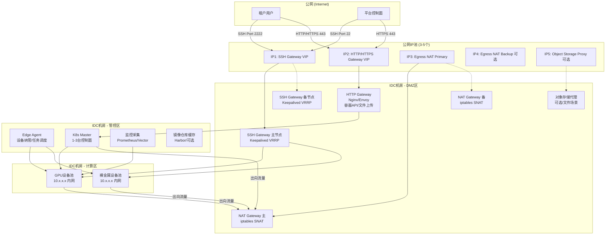
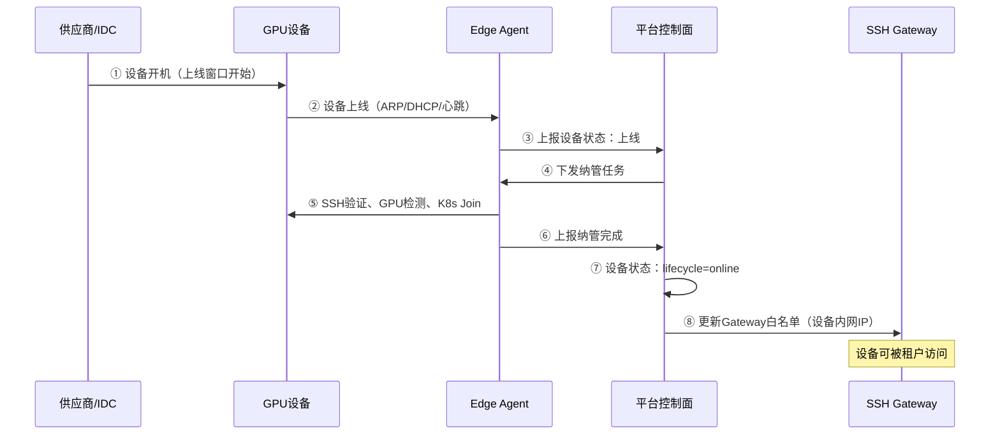
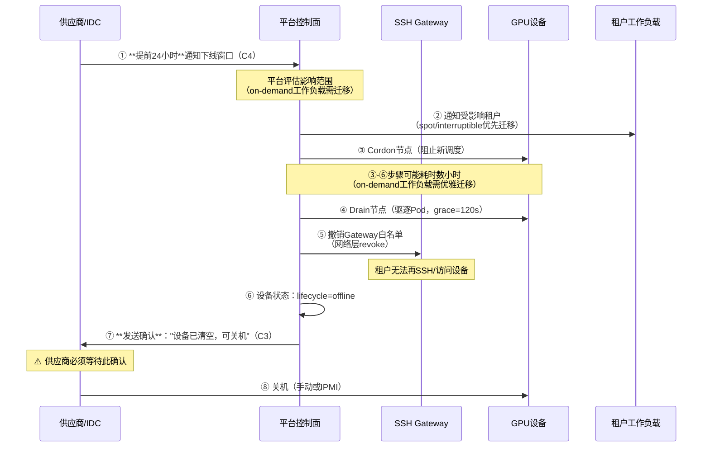
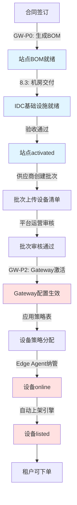

# 闲时算力网关与网络接入模型设计

> **版本**: 1.0  
> **日期**: 2026-09-25  
> **状态**: 设计稿  
> **关联设计**:  
> - `procurement-to-onboarding-closed-loop.md` — 供应商采购上架闭环  
> - `device-onboarding-flow.md` — 设备纳管全流程  
> - `guid/11-bare-metal-infra.md` — 裸金属基础设施

---

## 一、业务背景与约束

### 1.1 业务模式

GPURun Cloud 是一个**闲时GPU调度平台**,从IDC合作伙伴处接入闲置GPU算力：

- **时间弹性**：IDC可在约定时间窗口内将设备上下线
- **远程运维**：所有操作都是远程执行，无本地人员驻场
- **多产品形态**：裸金属、K8s容器、Agent Sandbox、Serverless推理、文件上传下载
- **合作伙伴约束**：最小化IDC/供应商侧操作复杂度

### 1.2 硬约束

| 约束项 | 典型值 | 影响 |
|-------|--------|------|
| **公网IP数量** | 3-5个/站点 | 需要多服务共享IP，NAT/端口复用 |
| **控制主机** | 1-3台/站点 | 平台可自采购，但需最小化部署 |
| **网络隔离** | 必须支持 | 平台需能在网络层revoke访问 |
| **供应商操作** | 最简化 | 仅机架交换机VLAN + 白名单 + 电源窗口 |
| **设备上下线** | 合同窗口内 | 网关需支持动态节点池变化 |

### 1.3 技术现状

- SSH Gateway已部署（`guid/11-bare-metal-infra.md`），replicas=2，用于裸金属SSH访问控制
- Edge Agent（Go）已实现设备纳管流水线
- 设备支持三种接入模式：`gateway_proxy`/`gateway_direct`/`direct`
- 网络拓扑模式：`standalone`/`nvlink`/`infiniband`/`roce`

---

## 二、站点拓扑设计

### 2.1 推荐拓扑（3-5公网IP下）



### 2.2 IP分配策略

| 公网IP | 用途 | 服务组件 | 是否必需 | 带宽要求 |
|-------|------|---------|---------|---------|
| **IP1** | SSH Gateway VIP | SSH Gateway (HA)<br/>含裸金属SSH + Agent Sandbox | ✅ 必需 | 中（SSH交互，C1确认共用） |
| **IP2** | HTTP/HTTPS Gateway | HTTP Gateway (容器API/文件上传) | ✅ 必需 | 高（文件传输） |
| **IP3** | Egress NAT Primary | NAT Gateway（通用出向） | ✅ 必需 | 中（出向流量） |
| **IP4** | Serverless NAT 或 NAT Backup | Serverless推理专用NAT（优先）<br/>或通用NAT备份 | 推荐 | 中-高（C2确认独立） |
| **IP5** | Object Storage Proxy | MinIO/S3 Proxy（每IDC独立，C5确认） | 推荐 | 极高（大文件场景） |

**最小配置（3 IP）**：IP1（SSH）+ IP2（HTTP）+ IP3（NAT）  
- Serverless推理降级：与通用NAT共用IP3，通过端口段分离或策略标记（iptables mark）隔离流量

**推荐配置（5 IP）**：上述全部，提供完整HA和流量隔离  
- IP4独立用于Serverless推理出向，避免与K8s工作负载争抢带宽
- IP5独立对象存储代理，每IDC独立部署（不共享中心存储）

### 2.3 网络分区隔离

| 网络分区 | VLAN/子网 | 设备类型 | 路由策略 |
|---------|----------|---------|---------|
| **DMZ区** | VLAN 10, 172.16.10.0/24 | 网关、NAT | 可访问公网+内网 |
| **管控区** | VLAN 20, 10.0.20.0/24 | K8s Master、Agent、监控 | 仅内网，通过NAT出公网 |
| **计算区** | VLAN 30-39, 10.0.30.0/22 | GPU设备、裸金属 | 仅内网，通过NAT出公网 |
| **存储区** | VLAN 40, 10.0.40.0/24 | NAS、Ceph、对象存储 | 仅内网 |

---

## 三、平台与供应商职责划分

### 3.1 职责矩阵

| 层级 | 平台职责 | 供应商/IDC职责 | 交付标准 |
|------|---------|---------------|---------|
| **物理层** | — | 机架、电源、制冷、布线 | 机柜就位，电源稳定 |
| **网络层** | 提供网关镜像、配置模板 | 配置机架交换机VLAN、平台IP白名单 | 平台可SSH到DMZ区控制主机 |
| **控制主机** | 自采购核心网关主机（SSH/HTTP/NAT Gateway）<br/>**（C8确认混合模式）** | 上架平台控制主机、接入内网交换机<br/>**可选提供辅助机**（如S3 Proxy、监控采集） | 核心网关在线、可访问计算区<br/>辅助机（若供应商提供）仅运行非敏感组件 |
| **GPU设备** | 纳管、监控、调度 | 上架、配置IPMI（可选）、提供root凭据 | 设备可被Agent SSH纳管 |
| **HA/故障切换** | 网关HA、NAT HA | 提供多路交换机上联（可选） | 单点故障不影响服务 |
| **安全** | 网关鉴权、会话审计（C7全部录制）、凭据轮换 | 内网ACL、MAC绑定（可选） | 平台可revoke任意设备访问 |
| **上下线窗口** | 监控设备状态、优雅迁移（需24小时通知，C4确认）<br/>**设备下线必须平台确认（C3确认）** | **提前24小时通知下线窗口**<br/>**等待平台确认后**方可手动下电 | 供应商不得自行下线设备 |

### 3.2 供应商最小化操作清单

供应商/IDC运维人员只需完成以下操作（**一次性或极低频**）：

#### 3.2.1 初始接入（一次性）

```bash
# 1. 机架交换机配置VLAN
# - VLAN 10 (DMZ): 平台控制主机端口
# - VLAN 30-39 (计算区): GPU设备端口
# - Trunk口: 上联到核心交换机

# 2. 平台控制主机IP白名单（允许SSH/HTTPS到平台控制面）
iptables -A INPUT -s <平台控制面IP段> -p tcp --dport 22,443 -j ACCEPT

# 3. 提供GPU设备清单（Excel/CSV）
# 列: 设备SN, 内网IP, root用户名, root密码, GPU卡型, GPU数量

# 4. （可选）提供设备IPMI/BMC凭据
# 列: 设备SN, BMC IP, BMC用户名, BMC密码
```

#### 3.2.2 设备上下线（按窗口，C3/C4确认）

```bash
# 上线窗口开始
# 1. 通知平台（飞书/邮件）："设备X可用窗口：2026-09-25 22:00 - 2026-09-26 08:00"
# 2. 设备开机（平台Agent自动检测上线）
# 3. 无需其他操作

# 下线窗口开始（C4确认：提前24小时通知）
# 1. **提前24小时**通知平台（飞书/邮件）："设备X计划下线窗口：2026-09-26 08:00"
# 2. 平台确认并自动迁移工作负载（最长24小时）
# 3. **平台完成后发送确认**："设备X已清空，可于XX:XX关机"
# 4. **供应商等待平台确认后**关机（或平台通过IPMI远程关机）
#
# ⚠️ C3确认：供应商不得在未收到平台确认前自行关机
# ⚠️ 若供应商紧急需要关机（硬件故障、电力中断），需立即通知平台并说明原因
```

### 3.3 平台控制主机配置（C8混合模式）

#### 3.3.1 平台自采购主机（核心网关，必需）

| 主机 | 角色 | 组件 | 规格 | 网卡配置 |
|------|------|------|------|---------|
| **控制主机-1** | SSH Gateway主 + NAT主 | SSH GW, Keepalived, NAT | 8C 16G | 双网卡（DMZ+管控区） |
| **控制主机-2** | SSH Gateway备 + NAT备 | SSH GW, Keepalived, NAT | 8C 16G | 双网卡（DMZ+管控区） |
| **控制主机-3** | K8s Master + Agent + 监控 | K8s control-plane, Edge Agent | 16C 32G | 双网卡（管控区+计算区） |

**最小配置（1台）**：单机部署全部组件（无HA）  
**推荐配置（2-3台）**：上述全部，提供完整HA

#### 3.3.2 供应商可提供辅助机（可选，非敏感组件）

| 主机 | 角色 | 组件 | 规格 | 约束 |
|------|------|------|------|------|
| **辅助机-1** | S3 Proxy / 对象缓存 | MinIO / Ceph RGW | 8C 16G + 10TB HDD | ❌ 不得运行鉴权/网关组件 |
| **辅助机-2** | 镜像缓存 | Harbor / Dragonfly | 8C 16G + 2TB SSD | ❌ 不得运行鉴权/网关组件 |
| **辅助机-3** | 监控采集 | Prometheus / Vector | 4C 8G | ❌ 不得访问租户数据 |

**边界原则**：
- ✅ **允许供应商提供**：存储密集型（S3 Proxy、Harbor）、监控采集、日志聚合
- ❌ **禁止供应商提供**：SSH Gateway、HTTP Gateway、NAT Gateway、K8s Master、Edge Agent、数据库、鉴权服务

**安全措施**：
- 供应商提供的辅助机**不得**有root权限到平台核心主机
- 平台通过配置管理（Ansible/Terraform）部署辅助机组件
- 辅助机故障不影响核心功能（控制面、鉴权、revoke能力）

---

## 四、设备上下线与访问撤销

### 4.1 上线流程（网络层自动识别）



### 4.2 下线流程（网络层优雅撤销，C3/C4确认）



### 4.3 访问撤销机制

| 撤销场景 | 触发条件 | 撤销层级 | 生效时间 | 兜底措施 |
|---------|---------|---------|---------|---------|
| **合同窗口结束** | IDC通知下线 | L1: Gateway白名单移除 | 立即 | Drain + Cordon |
| **设备维护** | 平台标记维护 | L1: Gateway白名单移除 | 立即 | Drain |
| **租户欠费** | 账户余额<0 | L1: Gateway白名单移除 | 立即 | 订单锁定 |
| **合规审计** | 异常行为检测 | L1: Gateway白名单移除 + 会话中断 | 立即 | 冻结账户 |

**L1（网络层revoke）实现**：

```bash
# SSH Gateway动态白名单管理
# 平台调用Gateway API更新白名单

# 添加设备到白名单
curl -X POST https://ssh-gw.platform.com/api/whitelist \
  -H "Authorization: Bearer <TOKEN>" \
  -d '{
    "device_id": "sd-xxx",
    "internal_ip": "10.0.30.101",
    "action": "allow"
  }'

# 移除设备（revoke）
curl -X DELETE https://ssh-gw.platform.com/api/whitelist/sd-xxx \
  -H "Authorization: Bearer <TOKEN>"

# Gateway立即：
# 1. 断开所有到该设备的活跃SSH会话
# 2. 阻止新连接到该设备的内网IP
# 3. 用户无法再建立任何SSH/SCP连接
```

---

## 五、隔离模型

### 5.1 租户间隔离

| 隔离维度 | 技术实现 | 隔离强度 |
|---------|---------|---------|
| **网络** | K8s NetworkPolicy（Calico/Cilium） | ✅ 强 |
| **存储** | Btrfs subvolume（裸金属）/ PV动态绑定（容器） | ✅ 强 |
| **GPU显存** | CUDA MPS（多租户）/ MIG（硬件隔离） | ⚠️ 中（MPS）/ ✅ 强（MIG） |
| **CPU/内存** | K8s资源限额（requests/limits） | ✅ 强 |
| **会话审计** | SSH Gateway会话录制 + 平台日志 | ✅ 完整 |

### 5.2 租户与管控面隔离

| 分区 | 租户可访问 | 管控面可访问 | 隔离措施 |
|------|----------|------------|---------|
| **租户工作负载** | ✅ SSH/Pod Exec | ✅ 监控采集、日志收集 | NetworkPolicy允许管控面监控端口 |
| **K8s API Server** | ⚠️ 有限（Capsule租户隔离） | ✅ 完整 | RBAC + Capsule多租户 |
| **节点宿主机** | ❌ 完全禁止 | ✅ 完整（root） | SSH Gateway不暴露节点SSH |
| **管控组件** | ❌ 完全禁止 | ✅ 完整 | NetworkPolicy禁止租户访问管控区 |

### 5.3 物理隔离（GPU池分类）

```
┌─────────────────────────────────────────────────────┐
│  elastic池 (K8s容器)                                 │
│  - 多租户共享                                        │
│  - NetworkPolicy隔离                                 │
│  - CUDA MPS时分复用                                  │
│  - 可动态切换到dedicated池                            │
├─────────────────────────────────────────────────────┤
│  dedicated池 (裸金属)                                │
│  - 单租户独占                                        │
│  - Btrfs subvolume隔离                               │
│  - 租户有root权限                                    │
│  - Gateway强制代理SSH（平台可revoke）                 │
└─────────────────────────────────────────────────────┘
```

---

## 六、产品线网关矩阵

### 6.1 产品形态与流量特征

| 产品形态 | 控制平面 | 数据平面 | 网关依赖 | 压力特征 | 压力等级 |
|---------|---------|---------|---------|---------|---------|
| **裸金属SSH控制台** | SSH Gateway | SSH Gateway | 必经 | 低带宽、长连接、会话数中等 | 🟡 中 |
| **裸金属用户数据** | — | 租户直接操作（SCP/rsync） | 必经（Gateway Proxy） | 高带宽、突发、大文件传输 | 🔴 高 |
| **K8s API / kubectl** | HTTP Gateway | HTTP Gateway | 必经 | 低带宽、短连接、API调用频繁 | 🟢 低 |
| **K8s工作负载出向** | — | NAT Gateway | 必经 | 中带宽、持续、镜像拉取+外网API | 🟡 中 |
| **Agent Sandbox交互** | SSH Gateway | SSH Gateway | 必经（C1确认共用） | 低带宽、中等连接数 | 🟡 中 |
| **Serverless/API推理** | HTTP Gateway | HTTP Gateway + NAT Gateway（独立IP，C2确认） | 必经（控制）+ 独立NAT（数据） | 高并发、低延迟、短连接 | 🔴 高 |
| **数据集/镜像拉取** | HTTP Gateway | NAT Gateway（下载）/ S3 Proxy（上传） | 部分必经 | 极高带宽、突发、TB级 | 🔴🔴 极高 |
| **用户文件上传下载** | HTTP Gateway | S3 Proxy（可选）/ HTTP Gateway | 可bypass | 高带宽、突发、GB级 | 🔴 高 |
| **平台Agent通信** | HTTP Gateway | HTTP Gateway | 必经 | 低带宽、心跳30s、任务拉取 | 🟢 低 |
| **监控指标采集** | — | Pull模式（平台Prometheus到设备） | 不经网关 | 低带宽、持续、15s间隔 | 🟢 低 |

### 6.2 流量走向详细说明

#### 6.2.1 裸金属SSH控制台（gateway_proxy模式）

```
租户 SSH客户端
  │
  ├─> ssh -p 2222 user@ssh-gw.platform.com
  │   (JWT Token认证)
  ▼
┌──────────────────────────────┐
│ SSH Gateway (IP1)             │
│  - 验证Token                  │
│  - 检查订单状态               │
│  - 代理到设备内网IP            │
│  - 会话录制                   │
└──────────┬───────────────────┘
           │ 内网SSH (port 22)
           ▼
     ┌───────────────┐
     │ 裸金属设备     │
     │ 10.0.30.101   │
     └───────────────┘

压力特征：
- 并发连接数：单站点峰值 ~500 会话
- 带宽：平均 10-50 Mbps（交互），峰值 200 Mbps（vim大文件）
- 瓶颈风险：SSH Gateway CPU（加解密）、会话录制磁盘IO
```

#### 6.2.2 裸金属用户数据（SCP/rsync）

```
租户 SCP/rsync
  │
  ├─> scp -P 2222 file user@ssh-gw.platform.com:/path
  ▼
┌──────────────────────────────┐
│ SSH Gateway (IP1)             │
│  - 文件传输代理                │
│  - 带宽限额（quota）           │
└──────────┬───────────────────┘
           │ 内网SSH (port 22)
           ▼
     ┌───────────────┐
     │ 裸金属设备     │
     │ 10.0.30.101   │
     └───────────────┘

压力特征：
- 并发传输：单站点峰值 ~100 传输
- 带宽：单传输可达 1 Gbps（10 Gbps内网）
- 瓶颈风险：SSH Gateway网卡带宽、CPU加密开销
- 缓解：网卡Offload（TCP Offload Engine）、升级到25G网卡
```

#### 6.2.3 K8s工作负载出向（镜像拉取、外网API）

```
Pod (10.0.30.x)
  │
  ├─> curl https://docker.io/v2/...
  ▼
┌──────────────────────────────┐
│ NAT Gateway (IP3)             │
│  - iptables SNAT               │
│  - conntrack表                 │
└──────────┬───────────────────┘
           │ 公网
           ▼
      Internet

压力特征：
- 并发连接数：单站点峰值 ~10k TCP连接
- 带宽：平均 500 Mbps，峰值 2 Gbps（大规模镜像拉取）
- 瓶颈风险：conntrack表溢出、NAT端口耗尽
- 缓解：调大nf_conntrack_max、端口复用、本地镜像缓存
```

#### 6.2.4 Serverless/API推理

```
外部用户 (Internet)
  │
  ├─> POST https://api.platform.com/v1/inference
  ▼
┌──────────────────────────────┐
│ HTTP Gateway (IP2)            │
│  - 鉴权                       │
│  - 反向代理到K8s Ingress       │
└──────────┬───────────────────┘
           │ 内网HTTPS
           ▼
     ┌───────────────┐
     │ K8s Ingress   │
     │ Inference Pod │
     └───────────────┘

压力特征：
- 并发请求：单站点峰值 ~5k QPS
- 带宽：平均 200 Mbps（请求小、响应大）
- 瓶颈风险：HTTP Gateway CPU、TLS握手开销
- 缓解：TLS Session Resume、连接池复用、HTTP/2多路复用
```

#### 6.2.5 数据集/镜像拉取（bypass对象存储）

```
Pod (10.0.30.x)
  │
  ├─> wget https://s3.platform.com/dataset.tar.gz
  │   (方案A: 经NAT Gateway)
  ▼
┌──────────────────────────────┐
│ NAT Gateway (IP3)             │
└──────────┬───────────────────┘
           │
           ▼
      S3 (外部/内部)

  OR

Pod (10.0.30.x)
  │
  ├─> wget http://s3-proxy.idc.internal/dataset.tar.gz
  │   (方案B: 本地S3 Proxy，不出公网)
  ▼
┌──────────────────────────────┐
│ S3 Proxy (IP5, 可选)          │
│  - MinIO/Ceph RGW            │
│  - 本地缓存热数据              │
└──────────────────────────────┘

压力特征：
- 并发下载：单站点峰值 ~200 并发
- 带宽：峰值 10 Gbps+（TB级数据集）
- 瓶颈风险：NAT Gateway带宽耗尽、出口带宽成本
- 缓解：
  - 部署本地S3 Proxy（IP5专用），缓存热数据
  - 数据集预置到本地NAS/Ceph
  - 使用P2P分发（如Dragonfly）
```

### 6.3 网关压力对比

| 网关组件 | 承载产品线 | 峰值流量 | 峰值连接数 | 瓶颈资源 | 扩展方式 |
|---------|----------|---------|----------|---------|---------|
| **SSH Gateway** | 裸金属SSH、Sandbox | 2 Gbps | 500会话 | CPU（加密）、录制磁盘IO | 横向扩展（多实例+LVS） |
| **HTTP Gateway** | K8s API、Serverless、文件上传 | 5 Gbps | 10k连接 | CPU（TLS）、带宽 | 横向扩展（Nginx/Envoy集群） |
| **NAT Gateway** | K8s出向、镜像拉取 | 10 Gbps | 50k连接 | conntrack表、带宽 | 纵向扩展（25G网卡）+HA |
| **S3 Proxy** | 数据集、用户文件 | 20 Gbps+ | 200并发 | 磁盘IO、带宽 | 分布式存储（Ceph/MinIO集群） |

---

## 七、压力缓解与优化策略

### 7.1 SSH Gateway优化

| 压力点 | 缓解策略 | 实施成本 |
|--------|---------|---------|
| **CPU加密开销** | 启用AES-NI硬件加速、使用ChaCha20-Poly1305 | 低（配置） |
| **会话录制磁盘IO** | 异步写入、批量刷盘、SSD存储 | 中（硬件） |
| **并发连接数** | 增加实例、LVS负载均衡 | 中（部署） |
| **单租户滥用** | 限速（tc qdisc）、会话数配额 | 低（配置） |

```bash
# SSH Gateway优化配置
# /etc/ssh/sshd_config
Ciphers chacha20-poly1305@openssh.com,aes128-gcm@openssh.com
MaxSessions 100
ClientAliveInterval 60
ClientAliveCountMax 3

# 会话录制异步写入（批量刷盘，减少IO）
# 在SSH Gateway代码中实现内存缓冲区，每5s或1MB刷一次盘
```

### 7.2 HTTP Gateway优化

| 压力点 | 缓解策略 | 实施成本 |
|--------|---------|---------|
| **TLS握手开销** | TLS Session Resume、OCSP Stapling | 低（配置） |
| **连接复用** | HTTP/2、Keep-Alive长连接 | 低（配置） |
| **带宽** | 启用Gzip/Brotli压缩 | 低（配置） |
| **DDoS防护** | 限流（nginx limit_req，C6确认策略）、Cloudflare代理 | 低-中 |

```nginx
# Nginx优化配置
http {
    # TLS优化
    ssl_session_cache shared:SSL:10m;
    ssl_session_timeout 10m;
    ssl_stapling on;
    ssl_stapling_verify on;

    # HTTP/2
    http2 on;

    # 压缩
    gzip on;
    gzip_types text/plain application/json;

    # 限流
    limit_req_zone $binary_remote_addr zone=api:10m rate=100r/s;
    location /api/ {
        limit_req zone=api burst=200 nodelay;
        proxy_pass http://k8s-ingress;
    }
}
```

### 7.3 NAT Gateway优化

| 压力点 | 缓解策略 | 实施成本 |
|--------|---------|---------|
| **conntrack表溢出** | 调大nf_conntrack_max（默认64k→1M） | 低（配置） |
| **NAT端口耗尽** | 启用端口复用、多公网IP轮转（C2独立Serverless NAT） | 低-中 |
| **带宽不足** | 升级到25G/40G网卡、HA双网关分流 | 高（硬件） |
| **镜像拉取风暴** | 本地Harbor镜像缓存（C5每IDC独立）、P2P分发 | 中（部署） |
| **NAT拥塞时** | **租户限流**（C6确认，按租户tier限速） | 低（配置） |

```bash
# NAT Gateway优化配置
# /etc/sysctl.conf
net.netfilter.nf_conntrack_max = 1048576
net.nf_conntrack_max = 1048576
net.netfilter.nf_conntrack_tcp_timeout_established = 600
net.ipv4.ip_local_port_range = 1024 65535
net.ipv4.tcp_tw_reuse = 1

# iptables NAT配置（C2确认：Serverless推理独立NAT IP）
# 通用K8s工作负载 → IP3
iptables -t nat -A POSTROUTING -s 10.0.30.0/22 -j SNAT --to-source 203.0.113.3

# Serverless推理（标记匹配）→ IP4（若可用）
iptables -t mangle -A PREROUTING -s 10.0.30.0/22 -p tcp --dport 443 -m conntrack --ctstate NEW -j MARK --set-mark 0x100
iptables -t nat -A POSTROUTING -m mark --mark 0x100 -j SNAT --to-source 203.0.113.4

# 3 IP降级配置（仅IP3可用时）：按端口段分离
# 通用流量 → IP3:10000-32767
iptables -t nat -A POSTROUTING -s 10.0.30.0/22 ! -m mark --mark 0x100 -j SNAT --to-source 203.0.113.3:10000-32767
# Serverless流量 → IP3:32768-65535
iptables -t nat -A POSTROUTING -s 10.0.30.0/22 -m mark --mark 0x100 -j SNAT --to-source 203.0.113.3:32768-65535

# C6确认：NAT拥塞时租户限流（按租户tier）
# 假设租户tier通过K8s label标识，使用tc qdisc限速
tc qdisc add dev eth0 root handle 1: htb default 30
tc class add dev eth0 parent 1: classid 1:1 htb rate 10gbit
tc class add dev eth0 parent 1:1 classid 1:10 htb rate 1gbit ceil 2gbit  # tier-premium
tc class add dev eth0 parent 1:1 classid 1:20 htb rate 500mbit ceil 1gbit  # tier-standard
tc class add dev eth0 parent 1:1 classid 1:30 htb rate 200mbit ceil 500mbit  # tier-basic
```

### 7.4 镜像与数据集缓存（分流策略，C5确认每IDC独立）

| 策略 | 适用场景 | 缓解效果 | 实施成本 | 部署模式（C5确认） |
|------|---------|---------|---------|-------------------|
| **本地Harbor镜像仓库** | 常用镜像（PyTorch、TensorFlow） | 🔴🔴 极高 | 中（2TB SSD） | **每IDC独立部署** |
| **S3 Proxy热数据缓存** | 热门数据集（ImageNet、COCO） | 🔴 高 | 中（10TB HDD） | **每IDC独立部署** |
| **P2P分发（Dragonfly）** | 大规模集群镜像分发 | 🔴 高 | 高（部署复杂） | 每IDC独立，不跨IDC P2P |
| **数据集预置** | 已知高频数据集 | 🔴🔴 极高 | 低（NAS挂载） | 每IDC本地NAS |

```yaml
# 本地Harbor镜像仓库配置
# containerd配置（GPU节点）
[plugins."io.containerd.grpc.v1.cri".registry.mirrors]
  [plugins."io.containerd.grpc.v1.cri".registry.mirrors."docker.io"]
    endpoint = ["https://harbor.idc.internal"]
  [plugins."io.containerd.grpc.v1.cri".registry.mirrors."k8s.gcr.io"]
    endpoint = ["https://harbor.idc.internal"]

# Harbor缓存策略：
# - 常用镜像（pytorch:2.1, tensorflow:2.14）→ 永久缓存
# - 其他镜像 → 按LRU缓存（7天未使用则清理）
```

---

## 八、完整实施方案（平台软件 + 机房交付）

> **说明**：本方案为**可执行的完整实施方案**，C1-C8与采购闭环C1-C20均已锁定，无开放确认项。

### 8.1 实施前提：确认项已全部锁定

| 确认项类别 | 确认项数量 | 状态 | 说明 |
|-----------|----------|------|------|
| **网关/网络确认项（C1-C8）** | 8项 | ✅ 已锁定 | Agent Sandbox共用SSH GW、Serverless独立NAT、24h下线通知、平台确认关机、每IDC独立S3 Proxy、NAT拥塞限流、SSH全量录制、混合控制主机采购 |
| **采购闭环确认项（C1-C20）** | 20项 | ✅ 已锁定 | 合同-批次-策略-Agent-上架全流程，详见`procurement-to-onboarding-closed-loop.md` |

**实施原则**：
- 按锁定方案执行，**不再阻塞于开放问题**
- 分Phase推进，每个Phase有明确验收标准
- 代码与机房交付并行（网关软件 + IDC基础设施）

### 8.2 平台软件实施路线（GW-P0 ~ GW-P5）

#### GW-P0: 合同站点BOM字段与UI（与采购闭环Phase 4衔接）

**落地状态（2026-09-26）**：✅ GW-P0 已合入 `develop-gpus`（#25/#27 + 本轮）——`site_node_count` / `site_node_tier` / `product_lines` / `public_ip_count` / `supplier_provides_cpu_hosts` + 供应商/运营创建对话框 + Excel BOM 下载。

**目标**：合同创建/详情UI支持站点BOM配置，与采购闭环合同模型衔接。

| 任务 | 涉及包/路径 | 依赖决策 | 实施要点 | 验收标准 |
|------|-----------|---------|---------|---------|
| **合同表新增字段** | `packages/db/src/schema/procurement.ts`<br/>`supplier_procurement_contract`表 | C8（混合采购）<br/>§12.1规模分档 | - `site_node_count`: enum（≤5台/≤30台/≤100台/100台以上）<br/>- `supplier_provides_cpu_hosts`: boolean<br/>- `product_lines`: multi-select JSON<br/>- `public_ip_count`: integer（3-5） | DB migration通过<br/>合同创建API可写入BOM字段 |
| **合同创建UI** | `apps/web/src/app/[locale]/merchant/procurement/contracts/new/page.tsx` | §12.6合同附件表格 | - 表单勾选：纳管设备规模、产品线、供应商CPU能力<br/>- 自动生成BOM预览（规格/数量表格）<br/>- 生成Excel附件（可下载） | 商务可创建合同<br/>BOM附件自动生成 |
| **合同详情页** | `apps/web/src/app/[locale]/merchant/procurement/contracts/[id]/page.tsx` | - | - 显示BOM清单（站点规模、产品线、控制主机配置）<br/>- 供应商确认合同时可查看BOM（隐藏价格） | 商务/供应商可查看BOM |
| **供应商门户合同确认** | `apps/supplier/src/app/[locale]/contracts/[id]/page.tsx` | - | - 供应商只读BOM清单（隐藏价格）<br/>- 确认/拒绝合同时签署BOM | 供应商可确认合同<br/>BOM内容可见（价格脱敏） |

**实施依赖**：
- 前置：采购闭环 Phase 4（合同CRUD + 批次关联，已合入 develop-gpus / #23）
- 后置：GW-P1（下线窗口）、GW-P2（网关审计）依赖合同BOM字段

**建议PR拆分**：
- PR-BOM-1: DB schema + migration + dataaccess
- PR-BOM-2: 合同创建/详情UI + BOM生成逻辑
- PR-BOM-3: 供应商门户合同确认UI

---

#### GW-P1: 下线窗口与平台确认（C3/C4实施）
**落地状态**：❌ 未实现（仅设计）。

**目标**：供应商发起下线通知 → 平台迁移 → 平台确认可关机；禁止未确认关机。

| 任务 | 涉及包/路径 | 依赖决策 | 实施要点 | 验收标准 |
|------|-----------|---------|---------|---------|
| **DB表：下线通知** | `packages/db/src/schema/device.ts`<br/>新表`device_offline_notices` | C3/C4 | - `device_id`, `notice_time`（提前24h）<br/>- `status`: pending/migrating/confirmed/cancelled<br/>- `platform_confirmed_at`, `shutdown_at` | 表创建成功 |
| **供应商发起下线通知** | `apps/supplier/src/app/[locale]/devices/[id]/offline/page.tsx` | C4（24h提前） | - 表单：选择下线时间（≥24h后）<br/>- 提交后发送站内信给平台运营<br/>- 状态变为`pending` | 供应商可提交下线通知<br/>平台收到站内信 |
| **平台迁移工作负载** | `apps/web/src/lib/server/actions/device-migration.ts` | - | - 查询设备上运行中的容器/虚拟机<br/>- 优雅迁移（on-demand优先级高）<br/>- 迁移完成后通知运营审核 | 自动迁移or人工触发<br/>迁移完成后状态变`migrating` |
| **平台确认可关机** | `apps/web/src/app/[locale]/devices/[id]/offline-confirm/page.tsx` | C3（必须确认） | - 运营审核：设备无运行中任务<br/>- 点击"确认可关机" → 发送飞书/站内信给供应商<br/>- 状态变`confirmed` | 运营可确认<br/>供应商收到"可关机"通知 |
| **供应商关机反馈** | `apps/supplier/src/app/[locale]/devices/[id]/shutdown/page.tsx` | - | - 供应商收到确认后关机<br/>- 提交"已关机"反馈 → 状态变`shutdown_at` | 供应商可提交关机反馈 |
| **违约检测** | `apps/web/src/lib/server/cron/offline-violation.ts` | C3（禁止未确认关机） | - cron每5分钟检查：设备offline但无确认记录<br/>- 触发告警 + 供应商罚则（合同条款） | 告警可触发<br/>违约记录可查询 |

**实施依赖**：
- 前置：合同BOM字段（GW-P0）、设备纳管流程（`device-onboarding-flow.md`）
- 后置：站内信系统（已有）、飞书/邮件通知（已有）

**建议PR拆分**：
- PR-OFFLINE-1: DB schema + dataaccess + 供应商发起通知
- PR-OFFLINE-2: 平台迁移工作负载 + 确认UI
- PR-OFFLINE-3: 违约检测cron + 告警

---

#### GW-P2: 网关审计与激活（供应商只读，平台审核）
**落地状态**：❌ 未实现（仅设计）。

**目标**：供应商可填站点基础配置 → 平台审核/激活后才生效；防火墙/路由平台侧；供应商无Gateway管理后台（D7）。

| 任务 | 涉及包/路径 | 依赖决策 | 实施要点 | 验收标准 |
|------|-----------|---------|---------|---------|
| **DB表：站点网关配置** | `packages/db/src/schema/gateway.ts`<br/>新表`site_gateway_configs` | D7（供应商不可改） | - `site_id`, `public_ips` JSON, `vlan_config` JSON<br/>- `status`: draft/pending_review/active<br/>- `reviewed_by`, `activated_at` | 表创建成功 |
| **供应商填写站点配置** | `apps/supplier/src/app/[locale]/sites/[id]/gateway/page.tsx` | - | - 表单：公网IP（3-5个）、VLAN编号<br/>- 提交后状态变`pending_review`<br/>- 发送站内信给平台运营 | 供应商可提交配置<br/>平台收到审核请求 |
| **平台审核网关配置** | `apps/web/src/app/[locale]/gateway/configs/[id]/review/page.tsx` | - | - 运营审核：IP段合法性、VLAN冲突检查<br/>- 点击"激活" → 调用Gateway API写入防火墙规则<br/>- 状态变`active` | 运营可审核/激活<br/>Gateway API调用成功 |
| **Gateway API（平台侧）** | `goes/proxy` 或新包`goes/gateway-manager` | - | - RESTful API: `POST /api/gateway/firewall`<br/>- 写入iptables规则、更新白名单<br/>- 平台鉴权（供应商禁止直接调用） | Gateway规则生效<br/>供应商无法直接调用 |
| **供应商只读视图** | `apps/supplier/src/app/[locale]/sites/[id]/gateway/status/page.tsx` | D7 | - 显示：流量统计、连接数、设备在线状态<br/>- **只读**（无编辑/重启按钮） | 供应商可查看<br/>无编辑权限 |

**实施依赖**：
- 前置：合同BOM（GW-P0）、站点管理（采购闭环）
- 后置：Gateway HA（GW-P3）、监控大盘（GW-P4）

**建议PR拆分**：
- PR-GW-CONFIG-1: DB schema + 供应商填写UI
- PR-GW-CONFIG-2: 平台审核UI + Gateway API
- PR-GW-CONFIG-3: 供应商只读视图

---

#### GW-P3: 会话录制与限流（C6/C7实施）
**落地状态**：❌ 未实现（仅设计）。

**目标**：全量SSH录制策略配置；NAT拥塞按tenant tier限流配置面。

| 任务 | 涉及包/路径 | 依赖决策 | 实施要点 | 验收标准 |
|------|-----------|---------|---------|---------|
| **SSH会话录制（C7）** | `goes/proxy` SSH Gateway模块 | C7（全部开启） | - 拦截SSH会话，录制命令+输出<br/>- 写入本地SSD：`/var/log/ssh-gw/sessions/`<br/>- 批量刷盘（5s/1MB）<br/>- 7天后归档到S3（MinIO） | 全部会话可查询<br/>7天后自动归档 |
| **会话查询API** | `apps/web/src/lib/server/routers/gateway.ts`<br/>tRPC路由`gateway.sessions.list` | - | - 查询参数：device_id, user_id, time_range<br/>- 返回：session_id, start_time, duration, commands<br/>- 点击session_id → 下载录制文件（asciinema格式） | 运营可查询会话<br/>可播放录制 |
| **NAT限流配置（C6）** | `apps/web/src/app/[locale]/gateway/rate-limit/page.tsx` | C6（按tier限速） | - 配置表单：tier → 带宽（Mbps）<br/>- premium: 1-2G, standard: 500M-1G, basic: 200-500M<br/>- 提交后调用Gateway API写入tc qdisc | 运营可配置限流<br/>tc规则生效 |
| **Gateway API: tc限流** | `goes/proxy` 或`goes/gateway-manager` | C6 | - API: `POST /api/gateway/rate-limit`<br/>- 执行：`tc qdisc add dev eth1 root handle 1: htb default 30`<br/>- 按租户分类：`tc class add ... classid 1:10 htb rate 2gbit` | tc规则写入成功<br/>限流生效（iperf3测试） |

**实施依赖**：
- 前置：SSH Gateway已部署、S3 Proxy（MinIO）已部署
- 后置：监控大盘（GW-P4）可查看限流效果

**建议PR拆分**：
- PR-RECORDING-1: SSH录制实现 + 归档脚本
- PR-RECORDING-2: 会话查询API + 运营UI
- PR-RATELIMIT-1: NAT限流配置UI + Gateway API

---

#### GW-P4: 数据面分流（C5实施，S3 Proxy/Harbor）
**落地状态**：❌ 未实现（仅设计）。

**目标**：每IDC S3 Proxy/MinIO；大文件/镜像不经SSH GW；与Harbor/JuiceFS选型说明的落地任务。

| 任务 | 涉及包/路径 | 依赖决策 | 实施要点 | 验收标准 |
|------|-----------|---------|---------|---------|
| **MinIO部署（每IDC独立，C5）** | 运维脚本或Ansible Playbook | C5 | - 每IDC部署MinIO（10TB HDD）<br/>- 配置STS Token临时凭据（24h有效）<br/>- LRU淘汰策略（热数据缓存） | MinIO可访问<br/>STS Token可用 |
| **S3临时凭据API** | `apps/web/src/lib/server/routers/storage.ts`<br/>tRPC路由`storage.getStsToken` | - | - 租户请求临时凭据（24h有效）<br/>- 返回：access_key, secret_key, session_token, endpoint<br/>- 租户用s3cmd/boto3上传/下载 | 租户可获取凭据<br/>可上传/下载文件 |
| **Harbor部署** | 运维脚本或Ansible Playbook | - | - 每IDC部署Harbor（1-2TB SSD）<br/>- 配置pull-through缓存（DockerHub/GHCR）<br/>- 大型站点启用Dragonfly P2P | Harbor可访问<br/>镜像拉取命中缓存>90% |
| **K8s镜像拉取配置** | K8s Node配置 | - | - 修改`/etc/containerd/config.toml`<br/>- 添加registry mirror：Harbor endpoint<br/>- 重启containerd | K8s Pod镜像拉取走Harbor |
| **JuiceFS部署（可选）** | 运维脚本 | §11.6存储选型 | - JuiceFS客户端安装到K8s Node<br/>- 后端：本地MinIO（C5）<br/>- 挂载为PV（数据集共享） | JuiceFS可挂载<br/>多Node可共享数据集 |

**实施依赖**：
- 前置：合同BOM（供应商提供辅助主机 or 平台全自带，GW-P0）
- 后置：监控大盘（GW-P5）可查看缓存命中率

**建议PR拆分**：
- PR-S3-1: MinIO部署脚本 + STS Token API
- PR-S3-2: S3临时凭据UI（租户门户）
- PR-HARBOR-1: Harbor部署脚本 + K8s镜像拉取配置
- PR-JUICEFS-1: JuiceFS部署脚本（可选）

---

#### GW-P5: 观测与供应商只读视图
**落地状态**：❌ 未实现（仅设计）。

**目标**：监控大盘、供应商只读视图、告警。

| 任务 | 涉及包/路径 | 依赖决策 | 实施要点 | 验收标准 |
|------|-----------|---------|---------|---------|
| **Gateway监控采集** | Prometheus + Node Exporter | - | - 采集指标：CPU、内存、网卡带宽、conntrack数<br/>- Gateway自定义指标：SSH会话数、NAT连接数<br/>- 抓取间隔：15s | Prometheus可查询指标 |
| **Grafana大盘** | `apps/web` 内嵌或独立部署 | - | - 大盘：Gateway CPU/带宽、SSH会话数、NAT连接数<br/>- 按站点/产品线分组<br/>- 实时告警：CPU>80%、连接数>阈值 | 运营可查看大盘<br/>告警可触发 |
| **供应商只读大盘** | `apps/supplier/src/app/[locale]/sites/[id]/metrics/page.tsx` | D7（只读） | - 显示：站点流量统计、设备在线率、平均负载<br/>- **只读**（无操作按钮）<br/>- 数据源：Prometheus只读API | 供应商可查看<br/>无编辑权限 |
| **告警通知** | 飞书/邮件 webhook | - | - 告警规则：Gateway CPU>80%持续5min<br/>- 通知：飞书群消息 + 邮件<br/>- 升级：连续3次告警 → 电话通知 | 告警可触发<br/>通知可收到 |

**实施依赖**：
- 前置：Gateway已部署（GW-P2）、监控采集已配置
- 后置：压力测试（Phase 5）验证告警阈值

**建议PR拆分**：
- PR-MONITOR-1: Gateway监控采集 + Grafana大盘
- PR-MONITOR-2: 供应商只读大盘
- PR-MONITOR-3: 告警规则 + 飞书/邮件通知

---

### 8.3 机房交付与物流实施（运营流程）

> **详见**：`../../../apps/supplier/content/guide/supplier-idc-provisioning-checklist.md`（本PR新建）

#### 8.3.1 标准模式：供应商可提供辅助CPU主机

**Runbook**（供应商提供S3 Proxy/Harbor/监控，平台自采核心主机）：

1. **合同签订**（T0）→ 确认BOM（§12.6合同附件表格）
2. **T0+3天**：供应商配置VLAN、公网IP、上联带宽
3. **T0+5天**：平台快递核心主机（SSH/NAT/K8s Master）到IDC
4. **T0+7天**：供应商签收 → 上架 → 接电源+网线 → 开机 → 通知平台IP
5. **T0+8天**：平台远程SSH安装系统/组件（Ansible Playbook）
6. **T0+10天**：供应商提供辅助主机（S3 Proxy/Harbor），平台远程部署
7. **T0+10天**：验收通过（§附录五验收勾选表）→ 进入运维阶段
8. **首批GPU设备上架**：供应商提前7天提供设备清单 → 平台纳管（`device-onboarding-flow.md`）

#### 8.3.2 降级模式：供应商无法提供CPU主机

**Runbook**（平台全自带主机，供应商仅提供机柜/电/网）：

1. **合同签订**（T0）→ 勾选：`☑ 供应商无法提供CPU主机 → 平台全自带模式`
2. **T0+3天**：供应商配置VLAN、公网IP、上联带宽（同标准模式）
3. **T0+5天**：平台快递**全部主机**（核心+辅助，按规模1-11台）到IDC
4. **T0+7天**：供应商签收 → 上架 → 接电源+网线 → 开机 → 通知平台IP
5. **T0+8天**：平台远程SSH安装系统/组件（Ansible Playbook，部署全部组件）
6. **T0+10天**：验收通过 → 进入运维阶段
7. **首批GPU设备上架**：同标准模式

**供应商职责调整**：
- ✅ 提供机柜位、PDU电源、VLAN配置、公网IP
- ✅ 协助上架平台快递的全部主机
- ✅ 提供GPU设备清单（SN、内网IP、root凭据）
- ❌ 不提供任何CPU主机
- ❌ 不负责CPU主机硬件维护（平台自行或委托第三方）

---

### 8.4 与采购上架商业闭环的衔接图



**门禁条件**（批次上架前置依赖）：
1. 合同状态 = `active`
2. 站点BOM已确认（GW-P0）
3. IDC基础设施验收通过（8.3）
4. Gateway配置已激活（GW-P2）
5. 设备清单完整（SN、IP、凭据）

**与`procurement-to-onboarding-closed-loop.md`的衔接点**：
- Phase 1–5 主干 → 已合入 `develop-gpus`（#23/#25）
- GW-P0 最小集（合同 BOM 字段 + supplier UI）→ 已合入；完整 BOM / 运营对话框仍待补
- **下一步重点**：补齐采购闭环剩余接线（API key、任务完成触发上架、策略应用 UI、运营合同 BOM）；并行推进 GW-P2（网关审计激活），GW-P1/P3/P4/P5 不阻塞上架

---

### 8.5 无开放确认项说明

| 确认项类别 | 确认项编号 | 状态 | 说明 |
|-----------|----------|------|------|
| **网关/网络确认项** | C1-C8 | ✅ 已锁定 | 本文档§10.2详细列出 |
| **采购闭环确认项** | C1-C20 | ✅ 已锁定 | 详见`procurement-to-onboarding-closed-loop.md` §十 |
| **设计决策建议** | D1-D8 | ✅ 已采纳或被C覆盖 | 本文档§10.1详细列出 |

**实施原则**：
- 按锁定方案执行，**不再阻塞于开放问题**
- 分Phase推进，每个Phase有明确验收标准
- 代码与机房交付并行（网关软件 + IDC基础设施）
- **后续关键依赖**：采购闭环剩余接线可不阻塞于 GW-P2；Gateway 真正生效仍依赖 GW-P2 激活

---

## 九、现有实现状态与下一步优先级

### 9.1 已实现组件（develop-gpus分支）

| 组件 | 实现位置 | 状态 | 说明 |
|------|---------|------|------|
| **SSH Gateway** | `guid/11-bare-metal-infra.md` | ✅ 已部署 | replicas=2，支持裸金属SSH访问 |
| **Edge Agent** | `goes/proxy` | ✅ 已实现 | 设备纳管流水线 |
| **采购上架闭环 Phase 1–5 主干** | #23/#25 合入 | ✅ 主干已落地 | 合同/审核/120%容量/策略表/Agent API/自动上架 cron |
| **GW-P0 完整 BOM** | #25/#27+ | ✅ | 分档/产品线/公网 IP/Excel + 双边创建对话框 |

### 9.2 采购闭环剩余接线（不阻塞设计，优先补）

| 缺口 | 状态 | 说明 |
|------|------|------|
| Agent API key 硬化 | ✅ | #27 |
| 任务完成 → 即时上架评估 | ✅ | #27 |
| 策略 apply / 任务 / 重试 UI | ✅ | #27 |
| 运营合同创建 BOM | ✅ | #27 + GW-P0 完整化 |
| Probe 门禁 / auto-unlist 深度 | ✅ | `DEVICE_LISTING_REQUIRES_PROBE` + probe 修复 |
| agent_registry / CDN stub | ✅ / 🟡 | 注册心跳落库；CDN 需配置 `AGENT_CDN_BASE_URL` |

### 9.3 下一步优先级（网关软件）

#### 优先级P0（Gateway 生效所需）

| 任务 | 依赖 | 状态 | 说明 |
|------|------|------|------|
| **GW-P0 完整 BOM** | — | ✅ | 分档/产品线/公网 IP/Excel/双边对话框 |
| **GW-P2: 网关审计与激活** | GW-P0 | ❌ | 站点网关配置 → 平台激活（后续，不阻塞上架） |

#### 优先级P1（重要，不阻塞上架）

| 任务 | 状态 | 说明 |
|------|------|------|
| **GW-P1: 下线窗口与平台确认** | ❌ | C3/C4 |
| **GW-P3: 会话录制与限流** | ❌ | C6/C7 |
| **HTTP Gateway / NAT HA** | ❌ | 部署与高可用 |

#### 优先级P2（体验优化）

| 任务 | 状态 | 说明 |
|------|------|------|
| **GW-P4: 数据面分流** | ❌ | S3 Proxy / Harbor |
| **GW-P5: 观测与供应商只读视图** | ❌ | Grafana / 只读 UI |

### 9.4 当前依赖（已更新）

```
Phase 1–5 主干（已合入）
  ├─ 采购上架接线 + GW-P0：✅ 已合入
  └─ 后续：GW-P2 激活 → GW-P1/P3/P4/P5（明确未开工）
```

**说明**：
- 采购上架主干**不再**等待 GW-P2；Gateway 生产生效仍需 GW-P2。
- **GW-P1/P3/P4/P5** 不阻塞自动上架，可后续迭代。

### 9.5 缺失/待补充（非阻塞）

| 缺失项 | 当前状态 | 需要补充 | 优先级 |
|-------|---------|---------|--------|
| **S3 Proxy** | ❌ 未部署 | 部署MinIO（GW-P4） | 🟡 P2 |
| **镜像缓存** | ❌ 未部署 | 部署Harbor（GW-P4） | 🟡 P2 |
| **监控大盘** | ⚠️ 部分 | 补充Gateway CPU/带宽/连接数指标（GW-P5） | 🟡 P2 |
| **供应商操作手册** | ❌ 缺失 | 新建`../../../apps/supplier/content/guide/supplier-idc-provisioning-checklist.md`（本PR已完成） | ✅ 已完成 |
| **压力测试** | ❌ 未执行 | 模拟1000并发SSH、5k QPS（P2） | 🟡 P2 |

---

## 十、决策建议与已确认项

### 10.1 决策建议（推荐方案）

| 决策编号 | 决策内容 | 推荐方案 | 理由 | 状态 |
|---------|---------|---------|------|------|
| **D1** | SSH Gateway是否复用HTTP Gateway？ | ❌ 不复用，独立部署 | SSH长连接+会话录制特性与HTTP短连接不同 | ✅ 保持 |
| **D2** | NAT Gateway是否与SSH Gateway共主机？ | ✅ 可共主机（Phase 1） | 节约控制主机成本，Phase 2分离 | ✅ 保持 |
| **D3** | S3 Proxy是否必需？ | ⚠️ 可选（视数据集场景） | 若用户主要用镜像（不用数据集），可省略 | ~~被C5覆盖~~（改为每IDC必需） |
| **D4** | 镜像拉取是否走NAT？ | ✅ 默认走NAT，热镜像走Harbor缓存 | 避免全部流量经Gateway | ✅ 保持 |
| **D5** | Serverless推理是否与K8s API共用HTTP Gateway？ | ✅ 共用，按路径分流 | 同一Nginx/Envoy，/api/v1/inference路由到推理服务 | ~~被C2部分覆盖~~（控制面共用，数据面独立NAT） |
| **D6** | 裸金属SSH是否支持direct模式？ | ⚠️ 支持但不推荐 | direct模式绕过Gateway，平台无法revoke | ✅ 保持 |
| **D7** | 供应商是否需要访问Gateway管理后台？ | ❌ 不需要 | 供应商仅需查看设备状态，不操作Gateway | ✅ 保持 |
| **D8** | Gateway是否需要跨IDC HA？ | ❌ 单IDC内HA足够 | 跨IDC延迟高，且每站点独立运行 | ✅ 保持 |

### 10.2 已确认项（用户决策已锁定）

| 确认编号 | 确认问题 | **已确认方案** | 影响 | 实施要点 |
|---------|---------|------------|------|---------|
| **C1** | Agent Sandbox是否共用SSH Gateway？ | **A. 共用**（与裸金属共用SSH Gateway） | 节约IP1，SSH Gateway压力叠加<br/>需监控并发会话数 | IP1承载裸金属+Sandbox，按产品线分配连接数配额 |
| **C2** | Serverless推理出向流量是否走同一个NAT IP？ | **B. 独立NAT IP**（优先）<br/>**降级**：3 IP时共用IP3但分端口/策略 | 便于流量统计、限流、计费<br/>5 IP配置时使用IP4 | - 5 IP：IP4专用Serverless NAT<br/>- 3 IP：IP3按端口段分离（通用:10000-32767，Serverless:32768-65535） |
| **C3** | 是否允许供应商自行下线设备？ | **B. 必须平台确认**<br/>供应商不得自行下线 | 平台可控，避免误下线影响租户<br/>需平台确认后才可关机 | - 供应商通知下线窗口<br/>- 平台迁移完成后发送确认<br/>- 供应商等待确认后关机 |
| **C4** | 设备下线窗口提前通知时间？ | **C. 24小时**提前通知 | 充足时间迁移on-demand工作负载<br/>减少租户中断 | - 供应商提前24h通知<br/>- 平台优先迁移spot/interruptible<br/>- on-demand工作负载优雅迁移（最长24h） |
| **C5** | 是否为每个IDC部署独立S3 Proxy？ | **A. 是**<br/>每IDC独立S3 Proxy/对象缓存 | 本地快、避免跨站点带宽<br/>多站点部署成本增加 | - 每IDC部署MinIO（10TB HDD）<br/>- 热数据缓存，LRU淘汰<br/>- 不跨IDC共享缓存 |
| **C6** | NAT Gateway带宽不足时处理方式？ | **A. 限流租户**<br/>按租户tier限速 | 保证高tier租户体验<br/>低tier租户可能受限 | - tc qdisc按tier限速<br/>- tier-premium: 1-2 Gbps<br/>- tier-standard: 500M-1G<br/>- tier-basic: 200-500M |
| **C7** | SSH Gateway会话录制是否默认开启？ | **A. 全部开启**<br/>所有SSH会话录制 | 合规审计完整<br/>存储成本高（需SSD+定期归档） | - 会话录制路径：`/var/log/ssh-gw/sessions/`<br/>- 批量刷盘（5s/1MB）<br/>- 7天后归档到对象存储 |
| **C8** | 控制主机由谁采购？ | **C. 混合**<br/>平台自采核心网关+供应商可提供辅助机 | 平台可控核心组件<br/>供应商可分摊存储成本 | **平台自采**：SSH/HTTP/NAT Gateway、K8s Master、Agent<br/>**供应商可提供**：S3 Proxy、Harbor、监控采集（非敏感组件） |

---

## 十一、高级网络设计问题

### 11.1 多网卡能否缓解网关拥塞？

#### 11.1.1 多网卡配置方案

在3-5个公网IP约束下，网关主机可配置多网卡来隔离控制面与数据面流量：

| 配置模式 | 网卡分配 | 适用场景 | 优点 | 缺点 |
|---------|---------|---------|------|------|
| **单网卡** | eth0: DMZ区（所有公网IP） | 3 IP最小配置 | 简单、成本低 | 控制+数据混合，CPU加密瓶颈 |
| **双网卡（隔离）** | eth0: 控制面（IP1 SSH + IP2 HTTP）<br/>eth1: 数据面（IP3/4/5 NAT + S3） | 5 IP推荐配置 | **控制数据隔离**、减少CPU争抢 | 需要双网卡主机、交换机双上联 |
| **双网卡（Bonding）** | bond0: eth0+eth1（LACP聚合） | 高带宽需求（>10G） | 带宽翻倍、HA容错 | 配置复杂、交换机需支持LACP |
| **多网卡（专用）** | eth0: SSH Gateway<br/>eth1: HTTP Gateway<br/>eth2: NAT Gateway | 极高性能要求 | 完全隔离、无争抢 | 成本高、仅大规模站点适用 |

#### 11.1.2 推荐配置：双网卡隔离模式

```bash
# 控制主机-1（SSH Gateway + NAT）
eth0: 172.16.10.1/24 (DMZ区)
  - IP1: SSH Gateway VIP (Keepalived)
  - IP2: HTTP Gateway VIP
eth1: 10.0.20.1/24 (管控区，内网)
  - 到K8s Master、计算区的内网流量
  - 监控采集、日志聚合

# NAT Gateway流量走向（避免hairpin）
# Pod出向流量: 计算区 → eth1(管控区) → eth0(DMZ区) → IP3/4公网
# 避免: 计算区 → DMZ区 → 回DMZ区 → 公网（hairpin降低效率）
```

#### 11.1.3 加密offload（网卡硬件加速）

现代网卡支持TLS/SSH加密offload，减少CPU负担：

| 技术 | 支持网卡 | 适用场景 | CPU减负 | 实施成本 |
|------|---------|---------|---------|---------|
| **Intel AES-NI** | 大部分Intel CPU | SSH、TLS加密 | 🔴🔴 极高（5-10x） | 低（CPU内置） |
| **TCP Offload Engine (TOE)** | Intel X710、Mellanox CX-5 | 大量TCP连接 | 🔴 高 | 中（专用网卡） |
| **TLS offload** | Mellanox CX-6、Nvidia BlueField | HTTPS Gateway | 🔴🔴 极高 | 高（SmartNIC） |
| **IPsec offload** | 多数10G+网卡 | VPN、隧道加密 | 🔴 高 | 低（常见支持） |

**推荐**：优先启用AES-NI（免费），高负载站点考虑Mellanox CX-6（TLS offload）。

#### 11.1.4 多网卡的优缺点总结

| 维度 | 优点 | 缺点 | 适用阈值 |
|------|------|------|---------|
| **带宽** | 隔离控制/数据面，避免争抢 | 总公网带宽仍受限于ISP | 单站点>5 Gbps |
| **CPU** | 减少网卡中断、加密offload | 需要支持offload的网卡 | SSH并发>500 |
| **成本** | 双网卡增量成本<1000元/台 | SmartNIC成本高（>5000元） | 5 IP配置推荐双网卡 |
| **复杂度** | 路由、防火墙规则需精细配置 | 排错难度增加 | 需网络工程师支持 |

**结论**：**5 IP推荐配置下，双网卡隔离模式性价比最高**（控制面eth0、数据面eth1），单网卡仅适用于3 IP最小配置。

---

### 11.2 数据平面绕过网关的混合模式分析

#### 11.2.1 混合模式设计思路

**核心原则**：控制/管理流量必经平台网关（鉴权、审计、revoke），大流量数据面可选择性绕过网关，利用IDC提供的其他IP或上联交换机。

```
┌─────────────────────────────────────────────────────┐
│  控制平面（必经平台网关）                              │
│  - SSH登录鉴权（SSH Gateway）                          │
│  - K8s API调用（HTTP Gateway）                         │
│  - 会话审计、访问revoke                                │
│  - 平台Agent心跳/任务拉取                              │
└─────────────────────────────────────────────────────┘
                      ⬇
              平台可revoke（立即生效）

┌─────────────────────────────────────────────────────┐
│  数据平面（可选绕过网关，视场景）                       │
│  - 裸金属大文件传输（SCP/rsync）                        │
│  - K8s Pod出向流量（镜像拉取、外网API）                  │
│  - 数据集/对象存储上传下载                              │
└─────────────────────────────────────────────────────┘
                      ⬇
        绕过网关 → IDC NAT/对象存储VIP
        （前提：平台仍能在控制面revoke）
```

#### 11.2.2 场景分析：裸金属SCP大文件传输

| 模式 | 路径 | 带宽瓶颈 | 安全性 | Revoke能力 | 推荐度 |
|------|------|---------|--------|-----------|--------|
| **模式A：完全走SSH Gateway** | 租户 → SSH GW (IP1) → 设备 | SSH GW网卡（10G） | ✅ 最高（会话录制） | ✅ 立即生效 | 🟡 适用<1 Gbps传输 |
| **模式B：直连设备公网IP** (direct模式) | 租户 → 设备公网IP → 设备 | 设备公网带宽 | ⚠️ 绕过审计 | ❌ **无法revoke** | ❌ **不推荐**（闲时窗口需revoke） |
| **模式C：IDC对象存储VIP** | 租户 → S3 Proxy (IP5) → 设备NAS | S3 Proxy（10-25G） | ✅ 高（S3鉴权） | ✅ S3 API可revoke | ✅ **推荐**（大文件场景） |

**结论**：裸金属大文件传输**推荐模式C（IDC对象存储VIP）**，通过S3 Proxy + 本地NAS，避免SSH Gateway带宽瓶颈，同时保留revoke能力（S3 API鉴权层）。

**实施方案**：
```bash
# 租户上传数据集到裸金属设备
# 1. 租户通过平台API获取临时S3凭据（STS Token，有效期24h）
curl -X POST https://api.platform.com/v1/bare-metal/orders/{orderId}/upload-token \
  -H "Authorization: Bearer <租户token>" \
  -d '{"path": "/mnt/data/dataset.tar.gz", "size_gb": 100}'

# 2. 平台返回S3临时凭据
{
  "s3_endpoint": "https://s3-proxy-idc-a.platform.com",
  "bucket": "bare-metal-order-{orderId}",
  "access_key": "TEMP_AKIA...",
  "secret_key": "TEMP_SECRET...",
  "expires_at": "2026-09-27T00:00:00Z"
}

# 3. 租户使用S3 CLI上传（不经SSH Gateway）
s3cmd put dataset.tar.gz \
  s3://bare-metal-order-{orderId}/dataset.tar.gz \
  --access_key=TEMP_AKIA... \
  --secret_key=TEMP_SECRET... \
  --host=s3-proxy-idc-a.platform.com

# 4. S3 Proxy将文件写入设备本地NAS（设备内网挂载）
# 5. 订单到期/取消时，平台revoke S3凭据（STS Token失效）
```

#### 11.2.3 场景分析：K8s Pod出向流量

| 模式 | 路径 | 带宽瓶颈 | 安全性 | Revoke能力 | 推荐度 |
|------|------|---------|--------|-----------|--------|
| **模式A：平台NAT Gateway** | Pod → NAT GW (IP3/4) → Internet | NAT GW（10G） | ✅ 高（平台审计） | ✅ 可按Pod IP revoke | 🟡 适用<5 Gbps |
| **模式B：IDC上联NAT** | Pod → IDC交换机 → IDC NAT → Internet | IDC上联（40-100G） | ⚠️ 中（IDC审计） | ⚠️ 需IDC配合 | ✅ **适用>5 Gbps** |
| **模式C：本地Harbor缓存** | Pod → 本地Harbor（内网） | 内网10G | ✅ 最高（不出公网） | N/A | ✅ **推荐**（镜像场景） |

**结论**：
- **镜像拉取**：优先模式C（本地Harbor缓存，C5每IDC独立）
- **外网API调用**（<5 Gbps）：模式A（平台NAT Gateway）
- **大规模数据集下载**（>5 Gbps）：模式B（IDC上联NAT），需与IDC约定允许列表（如S3、GCS域名）

**关键约束**：模式B（IDC上联NAT）仅适用于**合同期内**，设备下线窗口时平台仍需通过模式A（平台NAT）确保revoke能力。

#### 11.2.4 与现有gateway模式的对照

| 现有模式 | 定义 | 对应混合模式 | Revoke能力 | 闲时窗口适用？ |
|---------|------|------------|-----------|--------------|
| **gateway_proxy** | 完全代理（SSH会话录制） | 模式A：完全走SSH Gateway | ✅ 强 | ✅ 适用 |
| **gateway_direct** | 网关端口转发（无会话录制） | 模式A变体：端口映射到设备 | ✅ 强 | ✅ 适用 |
| **direct** | 租户直连设备公网IP | 模式B：直连设备 | ❌ **无** | ❌ **不适用**（闲时需revoke） |

**重要决策**：**闲时调度平台必须禁用`direct`模式**，因为设备下线窗口时平台无法在网络层revoke访问。所有裸金属订单强制使用`gateway_proxy`或`gateway_direct`，数据面大文件传输通过S3 Proxy（模式C）。

#### 11.2.5 混合模式的安全边界

| 边界 | 控制面（必经网关） | 数据面（可绕过） | Revoke实现 |
|------|------------------|----------------|-----------|
| **鉴权** | ✅ SSH Gateway JWT<br/>✅ K8s API RBAC | ✅ S3 Proxy STS Token<br/>⚠️ IDC NAT无鉴权 | 撤销Token/证书 |
| **审计** | ✅ SSH会话录制<br/>✅ K8s API日志 | ⚠️ S3访问日志<br/>❌ IDC NAT无审计 | 查询平台审计日志 |
| **隔离** | ✅ NetworkPolicy<br/>✅ Gateway白名单 | ✅ S3 bucket隔离<br/>❌ IDC NAT共享 | 删除白名单/bucket |
| **Revoke时效** | ⬇️ 立即生效（<5s） | ⬇️ S3: 立即（Token失效）<br/>⚠️ IDC NAT: 需IDC配合（小时级） | **关键差异** |

**结论**：数据面绕过网关**仅适用于非闲时窗口敏感场景**，且必须满足：
1. ✅ 有独立的鉴权层（如S3 STS Token）
2. ✅ 平台可在控制面立即revoke（如S3 API禁用Token）
3. ❌ **禁止**：租户直连设备公网IP（无revoke能力）
4. ⚠️ **谨慎**：IDC上联NAT（revoke依赖IDC配合，时效性差）

**推荐实施优先级**：
1. **P0**：所有控制面流量必经平台网关（SSH Gateway、HTTP Gateway）
2. **P1**：裸金属大文件传输走S3 Proxy（IP5，每IDC独立）
3. **P1**：镜像拉取走本地Harbor缓存（不出公网NAT）
4. **P2**：K8s Pod出向流量默认走平台NAT（IP3/4），高带宽站点（>5 Gbps）可选IDC上联NAT（需合同约定revoke SLA）

#### 11.2.6 更新后的产品线网关矩阵（含混合模式）

| 产品形态 | 控制平面 | 数据平面 | 推荐路径 | Revoke时效 | 压力等级 |
|---------|---------|---------|---------|-----------|---------|
| **裸金属SSH控制台** | SSH Gateway | SSH Gateway | 完全走网关 | 立即（<5s） | 🟡 中 |
| **裸金属用户数据（大文件）** | SSH Gateway（鉴权） | **S3 Proxy (IP5)** | **混合模式C**：控制走SSH GW，数据走S3 | S3 Token失效（<5s） | 🔴 高 → 🟢 低（bypass网关） |
| **K8s API / kubectl** | HTTP Gateway | HTTP Gateway | 完全走网关 | 立即（<5s） | 🟢 低 |
| **K8s工作负载出向** | — | 平台NAT (IP3) 或 IDC上联NAT | 默认平台NAT，>5G可选IDC NAT | 平台NAT立即，IDC NAT小时级 | 🟡 中 |
| **Serverless/API推理** | HTTP Gateway | Serverless NAT (IP4) | 控制走HTTP GW，出向走独立NAT | 立即（<5s） | 🔴 高 |
| **数据集/镜像拉取** | — | 本地Harbor/S3 Proxy（优先）<br/>或平台NAT | **推荐**：不出公网（Harbor+S3 Proxy） | N/A（内网）或立即 | 🟢 低（bypass公网） |
| **用户文件上传下载** | HTTP Gateway | S3 Proxy (IP5) | 混合模式C | S3 Token失效（<5s） | 🔴 高 → 🟢 低 |

**关键变化**：
- 裸金属大文件、用户文件上传下载改为**混合模式C（S3 Proxy）**，压力从🔴高降为🟢低
- K8s工作负载出向可选IDC上联NAT（高带宽站点），但需合同约定revoke SLA
- 数据集/镜像拉取推荐完全bypass公网（本地Harbor + S3 Proxy）

---

## 十一之二、组件拓扑与服务部署矩阵

> **用途**：明确各服务运行在哪些主机上，及主机间的共置/分离策略。

### 11.5 主机角色定义

平台管控基础设施包含以下主机角色：

| 主机角色 | 职责 | 网络区域 | 所有者 | 共置规则 |
|---------|------|---------|--------|---------|
| **Gateway主机** | SSH Gateway、HTTP/HTTPS Ingress、NAT Gateway | VLAN 10（DMZ） | **平台自采购**（不可供应商提供） | 小型站点可单机共置；中型及以上必须HA（2+实例） |
| **K8s Master节点** | K8s control-plane（kube-apiserver、etcd、scheduler、controller-manager） | VLAN 20（管控） | **平台自采购**（不可供应商提供） | 小型站点可与Gateway共主机；中型及以上独立部署（1-3实例HA） |
| **管控节点** | Edge Agent、GPU监控采集、白名单API、任务编排 | VLAN 20（管控） | **平台自采购**（不可供应商提供） | 通常与K8s Master共主机；超大型站点可独立部署 |
| **S3 Proxy（MinIO）** | 对象存储热缓存、数据集加速、会话录制归档 | VLAN 20（管控）或VLAN 50（存储，可选） | **供应商可提供**或平台自采 | 可与监控共主机（小型站点）；中型及以上独立部署；大型站点需3节点HA |
| **Harbor镜像缓存** | 容器镜像缓存、Dragonfly P2P加速 | VLAN 20（管控） | **供应商可提供**或平台自采 | 小型站点可选部署；中型及以上推荐；大型站点需HA或P2P |
| **NAS/GFS/JuiceFS（可选）** | 共享文件系统（裸金属/K8s共享数据）、会话录制归档、镜像层缓存 | VLAN 50（存储，可选） | **供应商可提供**或平台自采 | 视业务需求；JuiceFS需后端对象存储（可用本地MinIO） |

### 11.6 服务部署矩阵

#### 11.6.1 按规模分层部署

| 服务 | ≤5台 | ≤30台（6-30） | ≤100台（31-100） | 100台以上 |
|------|------|-------------|----------------|----------|
| **SSH Gateway** | 1实例（单机） | 2实例HA（主/备） | 2实例HA | 3-5实例（集群+LVS） |
| **HTTP Ingress** | 与SSH共主机 | 与SSH共主机 | 独立2实例HA | 独立3-5实例（集群） |
| **NAT Gateway** | 与SSH共主机 | 与SSH共主机（双网卡） | 独立2实例HA | 分布式NAT（3+节点） |
| **K8s Master** | 与Gateway共主机 | 独立1实例 | 3实例HA | 3实例HA + etcd分离（可选） |
| **Edge Agent** | 与K8s Master共进程 | 与K8s Master共主机 | 与K8s Master共主机 | 可独立部署1-2实例 |
| **S3 Proxy（MinIO）** | 可选（0-1实例） | 推荐1实例 | 必需1-2实例 | 必需3节点HA（MinIO集群或Ceph RGW） |
| **Harbor** | 可选（0-1实例） | 推荐1实例 | 必需1-2实例 | 必需HA（2实例+共享存储或S3后端） |
| **监控采集（Prometheus）** | 与K8s Master共主机 | 与K8s Master共主机 | 可独立1实例 | 独立1-2实例 |
| **NAS/GFS** | 通常不需要 | 可选（供应商提供或平台自采） | 推荐（用于会话录制归档） | 推荐（高性能共享文件系统） |
| **JuiceFS** | 不推荐 | 可选（需MinIO后端） | 推荐（用于数据集共享） | 推荐（对象存储后端可用本地MinIO） |

#### 11.6.2 存储角色对比

| 存储方案 | 后端依赖 | 适用场景 | 推荐规模 | 注意事项 |
|---------|---------|---------|---------|---------|
| **NAS（NFS/SMB）** | 供应商提供存储设备或平台自建 | 会话录制归档、共享数据集（小型） | ≤30台站点 | 性能受限于单机网卡带宽（10G）；需定期清理录制归档 |
| **GFS（GlusterFS）** | 3+节点（供应商提供或平台自建） | 大规模共享文件系统 | ≥31台站点 | 副本模式（3副本）；需独立存储网络（可选VLAN 50） |
| **JuiceFS** | 对象存储后端（本地MinIO或公有云S3） | 数据集共享、K8s PV、会话录制归档 | 任何规模 | **需配合C5（每IDC独立MinIO）**；性能优于NAS但需对象存储带宽 |
| **本地MinIO** | 节点本地HDD/SSD | 对象存储热缓存（C5每IDC独立）、JuiceFS后端 | 任何规模 | LRU淘汰策略；大型站点需3节点HA |

**推荐策略**：
- **≤5台**：可选NAS（供应商提供或平台自采1台8C 16G + 1TB HDD），用于会话录制归档。
- **≤30台**：推荐MinIO（1实例，5TB HDD），用于数据集缓存；会话录制可直接写MinIO后归档到公有云S3。
- **≤100台**：MinIO 1-2实例（10TB HDD）；推荐JuiceFS（后端用本地MinIO）作为共享文件系统；NAS可用于会话录制归档（2TB SSD）。
- **100台以上**：MinIO 3节点HA（20TB HDD）；JuiceFS（后端MinIO）；可选GFS（3+节点）用于高性能场景；会话录制归档到对象存储（7天后自动归档）。

### 11.7 网络区域与主机分布

```
┌─────────────────────────────────────────────────────────────┐
│ VLAN 10 (DMZ - 对外暴露)                                       │
│  - Gateway主机（SSH/HTTP/NAT）                                 │
│  - 公网IP绑定（IP1-5）                                         │
│  - Keepalived VIP（SSH Gateway HA）                           │
└─────────────────────────────────────────────────────────────┘
         ↓ 路由/防火墙
┌─────────────────────────────────────────────────────────────┐
│ VLAN 20 (管控区 - 内网管理)                                    │
│  - K8s Master节点（control-plane + Edge Agent）                │
│  - S3 Proxy / MinIO（可选，或在VLAN 50）                      │
│  - Harbor镜像缓存                                              │
│  - 监控采集（Prometheus + Grafana）                            │
│  - 平台控制面API（白名单管理、任务编排）                        │
└─────────────────────────────────────────────────────────────┘
         ↓ 路由/防火墙
┌─────────────────────────────────────────────────────────────┐
│ VLAN 30-39 (计算区 - GPU设备)                                  │
│  - GPU设备（K8s Node / 裸金属设备）                             │
│  - 租户容器/虚拟机运行区                                        │
│  - **禁止直接访问公网**（必须经VLAN 10 NAT）                   │
└─────────────────────────────────────────────────────────────┘
         ↓ 可选（大型站点）
┌─────────────────────────────────────────────────────────────┐
│ VLAN 50 (存储区 - 可选，大型站点)                               │
│  - NAS / GFS / JuiceFS存储节点                                 │
│  - S3 Proxy / MinIO（可放此区）                                │
│  - 会话录制归档（长期存储）                                     │
└─────────────────────────────────────────────────────────────┘
```

**防火墙规则**：
- VLAN 10（DMZ）→ 公网：允许（SSH 22、HTTP 80/443、NAT出向）
- VLAN 10（DMZ）→ VLAN 20（管控）：允许（K8s API、MinIO API、Harbor API）
- VLAN 20（管控）→ VLAN 30-39（计算）：允许（K8s kubelet、SSH代理、监控采集）
- VLAN 30-39（计算）→ VLAN 10（DMZ）：允许（NAT出向、HTTP Ingress入向）
- VLAN 30-39（计算）→ VLAN 20（管控）：允许（MinIO API、Harbor pull镜像）
- VLAN 30-39（计算）→ 公网：**禁止**（必须经NAT）
- VLAN 50（存储）→ VLAN 20（管控）：允许（NFS/GFS挂载、对象存储API）
- VLAN 50（存储）→ VLAN 30-39（计算）：允许（NFS/GFS挂载、JuiceFS客户端）

### 11.8 C8混合模式下的主机所有权边界

| 主机角色 | 平台自采购（必须） | 供应商可提供（可选） | 禁止供应商提供（安全） |
|---------|-----------------|-------------------|---------------------|
| Gateway主机（SSH/HTTP/NAT） | ✅ | ❌ | ✅ 禁止（含鉴权密钥） |
| K8s Master节点 | ✅ | ❌ | ✅ 禁止（控制平面） |
| 管控节点（Edge Agent） | ✅ | ❌ | ✅ 禁止（调度逻辑） |
| S3 Proxy / MinIO | — | ✅ | — |
| Harbor镜像缓存 | — | ✅ | — |
| 监控采集（Prometheus） | — | ✅ | — |
| NAS / GFS / JuiceFS | — | ✅ | — |

**安全约束**：
- 供应商提供的主机**不得有root权限**访问平台核心主机（Gateway、K8s Master、Edge Agent）。
- 供应商提供的主机**不得直接访问平台数据库、鉴权服务、调度API**。
- 供应商提供的主机**仅可读取公开的API**（MinIO S3 API、Harbor Registry API），且需通过临时凭据（STS Token）鉴权。

---

## 十二、IDC接入BOM与站点就绪检查清单（合同附件）

> **用途**：本清单作为**合同附件**，在合同签订阶段明确双方责任和资源配置要求，避免上架阶段的资源不足或职责争议。

### 12.1 清单定级维度

站点资源配置根据以下维度确定：

| 维度 | 分级标准 | 影响资源 |
|------|---------|---------|
| **纳管设备规模** | ≤5台 / ≤30台（6-30）/ ≤100台（31-100）/ 100台以上 | 控制主机数量/规格、NAT容量、存储容量 |
| **产品线组合** | 裸金属+Sandbox / K8s容器 / Serverless / 重度文件&数据集 | 公网IP数量、网关容量、缓存策略 |
| **合作模式** | 闲时合作（带窗口管理）/ 整租 | 下线通知要求（C4:24h）、revoke机制 |
| **供应商CPU能力** | 是否提供CPU/控制主机 | 决定平台自带主机数量、上架物流、供应商职责范围 |

### 12.2 必需项（任何站点）

> **详细清单见**：`../../../apps/supplier/content/guide/supplier-idc-provisioning-checklist.md` §一（一次性机房就绪检查清单）

以下为所有站点的**最低配置要求**，不受纳管设备规模或产品线影响：

| 类别 | 项目 | 数量/规格 | 供应方 | 验收标准 |
|------|------|----------|--------|---------|
| **公网IP** | 公网IPv4地址 | **最低3个**<br/>推荐5个 | 供应商/IDC | 平台可从控制主机访问公网、可被租户访问 |
| **网络** | VLAN配置 | VLAN 10 (DMZ)<br/>VLAN 20 (管控)<br/>VLAN 30-39 (计算) | 供应商/IDC | 平台控制主机在DMZ区、GPU设备在计算区 |
| | 上联带宽 | **≥10 Gbps** | 供应商/IDC | 支持峰值流量、不丢包 |
| | 平台IP白名单 | 允许平台控制面IP段访问SSH 22、HTTPS 443 | 供应商/IDC | 平台可SSH到控制主机 |
| **GPU设备** | 设备清单字段 | SN、内网IP、root凭据、GPU卡型、GPU数量、设备角色 | 供应商 | 清单完整、IP可达、凭据有效 |
| | IPMI/BMC（可选） | BMC IP、凭据、IPMI功能 | 供应商（可选） | 可远程开关机、查询状态 |
| **电源与窗口** | 可用时间窗口 | 明确设备可用时段（闲时合作） | 供应商 | 合同约定窗口 |
| | **下线提前通知**（C4） | **24小时**提前通知 | 供应商 | 飞书/邮件通知平台 |
| | **下线确认机制**（C3） | **必须平台确认后**方可关机 | 平台+供应商 | 平台发送"设备已清空"确认 |
| **安全** | SSH会话审计（C7） | 全部SSH会话录制 | 平台 | 会话日志可查询、保留7天 |

**详细操作流程**：参见`../../../apps/supplier/content/guide/supplier-idc-provisioning-checklist.md` §四（上下线窗口操作流程）

### 12.3 平台自有 vs 供应商提供（C8混合模式）

> **详细配置见**：`../../../apps/supplier/content/guide/supplier-idc-provisioning-checklist.md` §二（控制主机配置）

| 组件类别 | 组件 | 供应方 | 规格要求 | 验收标准 |
|---------|------|--------|---------|---------|
| **核心网关（平台必须自有）** | SSH Gateway主/备 | **平台自采购** | 8C 16G，双网卡，SSD 2TB（会话录制） | Keepalived VIP正常、可代理SSH |
| | HTTP Gateway | **平台自采购** | 8C 16G，双网卡，25G网卡（高负载站点） | Nginx/Envoy运行、可访问K8s API |
| | NAT Gateway主/备 | **平台自采购** | 8C 16G，双网卡，conntrack 1M+ | iptables SNAT正常、conntrack不溢出 |
| | K8s Master | **平台自采购** | 16C 32G，双网卡 | K8s control-plane运行、可管理节点 |
| | Edge Agent | **平台自采购** | 与K8s Master共主机 | 可SSH到设备、可上报任务结果 |
| **存储辅助（供应商可提供）** | S3 Proxy / MinIO（C5每IDC独立） | **供应商可提供**<br/>或平台自采 | 8C 16G，10TB HDD | MinIO运行、缓存命中率>80% |
| | Harbor镜像缓存 | **供应商可提供**<br/>或平台自采 | 8C 16G，2TB SSD | Harbor运行、常用镜像已缓存 |
| | 监控采集 | **供应商可提供**<br/>或平台自采 | 4C 8G | Prometheus可采集GPU指标 |

**C8混合模式边界**：
- ❌ **禁止供应商提供**：SSH Gateway、HTTP Gateway、NAT Gateway、K8s Master、Edge Agent、数据库、鉴权服务
- ✅ **允许供应商提供**：S3 Proxy、Harbor、监控采集（非敏感、无鉴权权限）
- ⚠️ **安全约束**：供应商提供的主机不得有root权限到平台核心主机

**供应商无法提供CPU主机时的降级方案**：详见`../../../apps/supplier/content/guide/supplier-idc-provisioning-checklist.md` §2.2（降级模式）

### 12.4 按纳管设备规模分级配置

#### 12.4.1 小型站点（≤5台设备）

| 配置项 | 规格 | 说明 |
|-------|------|------|
| **公网IP** | 3个（最小配置） | IP1（SSH）+ IP2（HTTP）+ IP3（NAT） |
| **控制主机** | 1台（平台自采） | 8C 16G，单机部署SSH/HTTP/NAT/K8s Master |
| **网卡** | 单网卡（10G） | 控制+数据混合 |
| **NAT容量** | conntrack 256k | 小规模并发连接 |
| **会话录制** | 500GB SSD | 约1000小时SSH会话 |
| **S3 Proxy** | 可选（1TB HDD） | 若无重度文件场景可省略 |
| **Harbor缓存** | 可选（500GB SSD） | 常用镜像5-10个 |

#### 12.4.2 中型站点（≤30台设备，6-30台）

| 配置项 | 规格 | 说明 |
|-------|------|------|
| **公网IP** | 5个（推荐配置） | IP1（SSH）+ IP2（HTTP）+ IP3（NAT）+ IP4（Serverless NAT）+ IP5（S3 Proxy） |
| **控制主机** | 2-3台（平台自采） | 主机1/2：SSH/NAT HA（各8C 16G）<br/>主机3：K8s Master + Agent（16C 32G） |
| **网卡** | **双网卡**（10G） | **控制面eth0 + 数据面eth1**（推荐，§11.1） |
| **NAT容量** | conntrack 512k | 中等并发连接 |
| **会话录制** | 1TB SSD | 约2000小时SSH会话 |
| **S3 Proxy** | **推荐**（5TB HDD） | 热数据缓存、LRU淘汰 |
| **Harbor缓存** | **推荐**（1TB SSD） | 常用镜像20-30个 |

#### 12.4.3 大型站点（≤100台设备，31-100台）

| 配置项 | 规格 | 说明 |
|-------|------|------|
| **公网IP** | 5个（必需） | IP1-5全部配置 |
| **控制主机** | 3台（平台自采）+ 2台辅助（供应商可提供） | 核心：SSH/HTTP/NAT HA + K8s Master<br/>辅助：S3 Proxy + Harbor（供应商提供） |
| **网卡** | **双网卡**（25G） | 控制面+数据面隔离、加密offload（AES-NI/CX-6） |
| **NAT容量** | conntrack 1M | 高并发连接、端口复用 |
| **会话录制** | 2TB SSD | 约4000小时SSH会话 |
| **S3 Proxy** | **必需**（10TB HDD） | 每IDC独立（C5）、缓存命中率>80% |
| **Harbor缓存** | **必需**（2TB SSD） | 常用镜像50+个、Dragonfly P2P |

#### 12.4.4 超大型站点（100台以上）

| 配置项 | 规格 | 说明 |
|-------|------|------|
| **公网IP** | 5个 + 可选扩展 | 考虑多NAT IP分流（IP6/7用于K8s出向） |
| **控制主机** | 3-5台（平台自采）+ 3台辅助（供应商可提供） | 网关水平扩展（LVS/Nginx集群） |
| **网卡** | **多网卡**（40G/100G） | eth0:控制、eth1:数据、eth2:存储（可选） |
| **NAT容量** | conntrack 2M+ | 分布式NAT、多公网IP轮转 |
| **会话录制** | 5TB SSD + 对象存储归档 | 7天后自动归档 |
| **S3 Proxy** | **必需**（20TB HDD，多节点） | MinIO集群（3节点）、Ceph RGW |
| **Harbor缓存** | **必需**（5TB SSD，多节点） | Harbor HA + Dragonfly P2P |

### 12.5 按产品线附加配置

#### 12.5.1 裸金属 + Agent Sandbox（C1共用SSH Gateway）

| 配置项 | 要求 | 依据 |
|-------|------|------|
| **SSH Gateway HA** | 必需（2实例 + Keepalived） | 裸金属+Sandbox共用（C1），需HA避免单点 |
| **会话录制存储** | **全部开启**（C7），按站点规模分配 | 小型500GB、中型1TB、大型2TB+ |
| **会话录制策略** | 批量刷盘（5s/1MB）、7天后归档到对象存储 | 减少磁盘IO、节约SSD成本 |
| **并发会话配额** | 按产品线分配：裸金属60%、Sandbox40% | 避免单产品线耗尽连接数 |
| **Revoke时效** | <5s（网络层白名单移除） | 闲时窗口结束时立即生效 |

#### 12.5.2 K8s容器

| 配置项 | 要求 | 依据 |
|-------|------|------|
| **K8s Master节点** | 1-3台（按纳管设备规模），16C 32G | 小型1台、中型2台、大型3台（HA） |
| **Harbor镜像缓存** | 推荐部署（按纳管设备规模分配容量） | 避免公网镜像拉取风暴 |
| **conntrack容量** | 调大nf_conntrack_max（64k → 1M） | Pod出向流量、镜像拉取 |
| **NAT端口复用** | 启用端口复用、多公网IP轮转 | 避免NAT端口耗尽 |
| **NetworkPolicy** | 部署Calico/Cilium | 租户间网络隔离 |

#### 12.5.3 Serverless推理（C2独立NAT）

| 配置项 | 要求 | 依据 |
|-------|------|------|
| **独立NAT IP（5 IP配置）** | IP4专用Serverless推理出向 | C2确认：便于流量统计、限流 |
| **降级方案（3 IP配置）** | 与通用NAT共用IP3，但分端口段<br/>通用:10000-32767<br/>Serverless:32768-65535 | C2确认：3 IP时降级 |
| **HTTP Gateway容量** | 支持5k+ QPS、TLS Session Resume、HTTP/2 | 高并发、低延迟 |
| **限流策略（C6）** | 按租户tier限速<br/>premium: 1-2 Gbps<br/>standard: 500M-1G<br/>basic: 200-500M | NAT拥塞时保证高tier租户 |

#### 12.5.4 重度文件&数据集

| 配置项 | 要求 | 依据 |
|-------|------|------|
| **S3 Proxy（C5每IDC独立）** | **必需**，按纳管设备规模分配容量<br/>中型5TB、大型10TB、超大20TB | 避免SSH Gateway/NAT带宽瓶颈 |
| **对象存储架构** | MinIO单节点（中型）或MinIO集群（大型3节点） | 热数据缓存、LRU淘汰 |
| **数据集预置** | 热门数据集（ImageNet、COCO）预置到本地NAS | 避免首次下载耗时 |
| **上传/下载路径** | 租户获取临时S3凭据（STS Token，24h有效）<br/>通过S3 Proxy上传/下载（不经SSH Gateway） | 混合模式C（§11.2），控制走SSH GW鉴权、数据走S3 Proxy |

### 12.6 合同附件风格表格（可直接粘贴到供应商合同）

> **完整表格见**：`../../../apps/supplier/content/guide/supplier-idc-provisioning-checklist.md` §七（附录：合同BOM示例表格）

本表格为合同附件模板，可直接粘贴到供应商合同。包含以下章节：

- **第一部分：必需项**（所有站点）
- **第二部分：平台自有控制主机**（按纳管设备规模）
- **第三部分：供应商可提供辅助主机**（可选）
- **第三部分之二：供应商无法提供CPU主机时的降级方案**
- **第四部分：按产品线附加配置**
- **第五部分：验收流程**
- **第六部分：持续运维要求**

**核心字段**（合同签订时勾选）：
- **纳管设备规模**：☐ ≤5台  ☐ 6-30台  ☐ 31-100台  ☐ 100台以上
- **产品线**：☐ 裸金属  ☐ Agent Sandbox  ☐ K8s容器  ☐ Serverless推理  ☐ 重度文件&数据集
- **供应商提供能力**：☐ 标准模式（可提供辅助CPU主机）  ☐ 降级模式（无法提供CPU主机）
- **签订日期**：[YYYY-MM-DD]

**验收勾选表**：详见`../../../apps/supplier/content/guide/supplier-idc-provisioning-checklist.md` §五（验收勾选表）

---

### 第一部分：必需项（所有站点）

| 序号 | 项目 | 数量/规格 | 供应方 | 交付期限 | 验收标准 |
|------|------|----------|--------|---------|---------|
| 1.1 | 公网IPv4地址 | 最低3个，推荐5个 | 供应商 | 合同签订后10个工作日 | 平台可从控制主机访问公网 |
| 1.2 | VLAN配置 | VLAN 10（DMZ）、VLAN 20（管控）、VLAN 30-39（计算） | 供应商 | 合同签订后5个工作日 | 平台控制主机在DMZ区 |
| 1.3 | 上联带宽 | ≥10 Gbps | 供应商 | 合同签订后10个工作日 | 峰值流量不丢包 |
| 1.4 | 平台IP白名单 | 允许平台控制面IP段访问SSH 22、HTTPS 443 | 供应商 | 合同签订后5个工作日 | 平台可SSH到控制主机 |
| 1.5 | GPU设备清单 | 包含字段：SN、内网IP、root凭据、GPU卡型、GPU数量、设备角色 | 供应商 | 首批次上架前7个工作日 | 清单完整、IP可达、凭据有效 |
| 1.6 | IPMI/BMC（可选） | BMC IP、凭据、IPMI功能 | 供应商（可选） | 首批次上架前7个工作日 | 可远程开关机、查询状态 |
| 1.7 | 可用时间窗口 | 明确设备可用时段（闲时合作） | 供应商 | 合同签订时明确 | 合同约定窗口 |
| 1.8 | 下线提前通知（C4） | **24小时**提前通知 | 供应商 | 每次下线前24小时 | 飞书/邮件通知平台 |
| 1.9 | 下线确认机制（C3） | **必须平台确认后**方可关机 | 供应商 | 每次下线 | 等待平台"设备已清空"确认 |

---

### 12.7 采购合同系统集成建议

> **标记为合同附件建议** / **锁定设计决策**

采购合同UI/文档应在合同签订阶段收集以下BOM信息：

| 采购系统字段 | 对应清单项 | 字段类型 | 必填 | 说明 |
|------------|----------|---------|------|------|
| `contract.site_node_count` | 纳管设备台数 | enum: `≤5台 / ≤30台 / ≤100台 / 100台以上` | ✅ | 决定控制主机数量/规格（**优先用节点数，非GPU卡数**） |
| `contract.product_lines` | 产品线组合 | multi-select: `裸金属/Sandbox/K8s/Serverless/重度文件` | ✅ | 决定公网IP数量、缓存策略 |
| `contract.public_ip_count` | 公网IP数量 | number | ✅ | 最低3、推荐5 |
| `contract.supplier_provides_cpu_hosts` | 供应商是否提供CPU/控制主机 | boolean | ✅ | **false时触发平台全自带模式** |
| `contract.supplier_provides_aux_hosts` | 供应商是否提供辅助主机（C8） | boolean | ✅ | 影响S3 Proxy/Harbor采购（仅当`supplier_provides_cpu_hosts=true`时可选） |
| `contract.ipmi_available` | 设备是否有IPMI/BMC | boolean | — | 可选，影响远程关机能力 |
| `contract.power_windows` | 可用时间窗口 | JSON | ✅ | 闲时合作必填 |
| `contract.offline_notice_hours` | 下线提前通知时间 | number | ✅ | 默认24（C4锁定） |
| `contract.platform_confirmation_required` | 下线是否需平台确认 | boolean | ✅ | 默认true（C3锁定） |
| `contract.session_recording_enabled` | SSH会话录制 | boolean | ✅ | 默认true（C7锁定） |

**系统行为**：
1. 合同创建时，根据`site_node_count` + `product_lines` + `supplier_provides_cpu_hosts`自动生成BOM清单（§12.6表格）
2. 合同确认时，供应商在线签署BOM清单（电子签名）
3. 批次上架前，系统校验BOM清单是否满足（如：3 IP配置是否满足Serverless降级条件）
4. 批次审核时，运营检查控制主机是否已上架、规格是否符合BOM
5. **当`supplier_provides_cpu_hosts=false`**时，系统自动触发平台物流流程（主机快递、上架协调、供应商协助上架确认）

---

## 十三、术语表

| 术语 | 英文 | 说明 |
|------|------|------|
| SSH Gateway | SSH Gateway | SSH访问控制网关，验证身份、代理连接、会话录制（C7全部录制） |
| HTTP Gateway | HTTP Gateway / Ingress Gateway | HTTP/HTTPS访问控制网关，Nginx/Envoy |
| NAT Gateway | NAT Gateway | 出向流量网关，iptables SNAT（C2 Serverless独立IP） |
| S3 Proxy | S3 Proxy / Object Storage Proxy | 对象存储代理，MinIO/Ceph RGW（C5每IDC独立） |
| DMZ区 | DMZ Zone | 非军事化区，部署网关、NAT等边界设备 |
| 管控区 | Control Plane Zone | 部署K8s Master、Agent、监控的内网区域 |
| 计算区 | Compute Zone | GPU设备、裸金属设备的内网区域 |
| Gateway Proxy | Gateway Proxy Mode | 裸金属访问模式：SSH完全代理（闲时平台强制） |
| Gateway Direct | Gateway Direct Mode | 裸金属访问模式：网关端口转发 |
| Direct | Direct Mode | 裸金属访问模式：租户直连公网IP（**闲时禁用**，无revoke能力） |
| Revoke | Access Revoke | 访问撤销，平台在网络层阻止访问（<5s生效） |
| VRRP | Virtual Router Redundancy Protocol | 虚拟路由冗余协议，用于网关HA |
| Conntrack | Connection Tracking | Linux连接跟踪，NAT的核心机制 |
| 混合模式 | Hybrid Data-Plane Mode | 控制面走平台网关，数据面可绕过（如S3 Proxy） |
| STS Token | Security Token Service | S3临时凭据，用于数据面鉴权（可revoke） |
| AES-NI | AES New Instructions | Intel CPU硬件加密加速指令集 |
| TOE | TCP Offload Engine | 网卡TCP协议栈offload，减少CPU负担 |
| SmartNIC | Smart Network Interface Card | 支持TLS/IPsec offload的智能网卡 |

---

## 十四、附录：供应商接入检查清单

### 14.1 供应商初始接入（一次性）

```bash
# ── 网络配置 ──
☐ 配置机架交换机VLAN 10（DMZ）、VLAN 30-39（计算区）
☐ 配置平台控制主机上联端口为Trunk（允许所有VLAN）
☐ 配置平台IP白名单（允许SSH 22、HTTPS 443到平台控制面）
☐ 提供核心交换机上联带宽（建议10G+）

# ── 控制主机 ──
☐ 上架平台控制主机（1-3台）
☐ 接入DMZ区交换机
☐ 配置管理IP（静态IP或DHCP预留）
☐ 提供控制主机SSH root凭据给平台

# ── GPU设备 ──
☐ 上架GPU设备，接入计算区交换机
☐ 提供设备清单Excel（SN、内网IP、root凭据、GPU卡型）
☐ （可选）提供设备IPMI/BMC凭据

# ── 上下线窗口 ──
☐ 提供设备可用时间窗口（如：每日22:00-08:00）
☐ 提供紧急联系人（供平台通知下线）
```

### 14.2 设备上线前检查

```bash
☐ 设备已开机，网络可达
☐ 设备root SSH登录正常（平台Agent可连接）
☐ 设备GPU正常（nvidia-smi可识别）
☐ 设备时间同步（NTP）
☐ 通知平台："设备X上线窗口开始"
```

### 14.3 设备下线前检查（C3/C4确认）

```bash
☐ **提前24小时**通知平台："设备X计划下线窗口：2026-09-XX XX:XX"（C4确认）
☐ **等待平台确认**："设备X已清空，可于XX:XX关机"（C3确认）
☐ 收到平台确认后，关机（手动或平台IPMI远程关机）
☐ ⚠️ **不得在未收到平台确认前自行关机**（C3强制要求）
☐ 下线窗口结束后，设备可被供应商自行使用
```

---

**文档结束**
