# 镜像与部署模板管理设计

> 本文覆盖：基础镜像 / 自定义镜像的管理、应用商店模板、预加载镜像的全流程设计与数据库定义。
>
> **v2 变更 (商业评审)**：合并社区镜像→应用模板、系统模板→应用模板；删除 GPU 配置模板和镜像仓库配置表；基础镜像和自定义镜像增加 `recommendedConfig` 字段。详见 `image-template-commercial-review.md`。

---

## 1. 总体设计

### 1.1 镜像与模板分类

```
镜像目录 (Layer 1 — 平台基础设施)
├── 基础镜像 (Base Image)
│   └── 平台官方维护的 GPU 运行时镜像
│   └── 附带 recommendedConfig (命令/端口/环境变量/GPU)
│   └── 示例: pytorch/pytorch:2.4.0-cuda12.4
└── 自定义镜像 (Custom Image)
    └── 用户私有镜像 (push/commit/外部导入)
    └── 附带 recommendedConfig (从实例保存时自动提取)
    └── 仓库凭证 (Registry Credential)

工作负载定义 (Layer 2 — 用户操作单元)
└── 应用模板 (Application Template / App Store)
    └── 预配置 镜像+命令+端口+环境变量+GPU+扩缩容 的完整部署单元
    └── deployType: instance / serverless
    └── tier: official / verified / community
    └── sourceType: base_image / custom_image / docker_hub

性能优化 (跨层)
└── 预加载任务 (Preload Task)
    └── 在指定区域的节点上提前拉取镜像，加速首次启动
```

### 1.2 用户画像与使用场景


| 角色     | 关注的资源                     | 典型场景                           |
| ------ | ------------------------- | ------------------------------ |
| AI 开发者 | 基础镜像 + recommendedConfig  | 选择 PyTorch 镜像，系统自动预填推荐配置，修改后部署 |
| 模型部署者  | 应用模板                      | 一键部署 vLLM、ComfyUI 等成熟服务        |
| 企业用户   | 自定义镜像 + recommendedConfig | 推送内部镜像，从实例保存时自动提取部署配置          |
| 平台运营   | 所有类型                      | 上架/审核/管理基础镜像和应用模板              |


---

## 2. 镜像管理

### 2.1 镜像等级模型

```
镜像等级 (image_tier)
├── official   — 平台官方构建的镜像 (如 Ubuntu+CUDA、PyTorch)
├── verified   — 经平台验证的第三方镜像 (合规扫描 + 功能验证)
└── custom     — 用户私有镜像 (仅创建者可见)
```

> **v2 变更**: 社区镜像 (community) 已合并到应用模板 (application_template) 的 `tier` 字段中。

### 2.2 数据库设计

#### image_registry — 镜像注册表 / 仓库配置

```sql
CREATE TABLE image_registry (
    id              TEXT PRIMARY KEY,
    name            VARCHAR(128) NOT NULL,               -- 展示名称
    registry_url    VARCHAR(512) NOT NULL,                -- 仓库地址 e.g. docker.io
    is_public       BOOLEAN NOT NULL DEFAULT true,        -- 是否公共仓库
    requires_auth   BOOLEAN NOT NULL DEFAULT false,       -- 是否需要认证
    status          VARCHAR(16) NOT NULL DEFAULT 'active', -- active / disabled
    sort_order      INTEGER NOT NULL DEFAULT 0,
    created_at      TIMESTAMP NOT NULL DEFAULT NOW()
);

-- 初始数据
INSERT INTO image_registry (id, name, registry_url, is_public) VALUES
    ('docker-hub', 'Docker Hub', 'docker.io', true),
    ('gpurun', 'GPURun Registry', 'gpurun.cn', true),
    ('nvidia', 'NVIDIA NGC', 'nvcr.io', true);
```

#### base_image — 基础镜像

```sql
CREATE TABLE base_image (
    id              TEXT PRIMARY KEY,
    registry_id     TEXT REFERENCES image_registry(id),
    name            VARCHAR(255) NOT NULL,                -- 镜像名称 e.g. pytorch/pytorch
    display_name    VARCHAR(128) NOT NULL,                -- 展示名称 e.g. "PyTorch"
    description     TEXT,                                 -- 简要描述
    category        VARCHAR(64) NOT NULL,                 -- 分类: framework / os / tool
    tags            TEXT[] NOT NULL DEFAULT '{}',         -- 标签: ["deep-learning", "gpu"]
    icon_url        VARCHAR(512),
    sort_order      INTEGER NOT NULL DEFAULT 0,
    status          VARCHAR(16) NOT NULL DEFAULT 'active', -- active / deprecated / removed
    created_at      TIMESTAMP NOT NULL DEFAULT NOW(),
    updated_at      TIMESTAMP NOT NULL DEFAULT NOW()
);

CREATE INDEX base_image_category_idx ON base_image(category);
CREATE INDEX base_image_status_idx ON base_image(status);
```

#### base_image_version — 基础镜像版本

```sql
CREATE TABLE base_image_version (
    id              TEXT PRIMARY KEY,
    base_image_id   TEXT NOT NULL REFERENCES base_image(id) ON DELETE CASCADE,
    version_tag     VARCHAR(255) NOT NULL,                -- 版本标签 e.g. 2.4.0-cuda12.4-cudnn9-runtime
    display_label   VARCHAR(255) NOT NULL,                -- 展示标签 (含日期)
    full_image_ref  VARCHAR(512) NOT NULL,                -- 完整镜像引用 docker.io/pytorch/pytorch:2.4.0-...
    cuda_version    VARCHAR(32),                          -- CUDA 版本
    os_version      VARCHAR(64),                          -- OS 版本
    python_version  VARCHAR(32),                          -- Python 版本
    size_bytes      BIGINT,                               -- 镜像大小
    digest_sha256   VARCHAR(128),                         -- 镜像摘要
    requires_gpu    BOOLEAN NOT NULL DEFAULT true,
    min_gpu_memory  INTEGER,                              -- 最低显存要求 (MB)
    is_latest       BOOLEAN NOT NULL DEFAULT false,       -- 是否最新推荐
    release_date    DATE,
    deprecation_date DATE,                                -- 弃用日期
    deprecation_message TEXT,                             -- 弃用提示
    status          VARCHAR(16) NOT NULL DEFAULT 'active',
    UNIQUE (base_image_id, version_tag)
);

CREATE INDEX base_image_version_image_id_idx ON base_image_version(base_image_id);
CREATE INDEX base_image_version_latest_idx ON base_image_version(base_image_id, is_latest)
    WHERE is_latest = true;
```

#### community_image — 社区镜像

```sql
CREATE TABLE community_image (
    id              TEXT PRIMARY KEY,
    registry_id     TEXT REFERENCES image_registry(id),
    owner_id        TEXT REFERENCES tenant(id),            -- 提交者
    name            VARCHAR(255) NOT NULL,                 -- 镜像名称
    full_image_ref  VARCHAR(512) NOT NULL,                -- 完整镜像引用
    description     TEXT,                                  -- 描述
    category        VARCHAR(64) NOT NULL,                  -- 分类
    tags            TEXT[] NOT NULL DEFAULT '{}',
    usage_tips      TEXT,                                  -- 使用说明
    source_url      VARCHAR(1024),                         -- 源码地址 (GitHub 等)
    doc_url         VARCHAR(1024),                         -- 文档地址
    license         VARCHAR(128),                          -- 许可证
    sort_order      INTEGER NOT NULL DEFAULT 0,
    download_count  INTEGER NOT NULL DEFAULT 0,
    rating_avg      NUMERIC(3,2),
    review_status   VARCHAR(16) NOT NULL DEFAULT 'pending', -- pending / approved / rejected
    review_comment  TEXT,                                  -- 审核意见
    reviewed_by     TEXT REFERENCES user_staff(id),
    reviewed_at     TIMESTAMP,
    status          VARCHAR(16) NOT NULL DEFAULT 'active', -- active / deprecated / removed
    created_at      TIMESTAMP NOT NULL DEFAULT NOW(),
    updated_at      TIMESTAMP NOT NULL DEFAULT NOW(),
    UNIQUE (registry_id, full_image_ref)
);

CREATE INDEX community_image_status_idx ON community_image(review_status);
CREATE INDEX community_image_owner_idx ON community_image(owner_id);
CREATE INDEX community_image_category_idx ON community_image(category);
```

#### custom_image — 用户自定义镜像

```sql
CREATE TABLE custom_image (
    id              TEXT PRIMARY KEY,
    tenant_id       TEXT NOT NULL REFERENCES tenant(id),   -- 所属租户
    name            VARCHAR(255) NOT NULL,                 -- 镜像名称 (用户自定义)
    full_image_ref  VARCHAR(512) NOT NULL,                -- 完整镜像引用 e.g. registry.example.com/myorg/my-model:v1
    registry_id     TEXT REFERENCES image_registry(id),
    description     TEXT,                                  -- 备注
    source_type     VARCHAR(16) NOT NULL DEFAULT 'external', -- external / built_from_instance
    source_instance_id TEXT REFERENCES compute_task(id),  -- 从实例保存时为源实例 ID
    registry_credential_id TEXT,                           -- 关联的私有仓库凭证 ID
    status          VARCHAR(16) NOT NULL DEFAULT 'active',
    created_at      TIMESTAMP NOT NULL DEFAULT NOW(),
    updated_at      TIMESTAMP NOT NULL DEFAULT NOW(),
    UNIQUE (tenant_id, full_image_ref)
);

CREATE INDEX custom_image_tenant_idx ON custom_image(tenant_id);
```

#### registry_credential — 镜像仓库凭证

```sql
CREATE TABLE registry_credential (
    id              TEXT PRIMARY KEY,
    tenant_id       TEXT NOT NULL REFERENCES tenant(id),   -- 所属租户
    registry_url    VARCHAR(512) NOT NULL,                -- 仓库地址
    username        VARCHAR(255),                         -- 用户名
    password_enc    TEXT,                                  -- 加密密码
    access_token_enc TEXT,                                 -- 加密 Token (优先)
    description     VARCHAR(255),                          -- 备注
    is_default      BOOLEAN NOT NULL DEFAULT false,
    created_at      TIMESTAMP NOT NULL DEFAULT NOW(),
    updated_at      TIMESTAMP NOT NULL DEFAULT NOW(),
    UNIQUE (tenant_id, registry_url)
);
```

#### preload_task — 预加载任务

```sql
CREATE TABLE preload_task (
    id              TEXT PRIMARY KEY,
    tenant_id       TEXT NOT NULL REFERENCES tenant(id),   -- 发起者
    image_ref       VARCHAR(512) NOT NULL,                -- 要预加载的镜像
    full_image_ref  VARCHAR(512) NOT NULL,                -- 完整镜像引用 (含 digest)
    image_digest    VARCHAR(128),                         -- 镜像摘要
    registry_credential_id TEXT REFERENCES registry_credential(id),
    region_id       TEXT NOT NULL REFERENCES data_center(id), -- 目标区域
    status          VARCHAR(16) NOT NULL DEFAULT 'pending',  -- pending / downloading / ready / failed
    progress        INTEGER NOT NULL DEFAULT 0,           -- 下载进度 0-100
    size_bytes      BIGINT,                               -- 镜像大小
    downloaded_bytes BIGINT NOT NULL DEFAULT 0,
    error_message   TEXT,                                 -- 错误信息
    completed_at    TIMESTAMP,
    created_at      TIMESTAMP NOT NULL DEFAULT NOW(),
    updated_at      TIMESTAMP NOT NULL DEFAULT NOW()
);

CREATE INDEX preload_task_tenant_idx ON preload_task(tenant_id);
CREATE INDEX preload_task_region_idx ON preload_task(region_id);
CREATE INDEX preload_task_status_idx ON preload_task(status);
```

#### preload_node_task — 预加载节点任务 (多节点并行)

```sql
CREATE TABLE preload_node_task (
    id              TEXT PRIMARY KEY,
    preload_task_id TEXT NOT NULL REFERENCES preload_task(id) ON DELETE CASCADE,
    node_name       VARCHAR(256) NOT NULL,                -- 目标节点
    node_ip         VARCHAR(45),                          -- 节点 IP
    status          VARCHAR(16) NOT NULL DEFAULT 'pending',
    progress        INTEGER NOT NULL DEFAULT 0,
    digest_after    VARCHAR(128),                         -- 拉取后的 digest
    error_message   TEXT,
    started_at      TIMESTAMP,
    completed_at    TIMESTAMP,
    UNIQUE (preload_task_id, node_name)
);

CREATE INDEX preload_node_task_preload_idx ON preload_node_task(preload_task_id);
```

---

## 3. 部署模板管理

### 3.1 模板类型

```
部署模板
├── 应用模板 (application_template) — 面向应用商店
│   ├── 包含: 镜像 + GPU 推荐 + 端口 + 启动命令 + 环境变量 + 文档
│   ├── 分类: LLM / 图像生成 / 音频 / 视频 / 开发环境
│   └── 示例: "ComfyUI 一键部署" → 选择 GPU 类型 → 点击部署
│
└── GPU 配置模板 (gpu_config_template) — 面向实例配置
    ├── 包含: GPU 型号 + vCPU + 内存 + 系统盘 + 数据盘
    ├── 适用: 快速选择和部署已知工作负载合适的规格
    └── 示例: "A100×1 标准 (8vCPU/32GB/100GB)"
```

### 3.2 数据库设计

#### application_template — 应用模板

```sql
CREATE TABLE application_template (
    id              TEXT PRIMARY KEY,
    registry_id     TEXT REFERENCES image_registry(id),
    name            VARCHAR(255) NOT NULL,                -- 模板名称
    description     TEXT,                                  -- 描述
    category        VARCHAR(32) NOT NULL,                  -- llm / image / audio / video / dev
    tags            TEXT[] NOT NULL DEFAULT '{}',
    icon_url        VARCHAR(512),                          -- 图标
    image_ref       VARCHAR(512) NOT NULL,                -- 使用的镜像
    image_registry_credential_id TEXT,                     -- 镜像仓库凭证 (私有镜像时)
    min_gpu         VARCHAR(64),                           -- 最低 GPU 推荐
    min_gpu_count   INTEGER DEFAULT 1,                     -- 最少 GPU 数量
    min_memory_gb   INTEGER,                               -- 最低内存 (GB)
    min_disk_gb     INTEGER DEFAULT 60,                    -- 最低系统盘 (GB)
    default_port    INTEGER DEFAULT 8080,                  -- 默认端口
    default_command TEXT,                                  -- 推荐启动命令
    default_env_vars JSONB,                                -- 推荐环境变量
    health_check_path VARCHAR(256),                        -- 健康检查路径
    docs_url        VARCHAR(1024),                         -- 部署文档
    source_url      VARCHAR(1024),                         -- 源码地址
    deploy_type     VARCHAR(16) NOT NULL DEFAULT 'instance', -- instance / serverless
    is_featured     BOOLEAN NOT NULL DEFAULT false,
    sort_order      INTEGER NOT NULL DEFAULT 0,
    download_count  INTEGER NOT NULL DEFAULT 0,
    review_status   VARCHAR(16) NOT NULL DEFAULT 'pending', -- pending / approved / rejected
    reviewed_by     TEXT REFERENCES user_staff(id),
    reviewed_at     TIMESTAMP,
    tier            VARCHAR(16) NOT NULL DEFAULT 'community', -- official / verified / community
    status          VARCHAR(16) NOT NULL DEFAULT 'active',
    created_by      TEXT REFERENCES user_staff(id),
    created_at      TIMESTAMP NOT NULL DEFAULT NOW(),
    updated_at      TIMESTAMP NOT NULL DEFAULT NOW()
);

CREATE INDEX application_template_category_idx ON application_template(category);
CREATE INDEX application_template_featured_idx ON application_template(is_featured)
    WHERE is_featured = true AND status = 'active';
CREATE INDEX application_template_review_idx ON application_template(review_status);
```

#### application_template_version — 应用模板版本

```sql
CREATE TABLE application_template_version (
    id              TEXT PRIMARY KEY,
    template_id     TEXT NOT NULL REFERENCES application_template(id) ON DELETE CASCADE,
    version_tag     VARCHAR(64) NOT NULL,                 -- 版本号 e.g. v1.2.0
    changelog       TEXT,                                  -- 变更日志
    image_ref       VARCHAR(512) NOT NULL,                -- 该版本的镜像
    gpu_recommendations JSONB,                            -- 推荐 GPU 配置
    command         TEXT,                                  -- 启动命令
    env_vars        JSONB,                                -- 环境变量
    is_latest       BOOLEAN NOT NULL DEFAULT false,
    status          VARCHAR(16) NOT NULL DEFAULT 'active',
    created_at      TIMESTAMP NOT NULL DEFAULT NOW(),
    UNIQUE (template_id, version_tag)
);
```

#### gpu_config_template — GPU 配置模板

```sql
CREATE TABLE gpu_config_template (
    id              TEXT PRIMARY KEY,
    name            VARCHAR(128) NOT NULL,                 -- 模板名称 e.g. "A100×1 基础"
    description     TEXT,
    gpu_card_type_id TEXT NOT NULL REFERENCES gpu_card_type(id),
    gpu_count       INTEGER NOT NULL DEFAULT 1,
    vcpu_count      INTEGER NOT NULL,
    memory_gb       INTEGER NOT NULL,
    system_disk_gb  INTEGER NOT NULL DEFAULT 60,
    data_disk_gb    INTEGER DEFAULT 0,
    network_speed   VARCHAR(32),                          -- 网络带宽建议
    suitable_for    TEXT[] NOT NULL DEFAULT '{}',          -- 适用场景
    is_featured     BOOLEAN NOT NULL DEFAULT false,
    sort_order      INTEGER NOT NULL DEFAULT 0,
    tier            VARCHAR(16) NOT NULL DEFAULT 'standard', -- standard / premium / custom
    status          VARCHAR(16) NOT NULL DEFAULT 'active',
    created_at      TIMESTAMP NOT NULL DEFAULT NOW(),
    updated_at      TIMESTAMP NOT NULL DEFAULT NOW()
);

CREATE INDEX gpu_config_template_gpu_type_idx ON gpu_config_template(gpu_card_type_id);
CREATE INDEX gpu_config_template_featured_idx ON gpu_config_template(is_featured)
    WHERE is_featured = true AND status = 'active';
```

---

## 4. 数据关系总图

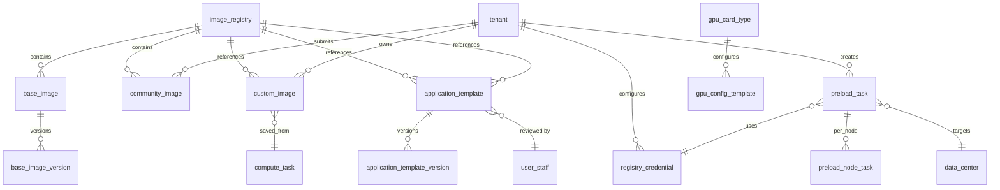

---

## 5. 交互流程

### 5.1 用户部署时选择镜像

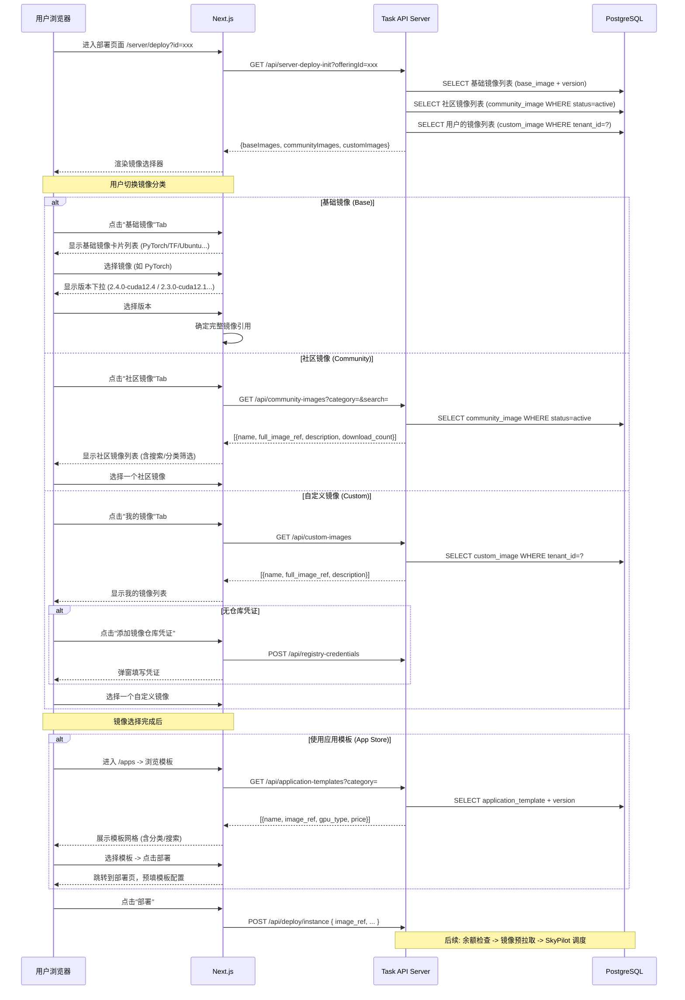

### 5.2 镜像预拉取流程

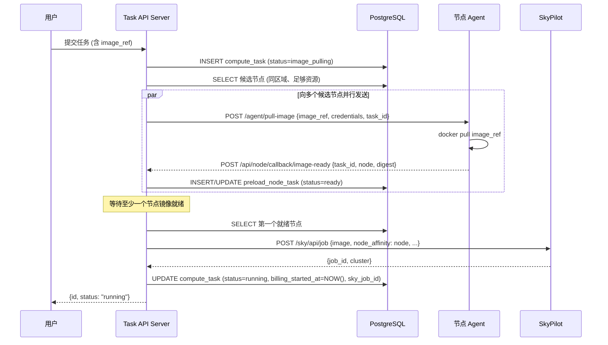

### 5.3 应用模板部署流程

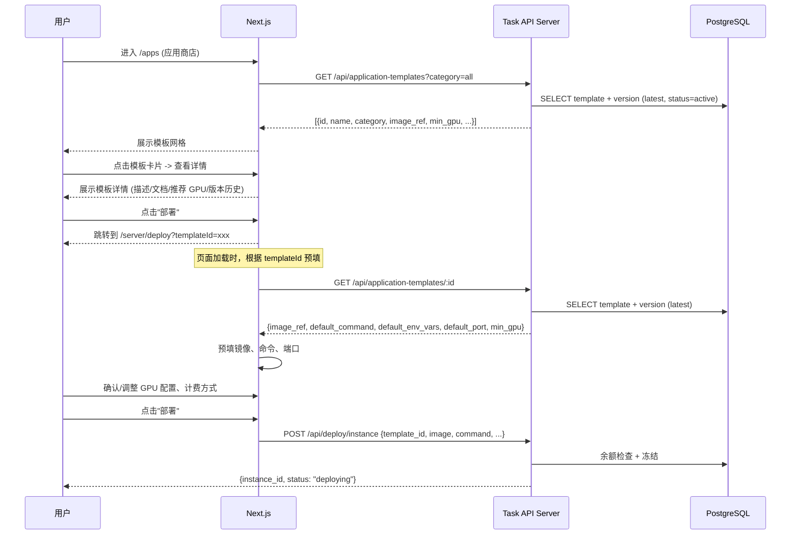

### 5.4 从运行实例保存为自定义镜像

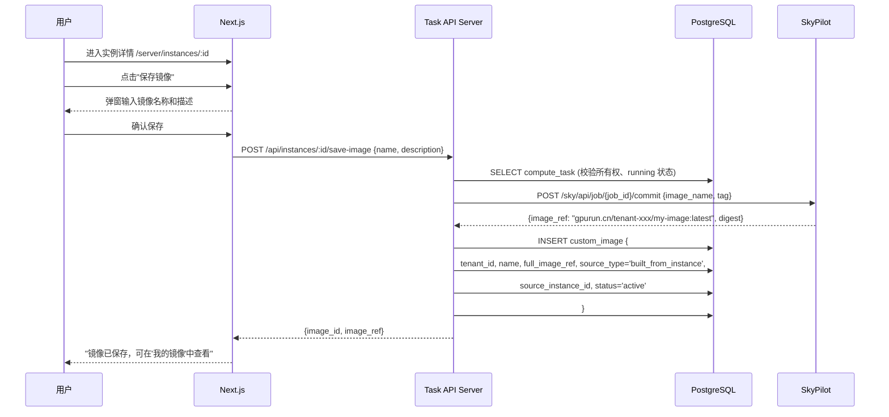

### 5.5 社区镜像上传与审核

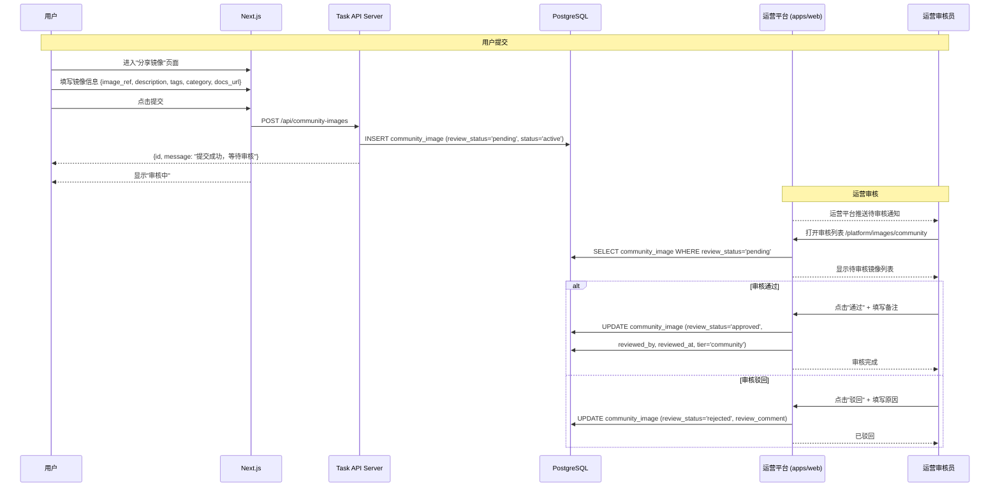

---

## 6. 运营管理功能

### 6.1 管理页面


| 管理页面     | 路径                           | 功能               | 对应表                                                |
| -------- | ---------------------------- | ---------------- | -------------------------------------------------- |
| 基础镜像管理   | `/platform/images/base`      | 管理基础镜像列表、新增版本、下架 | base_image, base_image_version                     |
| 社区镜像审核   | `/platform/images/community` | 待审核列表、通过/驳回      | community_image                                    |
| 自定义镜像审计  | `/platform/images/custom`    | 查看所有用户自定义镜像      | custom_image                                       |
| 镜像仓库管理   | `/platform/registries`       | 配置仓库地址、认证信息      | image_registry                                     |
| 应用模板管理   | `/platform/templates`        | 模板列表、新建/编辑、版本管理  | application_template, application_template_version |
| 应用模板审核   | `/platform/templates/review` | 用户提交模板的审核        | application_template (pending)                     |
| GPU 配置模板 | `/platform/gpu-templates`    | 管理 GPU 规格模板      | gpu_config_template                                |
| 预加载任务列表  | `/platform/preload`          | 查看全局预加载任务        | preload_task                                       |


### 6.2 应用模板上架流程

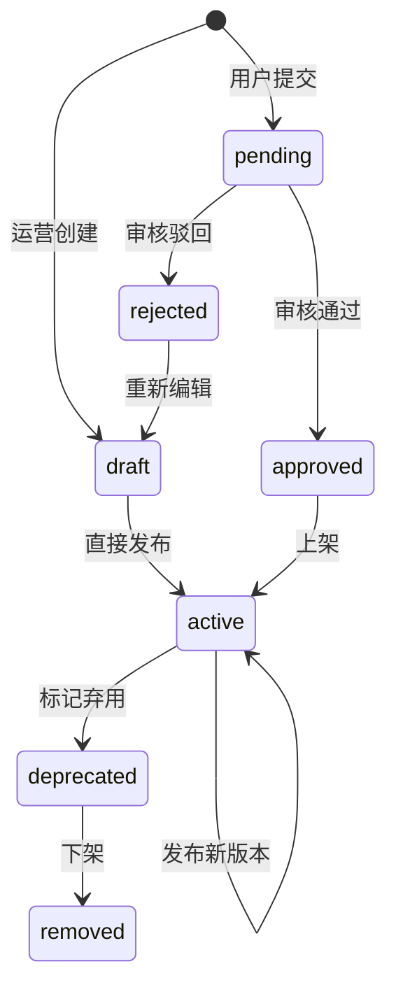

### 6.3 镜像状态管理

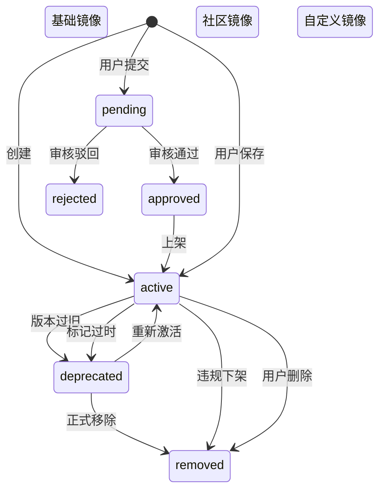

---

## 7. API 设计

### 7.1 面向用户 (apps/gpus)


| 方法       | 路径                                        | 功能                    | 对应流程    |
| -------- | ----------------------------------------- | --------------------- | ------- |
| `GET`    | `/api/base-images`                        | 基础镜像列表 (含版本)          | 部署页镜像选择 |
| `GET`    | `/api/base-images/:id/versions`           | 获取某镜像的版本列表            | 版本下拉    |
| `GET`    | `/api/community-images`                   | 社区镜像列表 (已上架, 支持搜索/分类) | 社区镜像浏览  |
| `POST`   | `/api/community-images`                   | 提交社区镜像分享              | 社区上传    |
| `GET`    | `/api/custom-images`                      | 我的镜像列表                | 自定义镜像选择 |
| `POST`   | `/api/custom-images`                      | 添加自定义镜像引用             | 自定义镜像   |
| `DELETE` | `/api/custom-images/:id`                  | 删除自定义镜像               | 镜像管理    |
| `GET`    | `/api/registry-credentials`               | 我的仓库凭证列表              | 私有仓库配置  |
| `POST`   | `/api/registry-credentials`               | 添加仓库凭证                | 凭证管理    |
| `PUT`    | `/api/registry-credentials/:id`           | 更新仓库凭证                | 凭证管理    |
| `DELETE` | `/api/registry-credentials/:id`           | 删除仓库凭证                | 凭证管理    |
| `GET`    | `/api/application-templates`              | 应用模板列表 (含筛选)          | 应用商店    |
| `GET`    | `/api/application-templates/:id`          | 应用模板详情                | 模板详情    |
| `GET`    | `/api/application-templates/:id/versions` | 模板版本历史                | 版本选择    |
| `POST`   | `/api/instances/:id/save-image`           | 从实例保存镜像               | 镜像保存    |
| `GET`    | `/api/gpu-config-templates`               | GPU 配置模板列表            | 配置模板选择  |
| `GET`    | `/api/preload-tasks`                      | 预加载任务列表               | 预加载管理   |
| `POST`   | `/api/preload-tasks`                      | 创建预加载任务               | 预加载创建   |
| `DELETE` | `/api/preload-tasks/:id`                  | 删除预加载任务               | 预加载删除   |
| `POST`   | `/api/node/callback/image-ready`          | 节点镜像拉取完成回调            | 预拉取回调   |


### 7.2 面向运营 (apps/web)


| 方法       | 路径                                            | 功能                                       |
| -------- | --------------------------------------------- | ---------------------------------------- |
| `GET`    | `/api/platform/base-images`                      | 管理基础镜像列表                                 |
| `POST`   | `/api/platform/base-images`                      | 新增基础镜像                                   |
| `PUT`    | `/api/platform/base-images/:id`                  | 更新基础镜像                                   |
| `POST`   | `/api/platform/base-images/:id/versions`         | 新增版本                                     |
| `PUT`    | `/api/platform/base-images/:id/versions/:vid`    | 更新版本                                     |
| `GET`    | `/api/platform/community-images`                 | 待审核/已审核社区镜像列表                            |
| `POST`   | `/api/platform/community-images/:id/review`      | 审核社区镜像 {action: approve/reject, comment} |
| `GET`    | `/api/platform/application-templates`            | 管理应用模板列表                                 |
| `POST`   | `/api/platform/application-templates`            | 创建应用模板                                   |
| `PUT`    | `/api/platform/application-templates/:id`        | 更新应用模板                                   |
| `DELETE` | `/api/platform/application-templates/:id`        | 删除应用模板                                   |
| `POST`   | `/api/platform/application-templates/:id/review` | 审核应用模板                                   |
| `GET`    | `/api/platform/gpu-config-templates`             | 管理 GPU 配置模板                              |
| `POST`   | `/api/platform/gpu-config-templates`             | 创建配置模板                                   |
| `PUT`    | `/api/platform/gpu-config-templates/:id`         | 更新配置模板                                   |
| `GET`    | `/api/platform/preload-tasks`                    | 全局预加载任务列表                                |
| `GET`    | `/api/platform/registries`                       | 镜像仓库配置                                   |
| `POST`   | `/api/platform/registries`                       | 添加仓库                                     |
| `PUT`    | `/api/platform/registries/:id`                   | 更新仓库                                     |


---

## 8. 用户界面路由

### 8.1 用户侧 (apps/gpus)


| 路由                              | 页面            | 数据来源                                        |
| ------------------------------- | ------------- | ------------------------------------------- |
| `/apps`                         | 应用商店          | application_template                        |
| `/server/deploy`                | 云服务器部署页       | base_image + community_image + custom_image |
| `/server/deploy?templateId=xxx` | 预填模板的部署页      | application_template + version              |
| `/server/instances/:id`         | 实例详情 → "保存镜像" | compute_task + custom_image                 |
| `/preloaded`                    | 预加载镜像管理       | preload_task                                |
| `/settings/registry`            | 镜像仓库凭证设置      | registry_credential                         |
| `/images/custom`                | 我的自定义镜像       | custom_image                                |
| `/images/share`                 | 分享镜像 (提交社区)   | → POST community_image                      |


### 8.2 运营侧 (apps/web)


| 路由                              | 页面         |
| ------------------------------- | ---------- |
| `/platform/images/base`            | 基础镜像管理     |
| `/platform/images/base/:id`        | 基础镜像版本管理   |
| `/platform/images/community`       | 社区镜像审核列表   |
| `/platform/images/community/:id`   | 社区镜像审核详情   |
| `/platform/templates`              | 应用模板列表     |
| `/platform/templates/create`       | 新建应用模板     |
| `/platform/templates/:id`          | 编辑应用模板     |
| `/platform/templates/:id/versions` | 模板版本管理     |
| `/platform/gpu-templates`          | GPU 配置模板管理 |
| `/platform/preload`                | 全局预加载监控    |
| `/platform/registries`             | 镜像仓库配置     |


---

## 9. 预加载性能与约束

### 9.1 约束

```sql
-- 每个租户最多同时预加载任务数
-- 应用层: 前端展示 MAX_PRELOAD_TASKS = 5
-- 数据库层: 触发器或应用层校验

-- 每个预加载任务最多 100 GB
-- 预加载镜像大小限制
```

### 9.2 预加载策略

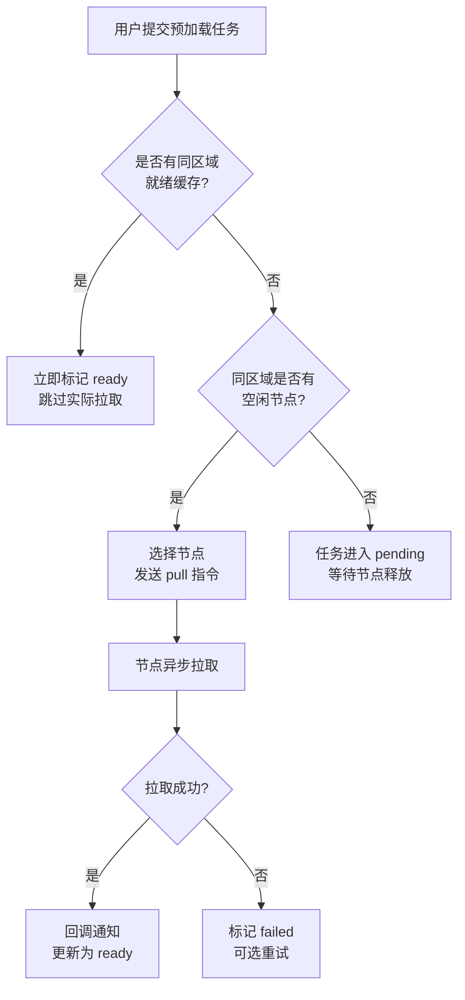

### 9.3 预拉取触发时机

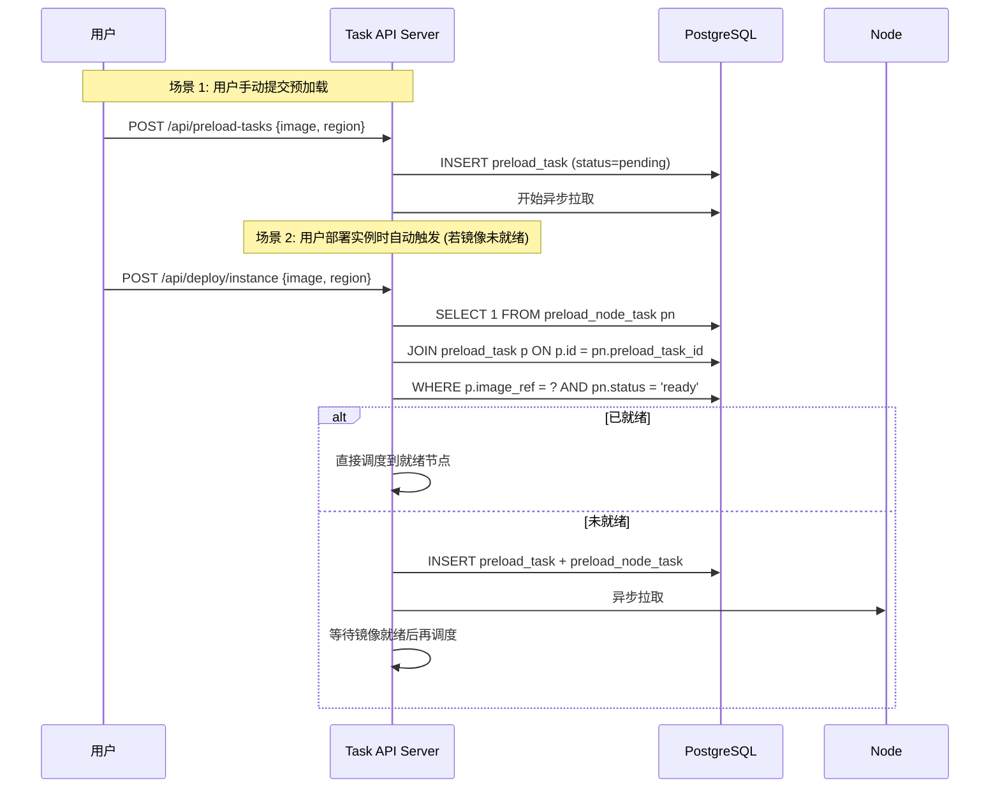

---

## 附录：与现有模块的关系

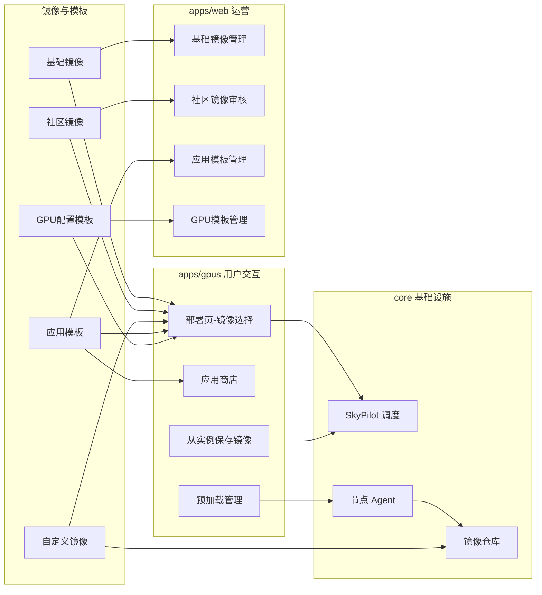

