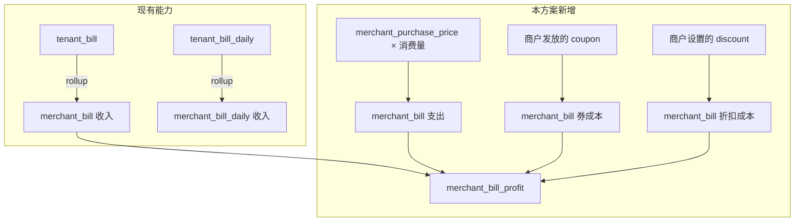
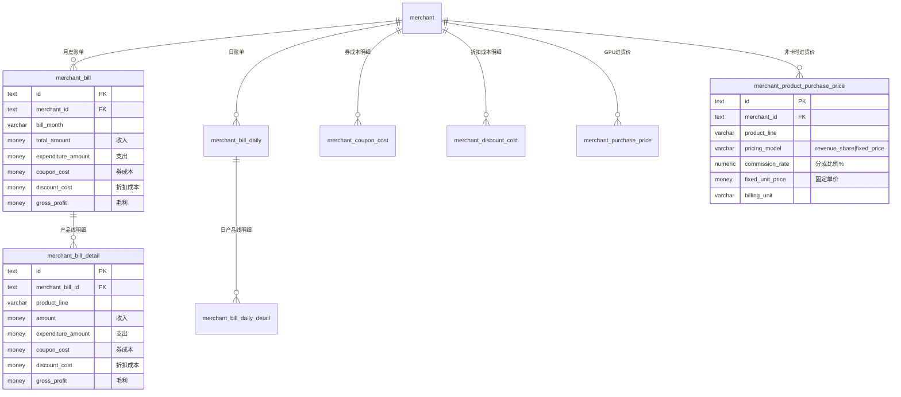
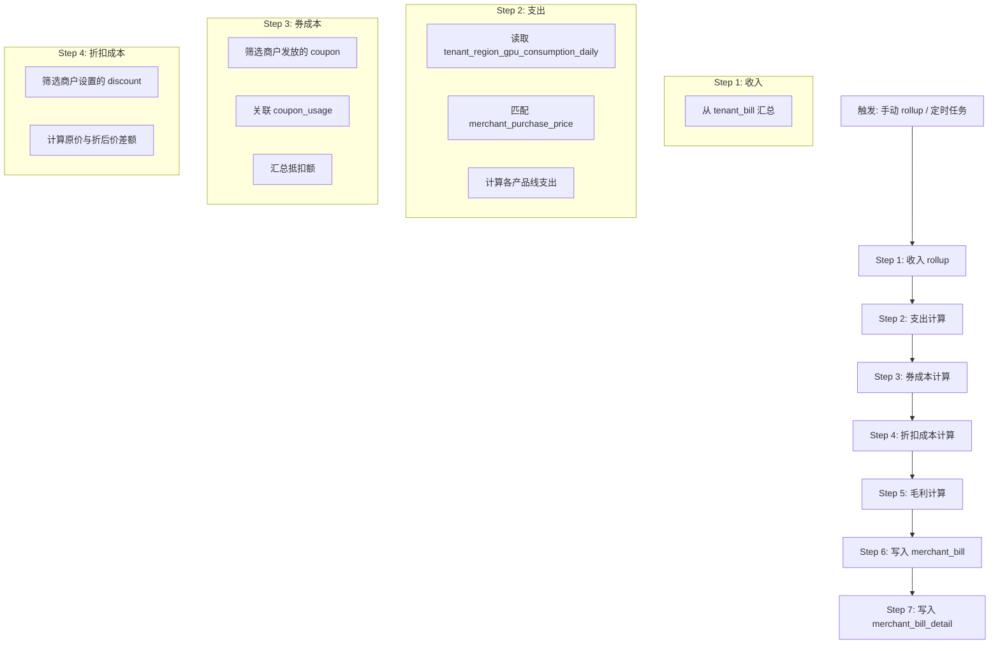

# 商户账单系统设计方案

> **已取代** → [merchant-open-items-design.md](../merchant-open-items-design.md)
>
> 本文档保留作历史参考，**勿按其实施**。裁决依据见 [矛盾台账](../audit/doc-contradictions.md)。
>
> 要点：§1 计费体系：毛利公式、券成本取数、commission_rate 单位、funding_mode 分流均已按定稿口径变更


> **版本**：v1.1  
> **日期**：2026-07-20  
> **状态**：**设计中**  
> **变更**：v1.1 — 非卡时产品线（Token/存储等）进货价模型：商户级分成比例或固定价格  
> **关联**：
> - [merchant-management-design.md](../../../apps/web/content/design/merchant-management-design.md)（商户域整体设计 v1.8）
> - [tenant-billing-import-design.md](../../../apps/web/content/design/tenant-billing-import-design.md)（租户月度账单导入）
> - [tenant-bill-daily-sync-design.md](../../../apps/web/content/design/tenant-bill-daily-sync-design.md)（租户日账单同步）
> - [finance-single-period-income-design.md](../../../apps/web/content/design/finance-single-period-income-design.md)（平台收入计算）
> - [discount-coupon-sync-design.md](../../../apps/web/content/design/discount-coupon-sync-design.md)（算力券与折扣同步）
> - `packages/db/src/merchant-schema.ts`（商户域 Schema）
> - `packages/db/src/crm-schema.ts`（CRM 域 Schema：`tenant_bill`、`coupon`、`discount_template`）
> - `packages/db/src/platform-pricing-schema.ts`（平台定价 Schema）

---

## 1. 背景与目标

### 1.1 业务诉求

商户作为平台的分销/合作主体，需要完整的经营账单体系来衡量自身盈亏：

| # | 目标 | 说明 |
|---|------|------|
| G1 | **月度收入账单** | 商户下属全部租户的消费汇总 = 商户向租户收取的费用 |
| G2 | **月度支出账单（进货）** | 商户按进货价向平台采购算力的成本 = 商户实际支付给平台的费用 |
| G3 | **日账单** | 按日粒度展示收入与支出，支持经营趋势分析 |
| G4 | **券成本** | 商户自行发放给租户的算力券，计入商户营销成本 |
| G5 | **折扣成本** | 商户给租户设置的折扣优惠，计入商户营销成本 |
| G6 | **利润计算** | 收入 - 支出 - 券成本 - 折扣成本 = 商户毛利 |

### 1.2 非目标（本期）

- **不** 实现商户自助对账门户（仅 CRM 运营平台展示）
- **不** 实现商户间资源转让或跨商户结算
- **不** 替代财务域 `billing_period` 账期核算（本方案面向商户经营视角，与平台财务账期独立）
- **不** 实现自动出票/发票功能

### 1.3 与现有方案的关系

当前商户账单（`merchant_bill` / `merchant_bill_daily`）仅为租户账单的简单 rollup，**不含支出维度**。本方案在现有基础上扩展：



---

## 2. 核心概念

### 2.1 商户经营模型

```text
                    ┌─────────────────────────────────┐
                    │          Merchant (商户)          │
                    │  进货价 = 平台刊例价 或 覆盖价      │
                    └──────────┬──────────────────────┘
                               │
            ┌──────────────────┼──────────────────┐
            ▼                  ▼                  ▼
   ┌──────────────┐  ┌──────────────┐  ┌──────────────┐
   │  Tenant A    │  │  Tenant B    │  │  Tenant C    │
   │  消费 ¥10000 │  │  消费 ¥5000  │  │  消费 ¥3000  │
   │  券抵 ¥2000  │  │  折扣 8折     │  │  无优惠       │
   └──────────────┘  └──────────────┘  └──────────────┘
```

### 2.2 金额口径定义

| 口径 | 公式 | 说明 |
|------|------|------|
| **收入（Income）** | `Σ tenant_bill.total_amount` | 租户消费总额（平台出账） |
| **支出（Expenditure）** | `Σ (消费量 × 进货价)` | 商户向平台采购成本 |
| **券成本（Coupon Cost）** | `Σ coupon.used_amount WHERE merchant_id = ?` | 商户发放的券被使用的部分 |
| **折扣成本（Discount Cost）** | `Σ (原价 - 折后价)` WHERE 折扣由商户设置 | 商户承担的折扣补贴 |
| **毛利（Gross Profit）** | 收入 - 支出 - 券成本 - 折扣成本 | 商户经营利润 |

### 2.3 进货价与消费量

进货价已在 `merchant_purchase_price` 中维护（按 `merchant_id × data_center × gpu_card_type × product_line × billing_unit` 粒度）。

消费量来源取决于产品线：

| 产品线 | 消费量来源 | 计量单位 |
|--------|-----------|---------|
| `pod_job` / `pod_deployment` / `pod_development` | `tenant_region_gpu_consumption_daily`（卡时） | 小时 |
| `bare_metal` | `bare_metal_order`（订单金额直接用进货价） | 订单 |
| `maas_token` / `juicefs` / `share_storage` / `harbor` | 按金额比例分摊（无独立卡时数据） | — |

> **简化策略**：对于无独立卡时数据的产品线（Token、存储等），支出按 **收入 × (1 - 平台毛利率)** 估算，或直接以平台出账金额作为支出（商户无差价）。具体策略在实施时确认。

---

## 3. 数据模型

### 3.1 现有表扩展

#### 3.1.1 `merchant_bill` 扩展支出字段

在现有 `merchant_bill` 表上**新增**支出维度字段：

| 列名 | 类型 | 说明 |
|------|------|------|
| `expenditure_amount` | `money` | 月度支出（进货成本） |
| `coupon_cost` | `money` | 商户发放券的已使用金额 |
| `discount_cost` | `money` | 商户设置折扣的优惠金额 |
| `gross_profit` | `money` | 毛利 = total_amount - expenditure_amount - coupon_cost - discount_cost |
| `expenditure_synced_at` | `timestamptz` | 支出数据最近计算时间 |

**现有列不变**：`total_amount`（收入）、`coupon_amount`（租户消费中的券抵扣）、`balance_amount`（租户消费中的余额支付）。

> **`coupon_amount` vs `coupon_cost` 的区别**：
> - `coupon_amount`：租户消费中由**平台发放的券**抵扣的金额（已存在于 tenant_bill）
> - `coupon_cost`：**商户自行发放的券**被租户使用的金额（新增）

#### 3.1.2 `merchant_bill_detail` 扩展

| 列名 | 类型 | 说明 |
|------|------|------|
| `expenditure_amount` | `money` | 该产品线的进货成本 |
| `coupon_cost` | `money` | 该产品线的券成本 |
| `discount_cost` | `money` | 该产品线的折扣成本 |
| `gross_profit` | `money` | 该产品线的毛利 |

#### 3.1.3 `merchant_bill_daily` 扩展

| 列名 | 类型 | 说明 |
|------|------|------|
| `expenditure_amount` | `money` | 日支出（进货成本） |
| `coupon_cost` | `money` | 日券成本 |
| `discount_cost` | `money` | 日折扣成本 |
| `gross_profit` | `money` | 日毛利 |

#### 3.1.4 `merchant_bill_daily_detail` 扩展

| 列名 | 类型 | 说明 |
|------|------|------|
| `expenditure_amount` | `money` | 该产品线日支出 |
| `coupon_cost` | `money` | 该产品线日券成本 |
| `discount_cost` | `money` | 该产品线日折扣成本 |
| `gross_profit` | `money` | 该产品线日毛利 |

### 3.2 新增表：`merchant_product_purchase_price`（非卡时产品线进货价）

非卡时产品线（Token、存储等）无 GPU 卡型维度，进货价按 `商户 × 产品线` 粒度配置，支持分成和固定价格两种模型：

| 列名 | 类型 | 约束 | 说明 |
|------|------|------|------|
| `id` | `text` | PK | |
| `merchant_id` | `text` | FK→`merchant.id`，NOT NULL | |
| `product_line` | `varchar(32)` | NOT NULL | 产品线：`maas_token`、`juicefs`、`share_storage`、`harbor` |
| `pricing_model` | `varchar(16)` | NOT NULL | `revenue_share`（分成）/ `fixed_price`（固定价格） |
| `commission_rate` | `numeric(7,4)` | NULL | 分成比例（%）；`pricing_model = 'revenue_share'` 时必填，如 `70.0000` 表示商户获得平台收入的 70% |
| `fixed_unit_price` | `money` | NULL | 固定单价；`pricing_model = 'fixed_price'` 时必填 |
| `billing_unit` | `varchar(16)` | NOT NULL | 计量单位：`token`、`gb_day`、`month` 等 |
| `currency` | `varchar(8)` | NOT NULL DEFAULT `'CNY'` | |
| `source` | `varchar(32)` | NOT NULL | 配置来源：`manual`（CRM 手工）/ `platform_sync`（平台同步） |
| `effective_from` | `date` | NOT NULL | 生效开始日 |
| `effective_to` | `date` | NULL | 生效结束日（NULL = 当前生效） |
| `status` | `varchar(32)` | NOT NULL | `active` / `archived` |
| `remark` | `text` | NULL | |
| `updated_by_staff_id` | `text` | FK→`user_staff.id`，NULL | |
| `created_at` | `timestamptz` | NOT NULL DEFAULT now() | |
| `updated_at` | `timestamptz` | NOT NULL | |

**索引**：

```sql
CREATE UNIQUE INDEX merchant_product_purchase_price_active_uk
  ON merchant_product_purchase_price (merchant_id, product_line)
  WHERE effective_to IS NULL AND status = 'active';

CREATE INDEX merchant_product_purchase_price_merchant_idx
  ON merchant_product_purchase_price (merchant_id);
```

**校验规则**（应用层）：

```text
IF pricing_model = 'revenue_share' THEN commission_rate IS NOT NULL AND 0 < commission_rate <= 100
IF pricing_model = 'fixed_price' THEN fixed_unit_price IS NOT NULL AND fixed_unit_price >= 0
```

> **与 `merchant_purchase_price` 的关系**：
> - `merchant_purchase_price`：GPU 卡时类产品线（`pod_job`、`pod_deployment`、`pod_development`），粒度 `商户 × 机房 × 卡型 × 产品线 × 计量单位`
> - `merchant_product_purchase_price`：非卡时产品线（Token、存储等），粒度 `商户 × 产品线`
> - 两者独立维护，支出计算时按产品线类型分别查找

### 3.3 新增表：`merchant_coupon_cost`（商户券成本明细）

商户发放的券被使用时，按租户 × 日粒度记录成本归属：

| 列名 | 类型 | 约束 | 说明 |
|------|------|------|------|
| `id` | `text` | PK | |
| `merchant_id` | `text` | FK→`merchant.id`，NOT NULL | |
| `tenant_id` | `text` | FK→`tenant.id`，NOT NULL | 使用券的租户 |
| `coupon_id` | `text` | FK→`coupon.id`，NULL | 关联的券实例（平台券时为 null） |
| `usage_date` | `date` | NOT NULL | 券使用日期 |
| `usage_month` | `varchar(7)` | NOT NULL | `YYYY-MM` |
| `product_line` | `varchar(64)` | NOT NULL | 使用的产品线 |
| `original_amount` | `money` | NOT NULL | 使用前原价 |
| `coupon_deduction` | `money` | NOT NULL | 券抵扣金额（= 商户券成本） |
| `merchant_id_source` | `varchar(32)` | NOT NULL | 券来源：`merchant_issued` / `platform_issued` |

**索引**：

```sql
CREATE UNIQUE INDEX merchant_coupon_cost_merchant_date_coupon_uk
  ON merchant_coupon_cost (merchant_id, usage_date, coupon_id);

CREATE INDEX merchant_coupon_cost_tenant_date_idx
  ON merchant_coupon_cost (tenant_id, usage_date);

CREATE INDEX merchant_coupon_cost_merchant_month_idx
  ON merchant_coupon_cost (merchant_id, usage_month);
```

> **说明**：仅记录**商户自行发放**的券（`merchant_id_source = 'merchant_issued'`）的成本。平台发放的券成本由平台承担，不计入商户支出。

### 3.4 新增表：`merchant_discount_cost`（商户折扣成本明细）

商户给租户设置的折扣，按租户 × 日粒度记录成本归属：

| 列名 | 类型 | 约束 | 说明 |
|------|------|------|------|
| `id` | `text` | PK | |
| `merchant_id` | `text` | FK→`merchant.id`，NOT NULL | |
| `tenant_id` | `text` | FK→`tenant.id`，NOT NULL | 享受折扣的租户 |
| `discount_template_id` | `text` | FK→`discount_template.id`，NULL | 关联的折扣模板 |
| `usage_date` | `date` | NOT NULL | 折扣生效日期 |
| `usage_month` | `varchar(7)` | NOT NULL | `YYYY-MM` |
| `product_line` | `varchar(64)` | NOT NULL | 折扣产品线 |
| `original_amount` | `money` | NOT NULL | 折前原价 |
| `discounted_amount` | `money` | NOT NULL | 折后价格 |
| `discount_cost` | `money` | NOT NULL | `original_amount - discounted_amount`（商户承担） |

**索引**：

```sql
CREATE UNIQUE INDEX merchant_discount_cost_merchant_date_tenant_pl_uk
  ON merchant_discount_cost (merchant_id, usage_date, tenant_id, product_line);

CREATE INDEX merchant_discount_cost_merchant_month_idx
  ON merchant_discount_cost (merchant_id, usage_month);
```

### 3.5 实体关系



---

## 4. 计算公式

### 4.1 月度收入（已有，不变）

```
收入 = Σ tenant_bill.total_amount
  WHERE tenant_id IN (SELECT id FROM tenant WHERE merchant_id = :merchantId)
    AND bill_month = :billMonth
```

产品线明细：

```
收入_产品线 = Σ tenant_bill_detail.amount
  WHERE bill_id IN (月度账单头)
    AND product_line = :productLine
```

### 4.2 月度支出（进货成本）

支出计算需要将**消费量**与**进货价**关联。消费量来源分两类：

#### 4.2.1 弹性算力（Pod 类产品线）

消费量来自 `tenant_region_gpu_consumption_daily`（卡时粒度）：

```
支出_pod = Σ (
  consumption.card_hours × purchase_price.hourly_price
)
WHERE tenant_id IN (商户下属租户)
  AND usage_month = :billMonth
  AND product_line IN ('pod_job', 'pod_deployment', 'pod_development')
```

进货价查找逻辑（与 `merchant_purchase_price` 一致）：

```
1. 精确匹配：merchant_id + data_center_id + gpu_card_type_id + product_line + billing_unit
2. 区域 fallback：merchant_id + data_center_id + product_line（任意卡型）
3. 商户 fallback：merchant_id + product_line（任意区域）
4. L1 刊例：platform_card_list_price.sell_price（默认进货价 = 平台刊例价）
```

#### 4.2.2 裸金属

直接使用订单的进货价（`bare_metal_order` 中已记录 `purchase_price` 或通过 `merchant_purchase_price` 查找）：

```
支出_baremetal = Σ order.final_amount
  WHERE order.tenant_id IN (商户下属租户)
    AND order.billing_month = :billMonth
    -- 使用订单下单时的进货价，非当前价
```

> **注意**：裸金属订单可能跨月，按 `billing_month`（订单归属月）而非下单月计算。

#### 4.2.3 非卡时产品线（Token、存储等）

非卡时产品线无独立卡时消费数据，进货价由**商户级配置**决定。每个商户对每个非卡时产品线有独立的进货价规则：

**进货价模型**：

| 模型 | 公式 | 适用场景 |
|------|------|---------|
| **分成模式** | `支出 = 租户消费额 × 分成比例 / 100` | 存储类（`juicefs`、`share_storage`）：按平台收入的一定比例结算 |
| **固定价格模式** | `支出 = 消费量 × 固定单价` | Token 服务（`maas_token`）、镜像仓库（`harbor`）等：按固定单价结算 |

**数据来源**：

```
支出_non_gpu = Σ (
  CASE pricing_model
    WHEN 'revenue_share' THEN
      tenant_bill_detail.amount × commission_rate / 100
    WHEN 'fixed_price' THEN
      consumption_quantity × fixed_unit_price
  END
)
WHERE tenant_id IN (商户下属租户)
  AND product_line IN ('maas_token', 'juicefs', 'share_storage', 'harbor')
  AND bill_month = :billMonth
```

> **说明**：`consumption_quantity` 对于 Token 类为 token 消耗量，对于存储类为存储用量（GB·天）。若平台 API 不返回消费量，分成模式可直接用 `tenant_bill_detail.amount` 作为基数。

### 4.3 券成本

仅统计**商户自行发放**的券被使用的部分：

```
券成本 = Σ coupon_usage.coupon_deduction
  WHERE coupon_usage.coupon_id IN (
    SELECT id FROM coupon WHERE merchant_id = :merchantId
    AND source = 'merchant_issued'  -- 商户自行发放
  )
  AND usage_month = :billMonth
```

> **与 `coupon_amount` 的区别**：
> - `tenant_bill.coupon_amount` = 平台券 + 商户券的**总抵扣额**（平台出账口径）
> - `merchant_bill.coupon_cost` = 仅**商户发放的券**的抵扣额（商户成本口径）

### 4.4 折扣成本

商户给租户设置的折扣，折扣成本 = 原价 - 折后价：

```
折扣成本 = Σ (original_amount - discounted_amount)
  WHERE tenant_id IN (商户下属租户)
    AND discount_source = 'merchant_configured'  -- 商户设置的折扣
    AND usage_month = :billMonth
```

折扣来源判断：

| 折扣来源 | 是否计入商户成本 | 说明 |
|----------|----------------|------|
| 平台统一活动 | **否** | 平台承担 |
| 商户自行设置 | **是** | 商户承担 |
| 供应商补贴 | **否** | 供应商承担 |

### 4.5 毛利

```
毛利 = 收入 - 支出 - 券成本 - 折扣成本
```

产品线级毛利：

```
毛利_产品线 = 收入_产品线 - 支出_产品线 - 券成本_产品线 - 折扣成本_产品线
```

---

## 5. 计算 Pipeline

### 5.1 月度账单计算



### 5.2 日账单计算

日账单计算逻辑与月度一致，粒度细化到 `usage_date`：

```
日收入 = Σ tenant_bill_daily.total_amount WHERE usage_date = :date
日支出 = Σ (日消费量 × 进货价) WHERE usage_date = :date
日券成本 = Σ coupon_usage WHERE usage_date = :date
日折扣成本 = Σ discount_cost WHERE usage_date = :date
日毛利 = 日收入 - 日支出 - 日券成本 - 日折扣成本
```

### 5.3 触发时机

| 触发 | 动作 | 说明 |
|------|------|------|
| 商户详情/账单页「刷新账单」 | 完整计算（收入+支出+券+折扣+毛利） | 手动触发 |
| 账单定时同步完成后 | 可选自动 rollup（配置项） | 依赖租户账单已同步 |
| 账期发布后 | 从 `platform_income_monthly` 读取收入（替代 tenant_bill rollup） | 与财务域对齐 |

### 5.4 幂等与重算

- 同一 `(merchant_id, bill_month)` 重跑结果一致
- 支出计算使用**当前生效**的进货价（非历史快照），若需精确历史毛利，应保存进货价快照
- 明细**先删后插**
- 券成本和折扣成本按**实际使用记录**计算，不受重算影响

---

## 6. 数据访问层设计

### 6.1 扩展现有 `merchantBillDataAccess`

在 `apps/web/src/lib/server/dataaccess/merchant/merchant-bill.ts` 中扩展：

```typescript
export const merchantBillDataAccess = {
  // --- 现有方法（保持不变）---
  listMonthly,
  getMonthlyDetails,
  listDaily,
  rollup,

  // --- 新增方法 ---
  /** 计算月度支出（进货成本） */
  computeMonthlyExpenditure(input: {
    merchantId: string
    billMonth: string
  }): Promise<MonthlyExpenditureResult>

  /** 计算月度券成本 */
  computeMonthlyCouponCost(input: {
    merchantId: string
    billMonth: string
  }): Promise<number>

  /** 计算月度折扣成本 */
  computeMonthlyDiscountCost(input: {
    merchantId: string
    billMonth: string
  }): Promise<number>

  /** 完整月度账单计算（收入+支出+券+折扣+毛利） */
  computeFullMonthlyBill(input: {
    merchantId: string
    billMonth: string
  }): Promise<FullMonthlyBillResult>

  /** 完整日账单计算 */
  computeFullDailyBill(input: {
    merchantId: string
    usageDate: string
  }): Promise<FullDailyBillResult>

  /** 获取利润趋势（用于商户概览图表） */
  getProfitTrend(input: {
    merchantId: string
    months: number
  }): Promise<ProfitTrendItem[]>
}
```

### 6.2 进货价查找（双轨模型）

进货价查找按产品线类型分两条路径：

**路径 A：GPU 卡时类产品线**（`pod_job`、`pod_deployment`、`pod_development`）

复用 `merchant-pricing.ts` 中的进货价查找逻辑：

```
resolveGpuPurchasePrice(merchantId, dataCenterId, gpuCardTypeId, productLine, billingUnit)
  → 1. merchant_purchase_price (精确匹配: merchant + dc + card + pl + unit)
  → 2. merchant_purchase_price (区域 fallback: merchant + dc + pl)
  → 3. merchant_purchase_price (商户 fallback: merchant + pl)
  → 4. platform_card_list_price.sell_price (L1 刊例 = 默认进货价)
```

**路径 B：非卡时产品线**（`maas_token`、`juicefs`、`share_storage`、`harbor`）

从 `merchant_product_purchase_price` 查找：

```
resolveNonGpuPurchasePrice(merchantId, productLine)
  → 1. merchant_product_purchase_price WHERE merchant_id AND product_line AND status='active' AND effective_to IS NULL
  → 2. 若未找到 → 返回 null（该商户未配置此产品线进货价，支出无法计算）
```

**统一入口**：

```typescript
function resolvePurchasePrice(
  merchantId: string,
  productLine: string,
  context?: { dataCenterId?: string; gpuCardTypeId?: string; billingUnit?: string }
): { pricingModel: 'card_time' | 'revenue_share' | 'fixed_price'; price?: number; rate?: number } | null
```

---

## 7. tRPC 接口设计

### 7.1 查询接口

| Procedure | 类型 | 说明 |
|-----------|------|------|
| `merchant.bill.getMonthly` | query | 月度账单列表（含支出/毛利） |
| `merchant.bill.getMonthlyDetail` | query | 月度账单产品线明细（含支出/毛利） |
| `merchant.bill.getDaily` | query | 日账单列表（含支出/毛利） |
| `merchant.bill.getDailyDetail` | query | 日账单产品线明细 |
| `merchant.bill.getProfitTrend` | query | 利润趋势（近 N 月） |
| `merchant.bill.getExpenditureBreakdown` | query | 支出构成（按产品线/区域） |

### 7.2 操作接口

| Procedure | 类型 | 说明 |
|-----------|------|------|
| `merchant.bill.computeMonthly` | mutation | 手动触发月度账单完整计算 |
| `merchant.bill.computeDaily` | mutation | 手动触发日账单计算 |
| `merchant.bill.refreshAll` | mutation | 刷新所有未计算月份 |

### 7.3 输入参数

```typescript
// computeMonthly
input: {
  merchantId: string
  billMonth: string       // YYYY-MM
}

// getMonthly
input: {
  merchantId: string
  page?: number
  pageSize?:number
}

// getMonthlyDetail
input: {
  merchantId: string
  billMonth: string
  billId?: string         // 优先用 billId 查存储结果
}

// getDaily
input: {
  merchantId: string
  billMonth: string       // 按月筛选日账单
}
```

### 7.4 输出结构

```typescript
type MerchantMonthlyBillItem = {
  id: string
  merchantId: string
  billMonth: string
  // 收入维度
  totalAmount: number        // 收入
  couponAmount: number       // 平台券抵扣
  balanceAmount: number      // 余额消费
  // 支出维度
  expenditureAmount: number  // 进货成本
  couponCost: number         // 商户券成本
  discountCost: number       // 商户折扣成本
  // 利润
  grossProfit: number        // 毛利
  grossMargin: number        // 毛利率 (%)
  // 元数据
  tenantCount: number
  source: string
  syncedAt: string
}

type MerchantMonthlyBillDetailItem = {
  id: string
  productLine: string
  resourceName: string
  // 收入
  amount: number
  couponAmount: number
  balanceAmount: number
  // 支出
  expenditureAmount: number
  couponCost: number
  discountCost: number
  // 利润
  grossProfit: number
  grossMargin: number
  type: string
}
```

---

## 8. 前端展示设计

### 8.1 商户账单页（`/merchant/[id]/consumption`）

扩展现有消耗/账单看板：

```
┌─────────────────────────────────────────────────────────────────┐
│ 商户账单 — 2026-07                                    [刷新账单]  │
├─────────────────────────────────────────────────────────────────┤
│ Card: 本月概览                                                   │
│ ┌──────────┬──────────┬──────────┬──────────┬──────────┐       │
│ │ 收入      │ 支出      │ 券成本    │ 折扣成本  │ 毛利      │       │
│ │ ¥120,000 │ ¥84,000  │ ¥8,000   │ ¥5,000   │ ¥23,000  │       │
│ │           │          │          │          │ 19.2%    │       │
│ └──────────┴──────────┴──────────┴──────────┴──────────┘       │
├─────────────────────────────────────────────────────────────────┤
│ Tab: [月度账单] [日账单] [利润趋势]                                │
├─────────────────────────────────────────────────────────────────┤
│ 月度账单 Tab:                                                    │
│ Table:                                                          │
│ | 月份    | 收入     | 支出     | 券成本  | 折扣成本 | 毛利    | 毛利率 |
│ | 2026-07 | ¥120,000| ¥84,000 | ¥8,000 | ¥5,000  | ¥23,000| 19.2% |
│ | 2026-06 | ¥115,000| ¥80,000 | ¥7,500 | ¥4,500  | ¥23,000| 20.0% |
│ | ...     | ...     | ...     | ...    | ...     | ...    | ...   │
│                                                                 │
│ 点击月份 → 展开产品线明细（收入/支出/券/折扣/毛利按产品线拆分）       │
├─────────────────────────────────────────────────────────────────┤
│ 日账单 Tab:                                                      │
│ 筛选: [月份下拉]                                                  │
│ Table:                                                          │
│ | 日期       | 收入    | 支出    | 券成本 | 折扣成本 | 毛利   |       │
│ | 2026-07-20 | ¥4,200 | ¥2,940 | ¥280  | ¥175    | ¥805  |       │
│ | 2026-07-19 | ¥4,100 | ¥2,870 | ¥260  | ¥165    | ¥805  |       │
├─────────────────────────────────────────────────────────────────┤
│ 利润趋势 Tab:                                                    │
│ 折线图: X轴=月份, Y轴=金额                                         │
│ 三条线: 收入(蓝) / 支出(红) / 毛利(绿)                              │
└─────────────────────────────────────────────────────────────────┘
```

### 8.2 产品线明细展开

点击月度账单某行，展开该月产品线明细：

```
┌─────────────────────────────────────────────────────────────────┐
│ 2026-07 产品线明细                                    [收起]      │
├─────────────────────────────────────────────────────────────────┤
│ | 产品线       | 收入     | 支出     | 券成本 | 折扣 | 毛利    | 毛利率 |
│ | 弹性部署     | ¥60,000 | ¥42,000 | ¥4,000| ¥2,500| ¥11,500| 19.2% |
│ | Job          | ¥30,000 | ¥21,000 | ¥2,000| ¥1,250| ¥5,750 | 19.2% |
│ | 云主机       | ¥20,000 | ¥14,000 | ¥1,300| ¥800  | ¥3,900 | 19.5% |
│ | 裸金属       | ¥10,000 | ¥7,000  | ¥700  | ¥450  | ¥1,850 | 18.5% |
│ | 对象存储加速 | —       | —       | —     | —     | —      | —     │
│ | 合计         | ¥120,000| ¥84,000 | ¥8,000| ¥5,000| ¥23,000| 19.2% |
└─────────────────────────────────────────────────────────────────┘
```

---

## 9. 与财务域的关系

### 9.1 口径差异

| 维度 | 商户账单（本方案） | 财务域账期（billing_period） |
|------|-------------------|---------------------------|
| **主体** | 商户 | 平台 |
| **收入** | 租户消费汇总 | 平台收入（含平台直客） |
| **成本** | 商户进货价 × 消耗量 | 供应商成本 + 提成 |
| **利润** | 商户毛利 | 平台毛利 |
| **触发** | 手动 rollup / 定时 | 财务人员操作账期 |

### 9.2 数据共享

- 商户月度收入：可从 `platform_income_monthly` 读取（若租户已纳入账期计算），或从 `tenant_bill` rollup（实时）
- 商户支出：独立计算，不依赖财务域 `platform_cost_monthly`
- 两者可交叉校验，但**不做自动联动**

---

## 10. Migration 计划

### 10.1 Schema 变更

| 步骤 | 内容 | 影响 |
|------|------|------|
| 1 | `merchant_bill` 新增 `expenditure_amount`、`coupon_cost`、`discount_cost`、`gross_profit`、`expenditure_synced_at` | 向后兼容，新字段 default 0 |
| 2 | `merchant_bill_detail` 新增同名字段 | 向后兼容 |
| 3 | `merchant_bill_daily` 新增同名字段 | 向后兼容 |
| 4 | `merchant_bill_daily_detail` 新增同名字段 | 向后兼容 |
| 5 | 新建 `merchant_product_purchase_price` 表（非卡时产品线进货价） | 新表 |
| 6 | 新建 `merchant_coupon_cost` 表 | 新表 |
| 7 | 新建 `merchant_discount_cost` 表 | 新表 |

### 10.2 迁移策略

- 新字段全部 `DEFAULT '0'`，历史数据不受影响
- 首次计算时，对所有历史月份**回填**支出/毛利数据
- 回填为异步任务，不阻塞日常使用

---

## 11. 风险与待确认项

| ID | 问题 | 建议默认 |
|----|------|---------|
| Q1 | 非卡时产品线的消费量（token 数、存储 GB·天）从哪里获取？ | 分成模式直接用 `tenant_bill_detail.amount` 作为基数；固定价格模式需 API 返回消费量 |
| Q2 | 进货价使用当前价还是历史快照？ | 首期用当前价；若需精确历史毛利，后续加进货价快照 |
| Q3 | 商户券和平台券的区分标准？ | 通过 `coupon.merchant_id` 和发放来源判断 |
| Q4 | 折扣成本如何区分商户设置 vs 平台统一活动？ | 通过折扣模板的 `source` 字段判断 |
| Q5 | 裸金属跨月消费如何归属？ | 按订单 `billing_month` 归属 |
| Q6 | 是否需要进货价快照（保证历史毛利精确）？ | 首期不做；后续根据需要增加 |
| Q7 | 日账单是否支持实时计算（每次查询）？ | 首期仅支持手动 rollup；实时查询走聚合 SQL |
| Q8 | `merchant_product_purchase_price` 的分成比例/固定价格是否需要版本化？ | 首期用 `effective_from/to` 实现版本化，与 `merchant_purchase_price` 一致 |

---

## 12. 实施阶段

| 阶段 | 内容 | 依赖 |
|------|------|------|
| P0 | Schema migration（扩展字段 + 新建 `merchant_product_purchase_price` / `merchant_coupon_cost` / `merchant_discount_cost`） | 无 |
| P1 | GPU 卡时产品线支出计算（进货价匹配 + 卡时消费） | `tenant_region_gpu_consumption_daily` 已有数据 |
| P2 | 非卡时产品线支出计算（分成/固定价格模型） | `merchant_product_purchase_price` 已配置 |
| P3 | 券成本 / 折扣成本计算 | `coupon` / `discount_template` 数据已同步 |
| P4 | 完整 rollup + tRPC 接口 | P0-P3 |
| P5 | 前端账单页改造（概览 + 月度 + 日 + 利润趋势） | P4 |
| P6 | 历史数据回填 + 定时 rollup | P5 |

---

## 变更记录

| 版本 | 日期 | 说明 |
|------|------|------|
| v1.0 | 2026-07-20 | 初稿 |
| v1.1 | 2026-07-20 | 非卡时产品线进货价模型：分成/固定价格；新增 `merchant_product_purchase_price` 表 |
