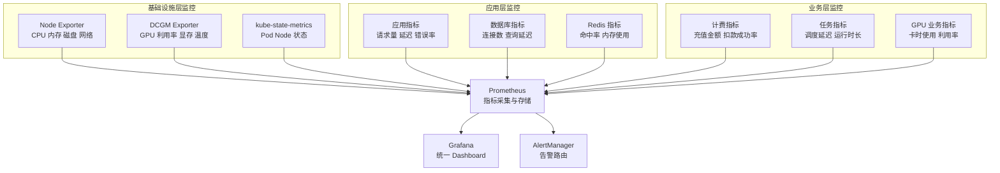
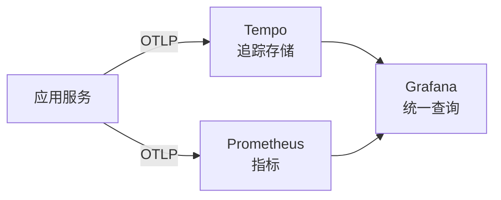
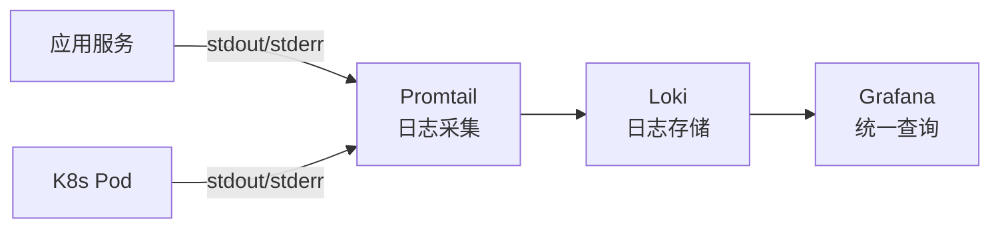

# 监控与可观测性设计

> 基于 Prometheus + Grafana 生态的全方位监控体系，覆盖基础设施、应用、业务三层监控。
> 集成 DCGM Exporter (GPU)、Grafana Tempo (追踪)、Grafana Loki (日志)。

---

## 1. 监控架构

### 1.1 三层监控模型



### 1.2 组件分工

| 组件 | 用途 | 部署位置 |
|------|------|---------|
| **Prometheus** | 指标采集、存储、查询 | 中心集群 |
| **Grafana** | 可视化 Dashboard | 中心集群 |
| **AlertManager** | 告警路由、去重、静默 | 中心集群 |
| **DCGM Exporter** | GPU 指标采集 | IDC 边缘集群 |
| **Node Exporter** | 主机指标采集 | 所有节点 |
| **kube-state-metrics** | K8s 状态指标 | 中心/边缘集群 |
| **Grafana Tempo** | 分布式追踪 | 中心集群 |
| **Grafana Loki** | 日志聚合 | 中心集群 |

---

## 2. 基础设施监控

### 2.1 GPU 监控 (DCGM Exporter)

```yaml
# GPU 指标
dcgm_fe_dev_busy_pct        # GPU 利用率 (%)
dcgm_fe_dev_fb_used         # 显存使用 (MiB)
dcgm_fe_dev_fb_free         # 显存空闲 (MiB)
dcgm_fe_dev_temperature     # GPU 温度 (°C)
dcgm_fe_dev_power_usage     # 功耗 (W)
dcgm_fe_dev_ecc_sbe         # 单bit ECC 错误
dcgm_fe_dev_ecc_dbe         # 双bit ECC 错误
dcgm_fe_sm_active           # SM 活跃周期
dcgm_fe_sm_occupancy        # SM 占用率
```

**GPU 告警规则**:

```yaml
groups:
  - name: gpu_alerts
    rules:
      - alert: GpuHighTemperature
        expr: dcgm_fe_dev_temperature > 85
        for: 5m
        labels:
          severity: warning
        annotations:
          summary: "GPU 温度过高: {{ $labels.gpu }} on {{ $labels.instance }}"

      - alert: GpuMemoryHigh
        expr: (dcgm_fe_dev_fb_used / (dcgm_fe_dev_fb_used + dcgm_fe_dev_fb_free)) > 0.95
        for: 10m
        labels:
          severity: warning

      - alert: GpuEccError
        expr: rate(dcgm_fe_dev_ecc_dbe[5m]) > 0
        labels:
          severity: critical
```

### 2.2 主机监控 (Node Exporter)

```yaml
# 关键指标
node_cpu_seconds_total           # CPU 使用
node_memory_MemAvailable_bytes   # 可用内存
node_filesystem_avail_bytes      # 磁盘可用空间
node_network_receive_bytes_total # 网络接收
node_network_transmit_bytes_total # 网络发送
node_disk_io_time_seconds_total  # 磁盘 IO
```

**主机告警规则**:

```yaml
groups:
  - name: node_alerts
    rules:
      - alert: NodeHighCPU
        expr: 100 - (avg by(instance) (rate(node_cpu_seconds_total{mode="idle"}[5m])) * 100) > 90
        for: 10m
        labels:
          severity: warning

      - alert: NodeLowMemory
        expr: (node_memory_MemAvailable_bytes / node_memory_MemTotal_bytes) < 0.1
        for: 5m
        labels:
          severity: critical

      - alert: NodeDiskSpaceLow
        expr: (node_filesystem_avail_bytes / node_filesystem_size_bytes) < 0.1
        for: 5m
        labels:
          severity: critical
```

### 2.3 Kubernetes 监控 (kube-state-metrics)

```yaml
# 关键指标
kube_pod_status_phase           # Pod 状态
kube_node_status_condition      # Node 状态
kube_deployment_status_replicas # Deployment 副本数
kube_job_status_complete        # Job 完成状态
kube_resourcequota              # 资源配额使用
```

---

## 3. 应用层监控

### 3.1 应用指标采集

```typescript
// 应用指标暴露端点
// GET /metrics

// 请求指标
http_requests_total{method, path, status}
http_request_duration_seconds{method, path}

// 业务指标
task_create_total{type, status}
task_duration_seconds{type}
billing_deduction_total{status}
payment_order_total{method, status}
recharge_amount_total{method}
```

### 3.2 数据库监控

```yaml
# PostgreSQL 指标 (postgres_exporter)
pg_stat_activity_count           # 活跃连接数
pg_stat_database_xact_commit     # 事务提交数
pg_stat_database_xact_rollback   # 事务回滚数
pg_stat_database_blks_hit        # 缓存命中
pg_stat_user_tables_n_live_tup   # 行数
pg_locks_count                   # 锁数量
```

### 3.3 Redis 监控

```yaml
# Redis 指标 (redis_exporter)
redis_memory_used_bytes          # 内存使用
redis_connected_clients          # 连接数
redis_commands_processed_total   # 命令处理数
redis_keyspace_hits_total        # 命中数
redis_keyspace_misses_total      # 未命中数
```

---

## 4. 业务层监控

### 4.1 计费业务指标

```yaml
# 充值指标
recharge_attempt_total{method}           # 充值尝试次数
recharge_success_total{method}           # 充值成功次数
recharge_amount_total{method}            # 充值金额
recharge_duration_seconds{method}        # 充值耗时

# 扣款指标
billing_deduction_attempt_total          # 扣款尝试次数
billing_deduction_success_total          # 扣款成功次数
billing_deduction_amount_total           # 扣款金额
billing_insufficient_balance_total       # 余额不足次数

# 支付回调指标
payment_callback_total{channel, status}  # 回调次数
payment_callback_latency_seconds{channel} # 回调延迟
```

### 4.2 任务调度指标

```yaml
# 任务指标
task_submit_total{type}                  # 任务提交数
task_schedule_duration_seconds{type}     # 调度耗时
task_running_count{type}                 # 运行中任务数
task_image_pull_duration_seconds         # 镜像拉取耗时
task_failure_total{type, reason}         # 任务失败数

# GPU 使用指标
gpu_utilization_avg                      # 平均 GPU 利用率
gpu_hours_total{type, gpu_type}          # GPU 卡时使用
gpu_available_count{data_center}         # 可用 GPU 数量
```

---

## 5. 分布式追踪 (Grafana Tempo)

### 5.1 追踪架构



### 5.2 追踪场景

| 场景 | 追踪链路 | 关键 Span |
|------|---------|----------|
| **任务提交** | API → 余额检查 → SkyPilot 调度 → 容器启动 | balance_check, skypilot_schedule, container_start |
| **推理请求** | Traefik → ForwardAuth → SkyServe | auth_verify, forward, inference |
| **充值支付** | API → 支付渠道 → 回调处理 | create_payment, channel_api, callback |
| **定时扣款** | 定时服务 → OpenMeter 查询 → 余额扣减 | query_usage, calculate_cost, deduct_balance |

### 5.3 追踪采样策略

```yaml
# Tempo 配置
metrics_generator:
  ring:
    kvstore:
      store: memberlist
  processor:
    spanmetrics:
      dimensions:
        - http.method
        - http.status_code
        - tenant_id
        - task_type
  storage:
    path: /var/tempo/wal
    remote_write:
      - url: http://prometheus:9090/api/v1/write

# 采样策略
distributor:
  receivers:
    otlp:
      protocols:
        grpc:
          max_recv_msg_size_mib: 4
```

---

## 6. 日志聚合 (Grafana Loki)

### 6.1 日志架构



### 6.2 日志标签

```yaml
# Promtail 配置
scrape_configs:
  - job_name: kubernetes-pods
    kubernetes_sd_configs:
      - role: pod
    relabel_configs:
      - source_labels: [__meta_kubernetes_pod_label_app]
        target_label: app
      - source_labels: [__meta_kubernetes_namespace]
        target_label: namespace
      - source_labels: [__meta_kubernetes_pod_node_name]
        target_label: node
```

### 6.3 日志查询示例

```logql
# 查询特定任务的日志
{app="task-manager"} | json | task_id="xxx"

# 查询错误日志
{namespace="production"} |= "ERROR"

# 查询 GPU 节点日志
{node=~"gpu-node-.*"} | logfmt | level="error"
```

---

## 7. 告警设计

### 7.1 告警级别

| 级别 | 响应时间 | 通知渠道 | 示例 |
|------|---------|---------|------|
| **P0 (紧急)** | 5 分钟 | 电话 + 飞书 | 资金异常、数据库宕机 |
| **P1 (严重)** | 30 分钟 | 飞书 | GPU 节点故障、任务大量失败 |
| **P2 (警告)** | 2 小时 | 飞书 | 磁盘空间不足、性能下降 |
| **P3 (通知)** | 次日 | 邮件 | 资源使用接近阈值 |

### 7.2 告警规则

```yaml
groups:
  - name: business_alerts
    rules:
      - alert: HighPaymentFailureRate
        expr: rate(payment_callback_total{status="failed"}[5m]) / rate(payment_callback_total[5m]) > 0.05
        for: 5m
        labels:
          severity: critical
        annotations:
          summary: "支付失败率超过 5%"

      - alert: TaskScheduleDelay
        expr: histogram_quantile(0.95, rate(task_schedule_duration_seconds_bucket[5m])) > 60
        for: 10m
        labels:
          severity: warning

      - alert: GpuUtilizationLow
        expr: avg(dcgm_fe_dev_busy_pct) < 20
        for: 1h
        labels:
          severity: info
```

### 7.3 告警路由

```yaml
# AlertManager 配置
route:
  group_by: ['alertname', 'severity']
  group_wait: 30s
  group_interval: 5m
  repeat_interval: 4h
  receiver: 'feishu'
  routes:
    - match:
        severity: critical
      receiver: 'phone'
    - match:
        severity: warning
      receiver: 'feishu'

receivers:
  - name: 'feishu'
    webhook_configs:
      - url: 'https://open.feishu.cn/open-apis/bot/v2/hook/xxx'
  - name: 'phone'
    webhook_configs:
      - url: 'https://phone-alert.example.com/notify'
```

---

## 8. Dashboard 设计

### 8.1 核心 Dashboard

| Dashboard | 内容 | 受众 |
|-----------|------|------|
| **基础设施总览** | Node/Pod/GPU 状态、资源使用率 | 运维 |
| **GPU 监控** | 利用率、显存、温度、ECC 错误 | 运维 |
| **应用性能** | 请求量、延迟、错误率、吞吐量 | 开发 |
| **计费业务** | 充值/扣款成功率、金额、异常 | 业务 |
| **任务调度** | 调度延迟、成功率、队列深度 | 业务 |
| **告警历史** | 告警趋势、响应时间、解决时间 | 管理 |

### 8.2 Dashboard as Code

```typescript
// Grafana Dashboard JSON
{
  "dashboard": {
    "title": "GPU 业务监控",
    "panels": [
      {
        "title": "GPU 利用率",
        "type": "timeseries",
        "targets": [{
          "expr": "avg(dcgm_fe_dev_busy_pct) by (instance)",
          "legendFormat": "{{ instance }}"
        }]
      },
      {
        "title": "任务运行数",
        "type": "stat",
        "targets": [{
          "expr": "sum(task_running_count) by (type)",
          "legendFormat": "{{ type }}"
        }]
      }
    ]
  }
}
```

---

## 9. SLO/SLI 定义

| 服务 | SLI | SLO 目标 |
|------|-----|---------|
| **任务管理 API** | 可用性 (非 5xx 请求) | 99.9% |
| **推理网关** | 延迟 (P95) | < 500ms |
| **支付系统** | 可用性 | 99.99% |
| **计费系统** | 准确性 (扣款正确率) | 100% |

---

## 10. 实施路线图

| 阶段 | 内容 | 周期 |
|------|------|------|
| **Phase 1** | Prometheus + Node Exporter + DCGM + 基础告警 | 1 周 |
| **Phase 2** | Grafana Dashboard + 业务指标 | 1 周 |
| **Phase 3** | Loki 日志聚合 + Promtail | 1 周 |
| **Phase 4** | Tempo 分布式追踪 | 1 周 |
| **Phase 5** | SLO 定义 + 高级告警 | 持续 |
