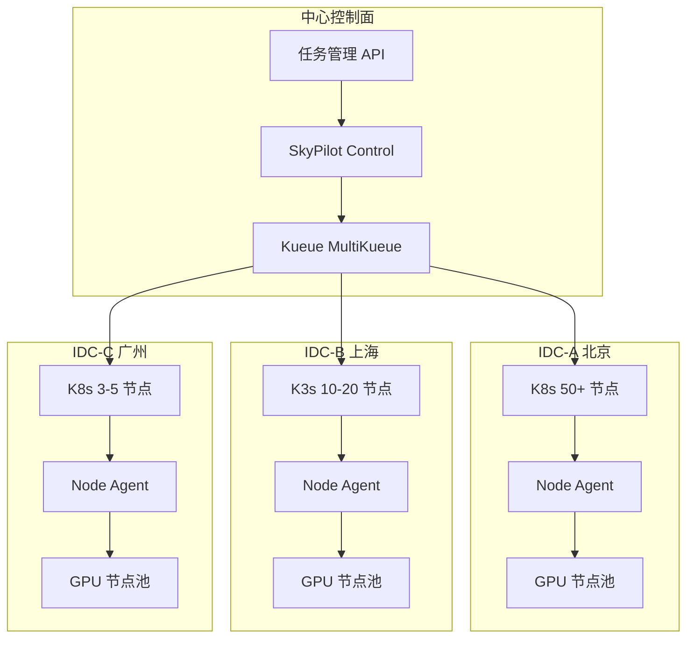
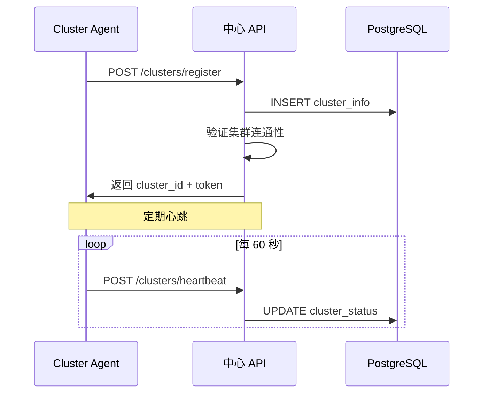
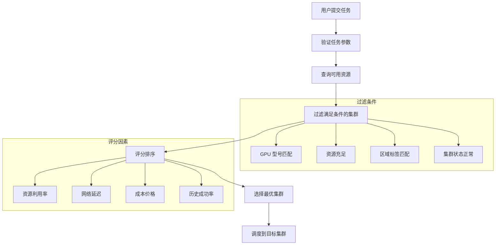
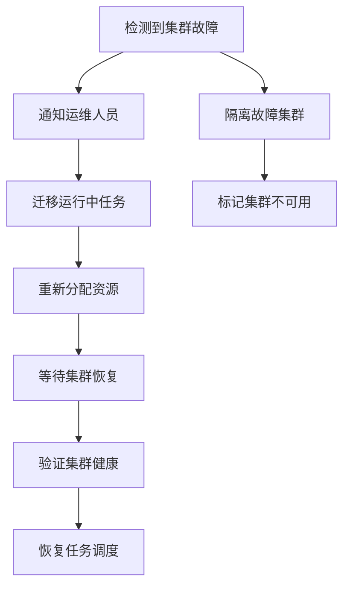

# 多 IDC 联邦设计

> 统一调度多个 IDC 机房的异构 GPU 资源，支持 3-5 台至 50+ 台集群的弹性扩展。
> 基于 SkyPilot + Kueue MultiKueue 实现跨集群资源发现与调度。

---

## 1. 联邦架构

### 1.1 架构模型



### 1.2 组件分工

| 组件 | 用途 | 部署位置 |
|------|------|---------|
| **SkyPilot Control** | 多集群调度控制器 | 中心集群 |
| **Kueue MultiKueue** | 跨集群队列管理 | 中心集群 |
| **Cluster Registry** | 集群注册与发现 | 中心集群 |
| **Node Agent** | 节点自注册与健康检查 | 每个 IDC |

---

## 2. 集群注册

### 2.1 集群信息模型

```typescript
interface ClusterInfo {
  id: string
  name: string                    // 集群名称
  idc: string                     // 所属 IDC
  region: string                  // 地域标签
  endpoint: string                // API Server 地址
  status: 'active' | 'inactive' | 'maintenance'

  // 资源信息
  nodes: NodeInfo[]
  totalGpuCount: number
  availableGpuCount: number
  gpuTypes: string[]              // ['A100', 'H100', 'V100']

  // 网络信息
  networkConfig: {
    podCidr: string
    serviceCidr: string
    loadBalancerCidr: string
  }

  // 配置信息
  config: {
    maxNodes: number
    maxPods: number
    maxGpuPerTask: number
    schedulerPolicy: string
  }

  // 时间戳
  registeredAt: Date
  lastHeartbeat: Date
}
```

### 2.2 集群注册流程



---

## 3. 资源发现

### 3.1 资源信息模型

```typescript
interface ClusterResources {
  clusterId: string
  timestamp: Date

  // 节点资源
  nodes: {
    total: number
    ready: number
    gpuNodes: number
  }

  // GPU 资源
  gpu: {
    total: number
    available: number
    byType: Record<string, {
      total: number
      available: number
      memoryMb: number
    }>
  }

  // CPU 资源
  cpu: {
    totalCores: number
    availableCores: number
  }

  // 内存资源
  memory: {
    totalGb: number
    availableGb: number
  }

  // 存储资源
  storage: {
    totalGb: number
    availableGb: number
  }

  // 队列状态
  queues: {
    name: string
    pendingJobs: number
    runningJobs: number
  }[]
}
```

### 3.2 资源同步

```typescript
// 资源信息同步（每 30 秒）
async function syncClusterResources(clusterId: string) {
  // 1. 查询本地资源
  const resources = await queryLocalResources()

  // 2. 上报到中心
  await fetch(`${API_BASE}/clusters/${clusterId}/resources`, {
    method: 'PUT',
    headers: { 'Content-Type': 'application/json' },
    body: JSON.stringify(resources),
  })

  // 3. 更新本地缓存
  await updateLocalCache(resources)
}

// 查询本地资源
async function queryLocalResources(): Promise<ClusterResources> {
  const nodes = await k8sApi.listNode()
  const pods = await k8sApi.listPod('all')
  const gpuNodes = nodes.items.filter(n => n.metadata.labels['gpu'])

  return {
    clusterId: clusterId,
    timestamp: new Date(),
    nodes: {
      total: nodes.items.length,
      ready: nodes.items.filter(n => n.status.conditions.find(c => c.type === 'Ready' && c.status === 'True')).length,
      gpuNodes: gpuNodes.length,
    },
    gpu: {
      total: gpuNodes.reduce((sum, n) => sum + parseInt(n.status.capacity['nvidia.com/gpu'] || '0'), 0),
      available: gpuNodes.reduce((sum, n) => sum + parseInt(n.status.allocatable['nvidia.com/gpu'] || '0'), 0),
      byType: getGpuTypeDistribution(gpuNodes),
    },
    // ... 其他资源信息
  }
}
```

---

## 4. 调度策略

### 4.1 调度决策流程



### 4.2 调度算法

```typescript
// 集群评分算法
function scoreCluster(cluster: ClusterInfo, task: TaskRequest): number {
  let score = 0

  // 1. 资源匹配度 (40%)
  const gpuMatch = cluster.gpu.available >= task.gpuRequired ? 1 : 0
  const cpuMatch = cluster.cpu.availableCores >= task.cpuRequired ? 1 : 0
  const memoryMatch = cluster.memory.availableGb >= task.memoryRequired ? 1 : 0
  score += (gpuMatch * 0.5 + cpuMatch * 0.25 + memoryMatch * 0.25) * 40

  // 2. 资源利用率 (30%) - 越低越好
  const utilization = 1 - (cluster.gpu.available / cluster.gpu.total)
  score += (1 - utilization) * 30

  // 3. 区域亲和性 (20%)
  if (task.preferredRegion === cluster.region) {
    score += 20
  } else if (task.preferredRegion === '') {
    score += 10
  }

  // 4. 成本因素 (10%)
  const cost = getClusterCost(cluster.id, task.gpuType)
  score += (1 - cost / maxCost) * 10

  return score
}

// 调度决策
async function scheduleTask(task: TaskRequest): Promise<ScheduleDecision> {
  // 1. 查询所有可用集群
  const clusters = await getAvailableClusters()

  // 2. 过滤满足条件的集群
  const validClusters = clusters.filter(c => validateCluster(c, task))

  // 3. 评分排序
  const scoredClusters = validClusters.map(c => ({
    cluster: c,
    score: scoreCluster(c, task),
  })).sort((a, b) => b.score - a.score)

  // 4. 选择最优集群
  if (scoredClusters.length === 0) {
    throw new Error('No available cluster found')
  }

  return {
    clusterId: scoredClusters[0].cluster.id,
    score: scoredClusters[0].score,
    alternatives: scoredClusters.slice(1, 3),
  }
}
```

---

## 5. 跨集群通信

### 5.1 通信模式

| 模式 | 用途 | 实现 |
|------|------|------|
| **API 调用** | 控制面通信 | HTTPS + mTLS |
| **数据同步** | 资源信息同步 | WebSocket |
| **日志传输** | 日志聚合 | Loki 远程写 |
| **指标传输** | 监控数据 | Prometheus Remote Write |

### 5.2 网络配置

```yaml
# 跨集群网络配置
network:
  # VPN 连接
  vpn:
    type: wireguard
    peers:
      - name: idc-a
        endpoint: vpn-a.platform.com
        allowedIPs: ["10.0.0.0/16"]
      - name: idc-b
        endpoint: vpn-b.platform.com
        allowedIPs: ["10.1.0.0/16"]

  # 服务网格
  serviceMesh:
    enabled: true
    provider: istio
    multiCluster: true

  # DNS 解析
  dns:
    clusterDomain: cluster.local
    crossClusterDns: true
```

---

## 6. 故障转移

### 6.1 故障检测

```typescript
// 集群健康检查
async function checkClusterHealth(clusterId: string): Promise<HealthStatus> {
  const cluster = await getCluster(clusterId)

  // 1. API Server 可达性
  const apiReachable = await checkApiReachable(cluster.endpoint)

  // 2. 节点状态
  const nodeHealth = await checkNodeHealth(clusterId)

  // 3. GPU 可用性
  const gpuHealth = await checkGpuHealth(clusterId)

  // 4. 网络连通性
  const networkHealth = await checkNetworkHealth(clusterId)

  return {
    clusterId,
    status: apiReachable && nodeHealth && gpuHealth && networkHealth ? 'healthy' : 'unhealthy',
    details: {
      api: apiReachable,
      nodes: nodeHealth,
      gpu: gpuHealth,
      network: networkHealth,
    },
    lastCheck: new Date(),
  }
}
```

### 6.2 故障转移流程



---

## 7. 成本优化

### 7.1 成本模型

```typescript
interface ClusterCost {
  clusterId: string
  idc: string

  // 固定成本
  fixedCost: {
    monthly: number        // 月度固定费用
    network: number        // 网络费用
    management: number     // 管理费用
  }

  // 可变成本
  variableCost: {
    gpuHour: Record<string, number>  // GPU 卡时价
    cpuCoreHour: number              // CPU 核时价
    memoryGbHour: number             // 内存 GB 时价
  }

  // 总成本
  totalCost: number
  costPerGpuHour: number
}
```

### 7.2 成本优化策略

| 策略 | 说明 | 实现 |
|------|------|------|
| **Spot 实例** | 利用闲置资源 | 优先调度到空闲 GPU |
| **混合计费** | 包月 + 按量 | 长期任务用包月 |
| **跨 IDC 调度** | 选择成本最低的 IDC | 成本感知调度 |
| **资源复用** | 共享 GPU | MIG 技术 |

---

## 8. 监控与运维

### 8.1 联邦监控

```yaml
# 多集群监控配置
federation_monitoring:
  # 集群状态
  cluster_status:
    - cluster_id
    - status
    - node_count
    - gpu_available
    - last_heartbeat

  # 调度指标
  scheduling_metrics:
    - scheduling_latency_seconds
    - scheduling_success_total
    - scheduling_failure_total

  # 跨集群流量
  cross_cluster_traffic:
    - bytes_sent
    - bytes_received
    - latency_ms
```

### 8.2 运维工具

```typescript
// 联邦管理 API
const federationApi = {
  // 集群管理
  listClusters: () => GET('/clusters'),
  getCluster: (id) => GET(`/clusters/${id}`),
  updateCluster: (id, data) => PUT(`/clusters/${id}`, data),
  removeCluster: (id) => DELETE(`/clusters/${id}`),

  // 资源查询
  getClusterResources: (id) => GET(`/clusters/${id}/resources`),
  getFederationResources: () => GET('/federation/resources'),

  // 调度管理
  getScheduleHistory: () => GET('/schedules'),
  getScheduleStats: () => GET('/schedules/stats'),
}
```
