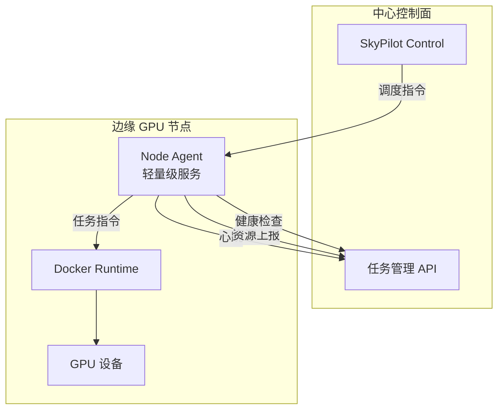

# 节点 Agent 设计

> 部署在每个 GPU 节点上的轻量级 Agent，负责节点自注册、健康检查、任务调度、资源采集。
> 支持 K8s/K3s 和裸金属两种部署模式。

---

## 1. Agent 架构

### 1.1 架构模型



### 1.2 组件分工

| 组件 | 用途 | 部署方式 |
|------|------|---------|
| **Node Agent** | 节点管理、任务调度 | DaemonSet / systemd |
| **Docker Runtime** | 容器运行时 | 预装 |
| **DCGM Exporter** | GPU 指标采集 | DaemonSet |
| **Node Exporter** | 主机指标采集 | DaemonSet |

---

## 2. Agent 功能

### 2.1 节点自注册

```typescript
// 节点注册流程
async function registerNode() {
  const nodeInfo = {
    hostname: os.hostname(),
    ip: getInternalIp(),
    gpuCount: getGpuCount(),
    gpuTypes: getGpuTypes(),
    cpuCores: os.cpus().length,
    memoryGb: Math.round(os.totalmem() / 1024 / 1024 / 1024),
    diskGb: getDiskSpace(),
    clusterName: process.env.CLUSTER_NAME,
    idcName: process.env.IDC_NAME,
  }

  // 向 API Server 注册
  const response = await fetch(`${API_BASE}/nodes/register`, {
    method: 'POST',
    headers: { 'Content-Type': 'application/json' },
    body: JSON.stringify(nodeInfo),
  })

  return response.json()
}
```

### 2.2 心跳上报

```typescript
// 心跳上报（每 30 秒）
async function heartbeat() {
  const status = {
    nodeId: nodeId,
    timestamp: Date.now(),
    resources: {
      cpu: {
        cores: os.cpus().length,
        used: getCpuUsage(),
        available: os.cpus().length - getCpuUsage(),
      },
      memory: {
        totalGb: Math.round(os.totalmem() / 1024 / 1024 / 1024),
        usedGb: Math.round(os.freemem() / 1024 / 1024 / 1024),
        availableGb: Math.round((os.totalmem() - os.freemem()) / 1024 / 1024 / 1024),
      },
      gpu: getGpuStatus(),
      disk: getDiskStatus(),
    },
    tasks: getRunningTasks(),
    health: getHealthStatus(),
  }

  await fetch(`${API_BASE}/nodes/heartbeat`, {
    method: 'POST',
    headers: { 'Content-Type': 'application/json' },
    body: JSON.stringify(status),
  })
}
```

### 2.3 健康检查

```typescript
// 健康检查指标
interface HealthStatus {
  cpu: {
    usage: number          // CPU 使用率 (%)
    loadAverage: number[]  // 负载均值
  }
  memory: {
    usage: number          // 内存使用率 (%)
    available: number      // 可用内存 (GB)
  }
  gpu: GpuStatus[]
  disk: {
    usage: number          // 磁盘使用率 (%)
    available: number      // 可用空间 (GB)
  }
  network: {
    latency: number        // 网络延迟 (ms)
    bandwidth: number      // 带宽 (Mbps)
  }
  docker: {
    running: number        // 运行中容器数
    stopped: number        // 停止容器数
  }
}

// GPU 状态
interface GpuStatus {
  index: number
  name: string
  utilization: number     // GPU 利用率 (%)
  memoryUsed: number      // 显存使用 (MB)
  memoryTotal: number     // 显存总量 (MB)
  temperature: number     // 温度 (°C)
  power: number           // 功耗 (W)
}
```

---

## 3. 任务调度

### 3.1 镜像预拉取

```typescript
// 镜像预拉取流程
async function pullImage(taskId: string, image: string) {
  // 1. 接收拉取指令
  const task = await receivePullCommand(taskId, image)

  // 2. 执行 docker pull
  const pullProcess = spawn('docker', ['pull', image])

  // 3. 上报进度
  pullProcess.stdout.on('data', (data) => {
    reportProgress(taskId, 'pulling', data.toString())
  })

  // 4. 完成回调
  pullProcess.on('close', async (code) => {
    if (code === 0) {
      // 获取镜像 digest
      const digest = await getImageDigest(image)

      // 回调 API Server
      await fetch(`${API_BASE}/tasks/${taskId}/image-ready`, {
        method: 'POST',
        headers: { 'Content-Type': 'application/json' },
        body: JSON.stringify({
          nodeId: nodeId,
          image: image,
          digest: digest,
        }),
      })
    } else {
      reportProgress(taskId, 'failed', `Pull failed with code ${code}`)
    }
  })
}
```

### 3.2 容器管理

```typescript
// 启动容器
async function startContainer(taskId: string, config: ContainerConfig) {
  const docker = new Docker()

  const container = await docker.createContainer({
    Image: config.image,
    Cmd: config.command,
    Env: config.envVars,
    HostConfig: {
      Resources: {
        DeviceRequests: config.gpuCount ? [{
          Driver: 'nvidia',
          Count: config.gpuCount,
          Capabilities: [['gpu']],
        }] : [],
        Memory: config.memoryLimit,
        CpuShares: config.cpuLimit,
      },
      Binds: config.volumes,
      PortBindings: config.portBindings,
    },
    Labels: {
      'task-id': taskId,
      'org-id': config.orgId,
    },
  })

  await container.start()

  // 监控容器状态
  monitorContainer(container.id, taskId)

  return container.id
}

// 停止容器
async function stopContainer(containerId: string) {
  const docker = new Docker()
  const container = docker.getContainer(containerId)
  await container.stop()
  await container.remove()
}
```

### 3.3 资源采集

```typescript
// 资源使用采集（每 60 秒）
async function collectResourceUsage() {
  const tasks = getRunningTasks()

  for (const task of tasks) {
    const usage = {
      taskId: task.id,
      timestamp: Date.now(),
      billable: task.billable,
      organizationId: task.orgId,
      idc: process.env.IDC_NAME,
      node: os.hostname(),
      resources: {
        cpu: getTaskCpuUsage(task.containerId),
        memoryGb: getTaskMemoryUsage(task.containerId),
        gpu: getTaskGpuUsage(task.containerId),
      },
    }

    // 发送到 OpenMeter
    await sendToOpenMeter(usage)
  }
}

// GPU 使用采集
function getTaskGpuUsage(containerId: string) {
  // 使用 nvidia-smi 获取 GPU 使用
  const output = execSync(`nvidia-smi --query-compute-apps=pid,gpu_uuid,used_memory --format=csv,noheader`)
  // 解析并返回 GPU 使用数据
  return {
    type: 'A100',
    count: 1,
    memoryUsedMb: 8000,
  }
}
```

---

## 4. 裸金属支持

### 4.1 裸金属 Agent

```typescript
// 裸金属 Agent（SSH 模式）
class BareMetalAgent {
  private sshClient: SSHClient

  constructor(private device: SupplierDevice) {
    this.sshClient = new SSHClient({
      host: device.internalIp,
      username: device.loginUsername,
      password: device.loginPassword,
    })
  }

  // 执行命令
  async execCommand(command: string): Promise<string> {
    return this.sshClient.exec(command)
  }

  // 启动任务
  async startTask(taskId: string, config: TaskConfig): Promise<void> {
    // 1. 拉取镜像
    await this.execCommand(`docker pull ${config.image}`)

    // 2. 启动容器
    const cmd = `docker run -d --gpus all --name ${taskId} ${config.image} ${config.command}`
    await this.execCommand(cmd)

    // 3. 监控状态
    this.monitorTask(taskId)
  }

  // 停止任务
  async stopTask(taskId: string): Promise<void> {
    await this.execCommand(`docker stop ${taskId}`)
    await this.execCommand(`docker rm ${taskId}`)
  }

  // cgroup 限制
  async setCgroupLimits(taskId: string, limits: ResourceLimits) {
    const cgroupPath = `/sys/fs/cgroup/system.slice/docker-${taskId}.scope`

    // CPU 限制
    await this.execCommand(`echo ${limits.cpuQuota} > ${cgroupPath}/cpu.cfs_quota_us`)

    // 内存限制
    await this.execCommand(`echo ${limits.memoryLimit} > ${cgroupPath}/memory.limit_in_bytes`)
  }
}
```

---

## 5. 通信协议

### 5.1 Agent ↔ API Server

```typescript
// Agent API 接口
interface AgentApi {
  // 节点管理
  registerNode(info: NodeInfo): Promise<NodeRegistration>
  heartbeat(status: NodeStatus): Promise<void>

  // 任务管理
  pullImage(taskId: string, image: string): Promise<void>
  startTask(taskId: string, config: TaskConfig): Promise<void>
  stopTask(taskId: string): Promise<void>
  getTaskStatus(taskId: string): Promise<TaskStatus>

  // 资源采集
  reportUsage(usage: ResourceUsage): Promise<void>
}
```

### 5.2 通信安全

```typescript
// Agent 通信认证
const agentConfig = {
  // TLS 双向认证
  tls: {
    cert: '/etc/agent/tls/cert.pem',
    key: '/etc/agent/tls/key.pem',
    ca: '/etc/agent/tls/ca.pem',
  },

  // Token 认证
  auth: {
    token: process.env.AGENT_TOKEN,
  },

  // 重试策略
  retry: {
    maxRetries: 3,
    backoff: 'exponential',
  },
}
```

---

## 6. 部署配置

### 6.1 K8s DaemonSet

```yaml
apiVersion: apps/v1
kind: DaemonSet
metadata:
  name: node-agent
  namespace: kube-system
spec:
  selector:
    matchLabels:
      app: node-agent
  template:
    metadata:
      labels:
        app: node-agent
    spec:
      nodeSelector:
        node-role: gpu
      containers:
        - name: node-agent
          image: node-agent:latest
          env:
            - name: API_BASE
              value: "http://task-manager-api:3000"
            - name: CLUSTER_NAME
              valueFrom:
                fieldRef:
                  fieldPath: spec.nodeName
          volumeMounts:
            - name: docker-sock
              mountPath: /var/run/docker.sock
            - name: device-map
              mountPath: /dev
          resources:
            limits:
              cpu: 100m
              memory: 128Mi
      volumes:
        - name: docker-sock
          hostPath:
            path: /var/run/docker.sock
        - name: device-map
          hostPath:
            path: /dev
```

### 6.2 Systemd 服务

```ini
# /etc/systemd/system/node-agent.service
[Unit]
Description=GPU Node Agent
After=docker.service
Requires=docker.service

[Service]
Type=simple
User=root
ExecStart=/usr/local/bin/node-agent
Restart=always
RestartSec=10
Environment=API_BASE=http://task-manager-api:3000
Environment=CLUSTER_NAME=gpu-node-1

[Install]
WantedBy=multi-user.target
```

---

## 7. 监控与告警

### 7.1 Agent 指标

```yaml
# Agent 暴露的指标
node_agent_heartbeat_total           # 心跳次数
node_agent_heartbeat_latency_seconds # 心跳延迟
node_agent_task_pull_total           # 镜像拉取次数
node_agent_task_pull_duration_seconds # 镜像拉取耗时
node_agent_task_start_total          # 任务启动次数
node_agent_task_stop_total           # 任务停止次数
node_agent_usage_report_total        # 资源上报次数
```

### 7.2 告警规则

```yaml
groups:
  - name: agent_alerts
    rules:
      - alert: AgentHeartbeatMiss
        expr: time() - node_agent_heartbeat_timestamp > 120
        labels:
          severity: critical
        annotations:
          summary: "节点 Agent 心跳丢失: {{ $labels.node }}"

      - alert: AgentHighLatency
        expr: node_agent_heartbeat_latency_seconds > 5
        labels:
          severity: warning
```

---

## 8. 故障处理

### 8.1 故障场景

| 场景 | 检测方式 | 处理策略 |
|------|---------|---------|
| Agent 崩溃 | 心跳超时 | 自动重启 + 任务迁移 |
| 网络中断 | 心跳失败 | 本地缓存 + 重连 |
| Docker 异常 | 健康检查失败 | 重启 Docker + 恢复任务 |
| GPU 故障 | ECC 错误 | 标记节点不可用 + 任务迁移 |

### 8.2 恢复机制

```typescript
// 任务恢复机制
async function recoverTasks() {
  // 1. 查询数据库中本节点的运行中任务
  const tasks = await db.query.task.findMany({
    where: and(
      eq(task.nodeId, nodeId),
      eq(task.status, 'running')
    ),
  })

  // 2. 检查本地容器状态
  const runningContainers = await getRunningContainers()

  // 3. 恢复丢失的任务
  for (const task of tasks) {
    if (!runningContainers.includes(task.containerId)) {
      // 容器丢失，重新启动
      await startContainer(task.id, task.config)
    }
  }

  // 4. 清理孤立容器
  for (const container of runningContainers) {
    if (!tasks.find(t => t.containerId === container.id)) {
      // 容器存在但任务不存在，清理
      await container.stop()
      await container.remove()
    }
  }
}
```
