# OpenMeter 全链路计费方案

> **状态：候选方案 · 未采纳**
>
> 未采纳为计费真源，勿按其 L1/L3/L4 方案实施；实际口径见 [矛盾台账](../audit/doc-contradictions.md)。
>
> 要点：未采纳为计费真源，仅 L2 §5.4 与存储计费段可复用；实际计费走上游 OpenAPI 镜像（tenant-billing-system-design）


> **版本**：v2.1  
> **日期**：2026-07-26  
> **状态**：**设计中**  
> **范围**：基于 OpenMeter 的事件驱动计费体系，覆盖租户账单（含算力券与折扣）、预留资源包、存储与基础设施资源（镜像仓库/本地磁盘/镜像预热/网络卷）、供应商月度结算、商户经营损益、平台财务汇总四层账单  
> **关联**：
> - [reserved-resource-pack-design.md](reserved-resource-pack-design.md)（预留资源包设计方案）
> - [cloud-native-integration.md](../../../docs/design/k8s/cloud-native-integration.md)（OpenMeter 集成架构）
> - [billing-display.md](billing-display.md)（计费展示方案）
> - [merchant-billing-system-design.md](merchant-billing-system-design.md)（商户账单系统 v1.1）
> - [storage-quota-and-s3-volume.md](storage-quota-and-s3-volume.md)（存储配额与 S3 网络卷）
> - [../../business/image-preload-commercial-and-community-incentive.md](../../business/image-preload-commercial-and-community-incentive.md)（镜像预热商业化）
> - [image-registry-cost-optimization.md](../../../docs/design/k8s/image-registry-cost-optimization.md)（镜像仓库成本优化）
> - [image-tenant-workflow.md](../../../docs/design/k8s/image-tenant-workflow.md)（租户镜像上传下载流程）
> - `packages/db/src/crm-schema.ts`（租户/券/折扣 Schema）
> - `packages/db/src/merchant-schema.ts`（商户/进货价 Schema）
> - `packages/db/src/supply-schema.ts`（供应商/成本/设备 Schema）
> - `packages/db/src/finance-schema.ts`（财务账期 Schema）
> - `packages/db/src/gpus-consumer-schema.ts`（余额/支付/营销 Schema）
> - `packages/billing/src/`（余额操作 primitives）

---

## 1. 目标与范围

### 1.1 业务背景

平台需要一套**四层递进**的财务账单体系，从终端用户消费到平台总收入，完整追踪资金流向：

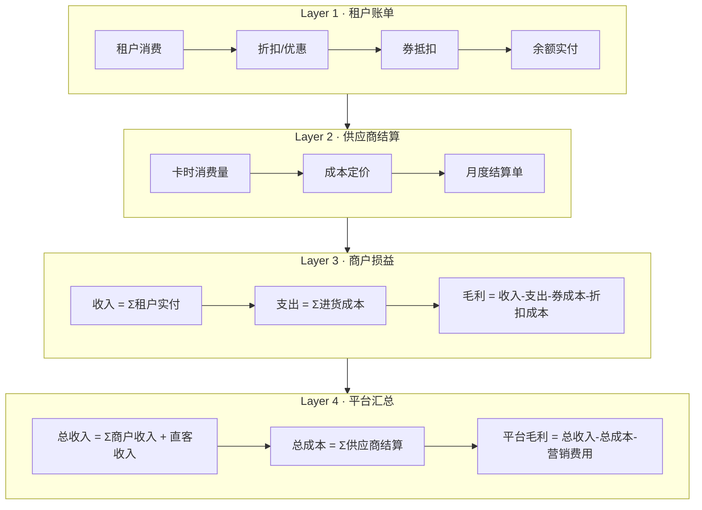

### 1.2 核心目标

| # | 目标 | 说明 |
|---|------|------|
| G1 | **租户账单** | 基于 OpenMeter 实时计量，含折扣/算力券/余额三层扣减，日账单 + 月账单 |
| G2 | **供应商月度结算** | 按机房×卡型汇总卡时消费，关联供应商成本定价，生成月度结算单 |
| G3 | **商户经营损益** | 收入（租户实付）- 支出（进货成本）- 券成本 - 折扣成本 = 毛利 |
| G4 | **平台财务汇总** | 总收入、总成本、平台毛利、营销费用分摊 |

### 1.3 非目标（本期）

- **不** 实现租户自助对账门户（仅 CRM 运营平台 + gpus 控制台展示）
- **不** 实现自动出票/发票
- **不** 替代财务域 `billing_period` 账期核算（本方案面向经营视角，与财务域独立运行或后续对齐）

---

## 2. 四层定价模型

### 2.1 价格层级

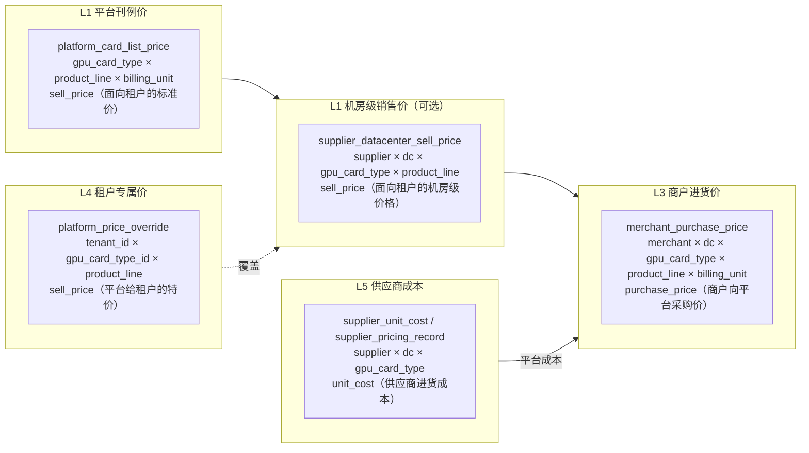

### 2.2 价格查找优先级

**租户计费价**（L1/L4 优先）：

```
1. platform_price_override WHERE tenant_id AND gpu_card_type_id AND product_line（租户专属价）
2. supplier_datacenter_sell_price WHERE supplier AND dc AND card AND pl AND unit（机房销售价）
3. platform_card_list_price WHERE gpu_card_type AND product_line AND billing_unit（平台刊例价）
```

**商户进货价**（C3 优先）：

```
1. merchant_purchase_price WHERE merchant AND dc AND card AND pl AND unit（精确匹配）
2. merchant_purchase_price WHERE merchant AND product_line（商户 fallback）
3. platform_card_list_price.sell_price（L1 刊例 = 默认进货价）
```

**供应商成本价**（E5）：

```
1. supplier_unit_cost WHERE supplier AND dc AND card（卡时价）
2. supplier_pricing_record WHERE supplier AND dc AND card（整租/分成）
```

---

## 3. OpenMeter 用量计量

### 3.1 事件流

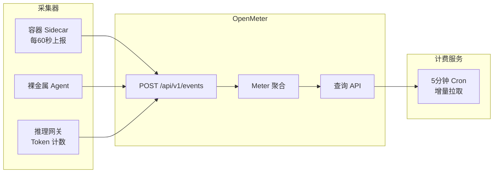

### 3.2 Meter 定义

#### 3.2.1 计算资源 Meter（已有）

| Meter slug | 事件类型 | 值属性 | groupBy | 过滤 | 用途 |
|------------|---------|--------|---------|------|------|
| `gpu_count_seconds` | `resource_usage` | `$.data.resources.gpu.count` | `tenant_id`, `gpu_type`, `product_line`, `idc`, `task_id` | `$.data.billable == true` | GPU 卡时 |
| `cpu_core_seconds` | `resource_usage` | `$.data.resources.cpu` | `tenant_id`, `product_line`, `task_id` | `$.data.billable == true` | CPU 用量 |
| `memory_gb_seconds` | `resource_usage` | `$.data.resources.memory` | `tenant_id`, `product_line`, `task_id` | `$.data.billable == true` | 内存用量 |
| `inference_tokens` | `inference_usage` | `$.data.total_tokens` | `tenant_id`, `model`, `task_id` | — | 推理 Token |
| `inference_requests` | `inference_usage` | `1` | `tenant_id`, `model`, `task_id` | — | 推理请求计数 |

#### 3.2.2 存储与基础设施 Meter（新增）

| Meter slug | 事件类型 | 值属性 | groupBy | 过滤 | 用途 |
|------------|---------|--------|---------|------|------|
| `registry_storage_gb_day` | `registry_usage` | `$.data.storage_gb` | `tenant_id`, `registry_host` | `$.data.billable == true` | 镜像仓库存储（GB·天） |
| `registry_pull_bytes` | `registry_usage` | `$.data.pull_bytes` | `tenant_id`, `registry_host`, `region` | `$.data.billable == true` | 镜像拉取流量（字节） |
| `registry_push_bytes` | `registry_usage` | `$.data.push_bytes` | `tenant_id`, `registry_host`, `region` | — | 镜像推送流量（字节，仅审计） |
| `node_disk_gb_day` | `disk_usage` | `$.data.disk_gb` | `tenant_id`, `node_id`, `disk_type` | `$.data.billable == true` | 节点本地磁盘占用（GB·天） |
| `preload_storage_gb_day` | `preload_usage` | `$.data.storage_gb` | `tenant_id`, `node_id`, `image_ref` | `$.data.billable == true` | 预热存储占用（GB·节点·天） |
| `preload_traffic_bytes` | `preload_usage` | `$.data.traffic_bytes` | `tenant_id`, `node_id`, `region` | `$.data.billable == true` | 预热拉取流量（字节） |
| `volume_storage_gb_day` | `volume_usage` | `$.data.volume_gb` | `tenant_id`, `volume_id`, `volume_type` | `$.data.billable == true` | 网络卷存储占用（GB·天） |
| `volume_request_count` | `volume_usage` | `$.data.request_count` | `tenant_id`, `volume_id`, `operation` | `$.data.billable == true` | 网络卷请求计数 |
| `volume_egress_bytes` | `volume_usage` | `$.data.egress_bytes` | `tenant_id`, `volume_id`, `region` | `$.data.billable == true` | 网络卷出流量（字节） |

### 3.3 事件字段约定

#### 3.3.1 计算资源事件（已有）

```json
{
  "eventType": "resource_usage",
  "subject": "tenant:{tenant_id}:task:{task_id}",
  "time": "2026-07-26T10:30:00Z",
  "data": {
    "tenant_id": "t_xxx",
    "product_line": "pod_deployment",
    "task_id": "task_xxx",
    "idc": "bj-idc-01",
    "billable": true,
    "resources": {
      "gpu": { "count": 8, "type": "A100-80G" },
      "cpu": 64,
      "memory": 512
    }
  }
}
```

#### 3.3.2 镜像仓库事件

```json
{
  "eventType": "registry_usage",
  "subject": "tenant:{tenant_id}:registry:{registry_host}",
  "time": "2026-07-26T10:30:00Z",
  "data": {
    "tenant_id": "t_xxx",
    "registry_host": "registry.gongji.cloud",
    "billable": true,
    "storage_gb": 128.5,
    "pull_bytes": 1073741824,
    "push_bytes": 536870912,
    "region": "cn-hangzhou"
  }
}
```

#### 3.3.3 节点本地磁盘事件

```json
{
  "eventType": "disk_usage",
  "subject": "tenant:{tenant_id}:node:{node_id}",
  "time": "2026-07-26T10:30:00Z",
  "data": {
    "tenant_id": "t_xxx",
    "node_id": "gpu-node-01",
    "disk_gb": 45.2,
    "disk_type": "image_cache",
    "billable": true,
    "product_line": "cloud_vm",
    "task_id": "task_xxx"
  }
}
```

#### 3.3.4 镜像预热事件

```json
{
  "eventType": "preload_usage",
  "subject": "tenant:{tenant_id}:preload:{preload_task_id}",
  "time": "2026-07-26T10:30:00Z",
  "data": {
    "tenant_id": "t_xxx",
    "preload_task_id": "pt_xxx",
    "node_id": "gpu-node-01",
    "image_ref": "registry.gongji.cloud/tenant-xxx/pytorch:latest",
    "storage_gb": 20.0,
    "traffic_bytes": 21474836480,
    "billable": true,
    "region": "cn-hangzhou"
  }
}
```

#### 3.3.5 网络卷事件

```json
{
  "eventType": "volume_usage",
  "subject": "tenant:{tenant_id}:volume:{volume_id}",
  "time": "2026-07-26T10:30:00Z",
  "data": {
    "tenant_id": "t_xxx",
    "volume_id": "vol_xxx",
    "volume_type": "s3",
    "volume_gb": 500.0,
    "request_count": 15000,
    "egress_bytes": 1073741824,
    "billable": true,
    "region": "cn-hangzhou",
    "operation": "read"
  }
}
```

---

## 4. Layer 1：租户账单（含折扣与算力券）

### 4.1 费用计算 Pipeline

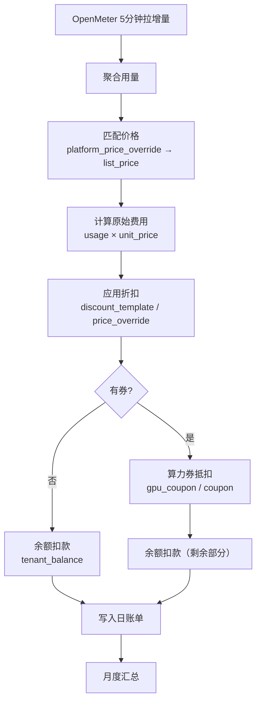

### 4.2 折扣体系

#### 4.2.1 折扣类型

| 类型 | 来源表 | 承担方 | 说明 |
|------|--------|--------|------|
| **租户专属价** | `platform_price_override` | 平台 | 直接降低 `sell_price`，差额由平台承担 |
| **平台算力券** | `discount_template` → `coupon` | 平台 | 平台发放，面值抵扣，成本由平台承担 |
| **商户算力券** | `gpu_coupon` (merchant-issued) | 商户 | 商户自行发放，成本计入商户营销费 |
| **商户折扣** | `merchant → discount_template` | 商户 | 商户给租户设置的折扣，差额由商户承担 |

#### 4.2.2 折扣计算规则

```text
原始费用 = usage × list_price

折扣1: 租户专属价
  IF platform_price_override 对该 tenant 生效 THEN
    原始费用 = usage × override.sell_price
    折扣金额 += usage × (list_price - override.sell_price)
    折扣承担方 = platform

折扣2: 算力券抵扣（平台券）
  IF tenant 有待使用 coupon THEN
    券抵扣 = MIN(coupon.surplus_amount, 原始费用 - 已折扣金额)
    原始费用 -= 券抵扣
    coupon.surplus_amount -= 券抵扣

折扣3: 算力券抵扣（商户券）
  IF tenant 有待使用 gpu_coupon (merchant_issued) THEN
    商户券抵扣 = MIN(gpu_coupon.remaining_value, 剩余费用)
    原始费用 -= 商户券抵扣
    gpu_coupon.remaining_value -= 商户券抵扣
    商户营销成本 += 商户券抵扣
```

#### 4.2.3 折扣成本归属

| 折扣类型 | 平台成本 | 商户成本 | 体现位置 |
|----------|---------|---------|---------|
| `platform_price_override` | 列表价与专属价差额 | — | 平台 `marketing_cost` |
| 平台券抵扣 | 券面值 | — | `tenant_bill.coupon_amount` |
| 商户券抵扣 | — | 券面值 | `merchant_bill.coupon_cost` |
| 商户折扣 | — | 原价-折后价 | `merchant_bill.discount_cost` |

### 4.3 算力券抵扣流程

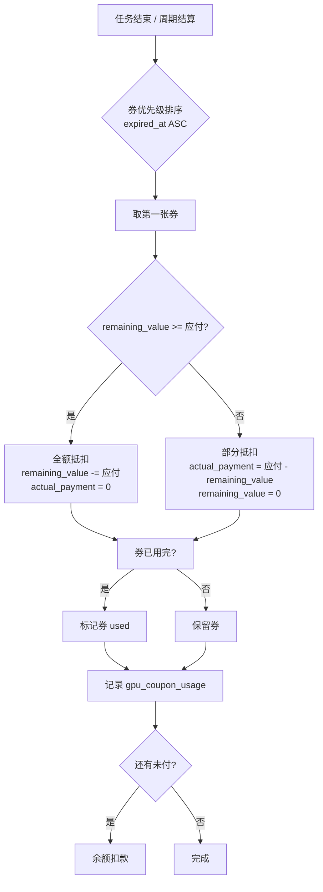

### 4.4 余额扣款（Freeze → Consume 模型）

```text
1. 任务提交: freezeBalance(amount=预估费用)
2. 任务运行中: 每5分钟 cycle
   - consumeReserved(amount=本次计费金额)
   - freezeBalance(amount=新增预估)
3. 任务结束: unfreezeBalance(amount=剩余冻结)
4. 最终结算: consumeReserved(amount=最后一笔)
```

### 4.5 租户账单数据流

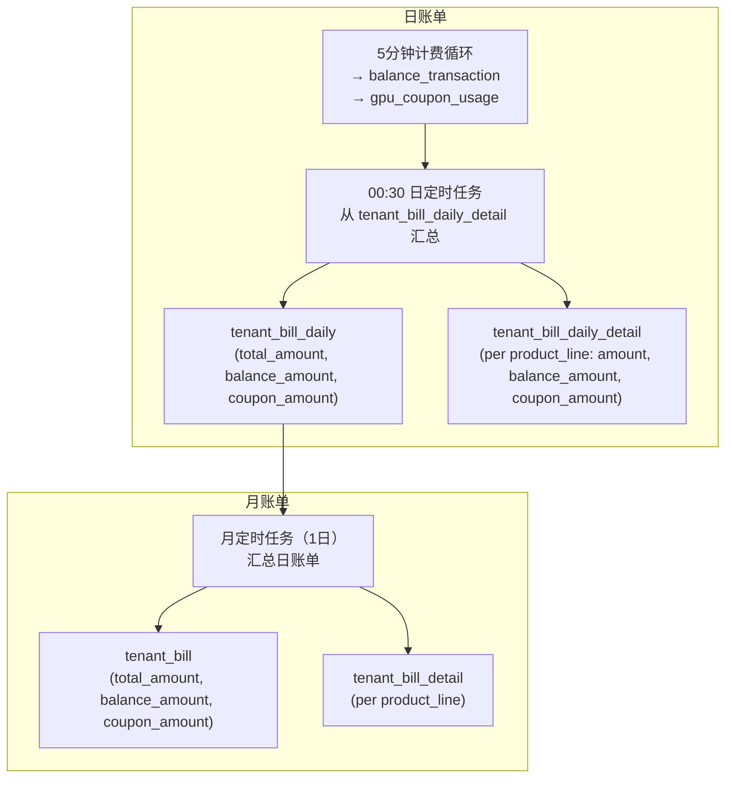

### 4.6 租户账单金额公式

```text
total_amount    = Σ 日账单各产品线 amount（折扣后总额，含券+余额）
balance_amount  = Σ 日账单 balance_amount（余额实付部分）
coupon_amount   = Σ 日账单 coupon_amount（券抵扣总额）

实付金额 = balance_amount（余额实付）
原价金额 = total_amount + 折扣金额（折扣前总消费）
```

### 4.7 计费明细行表（tenant_bill_line_item）

每笔计费事件生成一条明细行，支持逐笔回溯和对账。

#### 4.7.1 表结构

| 列名 | 类型 | 约束 | 说明 |
|------|------|------|------|
| `id` | `text` | PK | |
| `tenant_id` | `text` | FK→`tenant.id` | 租户 |
| `organization_id` | `varchar(64)` | NOT NULL | 关联 Better Auth org |
| `bill_date` | `date` | NOT NULL | 计费日期 |
| `bill_month` | `varchar(7)` | NOT NULL | 计费月 YYYY-MM |
| `product_line` | `varchar(32)` | NOT NULL | 产品线 |
| `task_id` | `text` | NULL | 关联任务（如有） |
| `idc` | `varchar(32)` | NULL | 机房 |
| `gpu_card_type_id` | `text` | NULL | GPU 卡型 |
| **用量来源** | | | |
| `openmeter_event_id` | `text` | NULL | OpenMeter 事件 ID（可追溯原始事件） |
| `openmeter_subject` | `text` | NULL | OpenMeter subject（tenant:xxx:task:xxx） |
| `usage_quantity` | `numeric(15,4)` | NOT NULL | 用量 |
| `usage_unit` | `varchar(16)` | NOT NULL | 计量单位：`gpu_card_hour` / `cpu_core_hour` / `token` / `request` |
| **价格快照（不可变）** | | | |
| `price_source` | `varchar(32)` | NOT NULL | 价格来源：`list_price` / `override` / `reserved_pack` / `merchant_sell_price` |
| `price_table_id` | `text` | NULL | 价格表记录 ID |
| `unit_price_snapshot` | `money` | NOT NULL | 单价快照（计费时冻结，不可变） |
| **费用分解** | | | |
| `subtotal` | `money` | NOT NULL | 小计 = usage × unit_price |
| `discount_amount` | `money` | NOT NULL DEFAULT 0 | 折扣金额（租户专属价差额） |
| `coupon_deduction` | `money` | NOT NULL DEFAULT 0 | 券抵扣金额 |
| `reserved_pack_deduction` | `money` | NOT NULL DEFAULT 0 | 预留包扣款 |
| `balance_deduction` | `money` | NOT NULL DEFAULT 0 | 余额扣款 |
| `amount` | `money` | NOT NULL | 实付金额 = subtotal - discount - coupon - reserved_pack |
| **来源标记** | | | |
| `reservation_pack_id` | `text` | NULL | 关联预留包（如有） |
| `coupon_id` | `text` | NULL | 关联券（如有） |
| `discount_template_id` | `text` | NULL | 关联折扣模板（如有） |
| `merchant_id` | `text` | NULL | 商户 ID（冗余） |
| **元数据** | | | |
| `computed_at` | `timestamptz` | NOT NULL | 计算时间 |
| `created_at` | `timestamptz` | NOT NULL DEFAULT now() | |

**索引**：

```sql
CREATE INDEX line_item_tenant_date_idx ON tenant_bill_line_item (tenant_id, bill_date);
CREATE INDEX line_item_tenant_month_idx ON tenant_bill_line_item (tenant_id, bill_month);
CREATE INDEX line_item_task_idx ON tenant_bill_line_item (task_id);
CREATE INDEX line_item_pack_idx ON tenant_bill_line_item (reservation_pack_id);
CREATE INDEX line_item_coupon_idx ON tenant_bill_line_item (coupon_id);
CREATE INDEX line_item_openmeter_idx ON tenant_bill_line_item (openmeter_event_id);
```

#### 4.7.2 金额恒等式

```text
每一行必须满足：
  subtotal = usage_quantity × unit_price_snapshot
  amount = subtotal - discount_amount - coupon_deduction - reserved_pack_deduction

每日汇总必须满足：
  tenant_bill_daily.total_amount = Σ line_item.amount
  tenant_bill_daily.balance_amount = Σ line_item.balance_deduction
  tenant_bill_daily.coupon_amount = Σ line_item.coupon_deduction

每月汇总必须满足：
  tenant_bill.total_amount = Σ daily.total_amount
```

### 4.8 价格快照机制

价格表会变化，计费时的价格必须冻结。

#### 4.8.1 快照时机

```text
5分钟计费循环:
  1. 查询当前价格 → price_snapshot
  2. 计算费用: usage × price_snapshot
  3. 写入 line_item 时同时写入 price_snapshot（不可变）
  4. 后续对账以 line_item.unit_price_snapshot 为准
```

#### 4.8.2 价格来源映射

| price_source | 对应表 | 快照字段 |
|--------------|--------|---------|
| `list_price` | `platform_card_list_price` | `sell_price` |
| `override` | `platform_price_override` | `sell_price` |
| `reserved_pack` | `reserved_resource_pack` | `unit_price_per_month`（折算为小时价） |
| `merchant_sell_price` | `supplier_datacenter_sell_price` | `sell_price` |

#### 4.8.3 价格变更影响

```text
价格变更不影响已生成的 line_item：
  - 已生成的 line_item 保留原价格快照
  - 新生成的 line_item 使用新价格
  - 月度汇总基于 line_item 金额，不受价格变更影响
```

### 4.9 折扣/券堆叠规则

#### 4.9.1 计费优先级

```text
费用类型优先级（从高到低）：
  1. 预留包固定费用（reserved_charge）— 不可被券/折扣抵扣
  2. 预留包超额费用（overage_charge）— 可用券抵扣
  3. 按需费用（on_demand_charge）— 可用券抵扣
```

#### 4.9.2 折扣应用顺序

```text
Step 1: 价格匹配
  IF platform_price_override 对该 tenant 生效 THEN
    使用 override.sell_price
  ELSE
    使用 list_price

Step 2: 券抵扣（按优先级）
  平台券 → 商户券（每笔仅用一张券，优先平台券）
  
  券选择规则：
    1. 按 expired_at ASC（先到期先用）
    2. 按 remaining_value DESC（大额优先）
    3. 平台券优先于商户券

Step 3: 余额扣款
  剩余费用从余额扣减
```

#### 4.9.3 预留包与券的交互

```text
预留包持有人消费：
  IF 使用量 ≤ 预留量 THEN
    reserved_pack_deduction = 本次消费
    不可使用券抵扣预留包固定费用
  ELSE
    reserved_pack_deduction = 预留包内余额
    overage = 超额部分
    可用券抵扣 overage（按 Step 2 规则）
```

#### 4.9.4 折扣模板版本

```text
券发放时冻结折扣模板参数：
  - discount_template.valid_from / valid_to
  - discount_template.percent / amount
  - discount_template.applicable_resources

使用时按冻结值计算，模板变更不影响已发放的券。
```

### 4.10 金额精度与舍入规则

#### 4.10.1 精度定义

| 场景 | 精度 | 舍入方式 |
|------|------|---------|
| 中间计算（单价×用量） | 8 位小数 | 四舍五入 |
| 最终金额（line_item.amount） | 2 位小数 | 四舍五入 |
| 券面值 | 2 位小数 | 四舍五入 |
| 分成比例 | 4 位小数 | 四舍五入 |
| 供应商成本 | 2 位小数 | 四舍五入 |

#### 4.10.2 舍入误差处理

```text
单行舍入误差 ≤ 0.01 元（可接受）

日汇总舍入误差：
  tenant_bill_daily.total_amount = Σ round(line_item.amount, 2)
  误差来源：单行舍入累积
  处理：日汇总以 Σ line_item.amount 为准，不单独舍入

月汇总舍入误差：
  tenant_bill.total_amount = Σ tenant_bill_daily.total_amount
  误差来源：日汇总舍入累积
  处理：月汇总以 Σ daily.total_amount 为准
```

### 4.11 预留资源包（Reserved Resource Pack）

预留资源包是一种预付费的 GPU 容量保障机制，租户通过预付费用锁定特定卡型的资源保障。详见 [reserved-resource-pack-design.md](reserved-resource-pack-design.md)。

#### 4.11.1 预留包计费模型

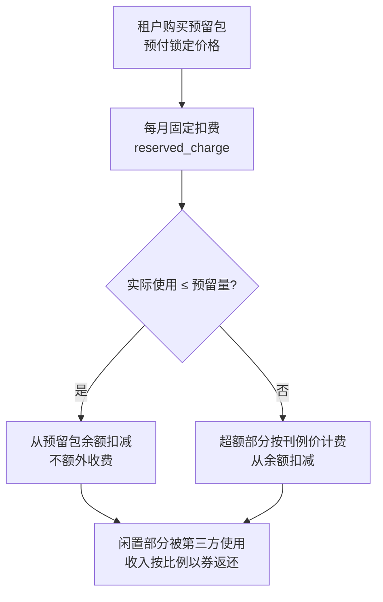

#### 4.11.1a 预留包计费详细规则

| 场景 | 计费规则 | line_item 字段 |
|------|---------|---------------|
| 持有人当月使用 ≤ 预留量 | `reserved_charge` 全额计入 | `reserved_pack_deduction = usage × list_price` |
| 持有人当月使用 > 预留量 | `reserved_charge + (超额卡时 × list_price)` | `reserved_pack_deduction = reserved_charge` + `balance_deduction = overage × list_price` |
| 持有人当月未使用 | 仍计 `reserved_charge` | `reserved_pack_deduction = reserved_charge` |
| 第三方使用闲置资源 | 第三方按 `list_price` 正常计费 | 与普通按需计费相同 |
| 预留包持有人使用非预留卡型 | 按 `list_price` 计费（不享受预留包折扣） | 与普通按需计费相同 |

**预留包固定费用（每月）**：

```text
reserved_charge = unit_price_per_month × reserved_quantity

此费用无论是否使用，每月均扣除。
来源：预留包预付总额按月分摊。
```

**持有人实际消费**：

```text
actual_consumption = usage_card_hours × list_price_per_hour

reserved_pack_deduction = MIN(actual_consumption, reserved_charge)
balance_deduction = MAX(0, actual_consumption - reserved_charge)

注意：预留包持有人的实际消费已包含在 reserved_charge 中，
超额部分才需要额外从余额扣款。
```

**闲置卡时计算**：

```text
total_card_hours_reserved = reserved_quantity × 730（月标准小时数）
total_card_hours_used = 持有人实际使用卡时（跨所有机房汇总）
total_card_hours_unused = total_card_hours_reserved - total_card_hours_used

third_party_used_card_hours = 第三方在闲置卡上的使用卡时
```

**闲置分成收入**：

```text
模式 A：固定价格
  sharing_income = third_party_used_card_hours × sharing_value（固定单价/卡时）

模式 B：收入分成
  third_party_consumption = third_party_used_card_hours × list_price_per_hour
  sharing_income = third_party_consumption × sharing_value / 100

限制：
  sharing_income ≤ third_party_consumption（分成不超过第三方消费额）
```

**返还券面值**：

```text
coupon_value = sharing_income

券一次性发放，不可拆分。
持有人可在后续消费中使用该券抵扣。
券的适用范围 = 所有产品线（不限卡型）。
券有效期 = 预留包到期后15天内。
```

#### 4.11.2 预留包与常规计费的关系

| 维度 | 预留包 | 常规按需计费 |
|------|-------|------------|
| 计费触发 | 每月固定扣费（使用无关） | 仅使用时计费 |
| 价格 | 预留包折扣价（购买时锁定） | 平台刊例价 |
| 超额部分 | 按平台刊例价计费 | N/A |
| 闲置分成 | 以券形式返还持有人 | N/A |

#### 4.11.3 预留包在租户账单中的体现

```text
tenant_bill.total_amount 包含：
  + reserved_charge（预留包固定费用）
  + overage_charge（超额部分费用，如有）
  + on_demand_charge（按需计费部分）

预留包闲置分成以券形式返还，不体现在 tenant_bill 的负值中。
```

#### 4.11.4 预留包数据模型

预留包使用以下表（详见 reserved-resource-pack-design.md）：

| 表 | 用途 |
|---|------|
| `reserved_resource_pack` | 预留包主表（购买记录 + 分成比例） |
| `reserved_pack_monthly_billing` | 月度计费记录 |
| `reserved_pack_usage_daily` | 日使用明细（持有人/第三方） |
| `reserved_pack_default_sharing` | 平台默认分成配置 |

**分成比例确认机制**：
- 租户**仅可查看**分成比例，**不可修改**
- 平台运营可修改分成比例，修改后需租户确认才能生效
- 确认前：按平台默认值计算
- 确认后：按新值计算
- 超时未确认（7天）：自动采用平台默认值

#### 4.11.5 预留包供应商结算差异

预留包的供应商结算根据合作模式不同：

| 合作模式 | 预留包持有人使用 | 第三方使用 | 无人使用 |
|----------|----------------|-----------|---------|
| **闲时合作** | 按卡时结算（持有人承担） | 按卡时结算（第三方承担） | 无成本 |
| **整租合作** | 按月租结算（预留包费用覆盖） | 月租已由预留包覆盖 | 按月租结算 |

---

## 4.12 存储与基础设施资源计费

本节定义镜像仓库、本地磁盘、镜像预热、网络卷四类资源的计费策略。

### 4.12.1 产品线扩展

在 `../../business/product-line-taxonomy.md` 现有枚举基础上，存储与基础设施类资源作为**横切维度**叠加到产品线上，不独立占用 `product_line`：

| 资源类型 | OpenMeter Meter | 计量单位 | billing_unit | 适用产品线 |
|---------|----------------|---------|-------------|-----------|
| **镜像仓库存储** | `registry_storage_gb_day` | GB·天 | `month` | `cloud_vm`, `serverless`, `job`, `inference` |
| **镜像拉取流量** | `registry_pull_bytes` | 字节 | `gb` | `cloud_vm`, `serverless`, `job`, `inference` |
| **节点本地磁盘** | `node_disk_gb_day` | GB·天 | `month` | `cloud_vm`, `serverless`, `job` |
| **镜像预热存储** | `preload_storage_gb_day` | GB·节点·天 | `month` | `cloud_vm`, `serverless`, `job` |
| **镜像预热流量** | `preload_traffic_bytes` | 字节 | `gb` | `cloud_vm`, `serverless`, `job` |
| **网络卷存储** | `volume_storage_gb_day` | GB·天 | `month` | `cloud_vm`, `serverless`, `job`, `inference` |
| **网络卷请求** | `volume_request_count` | 千次请求 | `month` | `cloud_vm`, `serverless`, `job`, `inference` |
| **网络卷出流量** | `volume_egress_bytes` | 字节 | `gb` | `cloud_vm`, `serverless`, `job`, `inference` |

> **设计原则**：存储类资源采用 **GB·天** 计量（与 `storage-quota-and-s3-volume.md` §7 对齐），月结时折算为 `GB × 天数 / 当月天数`。

### 4.12.2 镜像仓库计费

#### 4.12.2.1 存储计费

```text
计量: registry_storage_gb_day = 租户在 Harbor 中的镜像存储总量（GB）
计费周期: 日采集，月汇总
计算公式:
  月费用 = avg_daily_storage_gb × storage_price_per_gb_month
  
  avg_daily_storage_gb = Σ 日存储快照 / 当月天数
  storage_price_per_gb_month = 定价表查询（见 §2 价格层级）
```

**免费额度**：

| 套餐 | 免费存储 | 超出单价 |
|------|---------|---------|
| 免费版 | 20 GB | ¥0.15/GB/月 |
| 基础版 | 200 GB | ¥0.12/GB/月 |
| 专业版 | 1,000 GB | ¥0.10/GB/月 |
| 企业版 | 5,000 GB | ¥0.08/GB/月 |

```text
实际计费存储 = MAX(0, avg_daily_storage_gb - free_quota_gb)
月费用 = 实际计费存储 × storage_price_per_gb_month
```

**存储快照采集**：

```typescript
// 每小时采集一次租户镜像存储使用量（由 Harbor Webhook 或定时任务触发）
async function collectRegistryStorageUsage(): Promise<void> {
  const tenants = await getAllActiveTenants()
  
  for (const tenant of tenants) {
    const projectName = `tenant-${tenant.id}`
    
    // 从 Harbor API 获取 Project 存储使用量
    const usage = await harborAPI.getProjectStorageUsage(projectName)
    
    // 上报 OpenMeter 事件
    await openMeter.report({
      eventType: 'registry_usage',
      subject: `tenant:${tenant.id}:registry:${HARBOR_HOST}`,
      data: {
        tenant_id: tenant.id,
        registry_host: HARBOR_HOST,
        storage_gb: usage.storageBytes / (1024 ** 3),
        billable: true,
        region: getPlatformRegion(),
      }
    })
  }
}
```

#### 4.12.2.2 拉取流量计费

```text
计量: registry_pull_bytes = 租户镜像从 Harbor 拉取的总流量（字节）
计费周期: 日采集，月汇总
计算公式:
  月费用 = total_pull_gb × pull_price_per_gb
  
  total_pull_gb = Σ 日拉取流量 / (1024^3)
```

**流量定价**：

| 拉取源 | 单价 | 说明 |
|--------|------|------|
| 同 VPC 内网拉取（Harbor/Zot） | ¥0.00 | 内网免费 |
| 同区域云商仓库拉取 | ¥0.00 | 内网免费 |
| 跨区域拉取 | ¥0.50/GB | 产生跨区流量费 |
| 公网拉取（Proxy Cache 未命中） | ¥0.80/GB | 公网流量费 |

> **实际场景**：绝大多数拉取走同 VPC 内网（¥0），仅跨区和公网拉取产生费用。P2P 分发不经过 Harbor，不计入此 Meter。

### 4.12.3 节点本地磁盘计费

#### 4.12.3.1 计费模型

节点本地磁盘用于镜像缓存和 workspace 数据。实例运行期间占用的磁盘隐含在实例规格中，**仅对超出免费额度的部分计费**。

```text
计量: node_disk_gb_day = 租户实例占用的节点本地磁盘（GB·天）
计费周期: 日采集，月汇总
计算公式:
  月费用 = avg_daily_disk_gb × disk_price_per_gb_month
  
  avg_daily_disk_gb = Σ(各实例 data_disk_paid_gb × 运行天数) / 当月天数
```

**免费额度**（与 `storage-quota-and-s3-volume.md` §3 对齐）：

| 实例类型 | 免费数据盘 | 超出单价 |
|---------|-----------|---------|
| Cloud VM | 20 GB | ¥0.10/GB/月 |
| Serverless | 10 GB | ¥0.10/GB/月 |
| Job | 5 GB | ¥0.10/GB/月 |

```text
实际计费磁盘 = MAX(0, data_disk_paid_gb)
日费用 = 实际计费磁盘 × disk_price_per_gb_month / 当月天数
```

**关机计费策略**：

| 场景 | 计费规则 |
|------|---------|
| Cloud VM 运行中 | 按 `data_disk_paid_gb` 计费 |
| Cloud VM 关机（PVC 保留） | 按 `data_disk_paid_gb × 50%` 计费（保留费） |
| Cloud VM 关机（PVC 释放） | 不计费 |
| Serverless 缩容到 0 | PVC 保留期间按 `data_disk_paid_gb × 50%` 计费 |

### 4.12.4 镜像预热计费

#### 4.12.4.1 计费模型

预热计费包含两部分：**存储占用费**（持续占用节点磁盘）和 **拉取流量费**（一次性）。与 `../../business/image-preload-commercial-and-community-incentive.md` §1 对齐。

```text
计量:
  preload_storage_gb_day = 镜像在节点上的存储占用（GB × 节点数 × 天数）
  preload_traffic_bytes = 预热拉取的流量（字节）

计算公式:
  存储费 = Σ(镜像大小_GB × 节点数 × 保留天数) × storage_price_per_gb_day
  流量费 = Σ(镜像大小_GB × 节点数) × traffic_price_per_gb
  预热总费用 = 存储费 + 流量费
```

**定价**（与 `../../business/image-preload-commercial-and-community-incentive.md` §1.2 模型 D 对齐）：

| 计费项 | 单价 | 说明 |
|--------|------|------|
| 预热存储费 | ¥0.10/GB/节点/天 | 镜像在节点上的持续占用 |
| 预热流量费 | ¥0.01/GB/节点 | 每节点首次拉取的流量 |
| 最低消费 | ¥0.50/任务/节点 | 不足按此计费 |

**免费额度**（与 `../../business/image-preload-commercial-and-community-incentive.md` §1.3 对齐）：

| 用户等级 | 月免费额度 | 同时最大任务数 |
|---------|-----------|--------------|
| 新用户（首月） | 50 GB·节点·天 | 3 |
| 普通用户 | 10 GB·节点·天 | 2 |
| 上月消费 ≥ ¥50 | 50 GB·节点·天 | 5 |
| 上月消费 ≥ ¥500 | 200 GB·节点·天 | 10 |

```text
实际计费存储 = MAX(0, storage_gb_days - free_quota_gb_days)
实际计费流量 = MAX(0, traffic_gb - free_traffic_gb)
存储费 = 实际计费存储 × storage_price_per_gb_day
流量费 = 实际计费流量 × traffic_price_per_gb
预热总费用 = MAX(存储费 + 流量费, min_charge_per_task)
```

#### 4.12.4.2 预热计费与实例计费的关系

| 预热场景 | 预热费用 | 实例费用 |
|---------|---------|---------|
| 手动预热（控制台/API） | 单独计费 | 实例正常计费 |
| 部署自动预热（按量实例） | 含在实例单价中（+5% 溢价） | 正常计费 |
| 部署自动预热（包月/包周） | 含在套餐价格中 | 正常计费 |
| 裸金属自行预热 | 免费 | 设备已独占 |

### 4.12.5 网络卷计费

#### 4.12.5.1 计费模型

网络卷（S3/JuiceFS）采用**存储 + 请求 + 出流量**三维计费，与 `storage-quota-and-s3-volume.md` §7 对齐。

```text
计量:
  volume_storage_gb_day = 卷占用的存储容量（GB·天）
  volume_request_count = 请求次数（千次）
  volume_egress_bytes = 出流量（字节）

计算公式:
  存储费 = max(0, avg_daily_volume_gb - free_quota_gb) × storage_price_per_gb_day
  请求费 = (request_count / 1000) × request_price_per_1k
  流量费 = (egress_gb) × egress_price_per_gb
  卷总费用 = 存储费 + 请求费 + 流量费
```

**定价**（与 `storage-quota-and-s3-volume.md` §4 对齐）：

| 计费项 | 免费额度 | 单价 | 说明 |
|--------|---------|------|------|
| 存储 | 20 GB | ¥0.05/GB/月 | 按日均容量计费 |
| 请求 | 10,000 次/月 | ¥0.01/千次 | PUT/GET/DELETE 合并 |
| 出流量 | 10 GB/月 | ¥0.80/GB | 从卷读取的数据量 |

```text
实际计费存储 = MAX(0, avg_daily_volume_gb - free_quota_gb)
实际计费请求 = MAX(0, request_count - free_request_count)
实际计费流量 = MAX(0, egress_gb - free_egress_gb)

存储费 = 实际计费存储 × storage_price_per_gb_day × 当月天数
请求费 = (实际计费请求 / 1000) × request_price_per_1k
流量费 = 实际计费流量 × egress_price_per_gb
卷总费用 = 存储费 + 请求费 + 流量费
```

#### 4.12.5.2 跨区域流量附加

| 场景 | 流量费 | 说明 |
|------|--------|------|
| 同区域读取 | ¥0.00/GB | 内网免费 |
| 跨区域读取 | ¥0.50/GB | 跨区流量费 |
| 公网读取 | ¥0.80/GB | 公网流量费 |

```text
egress_price_per_gb = 
  IF source_region == target_region THEN 0
  ELSE IF is_public THEN 0.80
  ELSE 0.50
```

### 4.12.6 计费汇总到 line_item

四类资源的计费最终写入 `tenant_bill_line_item`，`usage_unit` 扩展如下：

| 资源类型 | usage_unit | usage_quantity 含义 | unit_price_snapshot 含义 |
|---------|-----------|-------------------|------------------------|
| 镜像仓库存储 | `gb_month` | 月均存储 GB | ¥/GB/月 |
| 镜像拉取流量 | `gb` | 拉取流量 GB | ¥/GB |
| 节点本地磁盘 | `gb_month` | 月均磁盘 GB | ¥/GB/月 |
| 预热存储 | `gb_node_day` | GB·节点·天 | ¥/GB/节点/天 |
| 预热流量 | `gb` | 流量 GB | ¥/GB |
| 网络卷存储 | `gb_month` | 月均卷容量 GB | ¥/GB/月 |
| 网络卷请求 | `1k_request` | 千次请求 | ¥/千次 |
| 网络卷出流量 | `gb` | 出流量 GB | ¥/GB |

```text
line_item.subtotal = usage_quantity × unit_price_snapshot
line_item.amount = subtotal - discount - coupon - reserved_pack
```

### 4.12.7 采集与上报架构

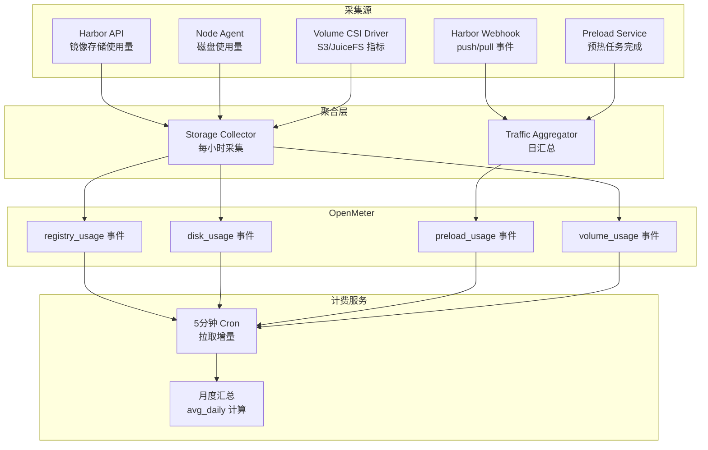

**采集频率**：

| 资源类型 | 采集频率 | 上报方式 | 说明 |
|---------|---------|---------|------|
| 镜像仓库存储 | 每小时 | 定时任务调用 Harbor API | 日均值平滑 |
| 镜像拉取流量 | 每日 | Harbor 日志聚合 | 流量按日汇总 |
| 节点本地磁盘 | 每小时 | Node Agent 上报 | 日均值平滑 |
| 预热存储 | 任务完成时 | 预热服务上报 | 持续占用按天累计 |
| 预热流量 | 任务完成时 | 预热服务上报 | 一次性计费 |
| 网络卷存储 | 每小时 | CSI Driver 上报 | 日均值平滑 |
| 网络卷请求/流量 | 每日 | S3/JuiceFS 日志聚合 | 按日汇总 |

---

## 5. Layer 2：供应商月度结算

### 5.1 供应商成本模型

| 合作模式 | 计费单位 | 成本公式 | 数据来源 |
|----------|---------|---------|---------|
| **闲时卡时价** | hour | `card_hours × supplier_unit_cost.unit_cost` | `tenant_region_gpu_consumption_daily` |
| **闲时分成** | % | `tenant实付 × revenue_share_percent / 100` | `tenant_bill_daily_detail` |
| **整租月租** | month | `monthly_rent / days_in_month × occupied_days` | `supplier_pricing_record.unit_price` |

### 5.2 供应商月度结算单数据流

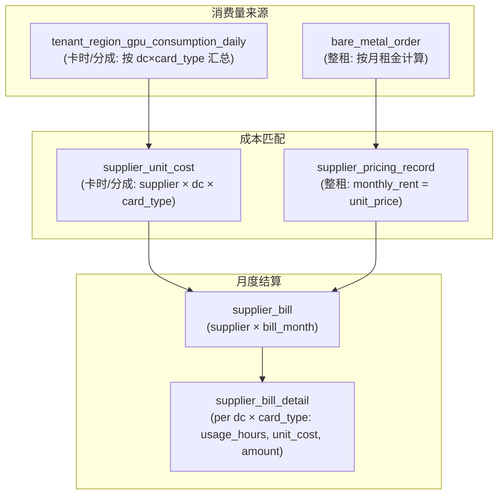

### 5.3 供应商月度结算金额公式

```text
supervisor_bill.total_usage_hours = Σ 日卡时消费（按机房×卡型）
supervisor_bill.total_amount      = Σ (usage_hours × unit_cost)  -- 卡时/分成
supervisor_bill.network_fee       = Σ data_center.network_fee_monthly（本月内按天分摊）
supervisor_bill.management_fee    = Σ data_center.mgmt_node_fee_monthly
supervisor_bill.final_amount      = total_amount + network_fee + management_fee
```

### 5.4 供应商结算单字段扩展

在现有 `supplier_bill` 表上新增字段：

| 列名 | 类型 | 说明 |
|------|------|------|
| `supplier_revenue_share_amount` | `money` | 分成模式下的平台应付分成 |
| `supplier_card_time_amount` | `money` | 卡时模式下的卡时费用 |
| `supplier_whole_rent_amount` | `money` | 整租模式下的整租费用 |
| `voucher_cost_amount` | `money` | 券成本中由供应商承担的部分 |
| `gross_profit` | `money` | 平台毛利 = tenant消费 - supplier结算 |

---

## 6. Layer 3：商户经营损益

### 6.1 商户损益模型

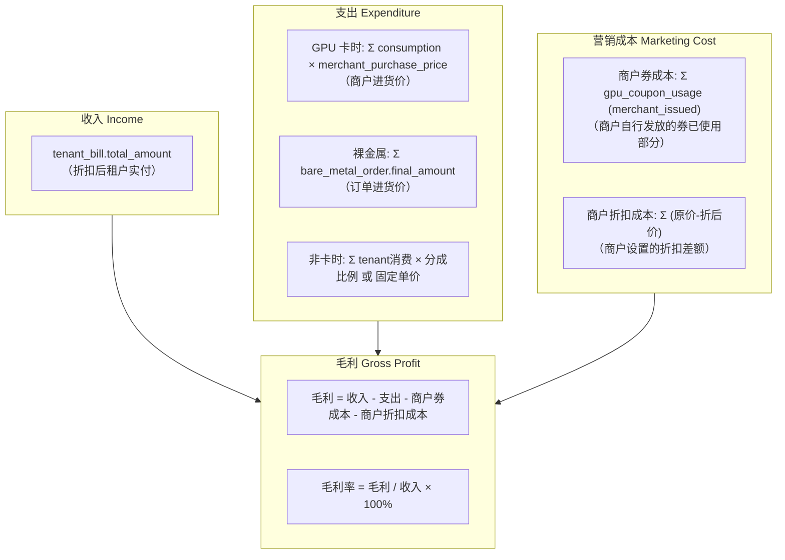

### 6.2 商户进货价查找

**GPU 卡时类产品线**（`pod_job`, `pod_deployment`, `pod_development`）：

```
1. merchant_purchase_price WHERE merchant AND dc AND card AND pl AND unit（精确匹配）
2. merchant_purchase_price WHERE merchant AND product_line（商户 fallback）
3. platform_card_list_price.sell_price（L1 刊例 = 默认进货价）
```

**非卡时产品线**（`maas_token`, `juicefs`, `share_storage`, `harbor`）：

```
merchant_product_purchase_price WHERE merchant AND product_line AND status='active'
  IF pricing_model = 'revenue_share':
    支出 = 租户消费额 × commission_rate / 100
  IF pricing_model = 'fixed_price':
    支出 = 消费量 × fixed_unit_price
```

### 6.3 商户月度损益计算流程

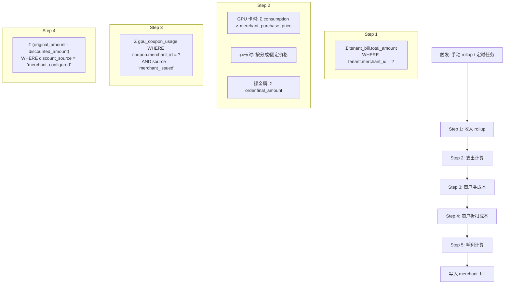

### 6.4 商户账单金额字段

在现有 `merchant_bill` 表上扩展：

| 列名 | 类型 | 说明 |
|------|------|------|
| `total_amount` | `money` | 收入（已有，= Σ tenant_bill.total_amount） |
| `expenditure_amount` | `money` | **新增** 支出（进货成本） |
| `coupon_cost` | `money` | **新增** 商户券成本 |
| `discount_cost` | `money` | **新增** 商户折扣成本 |
| `gross_profit` | `money` | **新增** 毛利 = total_amount - expenditure_amount - coupon_cost - discount_cost |

**`coupon_amount` vs `coupon_cost` 区别**：

| 字段 | 含义 | 承担方 |
|------|------|--------|
| `tenant_bill.coupon_amount` | 租户消费中**平台发放的券**抵扣总额 | 平台 |
| `merchant_bill.coupon_cost` | **商户自行发放的券**被使用的金额 | 商户 |
| `merchant_bill.total_amount` | 含平台券+商户券的总消费额（rollup from tenant_bill） | — |

### 6.5 新增表：商户非卡时产品线进货价

`merchant_product_purchase_price`：

| 列名 | 类型 | 说明 |
|------|------|------|
| `merchant_id` | `text` | FK→merchant |
| `product_line` | `varchar(32)` | 产品线 |
| `pricing_model` | `varchar(16)` | `revenue_share` / `fixed_price` |
| `commission_rate` | `numeric(7,4)` | 分成比例（%） |
| `fixed_unit_price` | `money` | 固定单价 |
| `billing_unit` | `varchar(16)` | 计量单位 |

### 6.6 新增表：商户券成本明细

`merchant_coupon_cost`：

| 列名 | 类型 | 说明 |
|------|------|------|
| `merchant_id` | `text` | FK→merchant |
| `tenant_id` | `text` | 使用券的租户 |
| `coupon_id` | `text` | FK→gpu_coupon |
| `usage_date` | `date` | 券使用日期 |
| `usage_month` | `varchar(7)` | YYYY-MM |
| `coupon_deduction` | `money` | 券抵扣金额（= 商户成本） |

---

## 7. Layer 4：平台财务汇总

### 7.1 平台损益模型

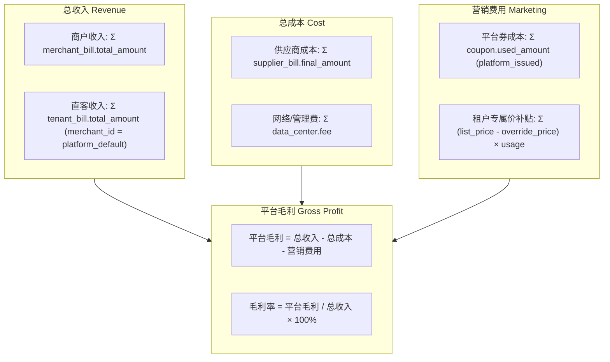

### 7.2 平台财务月度汇总

```text
platform_summary_monthly:
  total_revenue     = Σ merchant_bill.total_amount + Σ direct_tenant_bill.total_amount
  total_cost        = Σ supplier_bill.final_amount
  total_marketing   = Σ platform_coupon_cost + Σ price_override_subsidy
  gross_profit      = total_revenue - total_cost - total_marketing
  gross_margin      = gross_profit / total_revenue × 100%

  -- 按商户维度分解
  per_merchant:
    merchant_id
    revenue         = merchant_bill.total_amount
    cost            = merchant_bill.expenditure_amount（= Σ supplier cost attributable）
    marketing       = merchant_bill.coupon_cost + merchant_bill.discount_cost
    gross_profit    = revenue - cost - marketing

  -- 按供应商维度分解
  per_supplier:
    supplier_id
    settlement      = supplier_bill.final_amount
    revenue_share   = supplier_bill.supplier_revenue_share_amount（分成部分）
    card_time_cost  = supplier_bill.supplier_card_time_amount（卡时部分）
```

### 7.3 平台汇总表设计

新增 `platform_financial_summary` 表：

| 列名 | 类型 | 说明 |
|------|------|------|
| `id` | `text` | PK |
| `bill_month` | `varchar(7)` | 账单月 |
| `total_revenue` | `money` | 总收入 |
| `total_cost` | `money` | 总成本（供应商） |
| `total_marketing_cost` | `money` | 营销费用（平台券 + 专属价补贴） |
| `gross_profit` | `money` | 平台毛利 |
| `gross_margin` | `numeric(7,4)` | 毛利率（%） |
| `merchant_count` | `integer` | 活跃商户数 |
| `tenant_count` | `integer` | 活跃租户数 |
| `computed_at` | `timestamptz` | 计算时间 |
| `source` | `varchar(32)` | 计算来源 |

---

## 8. 对账与审计

### 8.1 对账报告设计

#### 8.1.1 每日对账

```sql
-- 每日对账报告表
billing_reconciliation_report (
  id,                     -- PK
  report_date,            -- 对账日期
  report_type,            -- 'daily' / 'monthly'
  -- 数据源对比
  openmeter_total_usage,  -- OpenMeter 总用量（卡时）
  billing_total_usage,    -- 计费系统总用量（差异=丢数据）
  usage_diff,             -- 用量差异 = billing - openmeter
  -- 金额核对
  openmeter_total_amount, -- OpenMeter 总金额（用量×单价）
  billing_total_amount,   -- 计费系统总金额（line_item 汇总）
  amount_diff,            -- 金额差异 = billing - openmeter
  -- 来源
  computed_at,            -- 计算时间
  status,                 -- 'passed' / 'failed'
  error_message           -- 失败原因（如有）
)
```

#### 8.1.2 对账流程

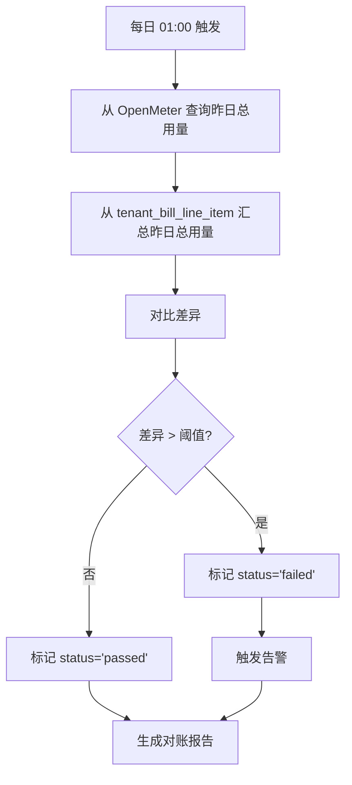

#### 8.1.3 对账维度

| 维度 | 对账内容 | 差异来源 |
|------|---------|---------|
| **租户级** | 每个租户的 line_item 汇总 vs OpenMeter | 单租户数据丢失 |
| **产品线级** | 每个产品线的 line_item 汇总 vs OpenMeter | 产品线配置错误 |
| **价格级** | line_item.unit_price vs 价格表 | 价格表变更未同步 |
| **券级** | gpu_coupon_usage 汇总 vs line_item.coupon_deduction | 券使用记录不一致 |

### 8.2 券生命周期审计

#### 8.2.1 券审计日志表

```sql
coupon_audit_log (
  id,                -- PK
  coupon_id,         -- FK→gpu_coupon
  tenant_id,         -- 租户
  merchant_id,       -- 商户（如有）
  -- 操作信息
  action,            -- 'issued' / 'frozen' / 'used' / 'expired' / 'cancelled'
  amount,            -- 操作金额
  remaining_before,  -- 操作前余额
  remaining_after,   -- 操作后余额
  -- 来源标记
  operator_id,       -- 操作人（系统/运营/租户）
  ref_type,          -- 'reserved_pack' / 'promotion' / 'merchant_grant' / 'monthly_settlement'
  ref_id,            -- 关联 ID
  -- 元数据
  created_at         -- 操作时间
)
```

#### 8.2.2 券生命周期事件

| 事件 | 触发时机 | amount | 来源 |
|------|---------|--------|------|
| `issued` | 券发放时 | 券面值 | ref_type + ref_id |
| `used` | 券使用时 | 使用金额 | line_item.coupon_id |
| `expired` | 券过期时 | 剩余面值 | 定时任务 |
| `cancelled` | 券取消时 | 剩余面值 | 运营操作 |

### 8.3 分成比例变更审计

#### 8.3.1 分成变更日志表

```sql
sharing_ratio_audit_log (
  id,                    -- PK
  pack_id,               -- FK→reserved_resource_pack
  tenant_id,             -- 租户
  -- 变更信息
  old_sharing_value,     -- 变更前分成值
  new_sharing_value,     -- 变更后分成值
  old_sharing_model,     -- 变更前分成模式
  new_sharing_model,     -- 变更后分成模式
  -- 确认信息
  confirmation_status,   -- 'pending' / 'confirmed' / 'timeout'
  confirmed_by,          -- 确认人（租户）
  confirmed_at,          -- 确认时间
  -- 来源
  changed_by,            -- 修改人（运营）
  changed_at,            -- 修改时间
  created_at             -- 记录创建时间
)
```

#### 8.3.2 分成比例变更流程

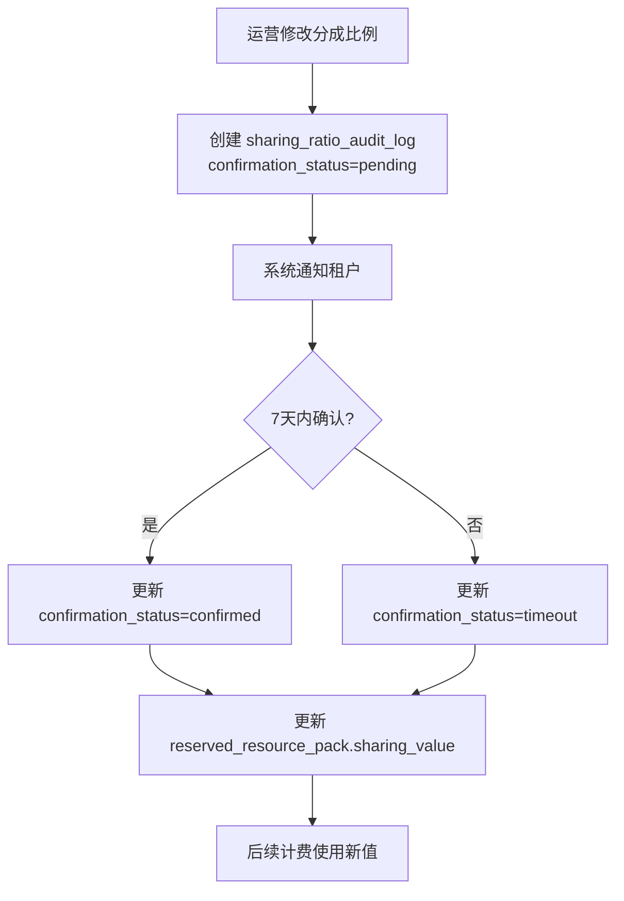

### 8.4 金额精度与舍入规则

#### 8.4.1 精度定义

| 场景 | 精度 | 舍入方式 |
|------|------|---------|
| 中间计算（单价×用量） | 8 位小数 | 四舍五入 |
| 最终金额（line_item.amount） | 2 位小数 | 四舍五入 |
| 券面值 | 2 位小数 | 四舍五入 |
| 分成比例 | 4 位小数 | 四舍五入 |
| 供应商成本 | 2 位小数 | 四舍五入 |

#### 8.4.2 舍入误差处理

```text
单行舍入误差 ≤ 0.01 元（可接受）

日汇总舍入误差：
  tenant_bill_daily.total_amount = Σ round(line_item.amount, 2)
  误差来源：单行舍入累积
  处理：日汇总以 Σ line_item.amount 为准，不单独舍入

月汇总舍入误差：
  tenant_bill.total_amount = Σ tenant_bill_daily.total_amount
  误差来源：日汇总舍入累积
  处理：月汇总以 Σ daily.total_amount 为准
```

---

## 9. 完整数据流全景

### 9.1 端到端流程

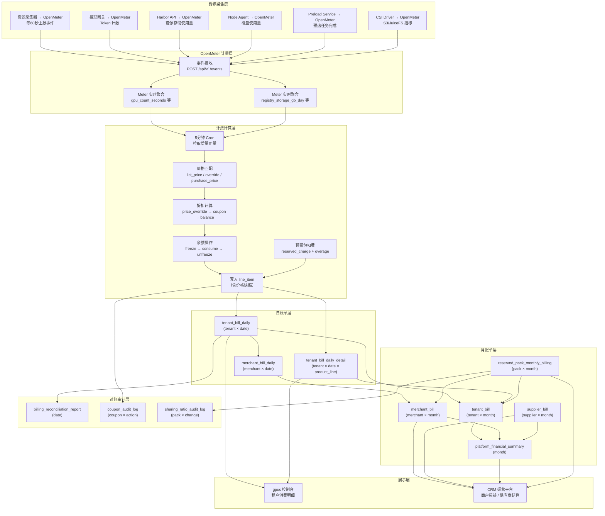

### 9.2 Cron 任务编排

| 任务 | 触发频率 | 输入 | 输出 | 说明 |
|------|---------|------|------|------|
| **5分钟计费循环** | 每5分钟 | OpenMeter 增量 | balance_transaction, gpu_coupon_usage | 实时扣费 |
| **日账单汇总** | 每日 00:30 | 前一日消费明细 | tenant_bill_daily, tenant_bill_daily_detail, merchant_bill_daily | 日结 |
| **预留包到期检查** | 每日 00:10 | reserved_resource_pack | status → expired | 到期处理 |
| **预留包日使用明细** | 每日 00:20 | tenant_region_gpu_consumption_daily + reserved_resource_pack | reserved_pack_usage_daily | 持有人/第三方用量统计 |
| **月账单汇总** | 每月1日 01:00 | 上月日账单 | tenant_bill, tenant_bill_detail, merchant_bill, supplier_bill | 月结 |
| **预留包月度计费** | 每月1日 01:30 | reserved_resource_pack + reserved_pack_usage_daily | reserved_pack_monthly_billing, gpu_coupon | 固定费用+分成券 |
| **供应商结算** | 每月2日 02:00 | 上月卡时消费 + 成本定价 | supplier_bill, supplier_bill_detail | 供应商对账 |
| **平台汇总** | 每月3日 03:00 | 月度各层账单 | platform_financial_summary | 财务看板 |

---

## 10. Schema 变更计划

### 10.1 现有表扩展

| 表 | 新增字段 | 类型 | 说明 |
|---|---------|------|------|
| `merchant_bill` | `expenditure_amount` | `money` | 商户进货成本 |
| `merchant_bill` | `coupon_cost` | `money` | 商户券成本 |
| `merchant_bill` | `discount_cost` | `money` | 商户折扣成本 |
| `merchant_bill` | `gross_profit` | `money` | 毛利 |
| `supplier_bill` | `supplier_revenue_share_amount` | `money` | 分成费用 |
| `supplier_bill` | `supplier_card_time_amount` | `money` | 卡时费用 |
| `supplier_bill` | `supplier_whole_rent_amount` | `money` | 整租费用 |
| `supplier_bill` | `gross_profit` | `money` | 平台毛利 |
| `tenant_bill_line_item` | `resource_type` | `varchar(32)` | 资源类型：`compute` / `registry` / `disk` / `preload` / `volume` |
| `tenant_bill_line_item` | `storage_class` | `varchar(32)` | 存储类别（resource_type=storage 时）：`registry` / `node_disk` / `volume` |
| `tenant_bill_daily_detail` | `registry_amount` | `money` | 镜像仓库费用 |
| `tenant_bill_daily_detail` | `disk_amount` | `money` | 磁盘费用 |
| `tenant_bill_daily_detail` | `preload_amount` | `money` | 预热费用 |
| `tenant_bill_daily_detail` | `volume_amount` | `money` | 网络卷费用 |

### 10.2 新增表

| 表 | 说明 | 粒度 |
|---|------|------|
| `tenant_bill_line_item` | 计费明细行 | tenant × date × product_line × task |
| `billing_reconciliation_report` | 每日对账报告 | date |
| `coupon_audit_log` | 券生命周期审计 | coupon × action |
| `sharing_ratio_audit_log` | 分成比例变更审计 | pack × change |
| `merchant_product_purchase_price` | 非卡时产品线进货价 | merchant × product_line |
| `merchant_coupon_cost` | 商户券成本明细 | merchant × date × coupon_id |
| `merchant_discount_cost` | 商户折扣成本明细 | merchant × date × tenant × product_line |
| `platform_financial_summary` | 平台财务月度汇总 | month |
| `reserved_resource_pack` | 预留资源包主表 | tenant × gpu_card_type |
| `reserved_pack_monthly_billing` | 预留包月度计费 | pack × month |
| `reserved_pack_usage_daily` | 预留包日使用明细 | pack × date |
| `reserved_pack_default_sharing` | 平台默认分成配置 | gpu_card_type × term |
| **`registry_storage_daily`** | **镜像仓库日存储快照** | **tenant × date** |
| **`registry_traffic_daily`** | **镜像仓库日流量快照** | **tenant × date** |
| **`node_disk_usage_daily`** | **节点磁盘日使用快照** | **tenant × node × date** |
| **`preload_consumption`** | **预热消费记录** | **tenant × preload_task × node** |
| **`preload_quota`** | **租户预热月度额度** | **tenant × month** |
| **`preload_pricing_config`** | **预热定价配置** | **platform（可按租户覆盖）** |
| **`volume_usage_daily`** | **网络卷日使用快照** | **tenant × volume × date** |
| **`storage_billing_policy`** | **存储计费策略（免费额度+单价）** | **platform × resource_type** |

#### 10.2.1 镜像仓库存储日快照

```sql
CREATE TABLE registry_storage_daily (
    id              TEXT PRIMARY KEY DEFAULT gen_random_uuid()::text,
    tenant_id       TEXT NOT NULL,
    registry_host   VARCHAR(512) NOT NULL,
    snapshot_date   DATE NOT NULL,
    storage_bytes   BIGINT NOT NULL,           -- 快照时存储总量
    storage_gb      NUMERIC(12,4) NOT NULL,    -- 折算 GB
    repository_count INT NOT NULL DEFAULT 0,   -- 仓库数
    artifact_count  INT NOT NULL DEFAULT 0,    -- Artifact 数
    created_at      TIMESTAMPTZ DEFAULT NOW(),
    UNIQUE (tenant_id, registry_host, snapshot_date)
);

CREATE INDEX idx_reg_storage_tenant ON registry_storage_daily(tenant_id);
CREATE INDEX idx_reg_storage_date ON registry_storage_daily(snapshot_date);
```

#### 10.2.2 镜像仓库日流量快照

```sql
CREATE TABLE registry_traffic_daily (
    id              TEXT PRIMARY KEY DEFAULT gen_random_uuid()::text,
    tenant_id       TEXT NOT NULL,
    registry_host   VARCHAR(512) NOT NULL,
    snapshot_date   DATE NOT NULL,
    pull_bytes      BIGINT NOT NULL DEFAULT 0, -- 拉取流量
    push_bytes      BIGINT NOT NULL DEFAULT 0, -- 推送流量
    pull_requests   INT NOT NULL DEFAULT 0,    -- 拉取请求数
    push_requests   INT NOT NULL DEFAULT 0,    -- 推送请求数
    created_at      TIMESTAMPTZ DEFAULT NOW(),
    UNIQUE (tenant_id, registry_host, snapshot_date)
);

CREATE INDEX idx_reg_traffic_tenant ON registry_traffic_daily(tenant_id);
CREATE INDEX idx_reg_traffic_date ON registry_traffic_daily(snapshot_date);
```

#### 10.2.3 节点磁盘日使用快照

```sql
CREATE TABLE node_disk_usage_daily (
    id              TEXT PRIMARY KEY DEFAULT gen_random_uuid()::text,
    tenant_id       TEXT NOT NULL,
    task_id         TEXT,                      -- 关联实例（如有）
    node_id         VARCHAR(255) NOT NULL,
    snapshot_date   DATE NOT NULL,
    disk_type       VARCHAR(32) NOT NULL,      -- image_cache | data_disk | workspace
    disk_gb         NUMERIC(12,4) NOT NULL,    -- 磁盘使用量
    billable_gb     NUMERIC(12,4) NOT NULL,    -- 计费磁盘 = disk_gb - free_quota
    created_at      TIMESTAMPTZ DEFAULT NOW()
);

CREATE INDEX idx_disk_usage_tenant ON node_disk_usage_daily(tenant_id);
CREATE INDEX idx_disk_usage_date ON node_disk_usage_daily(snapshot_date);
CREATE INDEX idx_disk_usage_task ON node_disk_usage_daily(task_id);
```

#### 10.2.4 预热消费记录

```sql
CREATE TABLE preload_consumption (
    id              TEXT PRIMARY KEY DEFAULT gen_random_uuid()::text,
    tenant_id       TEXT NOT NULL,
    preload_task_id TEXT NOT NULL,
    node_id         VARCHAR(255) NOT NULL,
    image_ref       VARCHAR(512) NOT NULL,
    image_size_bytes BIGINT NOT NULL,
    storage_gb_days NUMERIC(15,4) NOT NULL,    -- GB·节点·天
    traffic_gb      NUMERIC(15,4) NOT NULL,    -- 流量 GB
    storage_fee     NUMERIC(15,4) NOT NULL,    -- 存储费
    traffic_fee     NUMERIC(15,4) NOT NULL,    -- 流量费
    total_fee       NUMERIC(15,4) NOT NULL,    -- 总费用
    free_quota_used NUMERIC(15,4) NOT NULL DEFAULT 0, -- 使用的免费额度
    billed_at       TIMESTAMPTZ,
    created_at      TIMESTAMPTZ DEFAULT NOW()
);

CREATE INDEX idx_preload_cons_tenant ON preload_consumption(tenant_id);
CREATE INDEX idx_preload_cons_task ON preload_consumption(preload_task_id);
```

#### 10.2.5 预热月度额度

```sql
CREATE TABLE preload_quota (
    id              TEXT PRIMARY KEY DEFAULT gen_random_uuid()::text,
    tenant_id       TEXT NOT NULL,
    monthly_quota_gb_days NUMERIC(15,4) NOT NULL DEFAULT 10,
    used_gb_days    NUMERIC(15,4) NOT NULL DEFAULT 0,
    quota_month     VARCHAR(7) NOT NULL,       -- yyyy-MM
    max_concurrent  INT NOT NULL DEFAULT 2,
    max_image_gb    INT NOT NULL DEFAULT 10,
    updated_at      TIMESTAMPTZ DEFAULT NOW(),
    UNIQUE (tenant_id, quota_month)
);
```

#### 10.2.6 网络卷日使用快照

```sql
CREATE TABLE volume_usage_daily (
    id              TEXT PRIMARY KEY DEFAULT gen_random_uuid()::text,
    tenant_id       TEXT NOT NULL,
    volume_id       TEXT NOT NULL,
    volume_type     VARCHAR(16) NOT NULL,      -- s3 | juicefs
    snapshot_date   DATE NOT NULL,
    avg_size_gb     NUMERIC(12,4) NOT NULL,    -- 日均容量
    request_count   BIGINT NOT NULL DEFAULT 0, -- 请求次数
    egress_bytes    BIGINT NOT NULL DEFAULT 0, -- 出流量
    free_quota_gb   NUMERIC(12,4) NOT NULL DEFAULT 20,
    billable_gb     NUMERIC(12,4) NOT NULL,    -- avg_size_gb - free_quota
    created_at      TIMESTAMPTZ DEFAULT NOW(),
    UNIQUE (tenant_id, volume_id, snapshot_date)
);

CREATE INDEX idx_vol_usage_tenant ON volume_usage_daily(tenant_id);
CREATE INDEX idx_vol_usage_date ON volume_usage_daily(snapshot_date);
```

#### 10.2.7 存储计费策略配置

```sql
CREATE TABLE storage_billing_policy (
    id              TEXT PRIMARY KEY DEFAULT gen_random_uuid()::text,
    resource_type   VARCHAR(32) NOT NULL,      -- registry | node_disk | preload_storage | preload_traffic | volume_storage | volume_request | volume_egress
    scope           VARCHAR(16) NOT NULL DEFAULT 'platform', -- platform | tenant
    tenant_id       TEXT,                      -- 租户级覆盖时使用
    free_quota      NUMERIC(12,4) NOT NULL,    -- 免费额度
    free_unit       VARCHAR(16) NOT NULL,      -- gb | gb_day | gb_node_day | 1k_request
    unit_price      NUMERIC(10,6) NOT NULL,    -- 单价
    price_unit      VARCHAR(16) NOT NULL,      -- gb_month | gb | gb_node_day | 1k_request
    min_charge      NUMERIC(10,4) DEFAULT 0,   -- 最低消费
    effective_from  TIMESTAMPTZ NOT NULL,
    effective_to    TIMESTAMPTZ,
    created_by      TEXT,
    created_at      TIMESTAMPTZ DEFAULT NOW(),
    UNIQUE (resource_type, scope, tenant_id, effective_from)
);

CREATE INDEX idx_billing_policy_type ON storage_billing_policy(resource_type);
```

### 10.3 迁移策略

- 新字段全部 `DEFAULT '0'`，历史数据不受影响
- 首次计算时对所有历史月份**回填**
- 新增表在首次月结时创建数据

---

## 11. 实施阶段

| 阶段 | 内容 | 依赖 | 预计时间 |
|------|------|------|---------|
| **P0** | Schema migration（扩展字段 + 新建表） | 无 | 1天 |
| **P1** | 5分钟计费循环（OpenMeter → 余额扣费）+ line_item 写入 | OpenMeter 部署 | 3天 |
| **P2** | 日账单汇总（tenant_bill_daily + merchant_bill_daily） | P1 | 2天 |
| **P3** | 月度账单汇总（tenant_bill + merchant_bill + supplier_bill） | P2 | 2天 |
| **P4** | 折扣/算力券完整链路（price_override + coupon + merchant_coupon） | P2 | 2天 |
| **P5** | 预留资源包购买流程（余额扣减 + 创建记录 + 分成确认） | P0 | 3天 |
| **P6** | 预留包日使用明细计算（持有人/第三方卡时统计） | P0, OpenMeter | 2天 |
| **P7** | 预留包月度计费（固定费用 + 超额 + 分成券发放） | P5, P6 | 3天 |
| **P8** | 商户损益计算（expenditure + coupon_cost + discount_cost + gross_profit） | P3, P4 | 2天 |
| **P9** | 供应商月度结算（supplier_bill 扩展 + 预留包差异） | P3, P7 | 2天 |
| **P10** | 平台财务汇总（platform_financial_summary） | P8, P9 | 1天 |
| **P11** | 对账系统（reconciliation_report + coupon_audit_log + sharing_ratio_audit_log） | P1, P4, P7 | 3天 |
| **P12** | 前端展示（gpus 控制台 + CRM 账单页） | P4, P7, P8 | 4天 |
| **P13** | 镜像仓库计费（registry_storage_daily + Harbor API 采集 + line_item） | P0, P1 | 3天 |
| **P14** | 节点本地磁盘计费（node_disk_usage_daily + Node Agent 采集） | P0, P1 | 2天 |
| **P15** | 镜像预热计费（preload_consumption + preload_quota + 预热服务对接） | P0, P1 | 3天 |
| **P16** | 网络卷计费（volume_usage_daily + CSI Driver 对接） | P0, P1 | 3天 |
| **P17** | 存储计费策略管理（storage_billing_policy CRUD + 运营后台） | P13-P16 | 2天 |

---

## 12. 风险与待确认项

| ID | 问题 | 状态 |
|----|------|------|
| Q1 | 租户专属价补贴由平台全额承担还是按比例分摊？ | ✅ 已确认：全额由平台承担，计入平台营销费用 |
| Q2 | 商户券与平台券如何区分发放来源？ | ✅ 已确认：通过 `coupon.merchant_id` 和 `gpu_coupon.source` 字段区分 |
| Q3 | 裸金属跨月消费如何归属？ | ✅ 已确认：按订单 `billing_month` 归属，非下单月 |
| Q4 | 非卡时产品线的消费量（token 数、存储 GB·天）从哪里获取？ | ✅ 已确认：分成模式直接用 `tenant_bill_detail.amount` 作为基数 |
| Q5 | 供应商结算是否需要进货价快照？ | ✅ 已确认：首期用当前价；若需精确历史毛利，后续加快照 |
| Q6 | `platform_financial_summary` 是否需要替代 `billing_period`？ | ✅ 已确认：首期独立运行，后续与财务域对齐 |
| Q7 | OpenMeter 数据延迟如何处理？ | ✅ 已确认：5分钟窗口已足够；日结在 00:30 确保数据完整 |
| Q8 | 预留包持有人超额使用时按什么价格计费？ | ✅ 已确认：按平台刊例价（list_price） |
| Q9 | 预留包到期后未使用的月份如何处理？ | ✅ 已确认：不退不换 |
| Q10 | 同一租户能否购买多个同卡型的预留包？ | ✅ 已确认：不支持（唯一约束 tenant_id × gpu_card_type_id） |
| Q11 | 预留包闲置分成以什么形式返还？ | ✅ 已确认：以算力券形式返还 |
| Q12 | 预留包返还券的适用范围？ | ✅ 已确认：不限产品线 |
| Q13 | 预留包返还券的有效期？ | ✅ 已确认：预留包到期后15天内 |
| Q14 | 预留包分成比例由谁设定？ | ✅ 已确认：平台设默认值，平台运营可修改，租户确认后生效 |
| Q15 | 镜像仓库存储免费额度如何与 Harbor Project 配额联动？ | ✅ 已确认：`storage_billing_policy` 免费额度独立于 Harbor Project 配额；Harbor 配额为硬限制（push 拒绝），免费额度为计费减免 |
| Q16 | 节点本地磁盘关机后是否继续计费？ | ✅ 已确认：Cloud VM 关机且 PVC 保留时按 50% 计费；PVC 释放后不计费 |
| Q17 | 预热免费额度每月重置还是累积？ | ✅ 已确认：每月重置，不可累积 |
| Q18 | 网络卷跨区域流量费由谁承担？ | ✅ 已确认：由租户承担，计入 network卷出流量费用 |
| Q19 | P2P 分发是否产生镜像流量费？ | ✅ 已确认：P2P 在节点间分发不经过 Harbor，不计入 `registry_pull_bytes`；仅首次从 Harbor 拉取计费 |
| Q20 | 镜像预热与实例自动预热如何区分计费？ | ✅ 已确认：手动预热单独计费；部署自动预热含在实例单价中（+5% 溢价），不重复计费 |

---

## 变更记录

| 版本 | 日期 | 说明 |
|------|------|------|
| v1.0 | 2026-07-26 | 初稿：四层账单体系设计 |
| v1.1 | 2026-07-26 | 集成预留资源包设计（详见 reserved-resource-pack-design.md） |
| v1.2 | 2026-07-26 | 更新预留包Q&A：Q8-Q14全部确认（详见 reserved-resource-pack-design.md v1.2） |
| v2.0 | 2026-07-26 | 增强对账能力：新增 tenant_bill_line_item（计费明细行）、价格快照机制、折扣/券堆叠规则、对账报告、券审计日志、分成变更审计、金额精度规则 |
| v2.1 | 2026-07-26 | 新增存储与基础设施计费：镜像仓库存储/流量、节点本地磁盘、镜像预热存储/流量、网络卷存储/请求/出流量的 Meter 定义、计费策略、数据模型；新增 Q15-Q20 |
