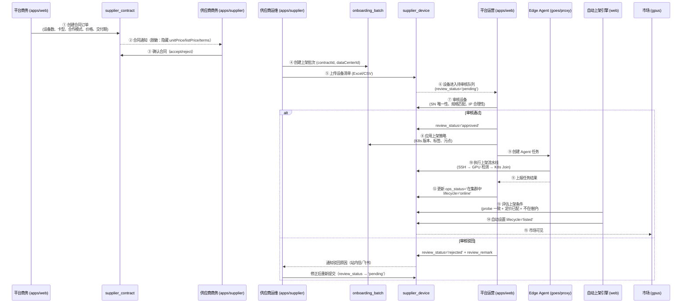
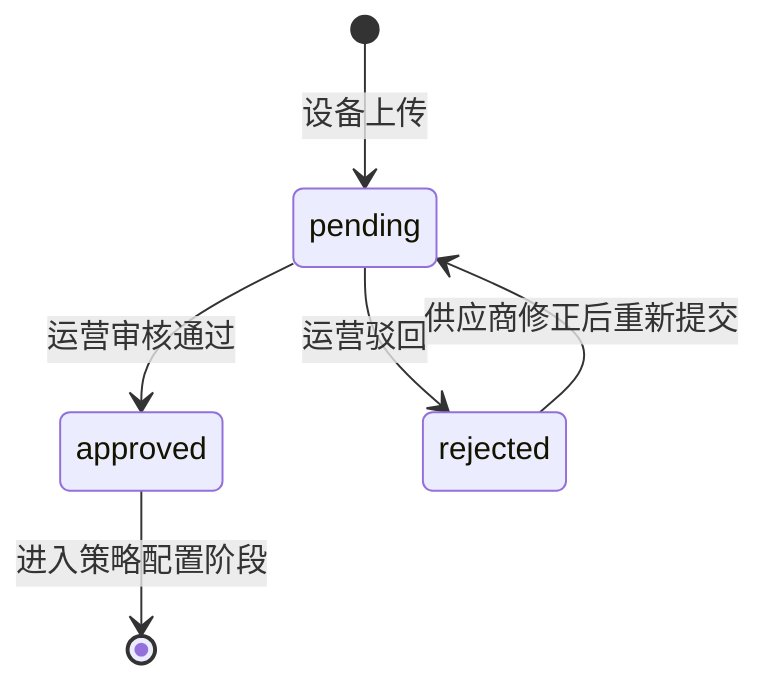

# 供应商采购上架闭环设计：从合同下单到设备自动上架

> **版本**: 1.0  
> **日期**: 2026-09-25  
> **状态**: 设计稿  
> **关联设计**:、`../../../apps/supplier/content/guide/supplier-idc-provisioning-checklist.md`（供应商机房交付清单）、`idle-compute-gateway-network.md`（网关/BOM 实施方案）
> - `device-onboarding-flow.md` — 设备纳管全流程与资源池自动化处理（下游衔接）  
> - `idle-compute-gateway-network.md` — 闲时算力网关与网络接入模型（**§12 IDC接入BOM与站点就绪检查清单**，合同签订时必读）  
> - `database-design.md` — 数据库整体架构  
> - `resource-pool-optimization.md` — 资源池调度引擎

---

## 一、概述

### 1.1 业务背景

GPURun Cloud 平台与供应商合作采购 GPU 设备，需要一套完整的闭环流程：

```
平台运营创建合同订单
  ↓
供应商确认合同（价格脱敏）
  ↓
【重要】合同签订时确认IDC接入BOM（参见idle-compute-gateway-network.md §12）
  - 纳管设备规模（≤5台 / ≤30台 / ≤100台 / 100台以上，非GPU卡数）
  - 公网IP数量（3-5个）、控制主机配置、产品线组合
  - 供应商是否提供CPU主机（否=平台全自带模式）
  - 平台自有 vs 供应商提供（C8混合模式）
  - 下线通知24h（C4）、必须平台确认（C3）、会话录制全开启（C7）
  - 组件拓扑与服务部署（参见idle-compute-gateway-network.md §11.5-11.8）
  ↓
供应商创建多批次上架设备
  ↓
平台运营审核设备清单
  ↓
自动触发接入流水线
  ↓
设备自动上架到市场
```

本文档描述从**合同创建**到**设备市场可见**的完整数据流、权限控制和状态机，作为 `device-onboarding-flow.md` 的上游补充。

**重要**：合同签订阶段必须明确**IDC接入BOM与站点就绪检查清单**（详见`idle-compute-gateway-network.md` §12），包括：
- **按纳管设备规模分层**（§12.1、§12.4）：≤5台 / ≤30台（6-30）/ ≤100台（31-100）/ 100台以上
- **组件拓扑与服务部署**（§11.5-11.8）：哪些服务运行在哪些主机上、共置/分离策略、网络区域规划
- **供应商无法提供CPU主机时的降级方案**（§12.6第三部分之二）：平台全自带模式、物流协调、职责调整

避免上架阶段资源不足或职责争议。

### 1.2 核心原则

1. **平台主导定价**  
   供应商在门户中**不得看到**平台的销售价格（`listPricePerHour`）和采购成本（`unitPricePerHour`），仅可见技术参数和履约要求。

2. **合作模式分类**  
   合同必须明确**合作模式**（`cooperationMode`）：
   - **闲时合作（idle_time）**：支持**卡时定价** AND/OR **分成（revenueShare）**
   - **整租（whole_rent）**：要求**月租价格（monthlyRent）**
   
   每种模式均需约定**基础设施费用**（带宽、IP、CPU 设备、存储）。

3. **合同驱动上架**  
   批次必须关联有效合同（`onboarding_batch.contract_id NOT NULL`），合同状态为 `active` 才允许创建批次。

4. **多批次交付**  
   一份合同允许创建多个上架批次（弹性分批交付），**批次计划数量可超过合同容量**（因设备可能被驳回）。

5. **权限分层**  
   - **商务角色**（finance/commercial）：可见全部商业条款和价格  
   - **运营角色**（ops）：可见设备技术参数、审核状态，**不可见价格**  
   - **供应商运维**：仅可见设备信息、IP、带宽、预期上架时间，**不可见商业条款**

---

## 二、参与者与权限

### 2.1 角色定义

| 角色 | 所属系统 | 职责 | 可见数据范围 |
|------|---------|------|------------|
| **平台商务** | `apps/web` | 创建合同、设定价格、审批商务条款 | 全部字段（含 `unitPricePerHour`, `listPricePerHour`, `terms`） |
| **平台运营** | `apps/web` | 审核设备、应用上架策略、监控交付进度 | 设备技术参数、审核状态、交付时间表；**隐藏价格和商业条款** |
| **供应商商务** | `apps/supplier` | 确认合同（接受/拒绝）、查看履约条款 | 设备数量、卡型、交付期、**隐藏价格**；可见 `revenueSharePercent`（如为分成模式） |
| **供应商运维** | `apps/supplier` | 创建批次、上传设备清单、查看接入状态 | 设备 SN/IP/带宽、批次进度；**隐藏合同商业条款** |

### 2.2 合同字段可见性矩阵

| 字段 | 平台商务 | 平台运营 | 供应商商务 | 供应商运维 | 说明 |
|------|---------|---------|-----------|-----------|------|
| `contractNo` | ✅ | ✅ | ✅ | ✅ | 合同编号 |
| `startDate` / `endDate` | ✅ | ✅ | ✅ | ✅ | 有效期 |
| `cooperationMode` | ✅ | ✅ | ✅ | ✅ | 合作模式（闲时/整租） |
| `expectedListingTime` | ✅ | ✅ | ✅ | ✅ | 预期上架时间 |
| `deviceQuantity` | ✅ | ✅ | ✅ | ✅ | 设备数量 |
| `unitPricePerHour` | ✅ | ❌ | ❌ | ❌ | **平台采购成本（商业机密）** |
| `listPricePerHour` | ✅ | ❌ | ❌ | ❌ | **平台销售价（商业机密）** |
| `revenueSharePercent` | ✅ | ❌ | ✅ | ❌ | 分成比例（供应商需知晓收益计算依据） |
| `terms` | ✅ | ❌ | ❌ | ❌ | **合同条款全文（含价格敏感信息）** |
| `infraPricing` | ✅ | ✅ | ✅ | ✅ | 基础设施费用（带宽/IP/存储） |
| `penaltyTerms` | ✅ | ✅ | ✅ | ❌ | 逾期罚则（商务层面） |

---

## 三、业务流程全景

### 3.1 序列图



### 3.2 关键阶段划分

| 阶段 | 起点 | 终点 | 负责方 | 交付物 |
|------|------|------|--------|--------|
| **Ⅰ 合同签订** | 平台商务创建合同 | 供应商确认合同 | 平台商务 + 供应商商务 | `supplier_contract` (status='active') |
| **Ⅱ 批次创建** | 供应商创建批次 | 设备清单上传完成 | 供应商运维 | `onboarding_batch` + `supplier_device` (review_status='pending') |
| **Ⅲ 运营审核** | 设备进入审核队列 | 审核通过/驳回 | 平台运营 | `supplier_device.review_status='approved'` |
| **Ⅳ 策略应用** | 审核通过后 | 创建 Agent 任务 | 平台运营 | `device_onboarding_policy_batch` + `device_onboarding_task` |
| **Ⅴ 设备接入** | Agent 拉取任务 | 设备加入 K8s 集群 | Edge Agent | `supplier_device.ops_status='在集群中'` |
| **Ⅵ 自动上架** | 设备 online | 市场可见 | 自动上架引擎 | `supplier_device.lifecycle='listed'` |

**本文档覆盖范围**：阶段 Ⅰ-Ⅲ（合同 → 批次 → 审核）  
**下游衔接文档**：`device-onboarding-flow.md` 覆盖阶段 Ⅳ-Ⅵ（策略 → 接入 → 上架）

---

## 四、数据模型设计

### 4.1 合同商业包模型（Contract Commercial Package）

#### 4.1.1 合作模式枚举

```typescript
type CooperationMode = 'idle_time' | 'whole_rent'
```

| 模式 | 说明 | 定价要素 | 典型用途 |
|------|------|---------|---------|
| **`idle_time`** | 闲时合作 | ① 卡时单价 (`unitPricePerHour`)<br/>② 分成比例 (`revenueSharePercent`)<br/>③ 或两者组合 | 弹性池、Spot 实例、Serverless 推理 |
| **`whole_rent`** | 整租 | 月租价格 (`monthlyRentPrice`) | 裸金属整机出租、专属集群 |

#### 4.1.2 基础设施费用结构（Infrastructure Pricing）

**无论何种合作模式，均需约定以下费用元素**：

```typescript
// 存储在 supplier_contract.infra_pricing (JSONB)
interface InfraPricing {
  // 带宽费用
  bandwidth: {
    pricePerMbpsPerMonth: number  // 1M 带宽/月 价格（元）
    includedMbps?: number          // 免费额度（Mbps）
  }
  
  // IP 费用
  publicIp: {
    pricePerIpPerMonth: number    // 单个 IP/月 价格（元）
    includedIps?: number           // 免费 IP 数量
  }
  
  // CPU 设备费用（仅整租模式）
  cpuDevice?: {
    pricePerCorePerMonth: number  // CPU 核/月 价格（元）
  }
  
  // 存储费用（分类型）
  storage: {
    nas?: {
      pricePerGbPerMonth: number  // NAS 存储 GB/月
      includedGb?: number
    }
    ceph?: {
      pricePerGbPerMonth: number  // Ceph 存储 GB/月
      includedGb?: number
    }
    gfs?: {
      pricePerGbPerMonth: number  // GFS 存储 GB/月
      includedGb?: number
    }
  }
}
```

#### 4.1.3 合同扩展字段

```sql
-- 新增字段（迁移文件）
ALTER TABLE supplier_contract
    ADD COLUMN expected_listing_time DATE,  -- 供应商承诺的设备上架截止时间
    ADD COLUMN penalty_terms TEXT,          -- 逾期罚则条款
    ADD COLUMN monthly_rent_price NUMERIC(15,4);  -- 整租模式的月租价格

-- 约束：整租模式必须有月租价格
ALTER TABLE supplier_contract
    ADD CONSTRAINT check_whole_rent_price
    CHECK (
        cooperation_mode != 'whole_rent' OR monthly_rent_price IS NOT NULL
    );

-- 约束：闲时合作必须有单价或分成比例
ALTER TABLE supplier_contract
    ADD CONSTRAINT check_idle_time_pricing
    CHECK (
        cooperation_mode != 'idle_time' OR 
        (unit_price_per_hour IS NOT NULL OR revenue_share_percent IS NOT NULL)
    );
```

### 4.2 多批次关联与容量管理

#### 4.2.1 批次 ↔ 合同关系

```sql
-- onboarding_batch 已有字段 contract_id
-- 新增约束：业务批次必须关联合同
ALTER TABLE onboarding_batch
    ADD CONSTRAINT onboarding_batch_contract_required
    CHECK (
        batch_kind != 'online' OR contract_id IS NOT NULL
    );
```

#### 4.2.2 允许超额规则（C6 决策）

**问题**：批次计划设备数可否超过合同总容量？

**决策**：**允许超额**，因为设备可能被审核驳回，需要缓冲空间。

**实现逻辑**：

```typescript
// apps/supplier/src/lib/server/routers/batch.ts

async function validateBatchCapacity(input: CreateBatchInput) {
  // 1. 查询合同总容量
  const contractCapacity = await db
    .select({ totalDevices: sum(supplierContractCapacityLine.deviceQuantity) })
    .from(supplierContractCapacityLine)
    .where(eq(supplierContractCapacityLine.contractId, input.contractId))
  
  // 2. 查询已创建批次的计划总数
  const existingPlanned = await db
    .select({ totalPlanned: sum(onboardingBatch.plannedDeviceCount) })
    .from(onboardingBatch)
    .where(eq(onboardingBatch.contractId, input.contractId))
  
  // 3. 允许超额 20%（可配置）
  const allowedBuffer = 1.2
  const maxAllowed = contractCapacity.totalDevices * allowedBuffer
  
  if (existingPlanned.totalPlanned + input.plannedDeviceCount > maxAllowed) {
    throw new TRPCError({
      code: 'BAD_REQUEST',
      message: `批次总计划数超过合同容量的 120%（${maxAllowed} 台），当前已计划 ${existingPlanned.totalPlanned} 台`,
    })
  }
}
```

**交付进度计算**（基于审核通过数，而非计划数）：

```typescript
interface ContractDeliveryProgress {
  contractedDevices: number      // 合同约定数量
  plannedDevices: number          // 所有批次计划总数
  approvedDevices: number         // 审核通过设备数
  listedDevices: number           // 已上架市场数
  deliveryRate: number            // approvedDevices / contractedDevices
}
```

### 4.3 审核状态扩展

#### 4.3.1 新增审核字段

```sql
-- supplier_device 表扩展
ALTER TABLE supplier_device
    ADD COLUMN review_status VARCHAR(16) NOT NULL DEFAULT 'pending',
    -- 'pending' | 'approved' | 'rejected'
    ADD COLUMN review_remark TEXT,
    ADD COLUMN reviewed_by TEXT REFERENCES user_staff(id),
    ADD COLUMN reviewed_at TIMESTAMPTZ;

CREATE INDEX idx_supplier_device_review_status 
    ON supplier_device(review_status) 
    WHERE review_status = 'pending';
```

#### 4.3.2 审核状态机



### 4.4 设备角色字段（复用 `device-onboarding-flow.md`）

```sql
-- supplier_device 新增字段（如尚未存在）
ALTER TABLE supplier_device
    ADD COLUMN device_role VARCHAR(16) NOT NULL DEFAULT 'compute';
    -- 'compute' | 'bare_metal' | 'convertible' | 'control_plane'
```

| device_role | 用途 | 池归属 | 是否可切换 |
|------------|------|--------|-----------|
| `compute` | 纯容器化工作负载 | elastic（固定） | ❌ |
| `bare_metal` | 纯裸金属出租 | dedicated（固定） | ❌ |
| `convertible` | 容器 ↔ 裸金属动态切换 | elastic ↔ dedicated | ✅ |
| `control_plane` | 管控节点 + 可选 GPU 复用 | elastic（低优） | ❌ |

---

## 五、端到端流程详解

### 5.1 阶段 Ⅰ：平台创建合同

#### 5.1.1 入口

**路由**：`apps/web/src/app/[locale]/(protected)/supplier/contracts/new`  
**权限**：平台商务角色（`finance` / `commercial`）

#### 5.1.2 必填字段清单

| 字段组 | 字段 | 说明 | 校验规则 |
|-------|------|------|---------|
| **基本信息** | `supplierId` | 供应商 ID | 必选，关联 `supplier.id` |
| | `contractNo` | 合同编号 | 全局唯一，建议格式 `SUPPL-YYYYMM-NNNN` |
| | `startDate` / `endDate` | 有效期 | `startDate < endDate` |
| | `expectedListingTime` | 预期上架时间 | `>= startDate` |
| **合作模式** | `cooperationMode` | 闲时/整租 | 枚举值 |
| **闲时定价** | `unitPricePerHour` | 卡时单价 | 若 `cooperationMode='idle_time'`，必填单价或分成 |
| | `revenueSharePercent` | 分成比例 | 0-100%，可与单价共存 |
| **整租定价** | `monthlyRentPrice` | 月租价格 | 若 `cooperationMode='whole_rent'`，必填 |
| **基础设施** | `infraPricing.bandwidth` | 带宽费用 | 必填 `pricePerMbpsPerMonth` |
| | `infraPricing.publicIp` | IP 费用 | 必填 `pricePerIpPerMonth` |
| | `infraPricing.storage` | 存储费用 | 至少填写一种（NAS/Ceph/GFS） |
| **产能** | `capacityLines` | 设备数量明细 | 至少一条，包含机房、卡型、数量 |
| **其他** | `terms` | 合同条款 | 可选，富文本 |
| | `penaltyTerms` | 逾期罚则 | 可选 |

#### 5.1.3 创建后自动触发

- 合同状态设为 `draft`（草稿）
- 平台商务审批后 → `pending`（待供应商确认）
- 通知供应商商务（站内信 + 邮件）

### 5.2 阶段 Ⅱ：供应商确认合同

#### 5.2.1 供应商视角合同详情

**路由**：`apps/supplier/src/app/[locale]/console/contracts/[id]`  
**权限**：供应商商务角色

**脱敏规则**（后端 mapper）：

```typescript
// apps/supplier/src/lib/server/mappers/contract.ts

export function mapContractForSupplierView(contract: SupplierContract) {
  return {
    id: contract.id,
    contractNo: contract.contractNo,
    startDate: contract.startDate,
    endDate: contract.endDate,
    expectedListingTime: contract.expectedListingTime,
    cooperationMode: contract.cooperationMode,
    
    // 价格字段脱敏
    unitPricePerHour: null,       // 隐藏平台采购成本
    listPricePerHour: null,       // 隐藏平台销售价
    dealToListRatio: null,        // 隐藏成交折扣率
    
    // 分成比例保留（供应商需知晓收益计算依据）
    revenueSharePercent: contract.revenueSharePercent,
    
    // 整租价格保留
    monthlyRentPrice: contract.monthlyRentPrice,
    
    // 基础设施费用保留（技术履约需要）
    infraPricing: contract.infraPricing,
    
    // 产能明细保留（不含价格）
    capacityLines: contract.capacityLines.map(line => ({
      dataCenterId: line.dataCenterId,
      gpuCardTypeId: line.gpuCardTypeId,
      deviceQuantity: line.deviceQuantity,
      startDate: line.startDate,
      endDate: line.endDate,
    })),
    
    // 合同条款全文隐藏（C19 决策）
    terms: null,
    penaltyTerms: contract.penaltyTerms,  // 罚则可见（履约约束）
    
    status: contract.status,
  }
}
```

#### 5.2.2 确认操作

供应商商务可选：
- **接受合同**：`status='pending'` → `'active'`，记录 `confirmedAt` 和 `confirmedBySupplierOrgId`
- **拒绝合同**：`status='pending'` → `'rejected'`，填写 `rejectionReason`
- **申请修改**：提交修改建议（`modificationNote`），平台商务审阅后重新发起

### 5.3 阶段 Ⅲ：供应商创建批次与上传设备

#### 5.3.1 批次创建约束

**前置条件**：
- 合同状态为 `active`
- 当前批次计划数 + 已有批次计划数 ≤ 合同容量 × 120%

**必填字段**：
- `contractId`：关联的合同 ID
- `dataCenterId`：机房（必须在合同 `capacityLines` 范围内）
- `plannedDeviceCount`：计划上架设备数
- `cooperationType`：合作类型（继承自合同）

#### 5.3.2 设备清单字段（Excel/CSV）

| 列名 | 对应字段 | 必填 | 校验规则 |
|------|---------|------|---------|
| 设备 SN | `sn` | ✅ | 全局唯一 |
| GPU 卡型 | `gpuCardTypeId` | ✅ | 必须在合同 `capacityLines` 中 |
| GPU 数量 | `gpuCount` | ✅ | > 0 |
| 内网 IP | `internalIp` | ✅ | IPv4 格式 |
| 外网 IP | `externalIp` | — | IPv4 格式 |
| root 用户名 | `loginUsername` | ✅ | Edge Agent SSH 登录 |
| root 密码 | `loginPassword` | ✅ | AES 加密存储 |
| 设备角色 | `deviceRole` | — | 默认 `compute` |

上传后所有设备自动设为 `review_status='pending'`，进入运营审核队列。

### 5.4 阶段 Ⅳ：平台运营审核

#### 5.4.1 审核界面

**路由**：`apps/web/src/app/[locale]/(protected)/supplier/online-tasks/[batchId]`  
**权限**：平台运营角色（ops）

**展示字段**（运营视角）：
- 设备 SN、GPU 卡型、GPU 数量、IP 地址
- 审核状态（pending/approved/rejected）
- 自动校验结果（SN 重复、卡型不存在、规格不匹配）
- **隐藏字段**：合同价格、商业条款（C19/C20 决策）

#### 5.4.2 自动校验规则

```typescript
// apps/web/src/lib/server/dataaccess/supplier/device-auto-validation.ts

export async function validateDevice(device: NewSupplierDevice): Promise<ValidationResult> {
  const errors: string[] = []
  
  // 1. SN 全局唯一性
  const existingSn = await db.select()
    .from(supplierDevice)
    .where(eq(supplierDevice.sn, device.sn))
    .limit(1)
  
  if (existingSn.length > 0) {
    errors.push(`设备 SN ${device.sn} 已存在`)
  }
  
  // 2. GPU 卡型存在性
  const cardType = await db.select()
    .from(gpuCardType)
    .where(eq(gpuCardType.id, device.gpuCardTypeId))
    .limit(1)
  
  if (cardType.length === 0) {
    errors.push(`GPU 卡型 ${device.gpuCardTypeId} 不存在`)
  }
  
  // 3. 规格与合同产能匹配
  const batch = await db.select()
    .from(onboardingBatch)
    .where(eq(onboardingBatch.id, device.onboardingBatchId))
    .limit(1)
  
  if (batch[0]?.contractId) {
    const capacityLine = await db.select()
      .from(supplierContractCapacityLine)
      .where(and(
        eq(supplierContractCapacityLine.contractId, batch[0].contractId),
        eq(supplierContractCapacityLine.gpuCardTypeId, device.gpuCardTypeId)
      ))
      .limit(1)
    
    if (capacityLine.length === 0) {
      errors.push(`设备卡型 ${device.gpuCardTypeId} 不在合同产能范围内`)
    }
  }
  
  // 4. IP 格式校验
  if (device.internalIp && !isValidIPv4(device.internalIp)) {
    errors.push(`内网 IP ${device.internalIp} 格式错误`)
  }
  
  return {
    valid: errors.length === 0,
    errors,
  }
}
```

#### 5.4.3 审核操作 tRPC API

```typescript
// apps/web/src/lib/server/routers/supplier/device-review.ts

export const deviceReviewRouter = router({
  // 获取待审核设备
  getPendingDevices: protectedProcedure
    .input(z.object({ batchId: z.string() }))
    .query(async ({ input, ctx }) => {
      return await db.select()
        .from(supplierDevice)
        .where(and(
          eq(supplierDevice.onboardingBatchId, input.batchId),
          eq(supplierDevice.reviewStatus, 'pending')
        ))
    }),
  
  // 批量审核
  batchReview: protectedProcedure
    .input(z.object({
      deviceIds: z.array(z.string()),
      action: z.enum(['approve', 'reject']),
      remark: z.string().optional(),
    }))
    .mutation(async ({ input, ctx }) => {
      const { deviceIds, action, remark } = input
      const staffId = ctx.session.user.id
      
      await db.transaction(async (tx) => {
        // 更新审核状态
        await tx.update(supplierDevice)
          .set({
            reviewStatus: action === 'approve' ? 'approved' : 'rejected',
            reviewRemark: remark,
            reviewedBy: staffId,
            reviewedAt: new Date(),
          })
          .where(inArray(supplierDevice.id, deviceIds))
        
        // 记录审核日志
        await tx.insert(supplierActivity).values(
          deviceIds.map(id => ({
            id: newId(),
            activityType: action === 'approve' ? 'device_approved' : 'device_rejected',
            metadata: { deviceId: id, remark },
            createdAt: new Date(),
          }))
        )
        
        // 如果是驳回，通知供应商
        if (action === 'reject') {
          await notifySupplier(tx, deviceIds, remark)
        }
      })
    }),
})
```

#### 5.4.4 审核驳回后的处理

- 供应商运维在门户查看驳回原因（`review_remark`）
- 供应商修正设备信息（如更换 SN、补充 IP）
- 修正后设备 `review_status` 重置为 `'pending'`，重新进入审核队列
- 支持自动通知：驳回 → 站内信 + 飞书通知；修正后 → 通知运营重新审核

---

## 六、页面与 API 归属

### 6.1 `apps/web`（运营平台）

| 功能 | 路由 | 权限 | 说明 |
|------|------|------|------|
| 合同创建 | `/supplier/contracts/new` | 平台商务 | 创建合同订单，设定价格和条款 |
| 合同详情 | `/supplier/contracts/[id]` | 平台商务/运营 | 商务可见全部字段，运营不可见价格 |
| 批次审核 | `/supplier/online-tasks/[batchId]` | 平台运营 | 审核设备清单，逐台通过/驳回 |
| 策略配置 | `/supplier/auto-onboarding/[batchId]` | 平台运营 | 应用上架策略模板（衔接到 `device-onboarding-flow.md`） |
| 交付监控 | `/supplier/contracts/[id]/progress` | 平台商务/运营 | 查看合同交付进度（计划/审核/上架） |

### 6.2 `apps/supplier`（供应商门户）

| 功能 | 路由 | 权限 | 说明 |
|------|------|------|------|
| 合同列表 | `/console/contracts` | 供应商商务 | 查看待确认、已生效、已结束合同 |
| 合同详情 | `/console/contracts/[id]` | 供应商商务 | 脱敏显示（隐藏价格和 `terms`） |
| 合同确认 | `/console/contracts/[id]/confirm` | 供应商商务 | 接受/拒绝/申请修改 |
| 批次创建 | `/console/devices/batches/new` | 供应商运维 | 选择合同，创建批次 |
| 设备上传 | `/console/devices/batches/[id]/upload` | 供应商运维 | 上传设备清单 Excel/CSV |
| 批次详情 | `/console/devices/batches/[id]` | 供应商运维 | 查看设备审核状态、接入进度 |

### 6.3 `apps/gpus`（市场前端）

**角色**：只消费已上架库存（`supplier_device.lifecycle='listed'`），不涉及采购流程。

| 功能 | 说明 |
|------|------|
| 容器市场 | 查询 `device_role='compute'` 且 `lifecycle='listed'` 的设备 |
| 裸金属市场 | 查询 `device_role='bare_metal'/'convertible'` 且 `lifecycle='listed'` 的设备 |
| Serverless 推理 | 查询 `device_role='compute'` 且支持推理产品线的设备 |

---

## 七、与现有设计的衔接

### 7.1 本文档 vs `device-onboarding-flow.md`

| 维度 | 本文档（采购闭环） | `device-onboarding-flow.md`（设备纳管） |
|------|------------------|--------------------------------------|
| **起点** | 平台创建合同 | 供应商上传批次（批次已存在） |
| **核心职责** | 商务流程（合同 → 批次 → 审核） | 技术流程（策略 → Agent → 上架） |
| **合同约束** | 批次必须关联合同，多批次交付 | 复用批次关联关系 |
| **审核流程** | 新增 `review_status` 字段和审核 API | 假设设备已审核通过 |
| **数据权限** | 价格脱敏、角色分层 | 不涉及商业敏感数据 |
| **状态衔接点** | `review_status='approved'` | 进入策略配置阶段（§4） |

**交接点明细**：

```
procurement-to-onboarding-closed-loop.md（本文档）
  └─ 阶段 Ⅲ 结束：supplier_device.review_status = 'approved'
      │
      ▼
device-onboarding-flow.md
  └─ 阶段 4 开始：运营应用上架策略（§4 设定上架策略）
      │
      ├─ 创建 device_onboarding_policy_batch
      ├─ 创建 device_onboarding_task
      │
      ▼
  └─ 阶段 5：Edge Agent 执行流水线（§5）
      │
      ▼
  └─ 阶段 6：自动上架引擎（§6）
      └─ lifecycle='online' → 'listed' → 市场可见
```

### 7.2 覆盖的设计空白

| 空白领域 | `device-onboarding-flow.md` 现状 | 本文档补充 |
|---------|--------------------------------|-----------|
| **采购合同** | 未涵盖 | 新增合同创建、确认、脱敏规则 |
| **多批次规则** | 未明确 | 明确一对多关系、超额规则 |
| **审核字段** | 提及但未设计 | 新增 `review_status` / `reviewed_by` / `reviewed_at` |
| **审核 API** | 未实现 | 新增 `device.review` / `device.batchReview` tRPC |
| **价格权限** | 未涉及 | 新增脱敏 mapper、角色权限矩阵 |
| **合作模式** | 未细化 | 新增闲时/整租、基础设施费用结构 |

---

## 八、当前实现状态快照（Gap Analysis）

> **2026-09-26 快照（#23/#24/#25/#27 + 本轮 P0 补齐）**：Phase 1–5 主干与网关设计文档已落地；#27 补齐 API key / 完成触发上架 / 策略 UI / 运营 BOM 最小集；本轮补齐 probe 一致性门禁、auto-unlist 深度、agent_registry、GW-P0 完整 BOM（分档/产品线/公网 IP/Excel）、Agent CDN stub。GW-P1～P5 仍为后续。机房交付清单见 `../../../apps/supplier/content/guide/supplier-idc-provisioning-checklist.md`；网关软件路线见 `idle-compute-gateway-network.md` §八。

### 8.1 批次上传模块

| 组件 | 实现状态 | 说明 |
|------|---------|------|
| DB Schema (`onboarding_batch`) | ✅ 已完成 | 含 `contract_id`；online 批次强制合同（#23） |
| 批次创建/清单 | ✅ 已完成 | 创建向导 + 清单解析/提交（web supplier 流） |
| 120% 容量门禁 | ✅ 已完成 | `validateContractCapacity` + UI 容量信息（#23） |

**总评**：✅ 已落地

### 8.2 运营审核模块

| 组件 | 实现状态 | 说明 |
|------|---------|------|
| DB Schema 审核字段 | ✅ 已完成 | `review_status` / `reviewed_by` / `reviewed_at` 等 |
| 审核 tRPC | ✅ 已完成 | `deviceReview`：`getPendingDevices` / `batchReview` / `validateDevice` |
| 审核 UI | ✅ 已完成 | 设备审核入口与批量通过/驳回 |

**总评**：✅ 已落地

### 8.3 上架策略配置

| 组件 | 实现状态 | 说明 |
|------|---------|------|
| DB Schema（policy / policy_batch / task） | ✅ 已完成 | migration `0021_*`（#25） |
| 策略 CRUD tRPC | ✅ 已完成 | `supplier.deviceOnboarding.*` |
| 策略配置 UI（CRUD） | ✅ 已完成 | `auto-onboarding` 已接真实 tRPC（去 Mock） |
| 应用策略 / 任务列表 / 重试 UI | ✅ 已完成 | #27 批次详情入口已接齐 |

**总评**：✅ 已落地

### 8.4 Edge Agent 任务调度

| 组件 | 实现状态 | 说明 |
|------|---------|------|
| Agent 实现（Go） | ✅ 已实现 | `goes/proxy` |
| DB 任务表 | ✅ 已完成 | `device_onboarding_task` |
| Platform Agent API（6 端点） | ✅ 已完成 | `apps/api` `/api/v1/agent/...`（#25） |
| 任务完成 → ops/lifecycle | ✅ 已完成 | completed 时置 `opsStatus` / `lifecycleStatus=online` |
| API key 硬化 | ✅ 已完成 | #27：`X-Agent-API-Key` 与 `AGENT_API_KEY` 比对 |
| 任务完成后即时上架评估 | ✅ 已完成 | #27：PATCH completed → `autoListDevice` |
| Agent 注册表 | ✅ 已完成 | `agent_registry` + register/heartbeat 落库 |
| Agent 二进制 CDN | 🟡 stub | `/downloads`：配置 `AGENT_CDN_BASE_URL` 则 302；否则 501 JSON stub |

**总评**：✅ API/任务/鉴权/注册表已落地；CDN 待真实二进制托管 

### 8.5 自动上架引擎

| 组件 | 实现状态 | 说明 |
|------|---------|------|
| 上架条件评估 | ✅ 已完成 | online + approved + 定价 + 非维护 + 非 listingDisabled |
| Cron 注册 | ✅ 已完成 | `registerAutoListingEngineCron`（约 15 分钟） |
| 事件驱动触发 | ✅ 已完成 | 任务完成 / markOnline / setListingDisabled / probe 修复 |
| Probe 一致性门禁 | ✅ 已完成 | `DEVICE_LISTING_REQUIRES_PROBE`（默认 true） |
| 自动下架 | ✅ 已完成 | Cron + listingDisabled + probe 不一致深度下架 |

**总评**：✅ 上架/下架与 probe 门禁已落地 

### 8.6 用户需求 → 代码 Gap（采购闭环）

| 需求 | 代码实现 | 说明 |
|------|---------|------|
| 合同创建/确认/价格脱敏 | ✅ | Phase 1–2 已合入 |
| 一份合同 → 多批次 + 120% | ✅ | #23 |
| 批次 → 审核 → 策略 → Agent → 上架 | ✅ | #25/#27 + probe 门禁/事件触发 |
| 合同站点 BOM（GW-P0） | ✅ | 分档/产品线/公网 IP/Excel + 运营/供应商创建对话框 |
| 网关 GW-P1～P5 | ❌ | 仅设计（#24），未写业务代码（明确后续） |

---

## 九、分阶段实施清单

> **重要**：本文档为设计稿。Phase 1–5 主干已合入 `develop-gpus`（#23/#25）；网关 GW-P1～P5 仍待实施（设计见 #24 / `idle-compute-gateway-network.md`）。机房侧交付以 `../../../apps/supplier/content/guide/supplier-idc-provisioning-checklist.md` 为准。剩余代码缺口见 §8。

### Phase 1: 数据模型与权限基础

**状态**：✅ 已在 `develop-gpus` 落地（合同字段/脱敏/角色）。

**工期**：2 个工作日  
**涉及包**：`@workspace/db`, `apps/web`

- [ ] 数据库迁移
  - [ ] `supplier_contract` 新增 `expected_listing_time`, `penalty_terms`, `monthly_rent_price`
  - [ ] `supplier_device` 新增 `review_status`, `review_remark`, `reviewed_by`, `reviewed_at`
  - [ ] `onboarding_batch` 新增约束 `contract_required`
- [ ] 脱敏 mapper
  - [ ] `apps/supplier/.../mappers/contract.ts` 实现 `mapContractForSupplierView`
- [ ] 权限中间件
  - [ ] `apps/web` 区分 `finance` / `ops` 角色，控制价格字段访问

### Phase 2: 合同创建与确认

**状态**：✅ 已在 `develop-gpus` 落地。

**工期**：3 个工作日  
**涉及包**：`apps/web`, `apps/supplier`

- [ ] 平台侧合同创建
  - [ ] `apps/web/.../contracts/new` 页面（含闲时/整租模式切换）
  - [ ] tRPC `contract.create` mutation
  - [ ] 基础设施费用配置组件
- [ ] 供应商侧合同确认
  - [ ] `apps/supplier/.../contracts/[id]` 详情页（脱敏）
  - [ ] tRPC `contract.confirm` / `contract.reject` mutation
  - [ ] 站内信/飞书通知集成

### Phase 3: 运营审核流程

**状态**：✅ 已在 `develop-gpus` 落地（设备审核 UI）。

**工期**：3 个工作日  
**涉及包**：`apps/web`

- [ ] 审核 UI
  - [ ] `apps/web/.../supplier/online-tasks/[batchId]` 设备清单表格
  - [ ] 批量审核操作（全部通过/全部驳回/逐台）
  - [ ] 自动校验结果展示（SN 重复、规格不匹配）
- [ ] 审核 tRPC
  - [ ] `device.getPendingDevices` query
  - [ ] `device.batchReview` mutation
  - [ ] 自动校验函数 `validateDevice`
- [ ] 驳回通知
  - [ ] 供应商站内信通知
  - [ ] 飞书机器人推送

### Phase 4: 批次关联合同

**状态**：✅ 已合入 `develop-gpus`（squash #23）。

- [x] online 批次强制关联合同
- [x] 计划数 ≤ 合同容量 × 120%（服务端 + UI）
- [ ] 合同详情交付进度聚合（可选增强）

### Phase 5: 集成上架流水线（依赖 `device-onboarding-flow.md`）

**状态**：✅ 主干已合入 `develop-gpus`（squash #25）；以下为诚实剩余项。

#### 5.1 数据模型
- [x] `device_onboarding_policy` / `device_onboarding_policy_batch` / `device_onboarding_task`
- [x] 合同站点 BOM 字段：`site_node_count`、`supplier_provides_cpu_hosts`

#### 5.2 运营策略配置（apps/web）
- [x] 策略模板 CRUD（tRPC，去 Mock）
- [x] 页面接齐 `applyPolicyToBatch` / 任务列表 / `retryTask`（#27）
- [x] 运营侧 `create-supplier-contract-dialog` 补 BOM 字段（#27 + GW-P0 完整化）

#### 5.3 Agent API（apps/api）
- [x] register / heartbeat / tasks/pending / tasks/:id / version / downloads(stub)
- [x] 任务完成：更新 `ops_status` / `lifecycle`→`online`
- [x] API key 与配置比对（#27）
- [x] 任务 completed 后即时调用上架评估（#27）
- [x] agent_registry 注册/心跳落库
- [x] downloads CDN stub（`AGENT_CDN_BASE_URL`）

#### 5.4 自动上架引擎
- [x] 条件含 `reviewStatus=approved` + online + 定价 + 非维护
- [x] cron 约 15 分钟兜底
- [x] 事件驱动路径补齐（任务完成 / markOnline / listingDisabled / probe）
- [x] Probe 一致性门禁（`DEVICE_LISTING_REQUIRES_PROBE`）
- [x] 自动下架（Cron + 事件 + probe 不一致）

#### 5.5 验收（主干）
- [x] Migration / 策略 CRUD / Agent 拉取上报 / cron 上架评估
- [x] 缺口 1–4（#27）与本轮 P0 补齐后更新本节

#### 5.6 与网关/机房交付门禁
批次上架前，站点须满足 `../../../apps/supplier/content/guide/supplier-idc-provisioning-checklist.md` 验收项，以及合同 BOM（纳管台数、是否提供 CPU 主机）已填写。详见 `idle-compute-gateway-network.md` §八。


---

## 十、附录：确认决策矩阵（C1-C20）

> 来源：`device-onboarding-review-report.md` E 节用户确认问题

| 编号 | 问题 | 推荐方案 | 最终决策 | 说明 |
|------|------|---------|---------|------|
| **C1** | 供应商查看合同时，价格字段处理方式？ | 完全隐藏（后端返回 `null`） | ✅ **已确认** | 不暴露 `unitPricePerHour` / `listPricePerHour`；前端不显示字段 |
| **C2** | 供应商是否可见 `revenueSharePercent`？ | 需要（计算收益依据） | ✅ **已确认** | 保留可见 |
| **C3** | 合同价格粒度（合同级 vs 卡型级）？ | 按卡型分别定价 | ✅ **已确认** | `supplier_contract_capacity_line` 按卡型定价 |
| **C4** | 批次是否强制关联合同？ | 是（商务合同是前提） | ✅ **已确认** | `batchKind='online'` 必须有 `contract_id` |
| **C5** | 一份合同允许多批次？ | 允许（分批交付） | ✅ **已确认** | 一对多关系 |
| **C6** | 批次设备数可否超过合同容量？ | ~~不允许~~ → **允许** | ✅ **已覆盖（用户决策）** | 允许超额 20%（设备可能被驳回） |
| **C7** | 审核粒度（批次 vs 单设备）？ | 支持部分通过、部分驳回 | ✅ **已确认** | 审核粒度为单设备 |
| **C8** | 驳回设备可否修正后重新提交？ | 允许 | ✅ **已确认** | 驳回后 `review_status='rejected'` → 供应商修正 → `'pending'` |
| **C9** | 审核是否自动通知供应商？ | 需要（站内信 + 邮件） | ✅ **已确认** | 审核通过/驳回自动通知 |
| **C10** | 上架策略粒度（批次 vs 设备）？ | 批次级为主，设备级可覆盖 | ✅ **已确认** | 复用 `device-onboarding-flow.md` §4 |
| **C11** | 策略模板是否按卡型/机房推荐？ | 需要 | ✅ **已确认** | 根据 `gpu_card_type` 和 `data_center` 推荐 |
| **C12** | 自动上架触发时机？ | 混合模式（event-driven + cron） | ✅ **已确认** | 设备上线立即评估 + 每 15 分钟 cron 兜底 |
| **C13** | 自动上架前置条件含定价？ | 是（无定价不得上架） | ✅ **已确认** | 检查 `supplier_card_list_price` 有效记录 |
| **C14** | 设备维护时是否自动下架？ | 是 | ✅ **已确认** | `inMaintenance=true` → `lifecycle='online'` |
| **C15** | `device_role` 指定时机？ | 批次创建时统一指定 | ✅ **已确认** | 特殊情况运营审核时逐台调整 |
| **C16** | `convertible` 设备的 `bare_metal_mode`？ | 批次创建时预设默认值 | ✅ **已确认** | 首次转换时可根据订单覆盖 |
| **C17** | Agent 任务创建后是否需人工确认？ | 自动进入队列 | ✅ **已确认** | 运营应用策略后自动创建任务 |
| **C18** | Agent 执行失败后重试策略？ | 自动重试 3 次 | ✅ **已确认** | 每次间隔 60s，超过后标记 `failed` |
| **C19** | 供应商是否可见 `contract.terms`？ | ~~可见~~ → **不允许** | ✅ **已覆盖（用户决策）** | 上架设备人员是运维，只可见设备信息、IP、带宽 |
| **C20** | 运营是否需区分角色权限？ | 需要（commercial vs ops） | ✅ **已确认** | `finance`/`commercial` 可见价格，`ops` 不可见 |

**决策汇总**：
- **已覆盖用户锁定决策**：C1（价格脱敏）、C6（允许超额）、C19（运维不可见商业条款）
- **遵循推荐**：C2-C5, C7-C18, C20 均按推荐方案确认

---

## 十一、合作模式详细说明（补充）

### 11.1 闲时合作（idle_time）

**定义**：供应商提供闲置 GPU 算力，平台按**卡时** 或 **分成** 方式结算。

#### 11.1.1 定价模式

| 模式 | 字段 | 结算方式 | 适用场景 |
|------|------|---------|---------|
| **卡时定价** | `unitPricePerHour` | 固定单价/卡/小时 | 成本可预测，供应商保底收益 |
| **分成定价** | `revenueSharePercent` | 平台销售额 × 分成比例 | 市场浮动，供应商共享溢价 |
| **混合定价** | 两者共存 | 保底卡时 + 超额分成 | 兼顾保底和激励 |

#### 11.1.2 基础设施费用约定

```typescript
// 闲时合作示例
{
  cooperationMode: 'idle_time',
  unitPricePerHour: 8.5,          // 8.5 元/卡/小时（可选）
  revenueSharePercent: 0.35,      // 35% 分成（可选）
  infraPricing: {
    bandwidth: {
      pricePerMbpsPerMonth: 20,   // 20 元/M/月
      includedMbps: 100            // 免费 100M
    },
    publicIp: {
      pricePerIpPerMonth: 15,     // 15 元/IP/月
      includedIps: 2               // 免费 2 个 IP
    },
    storage: {
      nas: {
        pricePerGbPerMonth: 0.5,  // 0.5 元/GB/月
        includedGb: 500            // 免费 500GB
      }
    }
  }
}
```

### 11.2 整租（whole_rent）

**定义**：供应商按月提供整机设备（含 GPU + CPU + 存储 + 带宽），平台按**月租** 结算。

#### 11.2.1 定价模式

| 字段 | 说明 | 必填 |
|------|------|------|
| `monthlyRentPrice` | 整机月租价格（元/月） | ✅ |
| `infraPricing.bandwidth` | 带宽费用（超出免费额度部分） | ✅ |
| `infraPricing.publicIp` | IP 费用（超出免费额度部分） | ✅ |
| `infraPricing.cpuDevice` | CPU 设备费用（元/核/月） | 可选（如独立核算） |
| `infraPricing.storage` | 存储费用（超出免费额度部分） | ✅ |

#### 11.2.2 整租示例

```typescript
// 整租合作示例
{
  cooperationMode: 'whole_rent',
  monthlyRentPrice: 25000,        // 25,000 元/台/月
  unitPricePerHour: null,         // 整租不按卡时计费
  revenueSharePercent: null,
  infraPricing: {
    bandwidth: {
      pricePerMbpsPerMonth: 15,   // 超出部分 15 元/M/月
      includedMbps: 1000           // 包含 1Gbps
    },
    publicIp: {
      pricePerIpPerMonth: 10,     // 10 元/IP/月
      includedIps: 5               // 包含 5 个 IP
    },
    cpuDevice: {
      pricePerCorePerMonth: 50    // 50 元/核/月（如需额外核）
    },
    storage: {
      ceph: {
        pricePerGbPerMonth: 0.3,  // 0.3 元/GB/月
        includedGb: 2000           // 包含 2TB
      }
    }
  }
}
```

### 11.3 模式切换规则

**问题**：合同期内是否允许从闲时切换到整租（或反向）？

**决策**：**不允许**。合作模式在合同签订时确定，期内不可变。如需变更，需终止当前合同并签订新合同。

**原因**：
- 定价体系完全不同（卡时 vs 月租）
- 结算流程不同（实时计费 vs 月结）
- 供应商履约方式不同（闲时可中断 vs 整租独占）

---

## 十二、术语表

| 术语 | 英文 | 说明 |
|------|------|------|
| 闲时合作 | idle_time cooperation | 供应商提供闲置算力，按卡时或分成结算 |
| 整租 | whole_rent | 供应商提供整机独占，按月租结算 |
| 卡时单价 | unit price per hour | GPU 卡每小时租金（元/卡/小时） |
| 分成比例 | revenue share percent | 平台销售额中供应商分成比例（0-100%） |
| 月租价格 | monthly rent price | 整机每月租金（元/月） |
| 基础设施费用 | infrastructure pricing | 带宽、IP、CPU、存储等附加费用 |
| 审核状态 | review status | 设备清单的审核状态（pending/approved/rejected） |
| 上架策略 | onboarding policy | K8s 版本、标签、污点、池归属等配置模板 |
| 设备角色 | device role | compute / bare_metal / convertible / control_plane |
| 生命周期状态 | lifecycle status | online / listed / offline 等 |
| 运维状态 | ops status | 在集群中 / 待接入 / 维护中 等 |

---

**文档结束**
