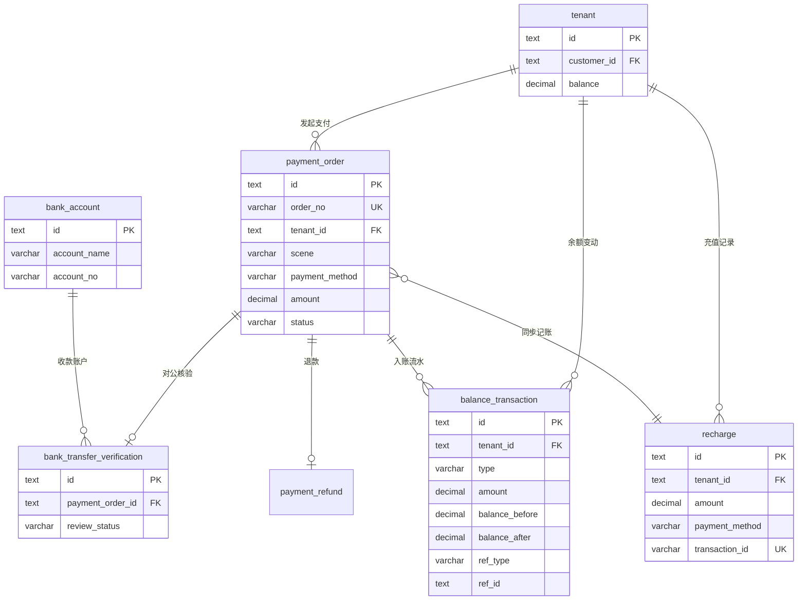
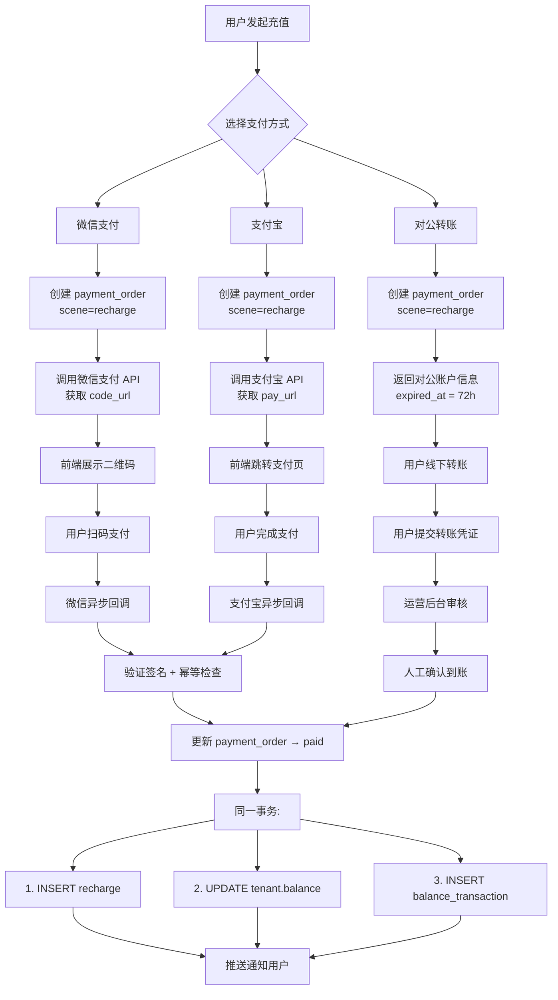
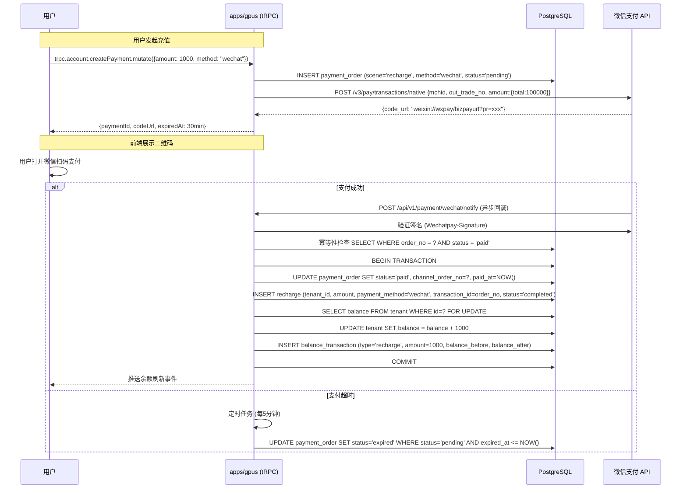
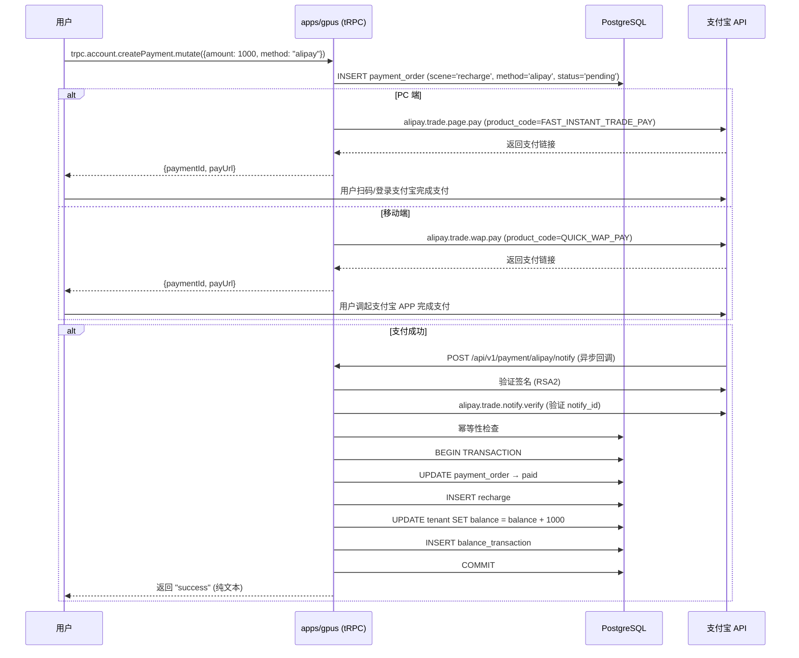
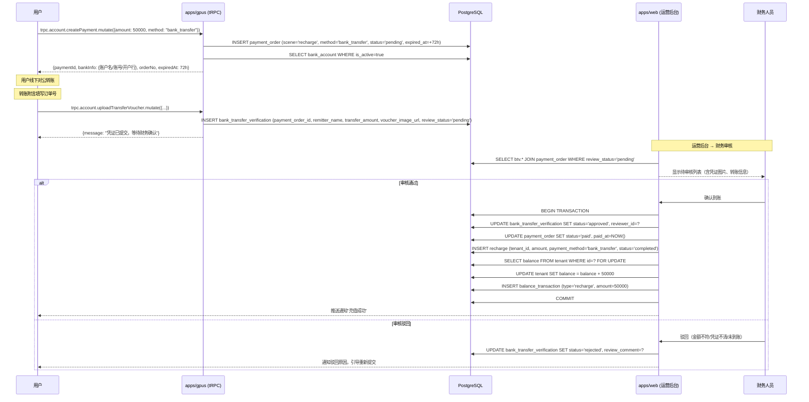
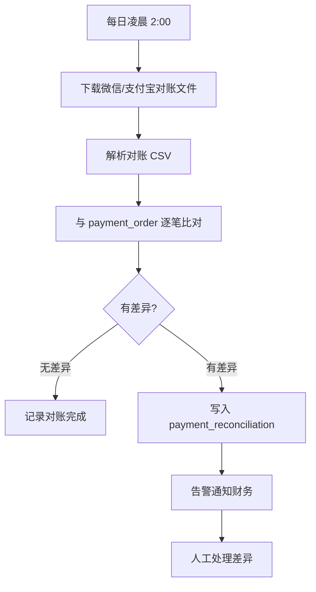

# 用户充值流程与数据库设计

> 支持微信支付、支付宝、对公转账三种方式，面向商业化运行设计。
> 依赖：CRM 三层实体模型（Customer → Project → Tenant）、余额三层防超额机制、OpenMeter 计量计费。

**版本**: v1.0（2026-07-16）

> **勘误（2026-10-06）**，裁决见 [矛盾台账](../audit/doc-contradictions.md) §1：
> 1. `payment_order.scene` 实际有 **5 个取值**（`packages/billing/src/types.ts` `PAYMENT_SCENES`）：`recharge`、`bare_metal_order`、`serverless`、`merchant_prepay`、`voucher_purchase`；本文档仅列前 2 个。
> 2. 余额写入已改走 `packages/billing.creditBalance → tenant_balance`（`apps/web/.../tenant-recharge.ts:76`）；`tenant.balance` 仅由余额快照 / Excel 导入写回，**§8.1 步骤 3 的 `UPDATE tenant SET balance` 与 §6/§9 流程图同此勘误**。
> 3. `balance_transaction` 实际有 **21 列**（`packages/db/src/gpus-consumer-schema.ts` `balanceTransaction`）：含 available/reserved/balance 各前后快照、4 个 voucher 快照列与 `idempotency_key`；本文档 §3.6 DDL 缺这些字段。

---

## 目录

1. [设计原则与约束](#1-设计原则与约束)
2. [资金模型](#2-资金模型)
3. [数据库设计](#3-数据库设计)
4. [充值流程总览](#4-充值流程总览)
5. [微信支付流程](#5-微信支付流程)
6. [支付宝流程](#6-支付宝流程)
7. [对公转账流程](#7-对公转账流程)
8. [充值成功后处理链路](#8-充值成功后处理链路)
9. [运营后台设计](#9-运营后台设计)
10. [tRPC 接口设计](#10-trpc-接口设计)
11. [支付回调端点设计](#11-支付回调端点设计)
12. [定时任务与补偿机制](#12-定时任务与补偿机制)
13. [安全与合规](#13-安全与合规)
14. [对账与财务核算](#14-对账与财务核算)
15. [监控与告警](#15-监控与告警)
16. [附录](#附录)

---

## 1. 设计原则与约束

### 1.1 核心原则

| 原则 | 说明 |
|------|------|
| **充值归属 Tenant** | 所有充值写入 `tenant`（billing_tenant），不写入 `customer`。客户维度余额为派生聚合。 |
| **充值不直接落 `recharge`** | `recharge` 表为运营侧记账凭证；用户侧支付流程走 `payment_order` → 确认后同步写入 `recharge`。 |
| **幂等性** | 支付订单号全局唯一，回调重入安全；同一笔充值不重复入账。 |
| **并发安全** | 余额操作使用行级锁 `SELECT ... FOR UPDATE`，防止并发写入。 |
| **异步确认** | 在线支付走异步回调确认；对公转账走人工审核确认。 |
| **可追溯** | 每笔资金变动产生 `balance_transaction` 流水，附带完整审计信息。 |
| **多租户隔离** | 所有查询强制带 `tenant_id`；支付回调通过订单号反查 tenant 保证隔离。 |

### 1.2 与现有系统的关系

```
┌─────────────────────────────────────────────────────────────────────┐
│                      现有系统                                        │
│                                                                      │
│  CRM 域 (apps/web)          │  消费者域 (apps/gpus)                  │
│  customer → project → tenant │  用户选购 → 订单 → 余额扣款             │
│  recharge / coupon / bill    │  payment_order → balance_transaction  │
│                              │                                      │
│  财务域 (apps/web)           │  计量计费 (OpenMeter)                  │
│  billing_period / income     │  5 分钟定时扣款 → 余额减少              │
│  platform_cost / settlement  │                                      │
├─────────────────────────────────────────────────────────────────────┤
│                      本文档新增                                      │
│  payment_order (支付订单)     │  bank_transfer_verification (对公核验)│
│  payment_channel_config (渠道)│  bank_account (对公收款账户)           │
│  balance_transaction (流水)  │  recharge (运营记账 — 同步写入)        │
└─────────────────────────────────────────────────────────────────────┘
```

### 1.3 支付场景矩阵

| 场景 | 金额来源 | 适用支付方式 | 实时性 | 关联表 |
|------|---------|-------------|--------|--------|
| **账户充值** | 用户自定 (¥1 ~ ¥100,000) | 微信 / 支付宝 / 对公转账 | 即时或 T+1~3 | payment_order → recharge → tenant_balance.available |
| **裸金属订单支付** | 订单固定金额 | 微信 / 支付宝 / 余额 | 即时 | payment_order → bare_metal_order |
| **云服务器/任务扣款** | 按量计费 | 余额（非直接支付） | 准实时（5min） | OpenMeter → balance_transaction |

---

## 2. 资金模型

### 2.1 用户资金流

```
                     ┌──────────────────────────────────────┐
                     │     tenant_balance（计费租户）          │
                     │                                       │
  ┌─────────┐        │  available_balance  可用               │
  │ 微信支付 │──────▶│  reserved_balance   冻结（按量预留）    │
  └─────────┘ 即时到账│                                       │
                     │  扣款路径:                              │
  ┌─────────┐        │  ├── 裸金属/包时 → deduct_available    │
  │ 支付宝   │──────▶│  ├── 按量任务 → freeze + consume       │
  └─────────┘ 即时到账│  └── 算力券抵扣 → coupon_usage_log     │
                     │                                       │
  ┌──────────┐       │  权威定义: tenant-balance-unification  │
  │对公转账   │──────▶│                                       │
  └──────────┘ T+1~3 │                                       │
                     └──────────────────────────────────────┘
```

### 2.2 充值金额规则

| 规则 | 说明 |
|------|------|
| 最低充值 | ¥1.00 |
| 最高单笔 | ¥100,000.00 |
| 预设金额档位 | ¥100 / ¥500 / ¥1,000 / ¥5,000 / ¥10,000 / ¥50,000 |
| 对公转账无上限 | 但超过 ¥100,000 需要额外审核 |
| 金额精度 | `NUMERIC(15,4)`，最小单位 0.0001 元 |

### 2.3 余额层次

> **权威模型**：`tenant-balance-unification.md`。

```
tenant_balance (tenant_id PK, organization_id 冗余)
    ├── available_balance  可下单 / 可支付
    └── reserved_balance   commitment=on-demand 按秒任务冻结未结算
total_funds = available + reserved
```

- 一客户可多个子租户：各有一行 `tenant_balance`，余额独立；按 `organization_id` 聚合展示
- 充值：`recharge` → available↑
- 按秒提交：`freeze` → available→reserved；5min 按秒 `consume_reserved`
- 预付（hour/daily/…）：`deduct_available`
- 流水：`balance_transaction`（含 organization_id 冗余）

> **废止**：`tenant.balance` 单字段真值、冻结「仅概念层」、历史码兼容迁移说明。

---

## 3. 数据库设计

### 3.1 表总览

```
┌─────────────────────────────────────────────────────────────────────┐
│                        支付核心表                                     │
│                                                                      │
│  payment_order            支付订单（统一入口）                         │
│  payment_channel_config   支付渠道配置（微信/支付宝密钥）              │
│  bank_account             对公收款账户信息                             │
│  bank_transfer_verification  对公转账核验凭证                         │
│                                                                      │
│                        资金记录表                                     │
│                                                                      │
│  balance_transaction      余额变动流水（充值/扣款/退款/冻结/解冻）      │
│  recharge                 运营侧充值记账（CRM 域，与 payment_order 同步）│
│                                                                      │
│                        扩展表                                         │
│                                                                      │
│  payment_refund           退款记录（预留）                             │
│  payment_reconciliation   对账记录（预留）                             │
└─────────────────────────────────────────────────────────────────────┘

                        依赖的现有表
┌─────────────────────────────────────────────────────────────────────┐
│  tenant (billing_tenant)   余额承载主体                               │
│  customer                  客户主体（CRM 经营维度）                    │
│  user_staff                内部员工（对公审核人）                       │
│  bare_metal_order          裸金属订单（scene 订单支付关联）             │
└─────────────────────────────────────────────────────────────────────┘
```

### 3.2 payment_order — 支付订单

> 支付体系的核心表，统一管理所有支付场景的订单生命周期。

```sql
CREATE TABLE payment_order (
    id                  TEXT PRIMARY KEY,                    -- UUID / ULID
    order_no            VARCHAR(64) NOT NULL UNIQUE,         -- 对外订单号 (PAY + yyyyMMddHHmmss + 6位随机)
    tenant_id           TEXT NOT NULL REFERENCES tenant(id), -- 所属计费租户

    -- 场景关联
    scene               VARCHAR(16) NOT NULL,                -- recharge / bare_metal_order / serverless / merchant_prepay / voucher_purchase（见文首勘误）
    scene_order_id      TEXT,                                -- 场景订单 ID (recharge.id / bare_metal_order.id / payment 相关 id)

    -- 金额
    amount              NUMERIC(15,4) NOT NULL CHECK (amount > 0),
    currency            VARCHAR(8) NOT NULL DEFAULT 'CNY',

    -- 支付方式
    payment_method      VARCHAR(16) NOT NULL,                -- wechat / alipay / bank_transfer

    -- 渠道信息
    channel_order_no    VARCHAR(128),                        -- 微信/支付宝 渠道订单号 (transaction_id / trade_no)
    channel_status      VARCHAR(32),                         -- 渠道返回的状态
    channel_response    JSONB,                               -- 渠道原始响应（完整回调 JSON，加密存储）

    -- 状态机
    status              VARCHAR(16) NOT NULL DEFAULT 'pending',
        -- pending:   等待支付（在线支付等待回调 / 对公转账等待凭证提交）
        -- paid:      支付成功（已确认到账，余额已增加）
        -- failed:    支付失败（回调金额不匹配 / 渠道拒绝）
        -- expired:   超时关闭（在线支付超时 / 对公转账超时未提交凭证）
        -- refunded:  已退款（全额退款）
        -- partial_refunded: 部分退款

    -- 时间线
    paid_at             TIMESTAMPTZ,                         -- 支付成功时间
    expired_at          TIMESTAMPTZ NOT NULL,                -- 支付过期时间
    created_at          TIMESTAMPTZ NOT NULL DEFAULT NOW(),
    updated_at          TIMESTAMPTZ NOT NULL DEFAULT NOW(),

    -- 审计
    created_by          TEXT,                                -- 创建人（系统/用户ID）
    ip_address          VARCHAR(45),                         -- 客户端 IP（安全审计）
    user_agent          TEXT                                 -- 客户端 UA
);

-- 索引
CREATE INDEX idx_payment_order_tenant ON payment_order(tenant_id);
CREATE INDEX idx_payment_order_scene ON payment_order(scene, scene_order_id);
CREATE INDEX idx_payment_order_status ON payment_order(status);
CREATE INDEX idx_payment_order_created ON payment_order(created_at DESC);
CREATE INDEX idx_payment_order_method_status ON payment_order(payment_method, status);
-- 回调查询用
CREATE UNIQUE INDEX idx_payment_order_channel_no ON payment_order(channel_order_no) WHERE channel_order_no IS NOT NULL;
```

**状态机**：

```
                              ┌──────────────┐
                              │   pending    │
                              └──────┬───────┘
                                     │
                    ┌────────────────┼────────────────┐
                    │                │                │
              回调成功/审核通过    回调失败          超时
                    │                │                │
                    ▼                ▼                ▼
              ┌──────────┐   ┌──────────┐   ┌──────────┐
              │   paid   │   │  failed  │   │ expired  │
              └────┬─────┘   └──────────┘   └──────────┘
                   │
              全额退款    部分退款
                   │         │
                   ▼         ▼
            ┌──────────┐ ┌──────────────────┐
            │ refunded │ │partial_refunded  │
            └──────────┘ └──────────────────┘
```

### 3.3 payment_channel_config — 支付渠道配置

```sql
CREATE TABLE payment_channel_config (
    id                  TEXT PRIMARY KEY,
    channel             VARCHAR(16) NOT NULL UNIQUE,         -- wechat / alipay
    channel_name        VARCHAR(64) NOT NULL,                -- 展示名：微信支付 / 支付宝
    app_id              VARCHAR(64) NOT NULL,                -- 应用 ID
    merchant_id         VARCHAR(64) NOT NULL,                -- 商户号
    api_key_enc         TEXT NOT NULL,                       -- 加密存储的 API 密钥
    api_v3_key_enc      TEXT,                                -- 微信 v3 API 密钥
    public_key_enc      TEXT,                                -- 支付宝/微信 平台公钥
    private_key_enc     TEXT,                                -- 平台私钥
    certificate_enc     TEXT,                                -- 证书（微信商户证书）
    notify_url          VARCHAR(512) NOT NULL,               -- 回调地址
    return_url          VARCHAR(512),                        -- 支付完成跳转地址
    is_active           BOOLEAN NOT NULL DEFAULT true,
    config_json         JSONB,                               -- 渠道特有配置（限额、费率等）
    created_at          TIMESTAMPTZ NOT NULL DEFAULT NOW(),
    updated_at          TIMESTAMPTZ NOT NULL DEFAULT NOW()
);
```

**初始化数据**：

```sql
INSERT INTO payment_channel_config (id, channel, channel_name, app_id, merchant_id, api_key_enc, notify_url, is_active)
VALUES
    ('pcc-wechat', 'wechat', '微信支付', '', '', '[encrypted]', 'https://api.example.com/api/v1/payment/wechat/notify', true),
    ('pcc-alipay', 'alipay', '支付宝', '', '', '[encrypted]', 'https://api.example.com/api/v1/payment/alipay/notify', true);
```

### 3.4 bank_account — 对公收款账户

```sql
CREATE TABLE bank_account (
    id                  TEXT PRIMARY KEY,
    account_name        VARCHAR(255) NOT NULL,               -- 开户名
    account_no          VARCHAR(64) NOT NULL,                -- 账号
    bank_name           VARCHAR(255) NOT NULL,               -- 开户行
    bank_branch         VARCHAR(255),                        -- 支行
    bank_code           VARCHAR(32),                         -- 联行号
    account_type        VARCHAR(16) NOT NULL DEFAULT 'enterprise', -- enterprise / personal
    remark              TEXT,                                -- 附言/备注说明
    min_amount          NUMERIC(15,4) DEFAULT 0,             -- 最低转账金额
    is_active           BOOLEAN NOT NULL DEFAULT true,
    sort_order          INTEGER NOT NULL DEFAULT 0,
    created_at          TIMESTAMPTZ NOT NULL DEFAULT NOW()
);
```

### 3.5 bank_transfer_verification — 对公转账核验

```sql
CREATE TABLE bank_transfer_verification (
    id                  TEXT PRIMARY KEY,
    payment_order_id    TEXT NOT NULL REFERENCES payment_order(id),

    -- 用户上传信息
    remitter_name       VARCHAR(255) NOT NULL,               -- 付款方名称（公司名）
    remitter_account    VARCHAR(64),                         -- 付款方账号
    transfer_amount     NUMERIC(15,4) NOT NULL,              -- 转账金额
    transfer_time       TIMESTAMPTZ,                         -- 转账时间
    voucher_image_url   VARCHAR(1024),                       -- 转账凭证图片 URL
    voucher_image_key   VARCHAR(255),                        -- 存储 key（对象存储）
    bank流水号          VARCHAR(128),                         -- 银行流水号（可选）
    remark              TEXT,                                -- 用户备注

    -- 运营审核
    reviewer_id         TEXT REFERENCES user_staff(id),       -- 审核人
    review_status       VARCHAR(16) NOT NULL DEFAULT 'pending',
        -- pending:   待审核
        -- approved:  已通过（余额已增加）
        -- rejected:  已驳回
        -- cancelled: 用户取消
    review_comment      TEXT,                                -- 审核备注
    reviewed_at         TIMESTAMPTZ,                         -- 审核时间
    reviewed_by         TEXT,                                -- 审核人（冗余，审计用）

    created_at          TIMESTAMPTZ NOT NULL DEFAULT NOW(),
    updated_at          TIMESTAMPTZ NOT NULL DEFAULT NOW()
);

CREATE INDEX idx_btv_order ON bank_transfer_verification(payment_order_id);
CREATE INDEX idx_btv_status ON bank_transfer_verification(review_status);
CREATE INDEX idx_btv_created ON bank_transfer_verification(created_at DESC);
```

### 3.6 balance_transaction — 余额变动流水

> 定义见 `database-design.md` §9.1（共享交易层统一定义）。
> 本场景写入时 `ref_type` 取值：`recharge`（充值确认）、`bare_metal_order`（裸金属扣款）、`compute_task`（按量扣款）。

**余额变动规则**：

```
balance_before + amount = balance_after

充值:   amount > 0,  balance_after > balance_before
扣款:   amount < 0,  balance_after < balance_before
冻结:   amount < 0,  从 available 扣除 (可用余额减少，总余额不变)
解冻:   amount > 0,  恢复到 available (可用余额恢复，总余额不变)
```

### 3.7 recharge — 运营侧充值记账

> CRM 域充值记录，由支付确认后同步写入。与 `payment_order` 为 1:1 关系（recharge 场景）。

```sql
CREATE TABLE recharge (
    id                  TEXT PRIMARY KEY,
    tenant_id           TEXT NOT NULL REFERENCES tenant(id),  -- 计费租户
    project_id          TEXT,                                 -- 可选归属项目
    amount              NUMERIC(15,4) NOT NULL,               -- 充值金额
    payment_method      VARCHAR(16) NOT NULL,                 -- wechat / alipay / bank_transfer
    status              VARCHAR(16) NOT NULL DEFAULT 'pending',
        -- pending / completed / failed
    transaction_id      VARCHAR(128) UNIQUE,                  -- 关联 payment_order.order_no
    remark              TEXT,
    operated_at         TIMESTAMPTZ,                          -- 操作时间
    operator_staff_id   TEXT REFERENCES user_staff(id),        -- 操作人（对公转账审核人）
    created_at          TIMESTAMPTZ NOT NULL DEFAULT NOW()
);

CREATE INDEX idx_recharge_tenant ON recharge(tenant_id);
CREATE INDEX idx_recharge_tenant_created ON recharge(tenant_id, created_at DESC);
```

**写入时机**：`payment_order.status` 变为 `paid` 的同一事务中，`INSERT INTO recharge`。

### 3.8 payment_refund — 退款记录（预留）

```sql
CREATE TABLE payment_refund (
    id                  TEXT PRIMARY KEY,
    payment_order_id    TEXT NOT NULL REFERENCES payment_order(id),
    refund_order_no     VARCHAR(64) NOT NULL UNIQUE,          -- 退款单号 (REF + yyyyMMddHHmmss + 6位)
    tenant_id           TEXT NOT NULL REFERENCES tenant(id),
    amount              NUMERIC(15,4) NOT NULL CHECK (amount > 0),
    reason              TEXT NOT NULL,                         -- 退款原因
    status              VARCHAR(16) NOT NULL DEFAULT 'pending',
        -- pending / processing / success / failed
    channel_refund_no   VARCHAR(128),                         -- 渠道退款号
    channel_response    JSONB,
    reviewer_id         TEXT REFERENCES user_staff(id),        -- 审批人
    reviewed_at         TIMESTAMPTZ,
    refund_at           TIMESTAMPTZ,                           -- 退款到账时间
    created_at          TIMESTAMPTZ NOT NULL DEFAULT NOW(),
    updated_at          TIMESTAMPTZ NOT NULL DEFAULT NOW()
);

CREATE INDEX idx_refund_order ON payment_refund(payment_order_id);
CREATE INDEX idx_refund_tenant ON payment_refund(tenant_id);
CREATE INDEX idx_refund_status ON payment_refund(status);
```

### 3.9 payment_reconciliation — 对账记录（预留）

```sql
CREATE TABLE payment_reconciliation (
    id                  TEXT PRIMARY KEY,
    reconciliation_date DATE NOT NULL,                         -- 对账日期
    channel             VARCHAR(16) NOT NULL,                  -- wechat / alipay
    total_count         INT NOT NULL DEFAULT 0,                -- 渠道总笔数
    total_amount        NUMERIC(15,4) NOT NULL DEFAULT 0,      -- 渠道总金额
    platform_count      INT NOT NULL DEFAULT 0,                -- 平台总笔数
    platform_amount     NUMERIC(15,4) NOT NULL DEFAULT 0,      -- 平台总金额
    diff_count          INT NOT NULL DEFAULT 0,                -- 差异笔数
    diff_amount         NUMERIC(15,4) NOT NULL DEFAULT 0,      -- 差异金额
    status              VARCHAR(16) NOT NULL DEFAULT 'pending',
        -- pending / matched / diff_found / resolved
    detail_json         JSONB,                                 -- 差异明细
    reconciled_by       TEXT REFERENCES user_staff(id),
    reconciled_at       TIMESTAMPTZ,
    created_at          TIMESTAMPTZ NOT NULL DEFAULT NOW()
);

CREATE UNIQUE INDEX idx_recon_date_channel ON payment_reconciliation(reconciliation_date, channel);
```

### 3.10 ER 关系图



---

## 4. 充值流程总览

### 4.1 统一充值流程



### 4.2 统一支付创建逻辑

```typescript
// apps/gpus tRPC endpoint: trpc.account.createPayment
async function createPayment(user, input) {
  const { scene, sceneOrderId, amount, method } = input;
  const tenantId = await getTenantId(user);

  // 1. 验证租户状态
  const tenant = await db.select().from(tenant).where(eq(tenant.id, tenantId));
  if (tenant.status !== 'active') throw new Error('账户未激活');

  // 2. 验证金额范围
  if (amount < 1 || amount > 100000) throw new Error('充值金额超出范围');

  // 3. 场景校验
  if (scene === 'bare_metal_order' && !sceneOrderId) {
    throw new Error('裸金属订单支付必须指定订单ID');
  }

  // 4. 生成订单号
  const orderNo = generateOrderNo(); // PAY + yyyyMMddHHmmss + 6位随机

  // 5. 计算过期时间
  const expiredAt = method === 'bank_transfer'
    ? addHours(now(), 72)     // 对公转账 72 小时
    : addMinutes(now(), 30);  // 在线支付 30 分钟

  // 6. 创建支付订单
  const [paymentOrder] = await db.insert(paymentOrder).values({
    id: generateId(),
    orderNo,
    tenantId,
    scene,
    sceneOrderId: sceneOrderId || null,
    amount,
    currency: 'CNY',
    paymentMethod: method,
    status: 'pending',
    expiredAt,
    createdBy: user.id,
    ipAddress: user.ipAddress,
  }).returning();

  // 7. 调用支付渠道
  if (method === 'wechat') {
    const wechatResult = await wechatPay.createNativeOrder({
      outTradeNo: orderNo,
      amount: Math.round(amount * 100), // 转分
      description: `算力平台账户充值 ¥${amount.toFixed(2)}`,
      notifyUrl: PAYMENT_CHANNEL_CONFIG.wechat.notifyUrl,
    });
    return { paymentId: paymentOrder.id, codeUrl: wechatResult.codeUrl, expiredAt };
  }

  if (method === 'alipay') {
    const alipayResult = await alipay.createPagePay({
      outTradeNo: orderNo,
      totalAmount: amount.toFixed(2),
      subject: '算力平台账户充值',
      notifyUrl: PAYMENT_CHANNEL_CONFIG.alipay.notifyUrl,
    });
    return { paymentId: paymentOrder.id, payUrl: alipayResult.payUrl, expiredAt };
  }

  if (method === 'bank_transfer') {
    const bankAccounts = await db.select().from(bankAccount)
      .where(eq(bankAccount.isActive, true))
      .orderBy(bankAccount.sortOrder);
    return {
      paymentId: paymentOrder.id,
      bankAccounts,
      orderNo,
      expiredAt,
      instructions: '请使用对公账户转账至以上账户，附言填写订单号',
    };
  }
}
```

---

## 5. 微信支付流程

### 5.1 交互流程



### 5.2 微信支付模式适配

| 模式 | 适用端 | API | 触发条件 |
|------|-------|-----|---------|
| **Native** | PC Web | `POST /v3/pay/transactions/native` | 默认（PC 浏览器） |
| **H5** | 移动端浏览器 | `POST /v3/pay/transactions/h5` | User-Agent 检测为移动端 |
| **JSAPI** | 微信内浏览器 | `POST /v3/pay/transactions/jsapi` | User-Agent 检测为微信内置浏览器，需获取 openid |

**自适应逻辑**：

```typescript
function detectWechatMode(userAgent: string): 'native' | 'h5' | 'jsapi' {
  if (/MicroMessenger/i.test(userAgent)) return 'jsapi';  // 微信内置浏览器
  if (/Mobile|Android|iPhone|iPad/i.test(userAgent)) return 'h5'; // 移动端浏览器
  return 'native'; // PC 浏览器
}
```

### 5.3 关键 API 参数

```typescript
// Native 模式请求
POST https://api.mch.weixin.qq.com/v3/pay/transactions/native
{
  "mchid": "商户号",
  "out_trade_no": "PAY20260716143012ABCD12",
  "appid": "公众号/小程序 AppID",
  "description": "算力平台账户充值 ¥1,000.00",
  "notify_url": "https://api.example.com/api/v1/payment/wechat/notify",
  "amount": {
    "total": 100000,     // 单位: 分
    "currency": "CNY"
  }
}

// 响应
{ "code_url": "weixin://wxpay/bizpayurl?pr=xxxxxxxx" }
```

### 5.4 回调处理要点

1. **签名验证**：使用 `Wechatpay-Signature` 头验证，公钥从 `payment_channel_config.public_key_enc` 获取。
2. **解密**：resource 使用 `AEAD_AES_256_GCM` 解密，密钥为 `api_v3_key`。
3. **幂等性**：`SELECT id FROM payment_order WHERE order_no = ? AND status = 'paid'`，已处理则直接返回 200。
4. **金额校验**：解密后 `transaction.amount.total`（分）必须等于 `payment_order.amount * 100`。
5. **成功响应**：返回 HTTP 200 + JSON `{ "code": "SUCCESS", "message": "成功" }`。

---

## 6. 支付宝流程

### 6.1 交互流程



### 6.2 回调处理要点

1. **签名验证**：使用支付宝公钥（`alipay.publickey`）验证 RSA2 签名。
2. **notify_id 验证**：调用 `alipay.trade.notify.verify` 验证回调真实性。
3. **app_id 校验**：回调中的 `app_id` 必须匹配 `payment_channel_config.app_id`。
4. **金额校验**：`total_amount` 必须等于 `payment_order.amount`。
5. **trade_status**：仅 `TRADE_SUCCESS` 或 `TRADE_FINISHED` 时确认支付。
6. **成功响应**：返回纯文本 `success`（非 JSON）。

---

## 7. 对公转账流程

### 7.1 完整流程



### 7.2 对公转账页面（apps/gpus）

```
┌─────────────────────────────────────────────────────────────────────────┐
│  对公转账充值                                                            │
│                                                                         │
│  充值金额: ¥50,000.00                                                    │
│                                                                         │
│  ┌── 收款账户信息 ──────────────────────────────────────────────────┐    │
│  │                                                                 │    │
│  │  开户名: XX科技有限公司                                            │    │
│  │  账  号: 1109 1234 5678 9012                                     │    │
│  │  开户行: 中国银行北京分行                                           │    │
│  │                                                                 │    │
│  │  ⚠ 请务必在转账附言中填写订单号，否则无法核对到账                    │    │
│  │                                                                 │    │
│  │  订单号: PAY20260716143012ABCD12                                 │    │
│  │  [复制订单号]                                                     │    │
│  └──────────────────────────────────────────────────────────────────┘    │
│                                                                         │
│  ┌── 提交转账凭证 ──────────────────────────────────────────────────┐    │
│  │                                                                 │    │
│  │  付款方名称: [________________________] (必填，与转账方一致)       │    │
│  │  付款方账号: [________________________] (选填)                    │    │
│  │  转账金额:   [50000.00                  ] (必填)                 │    │
│  │  转账时间:   [2026-07-16 15:00    ▼]                             │    │
│  │  银行流水号: [________________________] (选填)                    │    │
│  │                                                                 │    │
│  │  转账凭证:   [📎 上传凭证图片 / 截图]                               │    │
│  │              支持 JPG/PNG/PDF，最大 10MB                          │    │
│  │                                                                 │    │
│  └──────────────────────────────────────────────────────────────────┘    │
│                                                                         │
│  注意事项:                                                              │
│  • 对公转账到账时间通常为 1-3 个工作日                                    │
│  • 财务确认到账后自动充值至余额                                           │
│  • 超过 72 小时未提交凭证，订单将自动关闭                                  │
│                                                                         │
│  [提交凭证]                              [取消订单]                      │
└─────────────────────────────────────────────────────────────────────────┘
```

### 7.3 运营审核页面（apps/web）

```
对公转账审核                                              待审核: 3 笔
┌──────────────┬──────────┬────────────┬──────────┬────────┬────────┬──────────┬──────────────┐
│ 订单号       │ 租户     │ 金额       │ 付款方   │ 转账时间│ 凭证   │ 状态     │ 操作         │
├──────────────┼──────────┼────────────┼──────────┼────────┼────────┼──────────┼──────────────┤
│ PAY...ABCD12 │ user_a   │ ¥50,000    │ XX公司   │ 15:00  │ [查看] │ ⏳待审核 │ [通过][驳回] │
│ PAY...EFGH34 │ user_b   │ ¥10,000    │ YY科技   │ 14:20  │ [查看] │ ⏳待审核 │ [通过][驳回] │
│ PAY...IJKL56 │ user_c   │ ¥1,000     │ 个人     │ 13:00  │ [查看] │ ⏳待审核 │ [通过][驳回] │
└──────────────┴──────────┴────────────┴──────────┴────────┴────────┴──────────┴──────────────┘

审核详情弹窗:
┌─────────────────────────────────────────────┐
│  审核详情 - PAY20260716143012ABCD12          │
│                                             │
│  充值金额: ¥50,000.00                        │
│  付款方名称: XX公司                           │
│  付款方账号: 6222xxxxxxxxxxx                  │
│  转账金额: ¥50,000.00  ✓ 金额匹配            │
│  转账时间: 2026-07-16 15:00                  │
│                                             │
│  凭证图片: [预览] [下载原图]                   │
│                                             │
│  ┌── 审核操作 ──────────────────────────┐    │
│  │ 审核备注: [________________________] │    │
│  │                                     │    │
│  │ [✅ 确认通过]  [❌ 驳回]              │    │
│  └─────────────────────────────────────┘    │
└─────────────────────────────────────────────┘
```

---

## 8. 充值成功后处理链路

### 8.1 确认到账后的事务操作

> 以下操作必须在**同一个数据库事务**中完成，保证原子性。

> **已订正（2026-10-06）**：下方 SQL 为历史设计。实际实现中**步骤 3、步骤 4 已改走** `packages/billing.creditBalance()` —— 写 `tenant_balance` 与 `balance_transaction`（21 列，含 voucher 快照与 `idempotency_key`），不再直接 `UPDATE tenant SET balance`。步骤 1、2 不变。见文首勘误 2、3。

```sql
-- 充值确认事务（微信/支付宝回调 或 对公审核通过）
BEGIN;

-- 1. 更新支付订单状态
UPDATE payment_order
SET status = 'paid',
    paid_at = NOW(),
    channel_order_no = $channel_order_no,
    channel_status = $channel_status,
    channel_response = $channel_response,
    updated_at = NOW()
WHERE id = $payment_order_id AND status = 'pending';

-- 2. 创建运营侧充值记录
INSERT INTO recharge (id, tenant_id, amount, payment_method, status, transaction_id, operated_at, operator_staff_id)
VALUES ($recharge_id, $tenant_id, $amount, $payment_method, 'completed', $order_no, NOW(), $operator_id);

-- 3. 行级锁更新余额
UPDATE tenant
SET balance = balance + $amount,
    updated_at = NOW()
WHERE id = $tenant_id;

-- 4. 插入余额变动流水
INSERT INTO balance_transaction (id, tenant_id, type, amount, balance_before, balance_after, ref_type, ref_id, description, created_by)
VALUES (
    $bt_id,
    $tenant_id,
    'recharge',
    $amount,
    (SELECT balance - $amount FROM tenant WHERE id = $tenant_id),  -- balance_before
    (SELECT balance FROM tenant WHERE id = $tenant_id),            -- balance_after (更新后)
    'payment_order',
    $payment_order_id,
    '账户充值 - ' || $payment_method,
    $user_id
);

COMMIT;
```

### 8.2 事务安全说明

| 措施 | 说明 |
|------|------|
| **行级锁** | `UPDATE tenant SET balance = balance + ?` 在事务中隐式获取行锁，防止并发充值导致余额不一致 |
| **幂等检查** | `WHERE status = 'pending'` 确保同一订单不会重复入账 |
| **乐观锁备选** | 若并发极高，可使用 `WHERE balance = $expected_balance` + 重试机制 |
| **余额校验** | 事务提交后可选：校验 `balance_after = balance_before + amount` |

### 8.3 跨应用同步

```
apps/gpus (tRPC)                    apps/web (CRM)                apps/api (回调)
    │                                    │                              │
    │  充值确认事务                       │                              │
    │  ┌──────────────────────┐          │                              │
    │  │ payment_order → paid │          │                              │
    │  │ recharge → completed │──────────│→ CRM 客户详情·充值记录 Tab    │
    │  │ tenant.balance += N  │          │                              │
    │  │ balance_transaction  │          │                              │
    │  └──────────────────────┘          │                              │
    │                                    │                              │
    │  推送事件 ──────────────────────→  │ → 通知用户余额刷新             │
```

---

## 9. 运营后台设计

### 9.1 支付管理页面（apps/web）

| 页面 | 路由 | 功能 | 数据表 |
|------|------|------|--------|
| 充值记录 | `/finance/recharges` | 查询所有充值记录，按租户/客户/时间/方式筛选 | recharge + payment_order |
| 支付订单 | `/finance/payment-orders` | 查询所有支付订单，按状态/方式/时间筛选 | payment_order |
| 对公转账审核 | `/finance/bank-transfer` | 待审核列表、审核操作 | bank_transfer_verification + payment_order |
| 收款账户管理 | `/finance/bank-accounts` | 对公收款账户的增删改 | bank_account |
| 支付渠道配置 | `/finance/payment-channels` | 微信/支付宝渠道密钥配置 | payment_channel_config |
| 余额流水 | `/finance/balance-transactions` | 按租户/类型/时间查询流水 | balance_transaction |
| 退款管理 | `/finance/refunds` | 退款申请与审批 | payment_refund |
| 对账管理 | `/finance/reconciliation` | 日对账、差异处理 | payment_reconciliation |

### 9.2 余额手动调整

> 运营人员可对租户余额进行手动调整（赠送、扣回等），需填写调整原因并记录操作人。

```typescript
// apps/web tRPC endpoint
adjustBalance: adminProcedure
  .input(z.object({
    tenantId: z.string(),
    amount: z.number(),                    // 正数增加，负数扣减
    reason: z.string().min(10),            // 必须填写原因
    adjustmentType: z.enum(['bonus', 'adjustment']),
  }))
  .mutation(async ({ input }) => {
    return db.transaction(async (tx) => {
      const [tenant] = await tx.select().from(tenant)
        .where(eq(tenant.id, input.tenantId))
        .for('update');

      const balanceBefore = tenant.balance;
      const balanceAfter = balanceBefore + input.amount;

      if (balanceAfter < 0) throw new Error('调整后余额不能为负');

      await tx.update(tenant)
        .set({ balance: balanceAfter, updatedAt: new Date() })
        .where(eq(tenant.id, input.tenantId));

      await tx.insert(balanceTransaction).values({
        id: generateId(),
        tenantId: input.tenantId,
        type: input.adjustmentType,
        amount: input.amount,
        balanceBefore,
        balanceAfter,
        refType: 'manual',
        description: input.reason,
        createdBy: ctx.user.staffId,
      });

      return { balanceBefore, balanceAfter };
    });
  }),
```

---

## 10. tRPC 接口设计

### 10.1 用户端 (apps/gpus)

```typescript
export const accountRouter = createTRPCRouter({

  // 创建支付订单（统一入口）
  createPayment: protectedProcedure
    .input(z.object({
      scene: z.enum(['recharge', 'bare_metal_order', 'serverless', 'merchant_prepay', 'voucher_purchase']),  // 见文首勘误，实际以 packages/billing PAYMENT_SCENES 为准
      sceneOrderId: z.string().optional(),
      amount: z.number().positive().max(100000),
      method: z.enum(['wechat', 'alipay', 'bank_transfer']),
    }))
    .mutation(async ({ ctx, input }) => paymentService.create(ctx.user, input)),
    // returns: { paymentId, codeUrl/payUrl/bankInfo, expiredAt }

  // 查询支付状态（轮询用）
  getPaymentStatus: protectedProcedure
    .input(z.object({ paymentId: z.string() }))
    .query(async ({ ctx, input }) => paymentService.getStatus(ctx.user, input.paymentId)),
    // returns: { status, paidAt }

  // 取消支付
  cancelPayment: protectedProcedure
    .input(z.object({ paymentId: z.string() }))
    .mutation(async ({ ctx, input }) => paymentService.cancel(ctx.user, input.paymentId)),

  // 对公转账：上传凭证
  uploadTransferVoucher: protectedProcedure
    .input(z.object({
      paymentId: z.string(),
      remitterName: z.string().min(1),
      remitterAccount: z.string().optional(),
      transferAmount: z.number().positive(),
      transferTime: z.string(),
      bankSerialNo: z.string().optional(),
      voucherImageBase64: z.string().min(1),
    }))
    .mutation(async ({ ctx, input }) => paymentService.uploadVoucher(ctx.user, input)),

  // 查询对公账户信息
  getBankAccountInfo: publicProcedure
    .query(async () => paymentService.getBankAccounts()),

  // 余额查询
  getBalance: protectedProcedure
    .query(async ({ ctx }) => accountService.getBalance(ctx.user)),

  // 余额流水
  listBalanceTransactions: protectedProcedure
    .input(z.object({
      page: z.number().int().min(1).default(1),
      pageSize: z.number().int().min(1).max(50).default(20),
      type: z.string().optional(),
    }))
    .query(async ({ ctx, input }) => accountService.listTransactions(ctx.user, input)),

  // 支付记录
  listPayments: protectedProcedure
    .input(z.object({
      page: z.number().int().min(1).default(1),
      pageSize: z.number().int().min(1).max(50).default(20),
      status: z.string().optional(),
      method: z.string().optional(),
    }))
    .query(async ({ ctx, input }) => paymentService.list(ctx.user, input)),

  // 充值记录（CRM 视图）
  listRecharges: protectedProcedure
    .input(z.object({
      page: z.number().int().min(1).default(1),
      pageSize: z.number().int().min(1).max(50).default(20),
    }))
    .query(async ({ ctx, input }) => rechargeService.listByTenant(ctx.user, input)),
})
```

### 10.2 运营端 (apps/web)

```typescript
export const financeRouter = createTRPCRouter({
  paymentOrders: createTRPCRouter({
    // 支付订单列表（全租户）
    listAll: adminProcedure
      .input(z.object({
        status: z.string().optional(),
        method: z.string().optional(),
        tenantId: z.string().optional(),
        dateRange: z.object({ from: z.string(), to: z.string() }).optional(),
        page: z.number().int().min(1).default(1),
        pageSize: z.number().int().min(1).max(50).default(20),
      }))
      .query(async ({ input }) => paymentService.listAll(input)),

    // 支付订单详情
    getById: adminProcedure
      .input(z.object({ id: z.string() }))
      .query(async ({ input }) => paymentService.getById(input.id)),
  }),

  bankTransfer: createTRPCRouter({
    // 对公转账待审核列表
    listPending: adminProcedure
      .query(async () => paymentService.listPendingBankTransfer()),

    // 审核对公转账
    review: adminProcedure
      .input(z.object({
        verificationId: z.string(),
        action: z.enum(['approve', 'reject']),
        comment: z.string().optional(),
      }))
      .mutation(async ({ input }) => paymentService.reviewBankTransfer(input)),
  }),

  bankAccounts: createTRPCRouter({
    // 收款账户 CRUD
    list: adminProcedure.query(async () => bankAccountService.list()),
    create: adminProcedure.input(z.object({...})).mutation(async ({ input }) => bankAccountService.create(input)),
    update: adminProcedure.input(z.object({...})).mutation(async ({ input }) => bankAccountService.update(input)),
    toggleActive: adminProcedure.input(z.object({ id: z.string() })).mutation(async ({ input }) => bankAccountService.toggleActive(input.id)),
  }),

  balanceTransactions: createTRPCRouter({
    // 余额流水查询
    list: adminProcedure
      .input(z.object({
        tenantId: z.string().optional(),
        type: z.string().optional(),
        dateRange: z.object({ from: z.string(), to: z.string() }).optional(),
        page: z.number().int().min(1).default(1),
        pageSize: z.number().int().min(1).max(50).default(20),
      }))
      .query(async ({ input }) => balanceTransactionService.list(input)),

    // 余额手动调整
    adjust: adminProcedure
      .input(z.object({
        tenantId: z.string(),
        amount: z.number(),
        reason: z.string().min(10),
        adjustmentType: z.enum(['bonus', 'adjustment']),
      }))
      .mutation(async ({ ctx, input }) => balanceService.adjust(ctx.user, input)),
  }),

  recharges: createTRPCRouter({
    // 充值记录列表
    list: adminProcedure
      .input(z.object({
        tenantId: z.string().optional(),
        customerId: z.string().optional(),
        method: z.string().optional(),
        dateRange: z.object({ from: z.string(), to: z.string() }).optional(),
        page: z.number().int().min(1).default(1),
        pageSize: z.number().int().min(1).max(50).default(20),
      }))
      .query(async ({ input }) => rechargeService.listAll(input)),
  }),
})
```

---

## 11. 支付回调端点设计

> 支付回调需要暴露公网 HTTP 端点，回调入口放在 apps/api 中。

```typescript
// apps/api/src/routes/payment/index.ts
import { OpenAPIHono } from '@hono/zod-openapi'

const paymentRouter = new OpenAPIHono()

// ==================== 微信支付回调 ====================
paymentRouter.post('/wechat/notify', async (c) => {
  // 1. 获取请求头
  const signature = c.req.header('Wechatpay-Signature')
  const timestamp = c.req.header('Wechatpay-Timestamp')
  const nonce = c.req.header('Wechatpay-Nonce')
  const serial = c.req.header('Wechatpay-Serial')

  // 2. 验证签名
  const channelConfig = await getChannelConfig('wechat')
  const publicKey = decryptKey(channelConfig.publicKeyEnc)
  const isValid = verifyWechatSignature(publicKey, signature, timestamp, nonce, await c.req.text())
  if (!isValid) return c.json({ code: 'FAIL', message: '签名验证失败' }, 400)

  // 3. 解密 resource
  const body = await c.req.json()
  const decrypted = decryptResource(body.resource, channelConfig.apiV3KeyEnc)

  // 4. 幂等性检查
  const orderNo = decrypted.out_trade_no
  const existing = await db.select().from(paymentOrder)
    .where(and(eq(paymentOrder.orderNo, orderNo), eq(paymentOrder.status, 'paid')))
    .limit(1)
  if (existing.length > 0) return c.json({ code: 'SUCCESS', message: '成功' })

  // 5. 获取订单并验证金额
  const [order] = await db.select().from(paymentOrder)
    .where(eq(paymentOrder.orderNo, orderNo))
  if (!order) return c.json({ code: 'FAIL', message: '订单不存在' })
  if (Number(order.amount) * 100 !== decrypted.amount.total) {
    return c.json({ code: 'FAIL', message: '金额不匹配' })
  }

  // 6. 确认到账（调用共享 service）
  await paymentService.confirmPayment({
    paymentOrderId: order.id,
    channelOrderNo: decrypted.transaction_id,
    channelStatus: decrypted.trade_state,
    channelResponse: body,
  })

  return c.json({ code: 'SUCCESS', message: '成功' })
})

// ==================== 支付宝回调 ====================
paymentRouter.post('/alipay/notify', async (c) => {
  // 1. 获取 form data
  const formData = await c.req.parseBody()

  // 2. 验证签名
  const channelConfig = await getChannelConfig('alipay')
  const publicKey = decryptKey(channelConfig.publicKeyEnc)
  const isValid = verifyAlipaySignature(publicKey, formData)
  if (!isValid) return c.text('failure')

  // 3. 验证 notify_id（二次验证）
  const notifyValid = await alipayVerify.notifyVerify(formData.notify_id)
  if (!notifyValid) return c.text('failure')

  // 4. 验证 app_id
  if (formData.app_id !== channelConfig.appId) return c.text('failure')

  // 5. 处理成功状态
  if (formData.trade_status === 'TRADE_SUCCESS' || formData.trade_status === 'TRADE_FINISHED') {
    const orderNo = formData.out_trade_no

    // 幂等性检查
    const existing = await db.select().from(paymentOrder)
      .where(and(eq(paymentOrder.orderNo, orderNo), eq(paymentOrder.status, 'paid')))
      .limit(1)
    if (existing.length > 0) return c.text('success')

    // 获取订单并验证金额
    const [order] = await db.select().from(paymentOrder)
      .where(eq(paymentOrder.orderNo, orderNo))
    if (!order) return c.text('failure')
    if (Number(order.amount).toFixed(2) !== formData.total_amount) {
      return c.text('failure')
    }

    // 确认到账
    await paymentService.confirmPayment({
      paymentOrderId: order.id,
      channelOrderNo: formData.trade_no,
      channelStatus: formData.trade_status,
      channelResponse: formData,
    })
  }

  return c.text('success')  // 必须返回纯文本 "success"
})

// 注册到 apps/api
// apiV1.route('/payment', paymentRouter)
// 实际路径: POST /api/v1/payment/wechat/notify
// 实际路径: POST /api/v1/payment/alipay/notify
```

---

## 12. 定时任务与补偿机制

### 12.1 支付过期关闭

```sql
-- 每 5 分钟执行
UPDATE payment_order
SET status = 'expired',
    updated_at = NOW()
WHERE status = 'pending'
  AND expired_at <= NOW()
  AND payment_method IN ('wechat', 'alipay');
```

### 12.2 对公转账超时关闭

```sql
-- 每小时执行
UPDATE payment_order
SET status = 'expired',
    updated_at = NOW()
WHERE status = 'pending'
  AND payment_method = 'bank_transfer'
  AND expired_at <= NOW()   -- 默认 72 小时
  AND id NOT IN (
    SELECT payment_order_id FROM bank_transfer_verification
    WHERE review_status IN ('pending', 'approved')
  );
```

### 12.3 对账文件下载与核对

```typescript
// 每日凌晨执行
// 1. 下载微信前一天对账文件
//    GET https://api.mch.weixin.qq.com/v3/bill/tradebill?bill_date=2026-07-15
// 2. 下载支付宝前一天对账文件
//    alipay.data.dataservice.bill.downloadurl.query
// 3. 解析对账文件，与 payment_order 逐笔核对
// 4. 差异写入 payment_reconciliation
// 5. 差异告警通知财务
```

### 12.4 补偿机制

| 异常场景 | 处理方式 |
|---------|---------|
| 回调超时未收到 | 定时任务查询渠道订单状态（微信: `GET /v3/pay/transactions/out-trade-no/{out_trade_no}`；支付宝: `alipay.trade.query`），主动补单 |
| 部分回调 | 订单创建后 5 分钟未收到回调，主动查询渠道状态 |
| 重复回调 | 幂等性检查（`WHERE status = 'paid'`），已处理则忽略 |
| 金额不匹配 | 记录 `failed` 状态，告警通知运营 |
| 余额更新失败 | 事务回滚，回调返回失败，等待渠道重试 |

---

## 13. 安全与合规

### 13.1 安全措施

| 措施 | 说明 | 实现层 |
|------|------|--------|
| **支付订单幂等** | `UNIQUE(order_no)` + 回调处理前检查 `status = 'paid'` | DB + 应用层 |
| **余额行级锁** | `UPDATE tenant SET balance = balance + ? WHERE id = ?` 隐式获取行锁 | DB |
| **金额校验** | 回调时验证金额与订单一致，防止篡改 | 应用层 |
| **签名验证** | 微信/Ali 回调均验证签名，仅信任官方来源 | 应用层 |
| **对公转账审核** | 人工审核 + 凭证图片，双人复核 | 运营后台 |
| **HTTPS 强制** | 所有支付相关 API 仅允许 HTTPS | 网关层 |
| **密钥加密** | 渠道密钥、私钥在数据库中 `*_enc` 字段加密存储 | 应用层 |
| **回调 IP 白名单** | 微信/Ali 回调可验证来源 IP | 网关层 |
| **操作审计** | 所有余额变动记录 `created_by`，运营审核记录 `reviewer_id` | DB |
| **最小权限** | 支付回调端点仅暴露必要路径，不暴露内部管理接口 | 应用层 |

### 13.2 敏感信息处理

```typescript
// 密钥加密存储
const encrypted = await encrypt(channelConfig.apiKeyEnc, ENCRYPTION_KEY)
// 读取解密
const apiKey = await decrypt(channelConfig.apiKeyEnc, ENCRYPTION_KEY)

// 回调响应验证
const channelResponse = JSON.parse(order.channelResponse)
// channelResponse 存储完整回调 JSON，用于审计但不暴露密钥
```

### 13.3 合规要求

| 要求 | 说明 |
|------|------|
| **资金托管** | 用户充值资金与平台自有资金分离，对公转账直接进入公司对公账户 |
| **交易记录保存** | `payment_order` + `balance_transaction` 保存至少 5 年 |
| **实名认证** | 对公转账要求上传付款方公司名，与 `customer` 信息交叉验证 |
| **反洗钱** | 单笔 > ¥50,000 或日累计 > ¥200,000 触发风控告警 |
| **发票开具** | 充值完成后可关联发票申请（预留接口） |

---

## 14. 对账与财务核算

### 14.1 日对账流程



### 14.2 月度财务核算

```
月度充值汇总:
  SUM(recharge.amount)
    WHERE recharge.status = 'completed'
      AND recharge.created_at >= '2026-07-01'
      AND recharge.created_at < '2026-08-01'
    GROUP BY recharge.payment_method

→ 与银行流水对账
→ 生成财务报表
→ 纳入 billing_period 收入核算
```

### 14.3 与 CRM 财务域关联

```
充值收入 → recharge 表
    ↓ 聚合
billing_period → platform_income_monthly
    ↓ 匹配
tenant_bill.paid (确认收入)
    ↓ 提成
monthly_cost_base_line → AM 提成计算
```

---

## 15. 监控与告警

### 15.1 关键监控指标

| 指标 | 告警阈值 | 说明 |
|------|---------|------|
| 充值成功率 | < 95% | 每小时统计，低于阈值告警 |
| 回调延迟 | > 60s | 支付成功但未收到回调 |
| 对公转账待审核积压 | > 10 笔 | 超过 10 笔未审核 |
| 对账差异 | > 0 笔 | 日对账出现差异 |
| 异常大额充值 | > ¥50,000 | 单笔超阈值风控告警 |
| 余额更新失败 | > 0 次 | 事务提交失败 |

### 15.2 告警通道

| 告警级别 | 通道 | 响应时间 |
|---------|------|---------|
| P0 (资金异常) | 飞书机器人 + 电话 | 5 分钟 |
| P1 (对账差异) | 飞书机器人 | 30 分钟 |
| P2 (性能下降) | 飞书机器人 | 2 小时 |

---

## 附录

### A. 支付订单号生成规则

```typescript
// PAY + yyyyMMddHHmmss + 6 位随机字母数字
// 示例: PAY20260716143012ABCD12
function generateOrderNo(): string {
  const now = new Date()
  const y = now.getFullYear()
  const mo = String(now.getMonth() + 1).padStart(2, '0')
  const d = String(now.getDate()).padStart(2, '0')
  const h = String(now.getHours()).padStart(2, '0')
  const mi = String(now.getMinutes()).padStart(2, '0')
  const s = String(now.getSeconds()).padStart(2, '0')
  const rand = Math.random().toString(36).slice(2, 8).toUpperCase()
  return `PAY${y}${mo}${d}${h}${mi}${s}${rand}`
}

// 退款单号: REF + yyyyMMddHHmmss + 6 位随机
function generateRefundOrderNo(): string {
  // 同上逻辑，前缀改为 REF
}
```

### B. 退款流程（预留）

```
用户申请退款 → 运营审核 → 调用渠道退款 API → 退款到账
                                                    ↓
                                          balance_transaction (type='refund')
                                          payment_refund → status='success'
                                          payment_order → status='refunded'
                                          tenant.balance -= refund_amount
```

### C. 前端充值页面 Mock

```
充值
━━━━━━━━━━━━━━━━━━━━━━━━━━━━━━━━━━

当前余额: ¥ 42,800.00

选择金额
┌─────────┬──────────┬──────────┬──────────┬──────────┬───────────┐
│  ¥100   │  ¥500    │ ¥1,000   │ ¥5,000   │ ¥10,000  │ ¥50,000   │
└─────────┴──────────┴──────────┴──────────┴──────────┴───────────┘
自定义金额: [______________] 元

选择支付方式
┌─────────────────────────────────────────────────────┐
│ ◉ 微信支付                                          │
│   推荐微信扫码支付，即时到账                          │
├─────────────────────────────────────────────────────┤
│ ○ 支付宝                                            │
│   支持支付宝扫码/APP 支付，即时到账                    │
├─────────────────────────────────────────────────────┤
│ ○ 对公转账                                          │
│   大额推荐，1-3 工作日到账                            │
└─────────────────────────────────────────────────────┘

[确认充值 ¥1,000.00]

━━━━━━━━━━━━━━━━━━━━━━━━━━━━━━━━━━

最近交易
┌──────────────┬──────────┬────────┬────────┬───────────────┐
│ 订单号       │ 金额     │ 方式   │ 状态   │ 时间          │
├──────────────┼──────────┼────────┼────────┼───────────────┤
│ PAY...123456 │ ¥1,000   │ 微信   │ ✅成功 │ 2026-07-15 10:23│
│ PAY...789012 │ ¥5,000   │ 支付宝 │ ✅成功 │ 2026-07-10 15:45│
│ PAY...345678 │ ¥50,000  │ 对公   │ ✅成功 │ 2026-07-01 09:12│
└──────────────┴──────────┴────────┴────────┴───────────────┘
```

### D. 与现有表的字段映射

| 新表 | 关联现有表 | 关联字段 |
|------|-----------|---------|
| `payment_order` | `tenant` | `tenant_id` FK → `tenant.id` |
| `payment_order` | `bare_metal_order` | `scene_order_id` (when scene='bare_metal_order') |
| `balance_transaction` | `tenant` | `tenant_id` FK → `tenant.id` |
| `balance_transaction` | `payment_order` | `ref_type='payment_order'`, `ref_id=payment_order.id` |
| `recharge` | `tenant` | `tenant_id` FK → `tenant.id` |
| `recharge` | `payment_order` | `transaction_id` = `payment_order.order_no` |
| `recharge` | `user_staff` | `operator_staff_id` FK (对公审核人) |
| `bank_transfer_verification` | `payment_order` | `payment_order_id` FK |
| `bank_transfer_verification` | `user_staff` | `reviewer_id` FK |

### E. 技术栈依赖

| 组件 | 用途 |
|------|------|
| PostgreSQL | 主数据库 |
| Drizzle ORM | 数据库操作 |
| tRPC | 用户端/运营端 API |
| OpenAPIHono | 支付回调端点 |
| `wechatpay-node-v3` 或 `wechatpay-axios-plugin` | 微信支付 SDK |
| `alipay-sdk` 或 `alipay-node-sdk` | 支付宝 SDK |
| `node-cron` 或 Bull | 定时任务 |
| Better Auth | 用户认证与多租户 |
