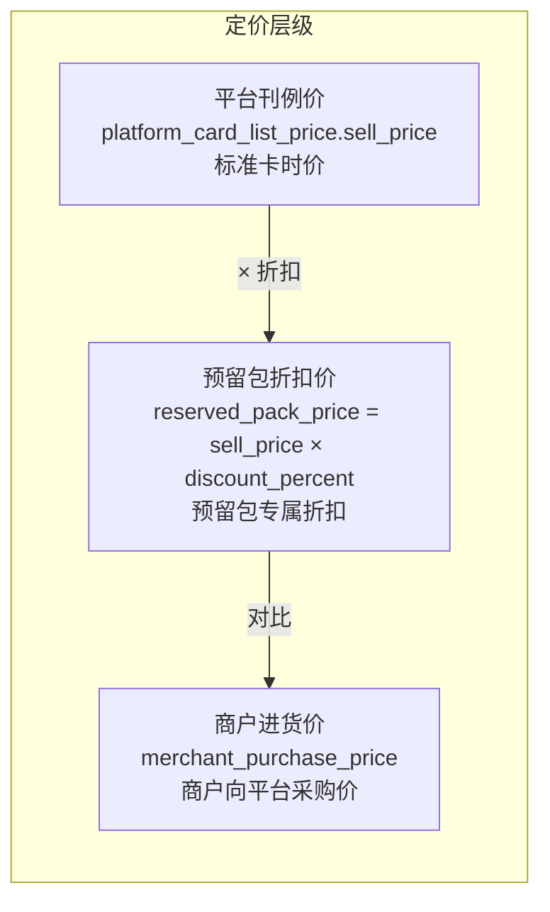
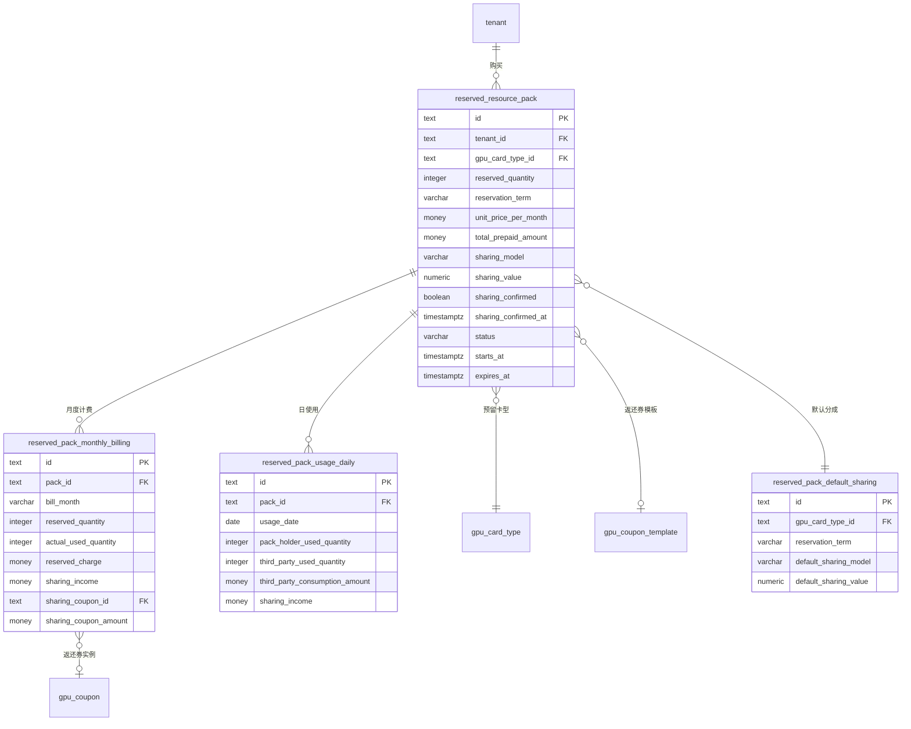
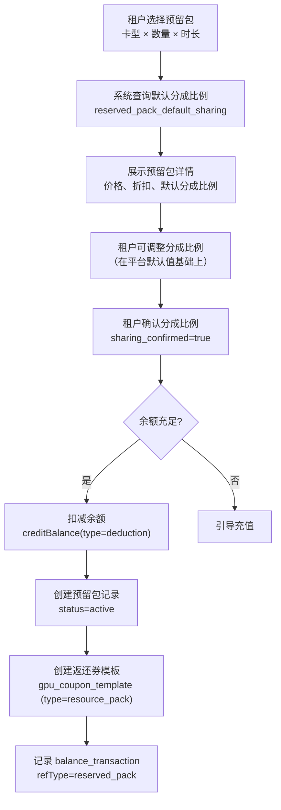
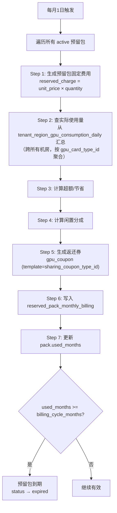
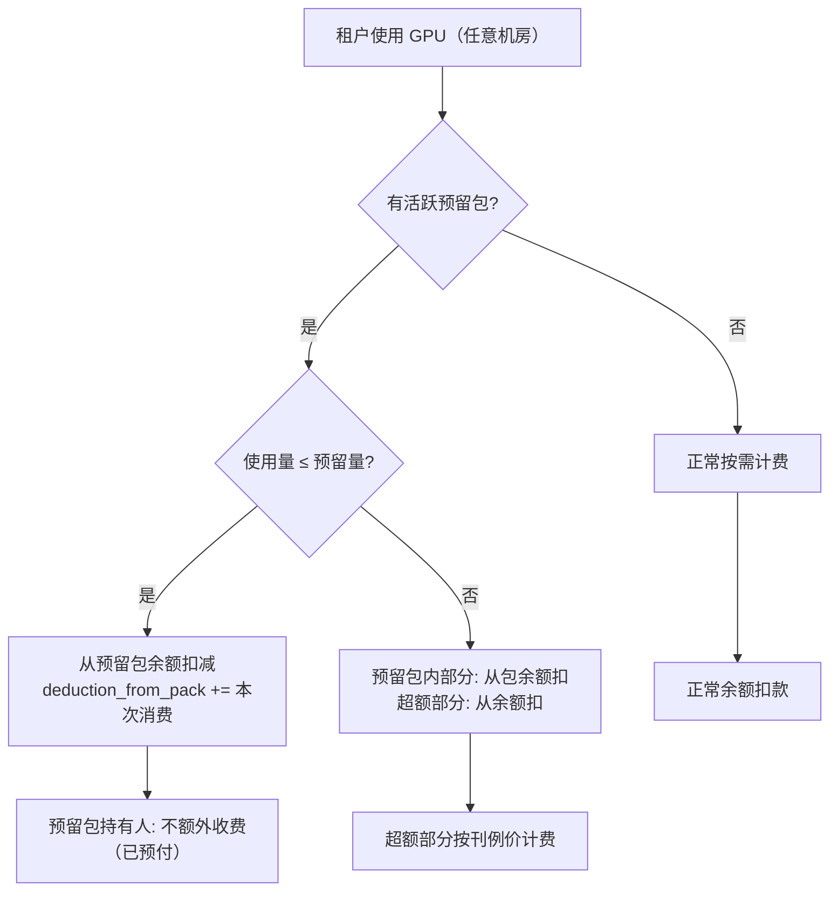
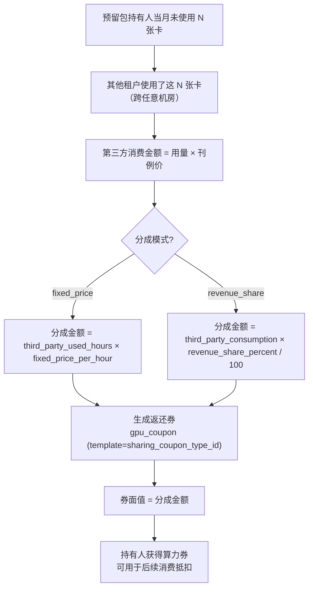
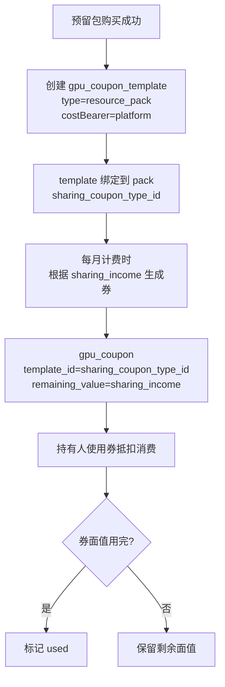
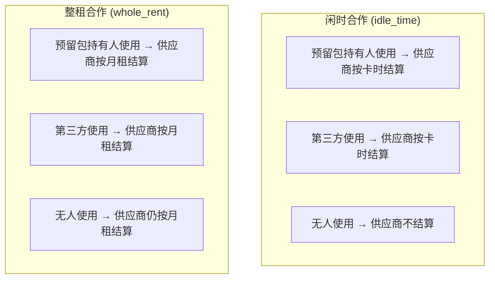
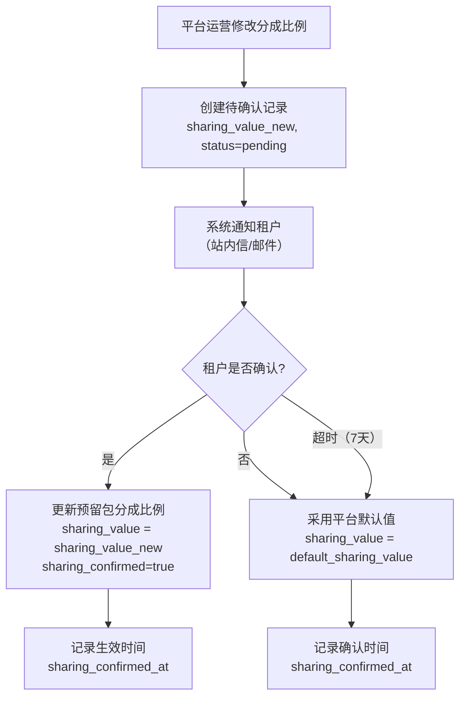

# 预留资源包设计方案

> **版本**：v1.1  
> **日期**：2026-07-26  
> **状态**：**设计中**  
> **范围**：预留资源包的完整生命周期，包括购买、计费、供应商结算、闲置资源分成  
> **关联**：
> - [openmeter-billing-design.md](openmeter-billing-design.md)（全链路计费方案）
> - [billing-display.md](billing-display.md)（计费展示方案）
> - [merchant-billing-system-design.md](merchant-billing-system-design.md)（商户账单系统）
> - `packages/db/src/gpus-consumer-schema.ts`（gpu_coupon_template.type='resource_pack'）
> - `packages/db/src/compute-schema.ts`（compute_base.commitment）
> - `packages/billing/src/balance.ts`（freeze/unfreeze/consume 模型）
> - `packages/db/src/supply-schema.ts`（supplierUnitCost, cooperation_type）

---

## 1. 背景与目标

### 1.1 业务背景

部分租户有稳定的 GPU 算力需求，希望以**预付费锁定价格**的方式获取资源保障。平台通过预留资源包实现：

- 租户**预付费用**锁定特定卡型的资源保障
- 无论是否实际使用，租户均按预留包计费（**资源保障 + 价格优惠**）
- 闲置资源可被其他租户使用，产生的收入按约定比例以**算力券形式回馈**预留包持有人
- 任务调度到哪个机房由平台运营灵活配置（机房可裁撤/新增），预留包不限定机房

### 1.2 核心规则

| # | 规则 | 说明 |
|---|------|------|
| R1 | **预付锁定** | 租户购买时指定卡型、数量、时长，一次性预付全款；**不限定机房** |
| R2 | **使用无关计费** | 无论租户是否使用，均按预留包价格计费（不退不换） |
| R3 | **跨机房调度** | 预留包仅按卡型购买，任务调度到哪个机房由平台运营设置 |
| R4 | **供应商结算差异** | 闲时合作：仅实际使用时结算；整租合作：与使用无关 |
| R5 | **闲置分成（券形式）** | 未使用的卡时被其他租户使用时，收入按约定比例以**算力券**回馈 |
| R6 | **分成比例确认** | 平台设默认比例，平台运营可修改，租户确认后生效；确认前按默认值计算 |

### 1.3 非目标（本期）

- **不** 实现预留包的转赠、转让
- **不** 实现按小时粒度的弹性预留（仅支持月/季/年）
- **不** 实现预留包的退订退款
- **不** 替代 `compute_base.commitment`（on_demand/monthly/yearly 是实例级承诺，预留包是资源级承诺）

---

## 2. 预留资源包模型

### 2.1 预留包定义

```text
预留资源包 = f(租户, 卡型, 数量, 时长)

示例：
  租户 A 购买：A100-80G × 4卡 × 3个月
  预付总价 = 4卡 × 月单价 × 3月
  有效期内，每月固定扣除 1个月的费用（使用无关）
  
  机房调度：由平台运营在「机房调度配置」中设置
    - 可指定租户任务调度到哪些机房
    - 机房裁撤/新增时运营更新配置并通知租户
```

### 2.2 价格体系



| 价格 | 含义 | 适用场景 |
|------|------|---------|
| `sell_price` | 平台刊例价 | 按需（on-demand）租户 |
| `reserved_pack_price` | 预留包折扣价 | 预留包持有人 |
| `purchase_price` | 商户进货价 | 商户采购成本 |
| `supplier_unit_cost` | 供应商成本 | 供应商结算 |

### 2.3 预留包与实例承诺的区别

| 维度 | `compute_base.commitment` | 预留资源包 |
|------|--------------------------|-----------|
| 粒度 | **实例级**：单个实例的承诺类型 | **资源级**：卡型的预留容量 |
| 对象 | 单个 VM / Serverless 实例 | 资源池中的 N 张 GPU 卡 |
| 机房 | 绑定实例所在机房 | **不限机房**，跨机房调度 |
| 计费 | 实例运行时按预留价计费，停机不计费 | **无论是否使用均计费** |
| 灵活性 | 可随时切换 on-demand ↔ monthly | 固定时长，不支持中途退订 |
| 余额交互 | freeze → consume → unfreeze | 购买时全额扣减，月度自动续费 |

### 2.4 机房调度配置

预留包不限定机房，但平台运营需要控制任务调度到哪些机房。调度配置独立于预留包：

```text
调度配置 = f(租户, 卡型, 允许的机房列表)

示例：
  租户 A 的 A100-80G 任务可调度到：
    - bj-idc-01（主力机房）
    - sh-idc-02（备用机房）
  
  机房裁撤时：
    运营从允许列表移除 → 通知租户 → 新任务不再调度到该机房
    已在该机房运行的任务继续运行直到结束
```

调度配置由运营平台维护，不影响预留包计费和分成逻辑。

---

## 3. 数据模型

### 3.1 新增表：`reserved_resource_pack`（预留资源包主表）

| 列名 | 类型 | 约束 | 说明 |
|------|------|------|------|
| `id` | `text` | PK | |
| `tenant_id` | `text` | FK→`tenant.id`，NOT NULL | 购买租户 |
| `merchant_id` | `text` | NOT NULL | 冗余 = tenant.merchant_id |
| `organization_id` | `varchar(64)` | NOT NULL | 关联 Better Auth org |
| `gpu_card_type_id` | `text` | FK→`gpu_card_type.id`，NOT NULL | **预留卡型（不限机房）** |
| `reserved_quantity` | `integer` | NOT NULL | 预留 GPU 卡数 |
| `reservation_term` | `varchar(16)` | NOT NULL | 预留时长：`monthly` / `quarterly` / `yearly` |
| `billing_cycle_months` | `integer` | NOT NULL | 计费周期月数：monthly=1, quarterly=3, yearly=12 |
| `unit_price_per_month` | `money` | NOT NULL | 每卡每月预留价（元） |
| `total_prepaid_amount` | `money` | NOT NULL | 预付总额 = quantity × unit_price_per_month × billing_cycle_months |
| `used_months` | `integer` | NOT NULL DEFAULT 0 | 已消费月数 |
| `list_price_per_hour_snapshot` | `money` | NOT NULL | 购买时平台刊例价快照（用于分成基准） |
| `discount_percent` | `numeric(7,4)` | NOT NULL | 折扣百分比（如 75.0000 表示 75 折） |
| `sharing_model` | `varchar(16)` | NOT NULL | 闲置分成模式：`fixed_price` / `revenue_share` |
| `sharing_value` | `numeric(9,6)` | NOT NULL | 当前生效的分成值：fixed_price=每卡时固定金额；revenue_share=分成百分比 |
| `sharing_value_pending` | `numeric(9,6)` | NULL | 待确认的新分成值（平台运营修改后，租户确认前） |
| `sharing_model_pending` | `varchar(16)` | NULL | 待确认的新分成模式 |
| `sharing_confirmed` | `boolean` | NOT NULL DEFAULT false | 分成比例是否已由租户确认 |
| `sharing_confirmed_at` | `timestamptz` | NULL | 租户确认分成比例的时间 |
| `sharing_changed_by` | `text` | NULL | 最近一次修改分成的运营人员 ID |
| `sharing_changed_at` | `timestamptz` | NULL | 最近一次修改分成的时间 |
| `sharing_coupon_type_id` | `text` | FK→`gpu_coupon_template.id`，NULL | 返还券模板（系统自动创建） |
| `status` | `varchar(16)` | NOT NULL | `pending` / `active` / `expired` / `suspended` |
| `starts_at` | `timestamptz` | NOT NULL | 预留开始时间 |
| `expires_at` | `timestamptz` | NOT NULL | 预留到期时间 |
| `source` | `varchar(32)` | NOT NULL | `purchase`（购买）/ `gift`（赠送）/ `conversion`（转化） |
| `remark` | `text` | NULL | |
| `created_at` | `timestamptz` | NOT NULL DEFAULT now() | |
| `updated_at` | `timestamptz` | NOT NULL | |

**索引**：

```sql
CREATE UNIQUE INDEX reserved_pack_tenant_card_active_uk
  ON reserved_resource_pack (tenant_id, gpu_card_type_id)
  WHERE status = 'active';

CREATE INDEX reserved_pack_tenant_idx ON reserved_resource_pack (tenant_id);
CREATE INDEX reserved_pack_status_idx ON reserved_resource_pack (status);
CREATE INDEX reserved_pack_expires_at_idx ON reserved_resource_pack (expires_at);
```

### 3.2 新增表：`reserved_pack_monthly_billing`（预留包月度计费）

每月对每个预留包生成一条计费记录：

| 列名 | 类型 | 约束 | 说明 |
|------|------|------|------|
| `id` | `text` | PK | |
| `pack_id` | `text` | FK→`reserved_resource_pack.id`，NOT NULL | 关联预留包 |
| `tenant_id` | `text` | NOT NULL | 冗余 |
| `merchant_id` | `text` | NOT NULL | 冗余 |
| `bill_month` | `varchar(7)` | NOT NULL | 计费月 YYYY-MM |
| `reserved_quantity` | `integer` | NOT NULL | 本月预留卡数 |
| `actual_used_quantity` | `integer` | NOT NULL DEFAULT 0 | 实际使用卡数（跨机房汇总） |
| `unused_quantity` | `integer` | NOT NULL | 未使用卡数 = reserved - used |
| `total_card_hours_reserved` | `numeric(15,4)` | NOT NULL | 预留卡时 = quantity × 730（月小时数） |
| `total_card_hours_used` | `numeric(15,4)` | NOT NULL DEFAULT 0 | 实际使用卡时（跨机房汇总） |
| `total_card_hours_unused` | `numeric(15,4)` | NOT NULL | 未使用卡时 |
| `reserved_charge` | `money` | NOT NULL | 预留包固定费用（= unit_price_per_month × quantity） |
| `overage_charge` | `money` | NOT NULL DEFAULT 0 | 超额费用（实际使用 > 预留时的额外计费） |
| `actual_consumption_amount` | `money` | NOT NULL DEFAULT 0 | 实际消费金额（按刊例价） |
| `deduction_from_pack` | `money` | NOT NULL DEFAULT 0 | 从预留包余额扣减的金额 |
| `deduction_from_balance` | `money` | NOT NULL DEFAULT 0 | 从余额扣减的金额（超额部分） |
| `sharing_income` | `money` | NOT NULL DEFAULT 0 | 闲置分成收入（以券形式返还） |
| `sharing_coupon_id` | `text` | FK→`gpu_coupon.id`，NULL | 返还的算力券实例 |
| `sharing_coupon_amount` | `money` | NOT NULL DEFAULT 0 | 返还券面值 |
| `sharing_model` | `varchar(16)` | NOT NULL | 分成模式快照 |
| `sharing_value` | `numeric(9,6)` | NOT NULL | 分成值快照 |
| `supplier_idle_cost` | `money` | NOT NULL DEFAULT 0 | 闲时供应商成本（仅实际使用部分） |
| `supplier_whole_rent_cost` | `money` | NOT NULL DEFAULT 0 | 整租供应商成本（与使用无关） |
| `computed_at` | `timestamptz` | NOT NULL | 计算时间 |
| `created_at` | `timestamptz` | NOT NULL DEFAULT now() | |

**索引**：

```sql
CREATE UNIQUE INDEX reserved_pack_monthly_pack_month_uk
  ON reserved_pack_monthly_billing (pack_id, bill_month);

CREATE INDEX reserved_pack_monthly_tenant_month_idx
  ON reserved_pack_monthly_billing (tenant_id, bill_month);
```

### 3.3 新增表：`reserved_pack_usage_daily`（预留包日使用明细）

按日记录预留包的使用情况，用于计算闲置分成：

| 列名 | 类型 | 约束 | 说明 |
|------|------|------|------|
| `id` | `text` | PK | |
| `pack_id` | `text` | FK→`reserved_resource_pack.id`，NOT NULL | 关联预留包 |
| `tenant_id` | `text` | NOT NULL | 冗余 |
| `usage_date` | `date` | NOT NULL | 使用日期 |
| `usage_month` | `varchar(7)` | NOT NULL | YYYY-MM |
| `reserved_quantity` | `integer` | NOT NULL | 该日预留卡数 |
| `pack_holder_used_quantity` | `integer` | NOT NULL DEFAULT 0 | 持有人使用的卡数（跨机房汇总） |
| `pack_holder_used_card_hours` | `numeric(15,4)` | NOT NULL DEFAULT 0 | 持有人使用卡时 |
| `third_party_used_quantity` | `integer` | NOT NULL DEFAULT 0 | 第三方使用的卡数 |
| `third_party_used_card_hours` | `numeric(15,4)` | NOT NULL DEFAULT 0 | 第三方使用卡时 |
| `third_party_consumption_amount` | `money` | NOT NULL DEFAULT 0 | 第三方消费金额（按刊例价） |
| `sharing_income` | `money` | NOT NULL DEFAULT 0 | 分成金额 |
| `created_at` | `timestamptz` | NOT NULL DEFAULT now() | |

**索引**：

```sql
CREATE UNIQUE INDEX reserved_pack_daily_pack_date_uk
  ON reserved_pack_usage_daily (pack_id, usage_date);

CREATE INDEX reserved_pack_daily_tenant_date_idx
  ON reserved_pack_usage_daily (tenant_id, usage_date);
```

### 3.4 新增表：`reserved_pack_default_sharing`（平台默认分成配置）

平台按卡型×预留时长设定默认分成比例，租户购买时展示：

| 列名 | 类型 | 约束 | 说明 |
|------|------|------|------|
| `id` | `text` | PK | |
| `gpu_card_type_id` | `text` | FK→`gpu_card_type.id`，NOT NULL | 卡型 |
| `reservation_term` | `varchar(16)` | NOT NULL | 预留时长 |
| `default_sharing_model` | `varchar(16)` | NOT NULL | 默认分成模式 |
| `default_sharing_value` | `numeric(9,6)` | NOT NULL | 默认分成值 |
| `status` | `varchar(16)` | NOT NULL | `active` / `archived` |
| `remark` | `text` | NULL | |
| `created_at` | `timestamptz` | NOT NULL DEFAULT now() | |
| `updated_at` | `timestamptz` | NOT NULL | |

**索引**：

```sql
CREATE UNIQUE INDEX reserved_pack_default_sharing_uk
  ON reserved_pack_default_sharing (gpu_card_type_id, reservation_term)
  WHERE status = 'active';
```

### 3.5 实体关系



---

## 4. 计费流程

### 4.1 预留包购买流程



**关键点**：分成比例在购买时确定，租户确认后 `sharing_confirmed=true`，不可再修改。

### 4.2 预留包月度计费流程



### 4.3 预留包持有人的消费计费



**跨机房使用**：预留包持有人在任何机房使用同卡型资源，均从预留包余额扣减。使用量按 `gpu_card_type_id` 聚合，不区分机房。

### 4.4 闲置资源分成流程



### 4.5 返还券生命周期



**券模板字段**：

| 字段 | 值 | 说明 |
|------|---|------|
| `type` | `resource_pack` | 预留包返还券 |
| `cost_bearer` | `platform` | 平台承担 |
| `applicable_resources` | `null` | 适用所有产品线 |
| `budget_limit` | `null` | 无预算上限（按实际分成动态发放） |
| `validity_days` | `15` | 预留包到期后15天内有效 |

### 4.6 供应商结算差异



**供应商成本归属**：

| 场景 | 闲时合作供应商成本 | 整租合作供应商成本 |
|------|-------------------|-------------------|
| 预留包持有人使用 | 持有人承担（从预留包费用覆盖） | 从预留包费用覆盖 |
| 第三方使用 | 第三方正常计费，供应商成本由第三方承担 | 月租已由预留包费用覆盖 |
| 无人使用 | **无成本** | 从预留包费用覆盖 |

---

## 5. 计算公式

### 5.1 预留包固定费用（每月）

```text
reserved_charge = unit_price_per_month × reserved_quantity

此费用无论是否使用，每月均扣除。
来源：预留包预付总额按月分摊。
```

### 5.2 持有人实际消费

```text
actual_consumption = usage_card_hours × list_price_per_hour

deduction_from_pack = MIN(actual_consumption, reserved_charge)
deduction_from_balance = MAX(0, actual_consumption - reserved_charge)

注意：预留包持有人的实际消费已包含在 reserved_charge 中，
超额部分才需要额外从余额扣款。
```

### 5.3 闲置卡时计算

```text
total_card_hours_reserved = reserved_quantity × 730（月标准小时数）
total_card_hours_used = 持有人实际使用卡时（跨所有机房汇总）
total_card_hours_unused = total_card_hours_reserved - total_card_hours_used

third_party_used_card_hours = 第三方在闲置卡上的使用卡时
```

### 5.4 闲置分成收入

```text
模式 A：固定价格
  sharing_income = third_party_used_card_hours × sharing_value（固定单价/卡时）

模式 B：收入分成
  third_party_consumption = third_party_used_card_hours × list_price_per_hour
  sharing_income = third_party_consumption × sharing_value / 100

限制：
  sharing_income ≤ third_party_consumption（分成不超过第三方消费额）
```

### 5.5 返还券面值

```text
coupon_value = sharing_income

券一次性发放，不可拆分。
持有人可在后续消费中使用该券抵扣。
券的适用范围 = 所有产品线（不限卡型）。
券有效期 = 预留包到期后15天内。
```

### 5.6 供应商成本

```text
闲时合作：
  supplier_idle_cost = Σ (实际使用卡时 × supplier_unit_cost)
  -- 仅持有人+第三方实际使用部分产生供应商成本

整租合作：
  supplier_whole_rent_cost = monthly_rent（与使用无关）
  -- 整租费用由预留包费用覆盖
```

---

## 6. 分成比例确认机制

### 6.1 默认分成比例

平台在 `reserved_pack_default_sharing` 表中按卡型×预留时长配置默认分成：

| 卡型 | 预留时长 | 默认分成模式 | 默认分成值 | 说明 |
|------|---------|------------|-----------|------|
| A100-80G | monthly | revenue_share | 30.0000 | 第三方消费的30%以券返还 |
| A100-80G | yearly | revenue_share | 40.0000 | 年付分成更高 |
| H100-80G | quarterly | fixed_price | 5.0000 | 每卡时固定5元返还 |

### 6.2 分成比例调整流程



### 6.3 角色权限

| 角色 | 权限 | 说明 |
|------|------|------|
| **租户** | 查看 | 仅可查看当前分成比例和待确认修改 |
| **平台运营** | 修改 | 可修改分成比例，修改后需租户确认 |
| **系统** | 自动处理 | 超时未确认则采用平台默认值 |

### 6.4 确认约束

- 租户**仅可查看**分成比例，**不可修改**
- 平台运营可修改分成比例，修改后需租户确认才能生效
- 确认前：按平台默认值计算（`reserved_pack_default_sharing.default_sharing_value`）
- 确认后：按新值计算（`reserved_resource_pack.sharing_value`）
- 超时未确认（7天）：自动采用平台默认值
- 到期续费时：沿用已确认的比例，不需重新确认

### 6.5 计费时的分成比例确定

```text
计算分成时，比例来源优先级：
  1. sharing_confirmed = true → 使用 sharing_value（已确认的新值）
  2. sharing_confirmed = false → 使用 reserved_pack_default_sharing.default_sharing_value（平台默认值）

无论哪种情况，一旦 sharing_confirmed=true，该值不可再修改。
```

---

## 7. 与其他账单的集成

### 7.1 租户账单（tenant_bill）集成

```text
预留包持有人的 tenant_bill.total_amount 包含：
  + reserved_charge（预留包固定费用）
  + deduction_from_balance（超额部分，如有）

tenant_bill_detail 中 product_line = 'reserved_resource_pack' 的行：
  amount = reserved_charge + overage_charge
  balance_amount = deduction_from_balance
  coupon_amount = 0（预留包不与券叠加，预留包本身就是预付）

闲置分成以券形式返还，不体现在 tenant_bill 的负值中。
```

### 7.2 商户账单（merchant_bill）集成

```text
商户收入：
  merchant_bill.total_amount += Σ 预留包持有人 tenant_bill 中的 reserved_charge

商户支出：
  merchant_bill.expenditure_amount += Σ 预留包持有人对应的供应商成本
  （闲时: 仅实际使用部分；整租: 全月）

商户券成本：
  merchant_bill.coupon_cost += 闲置分成返还券的面值（若券模板由商户发放）
  注：预留包返还券 costBearer=platform，不计入商户成本
```

### 7.3 供应商结算（supplier_bill）集成

```text
供应商结算差异：
  闲时合作：supplier_bill.total_usage_hours 仅统计实际使用卡时
  整租合作：supplier_bill.total_usage_hours = reserved_quantity × 730（与使用无关）

supplier_bill_detail 中增加字段：
  reserved_pack_card_hours  — 预留包关联的卡时（持有人+第三方）
  third_party_card_hours    — 第三方使用的卡时
```

### 7.4 平台财务汇总集成

```text
平台收入 = Σ 预留包 reserved_charge + Σ 非预留消费
平台成本 = Σ 供应商结算（闲时按使用，整租按固定）
平台营销 = 预留包折扣让利 + 闲置分成券成本
  折扣让利 = (list_price - reserved_price) × 使用量
  券成本 = Σ sharing_coupon_amount（平台发放的券面值）

闲置分成 = 平台将第三方消费的一部分以券形式让利给预留包持有人
  → 计入平台营销费用
```

---

## 8. 预留包折扣定价

### 8.1 折扣模型

| 预留时长 | 建议折扣 | 说明 |
|---------|---------|------|
| monthly（月付） | 90% | 灵活度最高，折扣最小 |
| quarterly（季付） | 80% | 中等承诺，中等折扣 |
| yearly（年付） | 70% | 长期承诺，最大折扣 |

折扣基于平台刊例价 `platform_card_list_price.sell_price`：

```text
reserved_pack_price = list_price × discount_percent / 100
unit_price_per_month = reserved_pack_price
```

### 8.2 折扣与分成的关系

折扣越大的预留包，闲置分成比例可以越低（因为持有人已享受了价格优惠）：

```text
sharing_percent = base_sharing_percent × (1 + (100 - discount_percent) / 100)

示例：
  年付（70折）：sharing = base × 1.3（分成比例较高，补偿更大折扣）
  月付（90折）：sharing = base × 1.1（分成比例较低）
```

---

## 9. 数据访问层设计

### 9.1 reservedPackDataAccess

```typescript
export const reservedPackDataAccess = {
  /** 创建预留包（购买） */
  createPack(input: {
    tenantId: string
    merchantId: string
    gpuCardTypeId: string
    reservedQuantity: number
    reservationTerm: 'monthly' | 'quarterly' | 'yearly'
    sharingModel: 'fixed_price' | 'revenue_share'
    sharingValue: number
    sharingConfirmed: true  // 购买时必须确认
  }): Promise<ReservedPack>

  /** 获取活跃预留包 */
  getActivePack(input: {
    tenantId: string
    gpuCardTypeId: string
  }): Promise<ReservedPack | null>

  /** 查询默认分成比例 */
  getDefaultSharing(input: {
    gpuCardTypeId: string
    reservationTerm: string
  }): Promise<{ sharingModel: string; sharingValue: number } | null>

  /** 月度计费汇总 */
  computeMonthlyBilling(input: {
    billMonth: string
  }): Promise<ReservedPackMonthlyBilling[]>

  /** 计算日使用明细（跨机房汇总） */
  computeDailyUsage(input: {
    usageDate: string
  }): Promise<ReservedPackUsageDaily[]>

  /** 到期检查（每日运行） */
  checkExpiry(): Promise<void>

  /** 列表查询 */
  listPacks(input: {
    tenantId?: string
    merchantId?: string
    status?: string
    page: number
    pageSize: number
  }): Promise<PaginatedResult<ReservedPack>>

  /** 预留包持有人消费检查（跨机房） */
  resolvePackDeduction(input: {
    tenantId: string
    gpuCardTypeId: string
    cardHours: number
  }): Promise<{
    fromPack: number
    fromBalance: number
    packId: string
  }>
}
```

### 9.2 与 billing 包集成

预留包的月度固定费用通过 `@workspace/billing` 的 `creditBalance` 入账：

```typescript
// 每月1日自动扣费
await creditBalance(db, {
  tenantId: pack.tenantId,
  organizationId: pack.organizationId,
  amount: pack.unitPricePerMonth * pack.reservedQuantity,
  txType: 'deduction',
  refType: 'reserved_pack',
  refId: pack.id,
  description: `预留资源包月费 (${billMonth})`,
})
```

闲置分成以券形式发放（不走 creditBalance）：

```typescript
// 创建返还券
await db.insert(gpuCoupon).values({
  templateId: pack.sharingCouponTypeId,
  organizationId: pack.organizationId,
  status: 'available',
  originalValue: String(sharingIncome),
  remainingValue: String(sharingIncome),
  grantedAt: new Date(),
  expiredAt: addDays(pack.expiresAt, 15), // 预留包到期后15天
})
```

---

## 10. Cron 任务

| 任务 | 触发频率 | 说明 |
|------|---------|------|
| **预留包到期检查** | 每日 00:10 | 检查 `expires_at <= now()`，更新 `status → expired` |
| **月度预留包计费** | 每月1日 01:30 | 计算所有 active 预留包的月度费用和分成 |
| **日使用明细计算** | 每日 00:20 | 计算每个预留包的持有人使用量和第三方使用量 |
| **闲置分成入账** | 每月1日 02:00 | 将分成以券形式发放给持有人 |

---

## 11. 前端展示

### 11.1 gpus 控制台 - 预留包管理

```
┌─────────────────────────────────────────────────────────────────┐
│ 预留资源包                                    [购买预留包]         │
├─────────────────────────────────────────────────────────────────┤
│ Card: 当前预留包                                                  │
│ ┌──────────────┬──────────────┬──────────────┬──────────────┐   │
│ │ 卡型          │ 数量          │ 到期时间       │ 分成比例      │   │
│ │ A100-80G     │ 4卡           │ 2026-10-26   │ 30% (已锁定) │   │
│ │ 剩余: 2个月   │ 月费: ¥12,000│ 已用: 60%     │ 累计券: ¥800 │   │
│ └──────────────┴──────────────┴──────────────┴──────────────┘   │
├─────────────────────────────────────────────────────────────────┤
│ Tab: [月度账单] [使用明细] [闲置分成券]                            │
│                                                                 │
│ 月度账单 Tab:                                                    │
│ | 月份    | 预留费用  | 实际消费  | 超额费用 | 分成券    | 供应商成本 |  │
│ | 2026-07 | ¥12,000 | ¥15,000 | ¥3,000 | ¥800券  | ¥8,000  |  │
│ | 2026-06 | ¥12,000 | ¥9,000  | ¥0     | ¥1,200券| ¥5,000  |  │
│                                                                 │
│ 闲置分成券 Tab:                                                  │
│ | 月份    | 券面值   | 有效期     | 状态     | 已用    | 剩余     |  │
│ | 2026-07 | ¥800   | 至2026-10 | available | ¥200  | ¥600    |  │
│ | 2026-06 | ¥1,200 | 至2026-10 | used     | ¥1,200| ¥0      |  │
└─────────────────────────────────────────────────────────────────┘
```

### 11.2 购买预留包流程

```
┌─────────────────────────────────────────────────────────────────┐
│ 购买预留资源包                                                   │
├─────────────────────────────────────────────────────────────────┤
│ 卡型: [A100-80G ▾]   数量: [4] 卡                               │
│ 时长: [月付 ▾] [季付] [年付]                                      │
│                                                                 │
│ 定价:                                                           │
│   刊例价: ¥160/卡/月                                             │
│   预留价: ¥128/卡/月 (80折)                                      │
│                                                                 │
│ 闲置分成比例:                                                     │
│   平台默认: 30% (收入分成)                                        │
│   （仅查看，不可修改；平台运营可调整，需您确认后生效）                  │
│                                                                 │
│ 费用:                                                           │
│   4卡 × ¥128 × 3月 = ¥1,536                                    │
│   余额: ¥5,000  扣减后: ¥3,464                                  │
│                                                                 │
│                        [取消]  [确认购买]                         │
└─────────────────────────────────────────────────────────────────┘
```

---

## 12. Schema 变更计划

| 步骤 | 内容 | 影响 |
|------|------|------|
| 1 | 新建 `reserved_resource_pack` 表 | 新表 |
| 2 | 新建 `reserved_pack_monthly_billing` 表 | 新表 |
| 3 | 新建 `reserved_pack_usage_daily` 表 | 新表 |
| 4 | 新建 `reserved_pack_default_sharing` 表 | 新表 |
| 5 | `supplier_bill_detail` 新增 `reserved_pack_card_hours`、`third_party_card_hours` | 向后兼容 |
| 6 | `tenant_bill_detail` 扩展 `type` 枚举支持 `reserved_pack` | 向后兼容 |

---

## 13. 实施阶段

| 阶段 | 内容 | 依赖 |
|------|------|------|
| P0 | Schema migration（4张新表 + 扩展字段） | 无 |
| P1 | 预留包购买流程（余额扣减 + 创建记录 + 分成确认） | P0 |
| P2 | 日使用明细计算（持有人/第三方卡时统计，跨机房汇总） | P0, OpenMeter 数据 |
| P3 | 月度预留包计费（固定费用 + 超额 + 分成券发放） | P1, P2 |
| P4 | 供应商结算集成（闲时/整租差异） | P3 |
| P5 | 商户/平台账单集成 | P3, P4 |
| P6 | 前端预留包管理页 + 购买流程 | P1 |
| P7 | 前端预留包账单/分成券展示 | P3 |

---

## 14. 风险与待确认项

| ID | 问题 | 状态 |
|----|------|------|
| Q1 | 预留包是否支持跨机房使用？ | ✅ 已确认：支持跨机房，仅按卡型购买 |
| Q2 | 预留包持有人超额使用时，超额部分按什么价格计费？ | ✅ 已确认：按平台刊例价 |
| Q3 | 闲置分成以什么形式返还？ | ✅ 已确认：以算力券形式返还 |
| Q4 | 预留包到期后未使用的月份如何处理？ | ✅ 已确认：不退不换 |
| Q5 | 同一租户能否购买多个同卡型的预留包？ | ✅ 已确认：不支持（唯一约束 tenant_id × gpu_card_type_id） |
| Q6 | 第三方使用闲置资源时，第三方按什么价格计费？ | ✅ 已确认：按平台刊例价 |
| Q7 | 分成比例由谁设定？ | ✅ 已确认：平台设默认值，平台运营可修改，租户确认后生效 |
| Q8 | 预留包持有人能否同时享受其他折扣？ | ✅ 已确认：首期不叠加 |
| Q9 | 返还券的适用范围是仅限同卡型还是全部产品线？ | ✅ 已确认：不限，所有产品线均可使用 |
| Q10 | 返还券是否有时效？ | ✅ 已确认：预留包到期后15天内 |

---

## 变更记录

| 版本 | 日期 | 说明 |
|------|------|------|
| v1.0 | 2026-07-26 | 初稿 |
| v1.1 | 2026-07-26 | Q1: 移除机房限定，支持跨机房调度；Q3: 分成以算力券形式返还；Q7: 分成比例购买时确认后锁定 |
| v1.2 | 2026-07-26 | Q2: 按平台刊例价；Q4: 不退不换；Q5: 不支持多包；Q8: 首期不叠加；Q9: 券不限产品线；Q10: 券有效期15天；分成流程: 租户仅查看，平台运营修改后需租户确认 |
