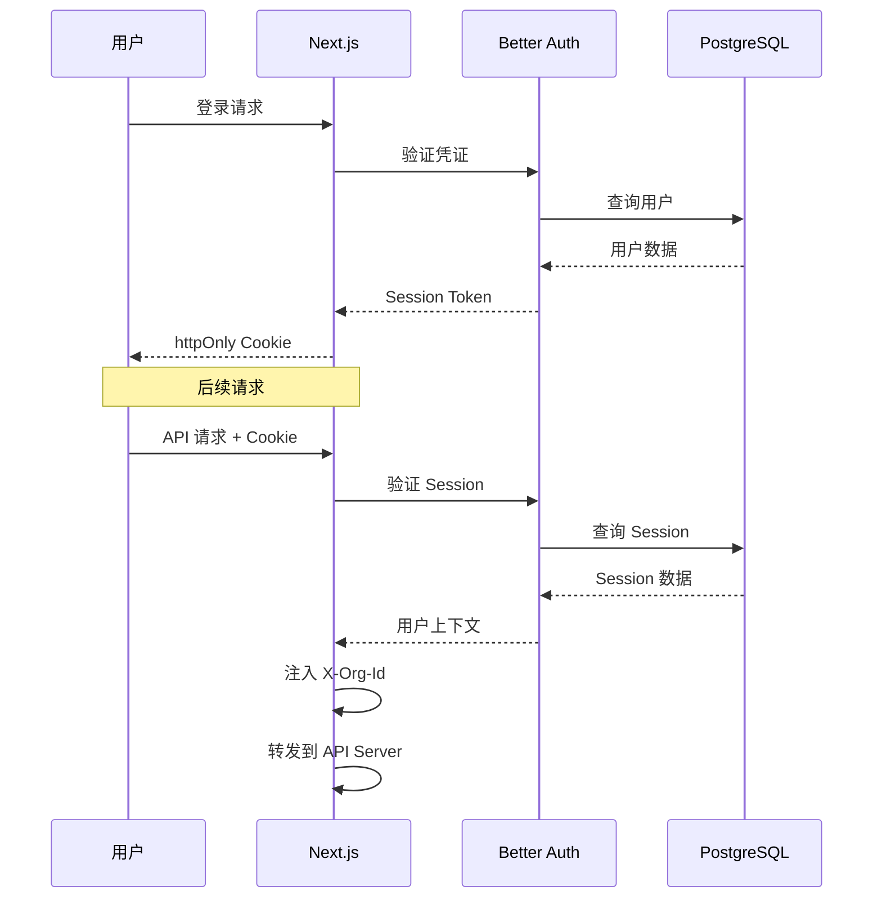
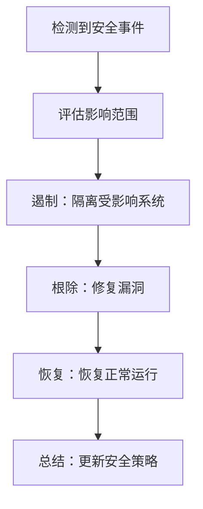

# 安全设计

> 覆盖认证、授权、数据加密、网络安全、合规审计的全方位安全体系。
> 基于 Better Auth 实现多租户认证与 RBAC 权限控制。

---

## 1. 安全架构

### 1.1 安全分层模型

```mermaid
flowchart TD
    subgraph 网络层[网络安全层]
        WAF[WAF 防火墙]
        TLS[TLS 终止]
        IP[IP 白名单]
    end

    subgraph 认证层[认证与授权层]
        AUTH[Better Auth<br/>认证与会话]
        RBAC[RBAC<br/>角色权限]
        MFA[多因素认证]
    end

    subgraph 数据层[数据安全层]
        ENC[数据加密<br/>AES-256]
        MASK[敏感数据脱敏]
        BACKUP[备份加密]
    end

    subgraph 应用层[应用安全层]
        INPUT[输入校验]
        CSRF[CSRF 防护]
        RATE[限流]
    end

    subgraph 审计层[审计与合规层]
        LOG[操作日志]
        AUDIT[审计追踪]
        COMPLY[合规报告]
    end

    WAF --> TLS --> IP
    AUTH --> RBAC --> MFA
    ENC --> MASK --> BACKUP
    INPUT --> CSRF --> RATE
    LOG --> AUDIT --> COMPLY
```



---

## 2. 认证体系

### 2.1 Better Auth 集成

```typescript
// 认证配置
import { betterAuth } from 'better-auth'

export const auth = betterAuth({
  database: { provider: 'postgresql', url: DATABASE_URL },
  emailAndPassword: { enabled: true },
  session: {
    expiresIn: 60 * 60 * 24 * 7, // 7 天
    updateAge: 60 * 60 * 24,     // 每 24 小时刷新
  },
  organization: { enabled: true }, // 多租户支持
  plugins: [
    // 邮箱验证
    // 短信验证
    // MFA
  ],
})
```

### 2.2 认证流程



### 2.3 API Key 认证

```typescript
// 推理网关 API Key 管理
interface ApiKey {
  id: string
  key: string              // bcrypt 哈希存储
  name: string
  organization_id: string
  permissions: string[]    // ['inference:read', 'inference:write']
  expires_at: Date | null
  created_at: Date
  last_used_at: Date | null
}

// API Key 验证
async function verifyApiKey(key: string): Promise<ApiKey | null> {
  // 1. 查询所有活跃 API Key
  // 2. bcrypt.compare 验证
  // 3. 检查过期时间
  // 4. 更新 last_used_at
  // 5. 返回 ApiKey 或 null
}
```

---

## 3. 授权体系

### 3.1 RBAC 角色定义

| 角色 | 说明 | 权限 |
|------|------|------|
| **platform_admin** | 平台管理员 | 全部权限 |
| **finance_admin** | 财务管理员 | 充值/账单/结算/退款 |
| **ops_admin** | 运维管理员 | 任务管理/节点管理/监控 |
| **tenant_admin** | 租户管理员 | 租户内全部权限 |
| **tenant_member** | 租户成员 | 查看/创建任务/充值 |
| **tenant_viewer** | 租户只读 | 仅查看 |

### 3.2 权限矩阵

```typescript
const permissions = {
  // 资源管理
  'resource:read': ['platform_admin', 'ops_admin', 'tenant_admin', 'tenant_member'],
  'resource:write': ['platform_admin', 'ops_admin'],
  'resource:delete': ['platform_admin'],

  // 任务管理
  'task:create': ['platform_admin', 'tenant_admin', 'tenant_member'],
  'task:read': ['platform_admin', 'tenant_admin', 'tenant_member', 'tenant_viewer'],
  'task:stop': ['platform_admin', 'tenant_admin', 'tenant_member'],
  'task:delete': ['platform_admin', 'tenant_admin'],

  // 财务管理
  'finance:read': ['platform_admin', 'finance_admin', 'tenant_admin', 'tenant_viewer'],
  'finance:recharge': ['platform_admin', 'tenant_admin', 'tenant_member'],
  'finance:refund': ['platform_admin', 'finance_admin'],
  'finance:adjust_balance': ['platform_admin', 'finance_admin'],

  // 推理网关
  'inference:read': ['platform_admin', 'tenant_admin', 'tenant_member', 'tenant_viewer'],
  'inference:write': ['platform_admin', 'tenant_admin', 'tenant_member'],
  'inference:api_key:manage': ['platform_admin', 'tenant_admin'],
}
```

### 3.3 资源隔离

```typescript
// 数据库查询强制带 organization_id
async function queryWithIsolation(ctx: Context, query: any) {
  const orgId = ctx.headers['x-org-id']
  if (!orgId) throw new Error('Missing organization context')

  // 所有查询强制带 organization_id
  return db.query(query).where(eq(query.organizationId, orgId))
}

// Kubernetes 命名空间隔离
const namespace = `tenant-${orgId}`
const resourceQuota = {
  hard: {
    'requests.cpu': '32',
    'requests.memory': '64Gi',
    'limits.nvidia.com/gpu': '8',
  }
}
```

---

## 4. 数据安全

### 4.1 数据加密

```typescript
// 敏感字段加密存储
import { createCipher, createDecipher } from './crypto'

// 加密存储
const encrypted = await encrypt(sensitiveData, ENCRYPTION_KEY)

// 解密读取
const decrypted = await decrypt(encryptedData, ENCRYPTION_KEY)

// 支付渠道密钥加密
interface PaymentChannelConfig {
  api_key_enc: string       // 加密存储
  private_key_enc: string   // 加密存储
  certificate_enc: string   // 加密存储
}
```

### 4.2 数据脱敏

```typescript
// 敏感数据脱敏规则
const maskingRules = {
  phone: (phone: string) => phone.replace(/(\d{3})\d{4}(\d{4})/, '$1****$2'),
  email: (email: string) => email.replace(/(.{2}).+(@.+)/, '$1***$2'),
  bank_card: (card: string) => card.replace(/(\d{4})\d+(\d{4})/, '$1****$2'),
  id_card: (id: string) => id.replace(/(\d{4})\d+(\d{4})/, '$1****$2'),
}
```

### 4.3 备份安全

```yaml
# 备份加密配置
backup:
  encryption:
    enabled: true
    algorithm: AES-256-GCM
    key_rotation: 90d
  storage:
    provider: s3
    bucket: backups
    encryption: SSE-KMS
  retention:
    daily: 30d
    weekly: 12w
    monthly: 12m
```

---

## 5. 网络安全

### 5.1 网络隔离

```yaml
# Kubernetes NetworkPolicy
apiVersion: networking.k8s.io/v1
kind: NetworkPolicy
metadata:
  name: tenant-isolation
spec:
  podSelector: {}
  policyTypes:
    - Ingress
    - Egress
  ingress:
    - from:
        - namespaceSelector:
            matchLabels:
              tenant: same
  egress:
    - to:
        - namespaceSelector:
            matchLabels:
              tenant: same
    - to:
        - ipBlock:
            cidr: 0.0.0.0/0
      ports:
        - port: 443
```

### 5.2 TLS 配置

```yaml
# TLS 证书管理
certificates:
  - name: api-cert
    domains:
      - api.platform.com
      - console.platform.com
    issuer: letsencrypt
    renew: 30d

  - name: inference-cert
    domains:
      - inference.platform.com
    issuer: letsencrypt
    renew: 30d
```

### 5.3 WAF 规则

```yaml
# WAF 配置
rules:
  - name: SQL注入防护
    action: block
    conditions:
      - type: sql_injection
        severity: high

  - name: XSS防护
    action: block
    conditions:
      - type: xss_attack
        severity: high

  - name: CC攻击防护
    action: rate_limit
    conditions:
      - type: request_rate
        threshold: 100/1m
```

---

## 6. 支付安全

### 6.1 支付安全措施

| 措施 | 说明 | 实现层 |
|------|------|--------|
| **订单幂等** | `UNIQUE(order_no)` + 回调检查 `status = 'paid'` | DB + 应用 |
| **金额校验** | 回调验证金额与订单一致 | 应用层 |
| **签名验证** | 微信/支付宝回调验证签名 | 应用层 |
| **密钥加密** | 渠道密钥加密存储 | DB |
| **HTTPS 强制** | 支付 API 仅允许 HTTPS | 网关 |
| **回调白名单** | 验证回调来源 IP | 网关 |

### 6.2 风控规则

```yaml
# 风控规则
rules:
  - name: 大额充值风控
    condition: amount > 50000
    action: notify_finance
    threshold: 50000

  - name: 频繁充值风控
    condition: recharge_count_1h > 5
    action: block
    threshold: 5

  - name: 异常登录风控
    condition: login_fail_count > 3
    action: lock_account_1h
    threshold: 3
```

---

## 7. 审计与合规

### 7.1 操作日志

```typescript
// 操作日志记录
interface AuditLog {
  id: string
  user_id: string
  organization_id: string
  action: string           // create / update / delete
  resource_type: string    // task / payment / user
  resource_id: string
  changes: JSON            // 变更前后对比
  ip_address: string
  user_agent: string
  created_at: Date
}

// 记录操作日志
async function auditLog(ctx: Context, action: string, resource: string, id: string, changes: any) {
  await db.insert(auditLog).values({
    id: generateId(),
    userId: ctx.user.id,
    organizationId: ctx.user.orgId,
    action,
    resourceType: resource,
    resourceId: id,
    changes,
    ipAddress: ctx.headers['x-forwarded-for'],
    userAgent: ctx.headers['user-agent'],
  })
}
```

### 7.2 合规要求

| 要求 | 说明 | 实现 |
|------|------|------|
| **数据保留** | 交易记录保留 5 年 | 定时归档 |
| **实名认证** | 对公转账验证公司名 | 人工审核 |
| **反洗钱** | 单笔 > ¥50,000 告警 | 风控规则 |
| **资金托管** | 用户资金与平台资金分离 | 账户隔离 |
| **发票管理** | 充值后可申请发票 | 预留接口 |

### 7.3 安全审计

```yaml
# 安全审计任务
tasks:
  - name: 密钥轮换
    schedule: "0 0 1 */3 *"  # 每 3 个月
    action: rotate_encryption_keys

  - name: 权限审查
    schedule: "0 0 1 */6 *"  # 每 6 个月
    action: review_user_permissions

  - name: 安全扫描
    schedule: "0 2 * * 0"    # 每周日
    action: security_scan
```

---

## 8. 应急响应

### 8.1 安全事件分级

| 级别 | 定义 | 响应时间 |
|------|------|---------|
| **P0** | 数据泄露、资金异常 | 5 分钟 |
| **P1** | 未授权访问、权限提升 | 30 分钟 |
| **P2** | 暴力破解、DDoS | 2 小时 |
| **P3** | 配置错误、日志异常 | 次日 |

### 8.2 应急流程



---

## 9. 安全配置检查清单

| 检查项 | 状态 | 说明 |
|--------|------|------|
| HTTPS 强制 | ✅ | 所有 API 仅允许 HTTPS |
| 密钥加密存储 | ✅ | 支付渠道密钥加密 |
| 输入校验 | ✅ | Zod schema 验证 |
| SQL 注入防护 | ✅ | ORM 参数化查询 |
| XSS 防护 | ✅ | 前端转义 + CSP |
| CSRF 防护 | ✅ | SameSite Cookie |
| 限流 | ✅ | API 限流配置 |
| 审计日志 | ✅ | 关键操作记录 |
| 备份加密 | ✅ | 备份数据加密 |
| 密钥轮换 | ⏳ | 每 3 个月轮换 |
