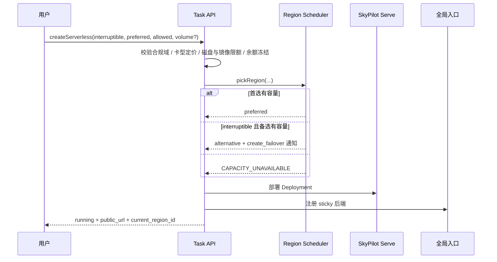
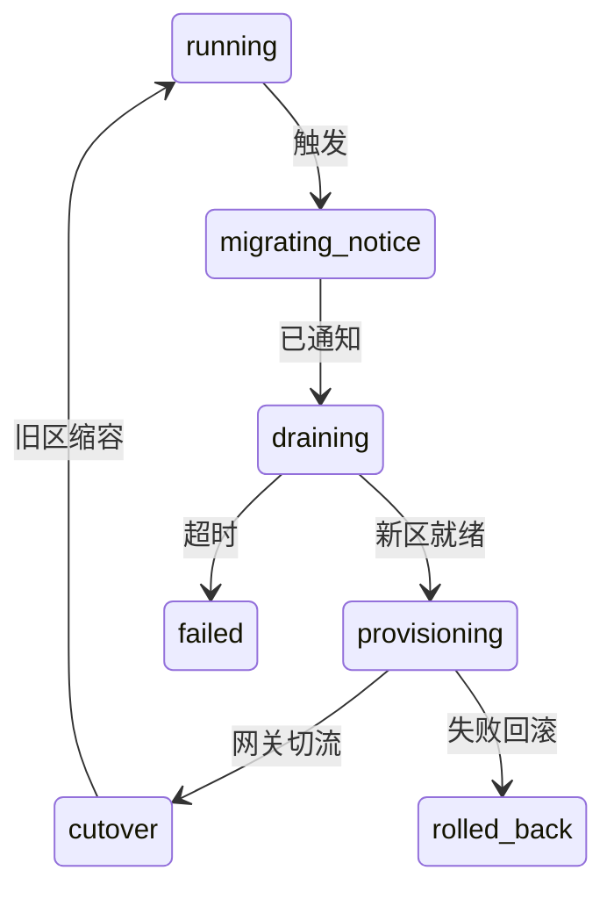

# 弹性服务 (Serverless) 实现方案

> **状态**: ✅ 已采纳（2026-07-19）  
> **范围**: `product_line=serverless`（无状态 Web / Deployment）  
> **不含**: LLM 推理（`inference`）— 见 `serverless-inference.md`  
> **权威对齐**: `../../business/product-line-taxonomy.md`、`tenant-balance-unification.md`、`multi-idc-federation.md`  
> **存储**: 镜像磁盘限额、数据盘免费额度/扩容、S3 网络卷见 `storage-quota-and-s3-volume.md`

---

## 目录

1. [产品定位](#1-产品定位)
2. [可中断调度（默认开启）](#2-可中断调度默认开启)
3. [数据模型](#3-数据模型)
4. [部署与生命周期](#4-部署与生命周期)
5. [跨区迁移履约](#5-跨区迁移履约)
6. [商业化定稿（计费 / SLA / 合规）](#6-商业化定稿计费--sla--合规)
7. [API / UI](#7-api--ui)
8. [存储挂载](#8-存储挂载)
9. [监控与运营](#9-监控与运营)
10. [实施路线图](#10-实施路线图)

---

## 1. 产品定位

| 维度 | Serverless | Inference | Cloud VM |
|------|------------|-----------|----------|
| K8s 原语 | Deployment | Deployment(s)+Traefik | Pod+PVC |
| 状态 | 无状态（状态外置） | 模型权重外置 | 持久化 |
| 计费 | GPU 时长（commitment） | Token / GPU | GPU 时长 |
| 可中断跨区 | ✅ 默认开 | Phase 2 | ❌ |
| Spot | ❌ | ❌ | ❌ |

**禁止**将 Serverless 容错写成 `billing_mode=spot`（Spot 仅 Job）。
容错策略字段为 `serverless_detail.fault_tolerance`（varchar），而非 `interruptible`（boolean）。

---

## 2. 可中断调度（默认开启）

### 2.1 选项

| 字段 (`serverless_detail`) | 默认 | 含义 |
|------|------|------|
| `fault_tolerance` | **`non_interruptible`** | 容错策略；`interruptible` 允许跨区重调度 |
| `preferred_region_id` | 用户所选 | 首选区域（compute_base.region） |
| `allowed_region_ids` | 同合规域可售区 | 可调度区域集合 |

```text
fault_tolerance=interruptible     → 允许跨区 failover
fault_tolerance=non_interruptible → 固定区域，仅区内自愈
```

### 2.2 与 Spot 正交

| | Spot | fault_tolerance |
|--|------|---------------|
| 字段 | `billing_mode=spot` | `serverless_detail.fault_tolerance` |
| 适用 | 仅 job | 仅 serverless（MVP） |
| 价格 | ×0.60（刊例六折） | **可中断 ×0.90 / 固定区 ×1.00**（见 §6 C11、§6.1） |
| 触发 | 闲时回收 / OD 抢占 | 容量 / 健康 / 维护 |

### 2.3 前端文案（部署向导）

- 默认勾选「允许中断并跨区调度」（对应 `fault_tolerance=interruptible`）
- 可选「固定在首选区域」（对应 `fault_tolerance=non_interruptible`）
- 旁注：迁移可能短暂抖动；公网 URL 不变；区域本地盘不可用时须用 S3 卷

### 2.4 准入

| product_line | fault_tolerance |
|--------------|---------------|
| serverless | ✅ 默认 `interruptible` |
| inference | Phase 2 |
| 其他 | ❌ |

挂载**区域本地 RWO PVC** 时：创建必须 `fault_tolerance=non_interruptible`，或改挂 S3 网络卷。

---

## 3. 数据模型

### 3.1 serverless_detail

> **实现对齐**: DB 使用 `fault_tolerance` (varchar) 替代设计初稿的 `interruptible` (boolean)。
> `fault_tolerance` 允许扩展为更丰富的容错策略（如 `graceful_degradation`），不再仅是布尔开关。

```sql
CREATE TABLE serverless_detail (
    id                     TEXT PRIMARY KEY,
    compute_base_id        TEXT NOT NULL REFERENCES compute_base(id) ON DELETE CASCADE,

    -- 服务标识
    service_name           VARCHAR(255),
    public_url             VARCHAR(512),
    internal_endpoint      VARCHAR(512),

    -- 容错策略: interruptible | non_interruptible (扩展为 varchar 以支持未来策略)
    fault_tolerance        VARCHAR(32) NOT NULL DEFAULT 'non_interruptible',
    min_replicas           INT DEFAULT 1,
    max_replicas           INT DEFAULT 1,
    target_port            INT,

    -- 部署配置
    command                TEXT,
    env_vars               JSONB DEFAULT '{}',

    -- SkyPilot 集成
    sky_serve_id           VARCHAR(256),
    endpoint_url           VARCHAR(512),

    created_at             TIMESTAMPTZ DEFAULT NOW()
);
```

**fault_tolerance 取值**:

| 值 | 含义 | 对应旧 interruptible |
|----|------|---------------------|
| `interruptible` | 允许跨区重调度 | `true` |
| `non_interruptible` | 固定区域，仅区内自愈 | `false` |

### 3.2 迁移审计

```sql
CREATE TABLE serverless_region_migration (
    id              TEXT PRIMARY KEY DEFAULT gen_random_uuid()::text,
    task_id         TEXT NOT NULL REFERENCES compute_base(id),
    tenant_id       TEXT NOT NULL REFERENCES tenant(id),
    from_region_id  TEXT,
    to_region_id    TEXT NOT NULL,
    reason          VARCHAR(64) NOT NULL,
    -- capacity_pressure | cluster_unhealthy | maintenance | admin | create_failover
    trigger_source  VARCHAR(32) NOT NULL,
    status          VARCHAR(32) NOT NULL DEFAULT 'pending',
    -- pending|draining|provisioning|cutover|succeeded|failed|rolled_back
    notice_sent_at  TIMESTAMPTZ,
    started_at      TIMESTAMPTZ,
    finished_at     TIMESTAMPTZ,
    error_message   TEXT,
    metadata        JSONB,
    created_at      TIMESTAMPTZ DEFAULT NOW()
);
```

### 3.3 合规域

```sql
CREATE TABLE region_compliance_domain (
    id           TEXT PRIMARY KEY,
    name         VARCHAR(128) NOT NULL,
    cross_border BOOLEAN NOT NULL DEFAULT false
);
-- data_center.compliance_domain_id → 约束 allowed_region_ids 同域（未开通跨境时）
```

---

## 4. 部署与生命周期

### 4.1 创建流程



### 4.2 专属操作

| 操作 | API | 说明 |
|------|-----|------|
| 扩缩容 | `scaleEndpoint` | min/max replicas |
| 配置更新 | `updateEndpointConfig` | 滚动更新 |
| Workers | `listWorkers` / `getWorkerLogs` | Pod 级 |
| 扩容数据盘 | `expandDataDisk` | 见存储文档 |
| 挂载/更换 S3 卷 | `attachVolume` | 见存储文档 |

---

## 5. 跨区迁移履约

### 5.1 触发

| 触发 | 要求 fault_tolerance |
|------|-------------------|
| 容量压力（扩容 Pending / 水位） | `interruptible` |
| 集群异常 | `interruptible` |
| 计划维护 | `interruptible` |
| 管理员强制 | 需确认；可豁免 |

`non_interruptible`：仅区内自愈，跨区返回 `REGION_PINNED`。

### 5.2 状态机



流程：`T−notice`（≥60s，可配）→ 新区拉起 → readiness → sticky 切流 → 旧区缩容 → `REGION_MIGRATED`。

### 5.3 端点 sticky（强制）

公网 URL / 自定义域名**不随区域变化**。全局 Traefik/Gateway 改 backend；证书挂全局入口。

### 5.4 选区评分

首选 +40、GPU 可用 +30、健康 +15、价格 +10、历史迁移失败 −5（权重可配）。细则对齐 `multi-idc-federation.md`。

迁移前检查镜像 digest；缺失则预热，超时换候选区。

---

## 6. 商业化定稿（计费 / SLA / 合规）

以下条目均为**必须交付**（不再列为可选缺口）。

| ID | 要求 | 定稿规则 |
|----|------|----------|
| C1 | 默认可中断 + UI 选项 | §2 |
| C2 | 与 Spot 隔离 | 校验禁止 serverless+spot |
| C3 | 跨区选区闸门 | interruptible + allowed + 合规域 |
| C4 | 迁移重叠期计费 | **双跑只计新区**；旧区 `billing_exclude`；双跑 ≤300s |
| C5 | 必达通知 | 站内信必达；已配 Webhook 必达 |
| C6 | sticky URL | 变更 = 事故 |
| C7 | 合规域 | 同域约束；跨境需开通 |
| C8 | 账单 `region_id` | 按 `current_region_id` 入账 |
| C9 | 镜像预热联动 | 迁移前 preload |
| C10 | SLA | 通知≥60s；切流成功率≥99%/月；不可用分钟退费/券 |
| C11 | 价格乘数 | **interruptible（可中断）= `0.90`，pinned（固定区）= `1.00`** —— 可中断享刊例价 9 折，固定区不打折（2026-10-06 定稿；字段预留） |
| C12 | 运营强制迁移 + 审计表 | §3.2 + admin API |
| C13 | 双跑/日迁移配额 | 租户+任务级限流 |
| C14 | 控制台免责声明 | 下单页固定文案 |

### 6.1 计费细则

| 阶段 | 计费 |
|------|------|
| 单区 running | 该区 GPU 秒 |
| 双跑 drain/provision | **仅新区** |
| cutover 后 | 仅新区 |
| 迁移失败回滚 | 实际占用区；不另收迁移费 |
| 旧区已不可用导致停机 | 停机段不计费 + SLA 赔偿池 |

```text
payable = list_price
        × interruptible_or_pinned_multiplier   -- 可中断 0.90 / 固定区(pinned) 1.00
        × commitment 规则
        + data_disk_paid 费用 + S3 卷费用      -- 见 storage 文档
```

### 6.2 通知 payload

```typescript
type RegionMigrationPayload = {
  event: 'REGION_MIGRATION_NOTICE' | 'REGION_MIGRATION_STARTED'
       | 'REGION_MIGRATED' | 'REGION_MIGRATION_FAILED'
  taskId: string
  serviceName: string
  fromRegionId?: string
  toRegionId: string
  reason: 'capacity_pressure' | 'cluster_unhealthy' | 'maintenance' | 'admin' | 'create_failover'
  migrateAt?: string
  publicUrl: string
  forced?: boolean
}
```

### 6.3 SLA

| 项 | fault_tolerance=interruptible | fault_tolerance=non_interruptible |
|----|--------|--------|
| 跨区自愈 | 承诺 | 不承诺 |
| 通知提前量 | ≥60s（紧急 forced 60s 内补发） | — |
| sticky 变更 | 0 | 0 |

---

## 7. API / UI

```typescript
createServerless: protectedProcedure.input(z.object({
  name: z.string(),
  gpuId: z.string(),
  gpuCount: z.number().int().min(1).max(8),
  region: z.string(),
  faultTolerance: z.enum(['interruptible', 'non_interruptible']).default('non_interruptible'),
  allowedRegionIds: z.array(z.string()).optional(),
  drainGraceSeconds: z.number().int().min(10).max(600).optional(),
  commitment: z.enum(['on-demand','hour','daily','weekly','monthly']),
  image: z.string(),
  dataDiskGb: z.number().int().min(0).optional(),
  volumeId: z.string().optional(),
  volumeMountPath: z.string().default('/data'),
}))
```

校验：`non_interruptible` 时 allowed=[region]；`interruptible` 时 allowed 含 preferred 且同合规域；本地盘+`interruptible` 互斥；镜像/数据盘限额见存储文档。

运营：`admin.forceMigrateServerless`、`admin.setMaintenanceWindow`。

---

## 8. 存储挂载

Serverless 支持：

1. **可选本地数据盘**（绑定区域 → 强制 pinned 或禁用跨区）  
2. **S3 网络卷**（推荐与 interruptible 组合）  

额度、扩容、计费、挂载实现见 **`storage-quota-and-s3-volume.md`**。

---

## 9. 监控与运营

| 指标 | 告警 |
|------|------|
| `serverless_migration_total{result}` | failed 突增 |
| `serverless_migration_dual_run_seconds` | > max |
| `serverless_migration_notice_fail_total` | >0 持续 |
| `serverless_pinned_capacity_block_total` | pinned 拒单率 |

---

## 10. 实施路线图

| Phase | 内容 |
|-------|------|
| S0 | 字段默认 true + UI + 创建 failover |
| S1 | 运行中迁移 + sticky + 通知 |
| S2 | 合规域 + 预热 + 重叠计费 + 审计 |
| S3 | 乘数/SLA 赔偿/运营强制迁移 |
| S4 | inference 扩展（另案） |

---

## 引用

| 文档 | 关系 |
|------|------|
| `../../business/product-line-taxonomy.md` | interruptible ≠ Spot |
| `storage-quota-and-s3-volume.md` | 磁盘限额与 S3 卷 |
| `serverless-inference.md` | LLM 产品线 |
| `spot-preemption-design.md` | 通知通道复用 |
| `container-cloud-instance-implementation.md` | UED / 总览入口 |
