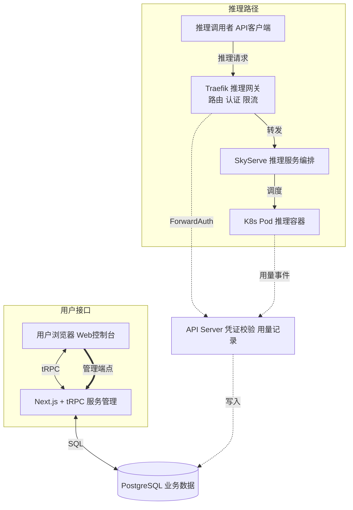
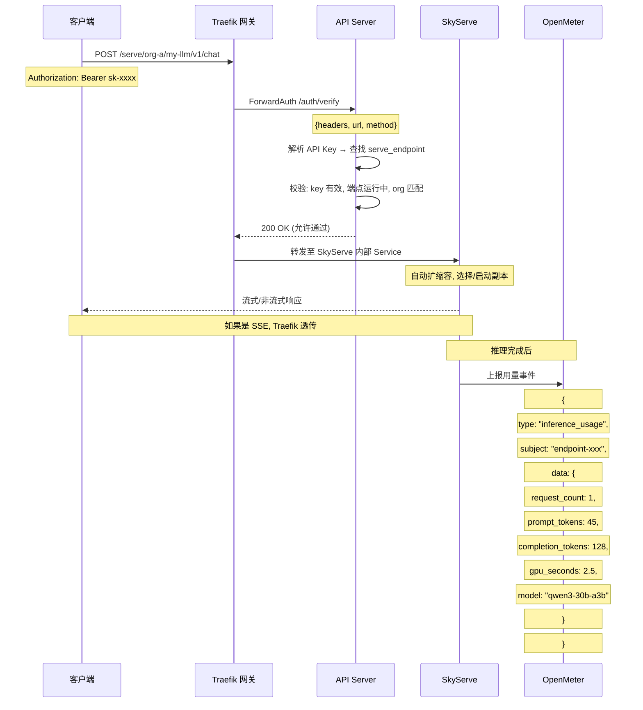
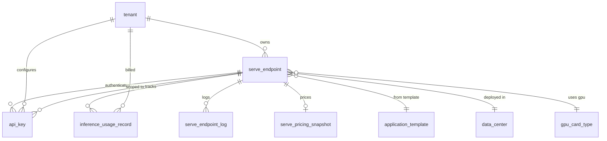
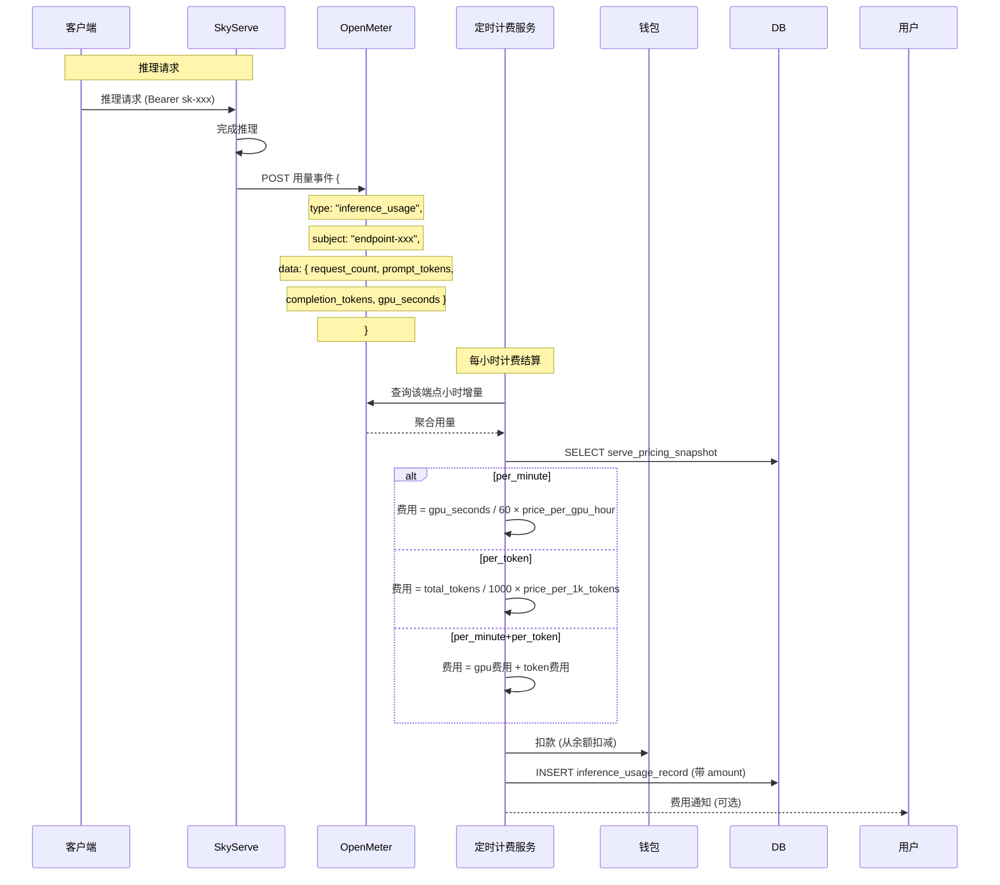
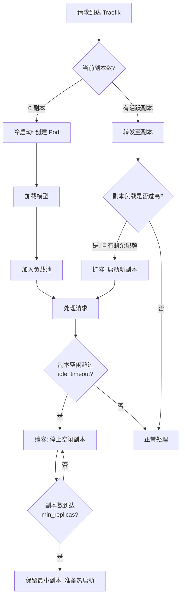

# Serverless Inference (LLM 推理) 服务设计

> 基于应用商店模板一键部署 LLM 推理端点，支持多模型部署、自动扩缩容，按 Token/请求数计费，商业化运行。
> 推理流量经由 Traefik 网关统一路由，SkyServe 负责服务编排。

**产品线定义**：`inference`（Serverless Inference），与 `serverless`（弹性服务）不同。
- `serverless`：K8s Deployment，部署任意 Web 应用，滚动更新，零停机；可中断跨区见 `serverless-implementation.md`
- `inference`：K8s Deployment(s)，专门部署 LLM 模型，多副本，API 端点，Token 计费
- 存储（镜像限额 / 数据盘 / S3）：`storage-quota-and-s3-volume.md`

---

## 1. 产品定位

### 1.1 用户价值

| 能力 | 说明 |
|------|------|
| **零运维部署** | 从应用商店选择模板 → 选择 GPU → 一键部署，无需管理服务器 |
| **自动扩缩容** | 根据请求量自动调整副本数，无请求时缩容至 0，零闲置成本 |
| **按调用付费** | 按 Token / 请求数 / 时长计费，不用不花钱 |
| **API 端点** | 每个服务获得独立公网 HTTPS 端点，支持 API Key 认证 |
| **SSE 流式支持** | 原生支持流式响应（LLM 推理场景） |

### 1.2 与实例产品的区别

| 维度 | Cloud VM (开发机) | Serverless (Web 服务) | Serverless Inference (LLM 推理) |
|------|------------------|----------------------|-------------------------------|
| K8s 原语 | Pod + PVC | Deployment | Deployment(s) |
| 用户操作 | SSH 登录，完全控制 | API 调用，零运维 | API 调用，零运维 |
| 计费方式 | 按小时/日/周/月 | 按 GPU 时长 | 按请求/Token/时长 |
| 扩缩容 | 手动 | 自动（基于指标） | 自动（基于 GPU/队列） |
| 适用场景 | 训练、开发、自定义环境 | Web 应用、API 服务 | 模型推理、LLM 服务 |
| GPU 分配 | 独占 | 共享（按副本） | 独占（按模型） |
| 节点迁移 | PVC 保留 | 零停机 | 零停机 |

### 1.3 架构



### 1.4 组件分工

| 组件 | 职责 |
|------|------|
| **Next.js (apps/gpus)** | Web 控制台：模板浏览、服务创建/管理、API Key 管理、用量查看 |
| **任务管理 API Server** | 服务生命周期管理、与 SkyServe/Traefik 交互、用量记录 |
| **SkyServe (SkyPilot)** | 推理服务编排：容器调度、扩缩容、健康检查 |
| **Traefik** | 推理入口网关：动态路由、API Key 认证 (ForwardAuth)、限流、SSE 透传 |
| **OpenMeter** | 用量计量：Token 计数、请求计数、GPU 时长 |

---

## 2. 用户交互流程

### 2.1 功能导航

```
/apps                 应用商店，浏览和选择推理模板
  → 选择模板           浏览 LLM/图像/音频分类
  → 选择部署类型        Instance / Serverless (即将推出 → 正式上线)
  → 选择 GPU 配置       GPU 型号 / 副本数 / 区域
  → 确认部署

/serverless/deploy     Serverless 专属部署页（从 apps 跳转）
  → 模板预填
  → 调整自动扩缩容参数
  → 创建端点

/serverless/endpoints  我的推理端点列表
  → 端点详情
    → API Key 管理
    → 调用示例
    → 用量与费用
    → 启/停/删除
```

### 2.2 部署流程

```mermaid
sequenceDiagram
    participant U as 用户
    participant G as apps/gpus tRPC
    participant DB as PostgreSQL
    participant S as SkyServe
    participant T as Traefik

    U->>G: 进入 /apps 浏览模板
    G-->>U: 模板列表 (LLM/图像/音频)

    U->>G: 选择模板 + Serverless 部署类型
    G-->>U: 跳转 /serverless/deploy?templateId=xxx

    U->>G: 配置参数并确认部署
    Note over U: 参数: GPU 类型, 最小/最大副本, 超时, 区域

    G->>DB: INSERT serve_endpoint (status='deploying')
    G-->>U: {endpoint_id, status: "deploying"}

    G->>S: POST /sky/api/serve
    Note over S: 创建 SkyServe 服务
    Note over S: 指定: image, resources, min/max replicas, port

    S-->>G: {serve_id, internal_endpoint}

    G->>DB: UPDATE serve_endpoint (serve_id, internal_endpoint)

    alt 创建 API Key
        G->>DB: INSERT api_key (endpoint_id, key, name)
    end

    G->>T: 创建路由规则
    Note over T: 路径: /serve/{org_slug}/{endpoint_name}
    Note over T: ForwardAuth → API Server 校验
    Note over T: RateLimit 中间件
    Note over T: 后端 → SkyServe 内部 Service

    T-->>G: 路由创建成功

    G->>DB: UPDATE serve_endpoint (public_url, status='running')
    G-->>U: {
      status: "running",
      public_url: "https://inference.example.com/serve/org-a/my-llm",
      api_key: "sk-xxxxxxxxx",
      curl_example: "curl -H 'Authorization: Bearer sk-xxx' ..."
    }
```

### 2.3 端点管理页面

```
我的推理端点
┌──────┬──────────┬──────────┬──────┬──────────┬──────────┬──────────┐
│ 名称  │ 模型     │ GPU     │ 状态  │ 调用量   │ 本月费用 │ 操作     │
├──────┼──────────┼──────────┼──────┼──────────┼──────────┼──────────┤
│ my-llm│ Qwen3    │ A100×1  │ 🟢运行│ 12.3K req │ ¥45.20  │ [管理]   │
│ sdxl  │ SDXL 1.0 │ 4090×1  │ 🟢运行│ 4.5K req  │ ¥28.80  │ [管理]   │
│ whisper│ Whisper  │ T4×1   │ ⏹停止 │ —        │ —       │ [启动]   │
└──────┴──────────┴──────────┴──────┴──────────┴──────────┴──────────┘
```

### 2.4 端点详情页

```
端点: my-llm
━━━━━━━━━━━━━━━━━━━━━━━━━━━━━━━━━━━━━━━━━━━━━━━━━━━━━
状态: 🟢 运行中 (2/5 副本活跃)

┌── 基本信息 ──────────────────────────────────────────┐
│ 模板: Qwen3-30B-A3B  |  GPU: NVIDIA H100 × 1        │
│ 区域: US-WEST-01      |  创建: 2026-07-16            │
│ 自动扩缩容: 最小 1 副本 | 最大 5 副本 | 空闲超时 5 分钟 │
└──────────────────────────────────────────────────────┘

┌── API 端点 ──────────────────────────────────────────┐
│ 🔗 https://inference.example.com/serve/org-a/my-llm  │
│ 🔑 API Key: sk-xxxx...xxxx [复制] [新建] [撤销]     │
│                                                       │
│ curl 示例:                                            │
│ ┌─────────────────────────────────────────────────┐  │
│ │ curl https://.../serve/org-a/my-llm/v1/chat     │  │
│ │   -H "Authorization: Bearer sk-xxxx"            │  │
│ │   -H "Content-Type: application/json"           │  │
│ │   -d '{"messages":[{"role":"user",              │  │
│ │         "content":"Hello"}]}'                    │  │
│ └─────────────────────────────────────────────────┘  │
└──────────────────────────────────────────────────────┘

┌── 用量与费用 ────────────────────────────────────────┐
│ 今日: 2,341 请求 | 45.2K Token | 0.8 GPU 时         │
│ 本月: 12,345 请求 | 234.5K Token | 4.5 GPU 时       │
│ 本月费用: ¥45.20                                      │
│ ┌────────────────────────────────────────────────┐   │
│ │ 📊 [查看用量图表 →]                              │   │
│ └────────────────────────────────────────────────┘   │
└──────────────────────────────────────────────────────┘

┌── 操作 ──────────────────────────────────────────────┐
│ [⏹ 停止] [🗑 删除] [⚙ 配置] [🔄 重启]               │
└──────────────────────────────────────────────────────┘
```

### 2.5 推理调用流程



---

## 3. 数据库设计

### 3.1 serve_endpoint — 推理端点

```sql
CREATE TABLE serve_endpoint (
    id                  TEXT PRIMARY KEY,
    tenant_id           TEXT NOT NULL REFERENCES tenant(id),
    organization_id     VARCHAR(64) NOT NULL,          -- Better Auth org ID
    name                VARCHAR(128) NOT NULL,          -- 端点名称 (URL slug)

    -- 模板信息
    template_id         TEXT REFERENCES application_template(id),
    template_version_id TEXT REFERENCES application_template_version(id),
    model_name          VARCHAR(255),                   -- 模型名称 (冗余)

    -- GPU 配置
    gpu_card_type_id    TEXT REFERENCES gpu_card_type(id),
    gpu_count           INTEGER NOT NULL DEFAULT 1,
    region_id           TEXT REFERENCES data_center(id),

    -- 关联计算任务
    compute_task_id     TEXT REFERENCES compute_task(id),  -- 底层 K8s 调度任务

    -- 扩缩容配置
    min_replicas        INTEGER NOT NULL DEFAULT 0,     -- 最小副本 (0 允许缩到无)
    max_replicas        INTEGER NOT NULL DEFAULT 4,
    idle_timeout_seconds INTEGER NOT NULL DEFAULT 300,  -- 空闲超时自动缩容
    target_concurrency  INTEGER DEFAULT 10,             -- 每副本目标并发

    -- SkyServe / Traefik
    sky_serve_id        VARCHAR(256),                   -- SkyServe 服务 ID
    internal_endpoint   VARCHAR(512),                   -- 内部 ClusterIP 端点
    public_url          VARCHAR(512),                   -- 公网 URL
    public_route_id     VARCHAR(256),                   -- Traefik 路由 ID

    -- 状态
    status              VARCHAR(16) NOT NULL DEFAULT 'deploying',
        -- deploying / running / stopping / stopped / failed
    status_message      TEXT,

    -- 计费
    pricing_model       VARCHAR(16) NOT NULL DEFAULT 'per_minute',
        -- per_minute: 按 GPU 分钟计费
        -- per_request: 按请求计费
        -- per_token: 按 Token 计费
    price_per_gpu_hour  NUMERIC(10,4),                  -- GPU 小时单价

    -- 时间线
    last_called_at      TIMESTAMP,
    deployed_at         TIMESTAMP,
    stopped_at          TIMESTAMP,
    created_at          TIMESTAMP NOT NULL DEFAULT NOW(),
    updated_at          TIMESTAMP NOT NULL DEFAULT NOW(),

    UNIQUE (organization_id, name)
);

CREATE INDEX se_tenant_idx ON serve_endpoint(tenant_id);
CREATE INDEX se_status_idx ON serve_endpoint(status);
CREATE INDEX se_org_idx ON serve_endpoint(organization_id);
```

### 3.2 api_key — API 密钥

```sql
CREATE TABLE api_key (
    id                  TEXT PRIMARY KEY,
    endpoint_id         TEXT NOT NULL REFERENCES serve_endpoint(id) ON DELETE CASCADE,
    tenant_id           TEXT NOT NULL REFERENCES tenant(id),
    name                VARCHAR(128) NOT NULL,          -- 密钥名称 e.g. "生产环境"
    key_prefix          VARCHAR(8) NOT NULL,            -- 密钥前缀 e.g. "sk-xxxx"
    key_hash            VARCHAR(256) NOT NULL,          -- 密钥哈希 (bcrypt)
    key_last_chars      VARCHAR(4) NOT NULL,            -- 末 4 位展示用
    status              VARCHAR(16) NOT NULL DEFAULT 'active', -- active / revoked
    last_used_at        TIMESTAMP,
    expires_at          TIMESTAMP,
    created_at          TIMESTAMP NOT NULL DEFAULT NOW()
);

CREATE INDEX ak_endpoint_idx ON api_key(endpoint_id);
CREATE INDEX ak_tenant_idx ON api_key(tenant_id);
CREATE INDEX ak_key_hash_idx ON api_key(key_hash);
```

### 3.3 inference_usage_record — 推理用量记录

```sql
CREATE TABLE inference_usage_record (
    id                  TEXT PRIMARY KEY,
    endpoint_id         TEXT NOT NULL REFERENCES serve_endpoint(id),
    tenant_id           TEXT NOT NULL REFERENCES tenant(id),
    api_key_id          TEXT REFERENCES api_key(id),

    -- 请求信息
    request_id          VARCHAR(128),                   -- 请求 Trace ID
    request_count       INTEGER NOT NULL DEFAULT 1,     -- 请求数
    prompt_tokens       INTEGER DEFAULT 0,              -- 输入 Token
    completion_tokens   INTEGER DEFAULT 0,              -- 输出 Token
    total_tokens        INTEGER DEFAULT 0,
    model_name          VARCHAR(255),

    -- 资源消耗
    gpu_seconds         NUMERIC(10,3) DEFAULT 0,        -- GPU 使用秒数
    gpu_card_type       VARCHAR(64),                    -- GPU 型号

    -- 响应信息
    response_status     INTEGER,                         -- HTTP 状态码
    latency_ms          INTEGER,                         -- 延迟 (ms)

    -- 计费
    billing_model       VARCHAR(16) NOT NULL,            -- per_minute / per_token
    unit_price          NUMERIC(10,6),                   -- 单价
    amount              NUMERIC(12,6),                   -- 费用

    -- 时间
    requested_at        TIMESTAMP NOT NULL,              -- 请求时间
    completed_at        TIMESTAMP,                       -- 完成时间
    created_at          TIMESTAMP NOT NULL DEFAULT NOW()
);

CREATE INDEX iur_endpoint_idx ON inference_usage_record(endpoint_id);
CREATE INDEX iur_tenant_idx ON inference_usage_record(tenant_id);
CREATE INDEX iur_time_idx ON inference_usage_record(requested_at);
CREATE INDEX iur_hourly_idx ON inference_usage_record(tenant_id, date_trunc('hour', requested_at));
```

### 3.4 serve_endpoint_log — 端点操作日志

```sql
CREATE TABLE serve_endpoint_log (
    id                  TEXT PRIMARY KEY,
    endpoint_id         TEXT NOT NULL REFERENCES serve_endpoint(id) ON DELETE CASCADE,
    action              VARCHAR(32) NOT NULL,
        -- created / deployed / started / stopped / deleted / config_updated / autoscaled
    operator_type       VARCHAR(16) NOT NULL,           -- system / user
    operator_id         TEXT,
    before_status       VARCHAR(16),
    after_status        VARCHAR(16),
    payload             JSONB,
    created_at          TIMESTAMP NOT NULL DEFAULT NOW()
);

CREATE INDEX sel_endpoint_idx ON serve_endpoint_log(endpoint_id);
```

### 3.5 价格快照

```sql
-- 端点的定价快照（创建时冻结，调价不影响已有端点）
CREATE TABLE serve_pricing_snapshot (
    id                  TEXT PRIMARY KEY,
    endpoint_id         TEXT NOT NULL REFERENCES serve_endpoint(id) ON DELETE CASCADE,
    gpu_card_type_id    TEXT NOT NULL REFERENCES gpu_card_type(id),
    pricing_model       VARCHAR(16) NOT NULL,
    price_per_gpu_hour  NUMERIC(10,4) NOT NULL,         -- 按 GPU 分钟计费的单价
    price_per_1k_tokens NUMERIC(10,6),                   -- 按 Token 计费的单价 (每 1K)
    price_per_request   NUMERIC(10,6),                   -- 按请求计费的单价
    created_at          TIMESTAMP NOT NULL DEFAULT NOW()
);
```

### 3.6 ER 关系



---

## 4. 计费模型

### 4.1 计费模式

| 模式 | 适用场景 | 计费粒度 | 典型单价 |
|------|---------|---------|---------|
| `per_minute` | GPU 推理服务 | 按 GPU 时长（秒级），最小计费单位 1s | ¥0.05/GPU 分钟 (A100) |
| `per_request` | 简单 API 服务 | 按请求数 | ¥0.001/请求 |
| `per_token` | LLM 推理 | 按输入+输出 Token | ¥3/1M Token (输入), ¥6/1M Token (输出) |
| `per_minute + per_token` | LLM 推理（推荐） | GPU 基础费 + Token 附加费 | ¥0.03/GPU 分 + ¥2/1M Token |

### 4.2 计费流程



### 4.3 免费额度

| 用户等级 | 月免费额度 | 说明 |
|---------|-----------|------|
| 新用户 (首月) | 1000 次请求 或 10 GPU 时 | 试用体验 |
| 普通用户 | 100 次请求 或 1 GPU 时 | 基础额度 |
| 付费客户 (上月消费 ≥$50) | 无额度 | 按量计费 |

---

## 5. 扩缩容策略



**自动扩缩容参数**：

| 参数 | 默认值 | 说明 |
|------|-------|------|
| `min_replicas` | 0 | 最小副本（0 = 无请求时完全缩容） |
| `max_replicas` | 4 | 最大副本上限 |
| `idle_timeout` | 300s | 空闲超过此时间缩容 |
| `target_concurrency` | 10 | 每副本目标并发数（超过则扩容） |
| `scale_up_cooldown` | 30s | 扩容冷却时间 |
| `scale_down_cooldown` | 60s | 缩容冷却时间 |

---

## 6. 推理网关 (Traefik)

### 6.1 路由规则

```
路由: Host(inference.example.com) && PathPrefix(/serve/{org_slug}/{endpoint_name})
中间件链:
  1. RateLimit (按端点: 100 req/s, 突发 200)
  2. ForwardAuth → API Server /auth/verify
  3. Headers (注入 X-Endpoint-Id, X-Tenant-Id)
后端: http://sky-serve-xxx.sky-system.svc:8080
```

### 6.2 API Key 认证流程

```typescript
// API Server /auth/verify 端点
// 被 Traefik ForwardAuth 调用
function verifyAuth(headers: Headers): { status: 200 | 401 } {
  const authHeader = headers.get('Authorization')
  // Bearer sk-xxxx

  const apiKey = authHeader?.replace('Bearer ', '')
  if (!apiKey) return 401

  const prefix = apiKey.slice(0, 7) // "sk-xxx"
  const hashed = hash(apiKey)

  // 查询匹配的 api_key
  const key = db.query.api_key.findFirst({
    where: and(
      eq(apiKey.keyPrefix, prefix),
      eq(apiKey.keyHash, hashed),
      eq(apiKey.status, 'active'),
    ),
  })

  if (!key) return 401

  // 校验端点状态
  const endpoint = db.query.serve_endpoint.findFirst({
    where: eq(serveEndpoint.id, key.endpointId),
  })

  if (!endpoint || endpoint.status !== 'running') return 401

  // 校验 org_slug 与 URL 匹配
  const urlOrgSlug = extractOrgSlugFromPath(headers.get('X-Forwarded-Uri'))
  if (endpoint.organization_id !== urlOrgSlug) return 401

  // 更新最后使用时间
  db.update(apiKey).set({ lastUsedAt: new Date() })

  return 200
}
```

### 6.3 端点自动创建路由

```typescript
// 部署端点时自动创建 Traefik 路由 (通过 K8s CRD 或 etcd)
const routeConfig = {
  // Traefik IngressRoute CRD
  apiVersion: "traefik.io/v1alpha1",
  kind: "IngressRoute",
  metadata: { name: `serve-${endpointName}` },
  spec: {
    entryPoints: ["web", "websecure"],
    routes: [{
      match: `Host(\`inference.example.com\`) && PathPrefix(\`/serve/${orgSlug}/${endpointName}\`)`,
      middlewares: [
        { name: `ratelimit-${endpointName}` },
        { name: `auth-forward` },          // 全局 ForwardAuth
      ],
      services: [{
        name: `sky-serve-${serveId}`,
        port: 8080,
      }],
    }],
  },
}
```

---

## 7. tRPC 接口

### 7.1 用户端 (apps/gpus)

```typescript
export const serverlessRouter = createTRPCRouter({
  // 模板相关
  listTemplates: publicProcedure
    .input(z.object({
      category: z.string().optional(),
      search: z.string().optional(),
    }))
    .query(async ({ input }) => serverlessService.listTemplates(input)),

  getTemplateDetail: publicProcedure
    .input(z.object({ templateId: z.string() }))
    .query(async ({ input }) => serverlessService.getTemplateDetail(input.templateId)),

  // 端点管理
  createEndpoint: protectedProcedure
    .input(z.object({
      templateId: z.string(),
      templateVersionId: z.string().optional(),
      name: z.string().min(2).max(64).regex(/^[a-z0-9-]+$/),
      gpuCardTypeId: z.string(),
      gpuCount: z.number().int().min(1).default(1),
      regionId: z.string(),
      minReplicas: z.number().int().min(0).default(0),
      maxReplicas: z.number().int().min(1).max(20).default(4),
      idleTimeoutSeconds: z.number().int().min(60).max(3600).default(300),
      targetConcurrency: z.number().int().min(1).default(10),
    }))
    .mutation(async ({ ctx, input }) => serverlessService.create(ctx.user, input)),

  listEndpoints: protectedProcedure
    .input(z.object({
      status: z.string().optional(),
      page: z.number().int().min(1).default(1),
      pageSize: z.number().int().min(1).max(50).default(20),
    }))
    .query(async ({ ctx, input }) => serverlessService.list(ctx.user, input)),

  getEndpointDetail: protectedProcedure
    .input(z.object({ endpointId: z.string() }))
    .query(async ({ ctx, input }) => serverlessService.getDetail(ctx.user, input.endpointId)),

  stopEndpoint: protectedProcedure
    .input(z.object({ endpointId: z.string() }))
    .mutation(async ({ ctx, input }) => serverlessService.stop(ctx.user, input.endpointId)),

  startEndpoint: protectedProcedure
    .input(z.object({ endpointId: z.string() }))
    .mutation(async ({ ctx, input }) => serverlessService.start(ctx.user, input.endpointId)),

  deleteEndpoint: protectedProcedure
    .input(z.object({ endpointId: z.string() }))
    .mutation(async ({ ctx, input }) => serverlessService.delete(ctx.user, input.endpointId)),

  updateEndpointConfig: protectedProcedure
    .input(z.object({
      endpointId: z.string(),
      minReplicas: z.number().int().min(0).optional(),
      maxReplicas: z.number().int().min(1).max(20).optional(),
      idleTimeoutSeconds: z.number().int().optional(),
      targetConcurrency: z.number().int().optional(),
    }))
    .mutation(async ({ ctx, input }) => serverlessService.updateConfig(ctx.user, input)),

  // API Key 管理
  listApiKeys: protectedProcedure
    .input(z.object({ endpointId: z.string() }))
    .query(async ({ ctx, input }) => serverlessService.listKeys(ctx.user, input.endpointId)),

  createApiKey: protectedProcedure
    .input(z.object({
      endpointId: z.string(),
      name: z.string().min(1).max(64),
    }))
    .mutation(async ({ ctx, input }) => serverlessService.createKey(ctx.user, input)),
    // returns: { id, name, key: "sk-xxxxxxxx..." }  // 密钥仅返回一次

  revokeApiKey: protectedProcedure
    .input(z.object({ keyId: z.string() }))
    .mutation(async ({ ctx, input }) => serverlessService.revokeKey(ctx.user, input.keyId)),

  // 用量与费用
  getEndpointUsage: protectedProcedure
    .input(z.object({
      endpointId: z.string(),
      period: z.enum(['today', '7d', '30d', 'custom']),
      from: z.string().optional(),
      to: z.string().optional(),
    }))
    .query(async ({ ctx, input }) => serverlessService.getUsage(ctx.user, input)),

  getEndpointCost: protectedProcedure
    .input(z.object({
      endpointId: z.string(),
      month: z.string().optional(),  // yyyy-MM
    }))
    .query(async ({ ctx, input }) => serverlessService.getCost(ctx.user, input)),
})
```

### 7.2 运营端 (apps/web)

```typescript
export const serverlessRouter = createTRPCRouter({
  endpoints: createTRPCRouter({
    listAll: adminProcedure
      .input(z.object({
        status: z.string().optional(),
        search: z.string().optional(),
        page: z.number().int().min(1).default(1),
        pageSize: z.number().int().min(1).max(50).default(20),
      }))
      .query(async ({ input }) => serverlessService.listAll(input)),

    getDetail: adminProcedure
      .input(z.object({ endpointId: z.string() }))
      .query(async ({ input }) => serverlessService.getDetailAdmin(input.endpointId)),

    forceStop: adminProcedure
      .input(z.object({ endpointId: z.string(), reason: z.string().optional() }))
      .mutation(async ({ input }) => serverlessService.forceStop(input)),
  }),

  apiKeys: createTRPCRouter({
    listAll: adminProcedure
      .input(z.object({
        endpointId: z.string().optional(),
        tenantId: z.string().optional(),
        status: z.string().optional(),
      }))
      .query(async ({ input }) => serverlessService.listAllKeys(input)),

    revoke: adminProcedure
      .input(z.object({ keyId: z.string(), reason: z.string().optional() }))
      .mutation(async ({ input }) => serverlessService.adminRevokeKey(input)),
  }),

  usage: createTRPCRouter({
    overview: adminProcedure
      .input(z.object({
        period: z.string(),
      }))
      .query(async ({ input }) => serverlessService.getPlatformUsage(input)),
      // 返回平台级汇总: 总请求数, Token, GPU 时, 收入
  }),
})
```

---

## 8. 定时任务

### 8.1 计费结算（每小时）

```sql
-- 聚合每端点小时用量
INSERT INTO inference_usage_record (id, endpoint_id, tenant_id, total_tokens,
  gpu_seconds, billing_model, amount)
SELECT
  gen_random_uuid()::text,
  se.id,
  se.tenant_id,
  SUM(om.total_tokens),
  SUM(om.gpu_seconds),
  sps.pricing_model,
  CASE sps.pricing_model
    WHEN 'per_minute' THEN SUM(om.gpu_seconds) / 60 * sps.price_per_gpu_hour
    WHEN 'per_token'  THEN SUM(om.total_tokens) / 1000 * sps.price_per_1k_tokens
  END
FROM openmeter_aggregation om
JOIN serve_endpoint se ON se.id = om.subject
JOIN serve_pricing_snapshot sps ON sps.endpoint_id = se.id
WHERE om.hour = date_trunc('hour', NOW() - INTERVAL '1 hour')
GROUP BY se.id, se.tenant_id, sps.pricing_model, sps.price_per_gpu_hour;
```

### 8.2 空闲缩容（每分钟）

```sql
-- 缩容空闲超过 idle_timeout 的副本
-- SkyServe 自带此功能，无需业务层实现
-- 业务层仅需记录每个副本的最后活跃时间
```

### 8.3 API Key 过期清理（每日）

```sql
UPDATE api_key
SET status = 'revoked'
WHERE expires_at IS NOT NULL
  AND expires_at <= NOW()
  AND status = 'active';
```

---

## 9. 运营管理页面

### 全局推理端点监控

```
推理服务概览                                2026-07-16
┌────────────┬────────────┬────────────┬────────────┬────────────┐
│ 活跃端点    │ 今日请求    │ 本月 Token │ 本月 GPU 时 │ 本月收入   │
│     128     │  456.7K    │  89.2M    │  1,234.5   │ ¥12,345.00 │
└────────────┴────────────┴────────────┴────────────┴────────────┘

端点列表
┌──────┬──────────┬──────────┬──────┬────────┬────────┬──────────┐
│ 端点  │ 用户     │ 模型     │ GPU  │ 状态   │ 请求量  │ 操作     │
├──────┼──────────┼──────────┼──────┼────────┼────────┼──────────┤
│ my-llm│ user_a  │ Qwen3   │ A100 │ 🟢运行 │ 12.3K  │ [管理]   │
│ sdxl  │ user_b  │ SDXL    │ 4090 │ 🟢运行 │ 4.5K   │ [管理]   │
│ bot   │ user_c  │ —       │ T4   │ 🔴异常 │ —      │ [强制停止]│
└──────┴──────────┴──────────┴──────┴────────┴────────┴──────────┘
```

---

## 10. 前端页面路由

| 路由 | 页面 | 数据来源 |
|------|------|---------|
| `/apps` | 应用商店 | application_template |
| `/serverless/deploy` | Serverless 部署页 | template + gpu_card_type + data_center |
| `/serverless/endpoints` | 端点列表 | serve_endpoint |
| `/serverless/endpoints/:id` | 端点详情 | serve_endpoint + api_key + inference_usage_record |
| `/serverless/endpoints/:id/usage` | 用量图表 | inference_usage_record |
| `/serverless/endpoints/:id/keys` | API Key 管理 | api_key |

---

## 11. 实施路线

### Phase 1 — MVP（核心流程）

- `serve_endpoint` / `api_key` 表
- 创建/删除/启停端点
- 按 GPU 分钟计费 (`per_minute`)
- 基础 Traefik 路由 + ForwardAuth
- 调用量统计（每日汇总）

### Phase 2 — 增长（扩缩容 + 商业化）

- 自动扩缩容 (0→N)
- Token 级计费 (`per_token`)
- 免费额度体系
- 用量图表
- 余额不足自动停止端点

### Phase 3 — 高级特性

- 多 API Key 管理（轮转、过期）
- 自定义域名绑定
- 请求级限流
- 模型 A/B 测试
- 按区域延迟路由
