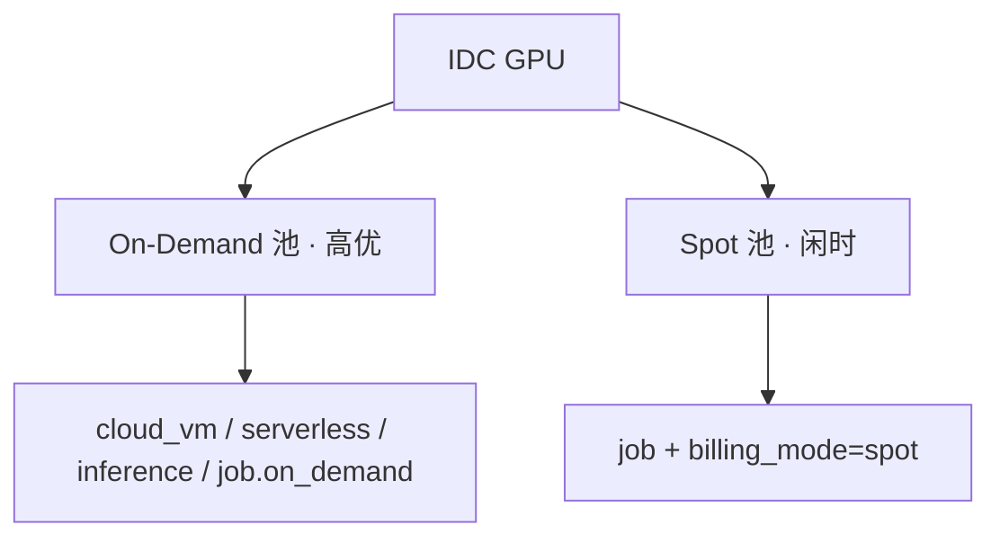
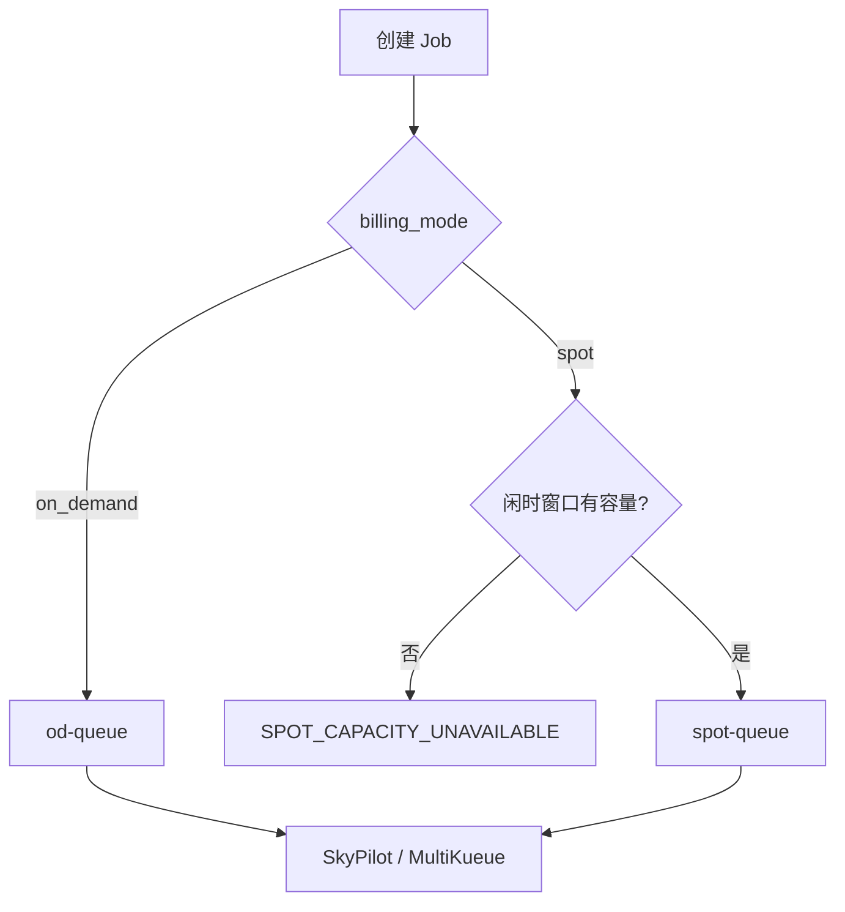
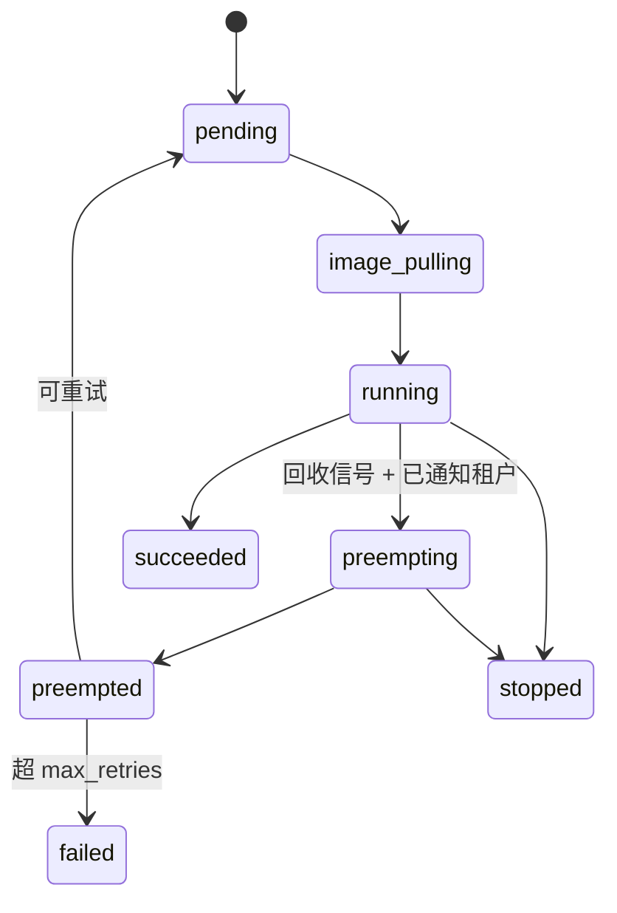
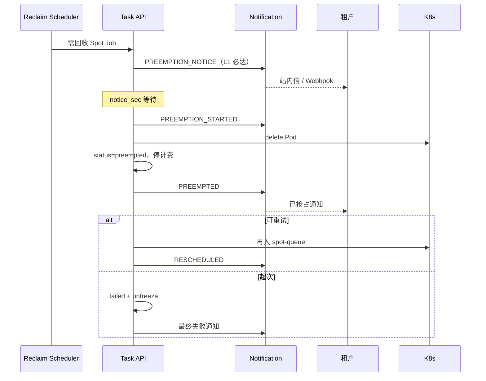

# Spot 抢占与闲时回收设计（权威定义）

> **状态**: ✅ 已采纳（2026-07-19，修订同日）  
> **依赖**: `../../business/product-line-taxonomy.md`、`tenant-balance-unification.md`、`multi-idc-federation.md`  
> **范围**: Job Spot 产品 + 供应商闲时窗口回收。  
> **不做历史兼容**：无 `product_line=spot`；字段按规范落库。

---

## 1. 定位

```text
供应商闲时窗口放出 GPU → 平台以 Spot 单价售给 Job（commitment=on-demand，按秒计费）
供应商忙时 / On-Demand 需容量 → 回收 Spot → **必须通知租户** → 保障高优任务
```

| 角色 | 诉求 | 应答 |
|------|------|------|
| 租户 | 便宜算力、中断可感知 | `billing_mode=spot`，刊例价六折（乘数 0.60）；**抢占必达通知**；checkpoint + 重试 |
| 供应商 | 忙时收回设备 | `idc_capacity_window` + 回收 SLA |
| 平台 | 利用率与毛利 | Spot 填闲；回收率进结算 |

边界（taxonomy）：

- Spot = `billing_mode`，不是 product_line
- 仅 `product_line=job`
- 仅 `commitment=on-demand`（按秒；禁止 hour/日/周/月预付）

---

## 2. 资源池与调度



| 机制 | 用途 |
|------|------|
| label `GPURun.cloud/pool=spot\|shared` | 入池 |
| taint + toleration | Spot 调度 |
| PriorityClass `od-high` / `spot-low` | 抢占优先级 |
| PreemptionPolicy `PreemptLowerPriority` | OD 可踢 Spot |



---

## 3. `idc_capacity_window`

```sql
CREATE TABLE idc_capacity_window (
    id                  TEXT PRIMARY KEY,
    data_center_id      TEXT NOT NULL REFERENCES data_center(id),
    gpu_card_type_id    TEXT REFERENCES gpu_card_type(id),
    window_start        TIMESTAMPTZ NOT NULL,
    window_end          TIMESTAMPTZ NOT NULL,
    mode                VARCHAR(16) NOT NULL,  -- idle_open | reclaim
    reclaim_notice_sec  INTEGER NOT NULL DEFAULT 120,
    reclaim_sla_sec     INTEGER NOT NULL DEFAULT 300,
    max_spot_gpus       INTEGER,
    status              VARCHAR(16) NOT NULL DEFAULT 'scheduled',
        -- scheduled | active | closed | cancelled
    supplier_contract_id TEXT,
    remark              TEXT,
    created_at          TIMESTAMPTZ NOT NULL DEFAULT NOW(),
    CHECK (window_end > window_start)
);

CREATE INDEX icw_dc_time_idx ON idc_capacity_window(data_center_id, window_start, window_end);
```

| cooperation_type | 含义 |
|------------------|------|
| `idle_time` | 仅窗口内进 Spot 池；reclaim 必须可收回 |
| `whole_rent` | 平台自管切分；仍建议配窗口 |

---

## 4. 状态机



| 状态 | 计费 |
|------|------|
| `preempting` | 计费至进程停止 |
| `preempted` | **停计费** |
| 再 `running` | 新计费段（按秒） |

事件：`preemption_notice` / `preemption_started` / `preempted` / `rescheduled` / `tenant_notified`。

---

## 5. 回收与租户通知（强制）

### 5.1 触发源

1. 窗口 reclaim（提前 `reclaim_notice_sec`）
2. On-Demand 抢占（高优需容量）
3. 运营强制回收

### 5.2 租户通知 —— 硬性要求

> **Job Spot 一旦进入抢占流程，必须通知到租户。**  
> 未成功投递至少一个「必达渠道」前，不得静默杀 Pod（紧急强制回收除外，见下）。

| 级别 | 渠道 | 是否必达 | 说明 |
|------|------|----------|------|
| L1 | **站内信 / 控制台通知中心** | ✅ 必达 | 写入 `tenant_notification`，租户登录可见 |
| L2 | **Webhook**（若租户已配置） | ✅ 已配置则必达 | `PREEMPTION_NOTICE` / `PREEMPTED` JSON |
| L3 | 邮件 | 推荐 | 绑定邮箱时发送 |
| L4 | 短信 / IM | 可选 | 企业租户 |

**必达判定**：L1 持久化成功；若存在 webhook URL，则 L2 HTTP 2xx 或进入重试队列（至少 3 次、指数退避）。L1 失败则阻断自动删 Pod 并告警 SRE。

通知载荷（最小集）：

```typescript
type PreemptionNotifyPayload = {
  event: 'PREEMPTION_NOTICE' | 'PREEMPTION_STARTED' | 'PREEMPTED' | 'RESCHEDULED'
  tenantId: string
  organizationId: string
  taskId: string
  jobName: string
  reason: 'window_reclaim' | 'od_preemption' | 'admin'
  preemptAt?: string       // ISO，NOTICE 时必填预计回收时刻
  noticeSeconds?: number
  retryCount?: number
  maxRetries?: number
  checkpointEnabled?: boolean
}
```

### 5.3 时序

| 时点 | 动作 |
|------|------|
| T−notice（默认 120s） | **先**发 `PREEMPTION_NOTICE` 给租户（L1+L2）→ 再 annotate / 准备 checkpoint |
| T−30s | 再次通知（可选）；开始 checkpoint |
| T0 | `PREEMPTION_STARTED` → SIGTERM → grace → SIGKILL；状态 preempting→preempted；发 `PREEMPTED` |
| 重调度成功 | 发 `RESCHEDULED` |
| T0+sla 仍占用 | 强制删 Pod；记 `reclaim_breach`；仍须补发 `PREEMPTED`（若尚未发出） |

**紧急强制回收**（节点故障 / 安全）：可先杀 Pod，但须在 **60s 内**补发 `PREEMPTED` 到 L1（及已配置的 L2），并标记 `reason` + `forced=true`。



### 5.4 通知表（规范）

```sql
CREATE TABLE tenant_notification (
    id                  TEXT PRIMARY KEY,
    tenant_id           TEXT NOT NULL REFERENCES tenant(id),
    organization_id     VARCHAR(64) NOT NULL,
    category            VARCHAR(32) NOT NULL,  -- spot_preemption | billing | ...
    event_type          VARCHAR(64) NOT NULL,
    title               VARCHAR(255) NOT NULL,
    body                TEXT NOT NULL,
    payload             JSONB NOT NULL DEFAULT '{}',
    ref_type            VARCHAR(32),           -- compute_base
    ref_id              TEXT,
    channel_inbox       BOOLEAN NOT NULL DEFAULT true,
    channel_webhook     BOOLEAN NOT NULL DEFAULT false,
    webhook_status      VARCHAR(16),           -- pending | sent | failed | skipped
    read_at             TIMESTAMPTZ,
    created_at          TIMESTAMPTZ NOT NULL DEFAULT NOW()
);

CREATE INDEX tn_tenant_created_idx ON tenant_notification(tenant_id, created_at DESC);
CREATE INDEX tn_org_idx ON tenant_notification(organization_id);
```

用户端：`trpc.notification.list` / `markRead`；抢占类默认高优展示。

### 5.5 Checkpoint

```sql
-- job_detail / spot_runtime 字段
checkpoint_enabled           BOOLEAN DEFAULT true,
checkpoint_volume_id         TEXT,
checkpoint_interval_seconds  INT DEFAULT 300,
last_checkpoint_at           TIMESTAMPTZ,
preempted_at                 TIMESTAMPTZ,
preemption_reason            VARCHAR(64),
preemption_count             INT DEFAULT 0,
retry_count                  INT DEFAULT 0,
max_retries                  INT DEFAULT 3,
last_tenant_notified_at      TIMESTAMPTZ  -- 最近一次成功通知租户
```

---

## 6. 计费

```text
spot_rate = on_demand_hourly_rate × spot_price_multiplier(0.60)
秒费用 = seconds × (spot_rate / 3600)
```

- 仅 `running` 且 `commitment=on-demand` 计费
- `preempted` / 重调度 `pending` 不计费
- 余额：`tenant-balance-unification.md`（freeze / consume_reserved）

---

## 7. API

```typescript
createJob: protectedProcedure.input(z.object({
  billingMode: z.enum(['on_demand', 'spot']).default('on_demand'),
  commitment: z.literal('on-demand'), // spot 强制按秒
  checkpointEnabled: z.boolean().default(true),
  maxRetries: z.number().int().min(0).max(10).default(3),
}))
```

校验：`spot` ⇒ `product_line=job` ∧ `commitment=on-demand`；无窗口容量 ⇒ `SPOT_CAPACITY_UNAVAILABLE`。

---

## 8. 运营

| 页面 | 功能 |
|------|------|
| 闲时窗口 | CRUD `idc_capacity_window` |
| Spot 运行中 | 手动 reclaim（触发后同样走租户通知） |
| 通知投递 | webhook 失败重试 / 死信 |
| 回收 SLA | `reclaim_success_rate`、通知成功率 |

```text
reclaim_success_rate = SLA 内完成回收数 / 应回收数
tenant_notify_success_rate = 必达渠道成功数 / 抢占事件数  （告警 < 99%）
```

---

## 9. 监控

| 指标 | 告警 |
|------|------|
| `spot_preemption_total` | — |
| `spot_reclaim_latency_seconds` | > sla |
| `spot_tenant_notify_fail_total` | > 0 持续 |
| `spot_retry_exhausted_total` | 突增 |

---

## 10. MVP 不做

| 项 | 原因 |
|----|------|
| Cloud VM / 裸金属 Spot | 见 taxonomy |
| Spot 竞价 | 固定乘数 |
| 保证 Spot 可用性 SLO | 尽力而为 + **必达通知** |

---

## 11. 实施

| 阶段 | 交付 |
|------|------|
| S1 | DDL：`billing_mode`、`idc_capacity_window`、`tenant_notification` |
| S2 | Spot 队列 + PriorityClass |
| S3 | 回收调度 + **租户通知必达** + 停计费 |
| S4 | checkpoint + 自动重试 + RESCHEDULED 通知 |
| S5 | 运营 UI + 通知/回收率进结算 |
