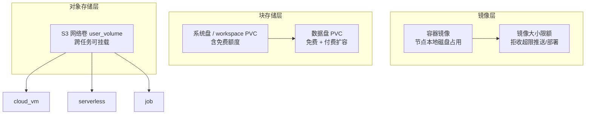
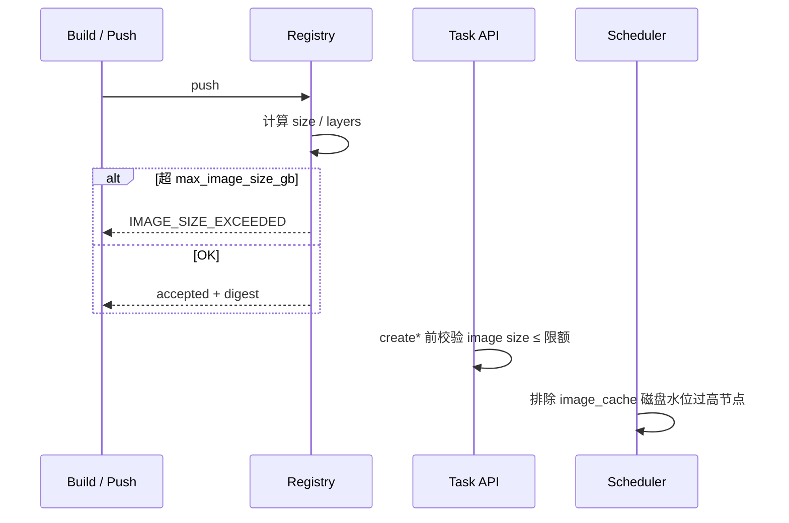
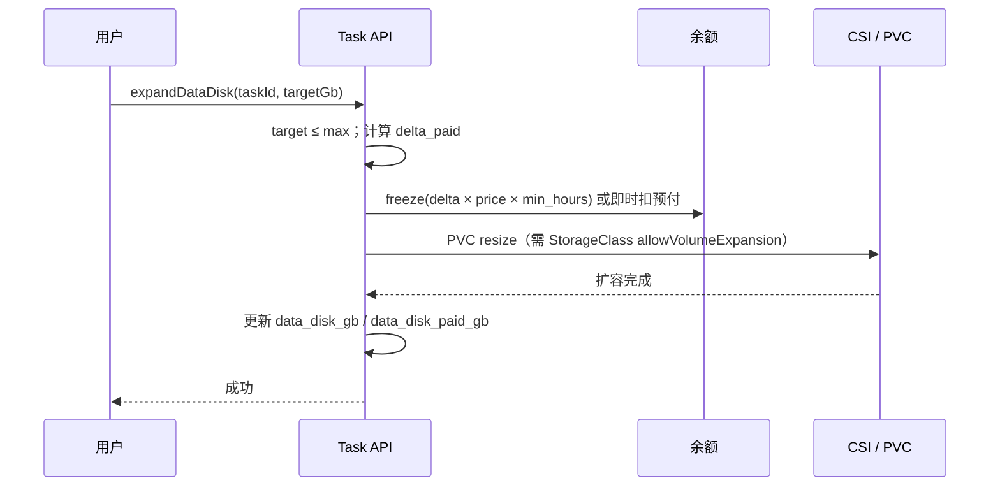

# 存储配额、数据盘扩容与 S3 网络卷

> **状态**: ✅ 已采纳（2026-07-19）  
> **范围**: 容器镜像磁盘限额、实例数据盘（免费额度 + 付费扩容 + 上限）、S3 兼容网络卷挂载。  
> **适用产品线**: `cloud_vm` / `serverless` / `job`（`inference` 模型权重挂载同 S3 卷模型，可复用）。  
> **对齐**: `tenant-balance-unification.md`（扣款）、`../../business/product-line-taxonomy.md`、各产品实现文档。

---

## 目录

1. [目标与分层](#1-目标与分层)
2. [镜像磁盘限额](#2-镜像磁盘限额)
3. [数据盘：免费额度与付费扩容](#3-数据盘免费额度与付费扩容)
4. [S3 网络卷](#4-s3-网络卷)
5. [产品线挂载矩阵](#5-产品线挂载矩阵)
6. [数据模型](#6-数据模型)
7. [计费](#7-计费)
8. [运行时实现](#8-运行时实现)
9. [API / UI](#9-api--ui)
10. [配额执法与告警](#10-配额执法与告警)
11. [实施路线图](#11-实施路线图)

---

## 1. 目标与分层



| 层 | 用途 | 计费 | 跨区 |
|----|------|------|------|
| **镜像** | 运行时只读层 | 仓库存储费（可选）+ 节点占用隐含在规格内；**硬限额** | digest 拉取 |
| **数据盘（块）** | 本地高性能读写 | 免费额度内 0；超出按 GB·时 | 绑区；与 serverless interruptible 互斥 |
| **S3 网络卷** | 共享数据/权重/checkpoint | 容量 GB·天 + 可选请求/流量 | ✅ 推荐跨区 |

---

## 2. 镜像磁盘限额

### 2.1 限额对象

| 对象 | 限额字段 | 默认（可配） | 执法点 |
|------|----------|--------------|--------|
| 单镜像解压后大小 | `max_image_size_gb` | 40 GB | push 入库扫描、部署前校验 |
| 单镜像层数 | `max_image_layers` | 120 | 构建/入库 |
| 租户自定义镜像总占用 | `max_tenant_image_storage_gb` | 200 GB | registry GC / 拒收新推送 |
| 节点可调度镜像缓存水位 | `node_image_cache_watermark` | 80% 磁盘 | 调度避开爆盘节点 |

> 「镜像磁盘限额」= **防止超大镜像拖垮节点与仓库**，与数据盘配额独立。

### 2.2 执法流程



### 2.3 与 Cog 构建联动

- 构建上下文扫描拒绝大权重进镜像（见 `cloud-vm-implementation.md` 数据镜像分离）。  
- 超限时错误码引导：改挂 S3/数据盘，勿 bake 权重。

### 2.4 配置表

```sql
CREATE TABLE storage_quota_policy (
    id                      TEXT PRIMARY KEY,
    scope                   VARCHAR(32) NOT NULL,  -- platform | tenant
    tenant_id               TEXT REFERENCES tenant(id),
    max_image_size_gb       INT NOT NULL DEFAULT 40,
    max_image_layers        INT NOT NULL DEFAULT 120,
    max_tenant_image_storage_gb INT NOT NULL DEFAULT 200,
    data_disk_free_gb       INT NOT NULL DEFAULT 50,
    data_disk_max_gb        INT NOT NULL DEFAULT 2000,
    data_disk_price_per_gb_hour NUMERIC(15,6) NOT NULL DEFAULT 0.0008,
    s3_free_gb              INT NOT NULL DEFAULT 20,
    s3_max_gb               INT NOT NULL DEFAULT 10240,
    s3_price_per_gb_day     NUMERIC(15,6) NOT NULL DEFAULT 0.002,
    effective_from          TIMESTAMPTZ NOT NULL DEFAULT NOW(),
    UNIQUE (scope, tenant_id)
);
```

租户行覆盖平台默认。

---

## 3. 数据盘：免费额度与付费扩容

### 3.1 语义

| 概念 | 说明 |
|------|------|
| **免费额度** `data_disk_free_gb` | 创建实例时赠送的本地数据盘容量（计入 `data_disk_gb`，不计费） |
| **付费扩容** `data_disk_paid_gb` | 用户购买的超出免费部分；`data_disk_gb = free + paid`（实际开通） |
| **上限** `data_disk_max_gb` | 单实例数据盘硬顶（含免费）；超出拒扩 |

```text
data_disk_gb = min(requested, data_disk_max_gb)
payable_disk_gb = max(0, data_disk_gb - data_disk_free_gb)  -- == data_disk_paid_gb
```

系统盘 / workspace（Cloud VM home+workspace PVC）可另设 `system_disk_free_gb`（默认含在规格内，不单独售）；**本文「数据盘」指可扩容的数据分区**（挂载 `/data` 本地路径或独立 data PVC）。

### 3.2 产品线默认

| product_line | 默认免费数据盘 | 可否扩容 | 说明 |
|--------------|----------------|----------|------|
| `cloud_vm` | 50 GB | ✅ | workspace 系统盘另计；`/data` 为数据盘 |
| `serverless` | 0 GB（推荐 S3） | ✅ 可选 | 有本地盘 ⇒ 建议 pinned |
| `job` | 20 GB | ✅ | checkpoint 可放数据盘或 S3 |
| `inference` | 0 | 权重走 S3 | — |

### 3.3 扩容流程



- **只扩不缩**（MVP）；缩容 Phase 2（需文件系统收缩）。  
- Cloud VM 关机态也可扩（PVC 独立于 Pod）。  
- Serverless：扩容触发滚动；有本地盘时保持 `interruptible=false`。

### 3.4 写满执法

- 文件系统用量 ≥ 95%：告警；≥ 100%：写入失败（ENOSPC），**不自动静默扩容**。  
- 控制台展示「免费剩余 / 已购 / 上限」。

---

## 4. S3 网络卷

### 4.1 产品定义

租户级 **S3 兼容对象存储桶**（或前缀），可挂载到多个任务，路径默认 `/data` 或用户指定。

| 能力 | 要求 |
|------|------|
| 创建/删除/扩容配额 | 控制台 `/storage` |
| 多挂载 | 同一 `volume_id` 可挂多个 running 任务（POSIX 语义弱 → 文档声明最终一致） |
| 跨产品线 | cloud_vm / serverless / job |
| 凭证 | 平台代管 AK/SK 或 STS 短期凭证注入 Pod |
| 免费额度 | `s3_free_gb`；超出按 GB·天 |

### 4.2 挂载技术选型

| 方案 | 适用 | 备注 |
|------|------|------|
| **Mountpoint for S3 / s3fs / goofys** | 通用 POSIX 近似 | sidecar 或 init+共享 mount |
| **CSI S3**（如 JuiceFS/Alluxio 或云厂商 CSI） | 生产优选 | 统一 PVC 声明 |
| **仅 SDK 访问**（不挂盘） | Job 脚本 | 不占用 FUSE |

**推荐落地**：CSI 或 DaemonSet 提供的 Mountpoint；Pod 声明：

```yaml
volumes:
  - name: s3-data
    csi:
      driver: s3.csi.GPURun.cloud
      volumeAttributes:
        bucket: tenant-xxx-vol-yyy
        prefix: ""
volumeMounts:
  - name: s3-data
    mountPath: /data
```

### 4.3 与本地数据盘关系

| 组合 | 允许 | 说明 |
|------|------|------|
| 仅 S3 | ✅ | serverless 可中断推荐 |
| 仅本地数据盘 | ✅ | 高性能；绑区 |
| S3 + 本地盘 | ✅ | 本地热数据 + S3 冷/共享；路径须分离（如 `/data` vs `/mnt/s3`） |
| 无盘 | ✅ | 纯无状态 |

---

## 5. 产品线挂载矩阵

| 能力 | cloud_vm | serverless | job |
|------|----------|------------|-----|
| 镜像限额 | ✅ | ✅ | ✅ |
| 本地数据盘免费+扩容 | ✅ | 可选 | ✅ |
| S3 网络卷 | ✅ | ✅ | ✅ |
| 多 S3 卷 | MVP 1 个；后续 N | 同左 | 同左 |
| 可中断跨区 | ❌ | 仅无本地盘或仅 S3 | 用 Spot，非 interruptible |

**挂载点约定**：

```text
cloud_vm:
  /home/user, /workspace   → 系统/工作 PVC（非本文「数据盘售卖」）
  /data                    → 本地数据盘 或 S3（若仅 S3）
  /mnt/s3/<name>           → 额外 S3（当 /data 已被本地盘占用）

serverless / job:
  /data                    → 默认 S3 或本地数据盘（二选一优先 S3）
```

---

## 6. 数据模型

### 6.1 扩展 user_volume

```sql
CREATE TABLE user_volume (
    id                  TEXT PRIMARY KEY,
    tenant_id           TEXT NOT NULL REFERENCES tenant(id),
    name                VARCHAR(255) NOT NULL,
    region_id           TEXT,                    -- 优选区域；空=多区可达
    compliance_domain_id TEXT,
    size_gb             INT NOT NULL,            -- 配额上限
    used_gb             NUMERIC(12,4) DEFAULT 0,
    free_quota_gb       INT NOT NULL DEFAULT 20, -- 创建时落入的免费部分快照
    endpoint            VARCHAR(512) NOT NULL,
    bucket              VARCHAR(255) NOT NULL,
    prefix              VARCHAR(512) DEFAULT '',
    access_key_enc      TEXT,
    secret_key_enc      TEXT,
    status              VARCHAR(16) NOT NULL DEFAULT 'creating',
    -- creating|ready|expanding|deleting|error
    mount_path_default  VARCHAR(255) DEFAULT '/data',
    created_at          TIMESTAMPTZ DEFAULT NOW(),
    updated_at          TIMESTAMPTZ DEFAULT NOW()
);

CREATE TABLE user_volume_attachment (
    id              TEXT PRIMARY KEY DEFAULT gen_random_uuid()::text,
    volume_id       TEXT NOT NULL REFERENCES user_volume(id),
    task_id         TEXT NOT NULL REFERENCES compute_base(id),
    product_line    VARCHAR(32) NOT NULL,
    mount_path      VARCHAR(255) NOT NULL,
    read_only       BOOLEAN NOT NULL DEFAULT false,
    status          VARCHAR(16) NOT NULL DEFAULT 'attaching',
    -- attaching|mounted|detaching|detached|error
    created_at      TIMESTAMPTZ DEFAULT NOW(),
    UNIQUE (task_id, mount_path)
);

CREATE INDEX idx_uva_volume ON user_volume_attachment(volume_id);
CREATE INDEX idx_uva_task ON user_volume_attachment(task_id);
```

### 6.2 任务侧磁盘字段（统一）

在 `cloud_vm_detail` / `serverless_detail` / `job_detail`：

```sql
-- 本地数据盘
data_disk_gb        INT NOT NULL DEFAULT 0,
data_disk_free_gb   INT NOT NULL DEFAULT 0,  -- 创建时策略快照
data_disk_paid_gb   INT NOT NULL DEFAULT 0,
-- S3（主挂载；多挂载走 attachment 表）
volume_id           TEXT,
volume_mount_path   VARCHAR(255),
```

### 6.3 扩容订单（可选独立表）

```sql
CREATE TABLE storage_expansion_order (
    id              TEXT PRIMARY KEY,
    tenant_id       TEXT NOT NULL,
    target_type     VARCHAR(32) NOT NULL,  -- data_disk | s3_volume
    target_id       TEXT NOT NULL,         -- task_id 或 volume_id
    from_gb         INT NOT NULL,
    to_gb           INT NOT NULL,
    paid_delta_gb   INT NOT NULL,
    amount          NUMERIC(15,4) NOT NULL,
    status          VARCHAR(16) NOT NULL,
    created_at      TIMESTAMPTZ DEFAULT NOW()
);
```

---

## 7. 计费

对齐 `tenant-balance-unification.md`：

| 项目 | 计量 | 扣款 |
|------|------|------|
| 本地数据盘付费部分 | `data_disk_paid_gb × hours`（与实例 running 对齐；关机 Cloud VM 可按「盘保留费」另规，MVP：**关机仍计盘费**或随 PVC 保留策略配置） | `consume` / 冻结窗口 |
| S3 超出免费 | `max(0, used_or_quota_gb - free) × days` | 日批或小时批 |
| 镜像仓库超租户限额 | 拒收或按 GB·天（商业可选） | — |

```text
data_disk_hourly = data_disk_paid_gb × data_disk_price_per_gb_hour
s3_daily = max(0, size_gb - free_quota_gb) × s3_price_per_gb_day
```

账单明细带 `resource_type=storage`、`storage_class=data_disk|s3`。

---

## 8. 运行时实现

### 8.1 Cloud VM

1. 创建时：按策略分配 `data_disk_free_gb`，开通 data PVC → `/data`。  
2. 若指定 `volumeId`：CSI 挂载到 `/data` 或 `/mnt/s3/...`。  
3. 扩容：`expandDataDisk` → PVC expand + 更新 paid。  
4. 构建镜像：**不把 `/data` 打进上下文**。

### 8.2 Serverless

1. 默认无本地盘；挂 S3 → `/data`，可保持 `interruptible=true`。  
2. 若 `dataDiskGb>0`：强制 `interruptible=false` 或拒绝可中断。  
3. 多副本：**同一 S3 卷多挂**；本地盘用 per-replica empty 或禁止（MVP：有本地盘则单副本或 RWX 另案）。

### 8.3 Job

1. checkpoint：优先 S3（`checkpoint_volume_id` 可指向 `user_volume`）。  
2. Spot Job：本地盘可能随抢占丢失 → 文档强调 S3。  
3. 挂载在 Job Pod spec 注入，与 cloud_vm 同源 CSI。

### 8.4 凭证与安全

- Pod 内仅 STS / 作用域前缀凭证，禁止长期根密钥落盘。  
- 租户隔离：bucket 或 prefix = `tenant_id/volume_id/`。  
- 删除卷：先检查 `user_volume_attachment` 无 mounted。

---

## 9. API / UI

```typescript
// 卷
listVolumes / createVolume / deleteVolume / expandVolume
// 挂载
attachVolume({ taskId, volumeId, mountPath, readOnly })
detachVolume({ taskId, volumeId })
// 本地盘
expandDataDisk({ taskId, targetGb })
getStorageQuota() // 返回策略 + 用量
```

控制台：

- `/storage`：S3 卷列表、用量、扩容  
- 部署向导：数据盘滑块（标免费段/付费段/上限）+ S3 卷选择  
- 实例详情：磁盘用量仪表盘  

---

## 10. 配额执法与告警

| 条件 | 动作 |
|------|------|
| 镜像 push > max_image_size | 拒绝 `IMAGE_SIZE_EXCEEDED` |
| 租户镜像总占用超限 | 拒绝新推送；提示 GC |
| 数据盘扩容 > max | 拒绝 `DISK_LIMIT_EXCEEDED` |
| S3 扩容 > s3_max | 拒绝 |
| 用量 ≥ 90% | 站内信告警 |
| S3 账单拖欠 | 只读挂载 → 最终卸载（宽限期可配） |

指标：`storage_data_disk_used_ratio`、`storage_s3_used_ratio`、`image_size_reject_total`。

---

## 11. 实施路线图

| Phase | 内容 |
|-------|------|
| V0 | `storage_quota_policy` + 镜像 size 拒收 + 数据盘免费/扩容字段 |
| V1 | PVC 扩容链路 + 计费 + UI 滑块 |
| V2 | S3 CSI/Mountpoint + `user_volume_attachment` + 三产品线挂载 |
| V3 | 多卷、关机盘费策略、S3 跨区复制 |

---

## 引用

| 文档 | 关系 |
|------|------|
| `cloud-vm-implementation.md` | `/data` 布局、构建排除 |
| `serverless-implementation.md` | 本地盘与 interruptible 互斥 |
| `compute-task-decoupling-analysis.md` | detail 表字段 |
| `../../business/image-preload-commercial-and-community-incentive.md` | 节点镜像缓存成本 |
| `tenant-balance-unification.md` | 扣款原语 |
| `container-cloud-instance-implementation.md` | 原 `user_volume` 入口 |
