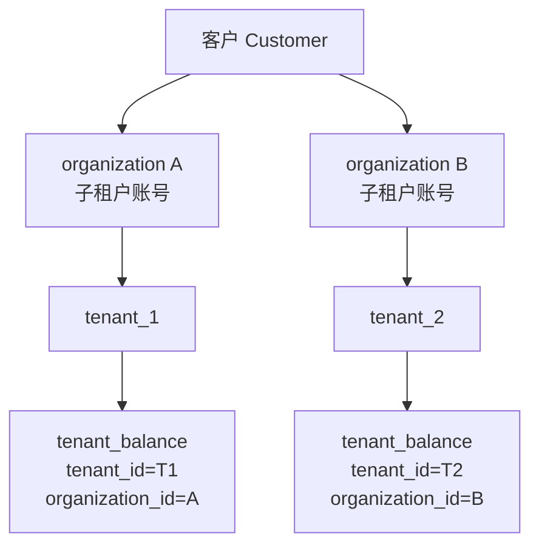
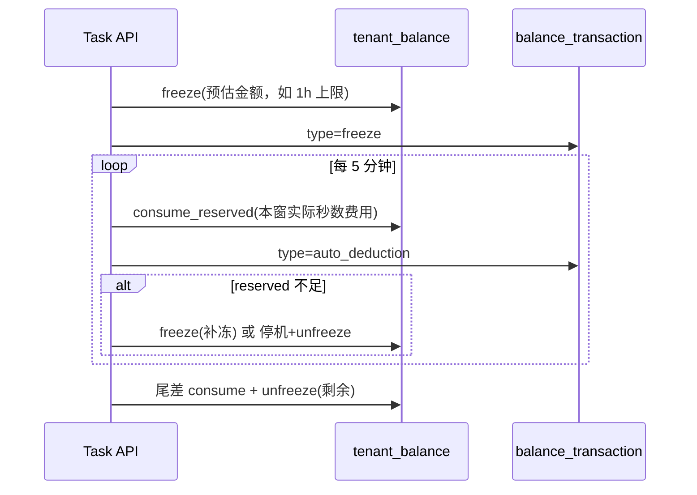

# 租户余额模型（权威定义）

> **状态**: ✅ 已采纳（2026-07-19，修订同日）  
> **效力**: 余额、冻结、扣款流水的唯一定义。  
> **不做历史兼容**：不保留 `tenant.balance` 单字段、不以 `balances(organization_id PK)` 为真值；新库直接按本文建表。
> **勘误（2026-10-06）**：§5 的 `balance_transaction` DDL **缺 5 列**，实际为 21 列（`packages/db/src/gpus-consumer-schema.ts` `balanceTransaction`）：
> `voucher_available_before` / `voucher_available_after` / `voucher_reserved_before` / `voucher_reserved_after` / `idempotency_key`。
> 本文档「以本表字段集为准」的表述仅适用于 17 个共有列；补列以 schema 为准。裁决见 [矛盾台账](../audit/doc-contradictions.md) §1 第 8 条。
> **两列职责声明（2026-10-06，收口前的过渡口径）**：在余额双真值完全收口前，两列职责如下 —
> - **`tenant_balance`（本表）**：租户可用/冻结余额的**唯一读写真值**，所有充值、扣费、冻结、解冻、券抵扣均通过 `packages/billing` 读写本表；
> - **`tenant.balance`**：**平台侧派生写回**，仅由余额快照采集（`platform_coin` 换算）与 Excel/手工导入更新，**不参与扣费判定**，仅供 CRM 列表与历史兼容读取。
> 收口方向见本文 §1「不做历史兼容」；schema 层双真值并存是已知缺口，见 [矛盾台账](../audit/doc-contradictions.md) §6 第 2 条。

---

## 1. 裁决

1. 余额真值表：**`tenant_balance`**
2. 主键：**`tenant_id`**（子租户计费账号，1:1 余额）
3. **冗余列 `organization_id`**：所属 Better Auth `organization.id`，便于按客户组织聚合多个子租户余额
4. 金额字段：**`available_balance` + `reserved_balance`**
5. 审计流水：**`balance_transaction`**（`database-design.md` §9.1 + 本文 §5）

---

## 2. 身份与多子租户



| 层 | 标识 | 用途 |
|----|------|------|
| 客户 | CRM `customer`（可选） | 合同 / 开票主体 |
| 认证组织 | `organization.id` | 登录、`X-Org-Id`、权限 |
| 计费租户 | `tenant.id` | **余额操作 FK（主键）** |
| 余额行 | `tenant_balance` | 每子租户独立钱包 |

规则：

- 一个客户可开 **多个子租户账号**（多个 organization / tenant），**各自独立余额**，互不挪用
- 写余额：**只按 `tenant_id`**
- 读聚合（客户下全部子账户）：`WHERE organization_id IN (...)` 或经 customer→org 映射；`organization_id` 为冗余，须与 `tenant` 上绑定的 org **同事务写入、保持一致**
- 禁止「有的接口按 organization_id 扣款、有的按 tenant_id」——扣款路径唯一：`tenant_id`

---

## 3. 表结构（权威 DDL）

```sql
CREATE TABLE tenant_balance (
    tenant_id           TEXT PRIMARY KEY REFERENCES tenant(id),
    organization_id     VARCHAR(64) NOT NULL,  -- 冗余：Better Auth organization.id
    available_balance   NUMERIC(15,4) NOT NULL DEFAULT 0
        CHECK (available_balance >= 0),
    reserved_balance    NUMERIC(15,4) NOT NULL DEFAULT 0
        CHECK (reserved_balance >= 0),
    currency            VARCHAR(8) NOT NULL DEFAULT 'CNY',
    updated_at          TIMESTAMPTZ NOT NULL DEFAULT NOW(),
    created_at          TIMESTAMPTZ NOT NULL DEFAULT NOW()
);

CREATE INDEX tenant_balance_org_idx ON tenant_balance(organization_id);

-- total_funds = available_balance + reserved_balance
```

| 字段 | 含义 |
|------|------|
| `tenant_id` | 子租户计费账号；扣款/冻结主键 |
| `organization_id` | 冗余组织 ID；列表/聚合查询 |
| `available_balance` | 可下单余额 |
| `reserved_balance` | 按量（`commitment=on-demand`）任务已冻结未结算 |

开户时：`INSERT tenant_balance (tenant_id, organization_id, ...)`，`organization_id` 取该 tenant 绑定 org，**不可为空**。

---

## 4. 操作原语

须在同一事务内 `SELECT ... FROM tenant_balance WHERE tenant_id=? FOR UPDATE`。

| 原语 | available | reserved | 流水 type | 场景 |
|------|-----------|----------|-----------|------|
| `recharge(amt)` | +amt | — | `recharge` | 充值入账 |
| `freeze(amt)` | −amt | +amt | `freeze` | 按秒任务提交预估冻结 |
| `unfreeze(amt)` | +amt | −amt | `unfreeze` | 结束释放未用预留 |
| `consume_reserved(amt)` | — | −amt | `auto_deduction` | 5min 按实际秒数扣冻结 |
| `deduct_available(amt)` | −amt | — | `deduction` | 裸金属 / `commitment=hour\|daily\|…` 预付 |
| `refund(amt)` | +amt | — | `refund` | 退款 |
| `adjust(amt)` | ±amt | — | `adjustment` | 运营调账 |

不变量：`available >= 0`，`reserved >= 0`；各原语扣减前校验充足。

### 4.1 按秒计费资金流（`commitment=on-demand`）



费用：`seconds × (hourly_price / 3600)`（Spot 再乘 `spot_price_multiplier`）。

### 4.2 预付（`hour` / `daily` / `weekly` / `monthly`）

`deduct_available(应付)` 一次完成；**不经** `reserved`。

---

## 5. balance_transaction

流水须记录双字段前后快照（规范字段，无「旧列兼容」分支）：

```sql
CREATE TABLE balance_transaction (
    id                  TEXT PRIMARY KEY,
    tenant_id           TEXT NOT NULL REFERENCES tenant(id),
    organization_id     VARCHAR(64) NOT NULL,  -- 冗余，与余额行一致
    type                VARCHAR(16) NOT NULL,
        -- recharge | deduction | auto_deduction | refund
        -- freeze | unfreeze | adjustment | bonus | coupon_refund
    amount              NUMERIC(15,4) NOT NULL,
    available_before    NUMERIC(15,4) NOT NULL,
    available_after     NUMERIC(15,4) NOT NULL,
    reserved_before     NUMERIC(15,4) NOT NULL,
    reserved_after      NUMERIC(15,4) NOT NULL,
    -- 总资金快照（便于对账）
    balance_before      NUMERIC(15,4) NOT NULL,  -- available_before + reserved_before
    balance_after       NUMERIC(15,4) NOT NULL,
    ref_type            VARCHAR(32),
        -- bare_metal_order | compute_base | serve_endpoint | recharge | preload_task | manual
    ref_id              TEXT,
    description         TEXT,
    created_by          TEXT,
    created_at          TIMESTAMPTZ NOT NULL DEFAULT NOW()
);

CREATE INDEX bt_tenant_idx ON balance_transaction(tenant_id);
CREATE INDEX bt_org_idx ON balance_transaction(organization_id);
CREATE INDEX bt_ref_idx ON balance_transaction(ref_type, ref_id);
```

> **已订正（2026-10-06）**：实际 `balance_transaction` 为 21 列，本 DDL 缺 `voucher_*` 4 列与 `idempotency_key`（见文首勘误）。补列后**以 schema 为准**。

完整 type 说明可与 `database-design.md` §9.1 互引；**以本表字段集为准**（17 个共有列）。

---

## 6. dataaccess

```typescript
async function withTenantBalanceLock(tx, tenantId, fn): Promise<void>
// 内部读取并校验 organization_id 冗余未被脏写

async function recharge(tx, tenantId, amt, meta): Promise<void>
async function freeze(tx, tenantId, amt, meta): Promise<void>
async function unfreeze(tx, tenantId, amt, meta): Promise<void>
async function consumeReserved(tx, tenantId, amt, meta): Promise<void>
async function deductAvailable(tx, tenantId, amt, meta): Promise<void>
```

- 禁止业务层直写 `tenant_balance`
- 流水写入时同步带上该行的 `organization_id`

---

## 7. 前端展示

| UI | 字段 |
|----|------|
| 可用余额 | `available_balance` |
| 冻结中 | `reserved_balance` |
| 账户总资金 | `available + reserved` |
| 客户多子户总览 | 经 `organization_id` / customer 映射聚合 |

`BillingCreditSummary` 只聚合本表 + 券。

---

## 8. 与闲时商业化

- Spot / On-Demand **共用**本钱包；仅单价不同
- 供应商结算不进 `tenant_balance`
- 预热超额：`deduct_available`
