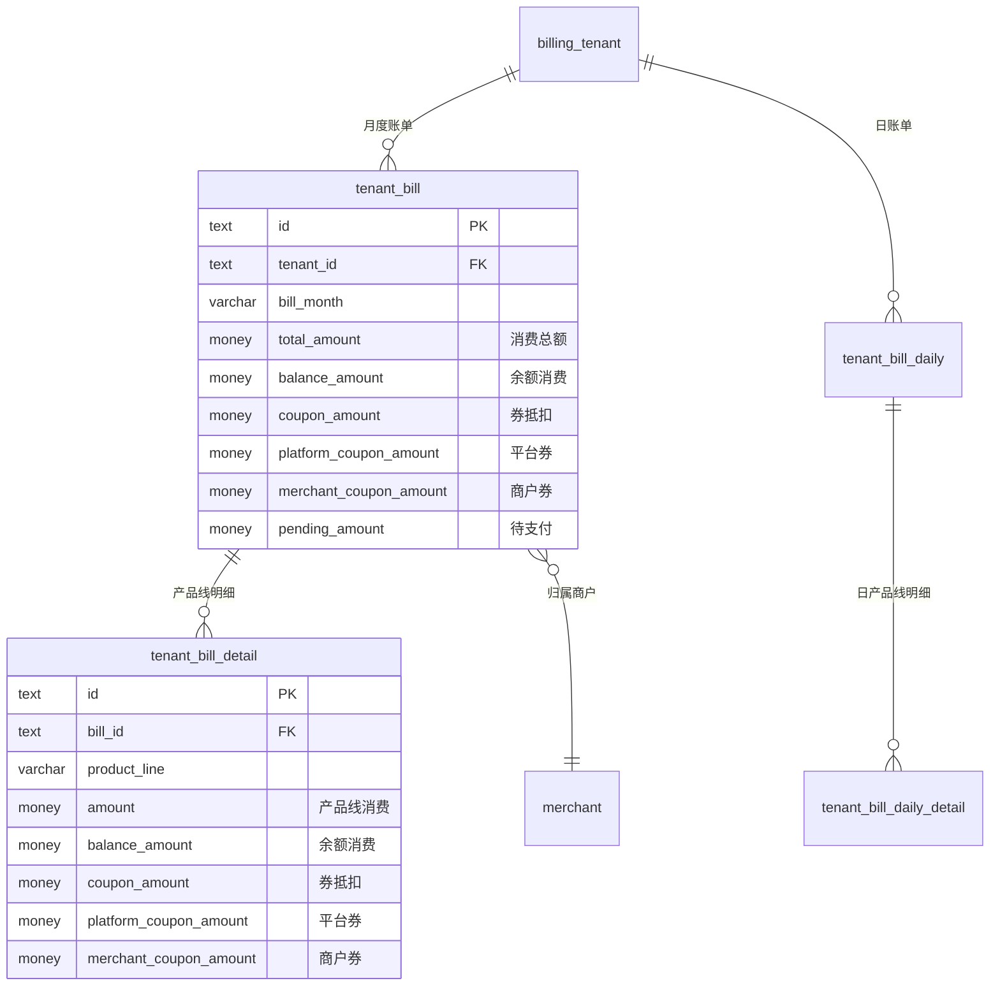
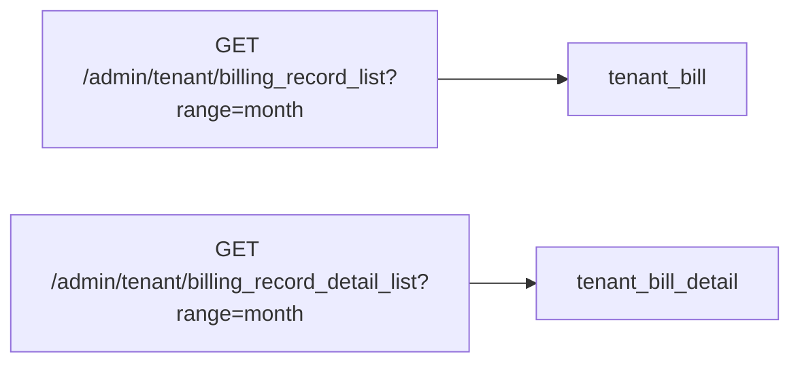
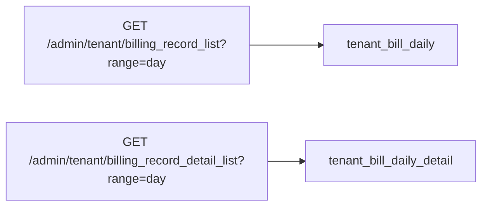
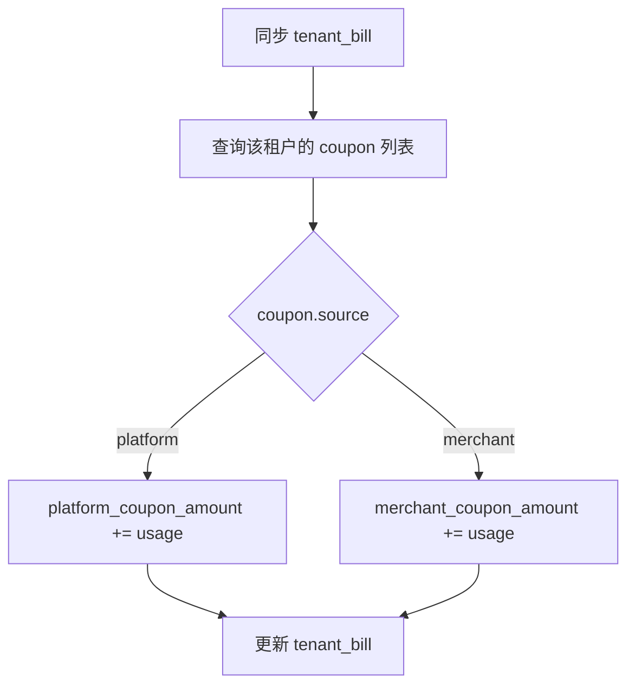

# 租户账单系统设计方案

> **版本**：v1.0  
> **日期**：2026-07-20  
> **状态**：**设计中**  
> **勘误（2026-10-06）**：§9.2 / §9.3 的券折扣归因口径与字段依赖已由 [merchant-open-items-design.md](../merchant-open-items-design.md) 取代（`coupon.merchant_id`、`discount_template.source` 在 schema 中不存在），裁决见 [矛盾台账](../audit/doc-contradictions.md) §1。
> **关联**：
> - [tenant-billing-import-design.md](../../../apps/web/content/design/tenant-billing-import-design.md)（租户月度账单导入 v1.4）
> - [tenant-bill-daily-sync-design.md](../../../apps/web/content/design/tenant-bill-daily-sync-design.md)（租户日账单同步 v1.3）
> - [merchant-billing-system-design.md](merchant-billing-system-design.md)（商户账单系统 — 对照阅读）
> - [discount-coupon-sync-design.md](../../../apps/web/content/design/discount-coupon-sync-design.md)（算力券与折扣同步）
> - `packages/db/src/crm-schema.ts`（`tenant_bill`、`tenant_bill_detail`、`tenant_bill_daily`、`coupon`、`discount_template`）

---

## 1. 背景与目标

### 1.1 业务诉求

租户作为平台的最终使用主体，需要清晰的账单体系来了解自身消费构成和待支付金额：

| # | 目标 | 说明 |
|---|------|------|
| G1 | **月度账单** | 按月汇总租户的全部消费，含余额消费、券抵扣、待支付金额 |
| G2 | **日账单** | 按日粒度展示消费明细，支持消费趋势分析 |
| G3 | **消费构成** | 按产品线、资源类型拆分消费，让租户了解钱花在哪里 |
| G4 | **支付追踪** | 区分余额支付、券抵扣、待支付，让租户了解付款状态 |
| G5 | **商户优惠** | 区分平台券与商户券、平台折扣与商户折扣，明确优惠来源 |

### 1.2 非目标（本期）

- **不** 实现租户自助账单下载/导出（仅在控制台展示）
- **不** 实现租户在线支付/充值（充值走平台流程）
- **不** 实现账单异议/申诉流程
- **不** 改造现有 `consumption_usage_daily`（CRM 租户详情日用量 Tab 保留）

### 1.3 与商户账单的本质区别

| 维度 | 租户账单（本方案） | 商户账单（merchant-billing-system-design.md） |
|------|-------------------|---------------------------------------------|
| **主体** | 租户（使用者） | 商户（经营者） |
| **核心问题** | 我消费了多少？欠多少？ | 我赚了多少？成本多少？ |
| **收入** | N/A（租户不收钱） | 租户消费汇总 |
| **成本** | N/A | 进货价 × 消耗量 |
| **优惠** | 券抵扣 = 我省了多少 | 券成本 = 我补贴了多少 |
| **利润** | N/A | 收入 - 成本 - 补贴 |
| **数据源** | 平台出账（`tenant_bill`） | 租户账单 rollup + 进货价计算 |
| **计算方式** | **直接读取**平台出账数据 | **二次计算**（消费量 × 进货价） |

> **核心差异**：租户账单是**展示型**（呈现平台已算好的数据），商户账单是**计算型**（需要自行计算支出和毛利）。

---

## 2. 租户账单模型

### 2.1 金额关系

```text
┌─────────────────────────────────────────────────────────────┐
│                     租户月度账单                               │
│                                                              │
│  total_amount (消费总额)                                      │
│  ├── balance_amount (余额消费 = 充值后扣款)                     │
│  ├── coupon_amount (券抵扣 = 平台券 + 商户券)                   │
│  └── pending_amount (待支付 = total - balance - coupon)       │
│                                                              │
│  支付来源细分:                                                │
│  ├── 平台券抵扣 (platform_coupon_deduction)                    │
│  ├── 商户券抵扣 (merchant_coupon_deduction)                    │
│  ├── 余额消费 (balance_amount)                                │
│  └── 待支付 (pending_amount)                                  │
└─────────────────────────────────────────────────────────────┘
```

### 2.2 与平台出账的关系

租户账单数据**直接来自**平台 OpenAPI（`/admin/tenant/billing_record_list`），不自行计算：

| 平台字段 | 本地字段 | 说明 |
|----------|---------|------|
| `total_billing_value` | `total_amount` | 消费总额 |
| `total_discount_value` | `coupon_amount` | 券抵扣总额 |
| `total - discount` | `balance_amount` | 余额消费 |

> **原则**：租户账单是平台出账的**镜像**，不做二次计算。商户账单才需要二次计算。

### 2.3 消费构成维度

租户账单从多个维度拆解消费：

```text
维度一: 产品线
  ├── 弹性部署 (pod_deployment)
  ├── Job (pod_job)
  ├── 云主机 (pod_development)
  ├── 裸金属 (bare_metal)
  ├── Token服务 (maas_token)
  ├── 对象存储加速 (juicefs)
  ├── 共享存储卷 (share_storage)
  └── 镜像仓库 (harbor)

维度二: 支付方式
  ├── 余额消费 (balance_amount)
  ├── 券抵扣 (coupon_amount)
  │   ├── 平台券 (platform_coupon)
  │   └── 商户券 (merchant_coupon)
  └── 待支付 (pending_amount)

维度三: 时间
  ├── 月度汇总 (tenant_bill)
  ├── 月度产品线明细 (tenant_bill_detail)
  ├── 日汇总 (tenant_bill_daily)
  └── 日产品线明细 (tenant_bill_daily_detail)
```

---

## 3. 数据模型

### 3.1 现有表（已实施，无需变更）

租户账单核心表已存在于 `crm-schema.ts`：

#### `tenant_bill`（月度账单头）

| 列 | 类型 | 说明 |
|----|------|------|
| `id` | text | PK |
| `tenant_id` | text | FK→`tenant.id` |
| `merchant_id` | text | 冗余，= tenant.merchant_id |
| `bill_month` | varchar(7) | YYYY-MM |
| `total_amount` | money | 消费总额 |
| `balance_amount` | money | 余额消费 |
| `coupon_amount` | money | 券抵扣总额 |
| `status` | varchar(32) | pending/paid/overdue |
| `due_date` | date | 到期日 |
| `paid_at` | timestamptz | 支付时间 |
| UNIQUE | `(tenant_id, bill_month)` | |

#### `tenant_bill_detail`（月度产品线明细）

| 列 | 类型 | 说明 |
|----|------|------|
| `bill_id` | text | FK→`tenant_bill.id` |
| `product_line` | varchar(64) | 产品线 |
| `amount` | money | 该产品线消费总额 |
| `balance_amount` | money | 该产品线余额消费 |
| `coupon_amount` | money | 该产品线券抵扣 |
| `type` | varchar(32) | prepaid/postpaid |
| UNIQUE | `(bill_id, product_line)` | |

#### `tenant_bill_daily`（日账单汇总）

| 列 | 类型 | 说明 |
|----|------|------|
| `tenant_id` | text | FK |
| `usage_date` | date | 东八区自然日 |
| `usage_month` | varchar(7) | YYYY-MM |
| `total_amount` | money | 日消费总额 |
| `balance_amount` | money | 日余额消费 |
| `coupon_amount` | money | 日券抵扣 |
| UNIQUE | `(tenant_id, usage_date)` | |

#### `tenant_bill_daily_detail`（日产品线明细）

| 列 | 类型 | 说明 |
|----|------|------|
| `daily_bill_id` | text | FK→`tenant_bill_daily.id` |
| `product_line` | varchar(64) | 产品线 |
| `amount` | money | 日该产品线消费 |
| `balance_amount` | money | 日该产品线余额消费 |
| `coupon_amount` | money | 日该产品线券抵扣 |
| UNIQUE | `(daily_bill_id, product_line)` | |

### 3.2 新增字段（扩展 `tenant_bill`）

为支持更精细的支付来源追踪，扩展月度账单头：

| 列名 | 类型 | 说明 |
|------|------|------|
| `platform_coupon_amount` | `money` | 平台发放券的抵扣额 |
| `merchant_coupon_amount` | `money` | 商户发放券的抵扣额 |
| `pending_amount` | `money` | 待支付金额 = total - balance - coupon |
| `usage_card_hours` | `numeric(15,4)` | 当月总卡时（可选，用于消费量展示） |

> **向后兼容**：新字段 `DEFAULT '0'`，历史数据在下次同步时自动回填。

### 3.3 新增字段（扩展 `tenant_bill_daily`）

| 列名 | 类型 | 说明 |
|------|------|------|
| `platform_coupon_amount` | `money` | 日平台券抵扣 |
| `merchant_coupon_amount` | `money` | 日商户券抵扣 |
| `pending_amount` | `money` | 日待支付 |

### 3.4 新增字段（扩展 `tenant_bill_detail` 和 `tenant_bill_daily_detail`）

| 列名 | 类型 | 说明 |
|------|------|------|
| `platform_coupon_amount` | `money` | 产品线平台券抵扣 |
| `merchant_coupon_amount` | `money` | 产品线商户券抵扣 |

### 3.5 实体关系



---

## 4. 计算公式

### 4.1 月度账单（直接读取，不计算）

租户月度账单**直接从** `tenant_bill` + `tenant_bill_detail` 读取，不做二次计算：

```
月消费总额 = tenant_bill.total_amount
月余额消费 = tenant_bill.balance_amount
月券抵扣 = tenant_bill.coupon_amount
月待支付 = total_amount - balance_amount - coupon_amount
```

**平台券 vs 商户券拆分**：

```
平台券抵扣 = Σ coupon_usage.deduction
  WHERE coupon_id IN (SELECT id FROM coupon WHERE source = 'platform')
    AND usage_month = :billMonth

商户券抵扣 = Σ coupon_usage.deduction
  WHERE coupon_id IN (SELECT id FROM coupon WHERE source = 'merchant')
    AND usage_month = :billMonth
```

> **注意**：当前平台 API 不直接返回平台券/商户券的拆分。若 API 不支持，首期 `platform_coupon_amount` 和 `merchant_coupon_amount` 均为 0，仅展示 `coupon_amount` 总额。后续通过 API 扩展或本地 coupon 关联回填。

### 4.2 日账单（直接读取，不计算）

```
日消费总额 = tenant_bill_daily.total_amount
日余额消费 = tenant_bill_daily.balance_amount
日券抵扣 = tenant_bill_daily.coupon_amount
日待支付 = total_amount - balance_amount - coupon_amount
```

### 4.3 产品线消费构成

```
产品线消费占比 = product_line.amount / total_amount × 100%
```

### 4.4 消费趋势

```
日均消费 = 月消费总额 / 当月天数
环比增长率 = (本月消费 - 上月消费) / 上月消费 × 100%
同比增长率 = (本月消费 - 去年同月消费) / 去年同月消费 × 100%
```

---

## 5. 数据同步流程

### 5.1 月度账单同步（已有）

通过平台 OpenAPI 同步，见 [tenant-billing-import-design.md](../../../apps/web/content/design/tenant-billing-import-design.md)：



### 5.2 日账单同步（已有）

通过平台 OpenAPI 同步，见 [tenant-bill-daily-sync-design.md](../../../apps/web/content/design/tenant-bill-daily-sync-design.md)：



### 5.3 券抵扣拆分（新增）

在账单同步时，增加平台券/商户券拆分逻辑：



### 5.4 待支付金额计算（新增）

```
pending_amount = total_amount - balance_amount - coupon_amount
```

在同步写入 `tenant_bill` 时自动计算。

---

## 6. 数据访问层设计

### 6.1 新增 `tenantBillDataAccess`

在 `apps/web/src/lib/server/dataaccess/crm/` 下新增 `tenant-bill.ts`：

```typescript
export const tenantBillDataAccess = {
  /** 租户月度账单列表（分页） */
  listMonthly(input: {
    tenantId: string
    page?: number
    pageSize?: number
  }): Promise<PaginatedResult<TenantMonthlyBillItem>>

  /** 租户月度账单产品线明细 */
  getMonthlyDetail(input: {
    tenantId: string
    billMonth: string
    billId?: string
  }): Promise<TenantMonthlyBillDetailItem[]>

  /** 租户日账单列表（按月筛选） */
  listDaily(input: {
    tenantId: string
    billMonth: string
  }): Promise<TenantDailyBillItem[]>

  /** 租户日账单产品线明细 */
  getDailyDetail(input: {
    tenantId: string
    usageDate: string
  }): Promise<TenantDailyBillDetailItem[]>

  /** 消费趋势（近 N 月） */
  getConsumptionTrend(input: {
    tenantId: string
    months: number
  }): Promise<ConsumptionTrendItem[]>

  /** 产品线消费构成 */
  getProductLineBreakdown(input: {
    tenantId: string
    billMonth: string
  }): Promise<ProductLineBreakdownItem[]>

  /** 账单汇总（用于租户详情概览） */
  getSummary(input: {
    tenantId: string
    billMonth?: string
  }): Promise<TenantBillSummary>
}
```

### 6.2 输出结构

```typescript
type TenantMonthlyBillItem = {
  id: string
  tenantId: string
  billMonth: string
  // 消费
  totalAmount: number
  balanceAmount: number
  couponAmount: number
  pendingAmount: number
  // 券来源细分（可选，API 支持时）
  platformCouponAmount: number
  merchantCouponAmount: number
  // 状态
  status: string
  dueDate: string
  paidAt: string | null
  // 元数据
  tenantName: string
  merchantName: string
}

type TenantMonthlyBillDetailItem = {
  id: string
  productLine: string
  resourceName: string
  amount: number
  balanceAmount: number
  couponAmount: number
  platformCouponAmount: number
  merchantCouponAmount: number
  type: string
  // 占比
  percentage: number  // 占月消费总额的比例
}

type TenantBillSummary = {
  currentMonth: {
    totalAmount: number
    balanceAmount: number
    couponAmount: number
    pendingAmount: number
    dueDate: string
    status: string
  } | null
  previousMonth: {
    totalAmount: number
  } | null
  yoyGrowth: number | null    // 同比增长率
  momGrowth: number | null    // 环比增长率
  totalPending: number        // 累计待支付
  overdueAmount: number       // 逾期金额
}
```

---

## 7. tRPC 接口设计

### 7.1 租户详情页接口

| Procedure | 类型 | 说明 |
|-----------|------|------|
| `crm.tenants.bill.getMonthly` | query | 月度账单列表 |
| `crm.tenants.bill.getMonthlyDetail` | query | 月度产品线明细 |
| `crm.tenants.bill.getDaily` | query | 日账单列表 |
| `crm.tenants.bill.getDailyDetail` | query | 日产品线明细 |
| `crm.tenants.bill.getSummary` | query | 账单汇总（概览 Tab） |
| `crm.tenants.bill.getConsumptionTrend` | query | 消费趋势 |
| `crm.tenants.bill.getProductLineBreakdown` | query | 产品线构成 |

### 7.2 输入参数

```typescript
// listMonthly
input: {
  tenantId: string
  page?: number
  pageSize?: number
}

// getMonthlyDetail
input: {
  tenantId: string
  billMonth: string
}

// listDaily
input: {
  tenantId: string
  billMonth: string
}

// getDailyDetail
input: {
  tenantId: string
  usageDate: string
}

// getSummary
input: {
  tenantId: string
  billMonth?: string  // 默认当月
}
```

---

## 8. 前端展示设计

### 8.1 租户详情页 — 账单 Tab

在现有租户详情页（`/crm/tenants/[id]`）新增或扩展「账单」Tab：

```
┌─────────────────────────────────────────────────────────────────┐
│ 租户账单 — 面壁数据中心 (984)                                     │
├─────────────────────────────────────────────────────────────────┤
│ Card: 本月账单概览                                               │
│ ┌──────────┬──────────┬──────────┬──────────┬──────────┐       │
│ │ 消费总额  │ 余额消费  │ 券抵扣    │ 待支付    │ 到期日    │       │
│ │ ¥23,470  │ ¥18,200  │ ¥3,270  │ ¥2,000  │ 08-15   │       │
│ └──────────┴──────────┴──────────┴──────────┴──────────┘       │
├─────────────────────────────────────────────────────────────────┤
│ Tab: [月度账单] [日账单] [消费趋势]                                │
├─────────────────────────────────────────────────────────────────┤
│ 月度账单 Tab:                                                    │
│ Table:                                                          │
│ | 月份    | 消费总额  | 余额消费 | 券抵扣  | 待支付  | 状态   | 到期日  |
│ | 2026-07 | ¥23,470 | ¥18,200| ¥3,270| ¥2,000| 待支付 | 08-15 |
│ | 2026-06 | ¥21,300 | ¥17,000| ¥2,800| ¥1,500| 已支付 | —     |
│ | 2026-05 | ¥19,800 | ¥16,500| ¥2,300| ¥1,000| 已支付 | —     |
│                                                                 │
│ 点击月份 → 展开产品线明细                                          │
├─────────────────────────────────────────────────────────────────┤
│ 日账单 Tab:                                                      │
│ 筛选: [月份下拉]                                                  │
│ Table:                                                          │
│ | 日期       | 消费总额 | 余额消费 | 券抵扣 | 待支付 |             │
│ | 2026-07-20 | ¥820   | ¥640   | ¥110 | ¥70  |             │
│ | 2026-07-19 | ¥780   | ¥610   | ¥100 | ¥70  |             │
├─────────────────────────────────────────────────────────────────┤
│ 消费趋势 Tab:                                                    │
│ 折线图: X轴=日期, Y轴=金额                                         │
│ 两条线: 消费总额(蓝) / 余额消费(绿)                                 │
│ 下方: 产品线消费饼图                                               │
└─────────────────────────────────────────────────────────────────┘
```

### 8.2 产品线明细展开

点击月度账单某行，展开该月产品线明细：

```
┌─────────────────────────────────────────────────────────────────┐
│ 2026-07 产品线明细                                    [收起]      │
├─────────────────────────────────────────────────────────────────┤
│ | 产品线       | 消费    | 余额消费 | 券抵扣  | 占比   | 类型    | |
│ | 弹性部署     | ¥12,000| ¥9,500  | ¥1,800| 51.1% | 后付费  | |
│ | Job          | ¥6,500 | ¥5,200  | ¥900  | 27.7% | 后付费  | |
│ | 云主机       | ¥3,200 | ¥2,500  | ¥400  | 13.6% | 后付费  | |
│ | 裸金属       | ¥1,770 | ¥1,000  | ¥170  | 7.5%  | 预付费  | |
│ | 合计         | ¥23,470| ¥18,200 | ¥3,270| 100%  |         | |
└─────────────────────────────────────────────────────────────────┘
```

---

## 9. 与商户账单的交叉

### 9.1 数据一致性

| 检查项 | 租户侧 | 商户侧 | 校验规则 |
|--------|--------|--------|---------|
| 月消费总额 | `tenant_bill.total_amount` | `merchant_bill.total_amount` (rollup) | `Σ租户 = 商户` |
| 月券抵扣 | `tenant_bill.coupon_amount` | `merchant_bill.coupon_amount` (rollup) | `Σ租户 = 商户` |
| 日消费总额 | `tenant_bill_daily.total_amount` | `merchant_bill_daily.total_amount` (rollup) | `Σ租户 = 商户` |

### 9.2 券成本归因

> **已订正（2026-10-06）**：下述公式与「通过 `coupon.merchant_id` 归因」的实现路径**已过时**（该列不存在）。
> 现行口径见 [merchant-open-items-design.md](../merchant-open-items-design.md) §最终资金口径：
> `商户券成本 = Σ merchant_account_ledger WHERE ref_type = 'voucher_redeem'`，由 `run-merchant-rollup.ts` 实算。

租户使用的券需要归因到商户成本：

```
商户券成本 = Σ (tenant_bill.coupon_amount 中商户发放的部分)
```

实现路径：通过 `coupon.merchant_id` 关联，判断券的发放来源。

### 9.3 折扣成本归因

> **已订正（2026-10-06）**：下述「通过折扣模板 `source` 字段判断来源」**已过时**（`discount_template` 无 `source` 列）。
> 现行口径：折扣成本**不计入毛利**，仅在账单展示（见 [merchant-open-items-design.md](../merchant-open-items-design.md) Q8）；券/折扣来源改由 ledger `ref_type` 与 `merchant_sales_price` 判定。

租户享受的折扣需要归因到商户成本：

```
商户折扣成本 = Σ (原价 - 折后价) WHERE 折扣由商户设置
```

实现路径：通过折扣模板的 `source` 字段判断折扣来源。

---

## 10. 与现有 `consumption_usage_daily` 的关系

| 表 | API | 覆盖范围 | 用途 |
|----|-----|----------|------|
| `consumption_usage_daily` | `billing_pod_record_list` | 仅 Pod 三类任务 | CRM 租户详情日用量 Tab |
| `tenant_bill_daily` | `billing_record_list?range=day` | **全产品线**日汇总 | 运营大盘日趋势、租户日账单 |
| `tenant_bill_daily_detail` | `billing_record_detail_list?range=day` | **全产品线**日明细 | 产品线日趋势 |

> **原则**：
> - 租户详情页「日账单」Tab 读 `tenant_bill_daily*`（全产品线，与月度同源）
> - 租户详情页「日用量」Tab 保留读 `consumption_usage_daily`（Pod 任务级明细）
> - 两者并存，不合并

---

## 11. Migration 计划

### 11.1 Schema 变更

| 步骤 | 内容 | 影响 |
|------|------|------|
| 1 | `tenant_bill` 新增 `platform_coupon_amount`、`merchant_coupon_amount`、`pending_amount`、`usage_card_hours` | 向后兼容，default 0 |
| 2 | `tenant_bill_daily` 新增 `platform_coupon_amount`、`merchant_coupon_amount`、`pending_amount` | 向后兼容，default 0 |
| 3 | `tenant_bill_detail` 新增 `platform_coupon_amount`、`merchant_coupon_amount` | 向后兼容，default 0 |
| 4 | `tenant_bill_daily_detail` 新增 `platform_coupon_amount`、`merchant_coupon_amount` | 向后兼容，default 0 |

### 11.2 回填策略

- `pending_amount`：`total_amount - balance_amount - coupon_amount`（可即时计算）
- `platform_coupon_amount` / `merchant_coupon_amount`：依赖 coupon 关联数据，分批回填

---

## 12. 风险与待确认项

| ID | 问题 | 建议默认 |
|----|------|---------|
| Q1 | 平台 API 是否返回平台券/商户券的拆分？ | 首期不拆分，仅展示 `coupon_amount` 总额 |
| Q2 | `pending_amount` 是否需要定时刷新？ | 随同步写入，不单独刷新 |
| Q3 | 租户控制台是否展示本方案的账单数据？ | 首期仅 CRM 运营平台展示 |
| Q4 | `consumption_usage_daily` 是否迁移读路径到 `tenant_bill_daily`？ | 不迁移，两者并存 |
| Q5 | 商户折扣如何识别来源（平台 vs 商户）？ | 通过折扣模板 `source` 字段判断 |

---

## 13. 实施阶段

| 阶段 | 内容 | 依赖 |
|------|------|------|
| P0 | Schema migration（扩展字段） | 无 |
| P1 | `pending_amount` 计算逻辑 + 回填 | P0 |
| P2 | `tenantBillDataAccess` 查询层 | P0 |
| P3 | tRPC 接口 | P2 |
| P4 | 租户详情页账单 Tab UI | P3 |
| P5 | 平台券/商户券拆分（若 API 支持） | P0 + API 联调 |

---

## 变更记录

| 版本 | 日期 | 说明 |
|------|------|------|
| v1.0 | 2026-07-20 | 初稿 |
