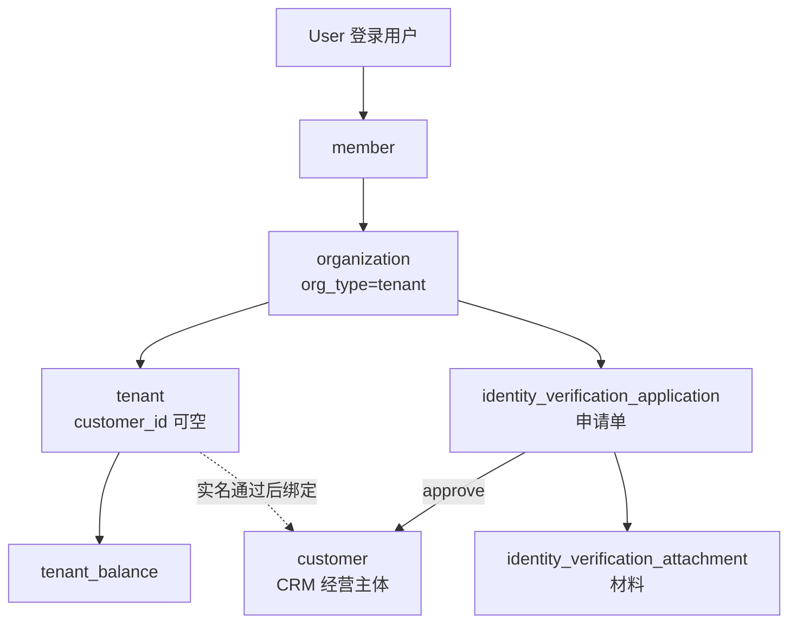
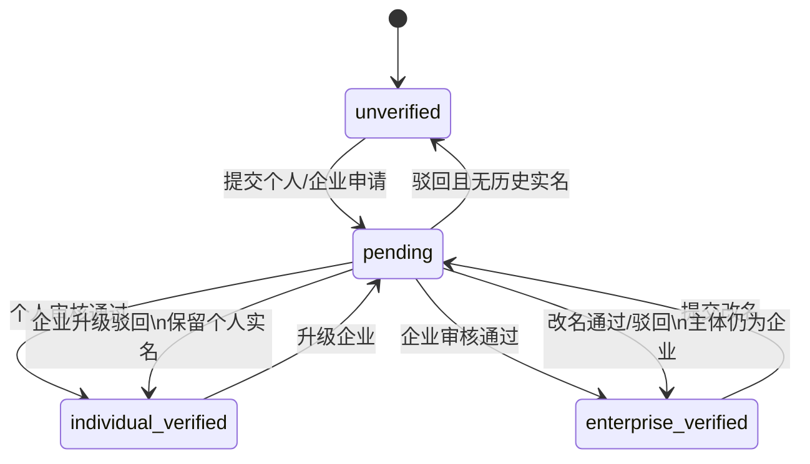
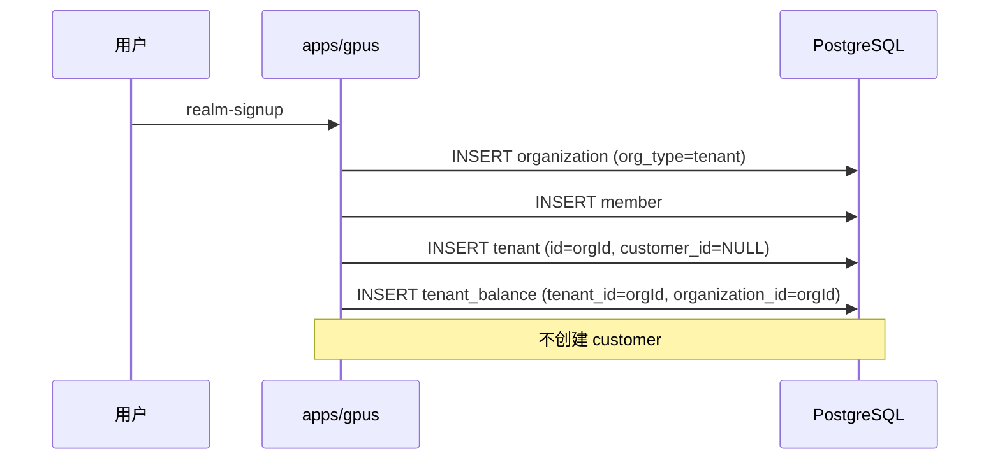
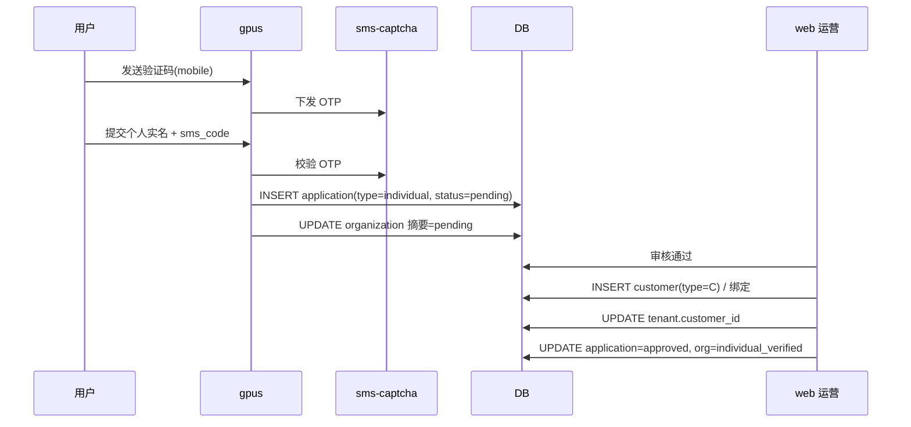

# 租户实名认证与客户延迟绑定

> **状态**: ✅ 已采纳（2026-07-22）· P0 已落地骨架  
> **范围**: `apps/gpus` 提交与查询 · `apps/web` 审核与建档 · `@workspace/db` schema  
> **关联**: `tenant-balance-unification.md`（余额）· `crm-database.md`（Customer/Tenant）· `multi-tenancy-architecture.md`（organization）  
> **前置裁决**: 采用 **方案 B 延迟绑定**——自助注册不强制创建 CRM `customer`；实名审核通过后再建档/绑定。

### 已确认产品决策（2026-07-22）

| # | 决策 | 结论 |
|---|------|------|
| 1 | 未实名能力边界 | 允许浏览与查看价格；**仅拦截充值 / 下单**（`pending` 同样拦截写操作） |
| 2 | 个人实名材料 | **仅**姓名 + 身份证号 + 手机号验证码；**不上传**身份证正反面 |
| 3 | 组织展示名 | 审核通过后 **自动同步** `organization.name`（个人→实名姓名；企业→公司名；改名→新公司名） |
| 4 | 改名范围 | **禁止** 变更 USCC；改 USCC 视为换主体，本期不做 |
| 5 | 附件存储 | **阿里云 OSS**（私有桶 + 预签名上传/下载） |
| 6 | 审核入口 | 挂在 **CRM**（`/crm/identity-reviews`） |

### 落地进度

| 阶段 | 内容 | 状态 |
|------|------|------|
| P0 | schema、开户延迟绑定、gpus 个人/企业提交、web 审核、充值/下单拦截 | ✅ |
| P1 | 改名表单 UI、附件预览增强、疑似客户合并交互 | ⏳ |
| P2 | 废弃 metadata、迁移历史、对公名称校验、自动核验 | ⏳ |

---

## 1. 目标与非目标

### 1.1 目标

1. **延迟绑定**：注册时仅创建 `organization` + `tenant`（`customer_id` 可空）+ `tenant_balance`；不预建 CRM `customer`。
2. **gpus 实名**：支持 **个人** / **企业** 两类认证；材料齐全后进入待审。
3. **web 审核**：运营审核通过/驳回；通过后创建或绑定 `customer`，并回写认证状态。
4. **状态机约束**：
   - 个人通过后 → 允许升级为企业实名；
   - 企业通过后 → **禁止再次实名**（含换企业主体）；
   - 企业通过后 → **允许改名**，须上传证明材料并经审核。
5. 用正式表替代当前 `organization.metadata` 临时方案。

### 1.2 非目标（本期不做）

- 第三方自动核验（公安/企查查 API）——预留 `verify_channel`，默认人工审核。
- 供应商 / 商户入驻认证（已有独立链路）。
- 实名与对公转账付款方名称的自动交叉校验（可二期挂钩 `bank_transfer_verification`）。
- 多子租户共用一个实名主体的复杂继承（默认 **一 organization : 一 tenant : 一 customer**）。

---

## 2. 领域模型



| 实体 | 职责 |
|------|------|
| `organization` | 登录隔离、会话 `activeOrganizationId`、展示认证摘要状态 |
| `tenant` | 计费主键；`customer_id` **可空**，通过后绑定 |
| `customer` | CRM 经营主体；**仅审核通过时创建或绑定** |
| `identity_verification_application` | 实名/升级/改名申请的权威记录 |
| `identity_verification_attachment` | 申请材料（执照、证件、授权书、改名证明等） |

**身份约定（与余额模型一致）**：

- `tenant.id === organization.id`（gpus 自助 1:1）
- `tenant_balance.tenant_id` / `organization_id` 均指向该 id
- 写余额只按 `tenant_id`；`customer` 不参与扣款路径

---

## 3. 认证主体状态机

组织对外展示的 **当前认证状态**（冗余在 `organization`，真值由最新有效申请推导）：

| 状态 | 含义 | 可发起动作 |
|------|------|------------|
| `unverified` | 未通过任何实名 | 个人认证 / 企业认证 |
| `pending` | 有进行中的申请 | 不可重复提交同类；可查看进度 |
| `individual_verified` | 个人实名已通过 | **升级企业**；不可再提个人实名 |
| `enterprise_verified` | 企业实名已通过 | **仅改名**；禁止再次实名 |
| `rejected` | 最近一次申请被驳回（且无有效实名） | 按驳回类型允许重新提交 |

> `rejected` 若此前已有有效实名（如个人已通过、企业升级驳回），对外仍展示 `individual_verified`，并在 UI 提示「企业升级被驳回，可修改后重提」。



### 3.1 硬规则（R）

| ID | 规则 |
|----|------|
| R1 | 同一 `organization` 同时最多 **1** 条 `status=pending` 申请 |
| R2 | `individual_verified` 可提交 `type=enterprise_upgrade`；不可再提交 `type=individual` |
| R3 | `enterprise_verified` **禁止** 任何实名类申请（`individual` / `enterprise` / `enterprise_upgrade`） |
| R4 | `enterprise_verified` 仅允许 `type=rename` |
| R5 | 个人实名手机号须短信验证码校验通过方可提交 |
| R6 | 企业实名必须上传营业执照；且「法人证件」**或**「授权人证件+授权书」二选一齐全 |
| R7 | 审核通过事务内：确保 `customer` 存在并写入 `tenant.customer_id`；回写 `organization` 摘要状态与展示名 |
| R8 | 敏感字段（身份证号）落库加密或脱敏存储；列表默认脱敏展示 |

---

## 4. 业务流程

### 4.1 注册与延迟绑定（开户）



- 未实名即可浏览控制台；**充值 / 下单 / 创建算力资源** 等写操作由 `VerificationGuard` 拦截（与现网一致，可配置白名单）。
- 撤销上一版「注册时强制 `ensureBillingTenant` 建 customer」行为；改为仅确保 `tenant` + `tenant_balance`。

### 4.2 个人实名（gpus）

**提交字段**：

| 字段 | 必填 | 说明 |
|------|------|------|
| `real_name` | ✓ | 姓名 |
| `id_number` | ✓ | 身份证号（18 位校验） |
| `mobile` | ✓ | 手机号 |
| `sms_code` | ✓ | 短信验证码（复用现有 sms-captcha） |

**流程**：



审核通过建档建议：

- `customer.type = 'C'`
- `customer.name = real_name`
- `customer.certCode = id_number`（或单独安全字段）
- `customer.contactPhone = mobile`
- `customer.identityVerified = true`
- `customer.identityVerificationType = 'manual'`
- `tenant.customer_id = customer.id`
- `organization.name` 可选同步为实名姓名（产品可配置）

### 4.3 企业实名（gpus，含个人升级）

**主体字段**：

| 字段 | 必填 | 说明 |
|------|------|------|
| `company_name` | ✓ | 企业名称 |
| `uscc` | ✓ | 统一社会信用代码（18 位） |
| `legal_person_name` | ✓ | 法人姓名 |
| `applicant_role` | ✓ | `legal_person` \| `authorized` |

**材料（`applicant_role` 分支）**：

| 材料 | 法人办理 | 授权人办理 |
|------|----------|------------|
| 营业执照 | ✓ | ✓ |
| 法人身份证正面 | ✓ | — |
| 法人身份证反面 | ✓ | — |
| 授权人身份证正面 | — | ✓ |
| 授权人身份证反面 | — | ✓ |
| 授权书 | — | ✓ |

可选：法人/授权人手机号 + OTP（建议授权人办理时强制，法人办理时可选）。

**申请类型**：

- 从未实名直接企业：`type = enterprise`
- 个人已通过再升级：`type = enterprise_upgrade`（保留历史个人申请只读）

审核通过建档建议：

- 若尚无 `customer`：`INSERT customer(type='B', name=company_name, certCode=uscc, …)`
- 若已有个人 `customer`（升级）：**更新** 为 B 端企业资料（`type='B'`，改名、证照号），不新建第二条 customer；原个人证件归档在申请单
- `tenant.customer_id` 绑定（升级场景通常已绑定，仅刷新）
- `organization.enterprise_verification_status = verified`
- 对外认证状态 → `enterprise_verified`

### 4.4 企业改名（gpus）

仅 `enterprise_verified` 可发起：

| 字段 | 必填 |
|------|------|
| `new_company_name` | ✓ |
| 证明材料（变更证明 / 新营业执照等）≥1 | ✓ |
| `reason` | 可选 |

审核通过：

- `UPDATE customer.name`
- `UPDATE organization.name`
- `application.status = approved`
- **不改变** `enterprise_verified`，**不改变** `uscc`（改信用代码视为换主体，本期禁止，走线下）

### 4.5 运营审核（apps/web）

**入口建议**：`/crm/identity-reviews`（或挂在客户模块「实名审核」Tab）

列表筛选项：`status`、`type`、提交时间、组织名/公司名/姓名关键词。

审核动作：

| 动作 | 效果 |
|------|------|
| 通过 | 事务：建档/更新 customer → 绑定 tenant → 更新 org 摘要 → 申请 `approved` |
| 驳回 | 申请 `rejected` + `review_comment`；按 §3 回退展示状态 |
| 转交 / 备注 | 可选二期 |

权限：需运营角色（如 `crm_ops` / `finance_ops`）；审计写入 `reviewed_by`、`reviewed_at`。

**人工合并**：若 USCC / 身份证号匹配已有 `customer`，审核台提示「疑似已有客户」，支持：

- 绑定已有 customer（推荐）
- 仍新建（需二次确认，避免重复经营主体）

---

## 5. 数据模型

### 5.1 `tenant.customer_id` 可空（延迟绑定）

```sql
-- migration 要点
ALTER TABLE tenant ALTER COLUMN customer_id DROP NOT NULL;
-- 保留 FK：ON DELETE RESTRICT；customer_id IS NULL 表示未绑定
```

Drizzle：`customerId` 去掉 `.notNull()`，保留 `.references(() => customer.id)`。

CRM 查询约定：

- 客户详情聚合下属 tenant：`WHERE customer_id = ?`（不变）
- 未绑定 tenant：运营「平台租户」列表单独展示 `customer_id IS NULL`，支持认领绑定

### 5.2 `identity_verification_application`

```sql
CREATE TABLE identity_verification_application (
  id                    TEXT PRIMARY KEY,
  organization_id       VARCHAR(64) NOT NULL REFERENCES organization(id) ON DELETE CASCADE,
  tenant_id             TEXT NOT NULL REFERENCES tenant(id) ON DELETE CASCADE,
  /** individual | enterprise | enterprise_upgrade | rename */
  type                  VARCHAR(32) NOT NULL,
  /** pending | approved | rejected | cancelled */
  status                VARCHAR(16) NOT NULL DEFAULT 'pending',

  -- 个人
  real_name             VARCHAR(128),
  id_number_cipher      TEXT,              -- 加密存储
  id_number_mask        VARCHAR(32),       -- 展示用 110***********1234
  mobile                VARCHAR(32),
  mobile_verified       BOOLEAN NOT NULL DEFAULT FALSE,

  -- 企业 / 改名
  company_name          VARCHAR(255),
  uscc                  VARCHAR(32),
  legal_person_name     VARCHAR(128),
  /** legal_person | authorized */
  applicant_role        VARCHAR(16),
  authorized_person_name VARCHAR(128),
  new_company_name      VARCHAR(255),      -- rename
  rename_reason         TEXT,

  -- 审核
  review_comment        TEXT,
  reviewed_by           TEXT REFERENCES user_staff(id) ON DELETE SET NULL,
  reviewed_at           TIMESTAMPTZ,
  bound_customer_id     TEXT REFERENCES customer(id) ON DELETE SET NULL,

  submitted_by          TEXT NOT NULL REFERENCES users(id),
  created_at            TIMESTAMPTZ NOT NULL DEFAULT NOW(),
  updated_at            TIMESTAMPTZ NOT NULL DEFAULT NOW()
);

CREATE INDEX iva_org_idx ON identity_verification_application(organization_id);
CREATE INDEX iva_status_idx ON identity_verification_application(status);
CREATE INDEX iva_type_status_idx ON identity_verification_application(type, status);
-- 部分唯一：同一 org 仅一条 pending
CREATE UNIQUE INDEX iva_org_pending_uk
  ON identity_verification_application(organization_id)
  WHERE status = 'pending';
```

### 5.3 `identity_verification_attachment`

```sql
CREATE TABLE identity_verification_attachment (
  id                TEXT PRIMARY KEY,
  application_id    TEXT NOT NULL REFERENCES identity_verification_application(id) ON DELETE CASCADE,
  /** business_license | id_front | id_back | auth_letter | rename_proof | other */
  kind              VARCHAR(32) NOT NULL,
  file_name         VARCHAR(255) NOT NULL,
  content_type      VARCHAR(128) NOT NULL,
  size_bytes        INTEGER NOT NULL,
  storage_key       TEXT NOT NULL,          -- 对象存储 key
  created_at        TIMESTAMPTZ NOT NULL DEFAULT NOW()
);

CREATE INDEX iva_att_app_idx ON identity_verification_attachment(application_id);
```

### 5.4 `organization` 摘要字段（扩展）

现有 `enterprise_verification_status` 不足以表达个人态，建议：

```sql
ALTER TABLE organization
  ADD COLUMN identity_status VARCHAR(32) NOT NULL DEFAULT 'unverified';
  -- unverified | pending | individual_verified | enterprise_verified | rejected

-- enterprise_verification_status 保留兼容：
--   enterprise_verified → verified
--   其他 → unverified/pending/rejected 与 identity_status 同步写
```

`metadata.individualVerification` / `metadata.enterpriseVerification` **废弃**，迁移到申请表后只读清理。

### 5.5 `customer` 回写字段

沿用现有：

- `identity_verified` / `identity_verified_at` / `identity_verification_type`
- `type`：个人 `C`，企业 `B`
- `cert_code`：身份证号或 USCC
- 可选新增 `identity_subject`：`individual` | `enterprise`（便于列表筛选）

---

## 6. 材料校验矩阵

| 申请类型 | 文本必填 | 附件必填 | OTP |
|----------|----------|----------|-----|
| `individual` | 姓名、身份证号、手机号 | 无（本期） | ✓ 手机号 |
| `enterprise` | 企业名、USCC、法人名、applicant_role | 执照 +（法人正反面 **或** 授权人正反面+授权书） | 授权人建议强制 |
| `enterprise_upgrade` | 同 enterprise | 同 enterprise | 同 enterprise |
| `rename` | new_company_name | ≥1 改名证明 | 无 |

附件约束建议：

- 格式：`image/jpeg`、`image/png`、`application/pdf`
- 单文件 ≤ 10MB；单申请 ≤ 10 个附件
- 上传：gpus 先拿预签名 URL → 直传对象存储 → 提交时带 `storage_key`

---

## 7. API 设计

### 7.1 apps/gpus（tRPC，禁止 `'use server'`）

| Procedure | 说明 |
|-----------|------|
| `identity.getStatus` | 当前 org 认证摘要 + 最近申请 |
| `identity.sendSmsCode` | 个人实名发码（限流） |
| `identity.createUploadUrl` | `{ kind, contentType, size }` → `{ uploadUrl, storageKey }` |
| `identity.submitIndividual` | 姓名+身份证+手机+验证码 |
| `identity.submitEnterprise` | 企业资料 + 附件 keys；自动判定 upgrade |
| `identity.submitRename` | 新名称 + 证明材料 |
| `identity.cancelPending` | 可选：用户撤销待审 |

服务端在 submit 时执行 R1–R6；通过后写申请单，不直接写 `customer`。

### 7.2 apps/web（tRPC）

| Procedure | 说明 |
|-----------|------|
| `crm.identityReview.list` | 分页列表（DB 级 page/pageSize） |
| `crm.identityReview.get` | 详情含附件（签名下载 URL） |
| `crm.identityReview.approve` | `{ applicationId, bindCustomerId? }` |
| `crm.identityReview.reject` | `{ applicationId, comment }` |

`approve` 伪代码事务：

```text
BEGIN
  lock application FOR UPDATE
  assert status=pending
  resolve customer (bind existing | create)
  update customer identity fields
  update tenant.customer_id = customer.id
  update organization.identity_status / name / enterprise_verification_status
  update application status=approved, bound_customer_id, reviewed_*
COMMIT
```

---

## 8. 前端信息架构

### 8.1 gpus `/console/verify`

1. **状态页**：未认证 / 审核中 / 个人已认证 / 企业已认证 / 驳回原因  
2. **选择入口**（未认证）：个人 | 企业  
3. **个人表单**：姓名、身份证、手机、验证码  
4. **企业表单**：主体信息 → 选择法人/授权人 → 上传区（按角色切换必填项）  
5. **个人已认证页**：展示「升级为企业」CTA；隐藏再次个人认证  
6. **企业已认证页**：展示企业信息 +「申请改名」；无再次实名入口  
7. **Guard**：未 `individual_verified|enterprise_verified` 时 **仅拦截充值 / 下单**（浏览、价格查询放行；`pending` 同样拦截写操作）

### 8.2 web 审核台（CRM）

入口：`/crm/identity-reviews`

1. 待审队列（默认 `pending`）  
2. 详情：左右分栏——左侧结构化字段，右侧附件预览（OSS 签名 URL）  
3. 疑似重复客户提示条  
4. 通过 / 驳回（驳回必填原因）

---

## 9. 与现网代码的迁移

| 现网 | 目标 |
|------|------|
| `organization.metadata.individualVerification` | → `identity_verification_application` |
| `organization.enterprise_verification_status` | 与 `identity_status` 双写兼容一版 |
| `POST /api/auth/verify-submit` | → tRPC `identity.*`；旧路由可代理或删除 |
| `verification.ts`（`'use server'`） | 改为 tRPC / 纯服务端模块（符合 AGENTS 禁止 `'use server'`） |
| `ensureBillingTenant` 建 customer | 改为 `ensureBillingTenant` **只**确保 tenant（customer_id 空）+ balance |

数据回填：对已有 metadata 中 `status=pending|verified` 的 org，生成对应申请单与（若 verified）customer 绑定脚本（一次性）。

---

## 10. 安全与合规

1. 身份证号：加密列 + 掩码列；日志禁止明文。  
2. 附件：私有桶；下载走短时签名 URL；审核人访问记审计。  
3. OTP：与登录验证码同等限流（频次、IP、手机号）。  
4. 权限：仅 org `tenant_owner` / 管理员可提交实名；成员只读状态。  
5. 防重复主体：审核台对 `uscc` / 证件号哈希做冲突提示（不做强制全局 UK，避免误伤分支机构；产品可后续收紧）。

---

## 11. 验收标准

| # | 场景 | 期望 |
|---|------|------|
| 1 | 新用户注册 | 有 org/tenant/balance，无 customer |
| 2 | 未实名充值 | Guard 拦截并引导认证 |
| 3 | 个人提交缺 OTP | 拒绝 |
| 4 | 企业缺执照或证件组合不完整 | 拒绝 |
| 5 | 审核通过个人 | 创建 C 类 customer 并绑定；可充值 |
| 6 | 个人再升企业通过 | 同一 customer 升级为 B；状态 enterprise_verified |
| 7 | 企业后再提实名 | API/UI 均拒绝 |
| 8 | 企业改名通过 | customer/org 名称更新；状态仍为企业已认证 |
| 9 | 并行第二笔 pending | DB 唯一索引拒绝 |
| 10 | CRM 列表 | 仅出现已绑定 customer；未实名 tenant 在「未建档租户」视图 |

---

## 12. 实施分期建议

| 阶段 | 内容 |
|------|------|
| P0 | schema：`customer_id` 可空、申请表/附件表、`identity_status`；开户去 customer；gpus 个人+企业提交；web 审核通过/驳回 |
| P1 | 升级企业、改名、附件预览、疑似客户合并 |
| P2 | 废弃 metadata、迁移脚本、与对公转账名称校验联动、自动核验通道 |

---

## 13. 产品决策（已锁定）

见文首「已确认产品决策」表；实施以该表为准，不再另行确认。

补充落地约定：

- **个人实名**：无身份证影像附件；校验身份证号格式 + OTP。  
- **企业 / 升级 / 改名**：附件走 **OSS** 预签名直传；`storage_key` 写入 `identity_verification_attachment`。  
- **通过后命名**：`UPDATE organization.name` 与（若已绑定）`customer.name` 同步为实名姓名或企业名 / 新企业名。  
- **改名**：只改名称与证明材料，**USCC 不可改**。  
- **CRM 菜单**：侧边栏「客户」域增加「实名审核」。

---

## 14. 文档关系

```
本文件（实名 + 延迟绑定）
  ├─ 开户 / tenant.customer_id 可空  → 修正 ensureBillingTenant 行为
  ├─ 余额仍遵守 tenant-balance-unification.md
  └─ CRM 建档遵守 crm-database.md（通过后才进入 Customer 经营域）
```
