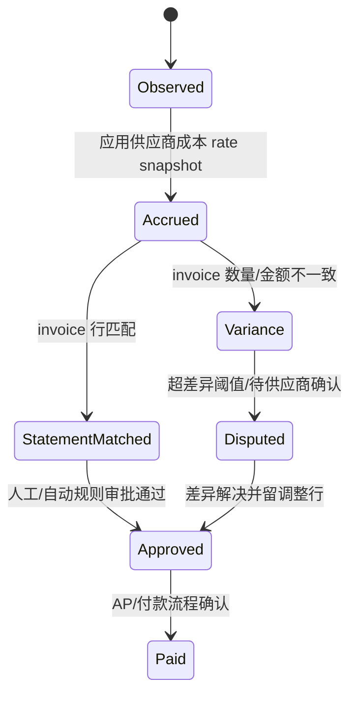
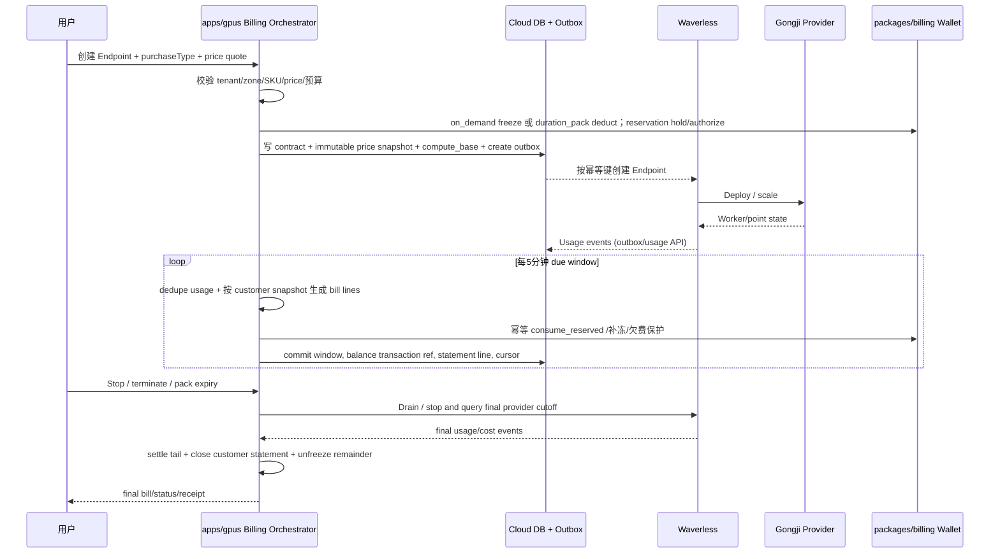
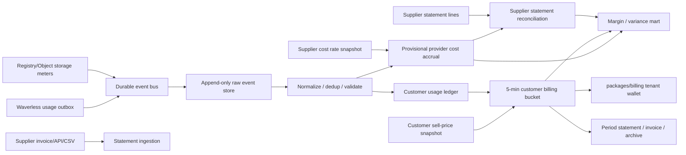

# Waverless 外采供应商成本记账与客户完整计费设计

> 状态：设计草案，供 `apps/waverless`、`apps/gpus`、`apps/web` 分模块实现前评审。  
> 范围：Waverless Serverless 使用共绩等外部 GPU Provider；定义供应商成本账、平台客户收入账、完整用量/套餐/预留/附加资源的收费闭环。  
> 术语：本文件中的「收入」指客户销售计费及应收/钱包核销管理；会计确认、税务、发票仍按现有财务制度处理，不把充值、冻结直接视作会计收入。  
> 约束：Waverless 是运行与用量事实源；Cloud `apps/gpus` 是客户计费和钱包权威；supplier 域复用成本/合同/供应商账单工作流，但不把 Serverless Worker 虚构成物理 `supplier_device`。

## 1. 摘要和裁决

### 1.1 一句话结论

Serverless 必须建立**两套独立但可对账的账**：

1. **供应商成本账（COGS / accounts payable）**：平台向 Provider 支付多少、资源成本发生在哪个 deployment/point/区间、供应商账单是否匹配。
2. **客户收入账（usage / receivable）**：平台按哪个价格快照向哪个 tenant 收取多少、余额如何冻结/核销、发票/账单状态如何变化。

两账通过相同的运行资源和时间区间维度关联，用来计算毛利/差异；**不能复用金额字段、不能用供应商成本当客户售价、不能把客户钱包流水当供应商成本账**。

### 1.2 现有能力可复用和缺口

| 现有模块/模型 | 定位 | 本设计使用方式 | 不足/补充 |
|---|---|---|---|
| `supplier`, `supplier_contract`, `supplier_terms_version` | 供应商主体/合同/合同条款版本 | 把 Gongji 登记为 API Serverless 供应商；关联供应商协议、计费币种、账期、最低消费/费率条款 | 当前合同产能行偏 `idle_time/whole_rent` 物理供给，需增加 `supply_mode=external_api_serverless` 或独立服务合同，不能伪装成物理台数 |
| `supplier_unit_cost` | 供应商×机房×卡型成本 | 对存在稳定“按 GPU 卡时成本”的 API 服务可复用/扩展费率记录 | 现有粒度只有数据中心/GPU 卡型/小时；表达不了 worker/point 分钟区间、启动费、存储、请求、出网、最低消费、异币和供应商账单行 |
| `supplier_pricing_record/history` | 供应商供给价格信息/历史 | 人工报价、目录价、成本参考价和有效期 | 仍非最终实际成本凭证；不能替代供应商实际 usage export/invoice |
| `supplier_bill/detail/daily`、导入和 `supplier-reconciliation` | 闲时/设备供应商月账生成、对账、发票 | 复用账期、附件/导入、审核、付款/发票工作流和部分 reconciliation UI | 其当前金额恒等式依赖租户区域卡时消费/设备/合同归因；外采 Serverless 需独立 source line 和资源映射，不能混写到设备日账单 |
| `platformCardListPrice` / `platformCardPriceRecord` | Cloud 客户销售价格读模型 | 可作为当前 GPU SKU 的收入侧价格输入 | 当前按 `gpuCardType × productLine × billingUnit`，粒度不足以表达逻辑 AZ、provider/physical region、购买模式、附加 meter 和合同折扣；创建时必须落不可变成交快照 |
| `tenant_balance` / `balance_transaction` / `@workspace/billing` | 客户钱包唯一读写真相 | 充值、冻结、按量 5 分钟核销、套餐购买扣款、退款/券抵扣 | 不承载 raw usage/供应商成本/账单明细；每次账务动作用唯一业务引用和幂等键 |
| `compute_base` / `serverless_detail` | Cloud Serverless 产品实体 | 作为 tenant/org/Endpoint/产品和 orchestrator 关联根 | 当前 `commitment` 含义过载，Serverless 仍走 SkyPilot stub/async，需增加 billing contract 与 backend discriminator |
| Waverless Worker / Provider 状态 | 实际运行计量事实 | Ready/Running/terminated 区间、provider mapping、GPU count、区域、point/task 映射 | Provider invoice 有不同计费边界；必须保留厂商实际账单成本作为另一来源，不能只用 Worker 秒推断 AP 最终金额 |

### 1.3 本期默认商业模式

- **按量**：按每个 Worker 经 Provider 确认的计费运行时间，内部精确到秒、客户每 5 分钟出消费账单/核销预冻结余额；队列排队和无 Worker provisioning 不计客户 GPU 费。供应商在 Ready 前已收费的部分属于平台启动成本，除非另立明示产品项。
- **连续时长包**：小时/天/周/月预付一段连续期限；期限不因 stop/scale-to-zero 暂停。包权益约束 SKU/区域/GPU 数/最大并发，到期未续费则拒绝新任务并停止资源；不能静默转按量。
- **预约保留**：与时长包分开，出售在指定时间窗保留指定 GPU 容量的权益。只有容量 hold/供应商保证合同成立后才可以销售；予約费与 included GPU usage 的抵扣/超额规则须防止同一 GPU-second 双重收费。
- **额外资源**：镜像仓库存储/流量、预热、模型缓存、对象存储容量/请求/流量分别使用独立 meter 和账单行。平台 SLA 所需的共享预热/双跑由平台承担；租户主动操作产生的增量成本可在明确报价与确认后转收。

## 2. 账务概念和边界

### 2.1 不同事实不可互相替代

| 名词 | 含义 | 权威来源 | 记账处理 |
|---|---|---|---|
| Usage fact | 某 Worker、存储对象、传输发生多少用量、何时发生 | Waverless / 对象存储或 Registry meter | 不直接改钱包；append-only、去重、可更正 |
| Customer price snapshot | 对 tenant 的生效销售单价/折扣/币种/计费单位 | Cloud 成交订单/价格 snapshot | 创建/购买时锁定版本，历史不重算 |
| Customer bill line | 用量 × customer sell price 后的应收金额 | Cloud Billing service | 进入 draft/issued statement；按支付/余额策略核销 |
| Balance transaction | tenant 钱包 available/reserved/voucher 的变动 | `@workspace/billing` | 同事务余额变动和流水；幂等键必填 |
| Provider cost usage | Provider 可能计费的实际资源区间或额外项目 | Provider API / Waverless observed state | 暂估成本 accrual，不替代 invoice |
| Supplier statement line | Provider 对账单/发票声明金额 | Provider statement/import | 匹配到 provider resources 和 cost usage，审核后 AP/付款 |
| Cost reconciliation | 我方估算成本与供应商账单差异 | Cloud supplier/AP reconciliation | 记录差异、原因、处理状态；不能覆盖源用量 |
| Margin result | 同期间客户净收入 − 供应商最终成本 − 平台承担项 | 财务/运营读模型 | 可为 estimate/provisional/final；需标注成本账单对齐状态 |

### 2.2 两套账的责任边界

```mermaid
flowchart LR
  P[Provider API / Invoice] --> COGS[Supplier Cost Usage + AP Statement]
  W[Waverless Worker Usage Events] --> COGS
  W --> INGEST[Customer Usage Ledger]
  CP[Customer Price Snapshot / Contract] --> INGEST
  INGEST --> BILL[Customer Bill Statement]
  BILL --> WALLET[@workspace/billing: tenant_balance]
  WALLET --> REV[Customer Receipts / Revenue reporting]
  COGS --> MARGIN[Margin & Variance Reconciliation]
  REV --> MARGIN
```

- `apps/waverless` 产出真实运行事实及外部资源身份，不连接 Cloud Postgres、不算租户售价、不写钱包。
- `apps/gpus` 拥有 Customer Billing Contract、sell snapshot、usage billing ledger/statement、租户钱包调用及按量欠费控制。
- `apps/web` 复用 supplier 成本运营域、销售价审批/查看权限及成本收入对账读模型；付款、调账必须走现有服务和权限流程。
- 成本与收入可使用同一个 usage event ID 作为 link，但各自有独立 amount、currency、price reference、状态和修正记录。
- Provider 实际收费区间可能早于 Cloud customer billable interval；需同时记 `provider_cost_interval` 与 `customer_billable_interval`，差额归属 platform cost center。

## 3. 统一计量模型（Meter Catalog）

### 3.1 标准 Usage Event

运行/资源事件通过公共 schema 进入 Cloud；来源支持 Waverless、Provider invoice/export、Harbor/Registry、S3/Object storage。字段示意：

```json
{
  "eventId": "immutable-source-event-id",
  "eventVersion": 1,
  "source": "waverless|provider_invoice|registry|object_storage",
  "eventType": "usage_interval|usage_correction|snapshot|statement_line",
  "occurredAt": "2026-10-17T01:02:03.123Z",
  "ingestedAt": "2026-10-17T01:02:04.010Z",
  "tenantId": "billing-tenant-id-or-null-for-platform-cost",
  "organizationId": "org-id-or-null",
  "computeBaseId": "ep-id-or-null",
  "resourceId": "platform-worker-or-storage-resource-id",
  "providerId": "gongji",
  "providerDeploymentId": "vendor-task-id",
  "providerResourceId": "vendor-point-id",
  "logicalAzId": "cn-hebei-az1",
  "physicalRegionId": "hebeif-1",
  "gpuSkuId": "gpu-l20-48g",
  "meter": "gpu_runtime|registry_storage|registry_egress|preheat_compute|preheat_transfer|object_storage_capacity|object_storage_request|object_storage_egress",
  "quantity": "123.000000",
  "unit": "gpu_second|byte_second|byte|request",
  "intervalStart": "2026-10-17T01:00:00Z",
  "intervalEnd": "2026-10-17T01:02:03Z",
  "currency": "CNY",
  "sourceStatementId": null,
  "idempotencyKey": "source:eventId:version",
  "traceId": "...",
  "metadata": {}
}
```

事件要求：

- Waverless event 至少一次传递；Cloud 用唯一 `(source,event_id,event_version)` 去重。同一个 event replay 不能重复产生 usage quantity、statement line 或钱包扣款。
- 原始事件 append-only；迟到/更正使用更高 version 的 correction/reversal，不能覆写已开具 statement 的明细。
- 所有数量存定点数或 integer base units；金额 `NUMERIC(15,4)`/money helper，禁止 JS binary float 进行财务累计。
- 必须区分 `occurredAt` 与 `ingestedAt`；Provider 有自己资源 ID/时钟时保留原值和 `timestampSource/confidence`。
- `tenantId` 空表示平台承担成本/供应商账单未分摊，禁止猜归属。

### 3.2 Meter Catalog 与默认收费方

| Meter | Usage unit | 客户收费默认 | 成本归属默认 | 周期/规则 |
|---|---|---|---|---|
| `gpu_runtime` | `gpu_second`，由 Worker 的 GPU 数 × 秒 | 按量/包时 included units/预约 included capacity，按合同 | Provider 资源实际费用 | 客户按 Worker Ready 起；成本按 Provider invoice billing start 起 |
| `worker_cpu_memory` | vCPU-second / GiB-second | MVP 可含在 GPU price；显式独立报价后才单列 | Provider 若独立收费则成本单列 | 不允许在 GPU price 和单列 meter 双收 |
| `registry_storage` | byte-second（展示 GB-month） | 用户镜像/私有制品按 tenant allocation；平台基础镜像免费/平台承担 | Registry 实际存储账单，平台基础/共享层成本中心 | 每日 snapshot 积分；GC/retention 后停止计费 |
| `registry_egress` | byte | 用户出站/跨区传输按明示价；平台拉取是否免费由 SKU policy 定义 | Registry/network provider actual cost | 可按实际字节；缺可靠 meter 则不收费 |
| `preheat_transfer` | byte | 只有用户明确下单的 warm request 才可收 | Provider/网络实际成本 | SLA/系统自动预热默认为平台承担 |
| `preheat_compute` | GPU-second / CPU-second | 用户专属预热任务在创建前展示并确认；通用共享 warm pool 平台承担 | Provider 实际资源 cost | 仅为缓存额外启动的 dedicated worker 记录；普通 worker 的正常镜像启动不重复收预热费 |
| `provider_model_cache_storage` | byte-second | 如产品承诺用户专属持久 cache，可单列；共享临时缓存默认为平台承担 | Provider/对象存储费用 | 需明确 TTL、驱逐和保留策略 |
| `object_storage_capacity` | byte-second | 按容量/存储 class 收费 | 对象存储账单成本 | 日用量积分，月账出明细 |
| `object_storage_request` | request by operation class | 支持准确 meter 时按 PUT/GET/LIST 等收费 | 对象存储请求账单 | 不可靠时暂不收费/套餐包含 |
| `object_storage_egress` | byte by destination class | 同区内网、跨区、公网分别有价/免费 policy | 对象存储/网络 Provider 成本 | 明确 direction、region 和免费额度 |
| `reservation_capacity` | reserved_gpu_second | 仅 capacity reservation 合同收最低保留费；实际使用从 included unit 抵扣 | 合同保留费/容量保证成本 | 不对相同 GPU 秒再次加收全额 `gpu_runtime` |
| `billing_adjustment` | currency amount | 退款、SLA credit、优惠、供应商差异不作为伪造 usage | 平台承担或 Provider credit | 独立审批 adjustment line |

**范围护栏：** 镜像下载、模型下载、GPU 实例运行、专用预热节点、模型缓存存储是不同用量；只有单独配置价格、生成可验证 usage event、在 UI 明示后才可单独向客户收费。

## 4. 供应商成本账规范（Supplier Cost Ledger / AP）

### 4.1 供应商成本价格与成本来源

#### 可复用的现有数据

- `supplier` / `supplier_contract` / `supplier_terms_version`：Gongji 供应商主体、合同、付款账期、币种、合同条款和生效时间。
- `supplier_unit_cost` / `supplier_pricing_record` / `supplier_pricing_history`：可复用 `supplier × data_center × gpu_card_type` 现货/参考成本和有效期管理，支持 UI、历史审计和人工成本假设。
- `supplier_bill`、`supplier_bill_detail`、`supplier_bill_daily` 等及 `supplier-reconciliation.ts`：复用账期、账单导入/附件、审批、付款、invoice 和一般恒等式校验模式。

#### 需要扩展的 API Serverless 成本能力

现有 supplier cost schema 是物理机房×卡型/hour 为主，不能完整表达外采 Serverless 成本。新增成本子域，不强迫旧闲时设备模型改语义：

1. `supplier_service_contract`（或扩展 supplier contract `supplyMode`）：`supplierId/contractId/providerId/serviceType/currency/settlementPeriod/minimumCommitment/effective interval/termsVersion/approval`。服务类型例如 `serverless_gpu_api`、`registry`、`object_storage`、`image_preheat`。
2. `supplier_service_rate`：成本 rate card，键至少含 `supplierId + serviceType + gpuSku/region/meter/unit/currency/effectiveFrom/effectiveTo`，保存 list/deal rate、tier/minimum fee、rate source、contract version。单位可为 `gpu_second/gpu_hour/worker_hour/point_start/GB-month/GB/request/egress_GB`；只做参考价也显式标 `estimated`。
3. `provider_cost_event`：基于 provider observed worker intervals 或供应商实时 usage 明细计算的 provisional accrual，append-only，含 vendor resource ID、usage interval、qty、成本 rate snapshot、estimated cost、cost status。
4. `supplier_statement` / `supplier_statement_line`：导入 Provider 月账/周期账单，保留原始行与附件 hash、币种/税费/折扣、source line ID、invoice number、账单区间、供应商原始数量/金额及导入批次。
5. `supplier_cost_allocation`：把 statement line 关联到 provider deployment/point、GPU SKU、物理区、usage cost events；可一行分摊多个租户/资源，也可有 `unallocated` 成本原因。
6. `supplier_cost_reconciliation`：对比 provider actual statement vs provisional cost accrual；差异维度包括启动分钟、GPU 秒、GPU 数、价格、minimum charge、存储/出网、税费、汇率、invoice adjustment；status `pending/matched/variance/disputed/accepted/paid`。
7. 成本快照的变更必须版本化；每个 provisional cost event 固定引用 `supplierRateSnapshotId`。最终供应商 invoice 差异用新 adjustment，不回写旧 source event。

### 4.2 Supplier 成本状态和记账规范



- Waverless usage event 是“资源实际发生”的技术事实；Supplier cost event 是“我方按合同估算/归因的供应商成本”；Supplier statement line 是“供应商正式声明应付”的账单事实，三者必须能分别查询。
- Provider API 估算和真实 invoice 之间状态未 reconcile 时，运营报表显示 provisional，不宣称最终毛利。
- 外币账单同时保存 transaction currency/amount 与 conversion rate/base currency/converted amount，汇率来源、生效日期和人工调整可审计。
- 供应商 `minimum charge`、月承诺、预约折扣不应该均摊到某个 tenant 以掩盖协议；分摊策略需有 version，可按 active GPU seconds/usage/value/平台承担等约定执行，并保留未分摊余额。
- 空闲/Active 容量成本可能高于租户运行秒成本；差额明确进入平台 `capacity_reservation/idle_capacity` 成本中心或对应 customer reservation 合同，不能无声计入其他用户。
- Platform-owned preheat、Provider 早于客户 billable cutoff 开始收费、试运行、供应商 API 最低消费、平台 SLA 补偿由成本 ledger/adjustment 表达，和 customer usage invoice 分开。

### 4.3 Supplier reconciliation 如何复用现有 supplier-bill

建议复用现有流程原则，不直接复用当前依赖物理设备日账单的金额算法：

| 阶段 | 可复用 | Serverless 新增 |
|---|---|---|
| Supplier 主体/合同/账期/币种 | 供应商档案、合同版本、联系人、付款条件 | `serviceType/supplyMode` 与 Provider connection reference，不保存 secret 在账单表 |
| Cost rate | 现有 `supplier_unit_cost` / rate history 模式、审核人和有效期 | Provider service SKU/region/meter/unit rate、minimum charge、per point/startup fee、币种 |
| 账单导入 | 上传/批次/附件 hash、格式校验、运营审核、invoice 关联 | Provider deployment/point/time range 原始 line、statement schema version、CSV/API 导入 mapper |
| 核对 | 账单头/明细汇总、invoice amount、差异列表、状态机 | Provider usage → Waverless mapping →成本 accrue → statement line 三方匹配；不要求 `supplier_device_id` |
| 付款 | 供应商账单确认/付款状态/付款凭证 | 继续用原 AP 工作流或账单记录的审批/付款能力 |
| 财务报表 | supplier/month/currency/paid/variance 汇总框架 | Serverless external cost、新的成本中心和客户收入 margin join |

`supplier_bill` 现有唯一键可能是 `(supplier_id,bill_month)` 并预设一供应商一月一份账单；Provider 支持多账户/产品/修正账单时，新的 statement idempotency key 应加上 `supplier account + provider product + statement number + revision`，不能错误覆盖同月历史账单。

## 5. 客户收入侧完整计费规范

### 5.1 收入侧权威对象

收入计费由五层组成：

1. **Customer Billing Contract**：tenant/org、computeBase、`purchaseType`、币种、优惠/含量、到期/取消/余额不足策略、创建时政策版本。
2. **Customer Price Snapshot**：不可变的 GPU/区域/产品线/meter 销售价、有效期、折扣/券规则、税务口径、币种。现价来自 `platform_card_list_price` / `platform_card_price_record` 或区域覆盖价；下单时复制成交价 snapshot，禁止在结算时查询“当前价格”重算历史。
3. **Customer Usage Ledger**：标准化可计费 quantity 与时间区间；去重、迟到事件、更正版本和余额核销 batch 可追溯。
4. **Customer Bill Statement/Lines**：用户可见的按量、存储、请求、出网、预热、包/预约、折扣、优惠、退款/SLA credit 明细。
5. **Wallet/Payment/Receivable**：余额冻结/核销通过 `@workspace/billing`；对公/渠道支付、发票和会计确认沿用现有财务体系。月结账单模式另外生成应收，不改变钱包流水事实。

客户 statement line 至少有 `tenantId/orgId/computeBaseId/contractId/meter/quantity/unit/customerPriceSnapshotId/unitPrice/discount/tax/amount/currency/region/logicalAz/resourceInterval/usageEventRange/statementPeriod/status`。

### 5.2 商品类型与计费规则

| purchaseType | 客户收费规则 | 实际容量/资源行为 | 资金动作 |
|---|---|---|---|
| `on_demand` | 每个 Worker GPU 数 × customer billable seconds × locked sell price；UTC 每 5 分钟批次出明细、核销预冻余额；stop 时精确尾结算 | Autoscaler min/max 可调，min=0；扩容仍受账户预算和区域配额限制 | 创建前冻结安全额度；每批 `consumeReserved`，需要时事务内补冻；结算完解冻余款 |
| `duration_pack` | 下单时按 pack price 预付 hour/day/week/month；package 记录 GPU 数、SKU/AZ、可扩缩上限/总 GPU seconds entitlement、有效期 | 期限内可暂停服务但期限继续走；不超 pack entitlement；到期 drain/stop，续费创建下一 order period | `deductAvailable` 买包；余额交易引用 pack order；退款/续费另事件，旧 pack immutable |
| `capacity_reservation` | 为指定时间窗/容量支付保留费；合同定义 included GPU seconds/最低消费/availability SLA，超额用量另算；同 GPU-second 不双计 reservation+全额 runtime | 需要 capacity inventory/hold/confirm/release；用户获得容量权益；没有 hold 成功不得确认预约 | 预约下单可预授权/冻结；hold 失败释放/退款；取消费按已批准 policy 单独 line |
| `internal_test` | 明确只用于测试组织/内部项目，不是免费价格缺失 fallback | 独立配额和期限，禁止对公网租户可用 | 不进入客户收入；平台成本仍记录 |

**现有 `commitment` 迁移：** 现有 `on_demand/hour/daily/weekly/monthly` 对 Serverless 不能完整区分时长权益与容量保留。新增 `purchaseType`；旧 `commitment` 仅用于兼容映射：`on_demand→on_demand`，hour/daily/weekly/monthly 默认映射 `duration_pack`。预约必须显式新建 `capacity_reservation` 合同/订单，不能从旧字段推断。

### 5.3 GPU 成本计量与客户 billable 计量必须双 cutoff

每个 worker 保存两个区间/时间：

- `providerBillingStartAt/providerBillingEndAt`：供应商可能据此收费，用于成本 accrue/reconcile。
- `customerBillingStartAt/customerBillingEndAt`：按已批准商业规则收费；默认仅在 Provider Worker Running/Ready 确认后开始，停止按可靠 terminate/billing stop 确认时间结束。

若共绩 invoice 只按 `running_points`/`billing_points` 或每小时整点计费，以供应商正式账单契约明确标准；Waverless event 即使高精度到秒，也不能假设供应商也按秒、且相同边界收费。两边差额放 platform cost variance，不要调客户 invoice 伪装成 Provider 实际成本。

客户收费公式示意：

```text
billable_gpu_seconds = Σ worker.gpu_count × max(0, customer_end - customer_start)
gross_amount = billable_gpu_seconds × customer_price_per_gpu_second
net_amount = gross_amount - contract_discount - eligible_coupon + tax/other_explicit_items
```

其中 price snapshot 可以保存 `price_per_gpu_hour` 并以定点数除以 3600 生成内部 rate；保留原始 rate 与精度。**每 5 分钟是批次/可见账单/核销频率，不是每个窗口最少收费 300 秒**；低于 5 分钟的任务/Worker 必须真实按秒尾结算，不凑 5 分钟。

### 5.4 Create / Run / Settle / Stop 完整闭环



每个阶段必须持久状态，跨 Waverless/Cloud DB/Postgres/wallet/provider 不存在分布式原子事务。使用 outbox + Saga + 对账：

1. **Quote**：返回 SKU、logical AZ、purchaseType、预估价/价格版本、预冻结/套餐价、预计附加费项、费用起算规则和可能不计费阶段；price snapshot TTL 防长时间 quote 后无声改价。
2. **Authorize**：按量先 reserve 足够 buffer；包时在创建资源前成功扣款/确认订单；预约先 hold capacity、成功再确认付款，否则释放 hold/款项。
3. **Create**：创建 Cloud contract/base 时生成 idempotency key；Waverless create 超时查询同 key，不重复调用会产生额外 Provider 资源的 POST。
4. **Running**：仅成功 Provider binding + observed Worker readiness 后映射状态；写 usage event/outbox 并按 cursor 消费。
5. **Settle**：每 5min 确认 window event watermark，构建 immutable bill lines；余额结算和 statement window 通过业务幂等 key 协调。余额 transaction 成功但 window commit 失败时 query by idempotency key 恢复，不重扣。
6. **Insufficient funds**：先通知/停止新扩容和新任务，执行宽限期 drain，最终 stop；已经发生的 usage 仍保留应收/欠费事件，不删事实。支付失败与 Provider 故障要区分。
7. **Stop/terminate/expiry**：关闭新增请求、等待最终 worker stop ack/Provider billing cutoff；读取所有 worker 到期数据，尾窗按真实秒核算，再解冻未用金额；任何不确定 worker 都留 `billing_reconciliation_pending`，不能过早全额解冻。
8. **Delete**：逻辑删除不删除 customer bill/usage/price snapshot；按 retention 和财务审计政策软删除/归档。

### 5.5 按量余额、包时、预约的完整权益和坏账控制

- 按量创建 freeze 至少覆盖配置 buffer；每批消耗后计算 projected runway（余额 / 最近用量速率），到告警阈值时通知租户；reserve 不足先尝试安全补冻，原子失败则置 `billing_suspended`，停止新任务/扩容。
- 资源停止过程中继续由 supplier cost accrual 记录成本，不因 tenant balance 为零而停掉平台成本采集。
- 负余额/信用额度如需支持，必须是 Cloud 明确的 credit policy/credit limit 和审批，不可通过 `tenant_balance` 负数绕过现有非负不变量。
- duration pack 的 paid entitlement 可以用 GPU-second ledger 扣额度，但该额度不能与人民币钱包双重收费；pack 到期时 remaining entitlement 的过期/退款按 SKU 合同和退款 policy 记录。
- capacity reservation 要确认 availability SLA、最大 failover 范围、cancel/no-show/partial fulfillment 补偿、客户是否可弹性使用保留容量。reserve 仅是销售承诺，若供应商 capacity API 不支持锁定，平台需要自有 capacity control/合同保底，否则不允许售自动保证。
- 退款、SLA credit、供应商赔款、平台赠券走 adjustment/credit note，关联原 statement/window 和审批；不修改原用量事件或已收款 transaction。

### 5.6 镜像、预热、模型缓存、对象存储客户收费政策

| 资源 | 客户什么时候收费 | 平台什么时候承担 | 必须持久记录 |
|---|---|---|---|
| 用户镜像存储 | tenant 镜像逻辑制品保留时按约定 GB-month/免费额度 | 平台官方基础镜像/共享公共层由平台承担 | digest、tenant ref、logical/physical bytes、去重分摊策略、retention/GC 时间、rate snapshot |
| Registry egress/导入 | 用户发起 cross-region/外部出站等可计量流量，报价后启用 | Worker 首次拉取、为平台服务启动、镜像物化成本是否含在 GPU service price 要以产品价目明确 | byte counters、方向、src/dst region、digest、owner、source billing ID |
| 显式镜像预热任务 | 用户主动请求、平台给出费用预估并确认后，收额外 transfer/专用资源成本 | SLA 自动预热、故障切换预热、共享 cache warm pool | warm job/endpoint/digest/provider/region/node count/bytes/duration/cost owner/expiry |
| Model Cache | 用户专属长驻缓存若占额外对象存储/卷，可按容量收费并明确 TTL；只选择普通运行时共享 cache，暂无独立 item 时含在服务价 | 平台 Host cache、命中优化、厂商免费/公共缓存由平台成本中心 | model digest/revision/size/region/cache status/tenant-vs-shared/eviction/bytes-second |
| Object storage | 用户 bucket 容量 GB-month；请求数和跨区/公网 egress meter 可靠且已发布时单列 | 宣传包含的免费额度、平台日志/缓存、平台内部复制 | bucket/tenant/storage class/region/byte snapshot/request operation/egress direction/usage period |

收费启用闸门：必须具备明确 Customer price policy、可验证 meter、price snapshot、statement line、余额/应收处理、异常修正流程、UI 展示与费用通知；否则显示免费/平台承担/暂不收费，不得估算扣款。

## 6. 大数据量账单处理

大数据量模式保持第 3–5 节相同产品规则、usage schema、钱账权威和价格 snapshot，只替换传输、聚合、留存和处理能力。不要因转事件总线而创建第二个钱包。

### 6.1 架构



### 6.2 处理语义

- Waverless 使用 transaction outbox 发送至少一次 usage events；Cloud API 吸收成功后按 cursor ack，consumer 故障不丢 Worker/成本事实。
- 消息可按 `provider/resourceId` partition 保证资源局部顺序、按 `tenantId` 聚合钱包扣款；跨租户并行。避免要求全局 event order。
- Raw usage 保留 immutable；Normaliser 版本化处理校验、时区/单位换算、乱序、重复、Provider corrections。`usage_event_id + version` 幂等。
- 5 分钟 bucket 对 customer ledger 和 cost accrual 分开生成：
  - Revenue bucket key：tenant/contract/computeBase/meter/customer price snapshot/region/window。
  - Provisional cost bucket key：supplier/contract/provider deployment/vendor resource/meter/cost rate snapshot/region/window。
- `billing_window` 状态 `open→ready_to_settle→settling→settled`，带 source watermark、usage count/hash、customer statement ID、wallet transaction idempotency key、retry metadata。settle 与 wallet 幂等原语可跨事务重试。
- 账单开出后迟到事件不修改已出账单；若客户按量已经核销，生成下一窗口 debit/credit adjustment；金额极小/零金额的 quantity 仍保留 usage line，但按账户精度/最小开票门槛累计处理。
- Supplier invoice reconciliation 是异步账期流程，与客户五分钟扣款频率解耦。供应商月底调价不回写客户历史 price snapshot；合同需决定差异由平台承担或向客户补单，后者必须是合同允许且可审计的显式 adjustment。
- Wallet transaction 仍按每 tenant/contract/window 聚合核销，不要把每个 raw provider event 都变成钱包流水；raw event/statement line 负责财务细节，balance transaction 负责余额变动证据。
- 对平台-owned shared cache/preheat cost 单独记 cost center；如果多人共享，不能将全部成本归因给 first tenant。可按资源使用、明确 SLA budget 或平台费用中心分摊，策略版本化。

### 6.3 规模触发与服务指标

从 MVP 转大数据量模式的判定依据用实测而非拍固定行数：

- 单个分页 settlement worker 无法在下一 5 分钟周期前消费上一周期；
- billing usage event backlog 超过声明的 settlement SLO，或 provider/存储多源使单 cron 扫描失控；
- 单账期明细量、statement查询延迟或归档量超过 Postgres 合理分区和索引预算；
- 多 Provider/provider account 需要独立 rate limit、事件重放和区域成本核算。

必须监测 event lag、source watermark、unmatched usage/cost、late correction rate、dedup hit、wallet idempotency collision、billing window lag、settlement retry、unbilled accrued revenue、supplier cost variance、unallocated supplier statement、tenant balance runway、DLQ/replay progress。具体事件吞吐、分区数、catch-up 倍数和查询 SLO 在接入前压测定标，不以“上 Kafka”作为完成标准。

## 7. 数据域和 Schema 设计指导

以下是逻辑模型，不要求机械地建成同名表。实施时以 `packages/db` Drizzle schema/生成 migration 为准；余额只有现有 `tenant_balance`/`balance_transaction` 权威。

### 7.1 Customer Revenue / Usage 域

| 实体 | 关键字段/约束 | 职责 |
|---|---|---|
| `compute_billing_contract` | `compute_base_id`, tenant/org, purchase_type, currency, status, price_snapshot_id, policy version, effective interval, insufficient-funds policy | 产品实例对应的不可变计费合同/结算规则 |
| `customer_price_snapshot` | product/meter/GPU SKU/logical AZ/provider scope/unit/currency/sell price/discount/tax/effective from/to/source price record/version | 客户销售单价锁定；引用平台刊例价/区域销售价或合同价，历史不被当前价改写 |
| `compute_pack_order` | order/tenant/computeBase/SKU/AZ/GPU entitlement/validFrom/validUntil/paid amount/price snapshot/status | 连续时长包购买、续期、过期和退款状态 |
| `compute_capacity_reservation` | tenant/contract/SKU/logical AZ/provider capacity scope/count/start/end/hold token/status/cancel policy/guarantee evidence | 真实预约容量 hold/confirm/release/取消和违约追踪 |
| `customer_usage_event` | source event key+version/tenant/contract/computeBase/worker/meter/qty/unit/interval/region/provider/source status | 收入计量的标准不可变事实；可用平台 Worker ID join Waverless 来源事件 |
| `customer_bill_statement` | tenant/period/currency/status/due/issued/paid/credit total/version | 对客消费账单，支持 5min provisional/settled usage summary 和周期正式 invoice |
| `customer_bill_line` | statement/contract/meter/quantity/unit/unit price/snapshot/discount/tax/net/region/usage range/ref | 可读可核的收费明细；账单一旦 issue 只加 adjustment/credit note |
| `customer_billing_window` | contract/window start/end/state/cursor/watermark/quantity/amount/wallet transaction ID/idempotency | 5 分钟消费与钱包核销 exactly-once business semantics |
| `usage_adjustment` | source statement/window/meter/qty/amount/sign/reason/approval/status | 晚到/错价/退款/SLA credit adjustment，不删除原始用量和流水 |

### 7.2 Supplier Cost / AP 域

| 实体 | 关键字段/约束 | 职责 |
|---|---|---|
| `supplier_service_agreement` | supplier/contract/terms version/provider ID/service type/currency/settlement period/minimum charge/valid interval | 将 API 弹性供给及 registry/object storage 合同放在 Supplier commercial context 下，不依赖物理设备行 |
| `supplier_service_rate_snapshot` | supplier agreement/provider SKU/physical region/meter/unit/cost rate/tiers/currency/effective interval/source | Supplier 成本 rate 版本；只用于成本估算/归因，绝不能作为 customer sell price |
| `supplier_cost_usage_event` | Waverless/provider source event key/version/provider deployment/vendor resource/meter/qty/interval/rate snapshot/estimated amount/owner/status | 供应商实际/估算成本使用事实 |
| `supplier_statement` | supplier/account/statement number/revision/billing period/currency/total/tax/attachment hash/import batch/status | 保留供应商原始正式账单和 revision |
| `supplier_statement_line` | external line ID/service/SKU/region/qty/unit/start/end/amount/currency/raw row hash | 不丢失供应商 statement 原始结构；可重复导入去重 |
| `supplier_cost_match` | statement line ↔ cost usage groups/provider resources/matched qty/amount/variance/status | 账单行与 Waverless/Provider 资源对账；支持一对多/多对一/未归属 |
| `supplier_cost_adjustment` | original statement/line, adjustment sign/reason/approvedBy/source | 差异确认、credits、minimum fee、FX/tax 调整不可变记账 |
| `platform_cost_allocation` | cost event/statement line/cost center/tenant optional/computeBase optional/allocation rule/version | 区分直归 tenant 与 platform-owned shared costs，并可重算追溯 |

### 7.3 共同维度、唯一键与保留

- Cloud external root 统一是 `computeBaseId`; Waverless `externalEndpointId` 映射到该根；Worker 维度为稳定 platform `workerId`，供应商 resource ID 作为 mapping，不能跨 Provider 当作主键。
- 所有商品和 meter 挂 `currency`；Supplier statement 允许外币，换算成本快照需记录 FX source/rate/time/base currency。
- Usage event 唯一键 `(source, source_event_id, event_version)`；Window 唯一键 `(billing_contract_id, start_at, end_at, settlement_version)`；supplier statement 唯一键 `(supplier_account_id, external_statement_no, revision)`；statement line 唯一键 `(statement_id, external_line_id)`。
- balance transaction 使用原生 `idempotencyKey`，稳定绑定 Customer billing window/pack order/adjustment；任何重试首先按 key 查询结果。
- 原始用量、已出账单、供应商正式 statement、已确认成本和余额流水 retention 需满足合同/财务审计期；明细大数据可归档但保留可校验 digest、索引和恢复流程。

## 8. 对外账单、运营监控与 API

### 8.1 客户控制台/开放接口

- Serverless Endpoint 展示 `purchaseType`、价格和快照日期、currency、GPU/卡数、logical AZ、billable Worker 状态、预冻结金额、5 分钟最新结算、未结算估值和钱包余额 runway。
- Bill statement 可按时间/meter/computeBase/region 筛选；每行展示计费区间、qty/unit、单价快照、折扣/券、amount、结算状态及调整关联，避免只显示一个小时价或月总额。
- 按量账户显示“实时预估”与“已结算”；不把未确认 usage 或 provisional cost 写成已扣余额。
- 时长包显示订单、SKU/AZ/最大 GPU 权益、validUntil、剩余权益/运行时间和续订/到期 drain；停止服务不暂停包期限。
- 预约显示预留资源、区域/时间窗、hold/confirmed、SLA/取消费、included units 和超额计费规则。
- Storage/preheat/egress 的免费额度、计量区间、价格、owner（tenant/platform）在创建或预热确认前预估，并在账单分栏展示。

### 8.2 Web 运营财务视图

- **Supplier cost**：按供应商/合同/API account/statement/month/provider resource/physical region/SKU 查询 estimated/accrued/invoiced/approved/paid/variance/unallocated。
- **Customer revenue**：按 tenant/customer/computeBase/meter/statement 查询 measured/billed/settled/paid/refunded/adjusted。
- **Margin**：同时显示 `customer_net_amount`、`supplier_final_cost`、`platform_owned_cost`、`unreconciled_estimated_cost` 和毛利率；未关账月份明确 `provisional`。
- 有权限的财务人员可以导入 statement、审核差异、形成 adjustment/credit、登记付款；任何动作记录 operator、reason、attachment/source hash、approval trail。
- supplier 管理页复用 supplier 主体和成本工作流，但按供给类型把 `external_serverless_api` 与 `idle_time/whole_rent` 过滤区分，报表不能将外采服务应付并入闲置物理卡 utilisation KPI。

### 8.3 运营指标与财务告警

| 指标/告警 | 触发与处理 |
|---|---|
| Customer `unbilled_usage_amount` / window lag | 超过 5 分钟/结算 SLO：暂停新建/扩容的风险评估，重放账务 consumer；不删除 usage |
| `wallet_runway_seconds` / reserve shortfall | 告警并执行明确 grace → no new tasks/scale → drain/stop；记录 tenant action |
| Provider expected-vs-invoiced cost variance | 超绝对/比例阈值进入 supplier reconciliation review，账单保持 pending/disputed |
| `unmatched_supplier_statement_amount` | 未能关联 provider task/point/region/interval；不能分配到任意 tenant，临时进入 unallocated cost |
| `startup_unbillable_cost` / warm-pool cost | Provider cost 大于客户 billable usage；按平台/项目成本中心归属，优化 start SLO |
| `customer_revenue_without_cost` | 收入有 usage 但 Provider cost statement 未到；收入可按合同正常结算，成本 margin 标 provisional |
| `supplier_cost_without_customer_usage` | Active 保底/供应商最低消费/错误孤儿资源；平台成本 owner 或待查，不向其他租户摊 |
| `duplicate_balance_idempotency` / reconciliation mismatch | 财务高优先告警；禁止用后台 SQL 直接修余额，必须走 compensating transaction |

## 9. 多模块实施任务清单

任务分成可以独立派发的 package；BILL0 先定契约和账务科目，随后可并行实现 Waverless meter、Customer billing 和 Supplier cost adapter。Schema/金额字段由 DB owner 集中合并，避免多个 Agent 同时编辑公共 schema。

| ID | 模块/任务 | 交付物 | 依赖 |
|---|---|---|---|
| BILL0 | 产品/财务负责人：计费语义冻结 | `purchaseType` / meter / cutoff / rounding / price lock / supplier-vs-customer policy / reservation / refund / tax / late event 契约 | 无，首项 |
| COST0 | apps/web + supplier 域：供给类型和成本来源 | Gongji supplier/service agreement、supplier rate snapshots、供应商 invoice mapper、cost center 规则；复用现有 supplier 账单流程且避开 supplier_device | BILL0 |
| W-METER | apps/waverless：成本/收入共同 usage facts | Provider billing timestamps、per Worker/GPU interval、event outbox/API、point mapping、source id/version/correction | BILL0 + worker mapping |
| G-REVENUE | apps/gpus：客户计费 Contract/price/usage/statement/wallet | immutable customer snapshot、按量 5min/window/尾结算、套餐订单、余额保护、customer statement API/UI | BILL0 + W-METER schema fixture |
| G-AP-INGEST | apps/web cost pipeline/或财务服务：Supplier statement ingestion | statement import API/CSV mapping、附件 hash、duplicate prevention、raw row、pending/approved状态 | BILL0 + COST0 + Provider invoice format |
| COST-RECON | apps/web supplier ops：成本三方对账 | supplier statement ↔ Waverless cost accrual ↔ supplier rate/contract；variance/dispute/approval/payment | COST0 + W-METER + G-AP-INGEST |
| CUSTOMER-EXTRAS | gpus + registry/object storage service | Registry/Preheat/Object Storage meter adapters、free allowance、customer price/owner policy、statement lines | BILL0 + meter source availability |
| MARGIN-REPORT | apps/web Finance / Billing reports | 客户收入、Provider 应付、平台承担、毛利与差异 provisional/final 报表 | G-REVENUE + COST-RECON |
| INT-BILL | 集成负责人 | replay/迟到/余额失败/供应商差异/到期/预热与对象存储的全链路财务验收 | 上述任务 |

### 9.1 验收矩阵

#### Provider 成本账

- [ ] Provider Running 资源能够从 Waverless worker ID 对到 Gongji `task_id + point_id`，并能对 provider invoice statement line 做准确/部分/未匹配分类。
- [ ] supplier rate snapshot 生效期和 supplier agreement 在资源开始时被固定引用；后续合同调价不会重写历史 accrued cost。
- [ ] 同一 supplier statement 重复导入/修订版导入不重复应付；原始行可追溯，修订必须产生新 statement revision/adjustment。
- [ ] Gongji minimum fee、整点/按分钟舍入、异币/税费、failed worker/Provider pre-Ready 计费等真实账单规则在 sandbox/第一张账单中确认；unknown 成本显式 provisional。
- [ ] Serverless cost 不依赖 `supplier_device_id`，不出现在 supplier idle-time device utilization/闲时结算数据中。
- [ ] supplier bill line amount、detail sum、statement total、付款 amount 的不变量校验通过；supplier cost 汇总能按 supplier/contract/region/provider/Endpoint/tenant 可选 owner 下钻。

#### 客户收入与钱包

- [ ] 按量 Worker 127 秒后终止：customer usage 按 127 秒尾结算，所有 5 分钟窗/尾窗的重复执行不重复扣款；窗口扣款可反查 `balance_transaction`。
- [ ] 用户售卖价快照与供应商 cost rate 互不覆盖；改销售价/采购价后历史订单/usage 重算结果不改变。
- [ ] 不同 Worker 的开始/停止时间、scale-to-zero、Provider 迟到事件、region/SKU变化均正确按 slice 计量；不能用 `compute_base.createdAt` 代表整个 Endpoint GPUs 运行时间。
- [ ] duration pack 的权益/期限/到期 drain/续期可追溯；capacity reservation 未 hold 前不得 confirmed/收费，失败补偿/取消费符合 policy。
- [ ] 余额扣费不成功会暂停新消费并排空资源；供应商成本仍继续记录；不存在 `priceSnapshot=null` 或零价静默创建商业实例。
- [ ] 镜像 registry、预热、对象存储容量/请求/流量作为独立账单项，免费/平台承担/用户承担均有明确策略和证据；缺 meter 的项目不扣款。
- [ ] 客户 statement 的计算满足 `sum(line.netAmount) + adjustments = statement.total`；钱包净扣款/退款/券抵扣和 statement/payment 状态可逐笔 reconciliation。

#### 成本收入对账和财务运营

- [ ] Dashboard 清晰区分 estimate/accrued/final supplier cost 与 customer billed/paid revenue；不把充值额、冻结、API usage estimate 误称会计收入/最终成本。
- [ ] 每个 customer bill line 可追溯 usage event→price snapshot→billing window→balance transaction；每笔 supplier AP line 可追溯 invoice raw line→provider resource mapping→supplier contract/rate snapshot。
- [ ] 毛利报表单独列 platform-owned preheat、Ready 前成本、共享缓存、minimum charge、优惠/坏账、supplier variance；无归属成本不得偷偷分摊给租户。
- [ ] correction/refund/credit note 通过 append-only adjustment、审批和审计；已开账单与 supplier 已确认 statement 不做原位更新。

## 10. 发布分期、迁移和风险

### 10.1 Phase 0：成本/收入映射只观察

1. 将 Gongji 作为 supplier API service supply type 登记，配置合同、单位成本/参考 rate 和预计结算规则。
2. Waverless 记录 provider observed Worker 运行区间与 vendor resource map；Cloud 以 shadow mode 计算 `estimated_supplier_cost` + `estimated_customer_charge`，不实际扣款。
3. 用真实 Gongji invoice/账单周期验证计量边界、最小计费单位、启动收费、失败点位、最低消费、人民币/外币/税费、储存/流量和账期修正。
4. Finance 和产品确认收入 price snapshot、customer bill semantics、退款/余额不足政策和发票口径后，才从 shadow 开启客户扣款。

### 10.2 Phase 1：MVP 收入扣款 + Supplier AP 对账

- 单 Provider、单逻辑 AZ、按量 GPU 秒 + 连续时长包；capacity reservation 仅在真实容量锁定能力 ready 后开放。
- 每五分钟客户结算，优先使用 existing wallet `freeze/consumeReserved/unfreeze/deductAvailable`，新增细粒度 ledger/window/statement line；完整尾结算/欠费保护。
- supplier monthly bill/import/reconciliation 通过独立外采 statement lines 做成本核对；使用现有 supplier 主体/合同/审批/付款，但不触碰物理闲时卡日账模型。
- Registry/object storage 先上线可靠容量 meter 和存储收费；请求/流量/模型缓存等来源未验证前按平台承担/套餐含量处理。

### 10.3 Phase 2：高吞吐用量总线和完整附加 meter

- 事件量、窗口延迟或账期查询压测达到第 6 节迁移阈值后，启用 durable outbox/event bus/normalizer、分区 raw ledger、5m bucket、月 statement 和历史归档。
- 接入更多 Provider、Registry、模型预热、对象存储请求/流量账单，统一 meter catalog 和 supplier rate / customer price 两侧独立对账。
- 基于实测处理量设吞吐 SLO、event lag SLO、financial replay/catchup、cost variance threshold 和 statement close SLA。

### 10.4 历史字段/系统兼容

- `compute_base.commitment` 已有 `on_demand/hour/daily/weekly/monthly` 语义，迁移必须区分 duration pack；新增 `purchaseType` 作为 canonical，旧数据明确映射、backfill source 和可逆发布计划。
- 目前 gpus `serverless` 仍有 SkyPilot 字段、早期定价和 5min cron 实现；Waverless Worker billing 只对 `orchestratorType=waverless` 的实例启用，旧 SkyPilot instance 保留对应成本/运行 cutoff，禁止用 `serverless.status=running` 一概套用新规则。
- `platformCardPriceRecord` 是 customer sell price 当前价读模型；在 contract 中固定引用快照/生成专用 immutable row，不能每期从 `lookupPriceSnapshot` 当前值读取。
- 所有余额操作必须经过 `packages/billing`；不得在 Apps 中直接更新 `tenant_balance`。
- 供应商账单成本不能因为一个 supplier 同时也卖裸金属/闲时卡，就污染 `supplier_device`、`supplier_gpu_inventory` 或 idle time unit cost reconciliation。

### 10.5 需供应商/财务正式确认的问题

| 议题 | 默认方案 | 冻结前确认方 |
|---|---|---|
| Gongji 对 Serverless 实例的计费计量单位/起止点 | 按供应商账单字段和可确认的 point/deployment 运行区间，记录成本时间，不假定秒级 | Supplier owner / Finance / Provider integration |
| create/starting/ready/pulling image 期间供应商是否收费 | 作为 supplier actual cost；默认客户从 Waverless confirmed Running 收费，差额平台承担；如客户收费须单独明确产品政策 | Product / Finance / Legal |
| 失败点位、最低消费、部分扩容/删点、账单修正 | Provider statement 为应付最终事实，API 计量只作暂估 | Supplier owner / Finance |
| supplier_domain 是否直接接纳 `external_serverless_api` supply type | 推荐用现有 supplier/contract/bill 关系，扩展 supply mode 和独立成本 adapter，不建立虚拟设备 | Supplier domain owner |
| duration pack 是否“GPU 持续运行时长”还是“到期前 entitlement 时长” | 本文推荐到期前连续期限 + included capacity，stop 不暂停 | Product / Finance |
| capacity reservation 的可售保证/违约补偿 | 没有可持久 hold 或合同库存锁时仅做申请，不标自动确认 | Product / Provider / Legal |
| Registry/Preheat/Object storage 是否收费及免费额 | 仅 meter+价目+展示+用户确认齐备后收费，其他平台承担/暂不收费 | Product / Finance / Storage owner |
| 税金和会计 revenue recognition | 沿用财务权威规则，Customer statement 和 wallet ledger 不直接视作总账 | Finance / Tax |

## 11. 相关实现位置与规范文档

- [单厂闭环总体实施任务](../../waverless-cn-provider-implementation-plan.md)：Provider/Region/Autoscaler/Worker/Cloud 的跨模块任务。
- [租户余额模型权威](tenant-balance-unification.md)：唯一钱包原语、5 分钟按秒冻结/核销、预付扣款。
- [产品线/计费语义 taxonomy](../../business/product-line-taxonomy.md)：product line、billing mode、commitment 的权威含义。
- [Serverless 实现设计](serverless-implementation.md) §6：已有 Serverless 价格、按量、存储和跨区 SLA 语义；本文件补充 supplier API cost 与 Waverless worker meter。
- [费用展示设计](billing-display.md)、[OpenMeter 计费设计](openmeter-billing-design.md)：账单展示及平台用量统计背景，实际启用前要与此处两账边界统一。
- [镜像/模板管理](image-and-template-management.md)、[镜像预热商业方案](../../business/image-preload-commercial-and-community-incentive.md)、[S3/存储 quota](storage-quota-and-s3-volume.md)：镜像/对象存储/预热的 meter 与责任归属。
- `packages/db/src/supply-schema.ts`：`supplierContract`、`supplierTermsVersion`、`supplierUnitCost`、`supplierPricingRecord/History`、`supplierDevice`。
- `packages/db/src/platform-pricing-schema.ts`：`platformCardListPrice`、`platformCardPriceRecord/History`、机房销售价。
- `packages/db/src/gpus-consumer-schema.ts`：`tenantBalance`、`balanceTransaction`、`paymentOrder`。
- `packages/db/src/compute-schema.ts`：`computeBase`、`serverlessDetail`、`computeTaskEvent`、镜像/仓库元数据。
- `apps/gpus/src/lib/server/services/billing.ts`、`apps/gpus/src/app/api/cron/billing/route.ts`：现有 Serverless 收入计费雏形；切换 Waverless 后需改按 Worker Usage interval，不按 Endpoint `createdAt/status` 估算。
- `apps/web/src/lib/server/dataaccess/supplier/supplier-reconciliation.ts`：当前供应商账单的日/月汇总与 gross-profit 校验，可参考工作流，另加外采 Serverless line adapter。

## 12. 完成定义

- 供应商 costs、客户收入、平台承担成本有不同账本/价格快照/权限，能通过资源 ID 和用量区间关联并对账。
- Waverless 为每个 Worker/资源发出可去重、可修正、可追溯 Usage Facts；Provider 真实 Invoice 行可回映到 Provider deployment/point，客户 Bill line 可回映到账户/价格快照/usage/余额流水。
- 按量 5 分钟出账与秒级计量、停止尾结算、幂等补偿、余额不足保护真实可运行；包时权益与预约保留语义不混淆。
- supplier 域复用供应商、合同、成本率、statement import、reconciliation/付款治理，但不伪造 `supplier_device` 或闲时卡库存；gpus 收入继续经 `@workspace/billing`。
- 镜像/预热/对象存储收费只对具备 meter、price、bill line、owner、UI 明示和审批的项目启用；否则明确为平台承担/暂未收费。
- Finance 能同时查 accrued/actual supplier cost、customer usage/revenue、platform-owned variance 和 provisional/final gross margin；所有账单开具后的变更采用 adjustment，不覆盖历史。
