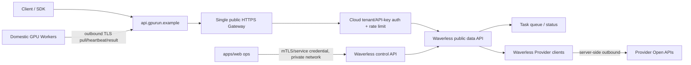
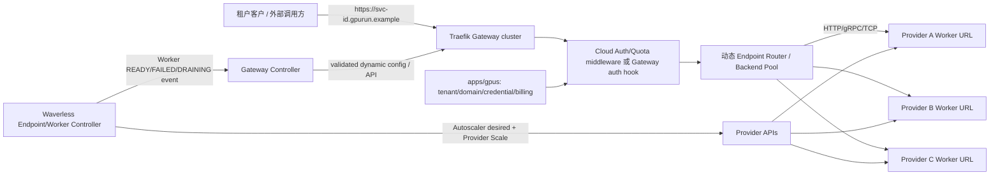

# Waverless 区域资源、Provider 与统一网关设计

> 状态：设计草案，供 `apps/waverless`、`apps/gpus`、`apps/web` 和平台网络团队实现前评审。  
> 目标：补齐 Waverless 区域资源监测与运营管理、国内外 Provider 扩展，以及统一对客入口。  
> 术语：仓库模块是 `apps/waverless`。本文“统一网关”指用户可访问的稳定 API/HTTP 入口；不是控制面管理 API，也不是各 Provider 的厂商 API。  
> 既定边界：Waverless 持有逻辑 AZ/provider binding/Worker 运行态真相；gpus 管租户权限、域名和产品入口；web 管运营配置与监测。

## 1. 摘要和裁决

无论启用多少 Provider、区域、厂商控制 API 或 Worker 内部端口，**终端用户只应看到一个平台 Gateway hostname 和一个稳定 API endpoint**，例如 `https://api.gpurun.example/v1/{endpoint}/...`。用户 credential 只授权逻辑 Endpoint；DNS/证书/入口路由不能随 Provider/区域迁移变化。

核心设计决策：

1. **统一网关入口与 Provider 控制面分离。** 用户数据请求走 Gateway → Waverless API/队列；Waverless Provider client 用服务端出站连接调用 Gongji/其他 GPU 厂商 API；Worker 通过受认证的 pull/heartbeat/result 访问 Waverless 的平台 Gateway。供应商 API 地址和 Worker 管理 API 永不作为用户 endpoint 暴露。
2. **逻辑区域是平台资源目录，不是 UI 文案。** 逻辑 AZ 关联一个或多个 provider physical region、SKU capability、合规域、可售/维护状态、配额、监控新鲜度与健康状态。Region Registry 由 Waverless 所有，gpus/web 都通过 API 读取；禁止各自静态维护不同区域列表。
3. **Provider adapter 必须归一化生命周期、观测和成本计量边界。** Provider API/状态以能力接口表达，不把供应商特有 `task_id/point_id/mark/clusterID` 泄漏到统一 Endpoint 合约。
4. **区域监测是控制环的输入。** 库存快照、API 健康、创建成功率、Worker Ready、预热和实际计费状态分别记录；过期/未知不可视为“健康且有库存”。
5. **生产建议：Traefik 承担入口代理和动态路由，Caddy 仅适合单入口静态/小规模 TLS 或运维工具。** 若已采用 Traefik，保持其作为 Gateway 数据面；不因 Waverless 增加 Caddy 再叠一层反向代理。需要队列式 Runpod API、鉴权和计量时，Traefik 仍应在 Waverless/Cloud 之前/旁作为 L7 proxy，而由应用实现业务 API。若并无 K8s/SRE 动态路由需求、只有一个固定 Waverless upstream，则 Caddy 是更简单的部署选择。

## 2. 范围与非目标

### 本文覆盖

- Region Registry、Provider binding、标准 GPU SKU/能力目录和状态生命周期。
- Provider adapter 合约、能力发现、Gongji 首厂实现、第二 Provider 扩展要求。
- Provider/Region 定期监控、库存新鲜度、创建/扩容/Ready/终止时间线、故障和成本 usage facts。
- 统一 Gateway 数据路径、DNS/TLS/端口、Tenant auth、Worker 通道、Traefik vs Caddy 对比及部署建议。
- 运维配置、观测面板、告警和 failover 准入条件。

### 不在本期默认实现

- 多 Provider 同 AZ 拼池和自动 failover（先把数据/接口做好；第二 Provider 通过验收前仅单 Provider 调度）。
- 跨境/跨合规域调度、将 Vendor URL 暴露给租户。
- 用 Nginx/Traefik/Caddy 本身承载 GPU 调度、队列、autoscaler、billing 或 provider client 业务逻辑。
- 宣称“任意区域/任意 Provider 90 秒 ready”。只允许对已满足 image/model readiness、供给健康和实测条件的目标定义 SLO。

## 3. 关键名词与唯一 ID

| 名称 | 例子 | 产生者/权威 | 是否对租户可见 |
|---|---|---|---|
| Platform Gateway hostname | `api.gpurun.example` | 平台 DNS/Ingress 配置 | 是，唯一公共 host |
| Public API path | `/v1/{endpoint}/run` | Waverless API contract | 是，稳定 |
| `externalEndpointId` | Cloud `compute_base.id` | Cloud 创建并映射，跨服务稳定 | 用户 API key scope 隐式绑定；可在 Console 可见 |
| Waverless `endpointId` | opaque Waverless UUID/name | Waverless | 不要求暴露；可由平台映射 |
| `logicalAzId` | `cn-hebei-az1` | Region Registry | 是，平台逻辑区域 |
| `providerId` | `gongji` | Provider registry | 租户一般隐藏；运营可见 |
| `physicalRegionId` | `hebeif-1` | Provider/Region Registry | 默认运营可见、用户只见逻辑 AZ |
| `providerDeploymentId` | Gongji `task_id` | Vendor API / Waverless mapping | 否 |
| `providerResourceId` | Gongji `point_id` | Vendor API / Waverless mapping | 否 |
| platform `workerId` | `wkr_...` | Waverless | 自有 Endpoint 的 Worker 详情可见 |
| `requestId/traceId` | UUID/trace | Gateway/API | 对客错误支持可返回 requestId，不返回内部密钥 |

任何用户写请求都不能用 vendor task/point ID 来做授权和寻址；Gateway 根据用户 key → tenant/Endpoint scope → externalEndpointId → Waverless Endpoint 映射。

## 4. Region Registry 与区域资源模型

### 4.1 模型分层

建议拆为四类对象，避免把稳定位置定义、动态库存和单次 worker 运行数据混在同一个 YAML 或 JSON 里：

1. **Logical AZ（平台目录）**：平台定义区域 ID、名称、合规域、数据驻留说明、网络属性、用户可售状态、生命周期和排序。
2. **Provider Region Binding（平台配置）**：`logicalAzId + providerId + physicalRegionId` 的映射、priority/weight、允许 SKU、租户/产品白名单、maintenance/enable 状态、mapping version。
3. **Provider SKU Capability（标准化供给能力）**：平台 SKU 关联 vendor mark/product ID、GPU 型号/显存/卡数、CPU/RAM、架构、驱动/CUDA、容器特性、multi-GPU topology、volume/network/cache 能力、价格单位。
4. **Region Resource Snapshot（定期采集）**：供应商报告 inventory/price/quota、Waverless 创建 in-flight、副本 desired/observed/ready、成功率/延迟、API 错误、新鲜度、采集来源。

建议配置/DTO 示例：

```yaml
schemaVersion: 1
registryVersion: "2026-10-17.1"
regions:
  - logicalAzId: cn-hebei-az1
    displayName: 华北·河北一区
    complianceDomain: domestic
    dataResidency: mainland-china
    lifecycle: active # draft|active|maintenance|retired
    customerAvailability: sellable
    providers:
      - providerId: gongji
        physicalRegionId: hebeif-1
        enabled: true
        priority: 10
        quota:
          maxGpuCount: 100
        skus:
          - platformSkuId: gpu-l20-48g
            vendorSkuId: "vendor-mark"
            capabilities: [serverless_worker, scale_absolute, list_workers, terminate_worker]
```

Registry API 返回两种视图：

- **customer view**：logicalAzId/name/compliance & sellable status/platform SKU/用户可用计价选项；隐藏 provider、物理 region、供应商库存成本。
- **operator view**：完整 Provider binding、physical region、SKU vendor code、库存来源/新鲜度、配额、健康、最近错误、版本变更。

### 4.2 Registry 生命周期与配置变更

`draft → validated → active → maintenance → retired`。启停区域/Provider binding 是控制面变更，要求：

- 唯一 ID、外键/Provider capability/SKU binding 校验；不存在的 vendor SKU 不可激活。
- 合规域校验必须在 Endpoint create 和调度执行时各做一次（防配置变更/直接 API 请求绕过）；国内业务绝不自动回退海外。
- maintenance/disable 默认只阻止新 Endpoint/new replicas，不自动终止已有 Worker；运营须选择 drain/迁移策略并预览影响。
- 每次配置变更记录 revision、before/after、operator、reason、requestId、effectiveAt；运行中的 Endpoint 固定记录创建时 policy revision，强制撤销策略须有单独安全事件。
- P0 可从版本化 config file 加载；Registry API 的客户/运营 DTO 稳定。若采用 DB，使用平台迁移机制/审核 UI，不允许 Web 修改部署文件或维护副本清单。

### 4.3 资源能力归一

不得以同一个字符串 `L20`/`4090` 就假设不同供应商可互换。Capability 至少表达：

- GPU physical model/marketing alias、VRAM/GPU 数、GPU interconnect/topology、MIG/virtualization。
- CPU architecture/vCPU、RAM、local disk、network bandwidth。
- OS/driver/CUDA/runtime compatibility、container image pull/auth、ports/protocol、health check。
- persistent volume type/region pinning、object storage endpoint connectivity、model cache/local cache capability。
- Provider replica min/max、scale operation shape、readiness semantics、worker list/termination/drain semantics、billing granularity/cutoff。

调度器对用户暴露规范 SKU；仅 capability 满足任务 constraint 且 mapping/image readiness 合格的 binding 能被候选选择。

## 5. 区域资源监测和管理

### 5.1 分层监测模型

对逻辑 AZ → Provider binding → SKU → Deployment/Worker 分层观测：

| 层 | 核心状态/指标 | 数据源 | 新鲜度和判断 |
|---|---|---|---|
| Provider connectivity | API health、认证错误、429、timeout、p50/p95 latency、circuit breaker | Provider API probe/client telemetry | 每 provider/region 独立；失败只影响 binding，不将其他区标坏 |
| Supply inventory | vendor reported available count、quota、price、snapshot time、response code | inventory/search API（若支持） | 每项有 `observedAt/freshUntil/source/confidence`；过期为 stale/unknown，不能当 0 或有库存 |
| Platform capacity | quota、desired/creating/observed/ready/failed/draining GPU counts、inflight age | Waverless DB + Provider reconcile | `ready` 必须按 provider readiness + Worker heartbeat/health 定义；API accepted != ready |
| Artifact/model readiness | image digest binding state、image cache status、model cache status/size | ImageBinding/WarmPlanner/Provider warm API/agent | `not_requested/pending/running/ready/failed/stale/unsupported` 分开；image ready != model ready != app ready |
| Workload performance | queue depth/oldest age、scale decision/accept/ready latency、cold start、worker failure、task retry | Waverless task/worker queue + lifecycle | 按 logical AZ/provider/SKU/Endpoint 有 label；高基数 worker ID 不作 Prometheus label，存日志/事件/DB 下钻 |
| Commercial | estimated provider cost、customer billable usage、warm cost owner、actual statement variance | Cost ledger + customer billing | 成本与收入独立维度，按区域/Provider/合同 reconciliation |

### 5.2 基础 API 监控 endpoints

Provider-specific API routes 只能由 Waverless service identity 调用；外部用户 Gateway 不可通达。建议：

- `GET /control/v1/regions` — customer safe 可售逻辑区列表。
- `GET /control/v1/ops/regions` — 运营 Registry binding + 资源状态。
- `GET /control/v1/ops/regions/{logicalAzId}/providers/{providerId}/resources` — 分 SKU inventory/quota/snapshot/worker counts。
- `GET /control/v1/ops/providers/{providerId}/health` — API probe/限流/最近错误/采集 freshness。
- `GET /control/v1/ops/deployments/{externalEndpointId}/reconcile` — desired/observed/provider status/cursor drift。
- `GET /control/v1/ops/artifacts/{digest}/bindings` — provider/region/SKU 的物化和预热状态。
- `POST /control/v1/ops/regions/{logicalAzId}/providers/{providerId}/maintenance` — 有 scope、reason 和审计；限制变更只阻断新建，除非 explicit drain command。

list endpoints 使用数据库级分页/cursor；ops API 不允许修改任意 vendor ID 或直接“标记 Ready”。

### 5.3 Provider inventory、健康探针与容量预留

- 独立 poller 按 provider rate limit 和区域频率轮询；采用 jitter/backoff/circuit breaker，探针流量不应打爆供应商 API。
- Inventory snapshot 需保存原始响应摘要/供应商时间戳/采集时间/单位转换规则/mapper version。可保留 raw JSON 到受限存储，日志不含 credential。
- Vendor available count 是非预留快照，不是资源承诺。Waverless 需维护平台 `inflightCreate`、`desired`、`observed` 和平台 quota；并发创建时通过 Endpoint/provider-region quota lease/lock 防超配。
- 若 Provider 不提供 inventory：将 `inventoryStatus=unsupported`，以创建尝试成功率、排队时间/Ready 率构成 availability estimate，标明置信度；不得把 estimated capacity 展示成供应商保证。
- 任何 inventory API 超时后：不立刻把原有 ready workers 标记失败；snapshot 变 stale、告警、对新建采用策略（默认关闭容量保证承诺，可受限尝试部署）。
- 成本侧容量 reservation 与可售额度分离：只有已签约/可预留资源才可将 `guaranteedCapacity` 计入 reservation planner。

### 5.4 运营告警/动作

建议 P0/P1 metrics：

- `provider_api_request_total{provider,operation,result}`、latency histogram、rate-limit、auth/signature failures。
- `provider_inventory_snapshot_age_seconds{provider,physical_region,sku}`、`provider_inventory_status`、`provider_quota_remaining`。
- `provider_deployment_reconcile_drift{provider,region,status}`、create-to-ready latency、terminate confirmation lag、orphan deployment count。
- `serverless_region_capacity{logical_az,provider,sku,state}`；`serverless_scale_decision_total{reason,result}`。
- `image_binding_ready{digest,provider,physical_region,sku}` 用数据库查询/事件，不直接把 digest 当高基数 Prometheus label；用 aggregate digest cohort labels 或 dashboard query。
- `provider_usage_cost_estimate`、`provider_invoice_cost_actual`、`customer_billed_amount`、`platform_owned_cost` 和 variance。

Action policy：

1. readiness/health 低于阈值先 `degraded` / 告警、停止该 binding 的新建；持续窗口后才切换流量/新容量。
2. Provider API 暂时不可用时要保留最后确认的 observed 状态并标 stale；不能因一次 poll failure terminate/重建全量 workers。
3. 自动 failover 只应用于 endpoint 明确允许的 logical AZ/provider 候选；同合规域、SKU/镜像/模型可用、配额/预算成立；在途 Worker/task 是否迁移独立处理。
4. 管理维护/熔断/恢复有 operator、reason、作用范围和自动回滚条件；不在普通 gpus tenant console 暴露运营动作。

## 6. Provider 实现规范

### 6.1 Provider Registry 与 capability interfaces

当前 Waverless Factory 选择一个全局 deployment provider；它适合单 Provider MVP，不足以直接承担多 Provider 路由。需分两个层级：

1. `ProviderFactory` 负责注册/构造 provider adapter（gongji/novita/k8s/...）。
2. `ProviderRegistry` 负责运行态查找已配置 client/credential/account，并按 `providerId` 注入 Endpoint binding；一个 Endpoint P0 绑定一个 Provider，未来多个 child deployment shards 才调用多 Provider。

按 capability 分离接口：

```go
type CoreDeploymentProvider interface {
  Deploy(ctx context.Context, req DeployRequest) (DeploymentRef, error)
  GetDeployment(ctx context.Context, ref DeploymentRef) (ProviderDeployment, error)
  ListDeployments(ctx context.Context, cursor string) (Page[ProviderDeployment], error)
  Scale(ctx context.Context, ref DeploymentRef, targetReplicas int, op OperationRef) error
  DeleteDeployment(ctx context.Context, ref DeploymentRef, op OperationRef) error
}

type WorkerProvider interface {
  ListWorkers(ctx context.Context, ref DeploymentRef, cursor string) (Page[ProviderWorker], error)
  DrainWorker(ctx context.Context, ref DeploymentRef, worker ProviderWorkerRef, op OperationRef) error
  TerminateWorker(ctx context.Context, ref DeploymentRef, worker ProviderWorkerRef, op OperationRef) error
}

type CapacityProvider interface {
  ListCapacity(ctx context.Context, region PhysicalRegionRef, sku ProviderSKURef) (CapacitySnapshot, error)
}

type WarmCapability interface {
  PreheatImage(ctx context.Context, req ImagePreheatRequest, op OperationRef) (WarmOperation, error)
  GetPreheat(ctx context.Context, op WarmOperationRef) (WarmOperation, error)
}

type ProviderUsageCapability interface {
  ListUsage(ctx context.Context, cursor string) (Page[ProviderUsageEvent], error)
}
```

实际 types 按当前 Go 代码/仓库泛型能力调整；核心原则：

- 不要继续将完整 `FullDeploymentProvider`（含 K8s Pod/PVC/exec）作为所有 Serverless Provider 必须实现的主要依赖。
- `CoreDeploymentProvider`/`WorkerProvider`/`CapacityProvider`/`WarmCapability`/`ProviderUsageCapability` 可独立断言；unsupported capability 显式标明，调度候选据此过滤。
- Provider request/response 使用 typed structs，labels 只放相关 trace/metadata，不把 region/sku/provider 唯一真相塞入无 schema map。
- 所有修改请求带 `OperationRef{idempotencyKey, generation, requestId}`；Create 不确定时查询并认领 vendor deployment，不能盲目重试创建。

### 6.2 Standard Provider data contracts

`ProviderBinding` 最低字段：

```text
providerId, providerAccountId, logicalAzId, physicalRegionId, platformSkuId,
vendorSkuId, capabilitySet, complianceDomain, priority, weight,
enabled, maintenanceState, quota, mappingVersion
```

`DeploymentRef`：

```text
externalEndpointId, waverlessEndpointId, providerId, providerDeploymentId,
logicalAzId, physicalRegionId, providerSkuId, createdGeneration
```

`ProviderWorker` normalized state：

```text
providerWorkerId, platformWorkerId?, providerDeploymentId, sku, gpuCount,
providerState, ready/health, drain flag, providerBillingStart/Stop,
physicalRegion, failureCode, sourceUpdatedAt, observedAt
```

`CapacitySnapshot`：

```text
available, quota, observedAt, freshUntil, inventoryStatus(available|zero|stale|unsupported|unknown),
confidence, rateCardRef, rawSourceVersion
```

不要将“没有查到”映射成 0 库存；不要将“异步 API 已接受”映射成 deployment Ready；未知状态使用 `UNKNOWN` 并安排对账。

### 6.3 Gongji adapter contract checklist

对接 API 前从供应商获得正式/当前 OpenAPI schema 和 sandbox，逐项验收：

- Auth mode（token/RSA signature）、timestamp replay、密钥轮换、多账户/子账号 scope。
- `create` 的幂等/标签检索、vendor deployment id、镜像 auth/ports/env、任务 deadline、region/SKU 参数。
- `change_points` 是绝对 points 目标还是增量、允许的 min/max、重复调用行为、返回受理还是资源 ready。
- deployment detail/points 的分页、状态语义、worker `point_id` 生命周期稳定性、region/SKU/GPU count、creation/ready/deleted 时间和费用起止。
- `delete_pod` 的重复请求、在途 task 处理、异步确认以及 terminate 对后续 points/desired count 的影响。
- `dynamic_pod_strategy` 必须关闭；provider 本地 queue/autoscaler 与 Waverless 决策不能双写控制副本数。
- Inventory/resource search 是否真实可预订、是否仅瞬时快照、吞吐限制/配额/价格有效时长；记录为 `snapshot only` 时不宣称 reserved capacity。
- Warm/image preheat：是否正式可用 API，支持到集群 Harbor 还是节点 cache、目标物理区/卡型/期望节点数、状态查询、TTL/回收、resource charges、跨区限制、ready 语义。
- Usage/cost export：可取得点位级账单/时间戳/单位，或只提供聚合月账；否则将成本核算标记为估算并以供应商 invoice 作为实际 AP 最终值。

### 6.4 防抖/限流/重试

- 每 Provider/account/region 独立 rate limit；poll inventory 与 worker status 分开配频，优先 webhook/event，poll 作为 reconcile。
- 对 GET/status 使用指数退避+jitter；对 POST/scale/delete 必须有稳定幂等 operation ID 并对不确定结果先 query，不能只靠 HTTP 5xx 盲重试。
- circuit breaker open 时保留现有资源状态，阻止新建/扩容或按明确策略降级；恢复后 reconciliation 拉齐，不重放已终结操作。
- Credentials 存 Secret manager/env，logs 不记录 Authorization/token/signature/request body registry password；错误响应做安全脱敏。
- 错误码区分 permanent（bad sku/image/auth/permission）、transient（429/timeout/5xx）、capacity unavailable、unknown outcome；重试策略与客户错误消息分开。

## 7. 统一 Gateway：用户只看一个入口

### 7.1 数据路径与控制路径



部署时推荐将 public Gateway host 接到 gpus API Gateway/edge proxy；后端可有 Cloud API、Waverless data API、static assets 等多个 internal services，但终端 hostname 保持单一。Provider 控制面和 Worker internal endpoints 放 private network/egress-only；不要求公网开放每个 provider region 的管理 port。

### 7.2 用户可见 contract

- DNS: 单个 public wildcard/host，如 `api.gpurun.example`，平台统一 TLS certificate 与自动续期。
- Async API: `POST /v1/{endpoint}/run`、`GET /v1/status/{taskId}`、`POST /v1/{endpoint}/runsync` 等稳定 paths；用户只持有 Cloud endpoint-scoped API key，不能调用 `/control/*`。
- 管理/用户 UI: `https://console.gpurun.example` 与 API host 可同一个 host 的 `/console` 路由，也可使用既有 Console host；“一个网关”要求是用户资源 API 的统一入口，并不强制 Console HTML 和 API 使用同域。
- Worker protocol: worker 在各厂商内部通过 HTTPS outbound 到同一个 `worker.gpurun.example` 或 Gateway 内部 `/v2` path；provider port/IP 不回传用户。若“一个 hostname”严格包括 SDK、Worker、Console，应使用统一 host+path routing：`/v1` 用户、`/v2` Worker、`/control` 私网/身份隔离；但 `/control` 不得公网可达，仅服务身份使用。
- Endpoint URL/credential 在 provider、physical region、worker replacement 或 failover 时不变化；内部 mapping 完成后由平台维护路由/队列，不把路由结果 redirect 到 vendor domain。
- Gateway 回应可包含 `requestId`、标准 Task ID、状态/估算费用；禁止返回 vendor deployment/point ID、内网地址和凭证。

### 7.3 端口与网络

- Public Gateway 最小开放 TCP 443；80 仅用于到 HTTPS redirect/ACME challenge（若证书方案需要）；不开放任意 Worker/Provider 原生端口。
- Worker 的 HTTP/TCP 服务若作为持久服务需要对客户暴露，使用同一 gateway 以 host/path + authenticated routing 或受控 tunnel/proxy 统一映射；不得把动态 worker port 映射成可公开的随机端口作为默认产品。
- Waverless/Provider egress：仅允许调用厂商 API、镜像 registry、对象存储、metrics/log sink 的 egress policy；Secret 不经 Gateway browser route。
- 运行状态管理与 admin/control endpoints 通过 private ingress、mTLS/签名服务身份、scope RBAC、审计；不能因对客单 host 合并就把管理面变成公开匿名 API。
- 对 body size、streaming、WebSocket、长时间 `runsync`、SSE/结果下载单独调 Gateway timeout/buffering/rate limit，避免统一代理默认值截断任务 API。

### 7.4 网关职责/不职责

**Gateway 负责**：TLS/DNS 入口、路由、request ID、身份校验/credential forwarding、速率/并发配额、body/timeouts/streaming、DDoS/WAF 接入、访问日志和 edge health。

**Waverless 负责**：Endpoint 查找、任务入队、Task auth scope（二次验证/由可信 header token 驱动）、Worker API、Autoscaler、Provider/Region 调度、内部 retry/idempotency、任务状态。

**apps/gpus 负责**：用户/organization/tenant authority、API-key 生命周期/撤销、customer price/余额、账单和 Gateway→Waverless external endpoint mapping。

Gateway 不负责选择 GPU SKU/物理区域、不判断 GPU readiness、不直接调用 provider Open API、不按每请求改副本、不用 `Location` redirect 将客户送厂商。

### 7.5 Traefik vs Caddy

| 维度 | Traefik | Caddy |
|---|---|---|
| 核心模型 | Cloud-native reverse proxy/Ingress，动态 service discovery/provider，常用于 K8s | 简化的 web server/reverse proxy，Caddyfile/JSON config，自动 HTTPS 易用 |
| K8s/多服务动态路由 | 强：IngressRoute/Middleware/CRD、Kubernetes provider、服务变化动态发现；适合 gpus/Waverless/control/services 多路由和 K8s 环境 | 可做，但通常需要静态/生成配置或额外 controller/adapter；对已有 K8s service 动态发现/CRD 产品化能力较少 |
| TLS | ACME 自动化、K8s secret/cert resolver | 自动 HTTPS 是核心体验，配置简洁；动态多租户域名也可做但需妥善管理 issuer/storage |
| Middleware / API gateway policy | 丰富路由中间件生态；复杂业务鉴权通常还需 Cloud auth service/plugin | 基础 reverse proxy/header/encode/rate-limit 视构建模块；完整 API gateway、tenant quota 通常仍要外置服务/plugin |
| 运维复杂度 | 功能多；K8s CRD/version/RBAC/动态 provider 配置更复杂 | 单机/静态路由较简单，配置易读，二进制部署轻 |
| 横向扩展/多实例 | 与 K8s/service discovery 常见模式适配，注意 ACME distributed storage/leader 问题仍需设计 | 可水平扩展，但 config/cert storage/自动发现/route consistency 需显式解决 |
| 与当前平台的建议 | **如 Cloud 现有入口/集群已用 Traefik，优先统一使用现有 Traefik，不新增 Caddy 层。** | 若 Waverless 独立小规模部署、单 API upstream、无动态 K8s 路由且不需要 gateway middleware 管理，可选 Caddy 作为简单 edge proxy。 |

**明确建议：**

1. 生产使用单一 north-south Gateway layer，不配置 `Traefik → Caddy → another ingress → Waverless` 多重代理。
2. 若现有 K8s 入口已是 Traefik：DNS→Traefik(443)→Cloud auth/API gateway→Waverless data API；control API 用 private router/network，只限 Cloud server-side workload。
3. 若 Waverless 部署在一台 VM/小型 Compose 环境、固定一个 upstream：可用 Caddy 监听 443 做自动 TLS 和 reverse proxy，Cloud 应用层仍承担 key auth、tenant quota 和 usage metering。
4. 规模增长后，可从 Caddy 单节点迁移到 Traefik/云 L7 gateway，不改变 `api.gpurun.example`、公共 URL、path 和 API key；Gateway technology 是平台内部实现细节。
5. 入口选型不由 Provider 数量决定。即使 20 家 Provider，Provider API 都是 Waverless server-side egress，不会增加用户入口/公开端口；只有 Worker 访问 Waverless data API 时需要统一 outbound reachable endpoint。

### 7.6 多 Worker 服务的统一 URL 动态反向代理（补充：面向租户客户的 HTTP 服务）

本节针对另一种数据路径：租户部署的是长期运行的 HTTP/gRPC/TCP 应用服务，而不是只接受 `/run` 队列任务的 Worker。一个逻辑 Endpoint 有 1–3 个应用容器端口；10 个 Worker 可能由 3 个 Provider 共同提供，且每个 Worker/Provider 各自存在不同 private/public backend URL。租户客户应访问一个稳定 URL，平台将请求转发给健康 Worker。

#### 架构裁决：独立的 Gateway 数据面 + Waverless 控制器

建议架构：



- `apps/gpus` 拥有逻辑 Endpoint/租户/自定义域名/客户 credential/配额和账单；一个 Endpoint 可有 1–3 个公开应用端口，但每个公开端口都映射为同一 hostname 下的稳定 path/port contract。
- Waverless 拥有 Worker 的 Provider mapping、private/public backend 地址、实际 Ready/health、GPU/SKU/区域、desired/observed capacity 和 Autoscaler 决策。
- Gateway Controller 订阅 Waverless Worker/Endpoint 事件或消费 outbox，维护逻辑 service 的 backend set。仅 READY、路由协议匹配且通过 active health check 的 Worker 可加入；DRAINING/FAILED/TERMINATED Worker 从新请求池摘除。
- Gateway 不查询各 Provider 管理 API，不自行按供应商 API 创建 GPU；Provider URL 仅由 Waverless adapter 归一化后，通过受认证控制接口给 Gateway Controller。
- 公网 DNS 只指向平台 Gateway（Traefik/Caddy edge fleet / 云 LB），Provider URL 不作为 DNS 记录下发给客户。Cloud/Waverless 维护 `serviceId → logical endpoint → route group → backend set` 映射。

#### Endpoint、端口和服务发现模型

不要把供应商提供的 URL 直接作为稳定用户 URL。建立以下映射：

```text
Tenant custom domain / platform service URL
  → gateway route (tenantId, serviceId, endpointId, publicPort/protocol)
    → logical backend pool (serviceId, containerPort, protocol)
      → backend instance (platformWorkerId, providerId, physicalRegionId,
                          private/public URL, targetPort, health, weight, version)
```

每个镜像/部署的 `exposedServices[]` 应在部署 contract 中声明，而不是动态猜 1–3 个端口：

```json
[
  {"serviceName":"inference","publicPort":443,"targetPort":8000,"protocol":"http","pathPrefix":"/"},
  {"serviceName":"metrics","publicPort":8443,"targetPort":9090,"protocol":"http","pathPrefix":"/metrics","visibility":"private"}
]
```

面向最终客户的推荐暴露方式：

- 优选一个稳定 hostname，每个服务分配 path 或可选子域，例如 `https://ep-x.gpurun.example/infer`、`/v1`、`/health`；若外部协议要求不同端口，平台也可以由 `serviceName` 产生不同用户可见 port，但默认 HTTPS 443 path routing，避免公网开放大量端口。
- 多个 endpoint/租户使用统一泛域名/动态 TLS resolver；证书和域名归 Cloud/Gateway 管理，后端地址随 Worker 扩缩变化。
- 每个 backend 需要明确协议：HTTP/1.1、HTTP/2/gRPC、WebSocket 或 raw TCP。HTTP path 重写、Host header、SNI、timeout、最大 body、streaming、WebSocket upgrade 都写入 service policy。
- HTTP/gRPC 若需要模型长时间推理，需配置 response streaming 和长连接 idle timeout；不得由默认 proxy timeout 截断。TCP passthrough 用 SNI/受控端口映射，不适用 HTTP path router，也不应随意开放任意 TCP port。
- Provider 若返回 private endpoint，Gateway 必须部署在可路由到该 private network 的同一 VPC/VPN/专线/peering；若只有 vendor public URL，则出站访问需要 IP allowlist、TLS、域名校验、SSR​F 防护和可观测性。禁止把未经校验的用户提供 URL 当 backend。

#### 动态 backend 路由状态机

1. Worker 在 Provider 创建后为 `STARTING`；此时**不**进入 live backend pool。
2. Provider 状态/Worker pull heartbeat + 应用 readiness probe 均成功，Waverless 发布 `WorkerRouteReady`（含 `workerId, endpoint/serviceId, provider, target address/port, protocol, routeVersion, healthSince`）。
3. Gateway Controller 验证签名与 endpoint ownership、backend address allowlist、协议/端口约束；通过后以幂等 `routeVersion` 添加 backend，等待 Gateway config ack / healthcheck pass。
4. 只有 Gateway 确认 backend 可接流量后，Waverless 将其计为 `routeReadyCapacity`。如果扩容已 Provider Ready 但 Gateway 未确认，Endpoint 总体仍 `DEGRADED/PROVISIONING`，并重试发布/告警。
5. Autoscaler 增加副本：新 backend 加入 pool，不改变用户 URL；选路策略按 endpoint service policy 工作。
6. 缩容/人工终止：先将 Worker 标为 DRAINING，在 Gateway backend set 中设 `weight=0`/禁止新连接，然后等待 active connections/requests drain 或达到 deadline；Gateway ack 后再调用 Provider terminate。WebSocket/gRPC streams 有明确最大 drain grace。
7. Worker 健康失败/Provider 故障：先从 backend pool ejection，记录原因；Waverless 扩容替代容量；若故障触发 Provider failover，先完成备用 Worker READY + Gateway route ack 再宣布恢复。
8. Worker stop/delete 后保留 tombstone/version，旧事件/迟到 webhook 不得把已 TERMINATED backend 重新加回 route。

#### 路由策略：按应用语义选择，不能只交给通用负载均衡器

| 工作负载/协议 | 推荐策略 | 原因/护栏 |
|---|---|---|
| 无状态、每个请求完全独立 HTTP inference | `least-time` 或 `p2c`，若流量可预估可 weighted round-robin | 以健康后端为池；最少连接/延迟有助不均衡任务；Waverless queue/task 模式仍应走 Waverless task API，而非此代理池 |
| HTTP streaming、LLM token streaming | `least-connections`/`p2c` 或业务 aware router | 需要按 active streams/预计 token 工作量，而非短请求数；设连接最大寿命、drain grace、backpressure |
| 有本地模型状态/缓存且需复用同 worker | service cookie/session affinity 或一致性 hash，作为可选 | Sticky 只改善亲和，不保证 worker 生存；支持失效后重试/重新加载；不可将所有流量固定到单 worker |
| 3 家 Provider 混合且 SKU 性能/成本不同 | Gateway 初始 pool 可带静态/动态权重；扩缩和容量份额由 Waverless Capacity Planner 决定 | weight 不是 Autoscaler，健康检查也不等于供应商 inventory；按区域/合规/模型 readiness 先过滤，再在合格池内分发 |
| 用户有数据驻留/强制逻辑 AZ | 先按逻辑 AZ 选 route group，再在 AZ 内 load balance | 绝不将 compliance/region constraint 表达为普通 weight；不允许 weight 0.1 仍有跨域概率 |
| 多个不同端口的 API（infer/admin/metrics） | 每个 serviceName 独立 route/service policy/backend pool | `admin/metrics` 默认 private/tenant admin auth，不因为镜像声明端口就自动公开 |
| 跨请求有状态的工作负载 | 应用外置状态/队列或明确 sticky session | 通用 LB 无法迁移内存 session；不能承诺 Worker 替换后会话不丢失 |

#### 加入 backend 的安全约束

- Gateway Controller 只能接受 Waverless 经过 service-auth 签名的 route event；不能提供任何租户可直接写 backend URL 的 API。
- 若 backend 是公网 URL，校验 HTTPS、DNS/IP resolution 和 CIDR allowlist，阻止 localhost、metadata IP、Cloud internal、control plane 和未授权域名，预防 SSRF。
- Provider 返回的 backend endpoint/port 是否稳定、是否需要 API credential/mTLS、Host/SNI 值由 Provider capability contract 声明；secret 用 secret reference 注入，不放在可检索 dashboard/route event 明文。
- Tenant isolation：route key 显式包含 tenant/service；header `X-Tenant-Id` 不能作为授权依据；从 API key/session 的 verified identity 关联 tenant。
- Gateway backend URL/health detail 只对平台运营可读；租户只看 worker logical ID/status，不暴露 vendor/private endpoints。
- route config 发布需要 compare-and-set `routeVersion`，所有 gateway replicas 收到 ack/timeout；部分 gateway 节点配置落后时显示 Degraded，不允许误报扩容 fully available。

#### Traefik vs Caddy：本场景重选

**在“租户公网 HTTP 服务→一个 10-worker backend pool→动态加入/摘除 backend→可能三家 Provider”场景，推荐 Traefik 做 data-plane reverse proxy。** 但它只应承载 route/backend/health/load balancing；Waverless/Controller 才是 Endpoint/Worker registry 和 scale authority。选择 Caddy 的前提应是明确限制功能和自建动态 route controller，而不是认为 Caddy 不支持反代。

| 场景能力 | Traefik | Caddy | 对本产品的判断 |
|---|---|---|---|
| 动态后端 URL | File provider 热更新、HTTP provider、Docker/Consul/KV 等 provider；无 K8s 也可用 | JSON API 可在线加载/变更配置；也可生成配置 reload，能实现 | **二者都可动态改；Traefik OSS 有成熟 provider/服务模型，Caddy API 更像通用配置管理接口。** |
| 动态成员增删 | service servers list/weights，可重新发布动态配置；健康检查/被动失败处理 | reverse_proxy upstreams 可由 JSON 管理，也支持 DNS/upstream modules；其 DNS 动态服务发现不等价于完整 Endpoint controller | 10 Worker 每个独立 URL 需控制面 adapter；不能把 DNS 自动发现当唯一 state |
| 加权/负载策略 | WRR、P2C、HRW、least-time、weighted service、healthcheck 等明确配置 | round_robin、random、least_conn、IP hash 等；高级策略可用模块/自定义 handler | 三家异构 GPU 需平台算 region/provider eligibility 和 weight；两边都不替代容量 planner |
| 运行时配置交付 | File provider 监控目录；HTTP provider 拉取配置；KV providers 可 watch；动态 config 不要求 K8s | Admin API 可在线改 JSON config，部署/开放 API 本身需严格保护；可 config reload | 若事件控制器要安全增删 10+ backend 并需要 route ack，Traefik file/http provider 和 Controller 集成更清晰 |
| 可靠性/安全 | config namespace/provider、配置校验、health/metrics；Admin API 默认不应公网暴露 | API 监听地址、访问控制、配置持久化/多实例一致性需自行认真运维 | 两者都要 HA config distribution、认证和 rollback；不能允许 Tenant 调动态配置 API |
| 非 K8s 部署 | 支持 file/http/kv providers，可 VM/Compose/裸机部署 | 适合单机/VM，配置简洁，自动 TLS 体验优秀 | 没有 K8s 不是 Traefik 的阻断条件；Traefik 的文件/HTTP provider 是可行核心模式 |
| 推荐 | **本项目多 backend pool 首选** | 固定少量 route/简单静态部署可选；若 Caddy admin API 作 route plane，需额外构建强认证 controller/审计/HA config store | **Traefik + 专用 Gateway Controller**，或先用 Gateway Controller→Traefik HTTP/File provider；保持单一平台 URL |

生产动态配置方式建议：

1. **P0 小规模**：Traefik `file provider` watching `/etc/traefik/dynamic/`；Controller 从 Waverless event 更新只读路由目录。用 temp file 写入、fsync/atomic rename，生成全量配置版本/sha256，配置 schema 校验成功后提交，保留最近 N 版 rollback。不要由多个服务分别写同一个 yaml。
2. **P1 多 Gateway replicas**：采用私有 HTTP provider（Traefik 主动拉取控制器生成的整份版本化 dynamic config）或 KV provider；API 需 mTLS/service auth、ETag/version、timeout、全配置有效性检查、stale protection。文件 provider 也可由 gitops/config distribution 同步，但 route 更新需控制延迟。
3. **避免直接向 Traefik 的管理 API 不受控地 POST 路由**：OSS HTTP provider 是 Traefik 拉 config，不代表官方有一个可任意修改单条路由的安全 Control API。若用 Caddy Admin API 同样需 private bind/auth boundary；它不能替代自建 controller 的审计/租户检查。
4. Gateway config 只发布健康后端的服务列表。安全策略、service router 和 Tenant auth route 通常静态/低频；Worker servers 列表才是高频动态部分，路由规则不需要每次扩容都重建。
5. 若采用 weighted providers 做流量分配，先由 Waverless 给出已预留/已 Ready 的各 provider 子池及目标权重，Gateway 执行权重；新 provider 只有 route ack + health pass 后增加权重。缩容顺序相反：weight 0 → drain → remove route → terminate。

示意（Traefik file provider，动态 servers list）：

```yaml
http:
  routers:
    ep-7f9-inference:
      rule: "Host(`ep-7f9.svc.gpurun.example`) && PathPrefix(`/v1`)"
      entryPoints: [websecure]
      service: ep-7f9-inference-pool
      tls: {}
  services:
    ep-7f9-inference-pool:
      loadBalancer:
        strategy: p2c
        healthCheck:
          path: /health/ready
          interval: 5s
          timeout: 2s
        servers:
          - url: "https://private-backend-1:8000"
          - url: "https://provider-b-edge.example.internal:9443"
```

此 YAML 是内部生成结果示例，不是 Tenant API；不要用它来硬编码 supplier/provider mapping，也不要将 vendor password token 放在 URL query。

### 7.7 平台服务子域与自动 HTTPS 证书

租户部署的 HTTP 服务需要单独的稳定 URL 时，建议使用平台托管的子域，例如：

```text
s1.user.apps.run
s2.other-user.apps.run
```

Traefik 可以为 `apps.run` 下的平台服务提供自动 HTTPS，但证书、DNS、路由是三个相关但独立的控制面：

1. **DNS/Ingress**：为 `*.apps.run` 配置 A/AAAA 或 CNAME 指向统一 Gateway/负载均衡地址；若根域 `apps.run` 也要服务，需单独配置根域解析。新创建服务名不必逐个创建 DNS 记录，通配符 DNS 解析到同一个 Gateway。
2. **TLS 证书**：使用 ACME DNS-01 签发 wildcard certificate。`*.apps.run` 只覆盖一层子域（如 `s1.apps.run`），**不覆盖** `s1.user.apps.run`；对用户示例的两级子域，需为每个 tenant 子域签 `*.user.apps.run`（或证书含该域），或调整 hostname 结构。
3. **推荐域名层级**：为了使用一个稳定通配符证书并减少证书管理，平台生成服务 URL 优先采用单层 `https://{serviceId}.apps.run`；若需要在名称中包含租户，则可用单标签编码 `https://{tenantSlug}--{serviceId}.apps.run`。只有确实需要 `{service}.{tenant}.apps.run` 时，才为每个 tenant 子域自动签发 wildcard 证书，或采用客户自定义域名证书流程。
4. **动态路由**：Gateway Controller 在 Cloud/Waverless 确认 service/domain ownership 后创建 `Host` router → logical service route → ready backend pool；Worker 增删只修改 pool，不重签服务证书。服务停止/删除时先禁用路由，再按域名保留策略回收绑定。

#### 证书签发模式

| 模式 | 可覆盖 | DNS 要求 | 适用 |
|---|---|---|---|
| 单张 wildcard `*.apps.run` | `s1.apps.run` 一层子域 | wildcard DNS 指向 Gateway；ACME DNS-01 TXT | **默认推荐的域名结构**，证书生命周期简单 |
| 每个 tenant 子域 wildcard `*.{tenant}.apps.run` | `s1.user.apps.run` | tenant wildcard DNS；为各 tenant 子域配置 DNS-01 validation/delegation | 多级 hostname 有明确产品价值、DNS 自动化可靠时 |
| 每个服务 hostname 独立证书 | 任意显式服务名 | DNS-01 或 HTTP-01；需签发/续期队列 | 小规模、自定义域名；不建议大量自动创建服务默认使用 |
| 集中签发/分发 | 视 SAN/wildcard 范围 | DNS-01 + 中央证书服务/安全分发 | 多 Traefik replicas 或 Gateway fleet |

ACME 运维与安全要求：

- Wildcard 必须使用 DNS-01；DNS Provider API token 需最小权限、可轮换、从 Secret 注入。建议只授予 challenge record zone 写权限，优先将 `_acme-challenge` delegation 与主域 DNS 写权限隔离。
- Traefik ACME storage 持久化并保护 private key；多个 Traefik replicas 不应各自在临时盘独立签发同一域名。生产 HA 建议中心化签发后安全分发，或采用明确支持的单 issuer 架构。
- 为大量 tenant 子域签证书要按域名/注册域做 issuance queue、去重、backoff 和 rate-limit 监控；开发阶段使用 CA staging。不要每次 Gateway 重建都丢 ACME state 后批量重签。
- Traefik 可依据动态 router Host 规则请求 ACME certificate，但需要实际 ACME challenge 条件满足；证书签发失败时服务路由处于 `tls_pending/degraded`，不得回落到默认证书后宣称 endpoint HTTPS ready。
- 根域解析、wildcard DNS 和 wildcard certificate 分别配置：DNS wildcard 不会自动产生 TLS wildcard certificate；`apps.run` 根域也不自动包含在 `*.apps.run` 中。
- Domain allocator 必须验证平台所有权、防止 tenant hostname 冲突；域名释放保留 tombstone/cooldown，防止旧域名被其他租户立即认领造成 TLS/缓存/品牌劫持。
- 自定义客户域名需做所有权验证（DNS TXT/CNAME），并按同样的证书更新/撤销/审计流程管理；不得把平台 `*.apps.run` 证书用于客户不受控的域名。

**产品建议**：内建子域第一期使用 `{serviceId}.apps.run` + `*.apps.run` wildcard DNS/TLS，保持单一 Gateway 入口；客户 vanity domain 或 `{service}.{tenant}.apps.run` 作为独立 P1 能力，待 DNS delegation、ACME 限速、HA certificate store 和回收安全通过后上线。

### 7.8 Gateway 与 Waverless queue/Autoscaler 的关系

必须为产品定义两个 endpoint mode，避免混淆：

| 模式 | Gateway backend | Autoscaler 信号 | 适用 | 入口扩容行为 |
|---|---|---|---|---|
| `queue_worker`（当前 Waverless 主模型） | `/v1/run` 固定转发到 Waverless API；Worker pull Waverless queue | pending tasks/oldest wait/inflight jobs | 非同步任务、批量/推理 handler | Traefik backend 不需要每个 Worker 一个 URL；Waverless 扩 Worker 处理队列 |
| `http_service`（用户本次描述） | 一个逻辑 service route → 经过 readiness 的 HTTP Worker backend pool | Waverless 需消费 active connection/request rate/queue metrics 的聚合信号，或 service-specific autoscaling metrics | 长连接、用户自己的 REST/OpenAI-compatible endpoint | Waverless 扩容后，Controller 把每个 ready URL 加到 Gateway pool；ready ack 后新 Worker 承接流量 |

同一产品允许逐 endpoint 选择一种 mode；默认优先 queue_worker。若要同时支持 http_service：

- Waverless Task queue Autoscaler 不能单独拿到 Traefik active connections/HTTP RPS，应由 Gateway metrics adapter 将 Endpoint 级请求/并发指标送入 Waverless autoscaler 或由 `http_service` 自己的 service autoscaler读 Prometheus metrics。
- 扩容决策仍归 Waverless（或其 ServiceAutoscaler 子模块），不让 Traefik 根据 backend 404/延迟自动调用 Provider Scale API。
- 暴露目标必须通过一个 shared logical URL；所有物理 backend target ports 都映射在 Provider adapter/private network 内。
- Waverless 记录 `desiredBackendCount`、`providerReadyBackendCount`、`gatewayActiveBackendCount` 三者，只有三者 reconciled 才标 Endpoint fully ready。
- HTTP 服务直接路由不代表任务 exactly-once；请求失败/重试可能重复副作用；对有状态业务用户必须自行幂等/外置 session state。

## 9. Apps/模块拆分任务

### 9.1 `apps/waverless`

- [ ] 实现 Region Registry model/API、Provider binding/SKU capability、Registry revision 和 config/database validation。
- [ ] 实现 Provider registry/factory，Endpoint binding 指向 provider/account/physical region/SKU；保持 P0 一个 Endpoint 一个 Provider；新增 Provider 不改变公开 Endpoint URL。
- [ ] 标准化 `ProviderWorker`、`ProviderDeployment`、`CapacitySnapshot`、provider errors、creation/readiness/termination timestamps；供应商字段保留在 mapping，不泄漏为平台主键。
- [ ] 实现 async poller/reconciler：inventory snapshot freshness、deployment/worker desired-observed drift、orphan worker/deployment、rate-limit/circuit breaker 和 provider operation journal。
- [ ] 实现 Waverless outbound Provider HTTP client，不经对客 Gateway；每 Provider/account rate limit、credential secret injection、idempotency key、trace ID、redaction。
- [ ] 输出 worker event/usage outbox：平台 worker ID ↔ vendor `task_id/point_id`、Running/Ready/terminated/failed、provider billing times、GPU count/SKU/region、price/cost-free facts。
- [ ] 暖机/缓存是 optional capabilities：`WarmCapability` 缺失时对调度标 unsupported；保留 warm task id/status/target AZ/SKU/desired nodes/digest/readyAt/TTL/cost owner。
- [ ] 统一 Gateway 数据 API 前提：所有 Worker 都使用相同 public URL/path，不返回 vendor host/port；定义 health/live/readiness 要求、可支持 body/streaming limits。

**验收：** mock provider 及 Gongji sandbox 至少实现 create/list/status/scale/list-worker/terminate；多 region inventory stale 测试；Provider 禁用/密钥错/429 不能污染其他 AZ；生成的 usage event 支持 Cloud replay/ack 且重启后 mapping 不丢。

### 9.2 `apps/gpus`

- [ ] Cloud server-side Provider Control client 和 Usage client 均经独立 service auth 调 Waverless；Browser 不访问 provider/control API。
- [ ] 租户 endpoint/credential 映射到稳定 `externalEndpointId`，用户请求只通过平台 Gateway host；限制 key scopes、rate/quota/revoke。
- [ ] Customer pricing snapshot/compute billing contract/pack & reservation order；连接 `@workspace/billing` 统一扣款/冻结，不把 supplier cost 表用于售卖。
- [ ] 实现 customer usage ingestion/window settlement/bill lines/reconciliation/statement API；保存 source usage event range 与 idempotency key。
- [ ] UI 展示逻辑区域、平台 SKU、Waverless Endpoint 状态与 customer billable Worker/用量；不显示/依赖 vendor point/host port。
- [ ] 新增服务子域 allocator（P0 推荐 `{serviceId}.apps.run`）；DNS/TLS wildcard policy 与动态 Host route 统一注册。`{service}.{tenant}.apps.run` 必须先具备每 tenant challenge delegation/证书发放和 ACME rate-limit control，才能作为可售选项。
- [ ] 自定义 vanity domain 如支持需 CNAME/TXT domain ownership verification 到同一个 Gateway；证书/route 仍在平台控制，不让域名绕过 tenant auth/rate limit。

**验收：** 换 Provider/physical AZ 时用户 API hostname/URL/key 不变；跨 tenant endpoint key 拒绝；余额/Provider/Cloud timeout 后操作可对账、不重复创建收费资源。

### 9.3 `apps/web`

- [ ] 建立 Region Registry ops UI：AZ lifecycle、Provider binding、physical region、SKU、inventory freshness/status、quota、enabled/maintenance；每次变更有审计/预览影响。
- [ ] 建立 Provider health/capacity dashboard：按区域/GPU SKU 展示 inventory snapshot、create→ready success/latency、replicas desired/observed/failed、API errors/429、stale markers。
- [ ] Worker/Deployment 下钻：平台 Worker ID→vendor resource map、任务/心跳、provider state、cost/billing state；terminate/drain 继续复用有权限生命周期 command，不直接打厂商 API。
- [ ] Gateway route operations：routeVersion/backend count/config ack/health/drain lag；域名状态、TLS certificate status/expiry/renewal/error、ACME issuance queue/rate-limit、DNS ownership/verification 状态；不向非授权运营/租户返回 private key/ACME account secret。
- [ ] Supplier cost profile/statement mapping 通过 supplier domain 的新 API Serverless adapter 进入，供应商发票导入与 cost reconciliation 复用现有工作流。
- [ ] Customer revenue/cost/margin 单独列 source/currency/finalness/variance；展示 provisional vs final，预算/权限区分，不把平台 cost 暴露给租户。
- [ ] Gateway 状态/route health 可运维观察；不让运营 UI 修改 TLS secret/Provider credential 明文。

## 10. Gateway 部署建议与安全验收

### 推荐网络分区

```text
Public Internet
  └─ DNS api.gpurun.example → public LB / Traefik (TCP 443 only)
       └─ Cloud auth/usage proxy → Waverless data API (private service)

Private service network
  ├─ Waverless control API (mTLS/service identity only)
  ├─ Waverless DB/Redis (not publicly reachable)
  └─ Provider API egress (Gongji/others over TLS; secrets from Secret manager)

Provider worker network
  └─ outbound TLS to api.gpurun.example/v2/... (no inbound public worker ports)
```

运营 Console 可以使用 `console.gpurun.example` 独立站点；若产品要求 hostname 绝对单一，可使用同 host 不同 path，但 Console session 与 API key auth/Worker auth/control scope 必须各自独立。

### 必过安全/入口测试

- [ ] Public DNS/证书从不同 Provider/physical region、扩缩容和控制面重启时不变化；用户的固定 URL 不指向 vendor host。
- [ ] 在 ACME staging 验证创建 `s1.apps.run` route 自动取得匹配证书；拒绝把 `*.apps.run` 误认为覆盖 `s1.user.apps.run`；根域 SAN/解析与 wildcard 独立验证。
- [ ] 并发创建/删除大量服务时 DNS-01/ACME 请求经 per-domain/account queue 去重限速；recreate Gateway 不丢 durable certificate state、不批量重签；DNS provider token 不出现在日志、动态 route 或 Browser。
- [ ] 新域名只有 owner verification + router config ack + TLS cert ready 后才返回客户 `service_ready`；证书签发失败时服务显示 `tls_pending/degraded`，不会返回不匹配的默认自签证书作为 Ready。
- [ ] tenant 域名释放/重用有 tombstone/cooldown；别的租户不能 claim 原 Host，未验证的自定义域名不允许添加 Host rule。
- [ ] 仅公开 443（80 只做 TLS redirect/ACME 需要）；默认无任意 GPU Worker NodePort/public IP 暴露；内部 control API 私网 + service auth。
- [ ] Tenant API key 不能访问 `/control/*`、他人 Endpoint、其他 tenant 的 Worker/statement；key rotate/revoke/expiration 即时生效。
- [ ] Worker `/v2` pull/heartbeat/result 和客户 `/v1` request 使用不同 auth audience/scope；管理端不复用 worker API key。
- [ ] 长任务 `/runsync`、streaming、WebSocket（若支持）验证 gateway idle timeout/request body buffering；Gateway 504 不可导致任务重复提交。
- [ ] Gateway request ID 传到 Waverless/Provider usage event；日志 redaction 测试确保不打印 authorization、signature、registry password、object credentials。
- [ ] 限流按 tenant/API key/Endpoint 生效；流量高峰不会让一个租户耗尽全局 worker queue 或 Provider API rate quota。
- [ ] Gateway 单层/路由拓扑文档可检查，没有 Traefik+Caddy 双重 TLS terminate 或面向互联网的 Waverless `/admin` 路由。

## 11. 分期与完成定义

### P0：单 Provider、单 AZ、成本/收入先 shadow

1. Waverless Region/Provider identity、Gongji adapter、Worker mapping、status poller、technical usage events。
2. 单一 Public Gateway host/path + server-side Cloud auth; Provider 控制 API 私网，worker 使用 outbound HTTPS。
3. 服务 subdomain 采用 `{serviceId}.apps.run` + `*.apps.run` DNS/TLS wildcard；ACME DNS-01 只开通 staging 测试，DNS token 受限、证书 state 持久。
4. Cloud 同时写 customer price snapshot 与 supplier cost rate association，但先 shadow cost/revenue，不因缺成本发票阻止 sandbox 功能测试。
5. 按量每 5 分钟窗口、尾结算、钱包幂等在 test/internal tenant 验证；修复旧 serverless cron/stop code 后再开放客户扣费。
6. Supplier 建立 Gongji API service supply mode / statement importer / provider resource line mapping；Shadow reconciliation 与第一份真实账单校准成本起止/精度。
7. Marketplace price UI 显示面向客户的 sell price；只向内部运营呈现 supplier purchase/cost。

**P0 不允许：** 无价格/price snapshot commercial deploy、无 ownership 的 supplier statement 分摊、Provider vendor API 直接暴露、没有容量 hold 的自动 reservation 销售、没可靠 meter 的自定义 storage/egress 扣款。

### P1：正式客户收入 + supplier 成本对账

- 正式开启按量 5min wallet settle 和 customer statement，完成欠费保护、余额恢复/套餐到期与客服/退款流程。
- 导入 Gongji supplier invoice 并完成 cost lines ↔ provider resources reconciliation；供应商数据不齐时先标 provisional，不声称 final margin。
- 以同一个 Gateway hostname 提供稳定 Endpoint public URL、api key rotation、limit、access log/usage trace。
- 运行持续至少一个账期的 customer revenue/supplier cost 影子对账和财务签核；毛利差异达到阈值则阻止自动扩大 Provider flow。
- 若要开放 `{service}.{tenant}.apps.run` 或 tenant vanity domains，完成 DNS-01 delegation/ownership verification、wildcard/per-tenant cert inventory、multi-replica durable cert distribution、issuance queue/backoff/rate-limit、域名释放 tombstone 和 ACME provider outage 降级验收。

### P2：大事件量和多 Provider

- Outbox/event bus、dedup/normalizer、分区 raw usage/cost ledger、5-min aggregate、statement/adjustment pipeline、hot/cold archive、日/月账仓库。
- 第二家 provider、multi-region supply snapshots、正式成本 rate card/多币种/最低消费和 provider invoice mapper。
- 多 provider warm/cache/storage/egress billing；supplier settlement 按 provider contract/account 区分并能汇总同一 supplier 的多个 API products。

### 全部完成定义

- 财务可从任一客户账单行反查 customer price snapshot→customer usage event(s)→Waverless platform worker→Provider external resource→provider cost event→supplier statement line/AP 状态。
- 每个周期能核对 `customer gross/net bill`、`wallet charge/refund`、`supplier actual/AP`、`platform-owned cost`、`unallocated/variance`；所有差异有状态/owner/reason/审批。
- 按量、时长包、容量预约各有单独商品/contract/order/policy/状态，禁止静默转换；预付包不能伪装为供应商 capacity guarantee。
- 供应商成本价格和租户售价独立版本化，任一边调价不改写另一边历史。
- 每 5 分钟账单条目可追溯且 idempotent；最终账单开具后使用 adjustment/credit note，不覆盖原账。
- Provider/Region/Gateway 数量增加时客户仍只见稳定单一 API Gateway，不需重新发 Endpoint URL/API key。
- 内建 service hostname 的 DNS、TLS certificate、route/backend mapping 三者一致且持久；wildcard domain depth 规则及证书匹配覆盖已通过自动化验收。
