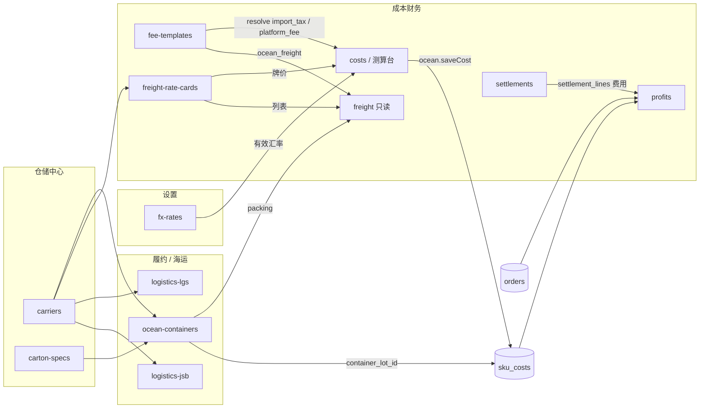
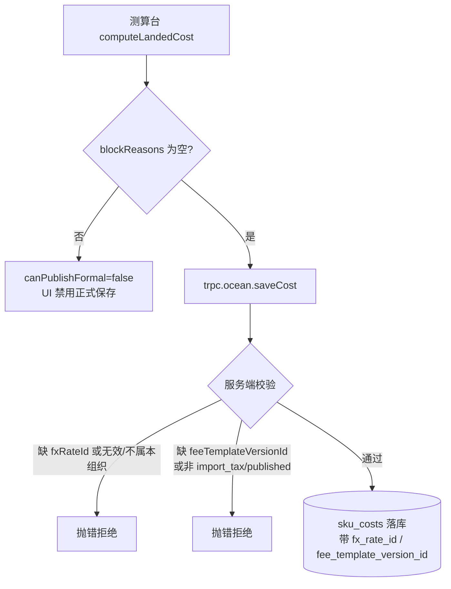

# 成本财务生产闭环（PR #64–#68）

> 状态：**已合入 develop**（基线含 #68）。日期：2026-11-07（Asia/Shanghai）。  
> 复审更新：**2026-11-08**（Asia/Shanghai）——G1–G9 缺口复审完成，状态见 [§9 复审状态](#9-复审-g1g9-状态2026-11-08)。  
> 范围：控制台成本财务组页面关联、导航方案 B、迁移（现为 `0000` / `0001` / `0002_glamorous_bruce_banner`，原 `0012`/`0013` 已并入，见 §4）、去 mock 规则与数据流。  
> 关联：[`shop-module5-fee-templates-trpc.md`](shop-module5-fee-templates-trpc.md)、[`shop-module13-finance-sync-dashboard-trpc.md`](shop-module13-finance-sync-dashboard-trpc.md)、[`shop-module7-ocean-trpc.md`](shop-module7-ocean-trpc.md)、[`haoshiyun-erp-console-menu-ia.md`](haoshiyun-erp-console-menu-ia.md) §3.8 / §5、[`freight-estimation-design.md`](freight-estimation-design.md)。

## 1. 目标与结论

将成本财务从「半接 + demo/localStorage」收成可部署的生产主链：

1. **费用解析 → 到岸测算 → 柜次 `sku_costs` → 利润派生** 只读/写 PostgreSQL。
2. **结算**支持 CSV/JSON 手工导入 + Lazop（Daraz/Lazada）平台同步入队；非 Lazop 不写假成功。
3. **运价卡**独立主档；运费页只读拼装运价卡 / `ocean_freight` 模板 / 海运装箱。
4. **承运商 / 箱规**迁出成本财务组（导航方案 B），挂到仓储中心，并被海运 / LGS / JSB 引用。
5. **禁止**演示文案、未引用 demo store、localStorage 双写正式成本。

| PR | 摘要 |
| --- | --- |
| #64 | 闭环骨架：运价卡表、费用类型 `ocean_freight`、测算强制汇率/模板、结算导入、导航 B、去 mock |
| #65 | 运价卡 CRUD 页、海运承运商/箱规选择、结算确认 UX |
| #66 | `finance.syncSettlementsFromPlatform`、LGS/JSB `carrier_id`（历史迁移 0013） |
| #67 | 死 demo 与导航缺口清理 |
| #68 | 删除未引用 `fx-rate-store` / `sku-cost-version-store` / `ocean-container-store` |

部署须跑 `pnpm --filter @workspace/db db:migrate`。迁移文件现状见 §4（2026-11-08 重生成后仅 `0000`/`0001`/`0002`，`db:check` 通过）。

## 2. 导航方案 B（`console-nav.ts`）

### 2.1 成本财务组（保留）

| 路由 | 用途 |
| --- | --- |
| `/console/costs` | SKU/柜次成本列表 + 到岸测算工作台；正式写回 `ocean.saveCost` → `sku_costs` |
| `/console/fee-templates` | 费用模板头+版本（`import_tax` / `platform_fee` / `ocean_freight`）审核与 resolve |
| `/console/settlements` | 结算批次列表/详情；状态确认；CSV/JSON 导入；Lazop 拉取 |
| `/console/profits` | 订单/SKU 利润（营收 − 最新柜次成本 − 结算/物流费用）；只读派生 |
| `/console/freight-rate-cards` | 运价卡 CRUD（空运/LCL/FCL 牌价） |
| `/console/freight` | 运费测算只读拼盘（运价卡 + ocean_freight 模板 + ocean packing） |

### 2.2 迁出至仓储中心

| 路由 | 用途 | 消费方 |
| --- | --- | --- |
| `/console/carriers` | 承运商主档（`commerce_carriers`），支持 `remove`（被引用拒绝，见 §5） | 海运柜次、运价卡、LGS/JSB 批次 |
| `/console/carton-specs` | 箱规主档（`commerce_carton_specs`），支持 `remove` | 海运装箱行 `carton_spec_code` |

### 2.3 设置区（汇率）

| 路由 | 用途 |
| --- | --- |
| `/console/settings/fx-rates` | 组织汇率 `fx_rates`；测算强制选用有效汇率；`sku_costs.fx_rate_id` FK |

`/console/finance` 已重定向至 `settlements`，不再并存菜单入口。

## 3. 页面业务关联

### 3.1 数据流（正式路径）

1. **费用解析**：测算台对 `import_tax` / `platform_fee` 各调 `feeTemplates.resolve`；未命中或缺组件则 `blockReasons` 阻断（`canPublishFormal=false`），**不可**落正式成本（禁止静默回退当正式值）。
2. **汇率**：读 `fxRates`；测算保存时服务端强制校验 `fxRateId`（有效且属本组织）与 `feeTemplateVersionId`（`import_tax` 且 `published`），写入 `sku_costs.fx_rate_id`（列在 `0000`，FK 在 `0002`）。
3. **运价**：优先 `freightRateCards`；可选箱规体积辅助；不再使用内存 `FREIGHT_RATES` / localStorage。
4. **落库成本**：仅 `trpc.ocean.saveCost` → `sku_costs`（`container_lot_id` ↔ `ocean_shipments.id`；行上可挂 `sku_cost_id`）。
5. **利润**：`finance.listProfits`（`view=order|sku`）/ `getProfit` / `profitKpis`：营收 − 最新 SKU 成本 − 结算/物流费；无结算 →「未结算」。SKU 视图按订单收入占比分摊结算/物流费用（`listSkuProfits`，数据库级分页）。
6. **结算**：
   - `finance.importSettlements`：CSV/JSON 行写入 `settlements` + `settlement_lines`；
   - `finance.syncSettlementsFromPlatform`：入队 `sync_tasks` 并调用 `apps/api` → `syncSettlementsForShop`（仅 Lazop）；能力探针 `settlementSync`；
   - `finance.updateSettlementStatus`：确认/打款等状态变更（需确认 UX）。

正式成本发布阻断链（G2，服务端 + 测算台同口径）：

`blockReasons` 判定（`cost-calculator.ts`）：缺有效汇率、未命中进口税模板、进口税模板缺组件、未命中平台费模板、缺运价卡或手工运费总额——任一命中即 `canPublishFormal=false`。

## 4. 表结构与迁移

> **2026-11-08 迁移重生成（复审 G1）**：`drizzle-kit generate` 重生成后，`packages/db/drizzle/` 仅保留：
>
> | 文件 | 内容 |
> | --- | --- |
> | `0000_flashy_silver_samurai.sql` | 基线全量（96 CREATE：`fee_templates` / `fee_template_versions` / `sku_costs` / `commerce_carriers` / `commerce_carton_specs` / `fx_rates` 等基表，含 `sku_costs.fx_rate_id`、`fee_template_version_id` 列） |
> | `0001_parched_namora.sql` | `commerce_brands.cover_image` |
> | `0002_glamorous_bruce_banner.sql` | 历史 0002–0019 全部增量（8 CREATE + ALTER/FK/索引，含下表两节内容） |
>
> `meta/_journal.json` 仅 3 条；`pnpm --filter @workspace/db db:check` 通过（Everything's fine）。原 `0012_cost_finance_closure.sql` / `0013_fulfillment_batch_carrier.sql` 文件已删除，其 DDL 现存于 `0002_glamorous_bruce_banner.sql`。**历史文档中的 `0005`–`0019` 编号均为旧编号，以本节为准。**

### 4.1 原 `0012_cost_finance_closure` 内容（现于 `0002_glamorous_bruce_banner.sql`）

| 变更 | 说明 |
| --- | --- |
| `fee_templates.type` | 语义扩展含 `ocean_freight`（`feeTemplateTypes` TS union；varchar 列，无 DB enum 迁移） |
| `ocean_shipments.carrier_id` | FK → `commerce_carriers.id`（ON DELETE SET NULL） |
| `ocean_shipment_boxes.carton_spec_code` | 箱规 code 引用（逻辑关联主档） |
| `sku_costs.fx_rate_id` | FK → `fx_rates.id`（列在 `0000`，FK 约束在 `0002`） |
| **新建** `commerce_freight_rate_cards` | 组织运价卡：mode / carrier / 费率 / 港口 / 有效期 / status |

### 4.2 原 `0013_fulfillment_batch_carrier` 内容（现于 `0002_glamorous_bruce_banner.sql`）

| 变更 | 说明 |
| --- | --- |
| `fulfillment_batches.carrier_id` | FK → `commerce_carriers.id`；LGS/JSB 与海运同模式 |

> 说明：`fee_templates` / `sku_costs` / `commerce_carriers` / `commerce_carton_specs` / `fx_rates` 基表在 `0000` 已存在；本轮是补 FK、类型语义与运价卡，不是新建费用模板表。历史文档若写「费用模板 migration 0012」指旧编号习惯，**以本节与 `packages/db/drizzle/0002_glamorous_bruce_banner.sql` 为准**。

## 5. tRPC 面（本轮相关）

| Router | 关键过程 |
| --- | --- |
| `feeTemplates` | CRUD + 审核 + `resolve`；类型含 `ocean_freight` |
| `finance` | `overview` / `listCosts` / `listProfits`（`view=order\|sku`，SKU 视图按收入占比分摊费用） / `getProfit` / `profitKpis` / `listSettlements` / `getSettlement` / `settlementStats` / `updateSettlementStatus` / `importSettlements` / `syncSettlementsFromPlatform` / `listFreight` / `getFreight` / `meta`（含 `settlementSync`）；列表均为数据库级分页（count + limit/offset） |
| `freightRateCards` | 运价卡 list/get/create/update |
| `carriers` / `cartonSpecs` | 主档 CRUD + **`remove`**（被海运柜次/履约批次/运价卡/装箱行引用时拒绝，引导改「停用」；`dataaccess/carriers.ts` `removeCarrier`） |
| `fxRates` | 汇率维护 |
| `ocean` | `saveCost`（服务端强制 `fxRateId` + `feeTemplateVersionId`，见 §3.1）；shipment create/update 带 `carrierId`；box 带 `cartonSpecCode` |
| `logistics`（LGS/JSB） | 批次 create/update 解析 `carrierId` → 冗余 carrier 标签 |

## 6. 去 mock / 禁止项

| 禁止 | 正式替代 | 状态（2026-11-08） |
| --- | --- | --- |
| localStorage / demo store 写正式成本或汇率 | `ocean.saveCost`、`fxRates`、`feeTemplates.resolve` | ✅ 已执行；#68 已删 `fx-rate-store` / `sku-cost-version-store` / `ocean-container-store` |
| 未命中模板仍落「正式」成本 | `blockReasons` 阻断（§3.1）+ 服务端强制校验 | ✅ `cost-calculator.test.ts` 10 用例覆盖 |
| 结算按钮假成功（非 Lazop / 无凭据） | `settlementSync` 能力探测；按钮禁用或返回清晰错误 | ✅ |
| 文案声称已调平台但仅写本地 | 同步任务笔记写明 `apps/api` 路径；禁止夸大 | ✅ |
| 平台费率缺组件回退 8%/2% 等写死值 | `getPlatformFeePercents` 未解析返回 0；`TARIFF_PROFILES` 税率全 0（`reviewNeeded: true`）；seed 模板占位费率属 DB 配置数据，非代码回退 | ✅ G4 |
| 已删除文件 | `fx-rate-store.ts`、`sku-cost-version-store.ts`、`ocean-container-store.ts`（#68）；`mock-data.ts` 等 17 个死 store（2026-11-08，见 §9 G7/G9） | ✅ |

仍**刻意不做**（边界）：非 Lazop 结算适配器、店铺 OAuth 重写、完整独立运费引擎 UED（见 `freight-estimation-design.md`）全量实现。

## 7. 验收清单

- [x] 迁移文件重生成且 `db:check` 通过（2026-11-08：`0000`/`0001`/`0002`，journal 3 条）；`commerce_freight_rate_cards` 可 CRUD。
- [x] 成本财务侧栏无承运商/箱规；仓储中心可见二者。
- [x] 测算选用汇率 + 费用模板后，`saveCost` 产生带 `fx_rate_id` / `container_lot_id` 的 `sku_costs`；缺任一服务端拒绝（`dataaccess/ocean.ts`）。
- [x] 利润页能看到成本与结算费用扣减；无结算显示「未结算」；SKU 视图按收入占比分摊费用（`listSkuProfits`）。
- [x] 结算：导入成功；Lazop 有凭据时可同步；无能力时不假成功。
- [x] 海运/LGS/JSB 可选承运商；海运箱可选箱规 code；承运商/箱规支持 `remove`（被引用拒绝）。
- [x] 仓库内无上述三个已删 demo store；17 个死 store 与 `apps/web` mock-data 已删（见 §9 G7/G9）。
- [x] 正式成本阻断与费率归零有测试：`pnpm --filter shop test:crossborder` → tests 10 / pass 10 / fail 0。

> 遗留「演示/示例」文案与被引用暂留文件见 §9 G9「已知遗留」。

## 8. 关键路径

| 路径 | 说明 |
| --- | --- |
| `apps/shop/src/lib/console-nav.ts` | 导航 B |
| `apps/shop/src/lib/server/routers/{finance,freight-rate-cards,carriers,carton-specs,fx-rates,ocean,fee-templates}.ts` | tRPC |
| `apps/shop/src/lib/server/dataaccess/{finance,freight-rate-cards,ocean,logistics,carriers,...}.ts` | DB |
| `apps/shop/src/lib/crossborder/cost-calculator.ts` | 测算与 `blockReasons` 阻断 |
| `apps/shop/src/lib/crossborder/cost-calculator.test.ts` | G2/G4 测试（10 用例） |
| `packages/db/drizzle/0000_flashy_silver_samurai.sql` | 基线（含 `sku_costs` 基表与列） |
| `packages/db/drizzle/0002_glamorous_bruce_banner.sql` | 运价卡、carrier/carton/fx FK、履约批次承运商等（原 0012/0013/0014… 并入） |
| `packages/db/src/commerce-schema.ts` | Drizzle 定义 |

## 9. 复审 G1–G9 状态（2026-11-08）

来源：复审报告 G1–G9 缺口清单（迁移重复、服务端校验、利润口径、费率回退、删除能力、测试、文档陈旧、分页、文案/mock 残留）。仅改文档，不改代码。

| # | 缺口 | 状态 | 完成证据 / 遗留 |
| --- | --- | --- | --- |
| G1 | 迁移重复（0012/0013/0014 重复 DDL）、无法验证已应用 | ✅ 已完成 | `drizzle-kit generate` 重生成为 `0000`/`0001`/`0002_glamorous_bruce_banner.sql`（journal 3 条，snapshot 齐）；旧 `0002`–`0019` 文件删除；`pnpm --filter @workspace/db db:check` 通过。目标库应用仍需部署时 `db:migrate` |
| G2 | 正式成本阻断仅客户端 | ✅ 已完成 | `cost-calculator.ts` `blockReasons`/`canPublishFormal`（缺汇率/进口税未命中或缺组件/平台费未命中/缺运费）；`dataaccess/ocean.ts` 服务端强制 `fxRateId`（active 且属组织）+ `feeTemplateVersionId`（import_tax + published）；UI 禁用保存 |
| G3 | SKU 利润不扣结算/物流费用 | ✅ 已完成 | `dataaccess/finance.ts` `listSkuProfits`：按订单收入占比分摊结算/物流费用；settled 依费用订单判定 |
| G4 | 费率硬编码回退（8%/2%、LK_SEED_RATES） | ✅ 已完成 | `fee-template-store.ts` 无 `LK_SEED_RATES` 回退（grep 0 命中）；`getPlatformFeePercents` 未解析返回 0；`cost-calculator.ts` `TARIFF_PROFILES` 税率全 0。seed 脚本 `LK_SEED_RATES` 仅用于生成 DB 费用模板占位组件（发布态配置数据，非代码回退） |
| G5 | carriers / cartonSpecs 无删除 | ✅ 已完成 | routers `remove`（`carriers.ts:63` / `carton-specs.ts:66`）；`removeCarrier` 被海运柜次/履约批次/运价卡引用时拒绝并引导停用；详情页删除按钮 |
| G6 | 无成本测算测试 | ✅ 已完成 | `cost-calculator.test.ts` 10 用例（G2 阻断 / G4 费率归零）；`apps/shop/package.json` script `test:crossborder`；实测 tests 10 / pass 10 / fail 0 |
| G7 | 文档与实现不一致（本项本身） | ✅ 本会话完成 | 本文件 §4/§5/§7/§9 重写；`README.md`、`apps/web/README.md`、`apps/shop/README.md`、`console-dropdown-data-maintenance.md`、`erp-console-ued-plan.md`、各模块文档迁移号/mock 陈述、`shop-module8` §3.5 等更新；`docs/design/INDEX.md` 登记 |
| G8 | 分页非数据库级 / 拉全量聚合 | ✅ 已完成 | `listSkuProfits` group-by 子查询 + count + limit/offset；`listFreightEstimates` UNION ALL + count + 分页；`profitTotals`/`profitKpis`/`financeOverview` SQL 聚合 |
| G9 | 文案不符（本机快照）/ mock 残留 | 🟡 部分完成 | 已修复：测算台文案改「测算草稿仅存本机会话，不参与正式成本」；订单店铺名兜底 `${platform} 店铺`（无 Demo Shop）；售后审核/驳回「待回传平台」；Copilot 兜底「未接入模型服务」；OTP 仅写服务端日志；`apps/web` `platformOps` 真实 tRPC（dashboardStats/syncHealth/pendingActions 三页已接），`mock-data.ts`/`demo-alert.tsx` 已删。**已知遗留**（见下） |

### 9.1 G9 已知遗留（进行中）

| 遗留 | 说明 |
| --- | --- |
| `aftersale-store.ts` 被 3 个详情页引用 | `aftersale-returns[aftersale-cancels/aftersales]/[id]` 的 `toRelated*Shape` 仍 import 该文件；其内部 import `wms-store`/`local-store`，`approveCancel` 仍写「平台已同步（示例）」——主路径已走 dataaccess，此为兼容壳（进行中：迁 `toRelated*` 后删） |
| `mappings/page.tsx` 兜底 `DEMO-${total+1}` | 新建映射未填 sellerSku 时的兜底生成（进行中：改校验必填或服务端生成） |
| `compliance-hs-slsi` 演示行 | 「SLSI 强制认证（演示数据）」来自页面内导入清单模拟（进行中：接真实 HS 清单源） |
| 营销页示例文案 | `(marketing)` 计费示例、平台能力示例等（进行中：按商业口径定稿） |
| `lib/console/related-ops-data.ts` | 疑似零引用死文件（进行中：确认后删除） |
| `UedPrototypeNotice` 组件 | 仍在（中性样式「原型说明」，55 处使用）；文案已如实，不宣称真实数据（进行中：按页逐步移除） |

> G1–G6/G8 证据均为本会话实测（grep / 测试 / `db:check`）；G7 为本文档及关联文档更新；G9 按上表逐项标注。
