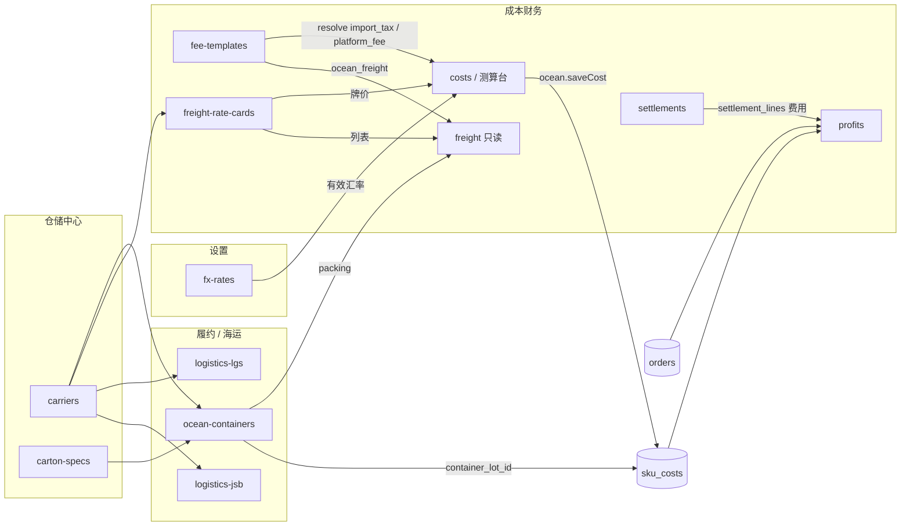

# 成本财务生产闭环（PR #64–#68）

> 状态：**已合入 develop**（基线含 #68）。日期：2026-11-07（Asia/Shanghai）。  
> 范围：控制台成本财务组页面关联、导航方案 B、迁移 `0012`/`0013`、去 mock 规则与数据流。  
> 关联：[`shop-module5-fee-templates-trpc.md`](shop-module5-fee-templates-trpc.md)、[`shop-module13-finance-sync-dashboard-trpc.md`](shop-module13-finance-sync-dashboard-trpc.md)、[`shop-module7-ocean-trpc.md`](shop-module7-ocean-trpc.md)、[`haoshiyun-erp-console-menu-ia.md`](haoshiyun-erp-console-menu-ia.md) §3.8 / §5、[`freight-estimation-design.md`](freight-estimation-design.md)。

## 1. 目标与结论

将成本财务从「半接 + demo/localStorage」收成可部署的生产主链：

1. **费用解析 → 到岸测算 → 柜次 `sku_costs` → 利润派生** 只读/写 PostgreSQL。
2. **结算**支持 CSV/JSON 手工导入 + Lazop（Daraz/Lazada）平台同步入队；非 Lazop 不写假成功。
3. **运价卡**独立主档；运费页只读拼装运价卡 / `ocean_freight` 模板 / 海运装箱。
4. **承运商 / 箱规**迁出成本财务组（导航方案 B），挂到仓储中心，并被海运 / LGS / JSB 引用。
5. **禁止**演示文案、未引用 demo store、localStorage 双写正式成本。

| PR | 摘要 |
| --- | --- |
| #64 | 闭环骨架：运价卡表、费用类型 `ocean_freight`、测算强制汇率/模板、结算导入、导航 B、去 mock |
| #65 | 运价卡 CRUD 页、海运承运商/箱规选择、结算确认 UX |
| #66 | `finance.syncSettlementsFromPlatform`、LGS/JSB `carrier_id`（迁移 0013） |
| #67 | 死 demo 与导航缺口清理 |
| #68 | 删除未引用 `fx-rate-store` / `sku-cost-version-store` / `ocean-container-store` |

部署须跑迁移 **`0012_cost_finance_closure`**、**`0013_fulfillment_batch_carrier`**。

## 2. 导航方案 B（`console-nav.ts`）

### 2.1 成本财务组（保留）

| 路由 | 用途 |
| --- | --- |
| `/console/costs` | SKU/柜次成本列表 + 到岸测算工作台；正式写回 `ocean.saveCost` → `sku_costs` |
| `/console/fee-templates` | 费用模板头+版本（`import_tax` / `platform_fee` / `ocean_freight`）审核与 resolve |
| `/console/settlements` | 结算批次列表/详情；状态确认；CSV/JSON 导入；Lazop 拉取 |
| `/console/profits` | 订单/SKU 利润（营收 − 最新柜次成本 − 结算/物流费用）；只读派生 |
| `/console/freight-rate-cards` | 运价卡 CRUD（空运/LCL/FCL 牌价） |
| `/console/freight` | 运费测算只读拼盘（运价卡 + ocean_freight 模板 + ocean packing） |

### 2.2 迁出至仓储中心

| 路由 | 用途 | 消费方 |
| --- | --- | --- |
| `/console/carriers` | 承运商主档（`commerce_carriers`） | 海运柜次、运价卡、LGS/JSB 批次 |
| `/console/carton-specs` | 箱规主档（`commerce_carton_specs`） | 海运装箱行 `carton_spec_code` |

### 2.3 设置区（汇率）

| 路由 | 用途 |
| --- | --- |
| `/console/settings/fx-rates` | 组织汇率 `fx_rates`；测算强制选用有效汇率；`sku_costs.fx_rate_id` FK |

`/console/finance` 已重定向至 `settlements`，不再并存菜单入口。

## 3. 页面业务关联

### 3.1 数据流（正式路径）

1. **费用解析**：测算台对 `import_tax` / `platform_fee` 各调 `feeTemplates.resolve`；未命中则**不可**落正式成本（禁止静默回退当正式值）。
2. **汇率**：读 `fxRates`；测算保存时写入 `sku_costs.fx_rate_id`（0012 FK）。
3. **运价**：优先 `freightRateCards`；可选箱规体积辅助；不再使用内存 `FREIGHT_RATES` / localStorage。
4. **落库成本**：仅 `trpc.ocean.saveCost` → `sku_costs`（`container_lot_id` ↔ `ocean_shipments.id`；行上可挂 `sku_cost_id`）。
5. **利润**：`finance.listProfits` / `getProfit`：营收 − 最新 SKU 成本 − 结算/物流费；无结算 →「未结算」。
6. **结算**：
   - `finance.importSettlements`：CSV/JSON 行写入 `settlements` + `settlement_lines`；
   - `finance.syncSettlementsFromPlatform`：入队 `sync_tasks` 并调用 `apps/api` → `syncSettlementsForShop`（仅 Lazop）；能力探针 `settlementSync`；
   - `finance.updateSettlementStatus`：确认/打款等状态变更（需确认 UX）。

## 4. 表结构与迁移

### 4.1 `0012_cost_finance_closure.sql`

| 变更 | 说明 |
| --- | --- |
| `fee_templates.type` | 扩展语义含 `ocean_freight`（与 `import_tax` / `platform_fee` 并列） |
| `ocean_shipments.carrier_id` | FK → `commerce_carriers.id`（ON DELETE SET NULL） |
| `ocean_shipment_boxes.carton_spec_code` | 箱规 code 引用（逻辑关联主档） |
| `sku_costs.fx_rate_id` | FK → `fx_rates.id` |
| **新建** `commerce_freight_rate_cards` | 组织运价卡：mode / carrier / 费率 / 港口 / 有效期 / status |

### 4.2 `0013_fulfillment_batch_carrier.sql`

| 变更 | 说明 |
| --- | --- |
| `fulfillment_batches.carrier_id` | FK → `commerce_carriers.id`；LGS/JSB 与海运同模式 |

> 说明：`fee_templates` / `sku_costs` / `commerce_carriers` / `commerce_carton_specs` / `fx_rates` 基表在早期 commerce schema（`0000`）已存在；本轮是补 FK、类型与运价卡，不是新建费用模板表。历史文档若写「费用模板 migration 0012」指旧编号习惯，**以本文件与 `packages/db/drizzle/0012_cost_finance_closure.sql` 为准**。

## 5. tRPC 面（本轮相关）

| Router | 关键过程 |
| --- | --- |
| `feeTemplates` | CRUD + 审核 + `resolve`；类型含 `ocean_freight` |
| `finance` | `listCosts` / `listProfits` / `getProfit` / `profitKpis` / `listSettlements` / `getSettlement` / `updateSettlementStatus` / `importSettlements` / `syncSettlementsFromPlatform` / `listFreight` / `getFreight` / `meta`（含 `settlementSync`） |
| `freightRateCards` | 运价卡 list/get/create/update |
| `carriers` / `cartonSpecs` | 主档 CRUD（含 update） |
| `fxRates` | 汇率维护 |
| `ocean` | `saveCost`；shipment create/update 带 `carrierId`；box 带 `cartonSpecCode` |
| `logistics`（LGS/JSB） | 批次 create/update 解析 `carrierId` → 冗余 carrier 标签 |

## 6. 去 mock / 禁止项

| 禁止 | 正式替代 |
| --- | --- |
| localStorage / demo store 写正式成本或汇率 | `ocean.saveCost`、`fxRates`、`feeTemplates.resolve` |
| 未命中模板仍落「正式」成本 | 阻断或明确标记非生产 |
| 结算按钮假成功（非 Lazop / 无凭据） | `settlementSync` 能力探测；按钮禁用或返回清晰错误 |
| 文案声称已调平台但仅写本地 | 同步任务笔记写明 `apps/api` 路径；禁止夸大 |
| 已删除文件 | `fx-rate-store.ts`、`sku-cost-version-store.ts`、`ocean-container-store.ts`（#68） |

仍**刻意不做**（边界）：非 Lazop 结算适配器、店铺 OAuth 重写、完整独立运费引擎 UED（见 `freight-estimation-design.md`）全量实现。

## 7. 验收清单

- [ ] 迁移 0012/0013 已应用；`commerce_freight_rate_cards` 可 CRUD。
- [ ] 成本财务侧栏无承运商/箱规；仓储中心可见二者。
- [ ] 测算选用汇率 + 费用模板后，`saveCost` 产生带 `fx_rate_id` / `container_lot_id` 的 `sku_costs`。
- [ ] 利润页能看到成本与结算费用扣减；无结算显示「未结算」。
- [ ] 结算：导入成功；Lazop 有凭据时可同步；无能力时不假成功。
- [ ] 海运/LGS/JSB 可选承运商；海运箱可选箱规 code。
- [ ] 仓库内无上述三个已删 demo store；无「演示数据」误导文案。

## 8. 关键路径

| 路径 | 说明 |
| --- | --- |
| `apps/shop/src/lib/console-nav.ts` | 导航 B |
| `apps/shop/src/lib/server/routers/{finance,freight-rate-cards,carriers,carton-specs,fx-rates,ocean,fee-templates}.ts` | tRPC |
| `apps/shop/src/lib/server/dataaccess/{finance,freight-rate-cards,ocean,logistics,...}.ts` | DB |
| `packages/db/drizzle/0012_cost_finance_closure.sql` | 运价卡与 FK |
| `packages/db/drizzle/0013_fulfillment_batch_carrier.sql` | 履约批次承运商 |
| `packages/db/src/commerce-schema.ts` | Drizzle 定义 |
