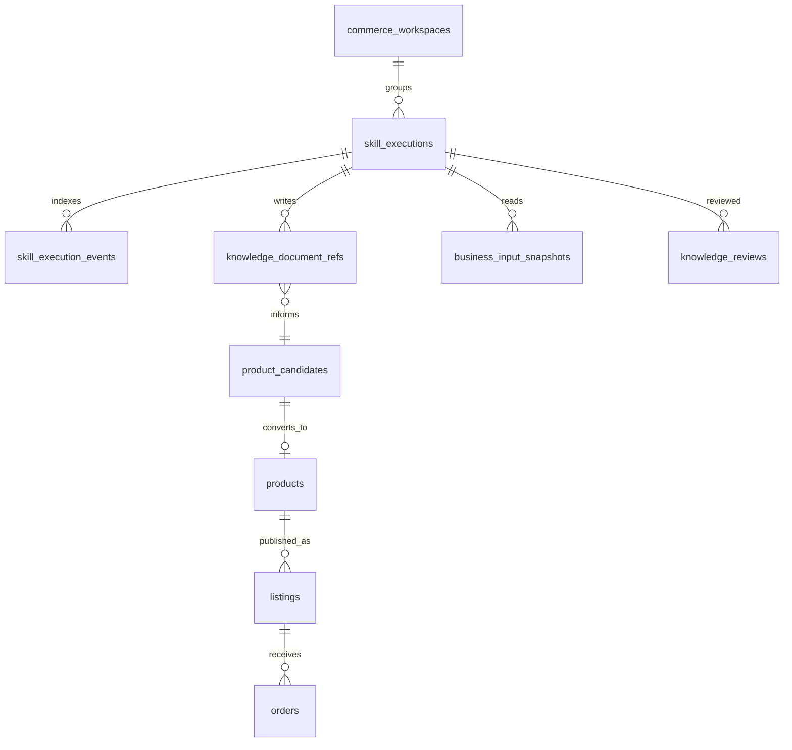

# 跨境运营域：数据库设计（Drizzle / PostgreSQL）

> **状态：现状基线（v0）。** 本文描述 `commerce-schema.ts` 已落地的早期跨境域表结构。好时运 ERP 目标演进（域 A–K，约 75 表）以 [haoshiyun-erp-database-schema.md](haoshiyun-erp-database-schema.md) 为**权威**——库存共享池、成本写路径、Seller SKU 映射、审计列集等均已由权威文档重定义；本文中标注的差异处以权威为准。

**归属：** `packages/db`  
**原则：** 复用 `auth-schema` 的 `organization` / `member` / `session.activeOrganizationId`；业务表强制 `organization_id`；外部平台 ID 只进映射表。Open Shop 为 Desktop/Skill 提供跨境业务输入数据接口，并通过 MCP 接收、保存 Skill 的执行结果和过程数据。完整知识内容进入基于 LLM Wiki（Open Knowledge Format，OKF）的电商知识库；PostgreSQL 只保存业务数据和访问/检索/关联所需的索引元数据，不复制成固定步骤的研究流程数据库。平台动作仍经过统一 domain 与待审策略。

---

## 1. 文件规划

```
packages/db/src/
  auth-schema.ts          # 已有，保留
  feishu-schema.ts        # 已有，MVP 不依赖
  commerce-schema.ts      # 新增：跨境运营域
  schema.ts               # 聚合导出
```

迁移：`0005_crossborder_commerce.sql` → `0006_commerce_lean_payload.sql` → `0007_commerce_platform_enrichment.sql`（编号以 journal 实际为准）。

**知识库边界：** 本文 3.15 起为 Skill execution/OKF 索引设计建议，不表示相应 Drizzle 表已实现。实现前需确定 LLM Wiki/OKF provider 的稳定 ID、ACL、revision 和幂等写入接口。Open Shop SQL 不存完整知识正文。

---

## 2. 枚举

```ts
platform: 'daraz' | 'lazada' | 'shopee' | 'tiktok_shop'
shop_status: 'draft' | 'connecting' | 'active' | 'error' | 'disabled'
sync_status: 'idle' | 'running' | 'success' | 'error'
listing_status: 'draft' | 'pending_review' | 'submitted' | 'live' | 'failed' | 'archived'
order_status: 'created' | 'paid' | 'ready_to_ship' | 'shipped' | 'delivered' | 'cancelled' | 'unknown'
pending_action_status: 'pending' | 'confirmed' | 'executing' | 'failed' | 'cancelled' | 'expired'
pending_action_kind: 'sourcing_upsert' | 'listing_submit' | 'price_change' | 'inventory_push' | 'settlement_post'
entity_type: 'product' | 'variant' | 'listing' | 'order' | 'shop'
knowledge_sync_status: 'pending' | 'synced' | 'failed' | 'deleted'
execution_status: 'started' | 'completed' | 'failed' | 'cancelled' | 'interrupted'
review_status: 'pending' | 'approved' | 'rejected' | 'changes_requested'
actor_kind: 'user' | 'agent' | 'system' | 'marketplace'
```

MVP 运行时只启用 `daraz`。

---

## 3. 表设计

### 3.1 shops（店铺）

| 列 | 类型 | 说明 |
|----|------|------|
| id | text pk | cuid |
| organization_id | text not null | → organization |
| platform | varchar | 见枚举 |
| name | text | 展示名 |
| external_shop_id | text | 平台侧店铺 id（可空至连接成功） |
| status | varchar | shop_status |
| region | varchar | 如 `pk` / `bd` |
| currency | varchar(3) | 默认店铺币种 |
| timezone | varchar(64) | IANA，如 Asia/Colombo |
| seller_name | text | 平台侧卖家名 |
| marketplace_country | varchar(16) | 站点/国家码 lk/my/… |
| auth_expires_at | timestamptz | token 过期（列表用） |
| last_sync_at | timestamptz | 最近成功同步 |
| meta | jsonb | 平台扩展（cipher 提示等） |
| created_at / updated_at | timestamptz | |
| deleted_at | timestamptz | 软删 |

唯一：`(organization_id, platform, external_shop_id)` where external not null。

### 3.2 integration_credentials

| 列 | 说明 |
|----|------|
| id | pk |
| organization_id | |
| shop_id | → shops |
| kind | oauth / api_key / … |
| payload_encrypted | text/bytea | 密文 |
| expires_at | |
| created_at / updated_at | |

### 3.3 integration_states

| 列 | 说明 |
|----|------|
| id | pk |
| shop_id | unique |
| orders_cursor | text |
| inventory_cursor | text |
| last_orders_sync_at | |
| last_inventory_sync_at | |
| health | sync_status |
| last_error | text |

### 3.4 integration_logs

审计：shop_id、direction(in/out)、action、request_id、status、message、payload_summary、created_at。索引 `(shop_id, created_at desc)`。

### 3.5 products / product_variants

本地主数据（非平台交易源）。

**products：** id, organization_id, title, status, source(`manual`|`sourcing`|`import`), brand, category_hint, images jsonb, weight_grams, length_mm / width_mm / height_mm, payload jsonb（description 等）, created_at, updated_at, deleted_at  

**product_variants：** id, organization_id, product_id, sku, barcode, attrs jsonb, created_at, updated_at  

### 3.6 listings

| 列 | 说明 |
|----|------|
| id | |
| organization_id | |
| shop_id | |
| product_id / variant_id | |
| status | listing_status |
| title | 列表展示标题（长文案进 payload） |
| external_item_id | 平台 item / product id |
| brand_external_id / brand_name | 平台品牌 |
| category_external_id | 平台类目 id |
| category_path | 类目面包屑（列表） |
| attributes | jsonb 结构化属性 |
| price_amount / price_currency | 列表金额 |
| stock_on_hand | 可售库存 |
| warehouse_code | 仓编码 |
| logistics_channel | 物流渠道 |
| publish_state | 平台上架态 ACTIVE/… |
| last_error | |
| payload | jsonb 平台原稿 / description / 图片 |
| submitted_at / live_at | |
| 唯一 | (shop_id, external_item_id) |

### 3.7 external_id_mappings

> **注意：** Seller SKU → 内部 SKU 的**权威映射路径已改为** `seller_sku_mappings`（唯一键 `(organization_id, shop_id, seller_sku)`，见权威 §3.2）。本表现仅承载非 SKU 实体（订单/结算/评论等外部 ID）；`(shop_id, entity_type, internal_id)` 侧唯一键需放宽为 1:N（见权威 §12）。

| 列 | 说明 |
|----|------|
| id | |
| organization_id | |
| shop_id | |
| entity_type | |
| internal_id | |
| external_id | |
| sync_status | |
| last_synced_at | |
| meta | jsonb |

唯一：`(shop_id, entity_type, external_id)`；`(shop_id, entity_type, internal_id)`。

### 3.8 orders / order_lines

平台订单镜像。

**orders：** id, organization_id, shop_id, external_order_id, status, platform_status, fulfillment_status, placed_at, paid_at, currency, total_amount, buyer_region, payment_method, shipping_provider, tracking_number, package_id, raw jsonb（buyerNameMask / shippingAmount / city 等）, created_at, updated_at  

**order_lines：** id, order_id, organization_id, external_line_id, sku, title, qty, unit_price, variant_id null, fulfillment_status, package_id, tracking_number, shipping_provider  

唯一：`(shop_id, external_order_id)`。

### 3.9 inventory_balances / stock_alerts

> **注意（迁移前现状）：** 权威 §5.1/§5.5/§12 已重构为**共享库存池**——余额按 `(organization_id, warehouse_id, bin_id, variant_id)` 归集，**店铺不再持有库存余额**；`stock_alerts` 改挂 warehouse+variant、双阈值 `threshold_out`/`threshold_in`、新增 `muted` 状态。本节为迁移前 `shop_id + variant` 拆分结构的现状记录。

**inventory_balances（现状）：** organization_id, shop_id, variant_id, on_hand, reserved, updated_at；唯一 `(shop_id, variant_id)`  

**stock_alerts（现状）：** organization_id, shop_id, variant_id, threshold, triggered_at, status(`open`|`acked`)

### 3.10 cost_components

> **注意：** 权威 §12 已裁定 `cost_components` 为**只读归档**；写路径改为 `cost_template_versions` + `sku_costs`（含 `freight_estimate_id` 逻辑引用），实际发生费用入 `order_fees`。本节为旧写路径的现状记录。

SKU 落地成本组件（现状）：organization_id, variant_id, component(`purchase`|`freight`|`duty`|`other`), amount, currency, note, effective_from。

### 3.11 settlements / settlement_lines

平台结算导入：settlements(shop_id, external_settlement_id, period_start/end, currency, raw)；lines 分摊到 order/variant。

### 3.12 pending_actions（B 级核心）

| 列 | 说明 |
|----|------|
| id | |
| organization_id | |
| shop_id | nullable |
| kind | pending_action_kind |
| status | pending_action_status |
| title | |
| payload | jsonb | 拟写入数据 |
| field_diff | jsonb | 可选 |
| idempotency_key | text | 唯一 per org |
| created_by | user id / `mcp:` / `system` |
| expires_at | |
| confirmed_by / confirmed_at | |
| executed_at / error | |
| created_at / updated_at | |

### 3.13 product_candidates（选品）

OpenWork Agent 可提出、Open Shop 租户运营台复核的候选商品。候选是可运营的业务实体；Skill 运行过程、分析正文和知识证据由 OKF 知识库承载，候选表仅保留运营列表/权限/去重/关联所需的字段，并保存知识库文档引用。

建议字段：`id, organization_id, title, url, category_hint, score numeric nullable, suggested_price numeric nullable, suggested_price_currency, estimated_landed_cost numeric nullable, landed_cost_currency, status, pending_action_id nullable, accepted_by, accepted_at, rejection_reason, knowledge_document_id nullable, knowledge_space_id nullable, source_execution_id nullable, created_by, created_at, updated_at`。高频筛选字段结构化；评分维度、理由和证据正文不在候选表复制，按知识库引用读取。

状态拆分：候选生命周期 `new | accepted | rejected | converted`；若有审核任务则沿用 `pending_actions` 或 review 工作流表达，不将 Skill 步骤状态塞入候选枚举。生成 product 后保留候选记录、知识库引用和关联，不删除来源。

### 3.15 Desktop Skill 执行与 OKF 知识库索引（设计稿）

#### 边界与原则

1. **不固定工作流步骤**：用户可随时更新 Skill、策略、步骤名称、顺序和输出结构。数据库不定义固定步骤枚举、不为 Skill 建固定 step 表；Skill 的真实结构由 OKF 文档与 execution 事件描述。
2. **Open Shop 提供输入接口**：按组织角色和 scope 向 Desktop/Skill 暴露店铺、商品、刊登、订单、库存、成本、结算、类目等业务上下文。输入快照/引用记录在执行元数据中以支持审计，不把完整业务 payload 冗余复制到知识库或索引表。
3. **MCP 是执行数据写入通道**：Skill 通过 MCP 写入运行元数据、过程事件、结构化结果、来源引用、复核状态与业务关联；所有工具经 Open Shop domain service 鉴权、校验、审计和幂等处理。
4. **OKF 知识库保存知识正文**：Skill 的执行结果、过程数据、来源摘要、推理产物（允许持久化的显式产物，不包含隐藏思维链）、人工批注、版本差异、结论和复盘，以 Open Knowledge Format 组织到 LLM Wiki 电商知识库。
5. **PostgreSQL 保存索引而非知识全文**：存租户/项目/运行 ID、OKF space/document/node/version 引用、执行状态、权限/可见性、时间、哈希、关键业务实体关联、检索过滤字段和同步状态；正文、长文本、完整证据集及知识关系由 OKF 知识库负责。
6. **保留人审和业务状态真相**：审批、角色授权、候选商品、商品/刊登/订单/库存/成本/结算和 pending actions 仍由 Open Shop 数据库管理。OKF 是知识内容与过程的权威载体，不取代交易表或业务状态机。
7. **版本追加、来源可追溯**：Skill/策略改变时写入新的 execution 和 OKF revision，旧版本可读、可比较；数据库只保存定位版本所需的 index metadata。
8. **多租户边界**：每条执行索引/项目索引均含 `organization_id`；服务端校验用户 membership、角色、scope、父业务实体归属和知识库 ACL。OKF space/document 访问也必须实现租户隔离。

#### 3.15.1 `commerce_workspaces`（可选的业务上下文索引）

当产品需要在 Shop UI 中管理一个跨多个 Skill execution 的协作上下文时，可使用轻量根实体；否则直接以 OKF `space/document` 为容器，不强制创建项目表。这里的 workspace 是通用业务上下文容器，并不等同于固定的选品/研究 workflow。

建议字段：`id, organization_id, name, status, marketplace, marketplace_country, shop_id nullable, category_hint, owner_user_id, okf_space_id, okf_document_id nullable, current_knowledge_version nullable, created_by, last_activity_at, created_at, updated_at, archived_at`。

此表只提供列表、筛选、组织权限检查和跳转 OKF 的索引；不保存步骤、过程正文、证据正文、评分解释或计算报告。若可见范围由组织角色覆盖，MVP 不建成员子表；若启用上下文级 ACL，只能收窄组织授权。

#### 3.15.2 `skill_executions`（MCP 写入的 Skill 执行索引）

每次 Skill/策略运行一个执行实体。生命周期状态用于运行/结果列表和异常恢复；运行明细与过程事件保存在 OKF。

| 字段 | 说明 |
|---|---|
| `id` | Open Shop 执行 ID |
| `organization_id` | 必须；所有读取按组织隔离 |
| `commerce_workspace_id` | 可空；关联通用业务上下文 |
| `shop_id` | 可空；此次运行所选业务店铺 |
| `actor_user_id` / `actor_kind` | 发起用户及 user/agent/system |
| `skill_id` / `skill_version` | Skill 标识和执行时版本；不推导固定步骤 |
| `strategy_ref` / `strategy_version` | 可选策略引用与版本 |
| `status` | `execution_status` |
| `input_refs` | JSONB 小型引用清单：业务资源 ID、数据范围、时间窗、版本/同步时间；不得复制完整业务 payload |
| `okf_space_id` / `okf_document_id` / `okf_node_id` | OKF 知识库定位引用 |
| `okf_revision_id` / `okf_format_version` | 内容 revision/OKF 格式版本 |
| `result_kind` / `result_summary` | 用于 Shop 列表的短摘要/分类；非正文，不保存长文本 |
| `result_schema_ref` | 可选结构化输出 schema 标识/版本 |
| `idempotency_key` | MCP 重试去重；唯一约束按 org + caller scope |
| `request_id` / `trace_id` | 跨 desktop/MCP/worker 关联 |
| `started_at` / `completed_at` / timestamps | 生命周期 |
| `error_code` / `error_summary` | 安全脱敏摘要，不放敏感 payload |

索引：`(organization_id, created_at desc)`、`(organization_id, commerce_workspace_id, created_at desc)`、`(organization_id, shop_id, created_at desc)`、`(organization_id, status, created_at desc)`；唯一 `(organization_id, idempotency_key)`（按 MCP principal 需要时增加 principal scope）。

#### 3.15.3 `skill_execution_events`（过程事件索引）

用于时间线、人工复核定位和运行排障；不复制 OKF event/document 正文。

`id, organization_id, execution_id, event_key, event_type, sequence_no, actor_kind, actor_id, occurred_at, status, okf_node_id nullable, okf_revision_id nullable, content_hash nullable, summary nullable, metadata_index jsonb, request_id nullable, created_at`。

`event_key`/`event_type` 由 Skill 与 MCP 约定提供，不在 DB enum 中枚举步骤；事件可能是 input_snapshot_created、tool_result、evidence_added、calculation_saved、review_requested、result_published 等，也允许新 Skill 引入新事件类型。使用 `(organization_id, execution_id, sequence_no)` 唯一、`(organization_id, execution_id, occurred_at)` 索引。内容正文、长文本和过程详情进入 OKF。

#### 3.15.4 `knowledge_document_refs`（OKF 知识对象索引）

若一个 execution 关联多个 OKF knowledge object，使用该索引表；否则可将单一 document ref 直接放 `skill_executions`，避免过度建表。

字段：`id, organization_id, execution_id nullable, commerce_workspace_id nullable, object_kind(space|document|node|source|artifact|decision), okf_space_id, okf_document_id nullable, okf_node_id nullable, okf_revision_id nullable, okf_format_version, title_index nullable, content_hash nullable, media_type nullable, source_type nullable, marketplace nullable, marketplace_country nullable, observed_at nullable, knowledge_sync_status, visibility_scope, created_by_kind, created_by, created_at, deleted_at`。

`title_index` 仅为列表显示/搜索辅助；完整正文、长标题、来源片段、解释、分类关系与知识图谱由 OKF 保存。数据库中的筛选字段应控制在产品确需的低基数字段，不将 OKF 的自由 schema 转译成固定 SQL 列。

唯一约束依据 OKF provider 的稳定 object ID：`(organization_id, okf_space_id, okf_document_id, okf_node_id)`（按 nullable 组合设计 partial unique index）；索引 `(organization_id, execution_id, created_at desc)`、`(organization_id, object_kind, knowledge_sync_status, created_at desc)`。

#### 3.15.5 `knowledge_reviews`（人工复核索引，可选）

当 Open Shop UI 需要对 OKF 对象提供待办、审核人、状态过滤时，在 PostgreSQL 保存审核索引；详细批注、逐条评审内容和版本 diff 存入 OKF。若复核完全在 OKF UI 内完成，可不建该表。

字段：`id, organization_id, target_ref_id, okf_revision_id, status(review_status), assigned_to, requested_by, reviewed_by, requested_at, reviewed_at, decision_summary, created_at, updated_at`。关联具体知识对象版本；新 revision 不继承旧审核为已通过。逐条 review item 用 OKF node 表达，SQL 不保存固定 review item schema。

#### 3.15.6 OKF 内容约定与同步一致性

- OKF 是 skill execution 过程与知识正文的权威存储；支持知识节点、来源引用、结构化数据、关系、标记/复核、版本/变更记录及跨 execution 复盘。
- OKF 格式 schema 可以随 Skill/策略演进；保存 `okf_format_version`、`skill_version`、`strategy_version` 和 content hash，读取时由知识库 adapter 做版本兼容，不由固定 DB step enum 驱动。
- MCP 写入流程采用 outbox/状态同步：先在 Open Shop 建 execution/index 元数据并返回稳定 ID，再将 OKF 文档/节点写入知识库；成功后标记 `synced` 并记录 OKF IDs/hash。失败标记 `failed`，可幂等重试或补偿；不能返回“已保存”而实际知识正文未持久化。
- 一次 MCP 请求可写入多个过程 event 和 result node；数据库只保存可供列表/权限/同步重试/审计的必要索引。详细过程可由 execution ID 定位至 OKF。
- 删除/保留策略跨 SQL 和 OKF 一致：撤销/删除操作记录状态并由后台清理两侧对象；法律/审计保留要求应明示，避免孤儿知识文档。
- OKF provider 暂不可用时，可将待投递 payload 放受限 outbox/object storage；PostgreSQL 只保留同步状态和引用，不将长期正文缓存悄悄变为第二知识库。

#### 3.15.7 `business_input_snapshots`（可选业务输入快照索引）

仅在复核/追溯要求需要证明 Skill 使用了哪一版输入时建立。存 `id, organization_id, execution_id, source_resource_type, source_resource_id, source_version/updated_at, selected_fields jsonb, snapshot_hash, captured_at`。

`selected_fields` 只列字段名/脱敏后的索引值或引用，不做完整业务数据镜像。订单/买家 PII、完整 listing payload、token 不进入快照。若上游业务表支持可靠版本号/同步 batch ID，优先引用版本和 batch，不另复制数据。

#### 3.15.8 `audit_events`（跨产品操作审计）

> **注意：** ERP 权威结构见域 I §9.2（`actor_type` / `module` / `before` / `after` / `ip` / `user_agent`）。本节为 Skill/OKF 侧扩展字段候选（`actor_kind` / `source` / `idempotency_key` / `metadata_summary`）；落地前需**合并为一套列集**，不得同名表两套迁移。

统一记录研究索引与业务动作：`id, organization_id, actor_kind, actor_id, source(desktop_mcp|shop_ui|api|worker|marketplace), action, resource_type, resource_id, resource_version nullable, request_id, idempotency_key nullable, result, reason_code nullable, metadata_summary jsonb, created_at`。

审计只放索引/操作摘要；完整的人工批注、Agent 结果和决策说明存 OKF。业务最终审批状态若影响产品/刊登执行，仍记录在对应业务表/pending_actions，而非只记知识库。

#### 3.15.9 `product_candidates` 与知识库关联

候选表加 `knowledge_document_id` / `knowledge_space_id` / `source_execution_id` 关联相关 OKF 结果；如多引用，使用 `knowledge_document_refs` junction。候选本身的标题、类目、建议价格、候选状态等是运营列表/审批字段，仍保留在业务表。候选决策依据正文存 OKF。

### 3.16 执行索引到业务运营数据关系

> 本 ER 图仅覆盖 MVP Skill/OKF 关系，不含好时运域 A–K 新表（见权威 schema）。



Skill 可以写入任意结构的执行结果和过程知识；OKF 保存完整内容、知识关系与历史 revision。PostgreSQL 通过 `skill_executions`/`knowledge_document_refs` 将知识对象与组织、输入数据、候选和运营实体关联。候选转商品后保留 lineage：`skill_execution/OKF document → product_candidate → product → listing → platform sync result`。订单实际销售结果通过 listing/product/variant 关联；回到知识库复盘时由 Skill 经业务输入接口读取，不复制交易明细。


---

### 3.17 platform_brands / platform_categories（平台缓存）

按 shop 缓存品牌/类目，供控制台筛选与刊登表单：

- **platform_brands：** organization_id, shop_id, external_id, name, raw jsonb；唯一 `(shop_id, external_id)`
- **platform_categories：** organization_id, shop_id, external_id, name, parent_external_id, path, leaf, raw jsonb；唯一 `(shop_id, external_id)`

---

## 3.18 列策略（marketplace connectors）

原则：列表/过滤所需字段用结构化列；平台易变 / 原文进 jsonb。

| 表 | 列（摘要） | jsonb |
|----|----|-------|
| shops | … + timezone, seller_name, marketplace_country, auth_expires_at, last_sync_at | meta |
| products | … + brand, category_hint, images, weight/dims | payload |
| listings | … + external_item_id, brand_*, category_path, stock_on_hand, warehouse_code, logistics_channel, publish_state | attributes, payload |
| orders | … + platform_status, fulfillment_status, buyer_region, payment_method, shipping_provider, tracking_number, package_id | raw |
| order_lines | … + fulfillment_status, package_id, tracking_number, shipping_provider | — |
| platform_brands / platform_categories | shop + external_id + name (+ path) | raw |
| integration_credentials | kind, expires_at | payload_encrypted（密文） |
| integration_states | orders/inventory/products/listings cursors + last_*_sync_at, health | — |

迁移：
- `0006_commerce_lean_payload.sql` — 初版 lean jsonb
- `0007_commerce_platform_enrichment.sql` — 多平台 enriched 列 + brand/category 缓存表

Seed：`packages/db/seeds/commerce-daraz-lk-shop.sql`（canonical cuid shop ids，与 console mock 对齐）。

---

## 4. 查询约定

1. 所有租户业务查询：`WHERE organization_id = ?`，且服务端校验 membership。  
2. 列表：`count` + `limit/offset`（遵守 AGENTS.md）。  
3. 不在表间乱加跨模块强 FK（除 shop→org、variant→product 等聚合内）。
4. execution/knowledge index 子表同时带 `organization_id`，服务端验证父 execution/workspace 与 OKF ACL 的 organization 一致；复合约束可作为纵深防御，不能替代应用授权。
5. execution/知识对象/审核/审计索引使用数据库级分页；OKF 正文和 revision 历史通过 knowledge provider 分页读取，不全量复制到 SQL。
6. 人工复核绑定精确 `okf_revision_id`；Agent 写入新 revision 不得继承旧审核状态。
7. MCP/API 与租户 UI 共用同一 domain service；客户端提供的 organization/workspace ID 只用于定位，授权由服务端 membership/role/scope/OKF ACL 决定。
8. execution/event/audit 索引追加写；知识正文和 revision 由 OKF 管理；业务实体当前态由业务表管理并保留必要操作历史。

---

## 5. Drizzle 草图（commerce-schema.ts 片段）

```ts
import { pgTable, text, timestamp, varchar, integer, jsonb, numeric, uniqueIndex, index } from "drizzle-orm/pg-core"
import { createId } from "@paralleldrive/cuid2"
import { organization } from "./auth-schema"

export const shops = pgTable(
  "shops",
  {
    id: text("id").primaryKey().$defaultFn(() => createId()),
    organizationId: text("organization_id").notNull().references(() => organization.id),
    platform: varchar("platform", { length: 32 }).notNull(),
    name: text("name").notNull(),
    externalShopId: text("external_shop_id"),
    status: varchar("status", { length: 32 }).notNull().default("draft"),
    region: varchar("region", { length: 16 }),
    currency: varchar("currency", { length: 3 }).notNull().default("USD"),
    meta: jsonb("meta").$type<Record<string, unknown>>().default({}),
    createdAt: timestamp("created_at", { withTimezone: true }).defaultNow().notNull(),
    updatedAt: timestamp("updated_at", { withTimezone: true }).defaultNow().notNull(),
    deletedAt: timestamp("deleted_at", { withTimezone: true }),
  },
  (t) => [
    index("shops_org_idx").on(t.organizationId),
    uniqueIndex("shops_org_platform_ext_uidx").on(t.organizationId, t.platform, t.externalShopId),
  ]
)

// pending_actions / products / orders … 同目录实现
```

完整实现在 P0 PR 的 `packages/db/src/commerce-schema.ts`。

---

## 6. Seed（Demo）

- 1 个 platform org + 1 个 tenant org  
- Canonical shops（cuid，与 `apps/shop` mock 一致）见 `packages/db/seeds/commerce-daraz-lk-shop.sql`：
  - Daraz LK `b5ofcwj2mzauov29y08m0q99`
  - Lazada MY `s8v7xkqw0asyz4zhswxwzdd3`
  - TikTok `kqw7alhkgefjmffogbib1z79`
- 若干 product_candidates、pending_actions、orders、inventory、alerts、listings  
- 可选示范项目“高速吹风机 · Daraz LK”：导入时标记 `demo=true`/示例来源或专用 seed 组织；所有附件数据保留 2026-07-18 基准和“待复核/假设”状态，禁止混入真实租户或作为默认税率/汇率。

供 Demo 页 mock 同源；OAuth authorize 的 `shopId` 必须等于 `shops.id`。
