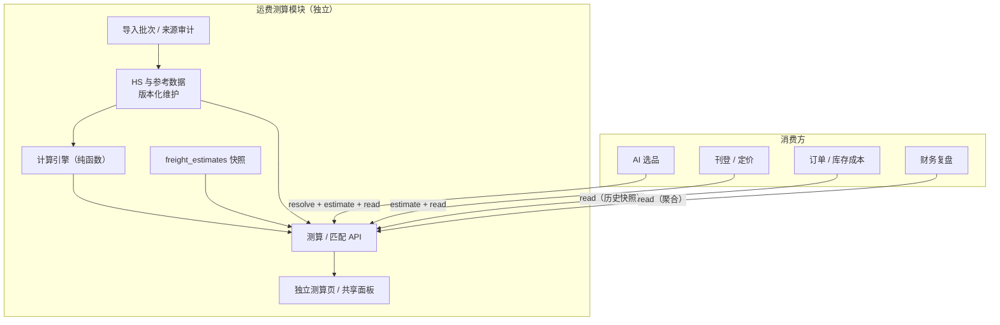
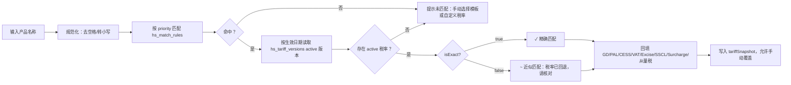
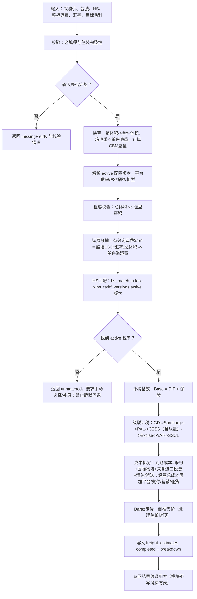
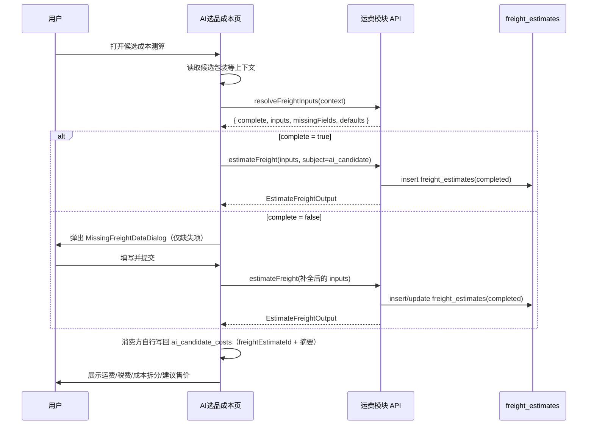
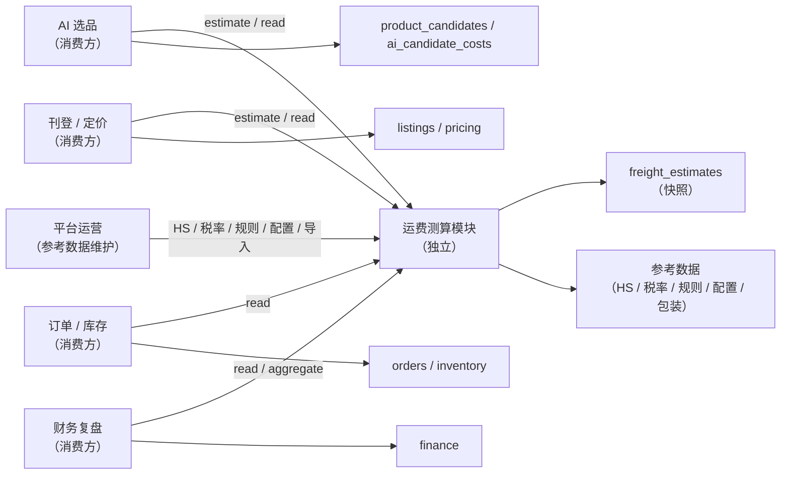
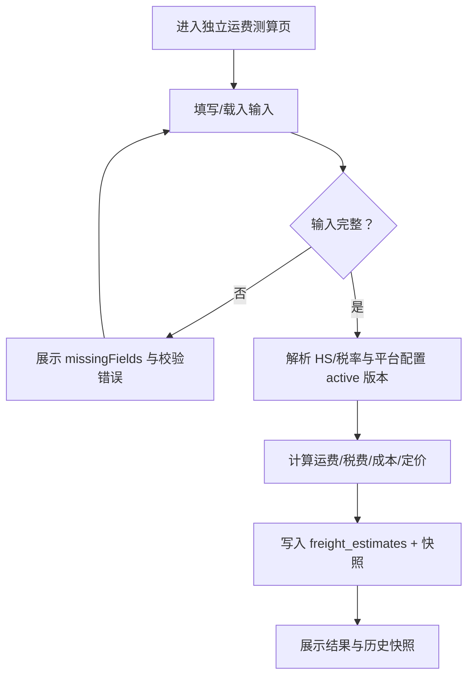
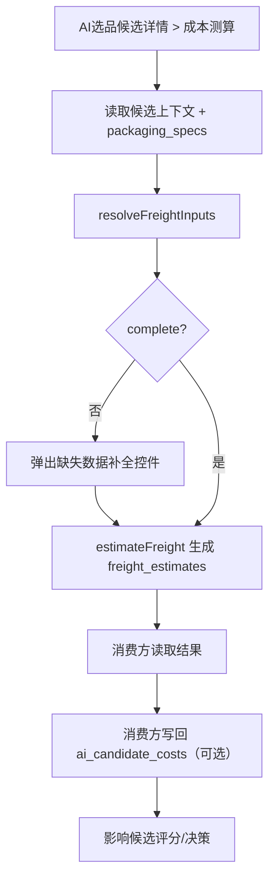
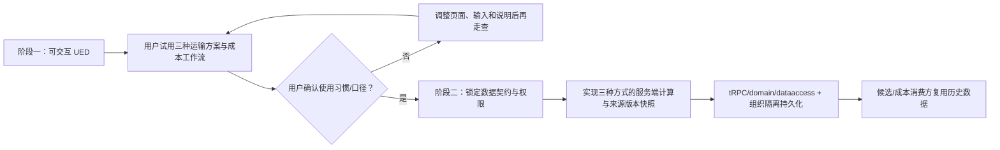

# 运费测算设计（Freight Estimation）——独立能力与消费方集成

> **状态：设计稿（先可交互 UED 验证，再接业务 API/tRPC）**  
> **模块定位：独立运费测算能力**，AI 选品是首批消费方之一，但不是唯一消费方  
> **代码形态：新增 `packages/freight`**（计算核心 + 类型 + 配置 + 快照 dataaccess），宿主先放 `apps/shop`  
> **适用范围：** 首期设计与 UED 覆盖 **Daraz Sri Lanka（LK）空运 DDP、海运 LCL、海运 FCL**；按确认的费率/计税规则逐阶段启用，缺真实报价时仅展示标注清楚的示例情景  
> **引用：** @see docs/design/ship-fees/Daraz整柜定价逻辑讲解.html、@see docs/design/ship-fees/整柜关税计算器.html、@see docs/design/ai-candidates/AI选品实现方案.md §6、§8.4、@see apps/shop/content/design/cost-calculator-sl-landed-ued.md、@see docs/design/crossborder-mvp-overview.md、@see AGENTS.md

## 1. 概述

将 `ship-fees` 中沉淀的「整柜定价逻辑」抽象为**独立、可复用的运费测算能力**。它有自己的输入、数据、API、入口和结果快照；AI 选品、刊登定价、订单成本、财务复盘等场景都只是**消费方**，按需调用并消费测算结果。

设计原则：

- **独立能力**：运费测算不隶属于 AI 选品。它不引用候选、选品任务等业务对象，也不直接写消费方业务表。
- **单一事实来源**：所有测算结果统一走 `freight_estimates` 快照 + 同一套计算引擎；参考数据统一走版本化表，避免不同模块各算一套。
- **按需集成**：消费方通过 API 获取输入、生成测算、读取结果；是否关联、如何展示、如何写回由消费方自己决定。
- **数据面收敛**：新增 `freight_estimates` 快照 + 运费参考数据表（HS/税率/规则/平台配置/包装/导入批次）；不新增渠道、订单、商品等业务表。
- **输入友好**：产品名称输入即匹配 HS，展示精确/近似与完整税率；允许手动覆盖并写入快照。
- **单件透明**：先列单件费用明细（采购/运费/保险/各项税/到仓/总成本），再汇总整柜，最后给出标准定价与包邮定价。
- **UED 先行**：本轮输出 UED 与 **API 草案**，暂不接入 tRPC、不实现 router/dataaccess。
- **交付分两阶段**：阶段一实现可交互 UED、用演示输入验证流程；用户确认习惯和口径后，阶段二接入 tRPC/domain/dataaccess 与生产持久化。阶段一的浏览器 state/mock 不得声称已经写入数据库。
- **数据可复用**：阶段二需保存测算输入、费率/汇率/税率版本、报价来源与有效期、公式版本、各项结果和警告；每次重算生成新快照，旧快照不漂移。
- **三种方案完整可比较**：UED 必须呈现空运 DDP、海运 LCL、海运 FCL；比较条件/费用包含范围不同或报价缺失时，显示“暂不可比较”与具体缺项，不伪造唯一最优方案。
- **租户隔离**：沿用 AGENTS.md 的组织隔离、依赖方向、数据访问约定。
- **可扩展**：UED 三种方式都有真实的输入与结果展示设计；业务阶段按真实费率、报价覆盖度及经过复核的规则逐项开放，不能只留空卡片。

## 2. 模块定位与解耦

### 2.1 两层架构



**关键点：** 箭头单向。运费模块不知道消费方是谁；消费方依赖运费模块。

### 2.2 独立模块职责

| 归属 | 内容 |
|---|---|
| **拥有** | 计价公式、级联税费、Daraz 倒推定价、包装换算、柜容校验、HS 匹配、合规提示（预留）、配置默认值 |
| **拥有** | `freight_estimates` 快照（输入、汇率、税率快照、结果、明细、缺失字段、警告） |
| **拥有** | HS 编码、税率版本、匹配规则、平台费率/汇率/柜型、租户包装规格的数据模型与读取 |
| **拥有** | 参考数据导入批次、来源/发布/回滚审计；平台后台与租户包装维护的服务端能力 |
| **拥有** | 独立测算入口（工具页）与可复用测算面板 |
| **不拥有** | 候选、选品任务、商品、订单、财务等业务对象 |
| **不拥有** | 消费方的成本记录、决策、刊登价、订单成本 |
| **不直接写** | 任何消费方业务表（包括 `ai_candidate_costs`） |
| **写权限** | 全局参考数据仅平台运营可写；租户包装规格由租户写；运费模块不代替平台/租户做业务审批 |

### 2.3 消费方职责

| 消费方 | 提供上下文 | 消费方式 | 写回归属 |
|---|---|---|---|
| **AI 选品** | `packaging_specs`（候选包装）、采购价、HS、目标毛利 | 进入成本测算时获取/补全输入 → 生成测算 → 读取运费、税费、到仓成本、建议售价 | AI 选品自己的 `ai_candidate_costs` dataaccess |
| **刊登 / 定价** | `packaging_specs`（商品包装）、采购成本、目标毛利 | 生成或读取测算 → 取建议售价作定价参考 | 刊登模块自己 |
| **订单 / 库存** | 订单商品、实际箱规 | 读取历史快照或按实际参数重算 | 订单/库存模块自己 |
| **财务复盘** | 时间范围、组织 | 聚合 `freight_estimates` 与业务单据 | 财务模块自己 |

### 2.4 依赖方向

```text
@workspace/db
   ↑
packages/freight（计算 + 参考数据 + 快照 + 导入 + 维护服务）
   ↑
apps/shop（测算 / 包装维护）
apps/web（平台 HS / 税率 / 规则 / 配置 / 导入后台）
apps/api（OpenAPI 导入 / 查询 / 匹配）
```

约束：

- `packages/freight` **不得**引用 `apps/*`，**不得**引用 AI 选品/候选/订单等业务 schema。
- 消费方可以引用 `freight_estimates.id`（**逻辑引用，不加跨模块外键**），但不允许运费模块反向依赖消费方。
- 消费方写回自己的表时，由消费方 dataaccess 完成；如需同一事务，由上层编排，不跨模块直接改表。
- 参考数据写入口必须在 `packages/freight` 的 domain 服务内；`apps/web`、`apps/api` 只能调用同一服务，禁止两套写路径。
- 租户级 `packaging_specs` 属于运费模块；租户只能读写本组织数据，不能写全局 HS/税率/平台配置。

### 2.5 在 ERP 全链路中的位置

| 环节 | 关系 | 说明 |
|---|---|---|
| **AI 选品** | 消费方（关键指标） | 运费与到仓成本是候选评分/决策的关键输入，但不改变运费模块独立性 |
| **升级款匹配** | 消费方 | 用同一套测算验证不同采购价下的利润空间 |
| **刊登 / 定价** | 消费方 | 使用建议售价、盈亏平衡价作为定价参考 |
| **订单 / 库存** | 消费方 | 按快照追溯成本，或用实际箱规重算 |
| **成本 / 财务** | 消费方 | 统一「到仓成本 vs 总成本」口径，做毛利复盘 |
| **平台运营** | 参考数据维护方 | 在 `apps/web` 维护 HS 编码、税率版本、匹配规则、平台费率/汇率/柜型；通过导入批次发布并追溯来源 |

## 3. 计价模型

### 3.1 基础概念

| 概念 | 定义 | 备注 |
|---|---|---|
| **FOB** | 离岸价（采购价） | 一般取自供应商报价 |
| **国际物流费用** | 空运 DDP、海运 LCL 或海运 FCL 报价和按报价规则分摊的费用 | 必须带币种、计费量/规则、包含/排除项、来源与有效期 |
| **海运费（整柜包干）** | 整柜运费（USD） | 报价通常为 `$3000/40'HQ` 等整柜包干价 |
| **CIF** | `FOB + 海运费` | 计税链路起点 |
| **保险** | `(FOB + 海运费) × 0.3%` | HTML 明确保险单独加回计税基数，便于可追溯 |
| **计税基数（Base）** | `CIF + 保险` | 斯里兰卡进口税费的计征基数 |
| **进口税费合计** | 依据适用 HS 和计税规则计算的全部进口税项；DDP 报价已含的项目不得重复计入 | 税率和是否已含必须可追溯；有不确定性须标待复核 |
| **到仓成本（经营口径）** | 采购价 + 国际物流 + 进口税费 + 明确计入的清关/派送等费用 | 必须显示组成项及未含项；不把“只有运费/FOB的粗算”叫完整到仓成本 |
| **经营总成本** | 到仓成本 + 售价侧平台/支付/仓储/营销/退货等费用 | 仅在有输入或明确配置时计入；列明缺失项；作为净利计算成本基础 |
| **计费方式（MVP）** | **按体积 CBM 分摊（整柜包干）** | `有效海运费(¥/m³) = 整柜运费(USD)*汇率 ÷ 总体积(CBM)`，`单件海运费 = 单件体积(m³)*有效海运费` |

### 3.2 体积计算（重点）

HTML 明确：**装箱单中的「单件体积」常是「整箱体积」**，必须换算成真实单件体积。

```text
箱体积(m³) = (长(cm)*宽(cm)*高(cm)) / 10^6
单件体积(m³) = 箱体积(m³) / 每箱件数(pcs/box)
总体积(CBM) = Σ(箱体积(m³) * 箱数)
单件毛重(kg) = 箱毛重(kg) / 每箱件数(pcs/box)
```

> **注意：** 若总体积 > 柜型容积（如 40'HQ ≈ 68 CBM）需提示「装不下」或建议按多柜重算。

### 3.3 斯里兰卡级联计税

按 HTML 顺序计算：

| 步骤 | 公式 | 说明 |
|---|---|---|
| 1 | `Base = (采购价 + 海运费) * (1 + 保险费率%)`（或 `Base = CIF + 保险`） | 计税基数 |
| 2 | `GD_advalorem = Base * GD率`；`GD_specific = 单件毛重 * Rs/kg`（或 Rs/件）；`GD_applied = 税则「or」取 max，否则相加` | General Duty |
| 3 | `关税附加 Surcharge = GD_applied * Surcharge率`（常用 2.5%） | 部分品类存在；从量税是否计附加按税则模板配置 |
| 4 | `PAL = Base * PAL率` | Ports & Airport Levy |
| 5 | `CESS = Base * CESS率 + 从量CESS` | 建设税。部分品类存在**从量**（Rs/kg 或 Rs/件），需按「单件毛重」计算 |
| 6 | `Excise基数 = Base + GD_applied + Surcharge + PAL + CESS`，`Excise = Excise基数 * Excise率` | 仅特定品类 |
| 7 | `VAT基数 = Base + GD_applied + Surcharge + PAL + CESS + Excise`，`VAT = VAT基数 * VAT率`（18%） | 层层累加 |
| 8 | `SSCL基数 = VAT基数 + VAT`，`SSCL = SSCL基数 * SSCL率`（常用 2.5%） | 社会保障贡献税 |

**从量税规则：** 对 `Rs.xx/= per kg` 或 `per unit` 的税目，按 `单件毛重/单件数量` 计算。若税则同时标注「20% or Rs.xx/= per kg」，HTML 明确**取较大者**（轻泡货多为从价更高，但极重货可能从量更高）；只有标注「+」时才相加。详见 `3.7` 的 `GD_applied` 规则。

### 3.4 Daraz 平台费用

| 费用项 | 费率/上限 | 说明 |
|---|---|---|
| 平台佣金 | 11%（全品类常用） | 按售价计提 |
| 包邮佣金 | 5%（额外叠加） | **在平台佣金之上**额外收取，按 `min(售价×5%, 封顶)` 计提；封顶默认 **₨450**（≈¥9.13） |
| 回款手续费 | 3.5% | 按售价计提 |
| 仓库杂费 | 10% | 按售价计提 |

> 包邮佣金是「额外」的：未触顶时「平台佣金 + 包邮佣金」= 11% + 5% = 16%；再加上回款 3.5% 与仓杂 10%，总扣点为 29.5%（均未含毛利）。  
> 封顶只作用于包邮的 5% 部分，不作用于 11% 基础平台佣金；即 `包邮佣金 = min(售价 × 5%, ₨450)`。

### 3.5 三种物流情景的计价范围

| 项目 | MVP | 说明 |
|---|---|---|
| 运输方式 | UED 必须有 `air_ddp`、`sea_lcl`、`sea_fcl` 三种情景 | 参数/报价未齐全时显示待补数据，不生成貌似精确的推荐价 |
| `sea_fcl` | 整柜包干价，按 CBM（或混装时显式选择分摊权重）分摊 | 校验柜容、柜数、港杂/清关/派送等费用范围 |
| `sea_lcl` | 按有效货代报价选择 CBM、计费吨、或两者取高；考虑最低收费和已报价附加费 | 计费规则来自报价，不把 FCL 公式套用于 LCL |
| `air_ddp` | 按货代约定计费重，通常在实重/材积重、最低收费与附加费之间按报价规则计算 | 必须标明 DDP 报价所含的关税、清关、派送；已含税不得二次加税 |
| 材积系数 | 不硬编码通用 6000/5000；由具体承运商报价/规则提供 | 规则来源和有效期随快照保存；缺失则该报价不完整 |
| 阶梯价/最小计费 | 按具体 LCL/空运报价支持 | 只在费率表/报价明确时计算 |
| 计价单位 | `cbm`、`kg`、`chargeable_kg`、`piece`、`shipment` | 结果显示采用的计费单位和分摊基准 |

**UED 方案对比列：** 单件成本、整批成本、货代报价、计费量/单位、税费是否包含、起运港/目的港及费用范围、时效、报价有效期、数据状态、未计费用和“暂不可比较”原因。所有空运/LCL/FCL 运价若只是样例，醒目标注“演示数据”，不默认推荐。

### 3.6 HS 自动匹配（产品名称 → HS 编码）

这是独立测算的**一等功能**，与 `整柜关税计算器.html` 的「产品名称（输入即自动匹配 HS 编码）」对齐。

**流程：**



**匹配结果展示（示例）：**

```text
输入：太阳能摄像头
✓ 精确匹配：HS 8525.89 | 关税 20% · PAL 5% · CESS 0% · VAT 18% · SSCL 2.5%
```

| 规则 | 说明 |
|---|---|
| 匹配顺序 | `hs_match_rules.priority` 升序；具体品类（如夜视摄像头 → 8525.83）排在通用品类（摄像头 → 8525.89）之前 |
| 税率版本 | 按测算时点取 `hs_tariff_versions` 的 active 版本；允许指定 `tariffVersionId` 复现 |
| 精确/近似 | `hs_tariff_versions.isExact = true` 显示「精确匹配」；`false` 显示「近似匹配，税率已回退，请核对」 |
| 手动覆盖 | 命中后仍允许修改 HS 或税率，`hsMatchedBy = rule \| manual` |
| 未命中 | 不静默回退；提示手动选择模板或自定义税率，并记录 `warnings`；无 active 税率同样阻断 |
| 来源 | 匹配结果带 `sourceType/sourceRef`，规则来自导入批次时可追溯 |
| 快照 | 命中后的完整税率写入 `tariffSnapshot`，避免配置调整影响历史结果 |
| 从量税 | 若 `specific > 0`，展示「从量税 ¥x/件」（或 Rs/kg、Rs/件） |

**SLSI / 强制认证提示：**

- 现有两份 HTML 未提供 SLSI 认证数据，本设计预留 `compliance` 输出与 `complianceSnapshot` 快照字段。
- HS 命中后可按品类叠加合规提示（如 SLSI、TRCSL、插头/电压、带电运输限制）；具体清单需后续以海关/SLSI 原表补齐。
- 合规提示不影响运费与税费计算，仅作为风险提示展示。

### 3.7 费用明细（每单位）

所有金额默认按**单件**计算，再乘总件数得到整柜合计。总件数定义：

```text
总件数(totalUnits) = 箱数(packageCount) × 每箱件数(piecesPerBox)
```

**单位成本明细（每件）：**

| 序号 | 费用项 | 公式 | 说明 |
|---|---|---|---|
| 1 | FOB 采购价 | 输入 | 单件采购价 |
| 2 | 单件海运费 | `单件体积 × 有效海运费(¥/m³)` | 整柜包干价按 CBM 分摊 |
| 3 | 保险费 | `(FOB + 海运费) × 保险费率` | 默认 0.3% |
| 4 | 关税 GD（从价） | `Base × GD率` | Base = CIF + 保险 |
| 5 | 关税附加 Surcharge | `GD_applied × Surcharge率` | 常用 2.5%，部分品类 |
| 6 | PAL | `Base × PAL率` | |
| 7 | CESS（从价） | `Base × CESS率` | |
| 8 | CESS（从量） | `单件毛重 × Rs/kg` 或 `Rs/件` | 有从量 CESS 时 |
| 9 | Excise | `(Base + GD_applied + Surcharge + PAL + CESS) × Excise率` | 特定品类 |
| 10 | VAT | `(Base + GD_applied + Surcharge + PAL + CESS + Excise) × VAT率` | 默认 18% |
| 11 | SSCL | `(VAT基数 + VAT) × SSCL率` | 常用 2.5% |
| 12 | 从量关税（GD specific） | `单件毛重 × Rs/kg` 或 `Rs/件` | 税则 `20% or Rs.x/kg` 时与行 4 比大小 |
| 13 | **内部拆分：采购+运费+GD/件** | `1 + 2 + GD_applied` | 仅为税项拆分中间值；不得将其单独标作完整“到仓成本” |
| 14 | **其他税费/件** | `3 + 5 + 6 + 7 + 8 + 9 + 10 + 11` | 保险与各项附加税；不含已计入行 13 的 GD |
| 15 | **到仓成本（经营口径）/件** | `13 + 14 + 明确计入的清关/派送等费用` | 采购+国际物流+未含进口税费+指定费用；如某项未知，显示“部分成本”及缺项 |
| 16 | **经营总成本/件** | `15 + 售价侧经营费用` | 平台费、支付费、营销、退货等有值才计入；列明缺失项，用于利润/定价 |

**从量关税取数规则：**

```text
GD_advalorem = Base × GD率
GD_specific  = 单件毛重 × Rs/kg（或 Rs/件）
GD_applied   = 税则标注「or」 ? max(GD_advalorem, GD_specific) : GD_advalorem + GD_specific
```

- 税则标注「20% or Rs.75/kg」时从高计征，`GD_applied` 取较大者；不能两项直接相加。
- 税则标注「20% + Rs.75/kg」时才相加。
- 若 `GD_specific > 0` 或 CESS 从量 > 0，`grossWeightKg` 必填；缺失时 `estimateFreight` 阻断并返回 `missingFields`，不能静默漏税。

**单位售价与利润明细（每件，按建议售价 P）：**

| 费用项 | 公式 |
|---|---|
| 平台佣金 | `P × 平台佣金率`（默认 11%） |
| 回款手续费 | `P × 回款费率`（默认 3.5%） |
| 仓库杂费 | `P × 仓库杂费率`（默认 10%） |
| 包邮佣金 | `min(P × 5%, 封顶)`（仅包邮档） |
| 净毛利 | `P − 总成本/件 − 平台佣金 − 回款手续费 − 仓库杂费 − 包邮佣金` |
| 净毛利率 | `净毛利 ÷ P` |

**整柜合计：**

```text
总运费 = 单件海运费 × 总件数                    // 与整柜包干价一致（分摊误差四舍五入）
税费及保险合计 = 单位其他税费 × 总件数            // 对应 totals.taxTotal
到仓成本合计 = 单位到仓成本 × 总件数              // 对应 totals.landedCostTotal
总成本合计 = 单位总成本 × 总件数                  // 对应 totals.totalCostTotal
```

> 说明：旧 HTML 对“到仓成本”的标签和内容曾存在两种口径。本设计统一改为：**到仓成本（经营口径）= 采购 + 国际物流 + 未包含在报价内的全部进口税费 + 明确计入的清关/派送等费用**；**经营总成本 = 到仓成本 + 平台/支付/营销/退货等售价侧费用**。旧公式“采购价+海运费+GD”只作为税项拆分中间值，不得当完整到仓成本展示。  
> 其中「其他税费」与 HTML 一致 = 保险 + 关税附加（Surcharge）+ PAL + CESS + Excise + VAT + SSCL；本设计额外把从量关税/从量 CESS 也归入对应税项。

### 3.8 标准定价与包邮定价

> 以下均为**单件**口径；`总成本` 指 `3.7` 的单位总成本，并已统一折算到 `pricingCurrency`。  
> 从量税按 LKR 税率计算后，再按 `exchangeCnyLkr` 折算到计价币种。

**标准定价（不包邮）：**

```text
标准定价 = 总成本 ÷ (1 − 平台佣金率 − 回款费率 − 仓库杂费率 − 目标毛利率)
```

**包邮定价：**

包邮佣金按 `min(售价 × 包邮佣金率, 封顶)` 计算，因此售价满足：

```text
P = (总成本 + min(P × 5%, 封顶)) ÷ (1 − 平台佣金率 − 回款费率 − 仓库杂费率 − 目标毛利率)
```

求解采用两段式（与 `整柜关税计算器.html` 一致）：

```text
令 d = 1 − 平台佣金率 − 回款费率 − 仓库杂费率 − 目标毛利率

① 先按未触顶试算（默认包邮佣金率 5%）：
   P1 = 总成本 ÷ (d − 包邮佣金率)

② 判断：
   若 P1 × 包邮佣金率 ≤ 封顶  →  包邮定价 = P1（未触顶，按费率计提）
   否则               →  包邮定价 = (总成本 + 封顶) ÷ d（已触顶，按固定封顶计提）
```

- 封顶与售价必须使用**同一币种**；若封顶为 ₨450、测算币种为 CNY，先按 `exchangeCnyLkr` 换算：`capCny = 450 ÷ exchangeCnyLkr`。
- 与 HTML 一致，若售价按 CNY 计算，触顶判断为 `P_cny × exchangeCnyLkr × 5% > 450`；等价的 CNY 封顶约为 `¥9.13`。
- 封顶阈值反推：`₨450 ÷ 5% = ₨9,000 ≈ ¥182.6`。
- 同时输出「标准定价 / 包邮定价 / 包邮佣金 / 是否触顶」四项，便于对比。
- 盈亏平衡价（不含目标毛利）：
  `盈亏平衡价 = (总成本 + min(盈亏平衡价 × 5%, 封顶)) ÷ (1 − 平台佣金率 − 回款费率 − 仓库杂费率)`（不包邮则去掉包邮项）。

### 3.9 定价校验

| 校验 | 规则 |
|---|---|
| 分母为正 | `1 − 平台佣金率 − 回款费率 − 仓库杂费率 − 目标毛利率 > 0`；包邮未触顶分支还需 `d − 5% > 0` |
| 包邮分支 | 触顶/未触顶必须与实际佣金 `min(P×5%, 封顶)` 一致 |
| 利润校验 | `净毛利率 ≥ 目标毛利率`（允许四舍五入误差） |
| 币种一致 | 售价、封顶、平台费用同币种；成本跨币种需先换算 |

### 3.10 与 HTML 示例的差异（已确认按 40% 公式）

`Daraz整柜定价逻辑讲解.html` 的**费率文字与示例常数不一致**：

```text
标准档：1 − 11% − 3.5% − 10% − 40% = 0.355
HTML 示例写：0.365

包邮未触顶：1 − 11% − 5% − 3.5% − 10% − 40% = 0.305
HTML 示例写：0.315
```

- 按 HTML 的**公式**（40% 毛利率）应为 `0.355 / 0.305`。
- 按 HTML 的**示例常数** `0.365 / 0.315` 反推，实际毛利率是 **39%**，不是 40%。
- **已确认：按 40% 公式计算**，不硬编码 `0.365/0.315`；HTML 示例常数视为笔误，仅保留对照说明。

按移动电源实例复算（总成本 ¥60.77）：

| 项目 | 按 40% 公式 | HTML 示例 |
|---|---|---|
| 标准定价 | `60.77 ÷ 0.355 = ¥171.18`（≈₨8,438） | `60.77 ÷ 0.365 = ¥166.49`（₨8,206） |
| 包邮未触顶试算 | `60.77 ÷ 0.305 = ¥199.25`（≈₨9,821） | `60.77 ÷ 0.315 = ¥192.92` |
| 包邮佣金 | `199.25 × 49.2913 × 5% = ₨491.1` → 触顶 | `192.92 × 49.2913 × 5% = ₨475.4` → 触顶 |
| 包邮触顶定价 | `(60.77 + 9.13) ÷ 0.355 = ¥196.90`（≈₨9,706） | `(60.77 + 9.13) ÷ 0.365 = ¥191.51`（₨9,440） |

> 补充验算：HTML 示例 `₨8,206 × 64.5%` 后剩余约 `¥59.1`，不足以覆盖总成本 `¥60.77`；按 `0.355` 计算则剩余 `¥60.77`，可覆盖成本。  
> 结论：主链路（到仓成本、总成本、级联计税、包邮 min 封顶）与 HTML 一致；目标毛利**已确认按 40% 公式**执行，HTML 示例常数 `0.365/0.315` 与金额视为笔误，不作为验收基线。
>
> HTML 中的移动电源、太阳能摄像头及其金额仅作**原型样例/回归基线**，不得硬编码进出品名、金额或最终售价；引擎必须由输入 + active 参考数据推导（见 5.5）。

## 4. 数据模型设计（独立快照表 + 消费方可选关联）

### 4.1 新增 `freight_estimates`（独立测算快照）

保存每次测算的输入、配置快照与结果。该表**不依赖候选/商品/订单**，通过可空的 `subjectType` / `subjectId` 记录“由谁发起”，但不加跨模块外键。

```typescript
export const freightEstimates = pgTable(
  "freight_estimates",
  {
    id: text("id").primaryKey().$defaultFn(() => createId()),
    organizationId: text("organization_id").notNull().references(() => organization.id),
    createdBy: text("created_by").references(() => user.id),

    // 独立能力元信息（不绑定具体业务对象）
    title: text("title"),
    sourceType: varchar("source_type", { length: 32 }).notNull().default("standalone")
      .$type<FreightSourceType>(), // standalone|ai_candidate|listing|order|import
    subjectType: varchar("subject_type", { length: 32 }), // 可选：ai_candidate|listing|order
    subjectId: text("subject_id"),                        // 可选：逻辑引用，无跨模块 FK
    sourceBatchId: text("source_batch_id"),               // 批量导入来源，逻辑引用 import_batches
    inputSources: jsonb("input_sources").$type<Record<string, FreightInputSource>>().default({}), // 字段级来源
    packagingSpecId: text("packaging_spec_id"),           // 逻辑引用 packaging_specs
    hsTariffVersionId: text("hs_tariff_version_id"),      // 逻辑引用 hs_tariff_versions

    // 运输方式与状态
    mode: varchar("mode", { length: 16 }).notNull().$type<LogisticsMode>(), // air_ddp|sea_lcl|sea_fcl
    status: varchar("status", { length: 16 }).notNull().default("draft").$type<FreightEstimateStatus>(),

    // 输入快照
    purchasePrice: numeric("purchase_price", { precision: 15, scale: 4 }),
    purchaseCurrency: varchar("purchase_currency", { length: 3 }).notNull().default("CNY"),
    packageLengthCm: numeric("package_length_cm", { precision: 10, scale: 2 }),
    packageWidthCm: numeric("package_width_cm", { precision: 10, scale: 2 }),
    packageHeightCm: numeric("package_height_cm", { precision: 10, scale: 2 }),
    piecesPerBox: integer("pieces_per_box"),
    packageCount: integer("package_count"),
    totalUnits: integer("total_units"), // 总件数 = packageCount * piecesPerBox
    grossWeightKg: numeric("gross_weight_kg", { precision: 10, scale: 3 }),
    netWeightKg: numeric("net_weight_kg", { precision: 10, scale: 3 }),
    totalVolumeCbm: numeric("total_volume_cbm", { precision: 10, scale: 4 }),
    containerType: varchar("container_type", { length: 16 }),
    containerUsd: numeric("container_usd", { precision: 15, scale: 4 }),
    lclRateCbm: numeric("lcl_rate_cbm", { precision: 15, scale: 4 }),
    lclRateChargeableTon: numeric("lcl_rate_chargeable_ton", { precision: 15, scale: 4 }),
    lclMinimumCharge: numeric("lcl_minimum_charge", { precision: 15, scale: 4 }),
    airRatePerKg: numeric("air_rate_per_kg", { precision: 15, scale: 4 }),
    airVolumetricDivisor: integer("air_volumetric_divisor"), // 按报价；不设通用默认值
    chargeableWeightKg: numeric("chargeable_weight_kg", { precision: 10, scale: 3 }),
    logisticsSurcharges: jsonb("logistics_surcharges").$type<Array<{name: string, amount: number, currency: string, includedInQuote: boolean}>>().default([]),
    freightQuoteSource: text("freight_quote_source"),
    freightQuotedAt: timestamp("freight_quoted_at", { withTimezone: true }),
    freightQuoteExpiresAt: timestamp("freight_quote_expires_at", { withTimezone: true }),
    freightQuoteIncludes: jsonb("freight_quote_includes").$type<string[]>().default([]),
    freightQuoteExcludes: jsonb("freight_quote_excludes").$type<string[]>().default([]),
    freightTransitDaysMin: integer("freight_transit_days_min"),
    freightTransitDaysMax: integer("freight_transit_days_max"),
    pricingFormulaVersion: varchar("pricing_formula_version", { length: 32 }),
    exchangeUsdCny: numeric("exchange_usd_cny", { precision: 10, scale: 4 }),
    exchangeCnyLkr: numeric("exchange_cny_lkr", { precision: 10, scale: 4 }), // CNY -> LKR，包邮封顶/售价换算
    targetMarginPct: numeric("target_margin_pct", { precision: 6, scale: 2 }),
    freeship: varchar("freeship", { length: 8 }).notNull().default("false"),
    freeshipCap: numeric("freeship_cap", { precision: 15, scale: 4 }), // 与 pricingCurrency 同币种；由 freeshipCapLkr 换算

    // HS 与税率快照（防止配置调整后历史结果漂移）
    hsCode: varchar("hs_code", { length: 20 }),
    hsMatchedBy: varchar("hs_matched_by", { length: 16 }).default("manual"), // manual|rule
    hsMatchExact: varchar("hs_match_exact", { length: 8 }).default("false"),
    tariffSnapshot: jsonb("tariff_snapshot").$type<Record<string, unknown>>().default({}),
    complianceSnapshot: jsonb("compliance_snapshot").$type<Record<string, unknown>>().default({}), // SLSI 等提示，预留
    configSnapshot: jsonb("config_snapshot").$type<Record<string, unknown>>().default({}), // 平台费率/FX/柜型/保险快照

    // 结果快照：单件口径
    perPieceVolumeCbm: numeric("per_piece_volume_cbm", { precision: 12, scale: 6 }),
    perPieceWeightKg: numeric("per_piece_weight_kg", { precision: 10, scale: 3 }),
    effectiveFreightPerCbm: numeric("effective_freight_per_cbm", { precision: 15, scale: 4 }),
    unitFreight: numeric("unit_freight", { precision: 15, scale: 4 }),
    unitLandedCost: numeric("unit_landed_cost", { precision: 15, scale: 4 }),
    unitTotalCost: numeric("unit_total_cost", { precision: 15, scale: 4 }),
    unitNetProfit: numeric("unit_net_profit", { precision: 15, scale: 4 }),

    // 结果快照：整柜合计
    freightTotal: numeric("freight_total", { precision: 15, scale: 4 }),
    taxTotal: numeric("tax_total", { precision: 15, scale: 4 }), // 税费 + 保险合计
    landedCostTotal: numeric("landed_cost_total", { precision: 15, scale: 4 }),
    totalCostTotal: numeric("total_cost_total", { precision: 15, scale: 4 }),

    // 定价结果（单件）
    priceMode: varchar("price_mode", { length: 16 }).default("standard"), // standard|freeship
    standardPrice: numeric("standard_price", { precision: 15, scale: 4 }),
    freeshipPrice: numeric("freeship_price", { precision: 15, scale: 4 }),
    freeshipFee: numeric("freeship_fee", { precision: 15, scale: 4 }),
    freeshipCapped: varchar("freeship_capped", { length: 8 }).default("false"),
    suggestPrice: numeric("suggest_price", { precision: 15, scale: 4 }), // 按所选模式取标准/包邮
    breakEvenPrice: numeric("break_even_price", { precision: 15, scale: 4 }),
    netMarginPct: numeric("net_margin_pct", { precision: 6, scale: 2 }),
    pricingCurrency: varchar("pricing_currency", { length: 3 }).notNull().default("LKR"),
    breakdown: jsonb("breakdown").$type<Record<string, unknown>>().default({}),
    missingFields: jsonb("missing_fields").$type<string[]>().default([]),
    warnings: jsonb("warnings").$type<string[]>().default([]),

    estimatedAt: timestamp("estimated_at", { withTimezone: true }).defaultNow().notNull(),
    ...timestamps,
  },
  (t) => [
    index("freight_est_org_idx").on(t.organizationId),
    index("freight_est_org_time_idx").on(t.organizationId, t.estimatedAt),
    index("freight_est_subject_idx").on(t.organizationId, t.subjectType, t.subjectId),
  ],
)
```

枚举与规范：

```typescript
export const freightSourceTypes = ["standalone", "ai_candidate", "listing", "order", "import"] as const
export type FreightSourceType = (typeof freightSourceTypes)[number]

export const freightEstimateStatuses = ["draft", "completed", "superseded"] as const
export type FreightEstimateStatus = (typeof freightEstimateStatuses)[number]

export const dataSourceTypes = ["manual", "excel", "csv", "api", "seed", "marketplace"] as const
export type DataSourceType = (typeof dataSourceTypes)[number]

export type FreightInputSource = {
  sourceType: DataSourceType
  sourceRef?: string
  sourceBatchId?: string
  recordId?: string
}
```

- 强制 `organizationId`；`subjectType` / `subjectId` 可空，**无跨模块外键**。
- 金额 `numeric(15,4)`，体积 `numeric(10,4)`，单件体积 `numeric(12,6)`，时间戳 `withTimezone`。
- `tariffSnapshot` / `breakdown` / `missingFields` / `warnings` 用 `jsonb`。
- 每次测算新增记录；同一 `subject` 的旧记录可标记 `superseded`。
- 所有运费域表（快照 + 参考数据 + 导入批次）统一在 `packages/db/src/commerce-schema.ts` 维护；迁移由 `drizzle-kit generate` 生成。

### 4.2 HS 与参考数据维护（新增，平台级）

**现状问题：** 早期草案把 `HS_RULES` / `HS_TARIFF` 放在代码常量里，只能改代码发版；`freight_estimates` 只记录了测算来源，没有字段级来源；也没有 Excel/API 导入批次。这不利于后续补充海关税则、SLSI 清单和平台费率。

**目标：** 把 HS 与相关参考数据做成**可维护、可版本化、可追溯来源**的数据，而不是硬编码。MVP 仍然只服务 Daraz SL，但表结构支持后续扩展其他国家/平台。

#### 4.2.1 通用溯源字段

以下字段用于全局参考数据表（`hs_codes`、`hs_tariff_versions`、`hs_match_rules`、`freight_config_versions`）与导入批次；`packaging_specs` 是租户表，只使用 `organization_id`、`status` 和来源/审计字段，不使用 `scope/owner_key/effective_*`。

| 字段 | 说明 |
|---|---|
| `scope` | `global`（平台级）或 `tenant`（租户级覆盖） |
| `owner_key` | 全局固定 `global`，租户为 `organizationId`；用于唯一约束，避免 nullable 唯一索引问题 |
| `organization_id` | `scope=tenant` 时必填；`global` 为空 |
| `source_type` | `manual` / `excel` / `csv` / `api` / `seed` / `marketplace` |
| `source_ref` | 来源引用：文件名、URL、API request id、海关公告号、SLSI 文件号 |
| `source_batch_id` | 逻辑引用 `import_batches.id`；手工录入可为空 |
| `created_by` / `updated_by` | 操作人 |
| `status` | `draft` / `active` / `archived`（按表定义） |
| `effective_from` / `effective_to` | 生效区间；历史测算不受影响，新测算按测算时点取 active 版本 |

#### 4.2.2 `hs_codes`（HS 编码主数据）

```typescript
export const hsCodes = pgTable(
  "hs_codes",
  {
    id: text("id").primaryKey().$defaultFn(() => createId()),
    scope: varchar("scope", { length: 16 }).notNull().default("global"), // global|tenant
    ownerKey: text("owner_key").notNull().default("global"),
    organizationId: text("organization_id").references(() => organization.id),

    countryCode: varchar("country_code", { length: 2 }).notNull().default("LK"),
    code: varchar("code", { length: 20 }).notNull(),
    normalizedCode: varchar("normalized_code", { length: 20 }).notNull(), // 去掉点/空格
    description: text("description").notNull(),
    descriptionEn: text("description_en"),
    parentCode: varchar("parent_code", { length: 20 }),
    level: integer("level"), // 2/4/6/8 位
    unit: varchar("unit", { length: 16 }), // kg|pcs
    status: varchar("status", { length: 16 }).notNull().default("active"),

    sourceType: varchar("source_type", { length: 16 }).notNull().default("manual"),
    sourceRef: text("source_ref"),
    sourceBatchId: text("source_batch_id"),
    createdBy: text("created_by").references(() => user.id),
    updatedBy: text("updated_by").references(() => user.id),
    ...timestamps,
  },
  (t) => [
    uniqueIndex("hs_codes_owner_code_uidx").on(t.ownerKey, t.countryCode, t.normalizedCode),
    index("hs_codes_code_idx").on(t.ownerKey, t.countryCode, t.code),
    index("hs_codes_parent_idx").on(t.ownerKey, t.countryCode, t.parentCode),
  ],
)
```

#### 4.2.3 `hs_tariff_versions`（税率版本）

同一 HS 编码可有多个版本，按 `effective_from` / `effective_to` 取生效版本。**不允许覆盖已发布版本**；变更必须新建版本。

```typescript
export const hsTariffVersions = pgTable(
  "hs_tariff_versions",
  {
    id: text("id").primaryKey().$defaultFn(() => createId()),
    scope: varchar("scope", { length: 16 }).notNull().default("global"),
    ownerKey: text("owner_key").notNull().default("global"),
    organizationId: text("organization_id").references(() => organization.id),

    countryCode: varchar("country_code", { length: 2 }).notNull().default("LK"),
    hsCode: varchar("hs_code", { length: 20 }).notNull(), // 对应 hs_codes.normalized_code
    version: integer("version").notNull(),
    status: varchar("status", { length: 16 }).notNull().default("draft"), // draft|active|archived
    effectiveFrom: timestamp("effective_from", { withTimezone: true }).notNull(),
    effectiveTo: timestamp("effective_to", { withTimezone: true }),
    currency: varchar("currency", { length: 3 }).notNull().default("LKR"),

    gdRate: numeric("gd_rate", { precision: 8, scale: 4 }),
    surchargeRate: numeric("surcharge_rate", { precision: 8, scale: 4 }),
    palRate: numeric("pal_rate", { precision: 8, scale: 4 }),
    cessRate: numeric("cess_rate", { precision: 8, scale: 4 }),
    exciseRate: numeric("excise_rate", { precision: 8, scale: 4 }),
    vatRate: numeric("vat_rate", { precision: 8, scale: 4 }),
    ssclRate: numeric("sscl_rate", { precision: 8, scale: 4 }),

    gdSpecificAmount: numeric("gd_specific_amount", { precision: 15, scale: 4 }),
    gdSpecificUnit: varchar("gd_specific_unit", { length: 8 }), // kg|unit
    gdSpecificRule: varchar("gd_specific_rule", { length: 8 }).default("none"), // max|sum|none
    cessSpecificAmount: numeric("cess_specific_amount", { precision: 15, scale: 4 }),
    cessSpecificUnit: varchar("cess_specific_unit", { length: 8 }),

    isExact: varchar("is_exact", { length: 8 }).notNull().default("false"), // 精确税率 or 回退
    confidence: numeric("confidence", { precision: 5, scale: 2 }),
    compliance: jsonb("compliance").$type<Record<string, unknown>>().default({}), // SLSI/TRCSL/带电等
    notes: text("notes"),

    sourceType: varchar("source_type", { length: 16 }).notNull().default("manual"),
    sourceRef: text("source_ref"),
    sourceBatchId: text("source_batch_id"),
    createdBy: text("created_by").references(() => user.id),
    updatedBy: text("updated_by").references(() => user.id),
    publishedBy: text("published_by").references(() => user.id),
    publishedAt: timestamp("published_at", { withTimezone: true }),
    ...timestamps,
  },
  (t) => [
    uniqueIndex("hs_tariff_owner_code_ver_uidx").on(t.ownerKey, t.countryCode, t.hsCode, t.version),
    index("hs_tariff_owner_code_date_idx").on(t.ownerKey, t.countryCode, t.hsCode, t.effectiveFrom),
    index("hs_tariff_status_idx").on(t.ownerKey, t.status),
  ],
)
```

#### 4.2.4 `hs_match_rules`（品名匹配规则）

把 HTML 的 `HS_RULES` 从代码数组改成可维护规则；`priority` 越小越先匹配。

```typescript
export const hsMatchRules = pgTable(
  "hs_match_rules",
  {
    id: text("id").primaryKey().$defaultFn(() => createId()),
    scope: varchar("scope", { length: 16 }).notNull().default("global"),
    ownerKey: text("owner_key").notNull().default("global"),
    organizationId: text("organization_id").references(() => organization.id),
    countryCode: varchar("country_code", { length: 2 }).notNull().default("LK"),
    pattern: text("pattern").notNull(), // 关键词或正则
    matchType: varchar("match_type", { length: 16 }).notNull().default("keyword"), // keyword|regex
    priority: integer("priority").notNull(),
    hsCode: varchar("hs_code", { length: 20 }).notNull(),
    status: varchar("status", { length: 16 }).notNull().default("active"),
    sourceType: varchar("source_type", { length: 16 }).notNull().default("manual"),
    sourceRef: text("source_ref"),
    sourceBatchId: text("source_batch_id"),
    createdBy: text("created_by").references(() => user.id),
    updatedBy: text("updated_by").references(() => user.id),
    ...timestamps,
  },
  (t) => [
    index("hs_rules_owner_priority_idx").on(t.ownerKey, t.countryCode, t.priority),
    index("hs_rules_owner_status_idx").on(t.ownerKey, t.countryCode, t.status),
  ],
)
```

> `priority` 由服务层校验唯一（表上不建唯一约束，避免拖拽交换时逐行更新冲突）；`reorder` 在事务内先写临时区间再落最终值。`hsCode` 必须是同 `ownerKey/countryCode` 下 active 的 `hs_codes`，发布/保存时校验。

#### 4.2.5 `freight_config_versions`（平台费率/汇率/柜型/保险）

避免把 11%、3.5%、10%、₨450、68 CBM 等写死。配置也按版本维护，`payload` 存具体字段，便于扩展。

```typescript
export const freightConfigVersions = pgTable(
  "freight_config_versions",
  {
    id: text("id").primaryKey().$defaultFn(() => createId()),
    scope: varchar("scope", { length: 16 }).notNull().default("global"),
    ownerKey: text("owner_key").notNull().default("global"),
    organizationId: text("organization_id").references(() => organization.id),
    configType: varchar("config_type", { length: 32 }).notNull(), // platform_fees|fx|containers|insurance
    version: integer("version").notNull(),
    status: varchar("status", { length: 16 }).notNull().default("draft"),
    effectiveFrom: timestamp("effective_from", { withTimezone: true }).notNull(),
    effectiveTo: timestamp("effective_to", { withTimezone: true }),
    payload: jsonb("payload").$type<Record<string, unknown>>().notNull(),
    sourceType: varchar("source_type", { length: 16 }).notNull().default("manual"),
    sourceRef: text("source_ref"),
    sourceBatchId: text("source_batch_id"),
    createdBy: text("created_by").references(() => user.id),
    updatedBy: text("updated_by").references(() => user.id),
    publishedBy: text("published_by").references(() => user.id),
    publishedAt: timestamp("published_at", { withTimezone: true }),
    ...timestamps,
  },
  (t) => [
    uniqueIndex("freight_config_owner_type_ver_uidx").on(t.ownerKey, t.configType, t.version),
    index("freight_config_owner_type_date_idx").on(t.ownerKey, t.configType, t.effectiveFrom),
  ],
)
```

`payload` 示例：

```json
{
  "platform": "daraz",
  "country": "LK",
  "commission": 0.11,
  "freeship": 0.05,
  "payment": 0.035,
  "warehouse": 0.10,
  "freeshipCapLkr": 450,
  "insuranceRate": 0.003,
  "pricingCurrency": "LKR",
  "exchangeUsdCny": 6.7589,
  "exchangeCnyLkr": 49.2913,
  "containers": { "40HQ": 68, "40GP": 67, "20GP": 28 }
}
```

> `payload` 按 `configType` 使用不同 Zod schema 校验；发布时拒绝缺字段、负费率、费率 > 100%、无效柜型容积。

#### 4.2.6 `packaging_specs`（包装规格，租户级）

包装既可能来自商品主数据、候选，也可能手工录入/Excel 导入。单独建表，避免把包装字段散落在多个业务表；`subjectId` 只做逻辑引用，不加跨模块外键。

```typescript
export const packagingSpecs = pgTable(
  "packaging_specs",
  {
    id: text("id").primaryKey().$defaultFn(() => createId()),
    organizationId: text("organization_id").notNull().references(() => organization.id),
    name: text("name").notNull(),
    subjectType: varchar("subject_type", { length: 16 }).notNull().default("custom"), // product|ai_candidate|custom
    subjectId: text("subject_id"), // 逻辑引用
    lengthCm: numeric("length_cm", { precision: 10, scale: 2 }),
    widthCm: numeric("width_cm", { precision: 10, scale: 2 }),
    heightCm: numeric("height_cm", { precision: 10, scale: 2 }),
    piecesPerBox: integer("pieces_per_box"),
    packageCount: integer("package_count"),
    grossWeightKg: numeric("gross_weight_kg", { precision: 10, scale: 3 }),
    netWeightKg: numeric("net_weight_kg", { precision: 10, scale: 3 }),
    isDefault: varchar("is_default", { length: 8 }).notNull().default("false"),
    status: varchar("status", { length: 16 }).notNull().default("active"),
    sourceType: varchar("source_type", { length: 16 }).notNull().default("manual"),
    sourceRef: text("source_ref"),
    sourceBatchId: text("source_batch_id"),
    createdBy: text("created_by").references(() => user.id),
    updatedBy: text("updated_by").references(() => user.id),
    ...timestamps,
  },
  (t) => [
    index("packaging_specs_org_idx").on(t.organizationId),
    index("packaging_specs_subject_idx").on(t.organizationId, t.subjectType, t.subjectId),
  ],
)
```

> `product_candidates` 不再需要新增包装字段；AI 选品适配层可读 `packaging_specs`，也可以把候选包装写入 `packaging_specs`，由 `freight_estimates.packagingSpecId` 逻辑引用。

#### 4.2.7 `import_batches` / `import_batch_items`（导入批次）

Excel/CSV/API 导入都走同一套批次和校验，不直接写目标表。

```typescript
export const importBatches = pgTable(
  "import_batches",
  {
    id: text("id").primaryKey().$defaultFn(() => createId()),
    scope: varchar("scope", { length: 16 }).notNull().default("global"),
    ownerKey: text("owner_key").notNull().default("global"),
    organizationId: text("organization_id").references(() => organization.id),
    domain: varchar("domain", { length: 32 }).notNull(), // hs_codes|hs_tariffs|hs_match_rules|freight_config|packaging
    sourceType: varchar("source_type", { length: 16 }).notNull(), // excel|csv|api|manual
    format: varchar("format", { length: 16 }).notNull(), // xlsx|csv|json
    fileName: text("file_name"),
    fileUrl: text("file_url"),
    checksum: varchar("checksum", { length: 128 }),
    status: varchar("status", { length: 16 }).notNull().default("draft"), // draft|validating|ready|published|failed|archived
    totalRows: integer("total_rows").notNull().default(0),
    validRows: integer("valid_rows").notNull().default(0),
    errorRows: integer("error_rows").notNull().default(0),
    createdRows: integer("created_rows").notNull().default(0),
    updatedRows: integer("updated_rows").notNull().default(0),
    skippedRows: integer("skipped_rows").notNull().default(0),
    errors: jsonb("errors").$type<Array<Record<string, unknown>>>().default([]),
    createdBy: text("created_by").references(() => user.id),
    publishedBy: text("published_by").references(() => user.id),
    publishedAt: timestamp("published_at", { withTimezone: true }),
    ...timestamps,
  },
  (t) => [
    index("import_batches_owner_domain_idx").on(t.ownerKey, t.domain),
    index("import_batches_status_idx").on(t.ownerKey, t.status),
    index("import_batches_checksum_idx").on(t.ownerKey, t.domain, t.checksum),
  ],
)

export const importBatchItems = pgTable(
  "import_batch_items",
  {
    id: text("id").primaryKey().$defaultFn(() => createId()),
    batchId: text("batch_id").notNull().references(() => importBatches.id, { onDelete: "cascade" }),
    rowNo: integer("row_no").notNull(),
    action: varchar("action", { length: 16 }).notNull(), // create|update|skip|error
    recordId: text("record_id"), // 发布后写入目标表 id
    raw: jsonb("raw").$type<Record<string, unknown>>().notNull(),
    errors: jsonb("errors").$type<string[]>().default([]),
    ...timestamps,
  },
  (t) => [index("import_batch_items_batch_idx").on(t.batchId, t.rowNo)],
)
```

#### 4.2.8 发布、版本与回滚规则

- **唯一事实来源**：运行时读数据库 active 版本；代码常量仅用于 `seed` 初始化和测试，不参与生产计算。
- **发布事务**：`publish` 在一个 `db.transaction` 内校验、关闭旧版本 `effective_to`、写入新 active 版本、更新批次状态；失败整体回滚。
- **不可变历史**：已发布版本不原地修改；修改 = 新建 `version + 1`。
- **快照隔离**：`freight_estimates` 保存 `tariffSnapshot` / `configSnapshot` / `hsTariffVersionId`；后续发布不影响历史测算。
- **无静默回退**：找不到 active 税率时返回 `missingFields` / `warnings`，要求手动选择或显式选择 fallback；禁止悄悄套用 20% 默认关税。
- **回滚**：重新发布上一版本或归档错误版本；历史快照不重算。
- **幂等导入**：按 `ownerKey + domain + checksum` 检测重复文件；重复上传默认提示并复用已有批次。
- **审计**：记录 `createdBy` / `publishedBy` / `sourceType` / `sourceRef` / `sourceBatchId`；导入批次保留原始行和错误。
- **权限**：`global` 参考数据仅平台 `platform_admin` / `platform_operator` 可写；租户只能读，租户级 `packaging_specs` 由租户管理员维护。

### 4.3 消费方上下文（可选，不属于运费模块）

运费模块独立运行所需的所有输入都已在 `freight_estimates` 落库。消费方若要减少重复录入，统一引用 `packaging_specs`，不再给 `product_candidates` / `products` 反复加包装字段：

| 消费方 | 包装上下文 | 关联方式 |
|---|---|---|
| **AI 选品** | `packaging_specs`（`subjectType=ai_candidate`, `subjectId=candidateId`） | `freight_estimates.packagingSpecId` 逻辑引用 |
| **商品 / 刊登** | `packaging_specs`（`subjectType=product`, `subjectId=productId`） | 同上 |
| **独立测算** | `packaging_specs`（`subjectType=custom`）或手工输入 | `packagingSpecId` 可空 |

- `packaging_specs` 属于运费模块的租户级数据，支持手工录入、Excel 导入、API 写入。
- 消费方只读或按需创建自己的包装规格；运费模块不依赖候选/商品是否存在。
- 历史测算复制 `packaging_specs` 快照到 `freight_estimates`，后续修改包装规格不影响历史结果。

### 4.4 消费方关联（以 AI 选品为例，可选）

AI 选品若希望成本记录可追溯，可在自己的 `ai_candidate_costs` 增加：

| 字段 | 类型 | 说明 |
|---|---|---|
| `freightEstimateId` | `text` | **逻辑引用** `freight_estimates.id`，不加跨模块外键 |
| `breakdown.freight` | `jsonb` | 消费方自行保存一份摘要/明细，避免读取时跨模块 |

约束：

- 该字段与写回逻辑属于 **AI 选品模块**，不属于运费模块。
- 运费模块只负责生成 `freight_estimates`；消费方读取后自行决定是否落库摘要。

## 5. 测算引擎（独立）

### 5.1 输入来源

| 来源 | 说明 |
|---|---|
| **手工录入** | 独立测算页直接填写全部参数 |
| **上次快照** | 选择历史 `freight_estimates` 作为默认值 |
| **平台默认值** | 读取 `freight_config_versions` 当前 active 版本：汇率、保险费率、平台费率、柜型容积 |
| **租户包装规格** | 从 `packaging_specs` 载入（候选/商品/自定义），也可手工覆盖 |
| **消费方上下文** | 由消费方传入（如候选包装、商品箱规），运费模块只按普通入参处理 |

### 5.2 输入清单

| 字段 | 必要性 | 说明 |
|---|---|---|
| `purchasePrice`（CNY/LKR） | 必填 | 采购价 |
| `packageLengthCm/WidthCm/HeightCm` | 海运必填；空运按报价规则需要时必填 | 箱尺寸，用于 CBM/材积重 |
| `piecesPerBox` | **必填** | 用于换算单件体积、单件毛重 |
| `packageCount` 或 `totalVolumeCbm` | 必填其一 | 总体积或箱数（可自动换算） |
| `grossWeightKg` | 从量税品类必填 | 用于从量税（CESS/部分税目） |
| `hsCode` | 建议必填 | 建议走 HS 自动匹配；解析到 active 税率版本 |
| `hsTariffVersionId` | 可选 | 指定税率版本（复现/审计）；缺省按生效日期取 active |
| `packagingSpecId` | 可选 | 逻辑引用 `packaging_specs`；手工输入时可空 |
| `containerType`、`containerUsd`、`exchangeUsdCny` | `sea_fcl` 必填 | 柜型、整柜运费及 USD→CNY 汇率 |
| LCL 报价 | `sea_lcl` 必填 | 每 CBM/计费吨报价、最低收费、附加费、计费规则、包含/不包含项目及有效期 |
| 空运 DDP 报价 | `air_ddp` 必填 | 每 kg 报价、承运商材积系数/最低收费、含税/清关/派送范围、禁限运及有效期 |
| `exchangeCnyLkr` | 计价币种为 LKR 或需换算包邮封顶时必填 | CNY→LKR 汇率，默认参考 49.2913 |
| `mode` | 必填 | `sea_fcl` / `sea_lcl` / `air_ddp`，按所选报价规则计算 |
| `targetMarginPct` | 必填 | 目标毛利率（倒推定价用） |
| `freeship`、`freeshipCapLkr` | 可选 | 包邮及封顶（默认参考 ₨450） |
| `platformRates` | 可选 | 平台佣金/回款/仓杂（可用默认值） |
| `sourceType` / `subjectType` / `subjectId` / `sourceBatchId` | 可选 | 仅用于记录来源；不影响计算 |
| `inputSources` | 自动 | 记录采购价、包装、HS、运费、汇率等字段的来源（手工/快照/包装表/导入批次） |

### 5.3 计算流程



### 5.4 配置化与版本解析

**运行时以数据库 active 版本为准**；代码常量只用于 `seed` 初始化和测试，不参与生产计算。

| 配置域 | 数据表 | 说明 |
|---|---|---|
| HS 编码 | `hs_codes` | 品名匹配和税率挂载的主数据 |
| 品名规则 | `hs_match_rules` | 关键词/正则 -> HS 编码，按 `priority` 顺序匹配 |
| 税率 | `hs_tariff_versions` | GD/PAL/CESS/Excise/VAT/SSCL、从量税、SLSI 提示、精确/近似标记 |
| 平台费率 | `freight_config_versions`（`configType=platform_fees`） | 佣金、包邮佣金、回款费、仓杂、包邮封顶 |
| 汇率 | `freight_config_versions`（`configType=fx`） | USD/CNY、CNY/LKR |
| 柜型 | `freight_config_versions`（`configType=containers`） | 40HQ/40GP/20GP 容积 |
| 保险 | `freight_config_versions`（`configType=insurance`） | 保险费率 |
| 包装 | `packaging_specs` | 租户级箱规、件数、重量 |

**维护归属矩阵：**

| 数据 | 归属 | 维护方式 | 典型来源 |
|---|---|---|---|
| HS 编码 | 平台运营 | 手工 / Excel / API | 海关税则、内部品类表 |
| 税率版本 | 平台运营 | 手工 / Excel / API | 海关公告、SLSI/TRCSL 文件 |
| 品名匹配规则 | 平台运营 | 手工 / Excel | 运营经验、历史测算 |
| 平台费率/包邮封顶 | 平台运营/财务 | 手工 / Excel | Daraz 费率表 |
| 汇率 | 平台运营/财务 | 手工 / API | 财务牌价 |
| 柜型容积/保险费率 | 平台运营 | 手工 / Excel | 货代/保险 |
| 包装规格 | 租户 | 手工 / Excel / API | 商品资料、装箱单 |
| 测算结果 | 系统 | 自动 | `estimateFreight` |

**初始 seed：** 从 `整柜关税计算器.html` 的 `HS_RULES` / `HS_TARIFF` / `HS_EXACT` 与 `PLATFORM_DEFAULTS` / `FX_DEFAULTS` / `CONTAINER_CAPACITY` 生成初始版本，之后只通过维护页面/导入更新。

**解析顺序：**

1. 调用方显式传入（手工修改、消费方上下文）。
2. `packaging_specs`（若传 `packagingSpecId`）。
3. 按测算时点取 `hs_tariff_versions` / `freight_config_versions` 的 active 版本。
4. 仍缺失 -> 返回 `missingFields` / `warnings`，由 UI 补全；HS 税率**不得静默回退**到 20%。

**快照：** 解析后的费率、汇率、柜型、税率写入 `freight_estimates.configSnapshot` / `tariffSnapshot`，核心计算只接收纯数值，不直接查库，保证可复现与可测试。

### 5.5 示例与回归基线

HTML 里的具体商品、HS、售价和最终金额只作为**原型样例**，不能写死进计算引擎；引擎必须由输入 + active 参考数据推导。

| 样例 | 用途 | 期望 |
|---|---|---|
| `移动电源 20,000mAh` | 成本/税费/定价回归 | 按当前 active 税率与输入计算；HTML 数值仅作对比 |
| `太阳能摄像头` | HS 自动匹配回归 | 命中 `HS 8525.89`，展示精确/近似、税率、SLSI 提示 |
| 标准/包邮对比 | 定价回归 | 两段式求解；封顶用 `exchangeCnyLkr` 换算后比较 |
| 缺税率 | 负向回归 | 返回 `unmatched` / `missingFields`，不得静默套用 20% |

**Fixture 位置：** `packages/freight/src/core/__fixtures__/`（或 `src/seed/__fixtures__/`），至少包含输入、active 税率版本、平台配置版本、期望输出。

**HTML 数值差异：** 见 3.10。目标毛利已确认按 40% 公式；HTML 示例常数 `0.365/0.315` 与其金额视为笔误，回归基线按 `0.355/0.305` 计算，不要求复现 HTML 示例金额。

## 6. API 设计（独立 API + 消费方适配）

> **阶段一不接入 tRPC**。先交付可交互 UED 并由用户验证习惯；确认后阶段二按 AGENTS.md 的 dataaccess/tRPC 规范接入。以下为阶段二 API 草案。所有接口归属**运费模块**，不包含候选、选品等业务参数。阶段一“保存”仅为 Demo 状态，不得冒充生产持久化。

### 6.1 `estimateFreight`（核心测算）

**用途：** 根据包装、整柜运费、HS 等输入，计算单件运费、税费级联、成本拆分、倒推售价，并写入 `freight_estimates`。

```typescript
// Input
type EstimateFreightInput = {
  estimateId?: string            // 补全已有 draft 快照时传入
  title?: string
  sourceType?: FreightSourceType // 默认 standalone
  subjectType?: "ai_candidate" | "listing" | "order"
  subjectId?: string             // 逻辑引用，模块不解析其业务含义
  sourceBatchId?: string         // 批量导入来源
  packagingSpecId?: string       // 逻辑引用 packaging_specs
  configVersionIds?: string[]    // 指定配置版本；缺省按生效日期取 active
  inputSources?: Record<string, FreightInputSource>

  purchasePrice: number
  purchaseCurrency: "CNY" | "LKR"
  package: {
    lengthCm: number
    widthCm: number
    heightCm: number
    piecesPerBox: number
    packageCount?: number
    totalUnits?: number          // 可选；缺省 = packageCount * piecesPerBox
    totalVolumeCbm?: number
    grossWeightKg?: number
    netWeightKg?: number
  }
  freight: {
    mode: "air_ddp" | "sea_lcl" | "sea_fcl"
    containerType?: "40HQ" | "40GP" | "20GP"
    containerUsd?: number
    lclRatePerCbm?: number
    lclRatePerChargeableTon?: number
    lclMinimumCharge?: number
    airRatePerKg?: number
    airVolumetricDivisor?: number // 必须来自有效报价，不用通用默认值
    chargeableWeightKg?: number
    surcharges?: Array<{name: string, amount: number, currency: string}>
    quoteSource: string
    quotedAt: string
    quoteExpiresAt?: string
    quoteIncludes: string[] // DDP 是否含税/清关/派送等
    quoteExcludes: string[]
    transitDaysMin?: number
    transitDaysMax?: number
    exchangeUsdCny: number
    exchangeCnyLkr: number       // CNY -> LKR，用于包邮封顶与 LKR 定价
  }
  hs: {
    code?: string
    productName?: string         // 用于自动匹配；命中规则后回填 code
    tariffVersionId?: string     // 指定税率版本；缺省按生效日期取 active
  }
  pricing: {
    targetMarginPct: number      // 0-100
    priceMode?: "standard" | "freeship" // 默认 standard
    freeship?: boolean
    freeshipCapLkr?: number      // 默认 450；落库时换算为 pricingCurrency
    pricingCurrency?: "CNY" | "LKR" // 默认 LKR
  }
  platformRates?: Partial<PlatformRates> // 显式覆盖 active 配置
}

// Output
type EstimateFreightOutput = {
  freightEstimateId: string
  hsMatch: {
    code: string | null
    tariffVersionId: string | null
    exact: boolean
    matchedBy: "rule" | "manual"
    display: string              // "✓ 精确匹配：HS 8525.89 | 关税 20% ..."
    rates: TariffRates
    compliance: Array<{ type: string; required: boolean; note?: string }> // SLSI 等，预留
    source: FreightInputSource
  }
  unitCount: number              // totalUnits = packageCount * piecesPerBox
  perPiece: {
    volumeCbm: number
    weightKg: number
    freight: number
    freightCny: number
    freightLkr?: number
  }
  taxes: {                       // 单件口径
    base: number
    insurance: number
    gd: number                    // 实际计征的 GD（从价/从量取高或相加）
    gdAdvalorem: number
    gdSpecific: number
    surcharge: number
    pal: number
    cess: { adValorem: number; specific: number; total: number }
    excise: number
    vat: number
    sscl: number
    dutyTotal: number             // 全部税费（不含保险）
  }
  perUnit: {                     // 单件完整费用明细（UI 表格直接消费）
    purchasePrice: number
    freight: number
    insurance: number
    gd: number                    // = taxes.gd
    gdAdvalorem: number
    gdSpecific: number
    surcharge: number
    pal: number
    cess: number
    cessSpecific: number
    excise: number
    vat: number
    sscl: number
    landedCost: number            // 采购价 + 国际物流 + 未含税费 + 显式的清关/派送费用；缺项不能标为完整
    otherFees: number             // 税费/保险等分项，仅用于明细，不重复计入 landedCost
    totalCost: number             // 经营总成本=landedCost+售价侧经营费用；用于定价/净利
  }
  totals: {
    cbmTotal: number
    freightTotal: number
    taxTotal: number             // 税费 + 保险（对应 perUnit.otherFees × unitCount）
    landedCostTotal: number
    totalCostTotal: number
  }
  unitPricing: {                 // 单件售价与平台费用；利润按所选 priceMode 计算
    priceMode: "standard" | "freeship"
    standardPrice: number
    freeshipPrice: number
    freeshipFee: number
    freeshipCapped: boolean
    platformCommission: number
    paymentFee: number
    warehouseFee: number
    netProfit: number
    netMarginPct: number
  }
  pricing: {
    suggestPrice: number         // 按所选模式取 standardPrice / freeshipPrice
    breakEvenPrice: number
    denom: number
    freeshipApplied: boolean
    freeshipCapped: boolean
    pricingCurrency: "CNY" | "LKR"
    exchangeCnyLkr: number
    platformFeeBreakdown: Record<string, number>
  }
  breakdown: Record<string, unknown>
  configVersionIds: string[]
  inputSources: Record<string, FreightInputSource>
  warnings: string[]
  comparison: {
    comparable: boolean
    nonComparableReasons: string[]
    declaredIncludedCosts: string[]
    declaredExcludedCosts: string[]
  }
}
```

**落库规则：**

- 新测算 → `insert freight_estimates`，`status = completed`；
- 补全已有 draft → `update freight_estimates`；
- 同一 `subjectType + subjectId` 的旧记录可标记 `superseded`；
- **只写 `freight_estimates`，不写任何消费方业务表**。

### 6.2 `resolveFreightInputs`（获取/补全输入）

**用途：** 通用输入解析。合并上次快照、平台默认值与调用方传入的上下文，返回完整度与缺失字段；供独立页和消费方复用。

```typescript
// Input
type ResolveFreightInputsInput = {
  mode?: "air_ddp" | "sea_lcl" | "sea_fcl"
  lastEstimateId?: string
  context?: Partial<EstimateFreightInput> // 消费方传入的上下文（如候选包装）
}

// Output
type ResolveFreightInputsOutput = {
  complete: boolean
  inputs: Partial<EstimateFreightInput>
  missingFields: Array<
    | "purchasePrice"
    | "packageLengthCm" | "packageWidthCm" | "packageHeightCm"
    | "piecesPerBox" | "packageCount"
    | "grossWeightKg" | "hsCode"
    | "containerUsd" | "exchangeUsdCny" | "exchangeCnyLkr"
    | "targetMarginPct"
  >
  defaults: {
    exchangeUsdCny: number
    exchangeCnyLkr: number
    insuranceRate: number
    platformRates: PlatformRates
    freeshipCapLkr: number
    pricingCurrency: "CNY" | "LKR"
    containerType: string
    containerCapacityCbm: number
    configVersionIds: string[]   // 本次解析使用的 active 配置版本
    sources: Record<string, FreightInputSource>
  }
}
```

### 6.3 快照查询

| 方法 | 入参 | 说明 |
|---|---|---|
| `listFreightEstimates` | `{ page, pageSize, sourceType?, subjectType?, subjectId?, status?, from?, to? }` | 按组织分页查询，DB 级分页（`count()` + `limit/offset`） |
| `getFreightEstimate` | `{ id }` | 查询单条快照，校验 `organizationId` |
| `getFreightDefaults` | `{}` | 返回当前 active 平台费率、保险费率、汇率、柜型、包邮上限及配置版本号 |
| `matchHsByName` | `{ productName, countryCode? }` | 用 `hs_match_rules` 匹配 HS，再取 active `hs_tariff_versions`；返回 `exact`、`display`、`rates`、`compliance`、`source` |
| `validateFreightInputs` | `{ inputs }` | 校验必填与格式，返回错误/缺失项 |

> 实现时统一走 dataaccess + `db.transaction`，所有测算/包装查询强制 `organizationId`；全局参考数据按 `scope=global` 读取。

### 6.4 参考数据维护 API（平台后台 / OpenAPI）

> 以下为草案。维护写操作统一调用 `packages/freight` 的 admin domain 服务；`apps/web` tRPC 与 `apps/api` REST 只做协议适配，禁止两套写路径。

**读取 / 匹配：**

| 方法 | 入参 | 说明 |
|---|---|---|
| `listHsCodes` | `{ page, pageSize, keyword?, status?, countryCode? }` | DB 级分页；平台视角默认 `scope=global` |
| `getHsCode` | `{ id }` | 编码详情 + 历史税率版本数 |
| `listHsTariffVersions` | `{ page, pageSize, hsCode?, status?, effectiveAt? }` | 税率版本列表 |
| `listHsMatchRules` | `{ page, pageSize, status? }` | 按 `priority` 升序 |
| `testHsMatch` | `{ productName, countryCode? }` | 预览命中规则、HS、精确/近似、税率、来源 |
| `listFreightConfigVersions` | `{ page, pageSize, configType?, status? }` | 平台费率/汇率/柜型/保险配置 |
| `listPackagingSpecs` | `{ page, pageSize, subjectType?, keyword? }` | 租户级包装规格 |
| `getPackagingSpec` | `{ id?, subjectType?, subjectId? }` | 按 id 或消费方上下文取包装规格 |
| `listImportBatches` | `{ page, pageSize, domain?, status? }` | 导入批次 |
| `getImportBatch` | `{ id }` | 批次 + 行级明细/错误 |

**写入 / 发布：**

| 方法 | 说明 |
|---|---|
| `createHsCode` / `updateHsCode` / `archiveHsCode` | 平台运营维护 HS 主数据 |
| `createHsTariffVersion` / `publishHsTariffVersion` / `archiveHsTariffVersion` | 新建即 draft；发布时关闭旧版本生效区间 |
| `createHsMatchRule` / `updateHsMatchRule` / `deleteHsMatchRule` / `reorderHsMatchRules` | 规则维护；`reorder` 在一个事务内更新 priority |
| `createFreightConfigVersion` / `publishFreightConfigVersion` / `archiveFreightConfigVersion` | 平台费率/汇率/柜型/保险版本 |
| `createPackagingSpec` / `updatePackagingSpec` / `archivePackagingSpec` | 租户包装规格；强制本组织 |
| `previewImport` | 上传 Excel/CSV/JSON，解析、校验、返回 diff；不写目标表 |
| `publishImport` | 事务发布，写目标表 + 批次行状态；失败整体回滚 |

**OpenAPI 端点（`apps/api`）：**

```text
GET  /v1/freight/reference/hs
POST /v1/freight/reference/hs/match
GET  /v1/freight/reference/hs/:code/tariffs
POST /v1/freight/imports                      # multipart 或 JSON，domain 区分参考数据/包装
GET  /v1/freight/imports/:id
POST /v1/freight/imports/:id/publish
GET  /v1/freight/reference/configs
```

**Web 上传入口：** `apps/web/src/app/api/freight/imports/route.ts`（Excel/CSV multipart）→ `packages/freight` `previewImport`；发布仍走 `publishImport`，与 `apps/api` 共用同一服务。

**权限：**

- 全局参考数据：`platform_admin` / `platform_operator`；`platform_finance` 只读。
- 租户包装规格：`tenant_owner` / `tenant_engineer` 可写，`tenant_viewer` 只读。
- 导入发布：平台运营；租户包装导入：`tenant_owner` / `tenant_engineer`。
- 所有写操作记录 `createdBy` / `publishedBy` / `sourceType` / `sourceRef` / `sourceBatchId`。

### 6.5 消费方适配（示例：AI 选品）

适配层属于 **AI 选品模块**，不放进运费模块：

```typescript
// apps/shop/.../ai-selection 侧
async function getFreightInputsForCandidate(candidateId: string) {
  const candidate = await loadCandidate(candidateId)
  const packaging = await freightApi.getPackagingSpec({
    subjectType: "ai_candidate",
    subjectId: candidateId,
  })
  return freightApi.resolveFreightInputs({
    context: {
      purchasePrice: candidate.purchasePrice,
      packagingSpecId: packaging?.id,
      package: packaging ? mapPackaging(packaging) : undefined,
      hs: { code: candidate.hsCode, productName: candidate.productName },
      pricing: { targetMarginPct: candidate.targetMarginPct },
      sourceType: "ai_candidate",
      subjectType: "ai_candidate",
      subjectId: candidateId,
    },
  })
}
```

约定：

- 运费模块不感知 `candidateId` 的业务含义，只把它当 `subjectId` 存储。
- 缺失数据弹窗由消费方触发；补全后调用 `estimateFreight`。
- 消费方如需写回自己的成本表，使用自己的 dataaccess，并仅保存 `freightEstimateId` 与摘要。

## 7. UI / UED 设计

### 7.1 三个入口，分层复用

| 入口 | 归属 | 说明 |
|---|---|---|
| **独立运费测算页** | 租户端 `apps/shop` | 侧栏「工具」或「成本」下新增入口，可独立使用，不依赖选品 |
| **消费方嵌入面板** | 消费方 | AI 选品成本页、刊登定价页等按需嵌入同一套测算面板 |
| **平台参考数据后台** | 平台端 `apps/web` | HS 编码、税率版本、匹配规则、平台费率/汇率/柜型、导入批次维护；租户不可见 |

### 7.2 独立测算页

建议路由：`apps/shop/src/app/[locale]/console/(ops)/freight/`

```
┌─────────────────────────────────────────────────────────────────────────┐
│ 运费测算                                                                 │
│ [新建测算] [从历史快照载入]                                                │
├─────────────────────────────┬─────────────────────────────────────────────┤
│ 左侧：输入区                  │ 右侧：测算结果区                              │
│ - 基础信息（标题、采购价、币种）│ - HS 匹配卡（精确/近似 + 税率）               │
│ - 包装信息（长宽高、件/箱、毛重）│ - 单位费用明细（每件逐项）                    │
│ - 物流方案：空运DDP/LCL/FCL    │ - 单件/整批费用明细与情景对比                  │
│ - 货代报价及包含/不含范围       │ - 税费级联、税费是否已含、时效/柜容校验         │
│ - 汇率及报价有效期             │ - 暂不可比较原因 / 缺失数据                    │
│ - 品名 → HS 自动匹配          │ - 成本拆分（到仓成本 vs 总成本）               │
│ - 定价设置（目标毛利、包邮）   │ - 标准定价 / 包邮定价对比（含 min 封顶）       │
│                             │ - 净毛利/净利率、盈亏平衡价、警告              │
│                             │ - [保存快照]（自动）                          │
└─────────────────────────────┴─────────────────────────────────────────────┘
```

- 默认 `sourceType = standalone`，无候选上下文。
- 支持载入历史快照、复制为新测算、查看版本列表。
- **品名输入即匹配**：输入「太阳能摄像头」立即显示 `✓ 精确匹配：HS 8525.89 | 关税 20% · PAL 5% · CESS 0% · VAT 18% · SSCL 2.5%`，并回填表单；用户仍可手动改 HS/税率。
- **三种情景可比较**：选择空运 DDP、海运 LCL、海运 FCL；每个方案独立展示报价规则/费率来源、计费量、时效、包含/排除费用、税费处理、单件和整批成本。
- **单件优先**：右侧先展示每件完整费用明细，再展示整批/整柜合计，避免把整批金额误当单价。
- **可比性校验**：若报价币种、报价日期、是否含税/派送或费用范围无法对齐，标注“暂不可比较”，不高亮唯一最优方案。
- **阶段提示**：UED 阶段 Demo 明示“示例数据/未保存至业务数据库”；业务阶段再显示真实保存状态与快照 ID。
- **定价对比**：同时展示标准定价与包邮定价，并标注包邮佣金「按 5% 计提」或「已触顶 ₨450」。

### 7.3 组件设计（shadcn/ui，可共享）

私有组件放各自 `_components/`；跨模块复用的放 `apps/shop/src/components/freight/`（或后续上提 `@workspace/ui`）。

| 组件 | 用途 | 说明 |
|---|---|---|
| `FreightScenarioPanel` | 运费测算面板 | 左侧输入 + 右侧结果，支持 air_ddp / sea_lcl / sea_fcl |
| `PackingForm` | 包装信息表单 | 长宽高、每箱件数、箱数/总体积、毛重；自动算 CBM |
| `HsMatcher` | HS 匹配器 | 品名输入即匹配；显示精确/近似、税率、从量税、SLSI 提示；支持手动覆盖 |
| `HsMatchCard` | HS 结果卡 | 展示 `✓ 精确匹配：HS ... | 关税 ...`，可展开税率明细 |
| `FreightBreakdown` | 运费明细 | 按空运/LCL/FCL 显示计费量、费率、附加费、单件/整批分摊及报价有效期 |
| `TaxCascade` | 税费级联表 | GD/Surcharge/PAL/CESS/Excise/VAT/SSCL/从量税 |
| `UnitCostTable` | **单位费用明细** | 每件 FOB/运费/保险/各项税/到仓/总成本，可切换单件/整柜 |
| `CostSplitCard` | 成本拆分 | 到仓成本 / 其他税费 / 总成本 |
| `PricingReverse` | 倒推定价 | 分母、标准定价、包邮定价、`min(售价×5%, 封顶)`、盈亏平衡价、净毛利率 |
| `PricingComparison` | 定价对比 | 标准 vs 包邮并列；显示包邮佣金与是否触顶 |
| `ContainerCheck` | 柜容校验 | 超柜容提示（非阻断） |
| `ScenarioComparison` | 方案对比 | 单件/整批成本、时效、税费包含范围、有效期、数据状态与可比性 |
| `MissingFreightDataDialog` | **缺失数据补全弹窗** | 由 `missingFields` 驱动，仅渲染缺失项 |
| `FreightEstimateHistory` | 历史快照 | 列表、查看、复用；分页 |
| `HsCodeTable` | HS 主数据表 | 平台后台；分页、搜索、状态、来源标记 |
| `HsTariffVersionForm` | 税率版本表单 | 从价/从量、`max/sum`、生效区间、SLSI 提示 |
| `HsRuleEditor` | 匹配规则编辑 | 关键词/正则、优先级拖拽、测试匹配 |
| `ImportWizard` | 导入向导 | 上传 → 字段映射 → 校验 → diff → 发布 |
| `ImportDiffTable` | 导入差异表 | 新增/更新/跳过/错误逐行展示，保留原始行 |
| `SourceBadge` | 来源标记 | 手工/Excel/API/Seed；展示来源批次与时间 |
| `PublishVersionDialog` | 发布确认 | 展示影响范围、旧版本关闭时间、回滚说明 |
| `PackagingSpecTable` | 包装规格表 | 租户端；按候选/商品/自定义筛选 |

### 7.4 AI 选品消费流程（示例）



关键点：

- **AI 选品负责“何时弹窗、弹什么、补全后怎么用”**；运费模块只返回 `missingFields`。
- 补全弹窗只展示缺失项，已存在或可默认的字段折叠，允许展开覆盖。
- 取消补全不阻断候选其他信息查看；成本页展示空态「运费数据不完整，无法测算」。
- 弹窗提交即生成/更新 `freight_estimates`，**不要求**候选或商品表内存在包装字段；包装统一来自 `packaging_specs` 或本次手工输入。

### 7.5 交互要点

| 要点 | 说明 |
|---|---|
| **即时预览** | 输入变化可交互计算三种物流情景（阶段一仅演示数据/公式）；阶段二服务端复算后，前端仅展示可信服务端结果 |
| **自动换算** | 长宽高 + 每箱件数 → 单件体积、CBM；毛重 + 每箱件数 → 单件毛重 |
| **HS 自动匹配** | 按品名建议 HS，可覆盖 |
| **包邮封顶提示** | 触顶时提示固定 ₨450 |
| **口径可见** | 明确“到仓成本（经营口径）=采购+国际物流+未含税费+约定清关/派送”；“经营总成本”再加平台/支付/营销/退货等；逐项展示含/不含与缺失 |
| **独立可用** | 无候选、无商品也能完成一次完整测算 |
| **包装可复用** | 可从 `packaging_specs` 选择，也可临时手工覆盖 |
| **来源可见** | HS/税率/费率/包装显示来源（手工/Excel/API/Seed）与生效版本 |
| **历史可追溯** | 每次测算生成快照，可查看、复用、对比；参考数据更新不影响历史 |

### 7.6 路由与代码归属建议

| 层 | 建议位置 | 归属 |
|---|---|---|
| 计算核心 | `packages/freight/src/core/*` | 运费模块（纯函数，禁止依赖业务） |
| 类型/默认种子 | `packages/freight/src/{types,config}/*` | 运费模块；默认值只用于 seed/test |
| 参考数据 dataaccess | `packages/freight/src/dataaccess/reference.ts` | HS、税率、规则、平台配置读写 |
| 包装 dataaccess | `packages/freight/src/dataaccess/packaging.ts` | `packaging_specs`，强制组织隔离 |
| 导入 dataaccess | `packages/freight/src/dataaccess/imports.ts` | 批次、明细、发布事务 |
| 快照 dataaccess | `packages/freight/src/dataaccess/estimates.ts` | 仅 `freight_estimates` |
| 维护 domain 服务 | `packages/freight/src/admin/*` | 校验、发布、回滚、导入；供 web/api 调用 |
| 租户 API/tRPC | `apps/shop/src/lib/server/routers/freight.ts` | 测算、包装、历史 |
| 平台 API/tRPC | `apps/web/src/lib/server/routers/freight-admin.ts` | HS/税率/规则/配置/导入 |
| OpenAPI | `apps/api/src/routes/freight.ts` | 导入、查询、匹配；复用同一 domain 服务 |
| 独立页 | `apps/shop/src/app/[locale]/console/(ops)/freight/` | 租户测算 UI |
| 包装维护页 | `apps/shop/src/app/[locale]/console/(ops)/freight/packaging/` | 租户包装规格 |
| 平台后台 | `apps/web/src/app/[locale]/(protected)/crossborder/freight/` | 全局参考数据维护 |
| 共享面板/弹窗 | `apps/shop/src/components/freight/` | 可复用组件 |
| 消费方适配 | 各消费方各自目录 | 消费方 |

`packages/freight` 的边界与导出：

```text
packages/freight/
├── package.json          # 依赖仅 @workspace/db（及必要工具库）
└── src/
    ├── index.ts          # 对外导出：estimateFreight、resolveFreightInputs、matchHsByName、admin 服务、types
    ├── core/             # 纯计算：freight.ts / tariff.ts / pricing.ts / packing.ts
    ├── config/           # 初始 seed 常量：PLATFORM_DEFAULTS / FX_DEFAULTS / CONTAINER_CAPACITY
    ├── dataaccess/       # estimates.ts / reference.ts / packaging.ts / imports.ts（事务在此层）
    ├── admin/            # HS/税率/规则/配置维护、导入校验与发布
    ├── seed/             # 从 HTML 常量生成初始版本（仅初始化/测试）
    └── types/            # 输入/输出/快照/参考数据类型
```

- 计算核心必须保持纯函数，便于单元测试（可用 HTML 案例校验）。
- dataaccess 不读写候选/商品/订单等消费方表；`packaging_specs.subjectId` 只做逻辑引用。
- 宿主 `apps/shop` 暴露租户测算 API；`apps/web` 暴露平台维护 API；`apps/api` 暴露 OpenAPI 导入/查询/匹配；三者复用同一包与 domain 服务。
- 落地时需同步在根 `AGENTS.md` 的包列表与依赖方向中登记 `packages/freight`。

### 7.7 平台参考数据后台（`apps/web`）

建议路由：`apps/web/src/app/[locale]/(protected)/crossborder/freight/`

| 页面 | 路由 | 主要内容 |
|---|---|---|
| HS 编码 | `/hs-codes` | 编码、描述、层级、状态、来源；新增/编辑/归档 |
| 税率版本 | `/hs-tariffs` | 按 HS/生效日期筛选；新建 draft、发布、归档；从价/从量/SLSI |
| 匹配规则 | `/hs-rules` | 关键词/正则、优先级拖拽、`testHsMatch` 预览 |
| 平台配置 | `/configs` | 平台费率、包邮封顶、汇率、柜型、保险费率版本 |
| 导入批次 | `/imports` | 批次列表、上传、校验、diff、发布、失败重试/下载错误 |
| 租户包装（只读审计） | `/packaging` | 跨租户查看包装来源；默认只读，不代替租户维护 |

**HS 列表关键列：** `code`、描述、`isExact` 当前税率、生效区间、`sourceType`、`sourceRef`、更新时间、操作。

**税率版本表单：** 从价税率、从量金额/单位、`max|sum|none`、生效起止、SLSI/TRCSL 提示、来源文件号；保存为 draft，发布需二次确认。

**匹配规则：** 支持上移/下移调整 `priority`；保存后立即用样例品名测试；禁止空规则/无效正则。

**导入向导：**


**约束：**

- 平台后台只写 `scope=global`；不能替租户创建包装规格。
- 发布前必须展示影响范围（受影响 HS/配置数、旧版本关闭时间）。
- 不允许直接编辑已发布版本；只能新建版本或归档。
- 导入必须显示原始行、来源文件、校验错误；失败不产生半成品数据。

### 7.8 租户包装规格维护（`apps/shop`）

建议路由：`apps/shop/src/app/[locale]/console/(ops)/freight/packaging/`

- 列表：名称、关联对象（候选/商品/自定义）、箱规、件/箱、箱数、毛重、来源、更新时间。
- 新建/编辑：长宽高、件/箱、箱数、毛重/净重；自动计算单件体积与 CBM。
- 导入：Excel/CSV，走 `previewImport` + `publishImport`，仅写本组织 `packaging_specs`。
- 在测算页可直接选择包装规格，也可临时手工覆盖；选择后 `packagingSpecId` 写入快照。
- 租户不能写 HS/税率/平台配置；只能只读匹配结果和平台配置。

## 8. 与 ERP 整体串联

### 8.1 全景视图



### 8.2 消费方集成清单

| 消费方 | 触发时机 | 输入上下文 | 消费结果 | 写回 |
|---|---|---|---|---|
| AI 选品 | 候选成本测算 | `packaging_specs`、采购价、HS、目标毛利、空运/LCL/FCL有效报价 | 三种方案各自单件/整批成本、税费边界、建议售价/利润与数据状态 | `ai_candidate_costs.freightEstimateId` + 各情景摘要/来源 |
| 刊登 | 定价确认前 | `packaging_specs`、采购成本 | 建议售价、盈亏平衡价 | 刊登模块 |
| 订单 | 下单/发货成本核算 | 实际箱规或历史快照 | 运费、税费 | 订单成本模块 |
| 财务 | 月度复盘 | 时间范围 | 聚合运费/税费 | 财务模块 |

### 8.3 字段映射（消费方视角）

| 消费方字段 | 来源 | 说明 |
|---|---|---|
| `ai_candidate_costs.freightCny/Lkr` | `EstimateFreightOutput.perPiece.freight` | 消费方自行折算保存 |
| `ai_candidate_costs.dutyTotalLkr` | `taxes.dutyTotal` | 摘要 |
| `ai_candidate_costs.landedCostLkr` | `perUnit.landedCost` | 严格沿用口径（单件） |
| `ai_candidate_costs.suggestPriceLkr` | `unitPricing.standardPrice` / `unitPricing.freeshipPrice` | 按消费方选择的定价档 |
| `ai_candidate_costs.breakdown` | `breakdown` 子集 | 消费方自行保存摘要 |
| `ai_candidate_costs.freightEstimateId` | `EstimateFreightOutput.freightEstimateId` | 逻辑引用，无跨模块 FK |
| `ai_candidate_costs.logisticsMode` | `mode` | 与现有枚举对齐 |

### 8.4 扩展点

| 扩展点 | 优先级 | 说明 |
|---|---|---|
| `sea_lcl` | P2 | 按 CBM 或重量计费（可能引入体积重） |
| `air_ddp` | P2 | 空运/快递需实重 vs 体积重（材积系数） |
| FCL 箱型细化 | P2 | 20GP/40GP/40HQ 容积校验 |
| 多港口/多清关规则 | P2 | 目的港附加费与税率差异 |
| 实时报价 API | P3 | 对接货代/平台报价，替换静态整柜运费 |
| 海关/税则 API 同步 | P2 | 定时拉取官方税则，生成导入批次，仍需人工发布 |
| 多国 HS/税率 | P2 | 复用 `countryCode` 与 `scope`；MVP 只启用 LK |
| 平台费率按类目 | P2 | `platform_fees.payload` 增加类目维度；MVP 仍用单一费率 |
| 租户级参考数据覆盖 | P2 | `scope=tenant` + `ownerKey` 已预留；默认只读全局 |
| 参考数据发布审批 | P3 | 双人复核/审批流；MVP 由平台运营直接发布 |

## 9. 流程图

### 9.1 独立测算



### 9.2 消费方（AI 选品）集成



### 9.3 两阶段交付流程



UED 验收时用户应能正确说明：单件与整批成本区别；DDP 报价是否已含税；LCL/FCL 的计费与分摊方式；哪些费用未包含；数据是示例/估算还是已核实；何时能保存复用。未通过时留在 UED 阶段，不开始生产 API 接线。

## 附录 A：字段映射对照（ship-fees HTML -> 设计）

| HTML 概念 | 设计字段 | 说明 |
|---|---|---|
| 整柜运费 USD | `containerUsd` | 整柜包干价 |
| 汇率 USD/CNY | `exchangeUsdCny` | 海运费与成本换算 |
| 汇率 CNY/LKR | `exchangeCnyLkr` | 包邮封顶/售价换算，HTML 实例 49.2913 |
| 总体积 CBM | `totalVolumeCbm` / `totals.cbmTotal` | Σ(箱体积*箱数) |
| 有效海运费 ¥/m³ | `breakdown.freight.effectiveFreightPerCbm` | `整柜USD*汇率/总体积` |
| 单件体积 = 箱体积/每箱件数 | `perPiece.volumeCbm` | HTML 强调此换算 |
| 单件毛重 = 箱毛重/每箱件数 | `perPiece.weightKg` | 从量税用 |
| CIF = 采购价+海运费 | 计算中使用 | 计税基数起点 |
| 保险 = (采购价+海运费)*0.3% | `taxes.insurance` | 加入计税基数 |
| Base = CIF+保险 | `taxes.base` | 级联计税基数 |
| GD/PAL/CESS/Excise/VAT/SSCL | `taxes.*` | 按顺序级联 |
| 品名自动匹配 HS | `hsMatch.code` / `hsMatch.display` | `hs_match_rules` 顺序匹配，标注精确/近似 |
| HS 税率/规则来源 | `hs_codes` / `hs_tariff_versions` / `hs_match_rules` | 数据库 active 版本；代码常量仅 seed |
| 到仓成本（经营口径） | `perUnit.landedCost` | 采购+空运DDP/LCL/FCL+未含进口税+明确约定的清关/派送；缺项标部分成本 |
| 经营总成本 | `perUnit.totalCost` | landed + 售价侧经营费用；用于净利/定价，避免毛利/净利混淆 |
| 平台佣金11%/包邮5%/回款3.5%/仓杂10% | `unitPricing.*` / `pricing.platformFeeBreakdown` | 包邮额外叠加 |
| 包邮佣金 = min(售价×5%, 封顶) | `unitPricing.freeshipFee` / `pricing.freeshipCapped` | 触顶后固定值计入分子 |
| 售价 = 总成本 ÷ (1-费用-毛利) | `unitPricing.standardPrice`、`pricing.denom` | **倒推**公式 |
| 每单位费用明细 | `perUnit.*` | UI 默认展示单件逐项 |
| 整柜合计 | `totals.*` | 单件 × 总件数 |
| 测算留痕 | `freight_estimates.*` | 输入、汇率、税率、结果、明细全部入快照 |

## 附录 B：校验清单（UED 确认用）

### 解耦校验
- [ ] 运费模块 API **不包含**候选/选品任务等业务参数
- [ ] 运费模块**不写** `ai_candidate_costs` 或任何消费方业务表
- [ ] `freight_estimates` 对候选/商品/订单**无外键依赖**，仅 `subjectType/subjectId` 逻辑引用
- [ ] 独立测算页在不进入任何选品流程时也能完成完整测算
- [ ] 消费方写回由各自 dataaccess 完成；跨模块仅通过 API 交互

### UED 交互校验
- [ ] 独立页支持新建、载入历史、保存快照、查看历史
- [ ] 消费方进入测算先调用 `resolveFreightInputs`，区分 `complete` / `missingFields`
- [ ] 缺失补全弹窗只展示缺失项，分组清晰，提交后落库 `freight_estimates`
- [ ] 取消补全后展示空态，不阻断查看候选其他信息
- [ ] 包装必填、柜容提示、毛重提示、口径说明完整
- [ ] 品名输入即匹配 HS，展示精确/近似、税率、从量税；未命中可手动选择
- [ ] 单位费用明细逐项展示，可切换单件/整柜
- [ ] 标准定价与包邮定价并列展示；包邮佣金按 `min(售价×5%, 封顶)` 计算并标注是否触顶
- [ ] 包邮触顶判断使用 `exchangeCnyLkr`，CNY 价格先折算 LKR 再与 ₨450 比较
- [ ] 从量税按「or 取高 / + 相加」规则展示，缺毛重时阻断
- [ ] 平台费用、净毛利、净利率、盈亏平衡价展示完整
- [ ] SLSI/强制认证提示有则展示，不阻断测算（无数据时明确“未校验”）

### 设计一致性校验（符合 AGENTS.md）
- [ ] **模块边界**：运费模块只依赖 `@workspace/db`；消费方依赖运费模块，反向禁止
- [ ] **数据访问**：本轮不写 tRPC/dataaccess，API 仅草案
- [ ] **分页**：`listFreightEstimates` 后续实现需 DB 级分页（默认 1/20，最大 100）
- [ ] **Drizzle**：`numeric`、`timestamp withTimezone`、`varchar+union`、`jsonb`、`cuid2` 主键；索引覆盖组织/来源/时间
- [ ] **组织隔离**：租户查询强制 `organizationId`；全局参考数据按 `scope=global` 读取，租户不可写
- [ ] **Next.js**：App Router、私有组件 `_components/`、不使用 `'use server'`
- [ ] **表范围收敛**：新增 `freight_estimates` + 运费参考数据表；不新增渠道/订单/商品业务表
- [ ] **单一写路径**：HS/税率/规则/配置/导入的写操作只在 `packages/freight` domain 服务；web/api 不各写一套
- [ ] **版本不可变**：已发布税率/配置不原地改；修改必须新建版本，历史快照不回溯
- [ ] **导入可追溯**：每批导入有 `sourceType/sourceRef/sourceBatchId`，行级错误与原始行保留
- [ ] **无静默回退**：缺 active 税率必须返回 `unmatched`/`missingFields`，不得默认套 20%
- [ ] **权限**：全局参考数据仅平台运营可写；租户只能维护本组织 `packaging_specs`

## 附录 C：决策记录

| 项目 | 决策 | 状态 |
|---|---|---|
| **模块形态** | 新增 `packages/freight`（计算 + 参考数据 + 快照 + 导入 + 维护服务），宿主先放 `apps/shop`，平台后台在 `apps/web` | **已确认** |
| **计价范围** | UED 覆盖 `air_ddp` / `sea_lcl` / `sea_fcl`；业务启用前要求对应有效费率/报价与规则 | **已确认** |
| **计费规则** | 按运输方式与有效承运商/货代报价区分：空运可按报价计费重、LCL 按报价 CBM/计费吨/最低收费、FCL 按柜价与装载分摊；不使用无来源的通用材积系数 | **已确认** |
| **数据模型** | 新增 `freight_estimates` 快照 + `hs_codes` / `hs_tariff_versions` / `hs_match_rules` / `freight_config_versions` / `packaging_specs` / `import_batches` / `import_batch_items` | **已确认** |
| **参考数据维护** | 平台后台维护全局 HS/税率/规则/费率/汇率/柜型；租户维护本组织包装规格 | **已确认** |
| **数据来源** | 支持手工、Excel/CSV、API、seed；批次化校验/发布/回滚/审计 | **已确认** |
| **解耦方式** | 运费模块不写消费方表；消费方通过 API 调用并自行写回 | **已确认** |
| **AI 选品集成** | 消费方适配层调用 API；包装来自 `packaging_specs`；缺失数据弹窗补全后落库 | **已确认** |
| **API 落地** | 阶段一仅交互 UED；用户确认后阶段二接 tRPC/domain/dataaccess 与生产持久化 | **已确认** |
| **口径** | 到仓成本（经营口径）=采购+国际物流+未含税费+约定清关/派送；经营总成本再加平台等售价侧费用。旧“采购+海运+GD”仅为中间拆分 | **已确认** |
| **HS 联动** | 复用计算器的 HS_RULES/HS_TARIFF 思路，但迁移为数据库版本化维护；代码常量仅 seed/test | **已确认** |
| **品名匹配** | 产品名称输入即匹配 HS；展示精确/近似与税率，可手动覆盖 | **已确认** |
| **单位明细** | 默认每件逐项列示，再汇总整柜 | **已确认** |
| **标准定价** | `总成本 ÷ (1 - 平台佣金 - 回款费 - 仓库杂费 - 目标毛利)` | **已确认** |
| **包邮定价** | 包邮佣金 `min(售价×5%, 封顶)`，两段式求解 | **已确认** |
| **目标毛利口径** | 按 40% 公式执行，标准/包邮分母为 `0.355/0.305`；HTML 示例常数 `0.365/0.315` 隐含 39%，视为笔误，不作为验收基线 | **已确认** |
| **SLSI** | 预留合规提示；数据源待海关/SLSI 原表补齐 | 待数据 |

---

**文档版本：** v2.6  
**创建日期：** 2026-10-27  
**最后更新：** 2026-10-28  
**状态：** 设计稿（先实现可交互 UED 并确认用户习惯，再接业务 API/tRPC；覆盖 air_ddp/sea_lcl/sea_fcl；生产费率与来源必须经验证）  
**变更：** 新增 HS 编码、税率版本、匹配规则、平台费率/汇率/柜型、包装规格、导入批次模型；补充来源/发布/回滚/权限与平台后台、租户包装维护 UI；运行时改为读取 active 版本，代码常量仅 seed/test；HTML 商品明确为回归样例；目标毛利确认按 40% 公式；交付更新为 UED 用户确认后再接 tRPC；UED 增加空运 DDP、海运 LCL/FCL 三情景及数据可比性/来源状态
