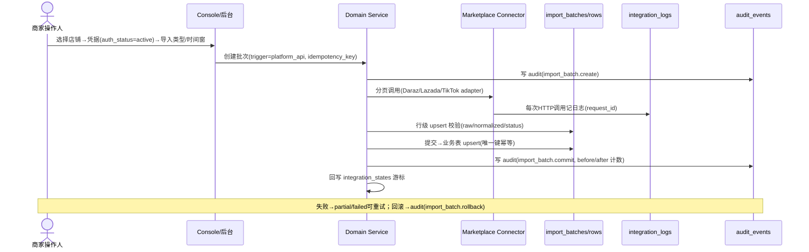

# 好时运 ERP 跨境运营域：完整数据库表结构设计

> 状态：**设计稿，待业务/IT确认后由 `drizzle-kit generate` 落库**
> 日期：2026-10-28
> 输入：`好时运ERP运营需求清单_V1.1_现有ERP整改版.xlsx`（F01–F19、202 字段、R01–R12、PUR-001~003）；[comment-scraping-and-report-design.md](comment-scraping-and-report-design.md)（评论抓取/DomainReview/HTML 报告）；样例报告 `docs/design/comments/Daraz评价分析报告-3D打印机器人.html`；[freight-estimation-design.md](freight-estimation-design.md)（运费测算 §4 已确认 8 表草案）+ 原型 `docs/design/ship-fees/`
> 借鉴：[Open Mercato](https://github.com/open-mercato/open-mercato) Core（MIT）—— `wms.movements` 事件账本、`workflows`/`business_rules` 审批、`audit_logs`、`sync_excel` 批次导入、`dictionaries`+别名；**不引入** MikroORM / REST factory / Enterprise 代码
> 关联：[haoshiyun-erp-open-mercato-reuse-plan.md](haoshiyun-erp-open-mercato-reuse-plan.md)、[haoshiyun-erp-gap-analysis-and-remediation.md](haoshiyun-erp-gap-analysis-and-remediation.md)、[crossborder-database-design.md](crossborder-database-design.md)、[comment-scraping-and-report-design.md](comment-scraping-and-report-design.md)、[freight-estimation-design.md](freight-estimation-design.md)

## 0. 设计原则

1. **租户隔离**：业务表强制 `organization_id`（不用 OM 的 `tenant_id` 双键）；平台主数据（平台/国家/币种）为受控全局表。
2. **内部 SKU 唯一主轴**：订单行、库存、采购、售后、成本、利润一律按 `variant_id`（内部 SKU）归集；Seller SKU 只存在于映射层（R04/R05/R08）。
3. **共享库存池**：实物库存归属 `organization + warehouse + bin + variant`，**不归属 shop**；店铺通过 `shop_warehouses` 关联仓库。**Lazada 五站**可竞争同一厦门池；**Daraz LK 使用 Colombo 本地仓 + 海运柜次状态机，不与厦门现货池混用**。
4. **追加式交易事实**：库存流水、审批事件、审计事件、质检结果不可 UPDATE/DELETE；更正走反向单据（OM `movements` + R12）。
5. **主档停用不删除**：`status` + `disabledAt`/`deletedAt` 软停用；编码永久唯一不复用（R06）。
6. **金额规范**：`numeric(15,4)` 原币 + `currency` + 汇率快照引用；禁止跨币种直接 SUM。
7. **枚举用 varchar + TS union**（AGENTS 约定），不用 PG enum。
8. **幂等键**：所有平台同步写入与库存事件带 `idempotency_key`，重放不重复生效（Q06）。
9. **演进不另建平行库**：在 `packages/db/src/commerce-schema.ts` 按域分节扩展；与现有 21 表冲突处给出迁移说明（§12）。
10. **非通用电商 ERP**：无自营店面/购物车/CRM 会员/促销引擎；平台侧只有连接器、映射、结算拉取。

### 0.1 借鉴 OM 的具体形状

| OM 概念 | 本设计落点 |
| --- | --- |
| `wms.movements`（来源单、前后量、delta、幂等键） | `inventory_ledger` |
| `wms.locations` | `commerce_warehouses` + `commerce_bins` |
| `workflows` + `business_rules` | `approval_rules` + `approval_instances` + `approval_events` |
| `audit_logs`（before/after JSONB） | `audit_events` |
| `sync_excel`（批次 + 行错误 + 补偿） | `import_batches` + `import_rows` |
| `dictionaries` + `dictionary_aliases` | `commerce_dictionaries` 三表 |
| `dashboards` 指标元数据 | `report_metrics`（可选，P0 可用视图代替） |

### 0.2 ER 总览

```mermaid
erDiagram
  commerce_platforms ||--o{ platform_marketplaces : has
  commerce_countries ||--o{ platform_marketplaces : hosts
  commerce_warehouses ||--o{ commerce_bins : contains
  commerce_warehouses ||--o{ shop_warehouses : linked
  shops ||--o{ shop_warehouses : uses
  shops ||--o{ listings : publishes
  products ||--o{ product_variants : has
  product_variants ||--o{ seller_sku_mappings : mapped
  shops ||--o{ seller_sku_mappings : owns
  suppliers ||--o{ supplier_skus : offers
  product_variants ||--o{ supplier_skus : sourced
  purchase_requests ||--o{ purchase_request_lines : contains
  purchase_requests ||--o{ approval_instances : reviewed_by
  purchase_orders ||--o{ purchase_order_lines : contains
  purchase_orders ||--o{ purchase_receipts : received_via
  purchase_receipts ||--o{ qc_inspections : inspected_by
  product_variants ||--o{ inventory_balances : stocked
  commerce_bins ||--o{ inventory_balances : holds
  product_variants ||--o{ inventory_ledger : moves
  commerce_bins ||--o{ inventory_ledger : located
  orders ||--o{ order_lines : contains
  order_lines ||--o{ inventory_reservations : reserves
  orders ||--o{ packages : fulfilled_by
  packages ||--o{ logistics_events : tracks
  orders ||--o{ aftersale_orders : may_return
  aftersale_orders ||--o{ qc_inspections : return_qc
  orders ||--o{ order_fees : incurs
  orders ||--o{ order_profit_snapshots : profits
  settlements ||--o{ settlement_lines : detail
  import_batches ||--o{ import_rows : rows
  listings ||--o{ product_reviews : reviewed_on
  shops ||--o{ product_reviews : receives
  product_reviews ||--o{ product_review_media : has_media
  product_reviews ||--o{ product_review_replies : replied
  product_reviews ||--o{ product_review_analyses : analyzed
  review_reports ||--o{ review_report_items : includes
  product_reviews ||--o{ review_report_items : cited_in
  freight_carriers ||--o{ freight_quotes : quotes
  freight_lanes ||--o{ freight_quotes : covers
  freight_lanes ||--o{ freight_rate_cards : prices
  freight_rate_cards ||--o{ freight_rate_card_versions : versions
  freight_rate_card_versions ||--o{ freight_rate_tiers : tiers
  freight_quotes ||--o{ freight_quote_lines : lines
  freight_charge_item_defs ||--o{ freight_quote_lines : defines
  hs_codes ||--o{ hs_tariff_versions : has
  hs_codes ||--o{ hs_match_rules : matches
  freight_estimates }o--|| freight_quotes : references
  freight_estimates }o--|| freight_rate_card_versions : references
  freight_estimates }o--|| hs_tariff_versions : snapshots
  sku_costs }o--|| freight_estimates : logical_ref
```



---

## 1. 域 A：平台与主数据（F02/F06，S1）

### 1.1 `commerce_platforms` — 平台受控主档（全局）

| 列 | 类型 | 说明 |
| --- | --- | --- |
| id | text PK | |
| code | varchar(32) UNIQUE | `daraz` / `lazada` / `shopee` / `tiktok_shop` |
| name | text | |
| adapter_key | varchar(64) | 对应 `packages/marketplace` adapter |
| status | varchar(16) | `active` / `disabled` |
| config | jsonb | connector 能力开关，不存业务规则 |
| created_at / updated_at | timestamptz | |

租户不可通过 CRUD 新造平台；平台接入由平台管理员配置 adapter。

### 1.2 `commerce_countries` — 国家主档（全局）

| 列 | 类型 | 说明 |
| --- | --- | --- |
| id | text PK | |
| iso2 | varchar(2) UNIQUE | `LK` / `MY` / `PH` / `SG` / `TH` / `VN` |
| name_zh / name_en | text | |
| region_code | varchar(16) | |
| default_timezone | varchar(64) | IANA |
| default_currency_code | varchar(3) FK→currencies | |
| status | varchar(16) | |

### 1.3 `platform_marketplaces` — 平台×国家站点

| 列 | 类型 | 说明 |
| --- | --- | --- |
| id | text PK | |
| platform_id | text FK | |
| country_id | text FK | |
| site_code | varchar(32) | 如 `LK`、`MY` |
| display_name | text | 如「Daraz 斯里兰卡」 |
| status | varchar(16) | |
| supported_features | jsonb | 连接器能力位（订单/商品/结算 API 可用性） |
| **UNIQUE** | | `(platform_id, site_code)` |

### 1.4 `commerce_currencies` — 币种（全局）

| 列 | 类型 | 说明 |
| --- | --- | --- |
| code | varchar(3) PK | ISO 4217 |
| name / symbol | text | |
| minor_unit | smallint | 0–4 |
| status | varchar(16) | |

汇率**不在**本表，见 §7 `fx_rates`。

### 1.5 `commerce_warehouses` — 公司仓库（org）

| 列 | 类型 | 说明 |
| --- | --- | --- |
| id | text PK | |
| organization_id | text FK | |
| code | varchar(64) | 如 `WH-CN-XMN-001` |
| name | text | |
| type | varchar(32) | `self_operated` / `lgs` / `jsb` / `third_party` |
| country_id | text FK | 所在国 |
| timezone | varchar(64) | |
| operating_currency | varchar(3) | |
| address | jsonb | 结构化地址 |
| status | varchar(16) | `active` / `disabled` |
| **UNIQUE** | | `(organization_id, code)` |

同一仓库可被多个店铺复用（跨境一盘货）。

### 1.6 `commerce_bins` — 库位（org + warehouse）

| 列 | 类型 | 说明 |
| --- | --- | --- |
| id | text PK | |
| organization_id | text FK | |
| warehouse_id | text FK | |
| code | varchar(64) | 如 `A-01-03` |
| name | text | |
| status | varchar(16) | `active` / `disabled` |
| **UNIQUE** | | `(organization_id, warehouse_id, code)` — R07 同仓唯一 |

**绑定约束（R07，2026-11-03 C2 已定）**：一个库位同一时点最多绑定一个有效内部 SKU —— **双保险**：① `commerce_bin_bindings` 上 partial unique index `(organization_id, bin_id) WHERE state = 'active'` 兜底；② 服务层事务校验给出友好报错。绑定有效态与履历见 `commerce_bin_bindings` + `bin_binding_history`（追加式只读，禁止物理删除，C1）——完整表结构与不变量见 `docs/design/erp-rectification-2026-11-03.md` §2.2。

**落地（0009）**：`commerce_warehouse_zones` 已成为独立表，库区不再写 `commerce_warehouses.raw.zones`；迁移不回填旧 JSON。`commerce_bins.bound_sku` 仅作冗余缓存。

### 1.7 `inventory_pools` — 库存池（可选抽象，org）

| 列 | 类型 | 说明 |
| --- | --- | --- |
| id | text PK | |
| organization_id | text FK | |
| code | varchar(64) | 如 `POOL-LAZADA-5C` |
| name | text | |
| warehouse_id | text FK | 首阶段一池一仓；一仓可服务多店 |
| status | varchar(16) | |
| **UNIQUE** | | `(organization_id, code)` |

**履约分池决议（2026-10-31）**：Lazada 五站可继续共用 `WH-CN-XMN-001` 对应的默认池（厦门现货）；**Daraz LK 不加入该池**。Daraz LK 走海运柜次 → Colombo 本地仓（见 §5.x `ocean_shipments` / `customs_clearing`）。余额仍以 warehouse+bin+sku 为物理事实，pool 仅逻辑分组与推送策略（Q09）。详见 [daraz-lk-erp-p0-ued.md](../../apps/shop/content/design/daraz-lk-erp-p0-ued.md)。

**落地（0009）**：`inventory_pools` 已建表，`shops.inventory_pool_id` 关联；种子创建 `POOL-LAZADA-5C`（厦门）与 `POOL-DARAZ-LK`（Colombo）。

### 1.8 `shops` — 店铺主档（扩展现有表）

在现有列基础上**新增**：

| 新增列 | 类型 | 说明 |
| --- | --- | --- |
| marketplace_id | text FK | → platform_marketplaces |
| seller_id | text | 平台 Seller ID |
| shop_code | varchar(64) | 内部店铺编码 |
| default_warehouse_id | text FK | 默认出库仓（每店必填一个 active） |
| inventory_pool_id | text FK | 可选，默认=默认仓所属池 |
| fulfillment_mode | varchar(32) | `lgs` / `jsb` / `self_ship` / `mixed` |
| owner_user_id | text | 店铺负责人（better-auth user） |
| planned_launch_at / launched_at | timestamptz | |
| **UNIQUE** | | `(organization_id, marketplace_id, seller_id)` |

保留现有 `(organization_id, platform, external_shop_id)` 唯一键作为兼容；新写路径以 `marketplace_id` 为准。

### 1.9 `shop_warehouses` — 店铺↔仓库 M2N

| 列 | 类型 | 说明 |
| --- | --- | --- |
| id | text PK | |
| organization_id | text FK | |
| shop_id | text FK | |
| warehouse_id | text FK | |
| is_default_outbound | boolean | 每店 active 关联**恰一个** true |
| status | varchar(16) | |
| created_by / created_at | | |
| **UNIQUE** | | `(shop_id, warehouse_id)` |

复合 FK 或应用层校验双方同 org。创建店铺向导：平台→站点→店铺→选仓→指定默认出库仓。

### 1.10 属性字典三表（F06）— 借鉴 OM dictionaries

#### `commerce_dictionaries`

| 列 | 类型 | 说明 |
| --- | --- | --- |
| id | text PK | |
| organization_id | text NULL FK | NULL = 系统字典 |
| key | varchar(64) | `color` / `size` / `brand` / `category` / `fulfillment_mode`… |
| label | text | |
| scope | varchar(16) | `system` / `org` |
| is_system | boolean | 系统字典不可删 |
| status | varchar(16) | |
| **UNIQUE** | | `(organization_id, key)`（org NULL 时用 partial unique on key） |

#### `commerce_dictionary_values`

| 列 | 类型 | 说明 |
| --- | --- | --- |
| id | text PK | |
| dictionary_id | text FK | |
| code | varchar(64) | |
| canonical_value | text | 规范值 |
| label_zh / label_en | text | |
| sort_order | integer | |
| status | varchar(16) | 停用后表单不可选 |
| metadata | jsonb | |
| **UNIQUE** | | `(dictionary_id, code)` |

#### `commerce_dictionary_aliases`

| 列 | 类型 | 说明 |
| --- | --- | --- |
| id | text PK | |
| dictionary_value_id | text FK | |
| alias | text | 原始别名 |
| normalized_alias | varchar(128) | lower/trim 后 |
| locale | varchar(16) | |
| **UNIQUE** | | `(dictionary_value_id, normalized_alias)`；同字典下 normalized 全局唯一由查询保证 |

别名用于导入匹配与搜索，不作为业务主值。

---

## 2. 域 B：商品与供应商（F04/F05/F08，S2）

### 2.1 `products` — SPU 主档（扩展现有表）

| 新增列 | 类型 | 说明 |
| --- | --- | --- |
| spu_code | varchar(32) | `HSY` + 6 位流水，如 `HSY000001`；**UNIQUE (organization_id, spu_code)**；序列生成、不复用（R01/R06） |
| brand_dict_value_id | text FK | 关联字典规范值 |
| category_dict_value_id | text FK | |
| status | 保留并语义化 | `active` / `disabled`（只停用不删） |
| legacy_codes | jsonb | 旧码对照（TEE-001 等，Q27/Q34） |
| created_by | text | |

生成策略：应用层事务内 `SELECT … FOR UPDATE` 组织级序列行，或独立 `commerce_spu_sequences(org, next_val)` 表；禁止随机 ID 兼作业务码。

### 2.2 `product_variants` — 内部 SKU（扩展现有表）

| 新增列 | 类型 | 说明 |
| --- | --- | --- |
| sku_code | varchar(32) | SPU + 3 位流水，如 `HSY000001001`；**UNIQUE (organization_id, sku_code)**（R02） |
| color_value_id / size_value_id | text FK | 字典值（可扩展为 attrs 表） |
| status | varchar(16) | `active` / `disabled` |
| barcode / weight_grams / length_mm / width_mm / height_m | 保留 | |
| attrs | jsonb | 其余规格，常用维度提列 |

兼容：现有 `sku` 列保留为展示/导入别名，新约束以 `sku_code` 为准。

### 2.3 `commerce_sku_sequences` — 编码序列

| 列 | 类型 | 说明 |
| --- | --- | --- |
| organization_id | text PK | |
| spu_next_val | integer | 默认 1 |
| sku_next_val | integer | 按 SPU 内 3 位滚动，或组织全局流水 |
| updated_at | timestamptz | |

### 2.4 `suppliers` — 供应商（F08）

| 列 | 类型 | 说明 |
| --- | --- | --- |
| id | text PK | |
| organization_id | text FK | |
| code | varchar(64) | 内部编码 |
| name | text | |
| contact_name / contact_phone / contact_email | text | |
| country_id | text FK | 可空 |
| payment_terms | varchar(64) | 如 `T/T 30` |
| lead_time_days | integer | 默认交期 |
| rating | smallint | 1–5，可空 |
| status | varchar(16) | |
| notes | text | |
| **UNIQUE** | | `(organization_id, code)` |

### 2.5 `supplier_skus` — 供应商货号↔内部 SKU

| 列 | 类型 | 说明 |
| --- | --- | --- |
| id | text PK | |
| organization_id | text FK | |
| supplier_id | text FK | |
| variant_id | text FK | 内部 SKU |
| supplier_sku | varchar(128) | 供应商货号 |
| unit_price | numeric(15,4) | 参考采购价原币 |
| currency | varchar(3) | |
| moq | integer | |
| lead_time_days | integer | 覆盖供应商默认 |
| status | varchar(16) | |
| **UNIQUE** | | `(organization_id, supplier_id, supplier_sku)` |
| 建议 UNIQUE | | `(organization_id, variant_id, supplier_id)` — 一供应商对一 SKU 一条有效报价；多报价用历史表 |

---

## 3. 域 C：刊登与 Seller SKU 映射（F07，S2）

### 3.1 `listings` — Listing 主档（扩展现有表）

保留平台维度与 `external_item_id`；变体明细下沉到映射表（R05 拆分）。

| 新增列 | 类型 | 说明 |
| --- | --- | --- |
| marketplace_id | text FK | 站点级 |
| listing_title | text | |
| publish_state / status | 保留 | 平台态 + 内部态分离 |
| primary_variant_id | text FK | 主变体（可空） |

### 3.2 `seller_sku_mappings` — **专用映射表**（F07 核心，替代通用映射的变体维度）

| 列 | 类型 | 说明 |
| --- | --- | --- |
| id | text PK | |
| organization_id | text FK | |
| shop_id | text FK | |
| listing_id | text FK | 所属 Listing（一 Listing 多变体） |
| seller_sku | varchar(128) | 平台 Seller SKU |
| variant_id | text FK | 内部 SKU；冲突/待定时可空 |
| status | varchar(32) | `active` / `pending` / `conflict` / `disabled` |
| source | varchar(16) | `manual` / `import` / `sync` |
| synced_at | timestamptz | |
| meta | jsonb | |
| **UNIQUE** | | `(organization_id, shop_id, seller_sku)` — Q05 强约束 |
| INDEX | | `(organization_id, variant_id)` — 一 SKU 多 Listing 允许 |

与现有 `external_id_mappings` 关系：

- 本表成为 **Seller SKU → 内部 SKU** 的唯一权威路径（R04/R05）。
- `external_id_mappings` 保留给非 SKU 实体（order external id ↔ internal order 等）；其 `(shop, entity_type, internal_id)` 唯一键**放宽**为允许 1:N（§9 迁移）。

### 3.3 `mapping_exceptions` — 映射异常队列

| 列 | 类型 | 说明 |
| --- | --- | --- |
| id | text PK | |
| organization_id | text FK | |
| shop_id | text FK | |
| kind | varchar(32) | `unmapped` / `conflict` / `disabled_variant` / `duplicate_seller_sku` |
| payload | jsonb | 平台原始行 |
| external_order_id / external_item_id | text | 关联对象 |
| status | varchar(16) | `open` / `resolved` / `ignored` |
| resolved_by / resolved_at | | |
| resolution | jsonb | 处决结果（绑定的 variant 等） |
| created_at | timestamptz | |
| INDEX | | `(organization_id, shop_id, status, created_at)` |

未映射/冲突订单行**必须**进本表且**禁止**自动占库。

---

## 4. 域 D：采购（F09，S3，OM 无对应 — 全新）

### 4.1 `approval_rules` — 审批规则（借鉴 OM business_rules；PUR-001~003）

| 列 | 类型 | 说明 |
| --- | --- | --- |
| id | text PK | |
| organization_id | text FK | |
| code | varchar(32) | `PUR-001` … |
| name | text | |
| module | varchar(32) | `purchase` / `inventory_adjust` / … |
| trigger | varchar(64) | `purchase_request_submit` |
| rule | jsonb | 如 `{ "assignees": ["user_a","user_b"], "mode": "mutual_review", "forbid_self": true, "amount_thresholds": [...] }` |
| priority | integer | |
| status | varchar(16) | |
| **UNIQUE** | | `(organization_id, code)` |

示例：`PUR-001` 杨洁/黄发聪互审、禁止自审。

### 4.2 `approval_instances` — 审批实例（单据级）

| 列 | 类型 | 说明 |
| --- | --- | --- |
| id | text PK | |
| organization_id | text FK | |
| module | varchar(32) | |
| biz_type | varchar(32) | `purchase_request` / `stock_adjustment` / … |
| biz_id | text | 业务单 ID |
| rule_id | text FK | 命中的规则 |
| status | varchar(32) | `pending` / `approved` / `rejected` / `cancelled` |
| current_assignee_id | text | 当前处理人 |
| payload_snapshot | jsonb | 提交时快照 |
| submitted_by / submitted_at | | |
| closed_by / closed_at | | |
| **UNIQUE** | | `(organization_id, biz_type, biz_id)` — 一单一审批流 |

### 4.3 `approval_events` — 审批事件（追加，R12）

| 列 | 类型 | 说明 |
| --- | --- | --- |
| id | text PK | |
| approval_instance_id | text FK | |
| organization_id | text FK | |
| action | varchar(32) | `submit` / `approve` / `reject` / `reassign` / `cancel` |
| actor_id | text | |
| comment | text | |
| before_status / after_status | varchar(32) | |
| created_at | timestamptz | |

禁止 UPDATE/DELETE。自审在 service 层拒绝：`actor_id == submitted_by && rule.forbid_self`。

### 4.4 `purchase_requests` — 采购申请（F09）

| 列 | 类型 | 说明 |
| --- | --- | --- |
| id | text PK | |
| organization_id | text FK | |
| request_no | varchar(32) | 内部单号，UNIQUE (org, request_no) |
| supplier_id | text FK | |
| warehouse_id | text FK | 预计入库仓 |
| status | varchar(32) | `draft` / `pending_approval` / `approved` / `rejected` / `converted` / `cancelled` |
| expected_arrival_at | date | |
| currency | varchar(3) | |
| total_amount | numeric(15,4) | 行汇总投影 |
| remark | text | |
| created_by / created_at / submitted_at | | |
| approval_instance_id | text FK | |
| converted_po_id | text | |

### 4.5 `purchase_request_lines`

| 列 | 类型 | 说明 |
| --- | --- | --- |
| id | text PK | |
| purchase_request_id | text FK | |
| organization_id | text FK | |
| line_no | integer | |
| variant_id | text FK | 内部 SKU |
| supplier_sku_id | text FK | 可空 |
| qty | integer NOT NULL | |
| unit_price | numeric(15,4) | |
| amount | numeric(15,4) | |
| remark | text | |

### 4.6 `purchase_orders` — 正式采购单

仅 `status=approved` 的申请可转换（service 校验）。

| 列 | 类型 | 说明 |
| --- | --- | --- |
| id | text PK | |
| organization_id | text FK | |
| po_no | varchar(32) UNIQUE (org, po_no) | |
| purchase_request_id | text FK | |
| supplier_id | text FK | |
| warehouse_id | text FK | |
| status | varchar(32) | `draft` / `sent` / `partial_received` / `received` / `closed` / `cancelled` |
| currency | varchar(3) | |
| total_amount | numeric(15,4) | |
| expected_arrival_at | date | |
| created_by / created_at / sent_at | | |

### 4.7 `purchase_order_lines`

| 列 | 类型 | 说明 |
| --- | --- | --- |
| id | text PK | |
| purchase_order_id | text FK | |
| organization_id | text FK | |
| line_no | integer | |
| variant_id | text FK | |
| qty_ordered | integer | |
| qty_received | integer | 默认 0，投影 |
| qty_qc_passed | integer | 默认 0，投影 |
| qty_stocked | integer | 默认 0，投影 |
| unit_price | numeric(15,4) | 锁定价 |
| amount | numeric(15,4) | |

### 4.8 `purchase_receipts` — 到货收货单（分批，Q13）

| 列 | 类型 | 说明 |
| --- | --- | --- |
| id | text PK | |
| organization_id | text FK | |
| receipt_no | varchar(32) UNIQUE (org, receipt_no) | |
| purchase_order_id | text FK | |
| warehouse_id | text FK | |
| status | varchar(32) | `draft` / `qc_pending` / `completed` / `cancelled` |
| arrived_at | timestamptz | |
| received_by | text | |
| remark | text | |

### 4.9 `purchase_receipt_lines`

| 列 | 类型 | 说明 |
| --- | --- | --- |
| id | text PK | |
| purchase_receipt_id | text FK | |
| organization_id | text FK | |
| po_line_id | text FK | |
| variant_id | text FK | |
| qty_arrived | integer | |
| qty_pending_qc | integer | |
| qty_passed | integer | |
| qty_failed | integer | |
| note | text | |

### 4.10 `qc_inspections` — 质检单（采购入库 + 退货回库共用）

| 列 | 类型 | 说明 |
| --- | --- | --- |
| id | text PK | |
| organization_id | text FK | |
| qc_no | varchar(32) UNIQUE (org, qc_no) | |
| source_type | varchar(32) | `purchase_receipt` / `aftersale_return` |
| source_id | text | |
| warehouse_id | text FK | |
| status | varchar(32) | `pending` / `completed` / `cancelled` |
| inspector_id | text | |
| inspected_at | timestamptz | |
| remark | text | |

### 4.11 `qc_inspections_lines`（质检行，追加结果）

| 列 | 类型 | 说明 |
| --- | --- | --- |
| id | text PK | |
| qc_inspection_id | text FK | |
| organization_id | text FK | |
| variant_id | text FK | |
| qty_inspected | integer | |
| qty_passed | integer | 合格→可入库 |
| qty_failed | integer | → 不可售/报损 |
| fail_reason | text | |
| target_bin_id | text FK | 建议上架库位 |

**规则**：只有 `qty_passed` 进入可用库存（生成入库 `inventory_ledger`）；`qty_failed` 进不可售或报损流水。

---

## 5. 域 E：仓储与库存（F10/F11/F12，S3；借鉴 OM wms）

### 5.1 `inventory_balances` — 库存余额（**重构现有表**）

| 列 | 类型 | 说明 |
| --- | --- | --- |
| id | text PK | |
| organization_id | text FK | |
| warehouse_id | text FK | **替代 shop_id 维度** |
| bin_id | text FK NULL | 库位；汇总层可为 NULL（仓级虚拟位） |
| variant_id | text FK | |
| on_hand | integer NOT NULL DEFAULT 0 | 实物 |
| reserved | integer NOT NULL DEFAULT 0 | 订单预留 |
| qc_hold | integer DEFAULT 0 | 质检未决 |
| damaged | integer DEFAULT 0 | 不可售 |
| available | integer 生成列/应用投影 | `on_hand - reserved - qc_hold - damaged` |
| version | integer | 乐观锁 |
| updated_at | timestamptz | |
| **UNIQUE** | | `(organization_id, warehouse_id, bin_id, variant_id)` |

迁移：现有 `(shop_id, variant_id)` 行按下述规则折叠为默认仓余额（§9）。**店铺不再持有库存余额。**

> 0009 实际表暂以 `warehouse_code` / `bin_code` 承载维度，历史 NULL `bin_code` 回填 `'UNASSIGNED'`，唯一索引改为 `(organization_id, warehouse_code, coalesce(bin_code,'UNASSIGNED'), variant_id)`。后续如切到 `warehouse_id` / `bin_id` 需单独迁移。

### 5.2 `inventory_ledger` — 库存流水（追加式，借鉴 OM movements）

| 列 | 类型 | 说明 |
| --- | --- | --- |
| id | text PK | |
| organization_id | text FK | |
| warehouse_id | text FK | |
| bin_id | text FK NULL | |
| variant_id | text FK | |
| direction | varchar(8) | `in` / `out` / `move` / `adjust` |
| event_type | varchar(32) | `purchase_stock_in` / `order_reserve` / `order_release` / `order_ship` / `return_stock_in` / `qc_fail_writeoff` / `manual_adjust` / `stocktake_diff` / `migration_opening` |
| qty | integer | 有符号或配合 direction；约定 out 为正数存储 + direction |
| on_hand_before / on_hand_after | integer | |
| reserved_before / reserved_after | integer | |
| source_type | varchar(32) | `purchase_receipt` / `order` / `aftersale` / `adjustment` / `migration` |
| source_id | text | |
| source_line_id | text | |
| bin_to_id | text FK NULL | move 时目标位 |
| reason | text | |
| actor_id | text | 系统写用 `system` |
| idempotency_key | varchar(128) | **UNIQUE (organization_id, idempotency_key)** — Q06 |
| occurred_at | timestamptz | 业务发生时间 |
| created_at | timestamptz | |
| INDEX | | `(organization_id, variant_id, occurred_at)`、`(organization_id, warehouse_id, occurred_at)` |

**禁止 UPDATE/DELETE**。余额是投影；UI 不得直改余额，只能通过触发流水的业务单据。修正用反向流水（`manual_adjust` 带 reason + 审批）。

### 5.3 `inventory_reservations` — 订单预留明细

| 列 | 类型 | 说明 |
| --- | --- | --- |
| id | text PK | |
| organization_id | text FK | |
| order_line_id | text FK | |
| variant_id | text FK | |
| warehouse_id | text FK | |
| bin_id | text FK NULL | 可空（预留可先仓级） |
| qty | integer | |
| status | varchar(16) | `held` / `released` / `committed` |
| held_at / released_at / committed_at | timestamptz | |
| release_reason | varchar(32) | `cancelled` / `paid_timeout` / `aftersale` / `manual` |
| ledger_hold_key / ledger_release_key / ledger_ship_key | text | 对应流水幂等键 |
| **UNIQUE** | | `(organization_id, order_line_id, status)` 的 active 部分 — 每行同时最多一条 held |

预留/释放/出库与对应 `inventory_ledger` **同事务**提交；并发用 `UPDATE inventory_balances SET reserved = reserved + $n WHERE … AND on_hand - reserved - qc_hold - damaged >= $n` 条件更新或行锁。

### 5.4 `stock_adjustments` — 盘点/报损/手工调整单（Q11）

| 列 | 类型 | 说明 |
| --- | --- | --- |
| id | text PK | |
| organization_id | text FK | |
| adjustment_no | varchar(32) UNIQUE (org, no) | |
| kind | varchar(32) | `stocktake` / `damage` / `manual_in` / `manual_out` / `recount` |
| warehouse_id | text FK | |
| status | varchar(32) | `draft` / `pending_approval` / `approved` / `rejected` / `posted` / `cancelled` |
| reason | text NOT NULL | 强制原因 |
| approval_instance_id | text FK | 阈值触发时 |
| posted_ledger_batch_id | text | |
| created_by / approved_by / posted_at | | |

#### `stock_adjustment_lines`

| 列 | 类型 | 说明 |
| --- | --- | --- |
| id | text PK | |
| stock_adjustment_id | text FK | |
| organization_id | text FK | |
| variant_id | text FK | |
| bin_id | text FK | |
| qty_system | integer | 账面 |
| qty_counted | integer | 实盘 |
| qty_diff | integer | counted - system |
| note | text | |

过账时逐行生成 `inventory_ledger`（`event_type=stocktake_diff|manual_adjust`）。

### 5.5 `stock_alerts` — 扩展

| 变更 | 说明 |
| --- | --- |
| 去掉 `shop_id`，增加 `warehouse_id` / `variant_id` 唯一 | 预警挂在仓+SKU |
| 增加 `threshold_out` / `threshold_in` | 缺货/积压双阈值 |
| 增加 `status`: `open` / `acked` / `muted` | |

---

## 6. 域 F：订单与履约（F13/F14，S4）

### 6.1 `orders` — 扩展现有表

| 新增列 | 类型 | 说明 |
| --- | --- | --- |
| marketplace_id | text FK | 站点 |
| warehouse_id | text FK | 实际扣库仓（默认仓，可改） |
| buyer_name_masked / buyer_phone_masked / shipping_address | jsonb/text | 脱敏收件信息 |
| ship_by_at | timestamptz | 平台发货截止 |
| cancel_reason | text | |
| sync_batch_id | text | 关联导入/同步批次 |
| **保留** | | `(shop_id, external_order_id)` 唯一 — 去重 |

### 6.2 `order_lines` — 扩展现有表

| 变更 | 说明 |
| --- | --- |
| `variant_id` 改为可空但业务必填（异常时可空） | 映射失败进异常队列 |
| 新增 `seller_sku` varchar | 冗余便于追溯 |
| 新增 `mapping_id` text FK | → seller_sku_mappings |
| 新增 `warehouse_id` | 行级仓（混仓场景） |
| 新增 `qty_cancelled` / `qty_shipped` | 进度投影 |
| 唯一建议 | `(order_id, external_line_id)` 幂等 |

### 6.3 `order_exceptions` — 订单异常

| 列 | 类型 | 说明 |
| --- | --- | --- |
| id | text PK | |
| organization_id | text FK | |
| order_id / order_line_id | text | |
| kind | varchar(32) | `unmapped_sku` / `insufficient_stock` / `duplicate` / `address_invalid` / `status_unknown` / `sync_conflict` |
| severity | varchar(16) | `blocker` / `warn` |
| payload | jsonb | |
| status | varchar(16) | `open` / `resolved` / `ignored` |
| resolved_by / resolved_at / resolution_note | | |
| created_at | timestamptz | |

`blocker` 未解决前不占库、不进入拣货。

### 6.4 `packages` — 包裹（LGS/JSB）

| 列 | 类型 | 说明 |
| --- | --- | --- |
| id | text PK | |
| organization_id | text FK | |
| package_no | varchar(64) | 内部包裹号 UNIQUE (org, package_no) |
| order_id | text FK | 一单一包起步；支持一单多包扩展 |
| shop_id | text FK | |
| warehouse_id | text FK | |
| channel | varchar(32) | `lgs` / `jsb_th` / `self_ship` |
| status | varchar(32) | `pending_pick` / `picked` / `packed` / `handed_over` / `in_transit` / `customs` / `delivered` / `exception` / `cancelled` |
| carrier | varchar(64) | |
| tracking_number | varchar(128) | |
| external_package_id | varchar(128) | 平台/承运商单号 |
| weight_gram / length_mm / width_mm / height_m | integer | 计费重 |
| handed_over_at / shipped_at / delivered_at | timestamptz | |
| jsb_batch_no | varchar(64) | TH JSB 批次，Q17 |
| raw | jsonb | |
| **UNIQUE** | | `(organization_id, package_no)`；`(shop_id, external_package_id)` partial |

### 6.5 `package_items`

| 列 | 类型 | 说明 |
| --- | --- | --- |
| id | text PK | |
| package_id | text FK | |
| organization_id | text FK | |
| order_line_id | text FK | |
| variant_id | text FK | |
| qty | integer | |

### 6.6 `logistics_events` — 轨迹（追加）

| 列 | 类型 | 说明 |
| --- | --- | --- |
| id | text PK | |
| organization_id | text FK | |
| package_id | text FK | |
| event_type | varchar(32) | `picked` / `packed` / `handover` / `departed` / `arrived_hub` / `customs_clearance` / `out_for_delivery` / `delivered` / `failed_attempt` / `returned` |
| description | text | |
| location | text | |
| source | varchar(16) | `api` / `manual` / `import` |
| occurred_at | timestamptz | |
| raw | jsonb | |
| idempotency_key | varchar(128) UNIQUE (org, key) | |

JSB 无 API 时（Q17）走人工批量导入，`source=import`。

### 6.7 `fulfillment_batches` — LGS/JSB 交接批次

| 列 | 类型 | 说明 |
| --- | --- | --- |
| id | text PK | |
| organization_id | text FK | |
| batch_no | varchar(64) | |
| channel | varchar(32) | `lgs` / `jsb_th` |
| warehouse_id | text FK | |
| status | varchar(32) | `open` / `submitted` / `accepted` / `rejected` / `closed` |
| package_count / total_weight_gram | integer | |
| submitted_by / submitted_at | | |
| platform_ack | jsonb | |
| **UNIQUE** | | `(organization_id, batch_no)` |

#### `fulfillment_batch_packages`

`(batch_id, package_id)` UNIQUE。

---

## 7. 域 G：售后（F15，P1 但取消释放库存提为 P0 子集）

### 7.1 `aftersale_orders` — 售后单

| 列 | 类型 | 说明 |
| --- | --- | --- |
| id | text PK | |
| organization_id | text FK | |
| aftersale_no | varchar(32) UNIQUE (org, no) | |
| order_id | text FK | |
| order_line_id | text FK 可空 | |
| shop_id | text FK | |
| type | varchar(32) | `cancel` / `refund_only` / `return_refund` |
| status | varchar(32) | `requested` / `approved` / `rejected` / `return_in_transit` / `return_received` / `qc_pending` / `qc_done` / `restocked` / `written_off` / `closed` |
| platform_aftersale_id | varchar(128) | |
| reason | text | |
| qty | integer | |
| refund_amount | numeric(15,4) | |
| currency | varchar(3) | |
| requested_at / closed_at | timestamptz | |
| raw | jsonb | |
| **UNIQUE** | | `(shop_id, platform_aftersale_id)` partial |

### 7.2 `aftersale_return_items` — 退回实物

| 列 | 类型 | 说明 |
| --- | --- | --- |
| id | text PK | |
| aftersale_order_id | text FK | |
| organization_id | text FK | |
| variant_id | text FK | |
| qty_returned | integer | |
| qty_passed | integer | 质检合格 → 入库流水 |
| qty_failed | integer | → 报损 |
| qc_inspection_id | text FK | |
| restock_bin_id | text FK | |
| restocked_ledger_key | text | |

**硬规则**：退货实物在 `qc_done` 且生成合格入库流水之前，**不得**增加 `available`（Q18）。

`type=cancel` 的售后在批准时触发 `order_release` 预留释放流水，不等待实物。

---

## 5.x 域 W 扩展：海运柜次与清关库存（Daraz LK / F22）

> 决议：Daraz LK ≠ 厦门现货池。本扩展服务海运 45–60d → Colombo WH。

### `ocean_shipments` — 柜次（container lot）

| 列 | 类型 | 说明 |
| --- | --- | --- |
| id | text PK | |
| organization_id | text FK | |
| lot_code | varchar(64) | 柜次号，org 内唯一 |
| container_no | varchar(64) | 物理柜号可空 |
| container_type | varchar(16) | `20GP`/`40GP`/`40HQ`/`LCL` |
| platform | varchar(32) | 默认 `daraz` |
| origin_port / dest_port | varchar(16) | 如 `CNXMN` / `LKCMB` |
| destination_warehouse_id | text FK | Colombo 本地仓 |
| status | varchar(32) | `in_transit` / `customs_clearing` / `received_local` / `cancelled` |
| etd / eta_port / eta_warehouse | date | |
| departed_at / cleared_at / received_at | timestamptz | |
| notes | text | |
| created_by / created_at / updated_at | | |
| **UNIQUE** | | `(organization_id, lot_code)` |

### `ocean_shipment_lines` — 柜次行

| 列 | 类型 | 说明 |
| --- | --- | --- |
| id | text PK | |
| shipment_id | text FK | → ocean_shipments |
| organization_id | text FK | |
| variant_id | text FK | |
| qty_shipped | integer | |
| qty_received | integer | 入本地仓实收 |
| qty_damaged | integer | |
| sku_cost_id | text FK 可空 | 关联本柜次成本版本 |
| **UNIQUE** | | `(shipment_id, variant_id)` |

### 库存桶增量

`inventory_balances` **新增** `customs_clearing`（清关中，整数，默认 0），**不计入 available**。

Daraz 投影口径：

- 柜次 `in_transit` → 行数量计入 SKU `in_transit`
- 柜次 `customs_clearing` → 从 `in_transit` 转入 `customs_clearing`
- 柜次 `received_local` → 转入 `on_hand`（再上架），残次进 `damaged`

仓库 `type` / `fulfillment_role` 可配置：`origin_pool` | `destination_local` | `3pl` | `supplier`。

---

## 8. 域 H：成本、汇率、结算与利润（F16，S6）

### 8.1 `fx_rates` — 汇率版本（Q15 / F33）

| 列 | 类型 | 说明 |
| --- | --- | --- |
| id | text PK | |
| organization_id | text FK 可空 | 平台默认可空；租户覆盖填 org |
| platform | varchar(32) | 如 `daraz` / `lazada`；可空=全局默认 |
| marketplace_id | text FK 可空 | 更细站点（Daraz LK）；与 platform 至少填一 |
| base_currency | varchar(3) | 原币 |
| quote_currency | varchar(3) | 折算币 |
| rate | numeric(18,8) | |
| rate_date / effective_date | date | 生效日 |
| source | varchar(32) | `manual` / `api` / `import` / `platform_bill` |
| created_by / created_at | | |
| **UNIQUE** | | `(organization_id, platform, marketplace_id, base_currency, quote_currency, effective_date, source)` |

消费方**保留三元组**：原币金额、`fx_rate_id`（或 rate+date+source 快照）、折算金额。订单/结算保存快照，历史不覆盖。

### 8.2 `cost_templates` + `cost_template_versions` — 标准成本模板（Q14）

#### `cost_templates`

| 列 | 类型 | 说明 |
| --- | --- | --- |
| id | text PK | |
| organization_id | text FK | |
| name | text | |
| scope | varchar(32) | `global` / `category` / `supplier` |
| scope_ref_id | text | 可空 |
| status | varchar(16) | |

#### `cost_template_versions`

| 列 | 类型 | 说明 |
| --- | --- | --- |
| id | text PK | |
| template_id | text FK | |
| organization_id | text FK | |
| version_no | integer | |
| components | jsonb | `[{ kind: "purchase|freight|duty|platform_fee|other", formula|amount, currency }]` |
| method | varchar(32) | `weighted_average` / `fifo` / `last_purchase` — Q14 待选 |
| effective_from / effective_to | timestamptz | |
| approval_instance_id | text FK | 可空 |
| created_by / created_at | | |
| **UNIQUE** | | `(template_id, version_no)` |

#### `sku_costs` — SKU 成本快照（版本化，不覆盖；F32 按柜次）

| 列 | 类型 | 说明 |
| --- | --- | --- |
| id | text PK | |
| organization_id | text FK | |
| variant_id | text FK | |
| version_id | text FK 可空 | → cost_template_versions |
| version_no | integer | 同 SKU（+柜次）内递增 |
| container_lot_id | text FK 可空 | → ocean_shipments（柜次）；Daraz 海运成本版本键 |
| freight_estimate_id | text 可空 | 逻辑引用运费测算快照 |
| tax_template_code | varchar(64) | 如 `LK_PAL_CESS_VAT_SSCL` |
| tax_breakdown | jsonb | PAL/CESS/VAT/SSCL 等快照 |
| landed_unit_cost | numeric(15,4) | |
| currency | varchar(3) | |
| fx_rate_id | text FK | 折本位币 |
| landed_unit_cost_base | numeric(15,4) | |
| effective_from | timestamptz | |
| source_purchase_line_id | text | 可追溯 |
| calculator_snapshot | jsonb | F32 工作台输入/瀑布 |
| created_by / created_at | | |
| INDEX | | `(organization_id, variant_id, container_lot_id, version_no)` |
| INDEX | | `(organization_id, variant_id, effective_from)` |

历史订单利润计算时按 `effective_from` / 柜次取当时版本，不回写。税模板可配置（本阶段种子为斯里兰卡级联）。

### 8.3 `order_fees` — 订单费用事实（Q16）

| 列 | 类型 | 说明 |
| --- | --- | --- |
| id | text PK | |
| organization_id | text FK | |
| order_id / order_line_id | text | 可空（头费用/行费用） |
| shop_id | text FK | |
| fee_type | varchar(32) | `commission` / `shipping_subsidy` / `payment_fee` / `promotion` / `penalty` / `jsb_freight` / `tax_pal` / `tax_cess` / `tax_vat` / `tax_sscl` / `other` |
| amount | numeric(15,4) | 原币，费用为正、扣款可负 |
| currency | varchar(3) | |
| fx_rate_id | text FK | |
| amount_base | numeric(15,4) | |
| source | varchar(16) | `api` / `import` / `manual` |
| settlement_line_id | text FK | 可空，对账关联 |
| occurred_at / created_at | | |
| import_batch_id | text | |

### 8.4 `settlements` / `settlement_lines` — 扩展

| 变更 | 说明 |
| --- | --- |
| settlements 增加 `status`（`imported`/`matched`/`confirmed`）、`total_amount`、`fx_rate_id`、`import_batch_id` | |
| settlement_lines 增加 `fee_type`、`order_id`、`variant_id`、`match_status` | 与 order_fees 对账 |

### 8.5 `order_profit_snapshots` — 利润投影（可重算）

| 列 | 类型 | 说明 |
| --- | --- | --- |
| id | text PK | |
| organization_id | text FK | |
| order_id | text FK UNIQUE | 一单一快照（重算覆盖版本号） |
| order_line_id | text FK 可空 | 行级可另表 |
| calc_version | integer | |
| gmv_base | numeric(15,4) | |
| cost_base | numeric(15,4) | |
| fee_total_base | numeric(15,4) | |
| refund_base | numeric(15,4) | |
| gross_profit_base / net_profit_base | numeric(15,4) | |
| fx_policy | jsonb | 使用的汇率日期策略 |
| calculated_at | timestamptz | |
| INDEX | | `(organization_id, calculated_at)` |

公式口径待 Q14/Q29/Q30 确认后固化在 domain service；本表只存结果与输入版本引用。

---

## 9. 域 I：系统、权限、审计、导入（F03/F18/F19，S1/S5）

### 9.1 `erp_roles` + `erp_role_permissions` + `role_scopes` — 业务 RBAC（叠加 better-auth）

better-auth org/member 不动；业务权限独立：

#### `erp_roles`

| 列 | 类型 | 说明 |
| --- | --- | --- |
| id | text PK | |
| organization_id | text FK | |
| code | varchar(32) | `biz_admin` / `buyer` / `operator` / `finance` / `viewer` / `it_tech` |
| name | text | |
| is_system | boolean | |
| status | varchar(16) | |
| **UNIQUE** | | `(organization_id, code)` |

#### `erp_role_permissions`

| 列 | 类型 | 说明 |
| --- | --- | --- |
| id | text PK | |
| role_id | text FK | |
| permission | varchar(64) | `product.read` / `product.write` / `purchase.submit` / `purchase.approve` / `inventory.adjust` / `order.ship` / `finance.read` / `report.export` / `settings.manage` / `it.impersonate` … |
| **UNIQUE** | | `(role_id, permission)` |

#### `erp_member_roles`（成员↔角色，M2N）

`(organization_id, user_id, role_id)` UNIQUE。蔡值=仅 `viewer`；外部 IT=`it_tech`（可停用技术账号，R11）。

#### `erp_role_scopes` — 数据范围（Q23，2026-11-03 C5 修订）

| 列 | 类型 | 说明 |
| --- | --- | --- |
| id | text PK | |
| organization_id / role_id / user_id | text | user 级覆盖可空 |
| scope_type | varchar(16) | `all` / `platform` / `country` / `marketplace` / `shop` / `warehouse`（**C5 新增 `country`**） |
| scope_ref_id | text | country_id / marketplace_id / shop_id / warehouse_id |
| actions | jsonb | 六动作子集 `["read","create","update","approve","export","configure"]`（C5：对应查看/新增/修改/审核/导出/配置） |

`erp_role_permissions.permission` 统一 `module.action` 六动作码（如 `inventory.read`、`purchase.approve`、`report.export`、`settings.configure`）；`it.impersonate` 等保留为 `it.*` 特殊 action。

服务端每个 tRPC 查询/写入同时校验：org 成员 + role permission（module.action）+ scope 命中（平台/国家/站点/店铺/仓库）。模型细节与测试账号演示见 `docs/design/erp-rectification-2026-11-03.md` §3。

### 9.2 `audit_events` — 业务审计（借鉴 OM audit_logs，R12）

| 列 | 类型 | 说明 |
| --- | --- | --- |
| id | text PK | |
| organization_id | text FK | |
| actor_id | text | |
| actor_type | varchar(16) | `user` / `system` / `api_key` |
| module | varchar(32) | |
| action | varchar(64) | `create` / `update` / `disable` / `approve` / `login` / `export` |
| entity_type | varchar(32) | |
| entity_id | text | |
| before | jsonb | |
| after | jsonb | |
| request_id | text | |
| ip / user_agent | text | 可空 |
| created_at | timestamptz | |
| INDEX | | `(organization_id, entity_type, entity_id, created_at)`、`(organization_id, created_at)` |

追加存储；修正以反向业务单据 + 新审计行，不改历史。

### 9.3 `import_batches` + `import_rows` — 导入迁移（借鉴 OM sync_excel，F19）

**双通道统一**：同一套批次框架承载①**文件导入**（Excel/CSV 迁移）与②**平台 API 批次导入**（Daraz/Lazada/TikTok 按店铺授权拉取历史/区间数据），靠 `trigger` 区分。

#### `import_batches`

| 列 | 类型 | 说明 |
| --- | --- | --- |
| id | text PK | |
| organization_id | text FK | |
| batch_no | varchar(32) | |
| trigger | varchar(16) | **`file_upload` / `platform_api` / `scheduled`** — API 拉取与文件导入分道 |
| kind | varchar(32) | 文件类：`product_master` / `sku_master` / `supplier_sku` / `opening_stock` / `historical_order` / `settlement` / `fee` / `review_backfill`；**API 类**：`api_products` / `api_orders` / `api_reviews` / `api_settlements` / `api_listings` |
| shop_id | text FK **可空** | `trigger=platform_api` 必填：**按店铺授权拉取**（Daraz/Lazada/TikTok 每店独立凭据） |
| credential_id | text 可空 | 逻辑引用 `integration_credentials`（本次拉取所用凭据快照） |
| api_endpoint | varchar(128) 可空 | 如 `Get Order List` / `getReviewList` / adapter action 名 |
| api_params | jsonb 可空 | 拉取范围：`{timeFrom, timeTo, cursorStart, pageSize, itemIds?}` |
| cursor_from / cursor_to | text 可空 | 拉取前后游标留痕（回写 `integration_states` 前的快照） |
| status | varchar(32) | `draft` / `validating` / `partial` / `committed` / `failed` / `rolled_back` |
| dry_run | boolean | API 通道默认 false；文件通道可 true |
| template_version | varchar(32) | 文件通道用 |
| file_name / file_storage_key | text | 文件通道用 |
| total_rows / success_rows / error_rows | integer | |
| api_calls / api_pages | integer 可空 | API 通道：调用次数/页数 |
| integration_log_ids | jsonb `string[]` 可空 | 关联 `integration_logs.request_id`，串起接口日志 |
| idempotency_key | varchar(128) | UNIQUE `(organization_id, idempotency_key)` — 重试不重复建批 |
| rollback_of_batch_id | text | 可空 |
| created_by / validated_at / committed_at / rolled_back_at | | |
| **UNIQUE** | | `(organization_id, batch_no)`；`(organization_id, idempotency_key)` |

#### `import_rows`

| 列 | 类型 | 说明 |
| --- | --- | --- |
| id | text PK | |
| import_batch_id | text FK | |
| organization_id | text FK | |
| row_no | integer | |
| external_id | text 可空 | API 通道：平台侧 ID（order_id/item_id/review_id），幂等对账用 |
| raw | jsonb | 原始行（文件行 / API 原始 payload 摘要） |
| normalized | jsonb | 校验后 |
| status | varchar(16) | `pending` / `valid` / `error` / `committed` / `rolled_back` |
| error_code / error_message | text | |
| entity_type / entity_id | text | 提交后回填 |
| **UNIQUE** | | `(import_batch_id, row_no)` |
| 建议 INDEX | | `(import_batch_id, external_id)` partial — API 行按平台 ID 对账 |

回滚只撤销该批次 `entity_id` 集合产生的影响，且不触碰批次提交后并发产生的新流水（用时间窗 + 幂等键标记）。

**与业务表幂等的关系**：API 导入提交时，业务表自身唯一键仍是最终防线（`orders(shop_id, external_order_id)`、`product_reviews(shop_id, external_review_id)` 等）；批次行只做过程校验与错误隔离，重复批次靠 `idempotency_key` + 业务表 upsert 双保险。

### 9.4 `report_metrics` — 指标元数据（可选，F17）

| 列 | 类型 | 说明 |
| --- | --- | --- |
| id | text PK | |
| code | varchar(32) UNIQUE | `gmv` / `order_count` / `stock_value` / `turnover_days` |
| name | text | |
| formula | text | 人读公式 |
| dimensions | jsonb | `["date","platform","shop","warehouse","category","sku"]` |
| currency_policy | varchar(32) | `source_only` / `base_fx_date` |
| source | text | 表/视图说明 |
| drilldown | varchar(32) | 下钻实体 |

P0 可用 SQL 视图 + 本表元数据；不引入独立 OLAP。

### 9.5 店铺授权与接口日志（`integration_*`，Daraz / Lazada / TikTok）

现有三表**保留并增补**，支撑「每个商家/店铺配置对应平台授权 → 按店拉取 → 批次导入 → 审计」链路：

#### `integration_credentials` — 店铺级授权凭据（增列）

现有：`organization_id`、`shop_id`、`kind`、`payload_encrypted`、`expires_at`。

| 增列 | 类型 | 说明 |
| --- | --- | --- |
| auth_mode | varchar(16) | `oauth2` / `app_key_sign` / `manual_token` —— Daraz/Lazada LAZOP 与 TikTok Partner Center 均为 oauth2 + 签名，手工录入兜底 |
| auth_status | varchar(16) | `active` / `expiring`（7 天内到期）/ `expired` / `revoked` / `error` — 授权健康 |
| scopes | jsonb `string[]` | 授权范围（orders/products/reviews/settlements） |
| authorized_by | text | 操作人（better-auth user）→ 联动 `audit_events` |
| authorized_at / revoked_at / last_refresh_at | timestamptz | 授权/解绑/刷新时间线 |
| refresh_fail_count | integer DEFAULT 0 | 连续刷新失败 → 置 `error` 并告警 |
| **UNIQUE** | | `(shop_id, kind)` — 每店每类凭据一条（当前隐含约定显式化） |
| INDEX | | `(auth_status, expires_at)` — 授权到期巡检 |

凭据变更（authorize / refresh / revoke）**必须**写 `audit_events`（entity_type=`integration_credential`，before/after 只存非密文元数据：auth_status/scopes/expires_at，**绝不落 payload_encrypted**）。

#### `integration_states` — 同步状态（增列）

保留现有 4 组游标；新增评论游标（见下）与：

| 新增列 | 类型 | 说明 |
| --- | --- | --- |
| last_import_batch_id | text 可空 | 最近一次 API 批次导入（→ import_batches） |
| auth_checked_at | timestamptz | 最近一次授权健康检查 |

#### `integration_logs` — 接口调用日志（增列）

现有：`shop_id`、`direction`、`action`、`request_id`、`status`、`message`、`payload_summary`。

| 增列 | 类型 | 说明 |
| --- | --- | --- |
| organization_id | text FK | 跨店审计查询（现仅有 shopId） |
| import_batch_id | text 可空 | 本次调用归属的 API 批次 |
| http_status / latency_ms | 可空 | 技术可观测 |
| error_code | varchar(64) 可空 | 平台错误码 |
| INDEX | | `(organization_id, created_at)`、`(import_batch_id)` |

**日志分层口径**：`integration_logs` = 每次平台 HTTP 调用的技术流水（含分页）；`import_batches` = 一次业务批次的聚合与回滚单元；`audit_events` = 谁在什么时候做了授权/导入/回滚等业务动作。三者通过 `import_batch_id` + `request_id` 串联，不互相替代。

`integration_states` **增加评论同步游标列**（与现有 4 组 `*_cursor + last_*_sync_at` 同模式）：

| 新增列 | 类型 | 说明 |
| --- | --- | --- |
| reviews_cursor | text | 可选；Daraz 公开评价接口按页拉取时可用 |
| last_reviews_sync_at | timestamptz | |
| reviews_synced_after | timestamptz | 增量窗口下界 |

不建 item 级游标表：单商品评论为小集合，按页全量 + `(shop_id, external_review_id)` upsert 幂等即可。抓取运行明细可选走 `review_fetch_runs`（§10.6）或复用 `integration_logs(action='reviews.fetch')`。

### 9.6 平台 API 批次导入流程与审计联动

**流程（trigger=platform_api）**：



**审计必写点**：

| 动作 | audit_events 记录 |
| --- | --- |
| 店铺授权 / 解绑 / 刷新 | `entity_type=integration_credential`，before/after=非密文元数据 |
| 创建 API 导入批次 | `entity_type=import_batch`，action=create，after=kind/shop/时间窗 |
| 批次提交 / 部分成功 | action=commit，after=success_rows/error_rows |
| 批次回滚 | action=rollback，before=原批次状态，after=rolled_back |
| 手动重试 | 新批次 + `rollback_of_batch_id` 或 idempotency 关联，actor 必填 |

**权限**：按 `erp_role_scopes` 的 shop scope 过滤可操作店铺（Q23）；`platform_api` 导入需 `import.execute` 权限，回滚需 `import.rollback`；外部 IT 技术账号（R11）只读日志、不可触发回滚（可配置）。

**已覆盖现状**：三平台 OAuth 流程与签名见 [marketplace-connectors.md](marketplace-connectors.md)（`integration_credentials` 加密落库已是真实写路径）；本节补齐的是**批次语义、授权生命周期状态与审计联动的表结构**。

---

## 10. 域 J：评论与口碑（Review & Reputation，S5/S7）

> 来源：[comment-scraping-and-report-design.md](comment-scraping-and-report-design.md)（API 优先 Lazop Review / AI 兜底 → DomainReview → HTML 报告）+ 样例报告 `Daraz评价分析报告-3D打印机器人.html`（26 条实抓 / 平台 32 条、KPI 六格、星级分布三列、高分差评、关键发现、正负中性分组）。
> 下游：控制台商品详情「评论」区块（`product-reviews-section`）、AI 选品痛点证据 `evidence[].reviewId`（[AI选品实现方案](ai-candidates/AI选品实现方案.md)）。
> 定位：**跨境电商多店铺口碑与选品证据**，非通用 UGC/评价社区；不建买家账号体系、不建站内评价回复社区流。

### 10.1 `product_reviews` — 评论原文主档

| 列 | 类型 | 说明 |
| --- | --- | --- |
| id | text PK | cuid2 |
| organization_id | text FK NOT NULL | 租户硬隔离 |
| shop_id | text FK NOT NULL → shops | 幂等键成分；凭据/权限边界 |
| marketplace_id | text FK 可空 | 站点（Daraz LK 等），启用 §1.8 后回填 |
| listing_id | text FK 可空 → listings | 由 `(shop_id, external_item_id)` 解析回填 |
| external_item_id | text NOT NULL | 平台 Item ID（样例 `593629355`） |
| variant_id | text FK 可空 → product_variants | SKU 解析成功后回填；未映射为 NULL 不阻塞入库 |
| seller_sku | varchar(128) 可空 | 平台原样 SKU 字符串 |
| sku_attrs | jsonb 可空 | `{color:"Blue", size:"25cm"}` ← 报告 `SKU：Color:… Size:…` |
| external_review_id | text NOT NULL | 平台 reviewId；缺失时 `hash:` + 稳定哈希 |
| rating | smallint NOT NULL | 1–5，CHECK |
| title | text 可空 | DomainReview 已有字段 |
| content | text 可空 | 原文（僧伽罗语/僧式英语/乱码/空） |
| content_zh | text 可空 | 当前生效中文（人工校对或 AI 翻译） |
| content_lang | varchar(8) 可空 | `en` / `si` / `ta` / `und` |
| review_at | timestamptz 可空 | 相对时间（`5 days ago`）归一化后 |
| purchased_at | timestamptz 可空 | 报告「下单 …」 |
| buyer_display_name | text 可空 | 已脱敏展示值 |
| buyer_external_id | text 可空 | 同一买家多次评价识别 |
| is_anonymous | varchar(8) DEFAULT `'false'` | 平台可能返回 |
| external_order_id | text 可空 | API `order_info`；可关联 orders |
| useful_count | integer DEFAULT 0 | 报告 👍 |
| source | varchar(16) NOT NULL | `api` / `ai_scrape` / `manual` / `mixed` |
| fetch_run_id | text FK 可空 → review_fetch_runs | 抓取批次溯源 |
| status | varchar(16) DEFAULT `'active'` | `active` / `hidden` / `removed` |
| raw | jsonb | 原始 payload |
| fetched_at | timestamptz DEFAULT now | |
| created_at / updated_at | timestamptz NOT NULL | |
| **UNIQUE** | | `(shop_id, external_review_id)` → `product_reviews_shop_ext_uidx` |
| INDEX | | `(shop_id, external_item_id, review_at DESC)`、`(organization_id, rating)`、`(variant_id)`、`(organization_id, source)` |

去重与设计稿 §3.1「platform+itemId+reviewId/hash」一致，但落在 **shop 级**唯一键（同平台多卖家/多店不冲突，与 `orders(shop_id, external_order_id)` 先例对齐）。

### 10.2 `product_review_media` — 评论媒体（图/视频）

| 列 | 类型 | 说明 |
| --- | --- | --- |
| id | text PK | |
| organization_id / review_id | text FK NOT NULL | |
| media_type | varchar(8) NOT NULL | `image` / `video`（报告现只有图，视频预留） |
| url | text NOT NULL | 报告用原始 URL 懒加载 |
| storage_key | text 可空 | 需转存/防盗链时用 `@workspace/storage` |
| width / height / size_bytes / sort_order | integer | |
| raw | jsonb；created_at | |
| **UNIQUE** | | `(review_id, url)` |
| INDEX | | `(organization_id, media_type)` |

带图 KPI：`COUNT(DISTINCT review_id) WHERE media_type='image'` → 报告「带图评价 16 条（28 张）」。

### 10.3 `product_review_replies` — 卖家回复

| 列 | 类型 | 说明 |
| --- | --- | --- |
| id | text PK | |
| organization_id / review_id | text FK | |
| external_reply_id | text 可空 | 平台侧回复 ID |
| content / content_zh | text | |
| replied_at | timestamptz | |
| replied_by | varchar(32) | `platform_seller` / `agent` / `operator_user` |
| user_id | text 可空 | 本组织操作人 |
| source | varchar(16) | `api` / `manual` / `ai_draft` |
| status | varchar(16) | `draft` / `posted` / `failed` |
| raw / created_at / updated_at | | |
| **UNIQUE** | | `(review_id, external_reply_id)`；`external_reply_id IS NULL` 时 partial UNIQUE `(review_id)` |
| INDEX | | `(organization_id, replied_at)` |

回复走审核时扩 `pending_actions.kind='review_reply'`（幂等键复用），不把评论本体进待审队列。

### 10.4 `product_review_analyses` — 分析结果（追加式）

| 列 | 类型 | 说明 |
| --- | --- | --- |
| id | text PK | |
| organization_id / review_id | text FK | |
| kind | varchar(32) | `sentiment` / `translation` / `issue_tag` / `summary` |
| sentiment | varchar(16) | `pos` / `neu` / `neg` / `void` ← 报告四色 tag |
| is_high_rating_negative | varchar(8) DEFAULT `'false'` | 高分差评：`rating>=4 && sentiment=neg` → 报告 `tag.warn` |
| issue_category | varchar(64) | 痛点归因：`material_quality` / `size_mislabel` / `missing_parts` / `color_deviation` / … |
| issue_tags | jsonb `string[]` | 如 `["塑料质感","关节松紧"]` |
| keywords | jsonb | 该评论命中词条 `[{term,lang,hit}]` |
| note | text | 报告 `.note-l` 的一句话备注 |
| confidence | numeric(5,4) | 规则/LLM 置信度 |
| evidence_basis | varchar(16) | **`verified` / `estimated` / `assumption` / `unverified` / `stale`** — 对齐 AI 选品 evidence_status；补齐 HTML 报告缺失的「已核实 vs 推断」 |
| analyzer_source | varchar(16) | `rule` / `llm` |
| analyzer_version | varchar(32) | 如 `rule_v1` / `llm_2026-10` |
| content_hash | text | 分析输入指纹 |
| supersedes_id | text FK 可空 | 追加式替代指针 |
| created_at | timestamptz | |
| **UNIQUE** | | `(review_id, kind, analyzer_version, content_hash)` |
| INDEX | | `(organization_id, issue_category, created_at)`、`(review_id, created_at)` |

痛点频次 = 按 `issue_category` 分组计数，供报告「至少 N 条明确抱怨」类文案生成。本表不可 UPDATE/DELETE（不变量 #7 扩展）。

### 10.5 `review_reports` — 报告 / 快照

| 列 | 类型 | 说明 |
| --- | --- | --- |
| id | text PK | |
| organization_id | text FK | |
| report_no | varchar(32) | 风格同 `import_batches.batch_no` |
| kind | varchar(32) | `product` / `shop` / `candidate` / `category` |
| scope | jsonb NOT NULL | `{listingIds[], externalItemIds[], variantIds[], shopIds[], candidateId?}` |
| period_start / period_end | timestamptz | 报告期（样例跨度 2025-12-15 ~ 2026-09-07） |
| listing_id / external_item_id | 可空 | 单品报告（当前样例形态） |
| status | varchar(32) | `generating` / `ready` / `failed` / `archived` |
| html_path | text | `docs/comments/<报告名>.html`（设计稿 §3.1/§8.3 目录约定） |
| html_storage_key / json_key / csv_key | text 可空 | 对象存储与导出 |
| kpi | jsonb | `{totalFetched, deduped, avgRating, platformTotal, platformAvg, pos, neu, neg, void, withImage, imageCount, highRatingNeg, trueNegativeRatePct, gapExplain}` |
| rating_dist | jsonb | `[{star, platformCount, platformPct, actualCount}]` ← 报告三列口径 |
| insights | jsonb | `{sellingPoints[], painPoints[], opportunities[], categoryJudgment}` ← 关键发现 |
| source_mix | varchar(16) | `api` / `ai_scrape` / `mixed` |
| review_sample_count | integer | |
| analyzer_version / template_version | varchar(32) | 复现性 |
| formula_notes | jsonb | **固化 KPI 口径**（如 avgRating 是否含 void、trueNegativeRate 公式）— 补 HTML「43% 未写公式」缺口 |
| generated_at / fetched_at / created_by | | |
| **UNIQUE** | | `(organization_id, report_no)` |
| INDEX | | `(organization_id, generated_at DESC)`、`(organization_id, kind)` |

### 10.6 `review_report_items` — 报告引用明细（可选但推荐）

| 列 | 类型 | 说明 |
| --- | --- | --- |
| id | text PK | |
| organization_id / report_id / review_id | text FK | |
| section | varchar(32) | `kpi_sample` / `negative` / `neutral` / `all` / `insight_evidence` |
| sort_order | integer | |
| **UNIQUE** | | `(report_id, review_id, section)` |

支撑「报告结论可点回原始评论」；AI 选品 `evidence[].reviewId` 存 `product_reviews.id`。

### 10.7 `review_fetch_runs` — 抓取运行（可选）

| 列 | 类型 | 说明 |
| --- | --- | --- |
| id | text PK | |
| organization_id / shop_id | text FK | |
| external_item_id | text | |
| source | varchar(16) | `api` / `ai_scrape` |
| endpoint | varchar(128) | 如 `my.daraz.lk/pdp/review/getReviewList` |
| pages | integer | |
| fetched_count / new_count / dup_count | integer | 报告「实抓 26 / 平台 32 / 差额」留痕 |
| platform_total / platform_avg | integer / numeric(5,2) | 平台声明口径快照 |
| error | text | |
| started_at / finished_at | timestamptz | |

### 10.8 评论域关联与不变量

```text
product_reviews
 ├─ organization_id → organization
 ├─ shop_id → shops（唯一键、凭据、权限）
 ├─ (shop_id, external_item_id) → listings.external_item_id
 │    └─ listings.product_id / variant_id → products / product_variants
 ├─ variant_id ← seller_sku_mappings.seller_sku 解析（§3.2）
 ├─ external_order_id → orders（可选；差评→售后联动）
 ├─ fetch_run_id → review_fetch_runs / integration_logs
 └─ 下游：product_candidates、AI 选品 evidence[].reviewId
```

| # | 不变量 | 实现层 |
| --- | --- | --- |
| J1 | `(shop_id, external_review_id)` 唯一，重抓 upsert 不重复 | UNIQUE |
| J2 | 分析结果追加式，重跑用新 `analyzer_version`/`content_hash` + `supersedes_id` | UNIQUE + 无 UPDATE API |
| J3 | 未映射 SKU 的评论可入库（`variant_id=NULL`），不阻塞抓取 | 可空 FK |
| J4 | 报告 KPI 必须带 `formula_notes` 口径，禁止无公式推断值冒充实测 | service 校验 |
| J5 | `evidence_basis` 必填于分析行；`assumption` 不得标 `verified` | service + CHECK |
| J6 | 抓取遵守合规：只公开评价、记录 source/endpoint，不绕登录 | run 表 + 日志 |

### 10.9 待确认（评论域）

1. `content_zh`：主档当前生效列 + `kind='translation'` 留痕（推荐），还是只放分析表。
2. `trueNegativeRatePct` 公式先定义再入库（杨洁/运营确认）。
3. 卖家回复是否 AI 草稿 + 审核（决定独立表 vs 主档列，及 `pending_actions.kind`）。
4. 媒体是否强制转存对象存储（`storage_key` 是否必填）。
5. 评论同步默认频率与是否并入 `runMarketplaceSync` worker。

---

## 11. 域 K：运费测算（Freight Estimation，K0–K6）

> 来源：[freight-estimation-design.md](freight-estimation-design.md)（v2.6，§4 已确认 8 表草案：独立快照 + 消费方逻辑引用）+ 原型 `docs/design/ship-fees/整柜关税计算器.html`（海运 FCL 单柜分摊 + LK 税叠 + Daraz 定价，HS_RULES 214 条 / HS_TARIFF 137 条）与 `Daraz整柜定价逻辑讲解.html` + [cost-calculator-sl-landed-ued.md](../../apps/shop/content/design/cost-calculator-sl-landed-ued.md)。
> 定位：**独立参考数据 + 情景快照**，与域 H 单向交互——K 产出 `freight_estimates`，H 消费（采纳为标准成本 / 订单实际费用另走事实层）；消费方只做**逻辑引用（text，无跨模块 FK）+ 摘要冗余**（freight-estimation-design §2.4/§4.3）。
> 模块形态（阶段二代码）：`packages/freight` 纯函数引擎 + dataaccess；本轮只落表结构设计，不接 tRPC。

### 11.1 与既有设计的保留 / 调整 / 新增

| 处置 | 内容 |
| --- | --- |
| **保留（freight-estimation-design §4.2 已确认 8 表，原样落地）** | `freight_estimates`、`hs_codes`、`hs_tariff_versions`、`hs_match_rules`、`freight_config_versions`、`packaging_specs`、`import_batches`+行表（与域 I 合并，见下） |
| **调整** | ① `freight_estimates` 增列：`carrier_id` / `lane_id` / `quote_id` / `rate_card_version_id` / `comparison_group_id` / `selected` / `evidence_basis` / `fx_rate_id`（均可空，逻辑引用）——内联费率字段保留为手工快照路径，引用 quote 时可由引擎填充；② `import_batches` 与域 I §9.3 合并为**一套**（全局参考数据 `owner_key='global'` + 租户导入 `organization_id`；行表统一 `import_rows`，废弃双命名）；③ `freight_config_versions(configType='fx')` 仅作平台默认回退，**权威日汇率 = 域 H `fx_rates`** |
| **新增（本节 K1–K7）** | `freight_carriers`、`freight_lanes`、`freight_charge_item_defs`、`freight_quotes`、`freight_quote_lines`、`freight_rate_cards`、`freight_rate_card_versions`、`freight_rate_tiers`、（可选 P2）`freight_estimate_comparisons` |
| **消费侧增列（域 H）** | `sku_costs` + `freight_estimate_id`（可空）；`cost_template_versions.components` jsonb 中 freight 组件可带 `freightEstimateId` / `source:"freight_estimate"`；`order_fees` **不写测算值**（只存实际发生费用，复盘用 `order_profit_snapshots`） |

**为何独立为域 K 而非并入 H**：freight-estimation-design 已确立独立模块/包边界；H 是「已发生/标准化成本」（租户财务写），K 是「参考数据 + 情景快照」（全局参考平台运营写 + 租户报价），写路径与权限不同。

### 11.2 `freight_estimates` — 测算快照大宽表（核心，保留 §4.1 草案 + 增列）

§4.1 草案字段全部保留：org、`source_type`（standalone/ai_candidate/listing/order/import）、`subject_type/subject_id`（逻辑引用）、`mode`（air_ddp/sea_lcl/sea_fcl）、`status`（draft/completed/superseded）、输入快照（采购价/箱规/container_usd/lcl_rate_*/air_rate_*/最低收费/计抛比/附加费 jsonb/有效期/含不含/时效/公式版本/USD-CNY 与 CNY-LKR 汇率/目标毛利/包邮参数）、HS 快照（hs_code/match 标记/tariff_snapshot/compliance/config 快照）、结果（单件 landed/total/净利 + 整柜合计 + 标准/包邮定价 + breakdown + missing_fields + warnings）。

**本设计增列**：

| 新增列 | 类型 | 说明 |
| --- | --- | --- |
| carrier_id | text 可空 | 逻辑引用 `freight_carriers`（手工散报价可空） |
| lane_id | text 可空 | 逻辑引用 `freight_lanes` |
| quote_id | text 可空 | 逻辑引用 `freight_quotes`；引用时费率字段可空由引擎填 |
| rate_card_version_id | text 可空 | 引用 `freight_rate_card_versions`（牌价路径） |
| comparison_group_id | text 可空 | 三方案对比归组（同组 N 条快照，每 mode 一条） |
| selected | varchar(8) DEFAULT `'false'` | 组内是否被选中 |
| evidence_basis | varchar(16) NOT NULL DEFAULT `'estimated'` | `verified/estimated/assumption/unverified/stale`（对齐评论域与 AI 选品） |
| fx_rate_id | text 可空 | 逻辑引用域 H `fx_rates`（USD/CNY 时点权威） |

索引：`(organization_id, created_at DESC)`、`(organization_id, subject_type, subject_id)`、`(comparison_group_id)`。UNIQUE 无（每次测算新行，superseded 靠状态标记）。

### 11.3 `freight_carriers` — 货代/承运商主档

MVP 建议 global（平台运营维护）+ org 协作属性；UNIQUE `(owner_key, code)`。

| 列 | 类型 | 说明 |
| --- | --- | --- |
| id | text PK | |
| scope | varchar(16) | `global` / `tenant` |
| owner_key | text | 全局 `global`，租户 = organizationId |
| organization_id | text NULL | scope=tenant 必填 |
| code / name / name_en | | 如 `CARRIER-DHL-LK` |
| kind | varchar(16) | `freight_forwarder` / `airline` / `shipping_line` / `courier` |
| scac / iata / contact / phone / email | 可空 | |
| supports_modes | jsonb `string[]` | `["air_ddp","sea_lcl","sea_fcl"]` |
| default_currency | varchar(3) | USD |
| status / source_type / source_ref / source_batch_id / created_* | | §4.2.1 溯源规范 |
| **UNIQUE** | | `(owner_key, code)` |

### 11.4 `freight_lanes` — 航线/港口对

| 列 | 类型 | 说明 |
| --- | --- | --- |
| id / scope / owner_key / organization_id | | 同 K3 |
| origin_country / dest_country | varchar(2) | 默认 `CN` → `LK` |
| origin_port / dest_port | varchar(16) 可空 | UN/LOCODE（`CNXMN`/`LKCMB`）；空 = 航线级默认 |
| mode | varchar(16) | `air_ddp` / `sea_lcl` / `sea_fcl` |
| trade_term | varchar(8) 可空 | `EXW/FOB/CFR/CIF/DDU/DDP` |
| lcl_fcl | varchar(8) 可空 | sea 时 `LCL`/`FCL` |
| transit_days_min/max | integer 可空 | 报价可覆盖 |
| status / 溯源 / timestamps | | |
| UNIQUE | | `(owner_key, origin_country, origin_port, dest_country, dest_port, mode)`（空港用 `''` 归一或表达式索引） |
| INDEX | | `(owner_key, mode, dest_country)` |

### 11.5 `freight_charge_item_defs` — 费用项字典（对齐 `order_fees.fee_type`）

| 列 | 类型 | 说明 |
| --- | --- | --- |
| id / scope / owner_key | | 全局为主 |
| code | varchar(48) | `ocean_freight` / `air_freight` / `thc_origin` / `thc_dest` / `doc_fee` / `customs_clearance` / `pickup` / `delivery_dest` / `fuel_surcharge` / `peak_season_surcharge` / `insurance` / `duty_gd` / `tax_pal` / `tax_cess` / `tax_vat` / `tax_sscl` / `tax_excise` / `tax_surcharge` / `port_misc` / `storage` / `jsb_freight` … |
| name_zh / name_en | text | |
| category | varchar(16) | `freight` / `origin_misc` / `destination_misc` / `clearance` / `insurance` / `tax` |
| charge_phase | varchar(16) | `origin` / `main` / `destination` |
| is_tax | varchar(8) | 税项不与 DDP 已含范围重复计算 |
| default_formula_hint | text 可空 | 人读公式（HTML 明细表「说明」列） |
| sort_order / status / 溯源 / timestamps | | |
| **UNIQUE** | | `(owner_key, code)` |

### 11.6 `freight_quotes` + `freight_quote_lines` — 货代报价单（一单一议，比价基础）

`freight_quotes`（头）：

| 列 | 类型 | 说明 |
| --- | --- | --- |
| id | text PK | |
| organization_id | text FK NOT NULL | 报价是租户资产 |
| carrier_id / lane_id | text 可空 FK | |
| mode / trade_term / lcl_fcl | varchar | 同 lane 语义 |
| origin_port / dest_port | varchar(16) 可空 | 冗余 |
| container_type | varchar(16) 可空 | `20GP`/`40GP`/`40HQ` |
| currency | varchar(3) | |
| base_price | numeric(15,4) | FCL 整柜包干 / LCL 每 CBM / 空运每 kg |
| billing_basis | varchar(16) | `container` / `cbm` / `chargeable_weight` / `weight_or_volume_max` |
| minimum_charge | numeric(15,4) 可空 | 最低收费 |
| volumetric_divisor | integer 可空 | 计抛比——**必须来自报价，无全局默认**（freight-design §5.2） |
| valid_from / valid_until / quoted_at | timestamptz | 有效期（HTML 缺失、设计补齐） |
| includes / excludes | jsonb `string[]` | DDP 边界（含税/清关/派送范围） |
| transit_days_min/max | integer 可空 | |
| evidence_basis | varchar(16) | 五级（同 §11.2） |
| quote_ref / attachment_key / source_type / source_ref | text | 报价单号/附件 |
| status | varchar(16) | `draft` / `active` / `expired` / `archived` |
| notes / raw / created_by / timestamps | | |
| INDEX | | `(organization_id, mode, status, valid_until)`、`(carrier_id)`、`(lane_id)` |
| UNIQUE | | `(organization_id, carrier_id, quote_ref)` partial（quote_ref 非空） |

`freight_quote_lines`（费目行）：

| 列 | 类型 | 说明 |
| --- | --- | --- |
| id / quote_id FK cascade / organization_id | | |
| charge_code | varchar(48) | → defs.code（软关联） |
| name / amount / currency | | numeric(15,4) |
| unit | varchar(16) | `shipment` / `cbm` / `kg` / `ton` / `container` / `piece` |
| included_in_base | varchar(8) | true=已含 base_price |
| tier_rule | jsonb 可空 | 行级阶梯（与 K8 同构） |
| sort_order / timestamps | | |
| INDEX | | `(quote_id, sort_order)` |

### 11.7 `freight_rate_cards` + `_versions` + `_tiers` — 公共牌价（阶梯价，版本不可变）

与 quotes 分离：牌价是**可复用**的月度/协议价，支持阶梯与有效期版本（HTML 讨论的装载率/最低收费规则在此固化）。

`freight_rate_cards`（头）：id、scope/owner_key/organization_id、carrier_id/lane_id 可空、code/name、mode/trade_term/container_type/billing_basis/currency、status/溯源/timestamps；UNIQUE `(owner_key, code)`。

`freight_rate_card_versions`：

| 列 | 类型 | 说明 |
| --- | --- | --- |
| id / rate_card_id FK / organization_id 可空 | | |
| version | integer | |
| status | varchar(16) | `draft` / `active` / `archived` |
| effective_from / effective_to | timestamptz | |
| base_price | numeric(15,4) | |
| minimum_charge / volumetric_divisor | 可空 | |
| includes / excludes | jsonb | |
| transit_days_min/max | integer 可空 | |
| published_by / published_at / 溯源 / timestamps | | |
| **UNIQUE** | | `(rate_card_id, version)`；发布事务关旧版本（§4.2.8 同规则） |

`freight_rate_tiers`（阶梯行）：

| 列 | 类型 | 说明 |
| --- | --- | --- |
| id / version_id FK / organization_id 可空 | | |
| tier_from / tier_to | numeric(15,4) 可空 | 下闭上开；tier_to null=无上限 |
| tier_unit | varchar(16) | `cbm` / `kg` / `chargeable_kg` / `ton` / `shipment` |
| price | numeric(15,4) | 该档单价 |
| min_charge_override | numeric(15,4) 可空 | |
| charge_code | varchar(48) 可空 | null=主运费；非空=附加费档 |
| sort_order / timestamps | | |
| INDEX | | `(version_id, tier_unit, tier_from)` |

### 11.8 `freight_estimate_comparisons` — 比价记录（P2 可选）

MVP 用 `freight_estimates.comparison_group_id` 归组即可；多货代同 lane 深度比价时升级本表：

| 列 | 类型 | 说明 |
| --- | --- | --- |
| id / organization_id | | |
| group_key / title | | |
| lane_id / mode / shipment_hint | jsonb | 上下文（总体积/总重/件数） |
| entries | jsonb | `[{estimateId, quoteId?, carrierName, unitCost, comparable, nonComparableReasons[]}]` —— **快照条目不做行级 FK 网络**，避免与「快照不可漂移」冲突 |
| result | jsonb | 可比性结论 / 排除原因（freight-design §3.5「暂不可比较」） |
| created_by / created_at | | |
| INDEX | | `(organization_id, created_at DESC)` |

### 11.9 参考数据 6 表（保留 freight-estimation-design §4.2.2–4.2.7 草案）

| 表 | 关键点 | 与 HTML 原型关系 |
| --- | --- | --- |
| `hs_codes` | country+code+normalized UNIQUE、parent/level/unit | HS_TARIFF 137 条数据化 |
| `hs_tariff_versions` | gd/surcharge/pal/cess/excise/vat/sscl 从价+从量（specific_amount/unit/rule=max\|sum）、isExact/confidence、生效区间、**已发布不可覆盖** | 税率回退三级提示 → isExact/confidence |
| **增列** `uplift_rule` | jsonb | 记录 VAT/SSCL 是否含 10%/15% CIF uplift——消解 ship-fees 与 cost-calculator UED 两版税叠口径差异（开放问题 #4） |
| `hs_match_rules` | pattern/match_type(keyword\|regex)/priority | HS_RULES 214 条数据化；**禁止静默回退**（§5.3） |
| `freight_config_versions` | configType=`platform_fees\|fx\|containers\|insurance` + payload 版本化 | 佣金 11%/包邮 5%+封顶 ₨450/回款 3.5%/仓杂 10%/柜型 68CBM/保险 0.3% |
| `packaging_specs` | L/W/H、pieces_per_box、package_count、subject 引用 | 箱规 0.13918m³/18 件 |
| `import_batches` + `import_rows` | **与域 I §9.3 合并**：domain=hs_codes\|hs_tariffs\|hs_match_rules\|freight_config\|packaging\|review_backfill\|…，checksum 幂等，draft→published，行级 action/errors | HTML 手工维护 → 批量导入 |

### 11.10 关联与不变量

```text
freight_quotes ──quote_id──> freight_estimates ──freight_estimate_id──> sku_costs / cost_template_versions.components / ai_candidate_costs
freight_lanes / carriers / rate_card_versions ── 逻辑引用（可空）──> freight_estimates
hs_tariff_versions / packaging_specs / fx_rates ── 快照固化 ──> freight_estimates.tariff_snapshot / config_snapshot
freight_charge_item_defs.code ←── order_fees.fee_type（事实层对齐）
```

| # | 不变量 | 实现层 |
| --- | --- | --- |
| K1 | 测算只写 `freight_estimates`，消费方不反向写快照 | 包边界 + 无跨模块 FK |
| K2 | HS 匹配未命中/近似回退必须进 `warnings`+`missing_fields`，禁止静默回退 | engine 校验（HTML 五坑#1） |
| K3 | 计抛比/费率必须来自报价或牌价版本，无全局默认兜底 | 输入校验 |
| K4 | 税率/平台配置/牌价版本发布后不可变，只增新版本 + effective 区间 | §4.2.8 同规则 |
| K5 | `evidence_basis` 必填；`assumption` 报价不参与自动推荐 | service |
| K6 | 柜容装载率 >100% 默认**警告不阻断**（沿 HTML），配置可升级为阻断 | warnings + config |
| K7 | 到仓成本口径固化在 `pricing_formula_version`；两版税叠差异须先由报关行确认再写 `uplift_rule` | 发布流程 |

### 11.11 待确认（运费域）

1. 运价来源：手工报价单 / Excel 导入 / 货代 API（P3）？平台统一采价还是租户自采（决定 quotes 归属与全局共享）？
2. 货代主档 global 还是 tenant；是否需要平台白名单审批？
3. 是否允许租户级**默认计抛比**（evidence_basis=assumption）供初筛？
4. **税叠口径验收基线**：ship-fees/freight-design 级联（无 uplift）vs cost-calculator UED 官方口径（+10%/15% CIF uplift、SCL 替代）——报关行确认后写 `uplift_rule`。
5. LCL 计费量 `max(CBM, 计费吨)` 是否兜底默认，还是完全逐报价。
6. DDP 申报优化类报价的合规标注与是否禁止自动推荐。
7. FCL 一柜多 SKU 分摊权重默认（CBM/件数）；装载率>100% 警告 vs 阻断。
8. 汇率权威源确认：`fx_rates` 唯一权威，取价时点（T/T+0）与手工覆盖权限。
9. 快照 superseded 触发时机与保留期限；「采纳为标准成本」是否走 `approval_instances`。
10. `import_batches` 合并后的行表命名统一为 `import_rows`（域 I §9.3 命名为唯一权威）。

---

## 12. 现有表冲突与迁移说明

| 现有表 | 冲突 | 迁移策略 |
| --- | --- | --- |
| `inventory_balances` | 唯一键 `(shop_id, variant_id)` vs 共享池 | 新表结构启用后：每 org 每 variant 汇总到 `default_warehouse_id` 虚拟 bin（`bin_id=NULL`）；写路径切换前做一次 opening migration（`event_type=migration_opening`）；旧列保留只读一个版本后删除 |
| `external_id_mappings` | `(shop, entity_type, internal_id)` 唯一限制一 SKU 多 Listing | 变体维度改由 `seller_sku_mappings` 承担；本表仅保留 order/shop 等实体，唯一键改为 `(shop, entity_type, external_id)`，去掉 internal 侧唯一 |
| `products` / `product_variants` | 无 HSY 编码 | 增列 + 回填序列；旧 `sku` 值写入 `legacy_codes`/alias |
| `listings` | 变体与 Seller SKU 混在主档 | 变体明细迁到 `seller_sku_mappings`；`listings` 只留平台 item 级 |
| `orders` / `order_lines` | 缺映射/预留关联 | 增列，不改唯一键 `(shop, external_order_id)` |
| `cost_components` | 无版本 | 由 `cost_template_versions` + `sku_costs` 取代写路径；旧表只读归档 |
| `stock_alerts` | 挂 shop | 改挂 warehouse+variant |
| `pendingActions` | 与 approval_instances 职责重叠 | `pending_actions` 继续服务「平台推送确认」类；采购/调整审批走 `approval_*`；长期合并到统一待办视图 |

生成迁移：`pnpm --filter @workspace/db db:generate`（**不手改** `packages/db/drizzle/`）。

---

## 13. 关键业务不变量（DB + Service 双层）

| # | 不不变量 | 实现层 |
| --- | --- | --- |
| 1 | SPU/SKU 编码 org 内唯一且不复用 | UNIQUE + 序列表 + 禁 DELETE |
| 2 | `(org, shop, seller_sku)` 唯一 | UNIQUE |
| 3 | 未映射/冲突订单行不占库 | service：进 `order_exceptions`，不建 reservation |
| 4 | `available = on_hand - reserved - qc_hold - damaged >= 0`（允许负库存则放宽，Q09） | 条件 UPDATE + CHECK |
| 5 | 每 order_line 同时最多一条 `held` 预留 | partial UNIQUE |
| 6 | 库存变更必有 ledger 行且幂等键唯一 | UNIQUE + 同事务 |
| 7 | ledger / approval_events / audit_events / qc 结果不可 UPDATE/DELETE | 无 update API + DB 权限（应用角色只 INSERT） |
| 8 | 采购申请未批准不得生成 PO/入库 | service + 状态机 |
| 9 | 审批禁止自审 | service：actor == submitter && forbid_self → 拒绝 |
| 10 | 退货未质检合格不得入可用库存 | QC → ledger 顺序强制 |
| 11 | 历史订单利润引用当时 `sku_costs`/`fx_rates` 版本 | 快照 FK，不重算覆盖已确认报表 |
| 12 | 导入回滚只影响本批次 | batch 标记 + 幂等键前缀 |
| J1–J6 | 评论域：shop 级唯一、分析追加式、未映射可入库、KPI 带公式、证据分级、合规抓取 | 见 §10.8 |
| K1–K7 | 运费域：快照单向消费、禁静默回退、费率必有来源、版本不可变、证据分级、柜容警告、公式版本化 | 见 §11.10 |
| I10–I13 | 授权与 API 导入：每店每类凭据唯一、凭据变更必审计且不落密文、API 批次幂等 + 业务表唯一键双保险、三日志分层（calls/batch/business audit）不互相替代 | 见 §9.5/§9.6 |

---

## 14. 表清单汇总

| 域 | 表 | 状态 |
| --- | --- | --- |
| A 平台主数据 | commerce_platforms, commerce_countries, platform_marketplaces, commerce_currencies, commerce_warehouses, commerce_bins, inventory_pools, shops*, shop_warehouses, commerce_dictionaries, commerce_dictionary_values, commerce_dictionary_aliases | 新建 11 + 扩展 1 |
| B 商品供应商 | products*, product_variants*, commerce_sku_sequences, suppliers, supplier_skus | 新建 3 + 扩展 2 |
| C 刊登映射 | listings*, seller_sku_mappings, mapping_exceptions | 新建 2 + 扩展 1 |
| D 采购审批 | approval_rules, approval_instances, approval_events, purchase_requests, purchase_request_lines, purchase_orders, purchase_order_lines, purchase_receipts, purchase_receipt_lines, qc_inspections, qc_inspections_lines | 全新建 11 |
| E 仓储库存 | inventory_balances*, inventory_ledger, inventory_reservations, stock_adjustments, stock_adjustment_lines, stock_alerts* | 新建 4 + 重构 2 |
| F 订单履约 | orders*, order_lines*, order_exceptions, packages, package_items, logistics_events, fulfillment_batches, fulfillment_batch_packages | 新建 6 + 扩展 2 |
| G 售后 | aftersale_orders, aftersale_return_items | 全新建 2 |
| H 成本财务 | fx_rates, cost_templates, cost_template_versions, sku_costs, order_fees, settlements*, settlement_lines*, order_profit_snapshots | 新建 5 + 扩展 3 |
| I 系统 | erp_roles, erp_role_permissions, erp_member_roles, erp_role_scopes, audit_events, import_batches, import_rows, report_metrics, integration_*（保留+reviews 游标） | 新建 8 + 微调 3 |
| J 评论口碑 | product_reviews, product_review_media, product_review_replies, product_review_analyses, review_reports, review_report_items, review_fetch_runs | 全新建 7 |
| K 运费测算 | freight_estimates, hs_codes, hs_tariff_versions, hs_match_rules, freight_config_versions, packaging_specs, import_batches(+items, 与 I 合并), freight_carriers, freight_lanes, freight_charge_item_defs, freight_quotes, freight_quote_lines, freight_rate_cards, freight_rate_card_versions, freight_rate_tiers, freight_estimate_comparisons(P2) | 保留落地 7（freight-design §4.2）+ 全新建 9 |
| H→K 消费侧增列 | sku_costs.freight_estimate_id、cost_template_versions.components.freightEstimateId（逻辑引用运费快照） | 扩展 2 |

`*` = 在现有表上扩展/重构。合计约 **75 张业务表**（不含 auth 基础表；K 域中 import_batches 与 I 合并计 1 张）。

---

## 15. 与需求追溯

| 需求 | 主要表 |
| --- | --- |
| F01 工作台 | pendingActions + approval_instances + report_metrics + 视图 |
| F02 平台店铺 | §1 全部 |
| F03 人员权限 | erp_roles / permissions / scopes + better-auth |
| F04/F05 商品 SKU | products / product_variants / sku_sequences |
| F06 字典 | dictionaries 三表 |
| F07 刊登映射 | listings / seller_sku_mappings / mapping_exceptions |
| F08 供应商 | suppliers / supplier_skus |
| F09 采购 | purchase_* + approval_* + qc_* |
| F10–F12 仓储库存 | warehouses / bins / balances / ledger / reservations / adjustments |
| F13/F14 订单履约 | orders / lines / exceptions / packages / logistics / fulfillment_batches |
| F15 售后 | aftersale_* + qc_inspections + ledger 释放/回库 |
| F16 成本利润 | fx_rates / cost_* / sku_costs / order_fees / settlements / profit_snapshots |
| F17 报表 | report_metrics + 只读视图/聚合查询 |
| F18 日志审计 | integration_logs / audit_events |
| F19 导入 | import_batches / import_rows（双通道：file_upload + platform_api 按店授权拉取） |
| 平台授权与 API 导入 | integration_credentials（每店 Daraz/Lazada/TikTok 授权）+ import_batches(trigger=platform_api) + integration_logs + audit_events，见 §9.5/§9.6 |
| 评论抓取与报告 | §10 域 J 全部 + integration_states.reviews_* + import kind=review_backfill |
| AI 选品（P2） | product_reviews + product_review_analyses + review_reports + product_candidates.evidence |
| 运费成本估算 | §11 域 K 全部（freight_estimates 快照 + 报价/牌价/HS 税率）→ 消费至 sku_costs / cost_template_versions / ai_candidate_costs |

---

## 16. 待确认对 schema 的影响

| Q 编号 | 影响 |
| --- | --- |
| Q07/Q08 锁库/释放状态节点 | 决定 order status → reservation 动作映射表（建议独立 `status_mappings` 配置行，不硬编码） |
| Q09 是否允许负库存 | `inventory_balances` CHECK 与 available 计算 |
| Q10 库位一 SKU 强约束实现 | **已定（C2）**：`commerce_bin_bindings` partial unique index + 服务层事务双保险；履历表 `bin_binding_history`（见 erp-rectification-2026-11-03 §2） |
| Q11 调整审批阈值 | `approval_rules.rule.amount_thresholds` |
| Q14 成本算法 | `cost_template_versions.method` 取值与 `sku_costs` 重算作业 |
| Q16 平台费用 API | `order_fees.source` 哪些可 `api` |
| Q17 JSB | `packages.channel=jsb_th` 是否有 API 字段 |
| Q23 权限粒度 | **已定（C5）**：`scope_type` = all/platform/**country**/marketplace/shop/warehouse；permission 六动作码（见 erp-rectification-2026-11-03 §3）；矩阵终稿/上线日期待确认 |
| Q24 容量 | 分区策略：`inventory_ledger` / `audit_events` / `integration_logs` / `product_reviews` / `freight_estimates` 按月分区（设计预留，首期不分区） |
| 评论域 §10.9 | content_zh 归属、负面率公式、回复审核流、媒体转存、同步频率 |
| 运费域 §11.11 | 运价来源与采价方式、货代主档范围、默认计抛比、**税叠 uplift 口径基线**、LCL 计费量兜底、DDP 合规标注、柜容分摊、汇率时点、superseded 策略、import 行表命名 |

---

## 17. 实施顺序（与 S1–S7 对齐）

1. **S1**：域 A + 域 I 的 roles/scopes + 字典 —— 不依赖业务单据。
2. **S2**：域 B + 域 C —— 编码序列与映射约束先行。
3. **S3**：域 E + 域 D —— 库存 ledger 与采购互审闭环，**并发/幂等单测必写**。
4. **S4**：域 F —— 同步 persist hooks + 预留事务 + 包裹。
5. **S5**：audit + import + report_metrics + 待办聚合；**域 J 最小闭环**（product_reviews + analyses + fetch 游标；报告可先 CLI 生成 HTML）。
6. **S6**：域 H + 域 G 完整售后。
7. **S7**：多平台扩展仅加 marketplace 行 + adapter，不改核心表；评论补 media/replies/report_items/report 快照与 AI 选品串联。

**域 K 运费测算批次**（与 S 批次并行，freight-estimation-design 阶段一为 UED、阶段二接库）：

- **K0**：freight-design 已确认 8 表落地 + 与域 I 合并 import 框架 + fx 权威源决策 → `db:generate`（可并入 S6 前置）。
- **K1**：`freight_charge_item_defs` + `freight_carriers` + `freight_lanes`（seed 自现有手工报价）。
- **K2**：`freight_quotes(+lines)` + `freight_estimates` 增列；`packages/freight` 引擎纯函数 + HTML 回归基线单测。
- **K3**：`freight_rate_cards/_versions/_tiers` 牌价录入与发布。
- **K4**：tRPC/dataaccess（阶段二）：estimateFreight / resolveFreightInputs / 参考数据维护 + 独立测算页 / 平台后台。
- **K5**：消费方接线 —— 「采纳为标准成本」→ cost_template_versions + sku_costs（含 freight_estimate_id）；AI 选品适配层；订单复盘对比。
- **K6（P2）**：多货代比价 UI / `freight_estimate_comparisons`、税则 API 同步、实时报价对接。

每步：`db:generate` → dataaccess 事务 → tRPC router → 单测 → 页面去 mock。
