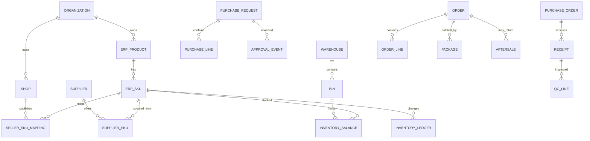

# 好时运 ERP 运营需求：覆盖分析与整改设计

> **状态：整改前代码基线分析（快照）。** 本文按分析时点的代码证据作差距判断；其中列出的「缺失实体」（仓库/库位、采购审批、库存流水、导入批次、审计事件、业务角色等）的**目标数据模型已由权威 [haoshiyun-erp-database-schema.md](./haoshiyun-erp-database-schema.md) 完成设计**（域 A–K，约 75 表，代码未实现）。本文保留为基线对照，不作现行设计依据。

**输入**：`好时运ERP运营需求清单_V1.1_现有ERP整改版.xlsx`（9 个工作表）  
**分析范围**：当前工作区 `open-shop` 中已跟踪的源码、数据库 schema/migrations、页面、服务端路由及设计文档。  
**状态**：初步设计；待业务确认项见 §8。  
**重要边界**：页面/原型出现不等于后端、持久化或平台接口已实现。本文按可检查的代码证据作静态判断，不声称验证了外部 ERP、生产数据或供应商接口。

## 1. 结论摘要

附件需求**没有被当前代码完整覆盖**。现状更接近跨境运营产品的 UI Demo、初步领域 schema 与连接器基础，而不是可直接替换使用的 ERP。

- **有页面/概念但以 mock 展示为主**：仪表盘、候选商品、商品/变体、刊登、订单、库存、成本/财务、待办；部分有列表和详情页面。
- **数据库有部分领域模型**：店铺、商品/变体、Listing、订单/订单行、库存余额、成本组件、结算、待办动作、同步状态/日志、选品候选。
- **关键 P0 业务能力缺失或模型不匹配**：采购申请/审核/采购单/分批收货质检、仓库和库位、库存流水与跨店共享库存、按 Seller SKU 映射内部 SKU、角色与店铺数据范围权限、历史迁移导入与回滚、真实订单/履约同步闭环、业务服务 API。
- **优先级口径冲突**：Excel 将售后列为 P1，但核心流程规定取消释放库存、退货质检后才能回库；建议至少把“取消释放”和“退货质检库存处理”提为 P0 的库存安全子集。
- **设计不可直接定案**：库存状态节点、成本/汇率算法、平台/JSB数据可获取性、广告分摊、仪表盘口径等，必须由技术评估和杨洁/财务确认。

分析时点代码事实（2026-10 快照）：`open-shop/apps/shop` 的运营台多个页面直接 import `apps/shop/src/lib/crossborder/mock-data.ts`（该文件已于 2026-11-08 删除）；`apps/web/src/lib/server/routers/index.ts` 目前只注册 `apiKeys` router，尚无 ERP 业务 router。`packages/db/src/commerce-schema.ts` 已有通用商品、变体、Listing、订单、库存余额等表，但没有采购、仓库/库位、库存流水、ERP 审批规则等核心实体。

## 2. 覆盖状态定义

| 状态 | 含义 |
|---|---|
| 已有基础 | schema、连接器或原型已出现，但不代表需求完整或生产可用 |
| 部分覆盖（mock/UI） | 有页面/交互形态，页面数据来源为示例或本地 mock |
| 未覆盖 | 当前代码中未发现对应的完整数据模型及业务处理 |
| 待确认 | 需求本身明确留给 IT/运营决定，本文不做业务假设 |

## 3. 按工作表核对

### 3.1 需求总览 / 现有 ERP 整改总表

工作台/dashboard、商品、刊登、订单、库存、成本/财务、候选商品等现有页面在 `apps/shop/src/app/[locale]/console/(ops)/` 可见；其中 dashboard、products、listings、orders、inventory、costs、finance、pending、candidates 当时均导入 mock 数据（快照）。**2026-11-08 更新**：`mock-data.ts` 已删除，上述主路径页已接 tRPC，详见 shop-module1–14 各模块文档。页面框架可复用的判断仍成立。

| Excel 整改主题 | 当前判断 | 证据/差距 |
|---|---|---|
| 运营仪表盘与待办 | 部分覆盖（mock/UI） | 有 dashboard、pending 页面；缺真实聚合、统一过滤、指标口径、数据新鲜度和明细下钻服务 |
| 店铺/授权管理 | 有基础 | `shops`、加密凭据、integration state/log 表及 marketplace OAuth/connectors 基础存在；缺多站点完整主档、授权续期健康闭环、后台业务配置 UI/任务监控证据 |
| 商品/SPU/SKU | 部分覆盖 | `products`/`product_variants` 表与列表/详情 UI 存在；缺 HSY 规则编码、标准字典/别名、停用和不可复用约束、款式-规格去重规则、商品负责人/审核 |
| 刊登与变体映射 | 部分覆盖 | `listings` 与 `external_id_mappings` 存在；现有映射唯一键是通用 external ID，未证实覆盖 `(shop, Seller SKU) -> 内部 SKU`、同链接多变体和缺映射异常队列 |
| 供应商和采购 | 未覆盖 | 未发现供应商映射、申请/审核、正式采购单实体及审批路由 |
| 仓库/库位/库存 | 部分覆盖，关键控制缺失 | 有 `inventory_balances(shopId,variantId,onHand,reserved)`；库存按店铺拆分与五国共用库存要求冲突；无仓库、库位绑定和流水实体 |
| 订单/物流 | 部分覆盖 | `orders/order_lines` 和订单 UI 存在；缺实际服务接入、逐 Seller SKU 精确映射、包裹实体、多阶段 LGS/JSB 路由、幂等库存占用/出库闭环 |
| 售后 | 未覆盖 | 未发现售后单与退货质检流程；订单取消库存释放也未看到实现证据 |
| 成本/利润/结算 | 部分覆盖（mock/基础 schema） | 有成本组件、settlement/lines、成本/财务页面；缺订单费用事实、来源追溯、汇率版本、成本算法、利润公式与核对服务 |
| 报表 | 部分覆盖（mock/UI） | dashboard/finance 页面；缺数据库级聚合、统一口径、跨站点汇率折算、导出与可追溯明细 |
| 接口日志/操作日志/导入迁移 | 部分覆盖 | integration logs 存在；缺完整同步任务审计、操作前后值审计、导入批次/行级错误/回滚 |
| 权限与人员 | 未覆盖/仅基础认证 | Better Auth 组织/成员模型可复用；未发现附件要求的业务角色、操作粒度、平台/国家/店铺 scope、停用员工及采购审批限制实现 |

### 3.2 页面功能字段 / 菜单模块蓝图 / 功能需求清单

菜单、字段及页面的完整清单已逐项纳入设计范围。当前导航覆盖部分运营页面，但缺失/未见业务 UI 的主要模块包括：采购申请及审批、采购单、收货/质检/入库、仓库和库位、库存调整/流水、供应商、属性字典、人员角色权限、售后、导入迁移、正式系统同步日志。具体需要按 P0 分批建设，见 §5。

Excel 的 202 个字段行已完整读取。设计时将其作为业务字段候选，而非逐个照搬到单表；应规范化为主档、业务单据、行项目、事件/流水、映射和审计记录。技术字段及数据来源仍需 IT 回填待确认表。

### 3.3 字段明细（202 条）

已检查字段明细全表（平台店铺、人员权限、商品、SKU、字典、刊登映射、供应商、采购、仓储库存、订单、物流、售后、成本利润、接口日志和导入）。覆盖率概览：

- 可在现 schema 找到相近实体但字段/规则不足：店铺、商品/变体、刊登、订单/订单行、库存余额、成本组件、结算、候选、集成凭据/状态/日志。
- 缺失实体：仓库、库位、SKU-库位绑定历史、库存流水、库存预留/来源明细、供应商/SKU供应商报价、采购申请/审批历史/采购单/收货/质检、包裹/物流事件、售后单/质检回库、导入批次/错误行、业务审计事件、业务角色/范围授权。
- 字段冲突：附件将 Listing seller SKU 定义为同店铺唯一，但当前 Listing 表没有专用 seller SKU 字段；通用映射表的 `internalId` 在同店铺/实体类型上唯一，可能限制一个内部 SKU 关联多个 Listing，需重新核实唯一键语义。
- 库存冲突：附件以仓库+库位+内部 SKU 为事实维度，并要求五国共享；现 `inventory_balances` 以 shop+variant 唯一，不能直接代表共享仓实物库存。

### 3.4 核心流程

| 流程 | 覆盖判断 | 主要差距 |
|---|---|---|
| 商品建档→SKU→供应商→Listing 映射 | 部分 | 主档及页面有基础；缺编码策略、供应商、Seller SKU 级映射校验及审批/停用规则 |
| 采购申请→互审→采购单→分批到货→质检→入库 | 未覆盖 | 关键实体和端到端流程均未发现 |
| 订单同步→去重→映射→共享库存锁定/取消释放/出库 | 部分 | 有订单模型、通用映射和库存余额；缺事务性幂等、库存流水、并发控制；状态节点待确认 |
| LGS 与泰国 JSB 履约 | 未覆盖（流程字段尚未形成业务闭环） | 有订单运单字段基础，但未见独立包裹/事件、JSB批量更新与清关状态处理 |
| 售后取消/退款/退货/质检/回库 | 未覆盖 | 缺售后实体、退货质检及关联库存流水 |

### 3.5 角色权限 / 待 IT 确认（35 项）

角色权限矩阵和 PUR-001~003 是实施规则来源。认证组织模型仅是底座，不等于业务 RBAC 已实现。35 项全部保留为项目问题台账；本稿将能确定的数据/架构设计先给出，涉及平台行为和业务政策的决定暂不猜定。完整问题按 Q01-Q35 原编号见 §8。

## 4. 目标领域模型（设计建议）

建议在现有 `commerce-schema.ts` 演进，不另建平行业务 schema。新增实体按 organization 隔离，外部 ID 专用字段或映射表，金额保存原币、币种、来源及发生时间；不可变交易事实采用追加事件/流水，主档停用而非物理删除。跨平台库存归属 warehouse+SKU，而不归属 shop；店铺销售映射仅决定订单占用同一个库存池。

### 4.1 平台基础资料与可复用主数据（本轮 UED / DB 设计重点）

本轮新增 UED 使用的层级：**平台 → 国家/站点 → 店铺 → 可选仓库（其中一个默认出库仓）/库存池**。国家主档提供默认时区和币种；店铺在选择平台后只显示该平台支持的站点，并默认带出站点币种、时区和库存/履约设置；每个店铺可以关联多个仓库，且必须选择其中一个作为默认出库仓。同一个公司仓库可以复用于多个店铺。基础资料统一软停用，不删除历史引用。

建议目标表（仅设计，不表示已有 migration）：

| 表 | 关键字段 | 关键约束 / 关联 |
|---|---|---|
| `commerce_platforms` | `id, code, name, status, adapter_key, config_schema_version` | `code` 全局唯一；平台种类由平台方/系统维护。租户不能任意创建新的 adapter；可停用但不能删被引用平台 |
| `commerce_countries` | `id, iso2, name_zh, name_en, region_code, default_timezone, default_currency_code, status` | ISO2 唯一；timezone 为 IANA；default currency FK |
| `platform_marketplaces` | `id, platform_id, country_id, site_code, display_name, status, supported_features` | `(platform_id, site_code)` 唯一；连接平台与国家站点（Daraz LK、Lazada MY 等），能力 JSON 只表达 connector 能力，不做业务规则存储 |
| `commerce_currencies` | `code, name, symbol, minor_unit, status` | ISO 4217 代码唯一；minor unit 允许 0–4；汇率不放币种主档 |
| `commerce_warehouses` | `id, organization_id, code, name, type, country_id, timezone, operating_currency, address, status` | `(organization_id, code)` 唯一；公司仓库可被多个平台店铺复用 |
| `shops`（扩充） | 现字段 + `marketplace_id, seller_id, shop_code, legal_entity_id, owner_user_id, team_id, default_warehouse_id, inventory_pool_id, fulfillment_mode, status, planned_launch_at, launched_at` | `marketplace_id` 约束平台/国家；(org, platform, seller_id) 唯一；授权凭据继续独立加密保存 |
| `shop_warehouses` | `id, organization_id, shop_id, warehouse_id, is_default_outbound, status, created_at, created_by` | 店铺与仓库多对多；每店 active 关联必须且仅一个 `is_default_outbound=true`；复合 FK 保证双方属于同一 organization；默认仓必须是店铺已关联且 active 仓 |
| `inventory_pools` | `id, organization_id, code, name, warehouse_id, status` | 可选抽象：多个店铺共享同一库存池；首阶段 **Lazada 五站**一个厦门 pool；**Daraz LK 独立 Colombo 本地仓 + 海运柜次，不入厦门池**。余额 = **warehouse + bin + variant**（见 schema §1.7 / F22） |
| `commerce_dictionaries` | `id, organization_id nullable, key, label, scope, status, is_system` | organization null 代表系统字典；用户字典按组织隔离；key 唯一范围按 system/org 定义 |
| `commerce_dictionary_values` | `id, dictionary_id, code, canonical_value, label_zh, label_en, sort_order, status, metadata` | `(dictionary_id, code)` 唯一；停用不删；表单仅可选 active 值 |
| `commerce_dictionary_aliases` | `id, dictionary_value_id, alias, normalized_alias, locale` | 同字典下 normalized alias 唯一；别名用于导入匹配/搜索，不作为新业务记录主值 |

`fulfillment_mode`、`warehouse_type`、订单状态等跨模块常量可由标准字典渲染，但生命周期/权限/唯一性仍由领域代码和 DB 约束控制，不能只依赖可编辑字典。币种代码、国家代码、平台代码属于有外部标准或 connector 的受控主数据，租户仅维护启停/展示设置，不应随意修改代码。

页面简化原则：创建店铺以“平台→站点→店铺信息→选择可用仓库→指定默认出库仓”分步且同一表单完成；国家默认时区/币种和平台支持站点自动带出；只把不常用字段放进“更多设置”；基础字典提供一次维护、多处复用、别名归一、停用而非删除。新建平台不能通过普通基础字典 CRUD 创造 API 集成，需由平台管理员完成 connector 配置。

## 4.2 UED 实现边界（本轮）

基础设置页面 `apps/shop/src/app/[locale]/settings/platform-basics/page.tsx` 与 `.../dictionaries/page.tsx`，以及 ERP 模块原型已进入 Console 路由。页面范围与交互索引见 [`haoshiyun-erp-ued-catalog.md` §12](./haoshiyun-erp-ued-catalog.md#12-当前可操作原型路由)。新原型都使用客户端示例数据；刷新后恢复初始值，不调用 tRPC、DB 或真实平台接口（**快照时点口径；2026-11-08 主路径已接 tRPC，见 §1 更新注**）。生产持久化、数据库级分页、审计、多租户隔离和权限仍是后续工作。

### 4.3 其余页面 UED 规格

已补齐剩余 ERP 页面组的信息架构、主要页面内容、状态、操作与待确认点，见 [`haoshiyun-erp-ued-catalog.md`](./haoshiyun-erp-ued-catalog.md)。主数据、供应商、Seller SKU 映射、采购、库存流水调整、售后、报表、导入、日志、角色权限以及店铺多仓向导已实现为客户端示例交互；订单履约异常详情、完整平台状态流程、SKU 规格矩阵批量生成、实文件导入校验等仍是原型规格/待后续细化，不代表业务服务已实现。

ERP 目标能力的域级覆盖、D0-D3 成熟度定义和 P0/P1 验收依赖另见 [`haoshiyun-erp-target-function-matrix.md`](./haoshiyun-erp-target-function-matrix.md)。目标覆盖不应以“菜单/页面存在”作为完成标准。

### 4.4 关键约束

1. **编码**：SPU `HSY` + 6 位序号；SKU 由 SPU + 3 位序号构成。编号在数据库事务/序列中生成且不可复用；迁移旧码保存 legacy code，不覆盖外部 Seller SKU。
2. **Listing 映射**：唯一业务键 `(organization_id, shop_id, seller_sku)`；关联一个有效内部 SKU。一个内部 SKU 可出现在多个 Listing；每个 Listing 的变体按 Seller SKU 独立映射。缺失/冲突/停用映射进入异常队列并禁止自动占库。
3. **共享库存**：余额唯一键 `(organization_id, warehouse_id, bin_id, sku_id)`；可用量通过实物、预留、质损/不可售计算。预留、释放、扣减必须和对应订单行保持幂等且同事务提交。并发时用行锁或条件更新确保 available >= requested。
4. **流水**：库存账本不可编辑/删除；每笔库存变更写唯一业务幂等键、来源单、前后数量、数量变化、类型、原因、操作者/时间。余额是流水投影，不允许直接 UI 改余额。
5. **采购**：提交申请后按申请人规则指派审核人；禁止自审。正式采购单仅可由已通过申请生成；收货、质检、入库分开记行项目，允许部分收货/部分合格；只有合格量入可用库存。
6. **审计/权限**：服务端每个查询和写操作同时校验 organization、动作权限及平台/国家/店铺 scope；审计记录保存 before/after、actor、来源、request id；高权限配置权与 IT 技术排查权分离。
7. **同步幂等**：订单唯一 `(shop_id, external_order_id)`；明细唯一键需依据平台稳定 line ID。同步状态变更和库存事件使用独立幂等键，重放不得重复扣减。

## 5. 修改方案与实施顺序

### 阶段 0：业务冻结与可交付原型

- 继续复用现有 UI 框架，但页面显著标示“演示数据”直至接入真实服务。
- 按附件的页面功能字段逐页面补齐列表、详情、录入、操作权限和空/异常状态的原型。
- 锁定角色清单、采购审批、共享库存语义和初始迁移模板。业务确认事项未确认时不实现硬编码政策。

### 阶段 1：P0 主数据和安全底座

- 完善 shop 主档（Seller ID、站点、履约、默认仓、库存池、币种/时区、授权健康）。
- 建立 ERP 商品/SPU、SKU 和标准属性字典；旧编码别名/迁移对照。
- 建立供应商及 SKU-供应商报价映射。
- 建立仓库、库位、SKU 库存余额及库存流水；执行唯一和不可删约束。
- 建立业务 RBAC 与组织内 scope、操作审计；导入模板、校验、批次、错误行及安全回滚。

### 阶段 2：P0 采购与库存闭环

- 采购申请/审批事件/采购单/收货/质检/入库；实现 PUR-001~003。
- 入库流水与库存投影在一个事务中提交；库存盘点差异通过调整单，至少记录原因及审核（审批门槛待 Q11 确认）。
- 建立 Listing/Seller SKU 映射管理和异常处理队列。

### 阶段 3：P0 平台订单、物流、工作台和报表

- 接入实际平台 connector：店铺授权，字段能力矩阵、订单同步游标、重试、人工重试、失败告警。
- 幂等拉单及状态映射；使用已确认的生命周期节点执行库存预留、取消释放、出库扣减。
- 包裹与履约事件模型；LGS 和 TH/JSB 流程可配置，先支持人工批量导入/更新作为 API 缺失降级。
- 仪表盘、报表和导出统一使用真实 domain 查询，指标显示数据来源、更新时间、币种/汇率、筛选与明细 drill-down。

### 阶段 4：P1 售后、利润和费用

- 售后单与退货收货/质检/入库或报损；取消释放规则在阶段 3先落地。
- 订单费用明细支持结算/物流/JSB/广告导入；原币、汇率版本、来源、导入批次可追溯。
- 在 Q14/Q15/Q16/Q29/Q30 决策后实现成本/毛利/净利公式和校验报表。

### 阶段 5：上线迁移、验收与容量

- 以测试环境跑完整测试单：Listing 映射→订单→共享库存→取消/发货→流水核对→费用/退款。
- 先 dry-run 迁移，再由业务抽查 SPU/SKU、Seller SKU、库存、历史订单；错误行隔离并支持批次回滚。
- 根据 Q24 给出容量假设、同步限流/扩展、备份恢复演练；公司掌握最高管理员和全量导出。

## 6. 页面和 API 改造边界

- UI 保留 `apps/shop` 的既有页面和组件，逐步将 `mock-data.ts` 移出生产 route 的数据依赖。（**已完成**：2026-11-08 `mock-data.ts` 已删除。）
- 业务实现按 Open Shop `AGENTS.md` 分层：`apps/shop` UI → tRPC (`apps/web`) → domain/dataaccess → Drizzle。当前 tRPC router 只有 `apiKeys`，因此这是一项新的业务接入工作，不应从页面直接查 DB。
- 列表数据库级分页；筛选条件可由 URL 表达；权限必须在服务端复验，不依赖隐藏按钮。
- 平台外部连接器只负责平台适配；库存/审批/映射规则在 domain service，避免在平台 connector 或 UI 中重复实现。
- 迁移由 schema 变更生成，不手写生成文件；每一阶段至少有 service 单元测试、事务/唯一性测试和关键端到端验收。

## 7. 验收基线（可先确认部分）

- 相同 organization 的多个站点订单竞争同一 SKU 时，库存不会超卖；重放同步和取消事件不会造成重复预留/释放/扣减。
- Seller SKU 映射未确认、冲突或指向停用 SKU 时，订单进入异常处理且不影响库存。
- 采购审批按申请人确定审批人且不能自审；未批准申请不能创建正式采购单/入库。
- 采购分批收货数量、质检数量、合格入库数量可分别核对；只有合格量增加可用库存。
- 任意库存余额可从期初/迁移来源和后续完整账本重算，流水连续且来源可追溯。
- 角色越权和越 scope 访问由服务端拒绝；关键修改有前后值、操作者和时间。
- 每个仪表盘/报表指标有公式、范围、来源、更新时间、币种处理，并能下钻至原记录。
- 导入部分成功时逐行报告错误；回滚只撤销该导入批次影响，不破坏并发产生的后续业务流水。

## 8. 待确认问题（按 Excel Q01-Q35）

下列事项在附件中留白或要求技术/运营回复。本设计不擅自决定：

| 编号 | 待确认内容 | 可先推进的确定项 |
|---|---|---|
| Q01 | 多平台/国家/店铺/仓库/币种架构容量与扩展方式 | schema 用平台、站点、organization 配置，不按国家硬编码表 |
| Q02 | Lazada 五站授权、token 续期和失效通知方式 | 每 Seller ID 独立凭据及健康/过期时间字段 |
| Q03 | 商品/订单/物流/售后/结算/广告各 API 字段可用性 | 先提供字段能力矩阵；不可用字段必须有人工导入/人工维护来源 |
| Q04 | 同步频率和重试/补偿策略 | 不静默失败，提供自动与人工重试和游标审计 |
| Q05 | Seller SKU 映射唯一性 | 采用 shop + seller SKU 唯一并做 DB 约束 |
| Q06 | 订单去重和库存幂等实现细节 | 订单、明细、库存事件均使用稳定幂等键 |
| Q07 | 什么平台状态锁库、什么状态正式扣减 | 保留待定；开发前由 IT 给出平台状态映射供杨洁确认 |
| Q08 | 支付失败/超时/取消释放的精确状态和延时 | 必须有自动释放与流水，具体触发节点待定 |
| Q09 | 五国并发库存策略/超卖允许值 | 单库存池、事务原子预留；是否负库存及平台推送策略待确认 |
| Q10 | 库位强唯一的数据库实现细节 | **已定（2026-11-03 C1/C2）**：partial unique index `(org, bin) WHERE state='active'` + 事务双保险；绑定禁物理删除，`bin_binding_history` 留痕（见 erp-rectification-2026-11-03 §2） |
| Q11 | 盘点、报损、手工调整是否以及何种金额/数量审批 | 强制原因、前后量、操作者、来源；审批阈值待确认 |
| Q12 | 采购审批规则 | 附件 PUR-001~003 可按原文实现，需确认员工名单/账号绑定 |
| Q13 | 分批收货/质检能力 | 按 receipt、QC、入库分别记账，支持部分完成 |
| Q14 | 采购成本移动加权、FIFO 或其他算法 | 暂不承诺利润值；保留采购批次和原价，待运营/财务选择 |
| Q15 | 汇率来源、时间、换算/舍入规则 | 保存原币金额、汇率值/日期/来源和折算金额 |
| Q16 | 平台各费用能否自动获取、广告费用分摊 | 费用来源标注接口/导入/人工，标准模板兜底 |
| Q17 | JSB API 能力及无 API 时操作方式 | 先设计人工录入/批量导入，接口确认后适配 |
| Q18 | 售后状态与退货质检关联字段 | 退货实物不得在质检前增加可用库存 |
| Q19 | 迁移数据范围、模板及回滚 | 先 dry-run、行级错误和批次标记；确认业务数据源后执行 |
| Q20 | 删除与保留政策 | 订单、库存流水、审核记录、**库位绑定记录**（2026-11-03 C1）不可物理删；主档停用 |
| Q21 | 操作恢复范围及审计保留期 | 审计追加存储；修正以反向业务单据，不篡改历史流水 |
| Q22 | 云/服务器/最高管理员/备份责任人 | 公司持有全量导出、最高管理权；需确定基础设施负责人 |
| Q23 | 各角色平台/国家/店铺和操作权限边界 | 使用 role + permission + scope，服务端授权；**已定（C5）** scope 增 `country`、六动作码，演示方案见 erp-rectification-2026-11-03 §3 |
| Q24 | 店铺、SKU、订单量、并发和扩展指标 | IT提供容量假设并做压测，具体数字待确认 |
| Q25 | 测试环境/账号、缺陷修复 SLA 和验收日程 | 杨洁业务验收；上线前跑完整测试订单 |
| Q26 | P0 页面、接口、里程碑和日期 | 本文 §5 给出建议阶段，日期/负责人待确认 |
| Q27 | TEE-001、HUB-01 等旧码的实体含义 | 先建立 legacy code mapping，不覆盖旧码；待逐项盘点 |
| Q28 | Listing 内变体及仅部分颜色尺码上架 | 模型支持一 Listing 多变体映射；验证平台 API 结构后定稿 |
| Q29 | GMV/净利润/跨币种汇总口径 | 先定义维度元数据；具体公式、日期及汇率待运营确认 |
| Q30 | PAL/CESS/VAT/SSCL 费用参数是否写死 | 设计为平台+站点+履约+有效期版本化模板；税务含义待确认；**审核状态机+历史快照已定（C8/C9）**，见 erp-rectification-2026-11-03 §4 |
| Q31 | 现有九页面真实数据/mock/未开发清单 | 代码可判定运营台主要页面依赖 mock；外部现有 ERP 与生产连接状态不可由仓库证明，需开发方逐页回复 |
| Q32 | 当前详情原型覆盖度 | 仓库存在商品、Listing、订单、库存、成本详情路由，但多为 mock；需验收字段交互 |
| Q33 | 缺失 P0 模块原型日期 | 采购/库位/流水/权限先于完整 AI 选品；日期待开发方回复 |
| Q34 | 旧编码转换及迁移抽查 | 采用不覆盖历史数据的 alias/mapping 方式，样本/策略待确认 |
| Q35 | AI 选品数据源/算法/更新频率 | 来源不透明时只做人工候选和评审，不自动做业务决策 |

## 9. 附件读取审计

已通过 XLSX 内部 XML 逐表解析工作簿及全部非空单元格，确认 9 张均为 visible 工作表；没有 comments/notes/VML 批注文件。工作表清单：

1. 需求总览（80 行）
2. 现有ERP整改总表（15 行）
3. 页面功能字段（42 行）
4. 菜单模块蓝图（42 行）
5. 功能需求清单（24 行）
6. 字段明细（207 行，含 202 条字段记录）
7. 核心流程（55 行）
8. 角色权限（59 行）
9. 待IT确认（40 行，Q01-Q35）

另外核对了 workbook 中隐藏状态标记及文件批注部件；无隐藏 sheet、批注。文档属性及单元格中的公式/数字格式未作为业务需求来源；本分析以公式缓存值和文本单元格内容为准。

## 10. 仓库证据索引

- 领域模型：`open-shop/packages/db/src/commerce-schema.ts`
- 初始跨境迁移：`open-shop/packages/db/drizzle/0005_crossborder_commerce.sql`（历史编号；2026-11-08 重生成后为 `0000_flashy_silver_samurai.sql` 等 3 个文件）
- ~~mock 数据：`open-shop/apps/shop/src/lib/crossborder/mock-data.ts`~~（2026-11-08 已删除）
- 运营台页面：`open-shop/apps/shop/src/app/[locale]/console/(ops)/`
- tRPC 入口：`open-shop/apps/web/src/lib/server/routers/index.ts`
- 现有阶段/交付边界：`open-shop/docs/design/crossborder-mvp-overview.md`
- 现有 DB 设计：`open-shop/docs/design/crossborder-database-design.md`
- 目标 DB 权威设计：`open-shop/docs/design/haoshiyun-erp-database-schema.md`
- 复用评估：`open-shop/docs/design/haoshiyun-erp-open-mercato-reuse-plan.md`
