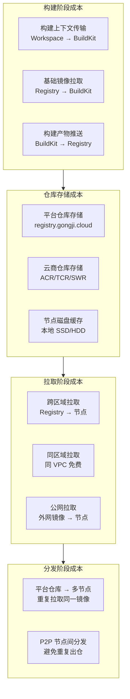
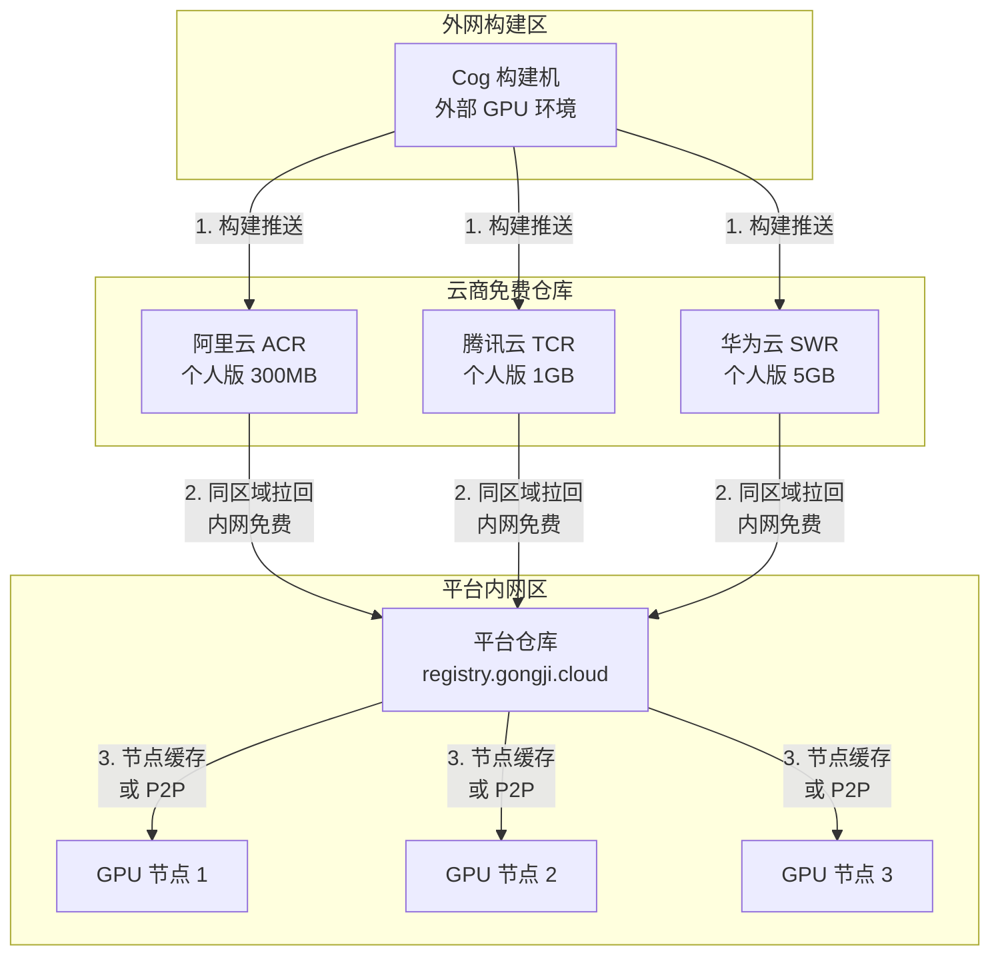
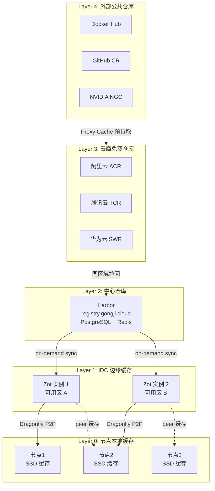
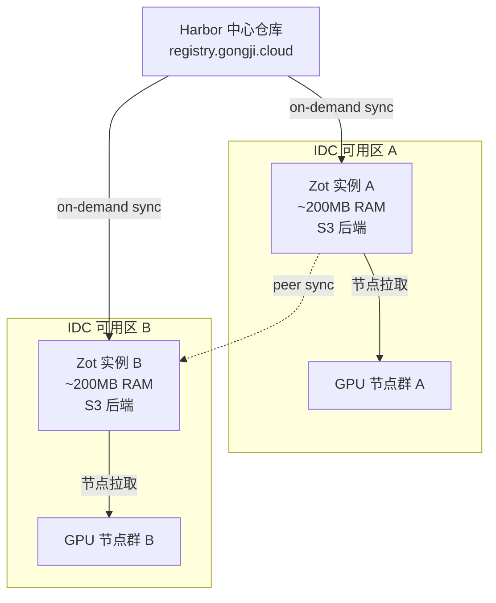
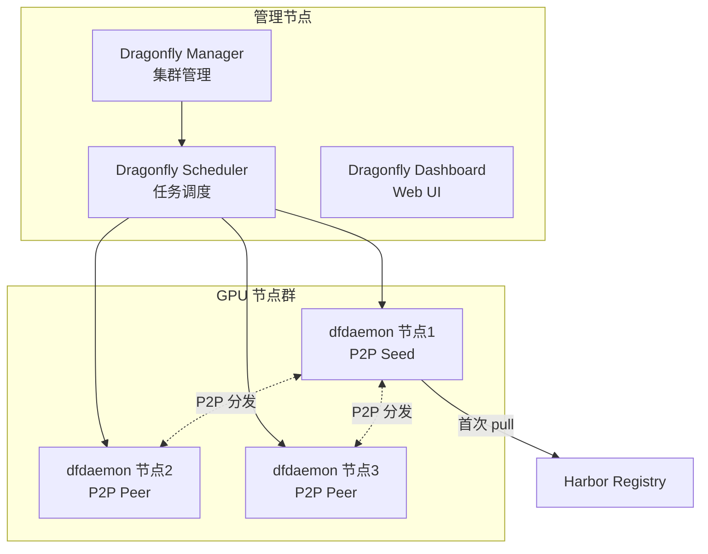
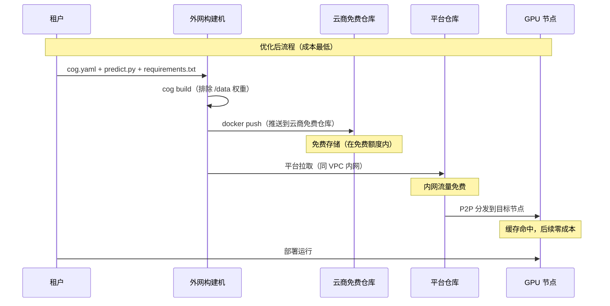

# 镜像仓库成本优化设计

> **状态**: ✅ 已采纳（2026-07-26）
> **范围**: Harbor 中心仓库 + Zot 边缘缓存 + Dragonfly P2P 的三层架构部署指南、流量成本最小化、云商免费仓库资源利用策略
> **对齐**: `image-registry-optimization.md`、`cloud-vm-implementation.md`、`storage-quota-and-s3-volume.md`、`container-cloud-instance-implementation.md`、`image-tenant-workflow.md`
> **目标**: 在镜像构建（Cog/Dockerfile/自定义快照）和拉取全链路中，最大化利用云商免费仓库资源、最小化流量费用；以 Harbor 为多租户中心仓库、Zot 为 IDC 边缘缓存、Dragonfly 为 P2P 分发层

---

## 目录

1. [成本分析](#1-成本分析)
2. [云商免费仓库资源利用](#2-云商免费仓库资源利用)
3. [三层镜像仓库架构](#3-三层镜像仓库架构)
4. [Harbor 中心仓库部署](#4-harbor-中心仓库部署)
5. [Zot 边缘缓存部署](#5-zot-边缘缓存部署)
6. [Dragonfly P2P 分发](#6-dragonfly-p2p-分发)
7. [构建流程成本优化](#7-构建流程成本优化)
8. [拉取流程成本优化](#8-拉取流程成本优化)
9. [镜像体积优化](#9-镜像体积优化)
10. [数据模型](#10-数据模型)
11. [API 设计](#11-api-设计)
12. [成本监控与告警](#12-成本监控与告警)
13. [实施路线图](#13-实施路线图)

---

## 1. 成本分析

### 1.1 成本构成

镜像全生命周期涉及四类流量成本：



### 1.2 成本热点

| 场景 | 流量方向 | 典型大小 | 单次成本估算 | 频率 | 月度成本估算 |
|------|---------|---------|------------|------|------------|
| **Cog 构建（外网）** | 构建机 → ACR/TCR | 1.5-25 GB | ¥0.02-0.50 | 50-200 次 | ¥1-100 |
| **Cog 镜像拉回** | ACR/TCR → 平台仓库 | 1.5-25 GB | ¥0.02-0.50 | 50-200 次 | ¥1-100 |
| **平台仓库 → 节点** | registry.gongji.cloud → 节点 | 1.5-25 GB | ¥0.02-0.50 | 100-500 次 | ¥2-250 |
| **跨区域拉取** | 异地仓库 → 节点 | 1.5-25 GB | ¥0.80-12.50 | 20-100 次 | ¥16-1250 |
| **外网公共镜像** | Docker Hub / GHCR → 节点 | 1-50 GB | ¥0.50-25.00 | 50-200 次 | ¥25-5000 |
| **重复拉取** | 同一镜像多节点拉取 | × N 节点 | 成本 × N | — | **最大浪费** |

### 1.3 核心优化原则

| 原则 | 策略 | 预期节省 |
|------|------|---------|
| **同区域零流量** | 构建、拉取全部在同 VPC/区域内完成 | 60-80% |
| **一次构建多点缓存** | 构建产物同时推送到平台仓库和节点缓存 | 30-50% |
| **层复用最大化** | Dockerfile 层优化 + content-addressable 存储 | 40-60% |
| **免费仓库优先** | 利用云商个人/企业免费额度 | 20-40% |
| **拉取替代推送** | 避免镜像在仓库间反复 transfer | 50-70% |

---

## 2. 云商免费仓库资源利用

### 2.1 云商免费额度对比

| 云商 | 产品 | 免费存储 | 免费拉取/天 | 同区域流量 | 跨区域流量 | 适用场景 |
|------|------|---------|-----------|-----------|-----------|---------|
| **阿里云** | ACR 个人版 | 300 MB | 300 MB | **免费** | ¥0.50/GB | 外网构建产物暂存 |
| **阿里云** | ACR 企业版试用 | 500 MB | 1 GB | **免费** | ¥0.50/GB | 中等规模构建 |
| **腾讯云** | TCR 个人版 | 1 GB | 1 GB | **免费** | ¥0.80/GB | 外网构建产物暂存 |
| **腾讯云** | TCR 企业版试用 | 5 GB | 5 GB | **免费** | ¥0.80/GB | 大规模构建 |
| **华为云** | SWR 个人版 | 5 GB | 5 GB | **免费** | ¥0.80/GB | 外网构建 + 预拉取 |
| **华为云** | SWR 企业版 | 按量 | 按量 | **免费** | 按量 | 生产环境 |

> **关键洞察**：所有云商的**同区域内网拉取均为免费**。这是成本优化的最大杠杆。

### 2.2 云商仓库使用策略



#### 策略一：外网构建 → 云商免费仓库 → 平台仓库

**适用场景**：租户在外部 GPU 环境使用 Cog 构建镜像

```typescript
// 外网构建镜像的最优拉取路径
interface ExternalBuildPullStrategy {
  // 1. 构建机直接推送到云商免费仓库（就近区域）
  buildTarget: 'cloud_provider_registry'
  
  // 2. 平台从云商同区域拉取到平台仓库（内网免费）
  pullFrom: 'same_vpc_registry'
  
  // 3. 从平台仓库分发到节点（可走 P2P）
  distributeTo: 'platform_registry_or_p2p'
  
  // 成本：仅存储费 + 同 VPC 免费拉取
  totalTrafficCost: 'minimal'
}

// 云商仓库选择逻辑
async function selectCloudRegistry(params: {
  imageSizeGb: number
  buildRegion: string
  platformRegion: string
}): Promise<{
  registry: string
  credentials: RegistryCredentials
  estimatedCost: number
}> {
  // 优先选择与平台同区域的云商仓库
  const sameRegionRegistries = await getRegistriesInRegion(params.platformRegion)
  
  for (const registry of sameRegionRegistries) {
    const availableStorage = registry.freeQuotaGb - registry.usedStorageGb
    
    if (availableStorage >= params.imageSizeGb) {
      // 在免费额度内，零流量成本
      return {
        registry: registry.endpoint,
        credentials: registry.credentials,
        estimatedCost: 0
      }
    }
  }
  
  // 无免费额度可用，使用按量付费
  return selectCheapestPayAsYouGo(params)
}
```

#### 策略二：基础镜像预热到云商仓库

**适用场景**：频繁使用的基础镜像（PyTorch、CUDA、Python 等）

```typescript
// 基础镜像预热策略
interface BaseImagePreheatStrategy {
  // 基础镜像推送到云商免费仓库（利用免费存储）
  // 平台节点从云商同区域拉取（内网免费）
  // 避免从 Docker Hub 等外网拉取（产生公网流量费）
  
  flow: 'dockerhub' → 'cloud_registry' → 'platform_nodes'
  
  // 成本对比：
  // - 直接从 DockerHub 拉取：¥0.80/GB（公网流量）
  // - 从云商同区域拉取：¥0.00（内网免费）
  // - 每个基础镜像每月可节省：¥0.80 × 8GB × 100次 = ¥640
}
```

#### 策略三：租户自定义镜像分层存储

**适用场景**：租户保存的自定义镜像

```typescript
// 自定义镜像分层存储策略
interface CustomImageStorageStrategy {
  // 热镜像（最近 7 天使用）：存储在平台仓库 + 节点缓存
  hot: 'platform_registry + node_cache'
  
  // 温镜像（7-30 天未使用）：迁移到云商免费仓库节省平台存储
  warm: 'cloud_free_registry'
  
  // 冷镜像（30+ 天未使用）：清理或迁移到对象存储冷备
  cold: 'object_storage_cold' | 'evict'
  
  // 迁移逻辑：
  // 平台仓库存储费：¥0.15/GB/月
  // 云商免费仓库：¥0（在免费额度内）
  // 节省：直接迁移到免费仓库
}
```

### 2.3 多云商仓库路由

```typescript
// 多云商仓库智能路由
class CloudRegistryRouter {
  private registries: CloudRegistryConfig[]
  
  async selectRegistry(params: {
    imageSizeGb: number
    buildRegion: string
    priority: 'cost' | 'speed' | 'reliability'
  }): Promise<RegistryRoute> {
    // 1. 筛选可用仓库（免费额度足够）
    const candidates = this.registries.filter(r => 
      r.region === params.buildRegion &&
      r.freeQuotaGb - r.usedStorageGb >= params.imageSizeGb
    )
    
    if (candidates.length === 0) {
      // 无免费额度，选择最便宜的付费仓库
      return this.selectCheapestPayAsYouGo(params)
    }
    
    // 2. 按优先级排序
    if (params.priority === 'cost') {
      // 成本优先：选择免费额度最充裕的
      candidates.sort((a, b) => 
        (b.freeQuotaGb - b.usedStorageGb) - (a.freeQuotaGb - a.usedStorageGb)
      )
    } else if (params.priority === 'speed') {
      // 速度优先：选择带宽最大的
      candidates.sort((a, b) => b.bandwidthMbps - a.bandwidthMbps)
    }
    
    return candidates[0]
  }
  
  // 检查并轮转仓库（避免超出免费额度）
  async rotateIfNeeded(imageSizeGb: number): Promise<void> {
    for (const registry of this.registries) {
      const usage = await this.getRegistryUsage(registry)
      if (usage.usedStorageGb / usage.freeQuotaGb > 0.8) {
        // 使用率超过 80%，标记为不可用
        registry.status = 'quota_high'
      }
    }
  }
}
```

---

## 3. 三层镜像仓库架构

### 3.1 选型决策

| 维度 | Harbor | Zot | 决策 |
|------|--------|-----|------|
| 多租户 RBAC | Project 级隔离，内置角色 | 无原生多租户 | **Harbor** |
| 漏洞扫描 | Trivy + 部署策略 | Trivy 仅展示 | **Harbor** |
| Webhook | 内置 push/scan/delete 事件 | 无 | **Harbor** |
| Proxy Cache | 支持多上游代理 | on-demand sync | 持平 |
| 资源消耗 | ~2GB RAM（含 DB/Redis） | ~200MB RAM（单进程） | **Zot** |
| 运维复杂度 | 8-10 容器 | 单二进制 | **Zot** |

**结论**：Harbor 作为中心仓库负责多租户管理和安全；Zot 作为 IDC 边缘缓存层降低 Harbor 出仓流量。

### 3.2 架构总览



### 3.3 拉取优先级

节点拉取镜像时按以下优先级选择源：

| 优先级 | 源 | 成本 | 延迟 | 说明 |
|--------|-----|------|------|------|
| P0 | 节点本地缓存 | ¥0 | 0 | LRU 磁盘缓存，最近使用过的镜像 |
| P1 | 同集群其他节点 | ¥0 | ~1s | Dragonfly P2P，仓库仅收 1 次请求 |
| P2 | IDC Zot 缓存 | ≈¥0 | ~2s | 同 VPC 内网，Zot on-demand sync |
| P3 | Harbor 中心仓库 | ≈¥0 | ~5s | 同 VPC 内网，仅首次拉取经过此层 |
| P4 | 云商免费仓库 | ¥0 | ~10s | 同区域 ACR/TCR/SWR 内网免费 |
| P5 | 外部公共仓库 | ¥0.5-25/GB | ~30s+ | Docker Hub/GHCR，公网流量最贵 |

### 3.4 缓存层级间同步

```typescript
// 构建完成后同步到各层
async function syncAfterBuild(params: {
  imageRef: string
  digest: string
  sizeBytes: number
}): Promise<SyncResult> {
  // 1. 镜像已推送到 Harbor（构建时推入）
  // 2. 并行预热到目标 IDC 的 Zot 缓存
  const idcInstances = await getZotInstancesInRegion(params.region)
  await Promise.all(
    idcInstances.map(zot => syncHarborToZot(params.imageRef, zot))
  )
  
  // 3. 并行预热到目标节点（Dragonfly P2P）
  const targetNodes = await selectNodesForPreload(params.imageRef)
  await parallelPreloadWithP2P(params.imageRef, targetNodes)
  
  return { syncedNodes: targetNodes.length, syncedZots: idcInstances.length }
}
```

---

## 4. Harbor 中心仓库部署

### 4.1 部署架构

Harbor 作为中心仓库部署在管理节点，提供多租户 RBAC、漏洞扫描、Webhook 通知、审计日志等企业级功能。

```mermaid
flowchart TB
    subgraph 管理节点[管理节点]
        HARBOR_CORE[Harbor Core<br/>API + UI + Job Service]
        HARBOR_DB[(PostgreSQL 15<br/>Harbor 元数据)]
        HARBOR_REDIS[(Redis 7<br/>会话 + 任务队列)]
        HARBOR_REGISTRY[Harbor Registry<br/>镜像存储)]
        HARBOR_TRIVY[Harbor Trivy<br/>漏洞扫描)]
        HARBOR_PORTAL[Harbor Portal<br/>Web UI)]
    end

    subgraph 存储层[存储层]
        S3[S3 / MinIO<br/>对象存储后端]
    end

    HARBOR_CORE --> HARBOR_DB
    HARBOR_CORE --> HARBOR_REDIS
    HARBOR_REGISTRY --> S3
    HARBOR_CORE --> HARBOR_REGISTRY
    HARBOR_CORE --> HARBOR_TRIVY
    HARBOR_CORE --> HARBOR_PORTAL
```

### 4.2 Helm 部署配置

```yaml
# harbor-values.yaml
expose:
  type: loadBalancer
  tls:
    enabled: true
    certSource: secret
    secret:
      secretName: harbor-tls
      notarySecretName: harbor-notary-tls

# 外部访问地址
externalURL: https://registry.gongji.cloud

# 持久化存储（S3 后端）
persistence:
  enabled: true
  imageChartStorage:
    type: s3
    s3:
      region: cn-hangzhou
      bucket: harbor-registry-data
      accesskey: ${HARBOR_S3_ACCESS_KEY}
      secretkey: ${HARBOR_S3_SECRET_KEY}
      regionendpoint: https://oss-cn-hangzhou.aliyuncs.com
  persistentVolumeClaim:
    registry:
      size: 500Gi
    database:
      size: 20Gi
    redis:
      size: 5Gi
    trivy:
      size: 5Gi

# 数据库配置
database:
  type: internal
  internal:
    password: ${HARBOR_DB_PASSWORD}

# Redis 配置
redis:
  type: internal
  internal:
    password: ${HARBOR_REDIS_PASSWORD}

# Trivy 扫描配置
trivy:
  enabled: true
  securityCheck:
    vulnType: os,library
    ignoreUnfixed: true
  resources:
    limits:
      cpu: 1
      memory: 2Gi

# Harbor Core 配置
core:
  resources:
    limits:
      cpu: 2
      memory: 4Gi
  # Token 过期时间（小时）
  tokenExpiration: 24

# Registry 配置
registry:
  resources:
    limits:
      cpu: 1
      memory: 2Gi

# Job Service 配置
jobservice:
  resources:
    limits:
      cpu: 1
      memory: 2Gi
```

### 4.3 多租户 Project 隔离

```typescript
// Harbor Project 映射到租户
interface HarborProjectMapping {
  // 租户 ID → Harbor Project
  // 每个租户一个独立 Project，RBAC 隔离
  tenantId: string
  projectName: string  // 格式: tenant-{tenantId}
  
  // 角色映射
  roles: {
    // 租户管理员 → Harbor Project Admin
    admin: 'project_admin'
    // 租户成员 → Harbor Developer
    member: 'developer'
    // 只读 → Harbor Guest
    viewer: 'guest'
  }
  
  // 配额策略
  quota: {
    storageGb: number       // 默认 200GB
    repositoryCount: number // 默认 50
    tagCount: number        // 默认 1000
  }
}

// 平台管理员使用的系统级 Project
const SYSTEM_PROJECTS = {
  // 基础镜像项目（PyTorch, CUDA, Python 等预置镜像）
  BASE_IMAGES: 'platform-base',
  // 构建缓存项目
  BUILD_CACHE: 'platform-build-cache',
}
```

### 4.4 Webhook 集成

```typescript
// Harbor Webhook 配置 → 平台 API 回调
interface HarborWebhookConfig {
  // 推送事件：同步 custom_image 表
  PUSH_ARTIFACT: {
    url: 'https://api.gongji.cloud/webhooks/harbor/push'
    events: ['PUSH_ARTIFACT']
  }
  
  // 扫描事件：更新 scan_status
  SCAN_COMPLETED: {
    url: 'https://api.gongji.cloud/webhooks/harbor/scan'
    events: ['SCANNING_COMPLETED', 'SCANNING_FAILED']
  }
  
  // 删除事件：清理 custom_image 记录
  DELETE_ARTIFACT: {
    url: 'https://api.gongji.cloud/webhooks/harbor/delete'
    events: ['DELETE_ARTIFACT']
  }
}

// Webhook 回调处理
async function handleHarborWebhook(event: HarborWebhookEvent) {
  switch (event.type) {
    case 'PUSH_ARTIFACT': {
      const { repository, digest, tag, size } = event.event_data.artifact
      const tenantId = extractTenantFromProject(event.event_data.repository)
      
      // upsert custom_image 记录
      await db.insert(customImage).values({
        tenantId,
        imageRef: `${HARBOR_HOST}/${repository.full}`,
        digest,
        sizeBytes: size,
        status: 'ready',
        source: 'push',
      }).onConflictDoUpdate({
        target: [customImage.tenantId, customImage.imageRef],
        set: { digest, sizeBytes: size, updatedAt: new Date() },
      })
      break
    }
    
    case 'SCANNING_COMPLETED': {
      const scanResult = event.event_data.scan_record
      await db.update(customImage)
        .set({
          scanStatus: scanResult.severity === 'Critical' ? 'vulnerability_found' : 'clean',
          scanSummary: scanResult,
          updatedAt: new Date(),
        })
        .where(eq(customImage.imageRef, event.event_data.artifact.digest))
      break
    }
  }
}
```

### 4.5 Proxy Cache 配置

Harbor 支持 Proxy Cache 模式，自动缓存上游仓库的镜像：

```typescript
// Proxy Cache 项目配置
const PROXY_CACHE_PROJECTS = {
  // Docker Hub 代理
  DOCKER_HUB: {
    projectName: 'dockerhub-proxy',
    registryEndpoint: 'https://hub.docker.com',
    registryType: 'docker-hub',
    accessId: process.env.DOCKERHUB_USERNAME,
    accessSecret: process.env.DOCKERHUB_TOKEN,
  },
  // GitHub Container Registry 代理
  GHCR: {
    projectName: 'ghcr-proxy',
    registryEndpoint: 'https://ghcr.io',
    registryType: 'github',
    accessId: process.env.GITHUB_USERNAME,
    accessSecret: process.env.GITHUB_TOKEN,
  },
  // NVIDIA NGC 代理
  NVIDIA_NGC: {
    projectName: 'nvidia-proxy',
    registryEndpoint: 'https://nvcr.io',
    registryType: 'quay',
    accessId: 'nvidia_api_token',
    accessSecret: process.env.NVIDIA_NGC_TOKEN,
  },
}

// 使用方式：租户拉取 Docker Hub 镜像时，走 Proxy Cache
// docker pull registry.gongji.cloud/dockerhub-proxy/library/pytorch:latest
// Harbor 自动从 Docker Hub 拉取并缓存，同 VPC 内网免费
```

---

## 5. Zot 边缘缓存部署

### 5.1 部署架构

Zot 部署在每个 IDC 的边缘节点，作为 Harbor 的只读缓存层。节点优先从同 IDC 的 Zot 拉取镜像，减少 Harbor 出仓流量。



### 5.2 Zot 配置

```json
// zot-config.json
{
  "distSpecVersion": "1.1.0",
  "storage": {
    "rootDirectory": "/var/lib/zot",
    "dedupe": true,
    "s3": {
      "region": "cn-hangzhou",
      "regionEndpoint": "https://oss-cn-hangzhou.aliyuncs.com",
      "bucket": "zot-cache-data",
      "accesskey": "${ZOT_S3_ACCESS_KEY}",
      "secretkey": "${ZOT_S3_SECRET_KEY}"
    },
    "gc": true,
    "gcInterval": "24h"
  },
  "http": {
    "address": "0.0.0.0",
    "port": "5000",
    "tls": {
      "cert": "/etc/zot/tls/tls.crt",
      "key": "/etc/zot/tls/tls.key"
    }
  },
  "log": {
    "level": "info",
    "output": "/var/log/zot/zot.log"
  },
  "extensions": {
    "sync": {
      "credentialsFile": "/etc/zot/sync-credentials.json",
      "registries": [
        {
          "urls": ["https://registry.gongji.cloud"],
          "tlsVerify": true,
          "onDemand": true,
          "maxRetries": 3,
          "retryInterval": "5m"
        }
      ]
    },
    "metrics": {
      "enable": true,
      "prometheus": {
        "path": "/metrics"
      }
    },
    "search": {
      "enable": true
    }
  }
}
```

### 5.3 Sync 凭证配置

```json
// sync-credentials.json
{
  "https://registry.gongji.cloud": {
    "username": "zot-sync-service-account",
    "password": "${HARBOR_SYNC_TOKEN}"
  }
}
```

### 5.4 Zot Systemd 服务

```ini
# /etc/systemd/system/zot.service
[Unit]
Description=Zot OCI Distribution Registry
After=network.target
Documentation=https://github.com/project-zot/zot

[Service]
Type=simple
ExecStart=/usr/local/bin/zot serve /etc/zot/zot-config.json
Restart=always
RestartSec=5
LimitNOFILE=65536
User=zot
Group=zot

[Install]
WantedBy=multi-user.target
```

### 5.5 与 Docker daemon 集成

节点的 Docker daemon 配置 Zot 为 mirror：

```json
// /etc/docker/daemon.json
{
  "registry-mirrors": [
    "https://zot-idc-a.gongji.internal:5000"
  ]
}
```

节点拉取 `registry.gongji.cloud/tenant/app:v1` 时，Docker daemon 优先尝试从本地 Zot mirror 拉取；Zot 未缓存时 on-demand 从 Harbor 同步，然后返回给节点。

---

## 6. Dragonfly P2P 分发

### 6.1 部署架构

Dragonfly 作为 P2P 分发层，部署在每个 K8s 集群中。当多个节点需要拉取同一镜像时，仓库只收到 1 次请求，其余通过 P2P 在节点间分发。



### 6.2 Helm 部署配置

```yaml
# dragonfly-values.yaml
manager:
  replicas: 2
  resources:
    limits:
      cpu: 1
      memory: 1Gi

scheduler:
  replicas: 2
  resources:
    limits:
      cpu: 1
      memory: 1Gi

dfdaemon:
  # 每个 GPU 节点部署一个 dfdaemon
  hostNetwork: true
  resources:
    limits:
      cpu: 0.5
      memory: 512Mi
  config:
    # 从 Harbor 拉取时的配置
    proxy:
      defaultFilter: "Accept-Language"
    # P2P 配置
    scheduler:
      manager:
        enable: true
        schedulerAddr: "dragonfly-scheduler.dragonfly:8002"
    # 客户端缓存配置
    storage:
      maxBufferCapacity: "512MB"
      taskExpiration: "168h"  # 7 天过期

seedPeer:
  replicas: 3
  resources:
    limits:
      cpu: 2
      memory: 2Gi
```

### 6.3 P2P 分发效率

| 场景 | 无 P2P | 有 P2P | 节省 |
|------|--------|--------|------|
| 10 节点拉取 10GB 镜像 | 100GB Harbor 出仓 | 10GB Harbor 出仓 + 90GB P2P | **90% 出仓流量** |
| 50 节点拉取 10GB 镜像 | 500GB Harbor 出仓 | 10GB Harbor 出仓 + 490GB P2P | **98% 出仓流量** |
| 100 节点拉取 10GB 镜像 | 1TB Harbor 出仓 | 10GB Harbor 出仓 + 990GB P2P | **99% 出仓流量** |

> **关键洞察**：Dragonfly 将 Harbor 出仓流量从 O(N × ImageSize) 降至 O(1 × ImageSize)，P2P 在节点间分发不产生仓库流量费。

---

## 7. 构建流程成本优化

### 7.1 Cog 构建流程

#### 场景：租户在外网 GPU 环境使用 Cog 构建镜像



```typescript
// Cog 构建最优路径
async function buildCogImage(params: {
  tenantId: string
  workspaceRef: string
  tagName: string
  targetNodeIds?: string[]
}): Promise<BuildResult> {
  // 1. 选择构建区域（与平台同区域，避免跨区）
  const buildRegion = await selectBuildRegion(params.tenantId)
  
  // 2. 选择云商免费仓库作为构建目标
  const cloudRegistry = await selectCloudRegistry({
    imageSizeGb: await estimateImageSize(params.workspaceRef),
    buildRegion,
    platformRegion: await getPlatformRegion()
  })
  
  // 3. 在构建机上执行 Cog build
  const buildJob = await submitCogBuild({
    workspaceRef: params.workspaceRef,
    tagName: params.tagName,
    targetRegistry: cloudRegistry.endpoint,
    dockerignore: getDefaultDockerignore(),
    // 排除大文件：权重、数据集
    excludePatterns: [
      '/data/**',
      '*.safetensors',
      '*.gguf',
      '*.pt',
      '*.bin',
      '.git/**',
      '.venv/**'
    ]
  })
  
  // 4. 构建完成后拉回到平台仓库（同 VPC 免费）
  const platformImageRef = await pullFromCloudToPlatform({
    cloudRegistry: cloudRegistry.endpoint,
    imageRef: buildJob.imageRef,
    digest: buildJob.digest
  })
  
  // 5. 并行预热到目标节点
  if (params.targetNodeIds) {
    await parallelPreload(platformImageRef, params.targetNodeIds)
  }
  
  return {
    imageRef: platformImageRef,
    digest: buildJob.digest,
    buildDuration: buildJob.duration,
    // 成本仅包含云商免费额度内的存储
    costBreakdown: {
      cloudStorage: 0,  // 免费额度内
      pullToPlatform: 0,  // 同 VPC 免费
      preloadToNodes: await estimatePreloadCost(platformImageRef, params.targetNodeIds)
    }
  }
}
```

### 7.2 Dockerfile 构建流程

#### 场景：租户使用自定义 Dockerfile 构建

```typescript
// Dockerfile 构建最优路径
async function buildDockerfileImage(params: {
  tenantId: string
  dockerfilePath: string
  contextPath: string
  buildArgs?: Record<string, string>
}): Promise<BuildResult> {
  // 1. 检查基础镜像是否在平台仓库（避免重复拉取公网镜像）
  const baseImage = await parseBaseImage(params.dockerfilePath)
  const baseImageInPlatform = await checkPlatformRegistry(baseImage)
  
  if (!baseImageInPlatform) {
    // 基础镜像不在平台仓库，先预拉取
    // 优先从云商免费仓库拉取（可能有缓存）
    await preheatBaseImage(baseImage, {
      source: 'auto',  // 自动选择最优源
      target: 'platform'
    })
  }
  
  // 2. 使用 BuildKit 缓存挂载（避免重复构建相同层）
  const buildJob = await submitBuildKitBuild({
    dockerfilePath: params.dockerfilePath,
    contextPath: params.contextPath,
    buildArgs: params.buildArgs,
    cacheFrom: 'registry',  // 从仓库缓存读取
    cacheTo: 'registry',    // 写入仓库缓存
    // 挂载缓存卷，避免重复下载依赖
    cacheMounts: {
      '/root/.cache/pip': 'build-cache-pip',
      '/root/.cache/conda': 'build-cache-conda',
      '/usr/local/cargo/registry': 'build-cache-cargo'
    }
  })
  
  // 3. 推送到平台仓库（同区域）
  await pushToPlatformRegistry(buildJob.imageRef, buildJob.digest)
  
  return buildJob
}
```

### 7.3 自定义镜像保存流程

#### 场景：租户从运行中实例保存镜像（docker commit）

```typescript
// 自定义镜像保存最优路径
async function saveCustomImage(params: {
  taskId: string
  tagName: string
  description?: string
}): Promise<SaveResult> {
  // 1. 获取当前实例信息
  const task = await getTask(params.taskId)
  
  // 2. 在节点上执行 docker commit
  const commitResult = await nodeAgent.commit({
    containerId: task.containerId,
    tag: `registry.gongji.cloud/${task.tenantId}/${params.tagName}`
  })
  
  // 3. 推送到平台仓库
  await nodeAgent.push({
    imageRef: commitResult.imageRef,
    // 优化：使用分层推送，仅推送变更层
    enableLayerUpload: true
  })
  
  // 4. 如果镜像较小（< 500MB），同时缓存到云商免费仓库作为备份
  if (commitResult.sizeBytes < 500 * 1024 * 1024) {
    await mirrorToCloudRegistry(commitResult.imageRef, {
      // 仅在免费额度内才镜像
      onlyIfFree: true
    })
  }
  
  // 5. 更新自定义镜像记录
  await db.insert(customImage).values({
    tenantId: task.tenantId,
    tagName: params.tagName,
    imageRef: commitResult.imageRef,
    digest: commitResult.digest,
    sizeBytes: commitResult.sizeBytes,
    sourceTaskId: params.taskId,
    // 记录存储位置，便于后续迁移决策
    storageLocations: ['platform'],
    description: params.description
  })
  
  return {
    imageRef: commitResult.imageRef,
    digest: commitResult.digest,
    sizeBytes: commitResult.sizeBytes,
    costBreakdown: {
      commitStorage: 0,  // 节点本地
      pushToPlatform: estimatePushCost(commitResult.sizeBytes),
      mirrorToCloud: 0  // 免费额度内
    }
  }
}
```

---

## 8. 拉取流程成本优化

### 8.1 拉取源智能选择

```typescript
// 拉取源选择算法
async function selectPullSource(params: {
  imageRef: string
  nodeId: string
  imageSizeGb: number
}): Promise<PullSource> {
  // 1. 节点本地缓存检查（零成本）
  const local = await checkNodeLocalCache(params.nodeId, params.imageRef)
  if (local) return { type: 'local', cost: 0 }
  
  // 2. 同集群其他节点缓存检查（P2P 零流量）
  const peerCache = await checkPeerNodeCache(params.nodeId, params.imageRef)
  if (peerCache) return { type: 'p2p', cost: 0 }
  
  // 3. 平台仓库检查（同区域极低成本）
  const platform = await checkPlatformRegistry(params.imageRef)
  if (platform) return { type: 'platform', cost: estimatePlatformCost(params.imageSizeGb) }
  
  // 4. 云商免费仓库检查（同 VPC 免费）
  const cloud = await checkCloudRegistry(params.imageRef)
  if (cloud) return { type: 'cloud_free', cost: 0 }
  
  // 5. 外部公共仓库（公网流量费，最贵）
  return { type: 'public', cost: estimatePublicCost(params.imageSizeGb) }
}
```

### 8.2 P2P 分发优化

```typescript
// P2P 分发策略：避免从仓库重复拉取
async function distributeWithP2P(params: {
  imageRef: string
  sourceNodeId: string  // 已有该镜像的节点
  targetNodeIds: string[]
}): Promise<DistributeResult> {
  // 1. 选择最优源节点（带宽最大、负载最低）
  const sourceNode = await selectOptimalSourceNode(params.sourceNodeId, params.targetNodeIds)
  
  // 2. 分层并行传输
  const layers = await getImageLayers(params.imageRef)
  const transfers = layers.map(async layer => {
    // 选择最优传输路径
    const target = selectBestTarget(params.targetNodeIds, layer)
    await transferLayer(sourceNode.id, target.id, layer)
  })
  
  await Promise.all(transfers)
  
  // 3. 验证所有节点镜像完整
  for (const nodeId of params.targetNodeIds) {
    await verifyImageIntegrity(nodeId, params.imageRef)
  }
  
  return {
    distributedTo: params.targetNodeIds.length,
    // P2P 完全不产生仓库流量费
    trafficCost: 0
  }
}
```

### 8.3 跨区域拉取优化

```typescript
// 跨区域拉取优化策略
async function handleCrossRegionPull(params: {
  imageRef: string
  sourceRegion: string
  targetRegion: string
  nodeId: string
}): Promise<PullResult> {
  // 策略 1: 如果同区域有云商仓库副本，从同区域拉取（免费）
  const sameRegionCloud = await checkCloudRegistryInRegion(params.imageRef, params.targetRegion)
  if (sameRegionCloud) {
    return pullFromCloudRegistry(sameRegionCloud, params)
  }
  
  // 策略 2: 如果平台仓库有跨区域副本，从副本拉取（极低成本）
  const replica = await checkPlatformReplica(params.imageRef, params.targetRegion)
  if (replica) {
    return pullFromPlatformReplica(replica, params)
  }
  
  // 策略 3: 从源区域拉取（产生跨区流量费）
  // 优化：批量拉取，减少连接次数
  const result = await pullWithBatchOptimization({
    imageRef: params.imageRef,
    source: `${params.sourceRegion}/${params.imageRef}`,
    target: params.nodeId,
    // 启用压缩传输（如果源支持）
    enableCompression: true,
    // 限制带宽避免影响其他任务
    bandwidthLimit: '50%'
  })
  
  return {
    ...result,
    // 记录跨区流量成本，用于后续优化
    crossRegionCost: estimateCrossRegionCost(result.trafficBytes, params.sourceRegion, params.targetRegion)
  }
}
```

---

## 9. 镜像体积优化

### 9.1 构建阶段体积控制

```typescript
// 构建体积优化配置
const IMAGE_SIZE_OPTIMIZATION = {
  // Dockerfile 最佳实践
  dockerfile: {
    // 多阶段构建：构建阶段和运行阶段分离
    multiStageBuild: true,
    // 使用 slim/alpine 基础镜像
    preferSlimBase: true,
    // 合并 RUN 指令减少层数
    mergeRunCommands: true,
    // 清理构建缓存
    cleanBuildCache: true
  },
  
  // Cog 构建优化
  cog: {
    // 权重外置到 /data，不进镜像
    excludeWeights: true,
    // 默认 .dockerignore 排除大文件
    defaultDockerignore: [
      '/data/**',
      '*.safetensors',
      '*.gguf',
      '*.pt',
      '*.bin',
      '.git/**',
      '.venv/**',
      '__pycache__/**',
      '*.pyc'
    ]
  },
  
  // 体积限制
  limits: {
    maxImageSizeGb: 40,
    maxLayers: 120,
    // 推荐镜像大小范围
    recommendedSizeRange: {
      min: '500MB',
      max: '5GB'
    }
  }
}
```

### 9.2 层复用优化

```typescript
// 层复用策略：最大化基础镜像层的共享
async function optimizeLayerReuse(params: {
  imageRef: string
  tenantId: string
}): Promise<LayerReuseResult> {
  // 1. 分析镜像层
  const layers = await getImageLayers(params.imageRef)
  
  // 2. 检查哪些层已经在平台仓库（其他镜像共享）
  const existingLayers = await checkExistingLayers(layers)
  
  // 3. 计算复用率
  const reuseRatio = existingLayers.length / layers.length
  
  // 4. 如果复用率低，建议优化 Dockerfile
  if (reuseRatio < 0.3) {
    const suggestions = generateDockerfileOptimizationSuggestions(layers, existingLayers)
    return { reuseRatio, suggestions }
  }
  
  return { reuseRatio, suggestions: [] }
}

// 生成 Dockerfile 优化建议
function generateDockerfileOptimizationSuggestions(
  layers: ImageLayer[],
  existingLayers: ImageLayer[]
): string[] {
  const suggestions: string[] = []
  
  // 检查是否有重复安装依赖的层
  const duplicateInstallLayers = layers.filter(l => 
    l.command?.includes('apt-get install') || 
    l.command?.includes('pip install')
  )
  
  if (duplicateInstallLayers.length > 1) {
    suggestions.push(
      '合并多个 pip install/apt-get install 为一个 RUN 指令，减少层数'
    )
  }
  
  // 检查是否有可以使用官方基础镜像的层
  const customBaseLayers = layers.filter(l => 
    l.baseImage && !l.baseImage.includes('python:') && 
    !l.baseImage.includes('nvidia/cuda:')
  )
  
  if (customBaseLayers.length > 0) {
    suggestions.push(
      '使用官方 python:nvidia/cuda 基础镜像，利用已有的缓存层'
    )
  }
  
  return suggestions
}
```

---

## 10. 数据模型

### 10.1 云商仓库配置表

```sql
-- 云商仓库配置
CREATE TABLE cloud_registry_config (
    id              TEXT PRIMARY KEY,
    provider        VARCHAR(32) NOT NULL,  -- alibaba | tencent | huawei
    endpoint        VARCHAR(512) NOT NULL,
    namespace       VARCHAR(255) NOT NULL,
    username        VARCHAR(255) NOT NULL,
    password_enc    TEXT NOT NULL,  -- 加密存储
    region          VARCHAR(64) NOT NULL,
    free_quota_gb   NUMERIC(9,2) NOT NULL,
    used_storage_gb NUMERIC(9,2) NOT NULL DEFAULT 0,
    daily_pull_limit_gb NUMERIC(9,2),
    daily_pull_used_gb  NUMERIC(9,2) NOT NULL DEFAULT 0,
    status          VARCHAR(16) NOT NULL DEFAULT 'active',  -- active | quota_exceeded | disabled
    priority        INT NOT NULL DEFAULT 0,  -- 路由优先级
    created_at      TIMESTAMPTZ DEFAULT NOW(),
    updated_at      TIMESTAMPTZ DEFAULT NOW()
);

CREATE INDEX idx_cloud_registry_provider ON cloud_registry_config(provider);
CREATE INDEX idx_cloud_registry_region ON cloud_registry_config(region);
```

### 10.2 镜像存储位置表

```sql
-- 镜像存储位置追踪
CREATE TABLE image_storage_location (
    id              TEXT PRIMARY KEY,
    image_ref       VARCHAR(512) NOT NULL,
    digest          VARCHAR(255) NOT NULL,
    size_bytes      BIGINT NOT NULL,
    location_type   VARCHAR(32) NOT NULL,  -- platform | cloud_free | node_cache
    location_detail VARCHAR(512) NOT NULL, -- registry endpoint or node_id
    region          VARCHAR(64) NOT NULL,
    tenant_id       TEXT,
    is_pinned       BOOLEAN NOT NULL DEFAULT false,  -- 固定不迁移
    last_accessed   TIMESTAMPTZ NOT NULL DEFAULT NOW(),
    access_count    INT NOT NULL DEFAULT 0,
    created_at      TIMESTAMPTZ DEFAULT NOW(),
    updated_at      TIMESTAMPTZ DEFAULT NOW()
);

CREATE UNIQUE INDEX idx_image_storage_unique ON image_storage_location(image_ref, location_type, location_detail);
CREATE INDEX idx_image_storage_ref ON image_storage_location(image_ref);
CREATE INDEX idx_image_storage_tenant ON image_storage_location(tenant_id);
CREATE INDEX idx_image_storage_accessed ON image_storage_location(last_accessed);
```

### 10.3 镜像流量成本追踪表

```sql
-- 镜像流量成本追踪
CREATE TABLE image_traffic_cost (
    id              TEXT PRIMARY KEY,
    image_ref       VARCHAR(512) NOT NULL,
    digest          VARCHAR(255),
    direction       VARCHAR(16) NOT NULL,  -- push | pull
    source          VARCHAR(32) NOT NULL,  -- platform | cloud_free | public | peer_node
    source_detail   VARCHAR(512),          -- 源地址
    target          VARCHAR(32) NOT NULL,  -- platform | node | cloud_free
    target_detail   VARCHAR(512),          -- 目标地址
    traffic_bytes   BIGINT NOT NULL,
    cost_yuan       NUMERIC(10,4) NOT NULL DEFAULT 0,
    region_pair     VARCHAR(128),          -- 源区域-目标区域
    tenant_id       TEXT,
    task_id         TEXT,
    duration_ms     INT,
    created_at      TIMESTAMPTZ DEFAULT NOW()
);

CREATE INDEX idx_traffic_cost_image ON image_traffic_cost(image_ref);
CREATE INDEX idx_traffic_cost_tenant ON image_traffic_cost(tenant_id);
CREATE INDEX idx_traffic_cost_created ON image_traffic_cost(created_at);
CREATE INDEX idx_traffic_cost_cost ON image_traffic_cost(cost_yuan);
```

---

## 11. API 设计

### 11.1 云商仓库管理 API

```typescript
export const cloudRegistryRouter = createTRPCRouter({
  /**
   * 查询云商仓库状态
   */
  getCloudRegistryStatus: adminProcedure.query(async () => {
    return getCloudRegistryStatus()
  }),

  /**
   * 智能选择构建目标仓库
   */
  selectBuildTarget: protectedProcedure
    .input(z.object({
      tenantId: z.string(),
      estimatedSizeGb: z.number(),
      buildRegion: z.string().optional()
    }))
    .query(async ({ input }) => {
      return selectBuildTarget(input)
    }),

  /**
   * 镜像迁移（平台仓库 → 云商免费仓库）
   */
  migrateToCloudRegistry: adminProcedure
    .input(z.object({
      imageRef: z.string(),
      targetProvider: z.enum(['alibaba', 'tencent', 'huawei'])
    }))
    .mutation(async ({ input }) => {
      return migrateToCloudRegistry(input)
    }),

  /**
   * 查询镜像流量成本
   */
  getTrafficCost: adminProcedure
    .input(z.object({
      tenantId: z.string().optional(),
      startDate: z.date(),
      endDate: z.date()
    }))
    .query(async ({ input }) => {
      return getTrafficCostReport(input)
    }),
})
```

### 11.2 镜像存储优化 API

```typescript
export const imageStorageOptimizerRouter = createTRPCRouter({
  /**
   * 分析镜像存储分布
   */
  analyzeStorageDistribution: adminProcedure.query(async () => {
    return analyzeStorageDistribution()
  }),

  /**
   * 执行冷镜像迁移
   */
  migrateColdImages: adminProcedure
    .input(z.object({
      inactiveDays: z.number().default(30)
    }))
    .mutation(async ({ input }) => {
      return migrateColdImages(input.inactiveDays)
    }),

  /**
   * 分析层复用率
   */
  analyzeLayerReuse: protectedProcedure
    .input(z.object({ imageRef: z.string() }))
    .query(async ({ input }) => {
      return analyzeLayerReuse(input.imageRef)
    }),
})
```

---

## 12. 成本监控与告警

### 12.1 关键成本指标

```yaml
# 镜像流量成本指标
image_traffic_cost_yuan_total{source, target, region_pair}  # 总流量成本
image_traffic_bytes_total{direction, source, target}        # 总流量字节
image_pull_cost_yuan{image_ref}                             # 单镜像拉取成本
image_build_cost_yuan{image_ref}                            # 单镜像构建成本

# 云商仓库利用率
cloud_registry_usage_ratio{provider, region}                # 仓库使用率
cloud_registry_daily_pull_ratio{provider, region}           # 日拉取额度使用率

# 缓存命中率（成本相关）
image_cache_hit_cost_saving{node_id}                        # 缓存命中节省的成本
image_p2p_cost_saving{node_id}                              # P2P 分发节省的成本
```

### 12.2 成本告警规则

```yaml
groups:
  - name: image_cost_alerts
    rules:
      - alert: HighTrafficCost
        expr: sum(rate(image_traffic_cost_yuan_total[1h])) > 10
        for: 1h
        labels:
          severity: warning
        annotations:
          summary: "镜像流量成本过高: ¥{{ $value }}/小时"

      - alert: CrossRegionPullHigh
        expr: rate(image_traffic_cost_yuan_total{region_pair=~".*-.*"}[1h]) > 5
        for: 1h
        labels:
          severity: warning
        annotations:
          summary: "跨区域拉取成本过高，建议优化镜像分布"

      - alert: PublicRegistryPullHigh
        expr: rate(image_traffic_cost_yuan_total{source="public"}[1h]) > 3
        for: 1h
        labels:
          severity: warning
        annotations:
          summary: "外网公共仓库拉取成本过高，建议预拉取"

      - alert: CloudRegistryQuotaWarning
        expr: cloud_registry_usage_ratio > 0.8
        for: 30m
        labels:
          severity: warning
        annotations:
          summary: "云商仓库免费额度使用率超过 80%: {{ $labels.provider }}"

      - alert: LowCacheHitRate
        expr: sum(rate(image_cache_hit_cost_saving[1h])) / sum(rate(image_traffic_cost_yuan_total[1h])) < 0.3
        for: 1h
        labels:
          severity: warning
        annotations:
          summary: "缓存命中率低于 30%，流量成本未有效优化"
```

---

## 13. 实施路线图

### Phase 1: 基础设施（1-2 周）

| 任务 | 优先级 | 说明 |
|------|--------|------|
| 云商仓库配置管理 | P0 | 支持阿里云 ACR / 腾讯云 TCR / 华为云 SWR |
| 镜像存储位置追踪 | P0 | 记录镜像在各层的位置 |
| 流量成本追踪 | P0 | 记录每次拉取/推送的成本 |

### Phase 2: 构建优化（2-3 周）

| 任务 | 优先级 | 说明 |
|------|--------|------|
| Cog 构建路径优化 | P0 | 外网构建 → 云商免费仓库 → 平台仓库 |
| 构建体积优化 | P1 | Dockerfile 最佳实践 + .dockerignore |
| BuildKit 缓存优化 | P1 | 依赖缓存复用 |

### Phase 3: 拉取优化（2-3 周）

| 任务 | 优先级 | 说明 |
|------|--------|------|
| 拉取源智能选择 | P0 | 按优先级选择最优拉取源 |
| P2P 分发实现 | P1 | 节点间直接传输，避免重复拉取 |
| 冷镜像迁移 | P1 | 自动迁移到云商免费仓库 |

### Phase 4: 高级优化（持续）

| 任务 | 优先级 | 说明 |
|------|--------|------|
| 成本分析看板 | P2 | 可视化流量成本分布 |
| 多云商智能路由 | P2 | 根据价格/速度/可靠性自动选择 |
| 预测性预热 | P2 | 基于使用模式预测预热 |

---

## 附录

### A. 成本节省估算

假设月度镜像操作：
- Cog 构建：100 次 × 平均 3 GB = 300 GB
- 平台 → 节点拉取：500 次 × 平均 3 GB = 1500 GB
- 跨区域拉取：50 次 × 平均 3 GB = 150 GB
- 外网镜像拉取：100 次 × 平均 5 GB = 500 GB

| 优化措施 | 节省的流量 | 单价 | 月度节省 |
|---------|-----------|------|---------|
| Harbor Proxy Cache 替代直接拉取 Docker Hub | 500 GB 外网拉取 | ¥0.80/GB | ¥400 |
| Zot 边缘缓存减少 Harbor 出仓 | 1500 GB × 60% | ¥0.15/GB | ¥135 |
| Dragonfly P2P 减少重复拉取 | 1500 GB × 80% | ¥0.80/GB | ¥960 |
| 同 VPC 拉取替代公网拉取 | 300 GB 构建产物 | ¥0.80/GB | ¥240 |
| 冷镜像迁移到云商免费仓库 | 150 GB 存储 | ¥0.15/GB | ¥22.5 |
| 层复用优化 | 450 GB | ¥0.80/GB | ¥360 |
| **合计** | — | — | **≈ ¥2,117/月** |

> 以上为保守估算，实际节省取决于镜像大小、拉取频率和区域分布。Harbor/Zot 部署成本约 ¥200/月（管理节点资源），净节省 ≈ ¥1,917/月。

### B. 云商仓库 API 对接参考

| 云商 | API 文档 | 认证方式 | 推荐 SDK |
|------|---------|---------|---------|
| 阿里云 ACR | [acr.aliyun.com](https://help.aliyun.com/zh/acr/) | AccessKey + RAM | `@alicloud/pop-core` |
| 腾讯云 TCR | [cloud.tencent.com/product/tcr](https://cloud.tencent.com/document/product/1141) | SecretId + SecretKey | `tencentcloud-sdk-nodejs` |
| 华为云 SWR | [swr.myhuaweicloud.com](https://support.huaweicloud.com/api-swr/) | AK/SK | `@huaweicloud/sdk-core` |

### C. 参考文档

| 文档 | 关系 |
|------|------|
| `image-registry-optimization.md` | 镜像拉取监控、GPU 调度优化（本文档补充成本优化维度） |
| `cloud-vm-implementation.md` §8 | Cog/Dockerfile 构建流程（本文档补充成本优化策略） |
| `storage-quota-and-s3-volume.md` | 镜像磁盘限额 |
| `container-cloud-instance-implementation.md` | 镜像管理、保存镜像流程 |
| `../../business/image-preload-commercial-and-community-incentive.md` | 预热商业化与成本分析 |
| `image-tenant-workflow.md` | 租户镜像上传/下载流程，Harbor 多租户对接细节 |
| `cloud-native-integration.md` §4 | 镜像拉取优化、Dragonfly P2P 集成 |
