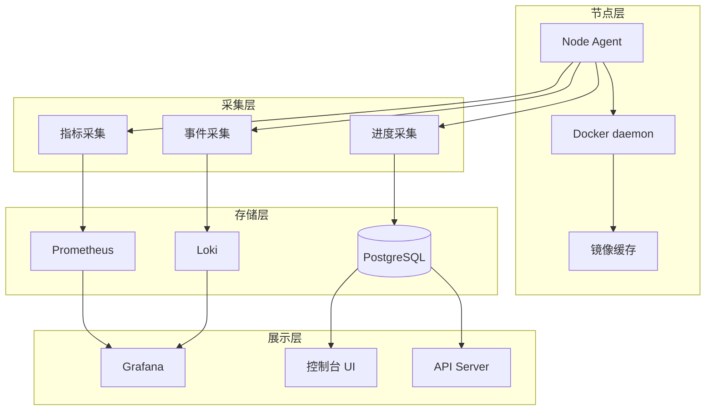
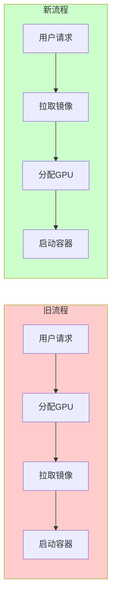
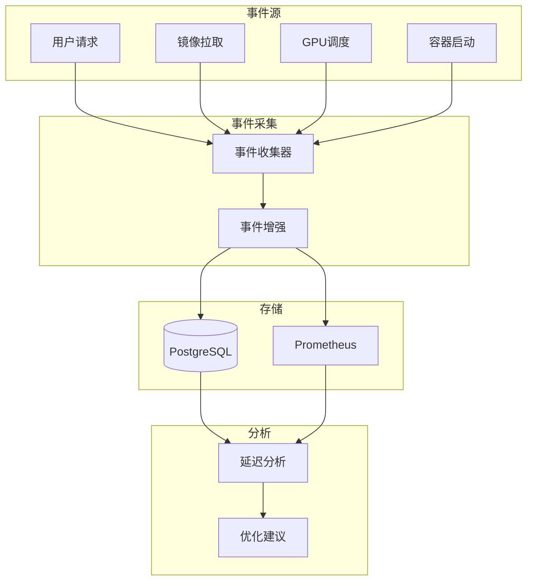
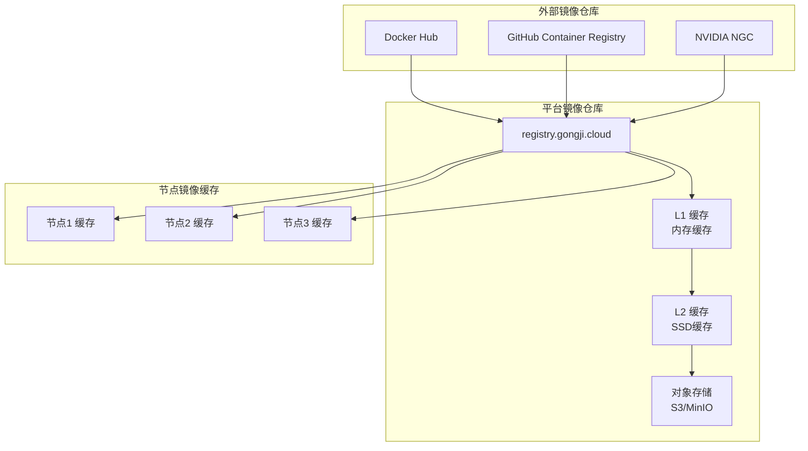

# 镜像仓库与拉取优化设计

> **状态**: ✅ 已采纳（2026-07-26）
> **范围**: 镜像拉取监控、GPU空闲预防、GPU调度追踪
> **对齐**: `cloud-native-integration.md`、`../../business/image-preload-commercial-and-community-incentive.md`、`container-cloud-instance-implementation.md`
> **目标**: 解决镜像拉取期间的计费、监控、调度问题

---

## 目录

1. [问题分析](#1-问题分析)
2. [镜像拉取监控](#2-镜像拉取监控)
3. [GPU空闲预防](#3-gpu空闲预防)
4. [GPU调度追踪](#4-gpu调度追踪)
5. [镜像仓库设计](#5-镜像仓库设计)
6. [数据模型](#6-数据模型)
7. [API 设计](#7-api-设计)
8. [监控与告警](#8-监控与告警)
9. [实施路线图](#9-实施路线图)

---

## 1. 问题分析

### 1.1 核心问题

| 问题 | 影响 | 现状 |
|------|------|------|
| **镜像拉取不计费** | 需要准确识别拉取状态 | `billable=false` 设计存在但未实现 |
| **GPU空占** | 拉取期间GPU被占用但未使用 | 无机制防止GPU空占 |
| **调度延迟** | 从请求到GPU分配耗时长 | 无追踪和优化机制 |
| **拉取监控** | 无法监控拉取进度和性能 | 无进度追踪机制 |

### 1.2 现有设计分析

**已有的设计**：
- `00-overview.md` §6.3：镜像拉取期间 `billable=false`
- `container-cloud-instance-implementation.md`：`image_pulling` 状态和回调机制
- `node-agent-design.md`：镜像拉取指标

**缺失的设计**：
- 镜像拉取进度实时监控
- GPU空闲预防机制
- GPU调度延迟追踪和优化
- 镜像缓存状态管理

---

## 2. 镜像拉取监控

### 2.1 监控架构



### 2.2 进度追踪

#### 2.2.1 进度事件

```typescript
// 镜像拉取进度事件
interface ImagePullProgress {
  // 基础信息
  computeBaseId: string
  nodeId: string
  imageRef: string
  
  // 进度信息
  pulledBytes: number
  totalBytes: number
  progressPercent: number
  
  // 速度信息
  speedBytesPerSecond: number
  etaSeconds: number
  
  // 层信息
  pulledLayers: number
  totalLayers: number
  currentLayer: string
  currentLayerProgress: number
  
  // 时间戳
  startTime: string
  lastUpdateTime: string
}
```

#### 2.2.2 进度计算

```typescript
// 计算拉取进度
function calculatePullProgress(params: {
  pulledBytes: number
  totalBytes: number
  startTime: Date
  lastUpdateTime: Date
}): {
  progressPercent: number
  speedBytesPerSecond: number
  etaSeconds: number
} {
  const elapsedSeconds = (lastUpdateTime.getTime() - startTime.getTime()) / 1000
  
  // 进度百分比
  const progressPercent = totalBytes > 0 
    ? Math.min(100, (pulledBytes / totalBytes) * 100)
    : 0
  
  // 平均速度
  const speedBytesPerSecond = elapsedSeconds > 0 
    ? pulledBytes / elapsedSeconds
    : 0
  
  // 预计剩余时间
  const remainingBytes = totalBytes - pulledBytes
  const etaSeconds = speedBytesPerSecond > 0 
    ? remainingBytes / speedBytesPerSecond
    : 0
  
  return {
    progressPercent,
    speedBytesPerSecond,
    etaSeconds
  }
}
```

### 2.3 拉取速度优化

#### 2.3.1 并行拉取

```typescript
// 大镜像分层并行拉取
async function pullImageWithParallelLayers(params: {
  imageRef: string
  nodeId: string
  maxConcurrency: number
}): Promise<void> {
  // 1. 获取镜像层信息
  const layers = await getImageLayers(params.imageRef)
  
  // 2. 检查已缓存的层
  const cachedLayers = await getCachedLayers(params.nodeId, params.imageRef)
  
  // 3. 过滤需要拉取的层
  const layersToPull = layers.filter(layer => 
    !cachedLayers.includes(layer.digest)
  )
  
  // 4. 并行拉取
  const concurrency = Math.min(params.maxConcurrency, layersToPull.length)
  const queue = [...layersToPull]
  
  const workers = Array(concurrency).fill(null).map(async () => {
    while (queue.length > 0) {
      const layer = queue.shift()
      if (layer) {
        await pullLayer(params.nodeId, params.imageRef, layer)
      }
    }
  })
  
  await Promise.all(workers)
}
```

#### 2.3.2 P2P分发

```typescript
// 多节点间P2P传输
async function p2pDistribution(params: {
  imageRef: string
  sourceNodeId: string
  targetNodeIds: string[]
}): Promise<void> {
  // 1. 获取源节点的层信息
  const sourceLayers = await getNodeLayers(params.sourceNodeId, params.imageRef)
  
  // 2. 分配层到目标节点
  const assignments = assignLayersToNodes(sourceLayers, params.targetNodeIds)
  
  // 3. 并行P2P传输
  const transfers = assignments.map(async assignment => {
    for (const layer of assignment.layers) {
      await transferLayer(
        params.sourceNodeId,
        assignment.targetNodeId,
        layer
      )
    }
  })
  
  await Promise.all(transfers)
  
  // 4. 验证所有节点都有完整镜像
  for (const targetNodeId of params.targetNodeIds) {
    await verifyImageOnNode(targetNodeId, params.imageRef)
  }
}
```

### 2.4 超时与重试

```typescript
// 镜像拉取超时配置
const IMAGE_PULL_CONFIG = {
  // 基础超时（秒）
  baseTimeout: 300,  // 5分钟
  
  // 每GB额外超时（秒）
  perGbTimeout: 60,  // 每GB增加1分钟
  
  // 最大超时（秒）
  maxTimeout: 1800,  // 30分钟
  
  // 重试次数
  maxRetries: 3,
  
  // 重试间隔（秒）
  retryInterval: 10,
  
  // 失败阈值：连续失败次数后标记为failed
  failureThreshold: 3,
}

// 计算超时时间
function calculatePullTimeout(imageSizeGb: number): number {
  const timeout = IMAGE_PULL_CONFIG.baseTimeout + 
                  imageSizeGb * IMAGE_PULL_CONFIG.perGbTimeout
  return Math.min(timeout, IMAGE_PULL_CONFIG.maxTimeout)
}

// 重试逻辑
async function pullImageWithRetry(params: {
  imageRef: string
  nodeId: string
  timeout: number
}): Promise<{ success: boolean; attempts: number; error?: string }> {
  let attempts = 0
  let lastError: string | undefined
  
  while (attempts < IMAGE_PULL_CONFIG.maxRetries) {
    attempts++
    
    try {
      await pullImage({
        imageRef: params.imageRef,
        nodeId: params.nodeId,
        timeout: params.timeout
      })
      
      return { success: true, attempts }
    } catch (error) {
      lastError = error instanceof Error ? error.message : String(error)
      
      if (attempts < IMAGE_PULL_CONFIG.maxRetries) {
        await sleep(IMAGE_PULL_CONFIG.retryInterval * 1000)
      }
    }
  }
  
  return { success: false, attempts, error: lastError }
}
```

---

## 3. GPU空闲预防

### 3.1 设计原则

**核心思想**：镜像拉取期间不分配GPU，拉取完成后才调度GPU。



### 3.2 两阶段调度

#### 3.2.1 阶段一：镜像拉取

```typescript
// 阶段一：镜像拉取（不分配GPU）
async function phase1ImagePull(params: {
  imageRef: string
  nodeId?: string  // 可选：指定节点
}): Promise<{
  nodeId: string
  pullDuration: number
  cacheHit: boolean
}> {
  // 1. 选择节点（不考虑GPU，只考虑磁盘和网络）
  const node = params.nodeId 
    ? await getNode(params.nodeId)
    : await selectNodeForImagePull(params.imageRef)
  
  // 2. 拉取镜像
  const result = await pullImage({
    imageRef: params.imageRef,
    nodeId: node.id,
    timeout: calculatePullTimeout(await getImageSize(params.imageRef))
  })
  
  // 3. 返回拉取结果
  return {
    nodeId: node.id,
    pullDuration: result.duration,
    cacheHit: result.cacheHit
  }
}
```

#### 3.2.2 阶段二：GPU调度

```typescript
// 阶段二：GPU调度（镜像已就绪）
async function phase2GpuScheduling(params: {
  computeBaseId: string
  imageNodeId: string  // 镜像所在节点
  gpuType: string
  gpuCount: number
}): Promise<{
  nodeId: string
  gpuAllocated: boolean
  schedulingDuration: number
}> {
  // 1. 优先调度到镜像所在节点
  const node = await selectNodeForGpu({
    preferredNodeId: params.imageNodeId,
    gpuType: params.gpuType,
    gpuCount: params.gpuCount
  })
  
  // 2. 如果首选节点GPU不足，选择其他节点
  if (!node) {
    const alternativeNode = await selectNodeForGpu({
      gpuType: params.gpuType,
      gpuCount: params.gpuCount
    })
    
    if (alternativeNode) {
      // 需要重新拉取镜像到新节点
      await pullImage({
        imageRef: await getImageRef(params.computeBaseId),
        nodeId: alternativeNode.id
      })
      
      return {
        nodeId: alternativeNode.id,
        gpuAllocated: true,
        schedulingDuration: 0
      }
    }
  }
  
  return {
    nodeId: node?.id || params.imageNodeId,
    gpuAllocated: true,
    schedulingDuration: 0
  }
}
```

### 3.3 节点选择算法

#### 3.3.1 镜像拉取节点选择

```typescript
// 选择镜像拉取节点（不考虑GPU）
async function selectNodeForImagePull(imageRef: string): Promise<Node> {
  const nodes = await getAvailableNodes()
  
  // 评分因素
  const scoredNodes = nodes.map(node => ({
    node,
    score: calculateImagePullNodeScore(node, imageRef)
  }))
  
  // 选择得分最高的节点
  scoredNodes.sort((a, b) => b.score - a.score)
  return scoredNodes[0].node
}

function calculateImagePullNodeScore(node: Node, imageRef: string): number {
  let score = 0
  
  // 1. 磁盘空间：+10分/10GB
  score += (node.diskFreeGb / 10) * 10
  
  // 2. 网络速度：+1分/MB/s
  score += node.networkSpeedMb
  
  // 3. 镜像缓存：+100分（如果已缓存）
  if (node.imageCache.has(imageRef)) {
    score += 100
  }
  
  // 4. 负载：-1分/%
  score -= node.loadPercent
  
  // 5. 距离：-0.1分/km（可选）
  // score -= distanceToUser(node) * 0.1
  
  return score
}
```

#### 3.3.2 GPU调度节点选择

```typescript
// 选择GPU调度节点（考虑镜像位置）
async function selectNodeForGpu(params: {
  preferredNodeId?: string
  gpuType: string
  gpuCount: number
}): Promise<Node | null> {
  const gpuNodes = await getGpuNodes({
    gpuType: params.gpuType,
    minGpuCount: params.gpuCount
  })
  
  // 评分因素
  const scoredNodes = gpuNodes.map(node => ({
    node,
    score: calculateGpuNodeScore(node, params)
  }))
  
  // 过滤掉GPU不足的节点
  const candidates = scoredNodes.filter(scored => 
    scored.node.availableGpu >= params.gpuCount
  )
  
  if (candidates.length === 0) return null
  
  // 选择得分最高的节点
  candidates.sort((a, b) => b.score - a.score)
  return candidates[0].node
}

function calculateGpuNodeScore(node: GpuNode, params: {
  preferredNodeId?: string
  gpuType: string
  gpuCount: number
}): number {
  let score = 0
  
  // 1. 首选节点：+200分
  if (params.preferredNodeId && node.id === params.preferredNodeId) {
    score += 200
  }
  
  // 2. 镜像缓存：+100分（如果已缓存）
  if (node.imageCache.has(params.imageRef)) {
    score += 100
  }
  
  // 3. GPU可用数量：+10分/GPU
  score += node.availableGpu * 10
  
  // 4. 节点负载：-1分/%
  score -= node.loadPercent
  
  // 5. 历史调度延迟：-0.1分/ms
  score -= node.avgSchedulingDelay * 0.1
  
  return score
}
```

### 3.4 Pod调度配置

```yaml
# Pod调度配置（避免GPU空占）
apiVersion: v1
kind: Pod
metadata:
  name: serverless-instance
  labels:
    app: serverless
    compute_base_id: "ep-xxx"
spec:
  # 节点亲和性：优先调度到镜像已缓存的节点
  affinity:
    nodeAffinity:
      requiredDuringSchedulingIgnoredDuringExecution:
        nodeSelectorTerms:
        - matchExpressions:
          - key: GPURun.cloud/image-cache
            operator: In
            values:
            - "ep-xxx"
      preferredDuringSchedulingIgnoredDuringExecution:
      - weight: 100
        preference:
          matchExpressions:
          - key: GPURun.cloud/gpu-available
            operator: Gt
            values:
            - "0"
  
  # 容忍度：允许调度到有taint的GPU节点
  tolerations:
  - key: nvidia.com/gpu
    operator: Exists
    effect: NoSchedule
  
  # 资源请求：明确请求GPU资源
  containers:
  - name: worker
    resources:
      requests:
        nvidia.com/gpu: 2
      limits:
        nvidia.com/gpu: 2
  
  # Pod拓扑 spread：均匀分布到多个GPU节点
  topologySpreadConstraints:
  - maxSkew: 1
    topologyKey: kubernetes.io/hostname
    whenUnsatisfiable: ScheduleAnyway
    labelSelector:
      matchLabels:
        app: serverless
```

---

## 4. GPU调度追踪

### 4.1 追踪架构



### 4.2 时间线事件

```typescript
// GPU调度时间线事件
interface GpuTimelineEvent {
  // 事件信息
  eventId: string
  computeBaseId: string
  eventType: TimelineEventType
  
  // 时间戳
  timestamp: string
  
  // 耗时
  durationMs: number  // 本次事件耗时
  totalMs: number     // 从请求开始的总耗时
  
  // 节点信息
  nodeId?: string
  nodeRegion?: string
  
  // GPU信息
  gpuType?: string
  gpuCount?: number
  
  // 镜像信息
  imageRef?: string
  imageCacheHit?: boolean
  imagePullDurationMs?: number
  
  // 调度信息
  schedulingAttempts?: number
  failureReason?: string
  
  // 元数据
  metadata?: Record<string, unknown>
}

type TimelineEventType = 
  | 'request_received'      // 收到用户请求
  | 'balance_checked'       // 余额检查完成
  | 'image_pull_start'      // 开始拉取镜像
  | 'image_pull_progress'   // 镜像拉取进度
  | 'image_pull_complete'   // 镜像拉取完成
  | 'scheduling_start'      // 开始GPU调度
  | 'scheduling_attempt'    // 调度尝试
  | 'gpu_allocated'         // GPU分配完成
  | 'container_start'       // 开始启动容器
  | 'container_running'     // 容器运行
  | 'billing_start'         // 计费开始
```

### 4.3 延迟分析

```typescript
// 延迟分析
interface LatencyAnalysis {
  computeBaseId: string
  
  // 总延迟
  totalLatencyMs: number
  
  // 各阶段延迟
  phases: {
    requestToImagePull: number      // 请求到开始拉取
    imagePull: number               // 镜像拉取
    imagePullToScheduling: number   // 拉取完成到开始调度
    scheduling: number              // GPU调度
    schedulingToContainer: number   // 调度到容器启动
    containerStart: number          // 容器启动
  }
  
  // 优化建议
  suggestions: OptimizationSuggestion[]
}

interface OptimizationSuggestion {
  type: 'cache' | 'parallel' | 'node_selection' | 'resource'
  description: string
  expectedImprovementMs: number
  priority: 'high' | 'medium' | 'low'
}

// 计算延迟分析
function analyzeLatency(events: GpuTimelineEvent[]): LatencyAnalysis {
  const phases = {
    requestToImagePull: 0,
    imagePull: 0,
    imagePullToScheduling: 0,
    scheduling: 0,
    schedulingToContainer: 0,
    containerStart: 0
  }
  
  // 按事件类型排序
  const sortedEvents = [...events].sort((a, b) => 
    new Date(a.timestamp).getTime() - new Date(b.timestamp).getTime()
  )
  
  // 计算各阶段延迟
  for (let i = 0; i < sortedEvents.length; i++) {
    const event = sortedEvents[i]
    const nextEvent = sortedEvents[i + 1]
    
    if (!nextEvent) break
    
    const duration = new Date(nextEvent.timestamp).getTime() - 
                     new Date(event.timestamp).getTime()
    
    switch (event.eventType) {
      case 'request_received':
        phases.requestToImagePull += duration
        break
      case 'image_pull_start':
      case 'image_pull_progress':
        phases.imagePull += duration
        break
      case 'image_pull_complete':
        phases.imagePullToScheduling += duration
        break
      case 'scheduling_start':
      case 'scheduling_attempt':
        phases.scheduling += duration
        break
      case 'gpu_allocated':
        phases.schedulingToContainer += duration
        break
      case 'container_start':
        phases.containerStart += duration
        break
    }
  }
  
  // 总延迟
  const totalLatencyMs = Object.values(phases).reduce((a, b) => a + b, 0)
  
  // 生成优化建议
  const suggestions = generateOptimizationSuggestions(phases)
  
  return {
    computeBaseId: sortedEvents[0]?.computeBaseId || '',
    totalLatencyMs,
    phases,
    suggestions
  }
}

// 生成优化建议
function generateOptimizationSuggestions(phases: {
  requestToImagePull: number
  imagePull: number
  imagePullToScheduling: number
  scheduling: number
  schedulingToContainer: number
  containerStart: number
}): OptimizationSuggestion[] {
  const suggestions: OptimizationSuggestion[] = []
  
  // 镜像拉取耗时过长
  if (phases.imagePull > 300000) {  // > 5分钟
    suggestions.push({
      type: 'cache',
      description: '镜像拉取耗时过长，建议预热镜像到节点缓存',
      expectedImprovementMs: phases.imagePull * 0.8,
      priority: 'high'
    })
  }
  
  // GPU调度耗时过长
  if (phases.scheduling > 120000) {  // > 2分钟
    suggestions.push({
      type: 'node_selection',
      description: 'GPU调度耗时过长，建议优化节点选择算法',
      expectedImprovementMs: phases.scheduling * 0.6,
      priority: 'high'
    })
  }
  
  // 容器启动耗时过长
  if (phases.containerStart > 60000) {  // > 1分钟
    suggestions.push({
      type: 'resource',
      description: '容器启动耗时过长，建议检查资源限制',
      expectedImprovementMs: phases.containerStart * 0.5,
      priority: 'medium'
    })
  }
  
  return suggestions
}
```

### 4.4 实时追踪

```typescript
// 实时追踪GPU调度
async function trackGpuScheduling(computeBaseId: string): Promise<{
  timeline: GpuTimelineEvent[]
  currentPhase: string
  estimatedTotalMs: number
}> {
  // 1. 获取所有事件
  const events = await db
    .select()
    .from(gpuSchedulingEvent)
    .where(eq(gpuSchedulingEvent.computeBaseId, computeBaseId))
    .orderBy(asc(gpuSchedulingEvent.createdAt))
  
  // 2. 确定当前阶段
  const lastEvent = events[events.length - 1]
  const currentPhase = lastEvent?.eventType || 'request_received'
  
  // 3. 估算总耗时
  const estimatedTotalMs = estimateTotalLatency(events)
  
  return {
    timeline: events,
    currentPhase,
    estimatedTotalMs
  }
}

// 估算总耗时
function estimateTotalLatency(events: GpuTimelineEvent[]): number {
  // 基于历史数据估算
  const historicalAvg = {
    request_received: 1000,        // 1秒
    image_pull_start: 0,
    image_pull_complete: 300000,   // 5分钟
    scheduling_start: 0,
    gpu_allocated: 60000,          // 1分钟
    container_start: 30000,        // 30秒
    billing_start: 0
  }
  
  let estimated = 0
  const completedEvents = new Set(events.map(e => e.eventType))
  
  for (const [eventType, avgMs] of Object.entries(historicalAvg)) {
    if (!completedEvents.has(eventType as TimelineEventType)) {
      estimated += avgMs
    }
  }
  
  return estimated
}
```

---

## 5. 镜像仓库设计

### 5.1 仓库架构



### 5.2 缓存策略

#### 5.2.1 多级缓存

```typescript
// 多级缓存管理
class ImageCacheManager {
  private l1Cache: Map<string, CacheEntry>  // 内存缓存
  private l2Cache: Map<string, CacheEntry>  // SSD缓存
  
  async get(imageRef: string, nodeId: string): Promise<CacheEntry | null> {
    // 1. 检查节点本地缓存
    const localCache = await this.getNodeLocalCache(nodeId, imageRef)
    if (localCache) return localCache
    
    // 2. 检查L1缓存（内存）
    const l1Entry = this.l1Cache.get(this.getCacheKey(imageRef, nodeId))
    if (l1Entry) return l1Entry
    
    // 3. 检查L2缓存（SSD）
    const l2Entry = this.l2Cache.get(this.getCacheKey(imageRef, nodeId))
    if (l2Entry) {
      // 提升到L1缓存
      this.l1Cache.set(this.getCacheKey(imageRef, nodeId), l2Entry)
      return l2Entry
    }
    
    // 4. 检查平台仓库缓存
    const platformCache = await this.getPlatformCache(imageRef)
    if (platformCache) {
      // 拉取到节点
      await this.pullToNode(nodeId, imageRef)
      return platformCache
    }
    
    return null
  }
  
  private getCacheKey(imageRef: string, nodeId: string): string {
    return `${nodeId}:${imageRef}`
  }
}
```

#### 5.2.2 缓存淘汰

```typescript
// 缓存淘汰策略
class CacheEvictionManager {
  async evict(params: {
    nodeId: string
    targetFreeGb: number
  }): Promise<{ evicted: string[]; freedGb: number }> {
    const evicted: string[] = []
    let freedGb = 0
    
    // 1. 获取节点上的所有缓存镜像
    const cachedImages = await this.getNodeCachedImages(params.nodeId)
    
    // 2. 按LRU排序（最近最少使用优先淘汰）
    const sortedImages = cachedImages.sort((a, b) => 
      a.lastUsed.getTime() - b.lastUsed.getTime()
    )
    
    // 3. 淘汰直到释放足够空间
    for (const image of sortedImages) {
      if (freedGb >= params.targetFreeGb) break
      
      // 检查是否可以淘汰（排除预热镜像）
      if (image.isPreloaded) continue
      
      // 淘汰镜像
      await this.evictImage(params.nodeId, image.imageRef)
      evicted.push(image.imageRef)
      freedGb += image.sizeGb
    }
    
    return { evicted, freedGb }
  }
}
```

### 5.3 镜像预热

```typescript
// 镜像预热服务
class ImagePreloadService {
  async preload(params: {
    imageRef: string
    nodeIds: string[]
    priority: 'high' | 'medium' | 'low'
  }): Promise<{
    success: boolean
    duration: number
    nodesWarmed: number
  }> {
    const startTime = Date.now()
    
    // 1. 并行预热到多个节点
    const results = await Promise.allSettled(
      params.nodeIds.map(nodeId => 
        this.preloadToNode(params.imageRef, nodeId, params.priority)
      )
    )
    
    // 2. 统计成功节点数
    const nodesWarmed = results.filter(r => r.status === 'fulfilled').length
    
    // 3. 记录预热事件
    await this.recordPreloadEvent({
      imageRef: params.imageRef,
      nodeIds: params.nodeIds,
      nodesWarmed,
      duration: Date.now() - startTime
    })
    
    return {
      success: nodesWarmed > 0,
      duration: Date.now() - startTime,
      nodesWarmed
    }
  }
  
  // 基于历史使用预测预热
  async predictivePreload(): Promise<void> {
    // 1. 查询最近7天的镜像使用频率
    const recentUsage = await this.getRecentImageUsage(7)
    
    // 2. 预测未来7天可能使用的镜像
    const predictedImages = this.predictUsage(recentUsage)
    
    // 3. 预热到推荐节点
    for (const image of predictedImages) {
      const recommendedNodes = this.getRecommendedNodes(image)
      await this.preload({
        imageRef: image.ref,
        nodeIds: recommendedNodes,
        priority: 'medium'
      })
    }
  }
}
```

---

## 6. 数据模型

### 6.1 镜像拉取进度表

```sql
-- 镜像拉取进度
CREATE TABLE image_pull_progress (
    id              TEXT PRIMARY KEY,
    compute_base_id TEXT NOT NULL REFERENCES compute_base(id),
    node_id         VARCHAR(255) NOT NULL,
    image_ref       VARCHAR(512) NOT NULL,
    pulled_bytes    BIGINT NOT NULL DEFAULT 0,
    total_bytes     BIGINT,
    speed_bytes     BIGINT,  -- bytes/second
    eta_seconds     INT,
    pulled_layers   INT,
    total_layers    INT,
    status          VARCHAR(16) NOT NULL,  -- pulling | completed | failed
    error_message   TEXT,
    created_at      TIMESTAMPTZ DEFAULT NOW(),
    completed_at    TIMESTAMPTZ
);

CREATE INDEX idx_image_pull_progress_compute_base ON image_pull_progress(compute_base_id);
CREATE INDEX idx_image_pull_progress_node ON image_pull_progress(node_id);
```

### 6.2 镜像拉取完成记录表

```sql
-- 镜像拉取完成记录
CREATE TABLE image_pull_completion (
    id              TEXT PRIMARY KEY,
    compute_base_id TEXT NOT NULL REFERENCES compute_base(id),
    node_id         VARCHAR(255) NOT NULL,
    image_ref       VARCHAR(512) NOT NULL,
    digest          VARCHAR(255) NOT NULL,
    pull_duration   INT NOT NULL,  -- milliseconds
    total_bytes     BIGINT NOT NULL,
    average_speed   BIGINT,  -- bytes/second
    cache_hit       BOOLEAN NOT NULL DEFAULT false,
    created_at      TIMESTAMPTZ DEFAULT NOW()
);

CREATE INDEX idx_image_pull_completion_compute_base ON image_pull_completion(compute_base_id);
CREATE INDEX idx_image_pull_completion_node ON image_pull_completion(node_id);
CREATE INDEX idx_image_pull_completion_digest ON image_pull_completion(digest);
```

### 6.3 GPU调度事件表

```sql
-- GPU调度事件
CREATE TABLE gpu_scheduling_event (
    id              TEXT PRIMARY KEY,
    compute_base_id TEXT NOT NULL REFERENCES compute_base(id),
    event_type      VARCHAR(32) NOT NULL,  -- request | pull_start | pull_end | schedule_start | gpu_allocated | container_start
    node_id         VARCHAR(255),
    node_region     VARCHAR(64),
    gpu_type        VARCHAR(64),
    gpu_count       INT,
    duration_ms     INT,  -- 本次事件耗时（毫秒）
    total_ms        INT,  -- 总耗时（毫秒）
    cache_hit       BOOLEAN,
    failure_reason  TEXT,
    metadata        JSONB,
    created_at      TIMESTAMPTZ DEFAULT NOW()
);

CREATE INDEX idx_gpu_scheduling_event_compute_base ON gpu_scheduling_event(compute_base_id);
CREATE INDEX idx_gpu_scheduling_event_type ON gpu_scheduling_event(event_type);
CREATE INDEX idx_gpu_scheduling_event_created ON gpu_scheduling_event(created_at);
```

### 6.4 节点镜像缓存表

```sql
-- 节点镜像缓存
CREATE TABLE node_image_cache (
    id              TEXT PRIMARY KEY,
    node_id         VARCHAR(255) NOT NULL,
    image_ref       VARCHAR(512) NOT NULL,
    digest          VARCHAR(255) NOT NULL,
    size_bytes      BIGINT NOT NULL,
    last_used       TIMESTAMPTZ NOT NULL,
    pull_count      INT NOT NULL DEFAULT 0,
    is_preloaded    BOOLEAN NOT NULL DEFAULT false,
    created_at      TIMESTAMPTZ DEFAULT NOW(),
    updated_at      TIMESTAMPTZ DEFAULT NOW()
);

CREATE UNIQUE INDEX idx_node_image_cache_unique ON node_image_cache(node_id, image_ref);
CREATE INDEX idx_node_image_cache_node ON node_image_cache(node_id);
CREATE INDEX idx_node_image_cache_last_used ON node_image_cache(last_used);
```

---

## 7. API 设计

### 7.1 tRPC 路由

```typescript
export const imageRegistryRouter = createTRPCRouter({
  /**
   * 获取镜像拉取进度
   */
  getImagePullProgress: protectedProcedure
    .input(z.object({ computeBaseId: z.string() }))
    .query(async ({ ctx, input }) => {
      return getImagePullProgress(input.computeBaseId)
    }),

  /**
   * 获取GPU调度时间线
   */
  getGpuSchedulingTimeline: protectedProcedure
    .input(z.object({ computeBaseId: z.string() }))
    .query(async ({ ctx, input }) => {
      return getGpuSchedulingTimeline(input.computeBaseId)
    }),

  /**
   * 查询节点镜像缓存状态
   */
  getNodeImageCacheStatus: protectedProcedure
    .input(
      z.object({
        nodeId: z.string().optional(),
        imageRef: z.string(),
      }),
    )
    .query(async ({ ctx, input }) => {
      if (input.nodeId) {
        return getNodeImageCacheStatus(input.nodeId, input.imageRef)
      }
      return getAllNodesCacheStatus(input.imageRef)
    }),

  /**
   * 触发镜像预热
   */
  preloadImage: protectedProcedure
    .input(
      z.object({
        imageRef: z.string(),
        nodeIds: z.array(z.string()),
        priority: z.enum(['high', 'medium', 'low']).default('medium'),
      }),
    )
    .mutation(async ({ ctx, input }) => {
      return preloadImage(input)
    }),
})
```

### 7.2 Node Agent API

```typescript
// Node Agent 镜像相关API
export const nodeAgentImageRouter = {
  /**
   * 镜像拉取进度回调
   */
  POST: '/api/node/callback/image-progress',
  handler: async (req: Request) => {
    const { nodeId, imageRef, pulledBytes, totalBytes, speed } = await req.json()
    
    // 记录进度
    await recordImagePullProgress({
      nodeId,
      imageRef,
      pulledBytes,
      totalBytes,
      speed
    })
    
    // 通知前端
    await notifyFrontend({
      type: 'image_pull_progress',
      nodeId,
      imageRef,
      progress: totalBytes > 0 ? (pulledBytes / totalBytes) * 100 : 0
    })
    
    return { success: true }
  },

  /**
   * 镜像拉取完成回调
   */
  POST: '/api/node/callback/image-ready',
  handler: async (req: Request) => {
    const { nodeId, imageRef, digest, pullDuration } = await req.json()
    
    // 记录完成
    await recordImagePullCompletion({
      nodeId,
      imageRef,
      digest,
      pullDuration
    })
    
    // 更新缓存状态
    await updateNodeImageCache(nodeId, imageRef, digest)
    
    // 触发GPU调度
    await triggerGpuScheduling(nodeId, imageRef)
    
    return { success: true }
  },

  /**
   * 查询节点镜像缓存
   */
  POST: '/api/node/image-cache/status',
  handler: async (req: Request) => {
    const { nodeId, imageRef } = await req.json()
    
    const status = await getNodeImageCacheStatus(nodeId, imageRef)
    
    return status
  },
}
```

---

## 8. 监控与告警

### 8.1 关键指标

```yaml
# 镜像拉取指标
image_pull_total{image_ref, status}  # 拉取总数
image_pull_duration_seconds{image_ref}  # 拉取耗时
image_pull_speed_bytes{image_ref}  # 拉取速度
image_pull_cache_hit_total{node_id}  # 缓存命中数
image_pull_failure_total{image_ref, reason}  # 拉取失败数

# GPU调度指标
gpu_scheduling_total{gpu_type, status}  # 调度总数
gpu_scheduling_duration_seconds{gpu_type}  # 调度耗时
gpu_allocation_total{gpu_type}  # GPU分配总数
gpu_allocation_duration_seconds{gpu_type}  # GPU分配耗时
gpu_idle_seconds{node_id}  # GPU空闲时间

# 缓存指标
image_cache_size_bytes{node_id}  # 缓存大小
image_cache_hit_ratio{node_id}  # 缓存命中率
image_cache_eviction_total{node_id}  # 缓存淘汰数
```

### 8.2 告警规则

```yaml
groups:
  - name: image_pull_alerts
    rules:
      - alert: ImagePullTimeout
        expr: histogram_quantile(0.95, rate(image_pull_duration_seconds_bucket[5m])) > 600
        for: 10m
        labels:
          severity: warning
        annotations:
          summary: "镜像拉取超时: {{ $labels.image_ref }}"

      - alert: ImagePullFailureHigh
        expr: rate(image_pull_failure_total[5m]) / rate(image_pull_total[5m]) > 0.1
        for: 5m
        labels:
          severity: critical
        annotations:
          summary: "镜像拉取失败率超过 10%"

      - alert: ImagePullCacheHitLow
        expr: rate(image_pull_cache_hit_total[5m]) / rate(image_pull_total[5m]) < 0.3
        for: 30m
        labels:
          severity: warning
        annotations:
          summary: "镜像缓存命中率低于 30%"

  - name: gpu_scheduling_alerts
    rules:
      - alert: GpuSchedulingDelay
        expr: histogram_quantile(0.95, rate(gpu_scheduling_duration_seconds_bucket[5m])) > 120
        for: 10m
        labels:
          severity: warning
        annotations:
          summary: "GPU调度延迟超过 2 分钟"

      - alert: GpuIdleHigh
        expr: avg(gpu_idle_seconds) by (node_id) > 3600
        for: 1h
        labels:
          severity: warning
        annotations:
          summary: "GPU空闲时间超过 1 小时: {{ $labels.node_id }}"
```

---

## 9. 实施路线图

### Phase 1: 基础监控（1-2周）

| 任务 | 优先级 | 负责人 |
|------|--------|--------|
| 镜像拉取进度追踪 | P0 | 后端 |
| Node Agent 回调API | P0 | 后端 |
| 基础指标采集 | P0 | 运维 |

### Phase 2: GPU调度优化（2-3周）

| 任务 | 优先级 | 负责人 |
|------|--------|--------|
| 两阶段调度实现 | P0 | 后端 |
| 节点选择算法优化 | P0 | 后端 |
| GPU调度延迟追踪 | P1 | 后端 |

### Phase 3: 缓存管理（2-3周）

| 任务 | 优先级 | 负责人 |
|------|--------|--------|
| 节点镜像缓存管理 | P0 | 后端 |
| 缓存淘汰策略 | P1 | 后端 |
| 镜像预热服务 | P1 | 后端 |

### Phase 4: 高级优化（持续）

| 任务 | 优先级 | 负责人 |
|------|--------|--------|
| P2P分发实现 | P2 | 后端 |
| 预测性预热 | P2 | 后端 |
| 性能优化 | P2 | 全栈 |

---

## 10. 附录

### 10.1 术语表

| 术语 | 定义 |
|------|------|
| **Image Pull** | 镜像拉取，从镜像仓库下载容器镜像到节点的过程 |
| **Image Cache** | 镜像缓存，节点本地存储的已拉取镜像副本 |
| **GPU Scheduling** | GPU调度，将Pod分配到有可用GPU的节点的过程 |
| **Two-Phase Scheduling** | 两阶段调度，先拉取镜像再分配GPU的调度策略 |
| **Cache Hit** | 缓存命中，节点已有所需镜像，无需重新拉取 |
| **LRU** | Least Recently Used，最近最少使用淘汰策略 |

### 10.2 参考文档

| 文档 | 关系 |
|------|------|
| `cloud-native-integration.md` | K8s 云原生集成总览 |
| `../../business/image-preload-commercial-and-community-incentive.md` | 镜像预热商业化方案 |
| `container-cloud-instance-implementation.md` | 容器云实例实现 |
| `node-agent-design.md` | Node Agent 设计 |
| `00-overview.md` | 系统架构总览 |

### 10.3 变更记录

| 日期 | 版本 | 变更内容 |
|------|------|----------|
| 2026-07-26 | v1.0 | 初始版本 |
