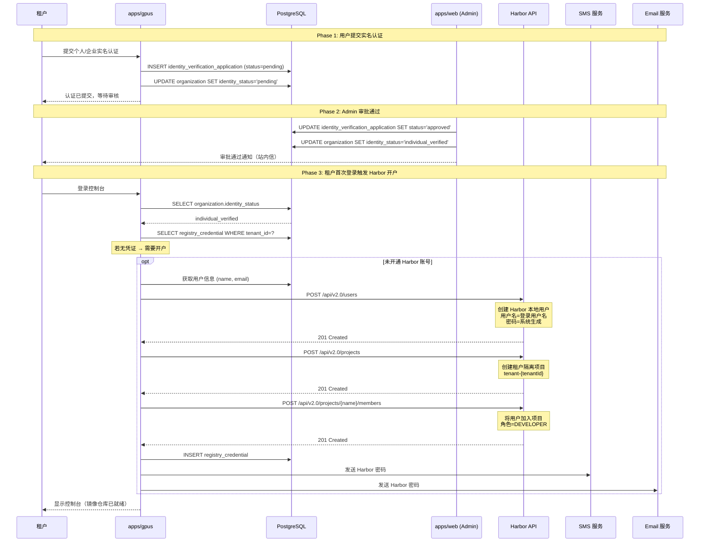
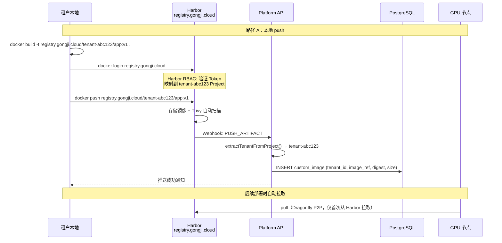
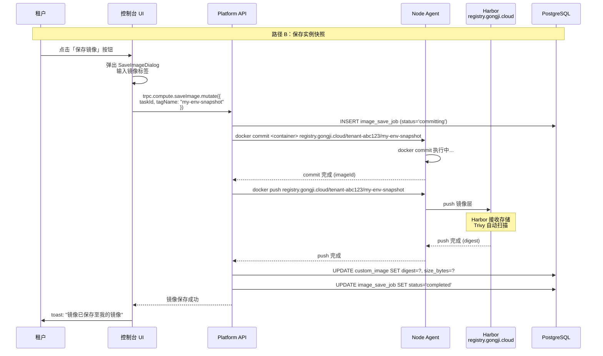
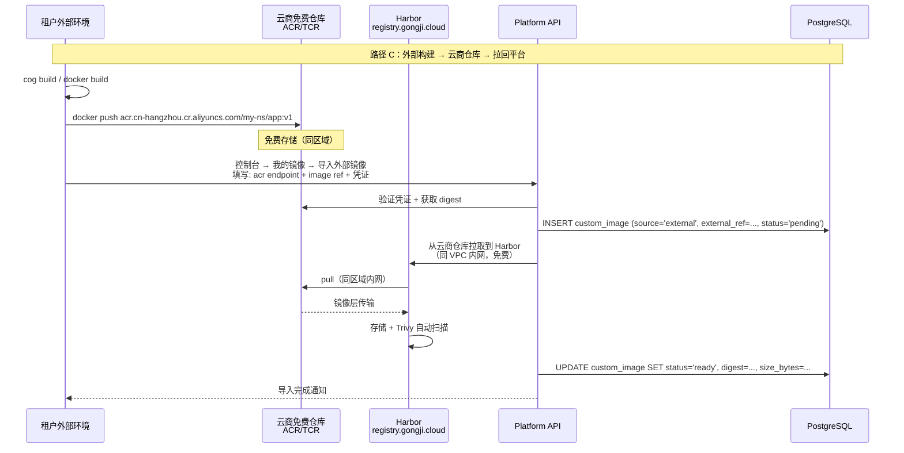
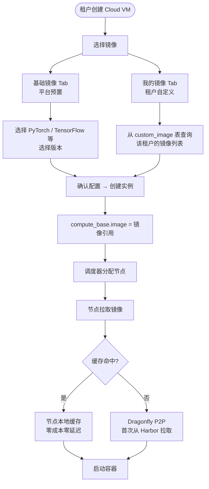
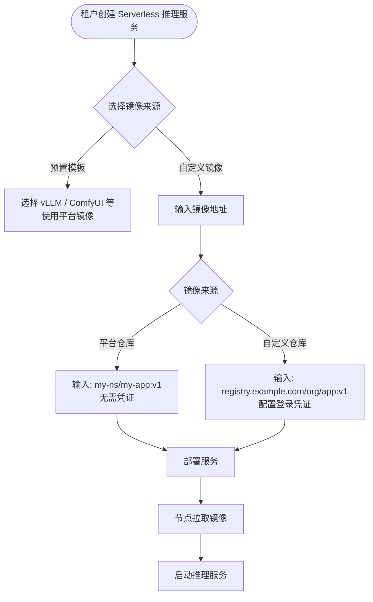
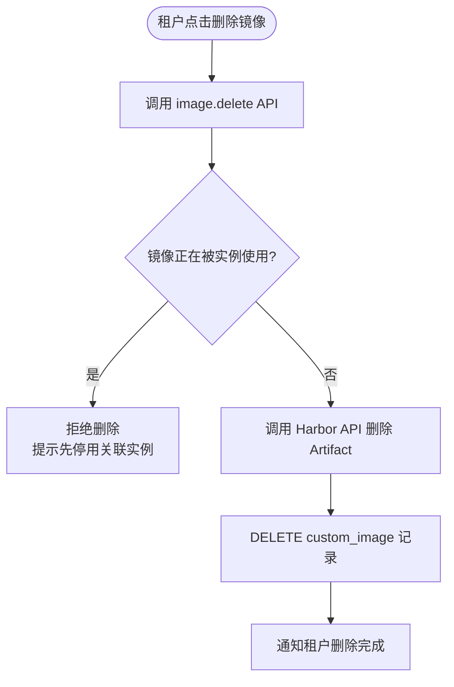
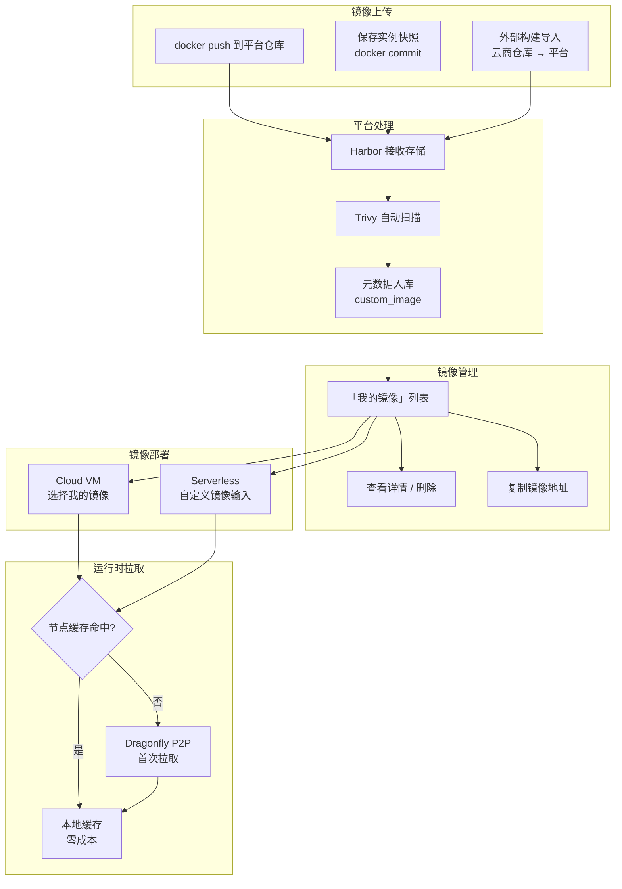

# 租户镜像上传与下载操作流程设计

> **状态**: ✅ 已采纳（2026-07-26）
> **范围**: 租户视角的镜像上传/下载全流程、apps/gpus 前端与后端实现流程、商业化运行所需的安全/配额/审计能力
> **对齐**: `image-registry-cost-optimization.md`（§4 Harbor 部署、§5 Zot 缓存、§6 Dragonfly P2P）、`cloud-vm-implementation.md` §8、`image-registry-optimization.md`
> **中心仓库**: Harbor（registry.gongji.cloud）— 多租户 Project 隔离 + Trivy 扫描 + Webhook 回调
> **Harbor API**: 使用 Harbor 官方 REST API v2.0（Basic Auth），不经过 Suanli OpenAPI 中间层
> **现状分析**: 基于 `apps/gpus` 现有代码（save-image-dialog.tsx 为 mock、template-step.tsx 有自定义镜像 UI 但凭证仅存 React state、custom_image 表尚未建表）

---

## 目录

1. [现状与问题](#1-现状与问题)
2. [Harbor API 客户端](#2-harbor-api-客户端)
3. [Harbor 账号开通流程](#3-harbor-账号开通流程)
4. [租户上传镜像流程](#4-租户上传镜像流程)
5. [租户下载/部署镜像流程](#5-租户下载部署镜像流程)
6. [apps/gpus 后端实现](#6-appsgpus-后端实现)
7. [apps/gpus 前端实现](#7-appsgpus-前端实现)
8. [数据模型](#8-数据模型)
9. [商业化运行能力](#9-商业化运行能力)
10. [完整流程图](#10-完整流程图)

---

## 1. 现状与问题

### 1.1 现有代码状态

| 功能 | 现状 | 问题 |
|------|------|------|
| **Cloud VM 基础镜像选择** | 硬编码在 `server-market-data.ts`，`BASE_IMAGES` 数组 | 不支持租户自定义镜像 |
| **Cloud VM "我的镜像" tab** | UI 占位，显示"功能即将上线" | 无后端、无 DB 表 |
| **Serverless 自定义镜像** | `template-step.tsx` 支持 platform/custom 仓库源 | 凭证仅存 React state，刷新丢失；无 DB 持久化 |
| **保存镜像 (docker commit)** | `save-image-dialog.tsx` 存在，`handleSave` 用 `setTimeout` mock | 无真实 docker commit 后端 |
| **镜像仓库凭证** | 无 `registry_credential` 表，客户端组件 state 管理 | 刷新丢失、无法跨页面共享 |
| **custom_image 表** | 不存在 | 无租户镜像元数据管理 |
| **image_build_job 表** | 不存在 | 无构建任务追踪 |

### 1.2 需要补齐的能力

```
租户上传镜像                    平台管理                      租户部署镜像
─────────────                ──────────                    ─────────────
1. docker push 到 Harbor      1. Harbor 接收 + 存储          1. 列表展示"我的镜像"
2. 保存实例快照 (commit)      2. Trivy 自动扫描              2. 选择镜像部署
3. 外部构建 → 云商仓库 → 拉回 3. Webhook → 元数据入库        3. 拉取到节点 (Dragonfly)
                             4. P2P 分发到节点
```

> 详细 Harbor 部署配置见 `image-registry-cost-optimization.md` §4。

---

## 2. Harbor API 客户端

### 2.1 架构决策

**决策**: 使用 Harbor 官方 REST API v2.0，通过 HTTP Basic Auth 直接调用 Harbor 服务，不经过 Suanli OpenAPI 中间层。

**理由**:
- Harbor 官方 API 稳定、文档完善（Swagger v2.0），覆盖用户管理、项目管理、Robot Account 等全部所需功能
- 消除对 Suanli OpenAPI 的依赖，减少中间层故障风险
- 直连 Harbor 可获得完整的错误信息和审计日志
- Basic Auth 实现简单，无需 RSA 签名等复杂加密逻辑

### 2.2 环境变量

```bash
# Harbor 连接配置
HARBOR_URL=https://registry.gongji.cloud    # Harbor 外部访问地址
HARBOR_ADMIN_USERNAME=admin                 # Harbor 管理员用户名
HARBOR_ADMIN_PASSWORD=Harbor12345           # Harbor 管理员密码
```

### 2.3 API 端点映射

| 平台操作 | Harbor API | 方法 | 认证 |
|---------|-----------|------|------|
| 创建租户用户 | `POST /api/v2.0/users` | 创建 Harbor 本地用户 | Admin Basic Auth |
| 重置用户密码 | `PUT /api/v2.0/users/{username}/password` | 管理员重置密码（无需 old_password） | Admin Basic Auth |
| 创建租户项目 | `POST /api/v2.0/projects` | 创建隔离的 Project | Admin Basic Auth |
| 添加项目成员 | `POST /api/v2.0/projects/{name}/members` | 将租户用户加入 Project | Admin Basic Auth |
| 创建 Robot Account | `POST /api/v2.0/robots` | 用于 CI/CD 自动 push/pull | Admin Basic Auth |
| 查询项目使用量 | `GET /api/v2.0/projects/{name}/summary` | 配额监控 | Admin Basic Auth |
| 删除镜像 Artifact | `DELETE /api/v2.0/projects/{name}/repositories/{repo}/artifacts/{reference}` | 镜像清理 | Admin Basic Auth |

### 2.4 客户端实现

```typescript
// apps/gpus/src/lib/server/services/harbor.ts

interface HarborConfig {
  url: string              // e.g. https://registry.gongji.cloud
  adminUsername: string    // e.g. admin
  adminPassword: string    // e.g. Harbor12345
}

interface HarborUser {
  username: string
  password: string
  email: string
  realname?: string
}

class HarborClient {
  private config: HarborConfig

  constructor(config: HarborConfig) {
    this.config = config
  }

  private get authHeader(): string {
    const credentials = `${this.config.adminUsername}:${this.config.adminPassword}`
    return `Basic ${Buffer.from(credentials).toString('base64')}`
  }

  private async request<T>(
    method: string,
    path: string,
    body?: unknown,
  ): Promise<T> {
    const url = `${this.config.url}/api/v2.0${path}`
    const headers: Record<string, string> = {
      'Authorization': this.authHeader,
      'Content-Type': 'application/json',
      'Accept': 'application/json',
    }

    const resp = await fetch(url, {
      method,
      headers,
      body: body ? JSON.stringify(body) : undefined,
    })

    if (!resp.ok) {
      const text = await resp.text().catch(() => '')
      throw new Error(
        `Harbor API ${method} ${path} failed (${resp.status}): ${text}`,
      )
    }

    // 204 No Content or empty body
    if (resp.status === 204) return undefined as T
    const text = await resp.text()
    return text ? JSON.parse(text) : (undefined as T)
  }

  /**
   * 创建 Harbor 本地用户
   * POST /api/v2.0/users
   */
  async createUser(user: HarborUser): Promise<void> {
    await this.request('POST', '/users', {
      username: user.username,
      password: user.password,
      email: user.email,
      realname: user.realname ?? user.username,
      comment: 'Platform-managed account',
    })
  }

  /**
   * 管理员重置用户密码（无需 old_password）
   * PUT /api/v2.0/users/{username}/password
   */
  async resetUserPassword(
    username: string,
    newPassword: string,
  ): Promise<void> {
    await this.request(
      'PUT',
      `/users/${encodeURIComponent(username)}/password`,
      { new_password: newPassword },
    )
  }

  /**
   * 创建项目（租户隔离）
   * POST /api/v2.0/projects
   */
  async createProject(projectName: string): Promise<void> {
    await this.request('POST', '/projects', {
      project_name: projectName,
      public: false,
      metadata: { public: 'false' },
    })
  }

  /**
   * 添加项目成员
   * POST /api/v2.0/projects/{name}/members
   */
  async addProjectMember(
    projectName: string,
    username: string,
    roleId: number = 2, // DEVELOPER
  ): Promise<void> {
    await this.request(
      'POST',
      `/projects/${encodeURIComponent(projectName)}/members`,
      {
        role_id: roleId,
        member_user: { username },
      },
    )
  }

  /**
   * 创建 Robot Account（CI/CD push/pull）
   * POST /api/v2.0/robots
   * 注意: secret 仅在创建时返回一次
   */
  async createRobotAccount(params: {
    name: string
    projectName: string
    description?: string
  }): Promise<{ id: number; name: string; secret: string }> {
    return this.request('POST', '/robots', {
      name: params.name,
      description: params.description ?? 'Platform CI/CD Robot',
      level: 'project',
      duration: -1, // 永不过期
      permissions: [{
        kind: 'project',
        namespace: params.projectName,
        access: [
          { resource: 'repository', action: 'pull' },
          { resource: 'repository', action: 'push' },
          { resource: 'artifact', action: 'read' },
          { resource: 'artifact', action: 'list' },
        ],
      }],
    })
  }

  /**
   * 检查用户是否存在
   * GET /api/v2.0/users/search?username={name}
   */
  async userExists(username: string): Promise<boolean> {
    try {
      const users = await this.request<Array<{ username: string }>>(
        'GET',
        `/users/search?username=${encodeURIComponent(username)}`,
      )
      return users.some((u) => u.username === username)
    } catch {
      return false
    }
  }
}

// 单例
let harborClient: HarborClient | null = null

export function getHarborClient(): HarborClient {
  if (harborClient) return harborClient
  const url = process.env.HARBOR_URL
  const adminUsername = process.env.HARBOR_ADMIN_USERNAME
  const adminPassword = process.env.HARBOR_ADMIN_PASSWORD
  if (!url || !adminUsername || !adminPassword) {
    throw new Error('Missing HARBOR_URL / HARBOR_ADMIN_USERNAME / HARBOR_ADMIN_PASSWORD')
  }
  harborClient = new HarborClient({ url, adminUsername, adminPassword })
  return harborClient
}
```

### 2.5 密码策略

Harbor 密码复杂度要求（Harbor v2.0 强制执行）：
- 最少 8 个字符
- 至少 1 个大写字母
- 至少 1 个小写字母
- 至少 1 个数字

平台生成密码时使用以下策略：

```typescript
function generateHarborPassword(): string {
  // 格式: Gpu{3位随机大写}{3位随机数字}{2位随机小写}
  // 例: GpuXR7k3ab — 满足 Harbor 密码复杂度要求
  const upper = 'ABCDEFGHIJKLMNOPQRSTUVWXYZ'
  const lower = 'abcdefghijklmnopqrstuvwxyz'
  const digits = '0123456789'

  const pick = (chars: string, n: number) =>
    Array.from({ length: n }, () => chars[Math.floor(Math.random() * chars.length)]).join('')

  return `Gpu${pick(upper, 3)}${pick(digits, 3)}${pick(lower, 2)}`
}
```

---

## 3. Harbor 账号开通流程

### 3.1 触发时机

**Harbor 账号在 Admin 审批通过实名认证后创建**，不由用户提交实名认证时触发。

**理由**:
- 实名认证可能被拒绝，提前创建 Harbor 账号会造成孤立资源
- Harbor 账号需要有效的用户身份，审批通过后创建确保身份可信
- 避免未通过实名的用户占用 Harbor 资源

### 3.2 流程



### 3.3 实现细节

**Harbor 开户在 gpus 的 identity dataaccess 层实现**：

```typescript
// apps/gpus/src/lib/server/identity/dataaccess.ts 新增方法

async function ensureHarborAccount(organizationId: string, user: { name: string; email: string }) {
  // 1. 检查是否已开通
  const [existing] = await db
    .select()
    .from(registryCredential)
    .where(
      and(
        eq(registryCredential.tenantId, organizationId),
        eq(registryCredential.registryHost, HARBOR_HOST),
        eq(registryCredential.credentialType, 'platform'),
      ),
    )
    .limit(1)
  if (existing) return // 已开通，跳过

  // 2. 检查实名认证状态
  const [org] = await db
    .select({ identityStatus: organization.identityStatus })
    .from(organization)
    .where(eq(organization.id, organizationId))
    .limit(1)
  if (!org || (org.identityStatus !== 'individual_verified' && org.identityStatus !== 'enterprise_verified')) {
    return // 未通过实名，不创建
  }

  const harbor = getHarborClient()
  const username = user.name // 默认为登录用户名
  const password = generateHarborPassword()
  const projectName = `tenant-${organizationId}`

  // 3. 创建 Harbor 用户
  const userExists = await harbor.userExists(username)
  if (!userExists) {
    await harbor.createUser({
      username,
      password,
      email: user.email,
    })
  }

  // 4. 创建租户项目
  try {
    await harbor.createProject(projectName)
  } catch (e) {
    // 项目可能已存在，忽略 409 错误
    if (!(e as Error).message.includes('409')) throw e
  }

  // 5. 将用户加入项目
  await harbor.addProjectMember(projectName, username, 2) // DEVELOPER

  // 6. 保存凭证
  await db.insert(registryCredential).values({
    id: crypto.randomUUID(),
    tenantId: organizationId,
    registryHost: HARBOR_HOST,
    username,
    passwordEnc: password, // TODO: 生产环境应加密存储
    credentialType: 'platform',
    scope: 'push_pull',
  })

  // 7. 通过 SMS + Email 发送密码
  const [org2] = await db
    .select({ name: organization.name })
    .from(organization)
    .where(eq(organization.id, organizationId))
    .limit(1)

  // SMS
  await sendHarborPasswordSms(user.name, password)

  // Email
  await sendHarborPasswordEmail(user.email, user.name, password)
}
```

**前端触发方式**：

在 `identity.ts` router 新增 `provisionHarborAccount` mutation，前端在以下时机调用：
- 用户首次登录控制台时（console layout 检测）
- 用户访问「我的镜像」页面时
- 用户访问 Settings → 镜像仓库密码时

```typescript
// apps/gpus/src/lib/server/routers/identity.ts 新增

provisionHarborAccount: protectedProcedure
  .mutation(async ({ ctx }) => {
    const harbor = getHarborClient()
    const username = ctx.user.name
    const password = generateHarborPassword()
    const projectName = `tenant-${ctx.organizationId}`

    // 检查是否已开通
    const [existing] = await db.select().from(registryCredential)
      .where(and(
        eq(registryCredential.tenantId, ctx.organizationId),
        eq(registryCredential.credentialType, 'platform'),
      )).limit(1)
    if (existing) return { alreadyProvisioned: true }

    // 检查实名状态
    const [org] = await db.select().from(organization)
      .where(eq(organization.id, ctx.organizationId)).limit(1)
    if (!org?.identityStatus?.includes('verified')) {
      throw new TRPCError({ code: 'PRECONDITION_FAILED', message: '请先完成实名认证' })
    }

    // 创建 Harbor 用户 + 项目 + 保存凭证
    await ensureHarborAccount(ctx.organizationId, { name: username, email: ctx.user.email })

    // 发送密码
    await sendHarborPasswordSms(username, password)
    await sendHarborPasswordEmail(ctx.user.email, username, password)

    return { success: true }
  }),
```

### 3.4 密码发送渠道

Harbor 密码通过 **SMS + Email 同时发送**，确保用户能收到：

- **SMS**: 复用 `identity/otp.ts` 的 SMS 通道（Tencent Cloud SMS）
- **Email**: 使用 `@workspace/email` 的邮件服务（Resend/Nodemailer）

短信模板：
```
【GPURun】您的镜像仓库已开通。用户名：{username}，密码：{password}。请妥善保管，重置密码请到控制台设置页。
```

邮件模板：新建 `harborAccountCreated` 邮件模板，包含用户名、密码、登录地址、使用说明。

---

## 4. 租户上传镜像流程

### 4.1 路径 A：从本地 push 到平台仓库（最常用）

**适用场景**：租户在本地或 CI/CD 中构建好镜像，直接推送到平台。



**租户操作步骤**：

```bash
# 1. 获取平台仓库登录凭证
#    控制台 → 我的镜像 → 获取登录命令
docker login registry.gongji.cloud
#    用户名：租户 ID 或 Access Token
#    密码：平台生成的仓库密码（或 Harbor Robot Account Token）

# 2. 给镜像打标签（按平台命名规范）
docker tag my-app:latest registry.gongji.cloud/tenant-abc123/my-app:v1

# 3. 推送
docker push registry.gongji.cloud/tenant-abc123/my-app:v1

# 4. 在控制台「我的镜像」中查看
```

**平台命名规范**：

```
registry.gongji.cloud/<namespace>/<image-name>:<tag>

namespace = Harbor Project 名称，格式: tenant-{tenantId}
示例：
registry.gongji.cloud/tenant-abc123/my-inference:v1.2
registry.gongji.cloud/tenant-abc123/comfyui-workflow:latest
```

### 4.2 路径 B：从运行中实例保存快照

**适用场景**：租户在 Cloud VM 中安装好环境后，保存为可复用镜像。



**租户操作步骤**：

1. 在 Cloud VM 实例详情页，点击「保存镜像」
2. 输入镜像标签（如 `my-training-env`）
3. 等待 1-3 分钟（commit + push 过程）
4. 完成后在「我的镜像」中可见

### 4.3 路径 C：外部 Cog/Dockerfile 构建

**适用场景**：租户在外部 GPU 环境（如另一朵云）使用 Cog 构建镜像。



**租户操作步骤**：

1. 在外部环境完成构建并 push 到云商仓库
2. 控制台 → 我的镜像 → 「导入外部镜像」
3. 填写：仓库地址、镜像路径、登录凭证
4. 平台自动拉回到 Harbor（同 VPC 免费）
5. 完成后在「我的镜像」中可见

---

## 5. 租户下载/部署镜像流程

### 5.1 Cloud VM 部署流程



**租户操作**：

1. 进入 Cloud VM 创建页
2. 切换到「我的镜像」Tab
3. 看到自己 push / 保存 / 导入的所有镜像列表
4. 选择一个镜像
5. 选择 GPU 规格、区域
6. 点击「创建」
7. 系统自动拉取镜像到节点并启动

### 5.2 Serverless 部署流程



**租户操作**：

1. 进入 Serverless 创建页
2. 模板步骤 → 切换到「自定义镜像」Tab
3. 选择「平台镜像仓库」
4. 输入镜像路径（如 `my-ns/my-app:v1`）
5. 配置环境变量、启动命令、端口
6. 点击「部署」

---

## 6. apps/gpus 后端实现

### 6.1 新增镜像管理 tRPC Router

```
apps/gpus/src/lib/server/routers/
├── compute.ts          # 现有：createServerless 等
├── image.ts            # 新增：镜像管理路由
├── registry.ts         # 新增：镜像仓库密码重置路由
└── ...
```

```typescript
// apps/gpus/src/lib/server/routers/image.ts
import { createTRPCRouter, protectedProcedure, adminProcedure } from "@/lib/trpc"
import { z } from "zod"

export const imageRouter = createTRPCRouter({
  /**
   * 列出租户的自定义镜像
   * 对应 UI: Cloud VM "我的镜像" Tab、Serverless 自定义镜像列表
   */
  listCustom: protectedProcedure
    .input(
      z.object({
        page: z.number().int().min(1).default(1),
        pageSize: z.number().int().min(1).max(100).default(20),
        search: z.string().optional(),
      }),
    )
    .query(async ({ ctx, input }) => {
      const tenantId = ctx.user.tenantId
      return listCustomImages({ tenantId, ...input })
    }),

  /**
   * 获取单个镜像详情
   */
  getDetail: protectedProcedure
    .input(z.object({ imageId: z.string() }))
    .query(async ({ ctx, input }) => {
      return getCustomImageDetail(ctx.user.tenantId, input.imageId)
    }),

  /**
   * 删除自定义镜像
   * 安全检查：如果镜像正在被实例使用，拒绝删除
   */
  delete: protectedProcedure
    .input(z.object({ imageId: z.string() }))
    .mutation(async ({ ctx, input }) => {
      return deleteCustomImage(ctx.user.tenantId, input.imageId)
    }),

  /**
   * 保存运行中实例为镜像（docker commit + push）
   * 替换现有 save-image-dialog.tsx 的 mock 实现
   */
  saveFromInstance: protectedProcedure
    .input(
      z.object({
        taskId: z.string(),
        tagName: z
          .string()
          .min(1)
          .regex(/^[a-z0-9][a-z0-9._-]*$/, "标签格式不合法"),
        description: z.string().optional(),
      }),
    )
    .mutation(async ({ ctx, input }) => {
      return saveImageFromInstance(ctx.user.tenantId, input)
    }),

  /**
   * 查询保存任务状态
   * 轮询接口，前端用于显示进度
   */
  getSaveJobStatus: protectedProcedure
    .input(z.object({ jobId: z.string() }))
    .query(async ({ ctx, input }) => {
      return getImageSaveJobStatus(ctx.user.tenantId, input.jobId)
    }),

  /**
   * 导入外部镜像
   * 租户提供外部仓库地址 + 凭证，平台拉回到 Harbor
   */
  importExternal: protectedProcedure
    .input(
      z.object({
        externalRegistry: z.string().url(),
        imageRef: z.string().min(1),
        username: z.string().min(1),
        password: z.string().min(1),
        tagName: z.string().optional(), // 可选重命名
      }),
    )
    .mutation(async ({ ctx, input }) => {
      return importExternalImage(ctx.user.tenantId, input)
    }),

  /**
   * 获取仓库登录凭证
   * 返回 Harbor Robot Account 凭证用于 docker login
   */
  getRegistryCredentials: protectedProcedure.query(async ({ ctx }) => {
    return generateRegistryCredentials(ctx.user.tenantId)
  }),

  /**
   * 获取租户存储配额使用情况
   * 对应 UI: 我的镜像 → 存储用量展示
   */
  getQuotaUsage: protectedProcedure.query(async ({ ctx }) => {
    return getTenantQuotaUsage(ctx.user.tenantId)
  }),

  /**
   * 平台管理员：查询镜像审计日志
   */
  getAuditLogs: adminProcedure
    .input(
      z.object({
        tenantId: z.string().optional(),
        action: z.enum(['push', 'pull', 'delete', 'import', 'scan']).optional(),
        startDate: z.date(),
        endDate: z.date(),
        page: z.number().int().min(1).default(1),
        pageSize: z.number().int().min(1).max(100).default(20),
      }),
    )
    .query(async ({ input }) => {
      return listAuditLogs(input)
    }),
})
```

### 6.2 dataaccess 层

```
apps/gpus/src/lib/server/dataaccess/
├── compute/
│   └── ...
├── image/
│   ├── custom-image.ts       # custom_image CRUD
│   ├── image-save-job.ts     # 保存任务状态
│   └── registry-credential.ts # 仓库凭证管理
└── ...
```

```typescript
// apps/gpus/src/lib/server/dataaccess/image/custom-image.ts
import { db } from "@workspace/db"
import { customImage } from "@workspace/db"
import { eq, and, desc, like, count } from "drizzle-orm"

async function listCustomImages(params: {
  tenantId: string
  page: number
  pageSize: number
  search?: string
}) {
  const conditions = [
    eq(customImage.tenantId, params.tenantId),
    eq(customImage.status, "ready"),
  ]
  if (params.search) {
    conditions.push(like(customImage.imageRef, `%${params.search}%`))
  }
  const where = and(...conditions)

  const [totalRow] = await db
    .select({ total: count() })
    .from(customImage)
    .where(where)

  const total = Number(totalRow?.total ?? 0)
  const offset = (params.page - 1) * params.pageSize

  const rows = await db
    .select()
    .from(customImage)
    .where(where)
    .orderBy(desc(customImage.createdAt))
    .limit(params.pageSize)
    .offset(offset)

  return { items: rows, total, page: params.page, pageSize: params.pageSize }
}

async function saveImageFromInstance(tenantId: string, params: {
  taskId: string
  tagName: string
  description?: string
}) {
  // 1. 验证任务属于该租户
  const task = await getTaskForTenant(tenantId, params.taskId)
  if (!task) throw new Error("实例不存在")

  // 2. 构建完整镜像引用
  const imageRef = `registry.gongji.cloud/${tenantId}/${params.tagName}`

  // 3. 创建保存任务记录
  const [job] = await db
    .insert(imageSaveJob)
    .values({
      tenantId,
      sourceTaskId: params.taskId,
      tagName: params.tagName,
      imageRef,
      status: "committing",
    })
    .returning()

  // 4. 异步执行 docker commit + push（由 Node Agent 完成）
  //    通过消息队列或直接 HTTP 调用 Node Agent
  await dispatchImageSaveJob({
    jobId: job.id,
    nodeId: task.nodeId,
    containerId: task.containerId,
    imageRef,
  })

  return { jobId: job.id, status: "committing" }
}
```

### 6.3 Node Agent 执行 docker commit + push

```typescript
// Node Agent 侧处理
async function handleImageSaveJob(params: {
  jobId: string
  containerId: string
  imageRef: string
  tenantId: string
}): Promise<void> {
  try {
    // 1. 获取 Harbor Robot Account 凭证（平台为该租户预创建）
    const credentials = await getRegistryCredentials(params.tenantId)
    
    // 2. docker login（使用 Robot Account）
    await execCommand(
      `echo "${credentials.password}" | docker login ${HARBOR_HOST} --username ${credentials.username} --password-stdin`
    )
    
    // 3. docker commit
    await execCommand(
      `docker commit ${params.containerId} ${params.imageRef}`
    )

    // 4. docker push（平台仓库同 VPC，免费）
    await execCommand(`docker push ${params.imageRef}`)

    // 5. 获取镜像信息
    const inspect = await execCommand(
      `docker inspect ${params.imageRef} --format '{{.Id}} {{.Size}}'`
    )
    const [digest, sizeBytes] = parseInspectOutput(inspect)

    // 6. 回调平台 API 更新状态
    await callbackPlatform({
      jobId: params.jobId,
      status: 'completed',
      digest,
      sizeBytes,
    })
  } catch (error) {
    await callbackPlatform({
      jobId: params.jobId,
      status: 'failed',
      errorMessage: error.message,
    })
  }
}
```

---

## 7. apps/gpus 前端实现

### 7.1 页面结构

```
apps/gpus/src/app/[locale]/console/
├── images/                          # 新增：镜像管理页面
│   └── page.tsx                     # 我的镜像列表页
├── server/
│   ├── deploy/
│   │   └── page.tsx                 # 修改：接入 custom_image 列表
│   └── instances/[id]/
│       └── _components/
│           └── save-image-dialog.tsx # 修改：接入真实 API
└── serverless/
    └── deploy/
        └── _components/
            └── template-step.tsx    # 修改：自定义镜像接入 custom_image 列表
```

### 7.2 「我的镜像」列表页

```typescript
// apps/gpus/src/app/[locale]/console/images/page.tsx
"use client"

import { trpc } from "@/lib/trpc"

export default function ImageListPage() {
  const [search, setSearch] = useState("")
  const [page, setPage] = useState(1)

  const { data, isLoading } = trpc.image.listCustom.useQuery({
    page,
    pageSize: 20,
    search: search || undefined,
  })

  return (
    <div>
      <PageHeader
        title="我的镜像"
        description="管理您上传和保存的容器镜像。"
        actions={
          <>
            <Button variant="outline" onClick={() => setImportDialogOpen(true)}>
              <Upload className="size-4" />
              导入外部镜像
            </Button>
            <Button onClick={() => setPushGuideOpen(true)}>
              <Terminal className="size-4" />
              推送镜像指南
            </Button>
          </>
        }
      />

      {/* 搜索栏 */}
      <Input
        placeholder="搜索镜像名称..."
        value={search}
        onChange={(e) => { setSearch(e.target.value); setPage(1) }}
      />

      {/* 镜像列表 */}
      <div className="grid grid-cols-1 gap-4 md:grid-cols-2 lg:grid-cols-3">
        {data?.items.map((image) => (
          <ImageCard
            key={image.id}
            image={image}
            onDelete={() => handleDelete(image.id)}
            onUse={() => handleUseImage(image)}
          />
        ))}
      </div>

      {/* 分页 */}
      <ListPagination
        page={page}
        pageSize={20}
        total={data?.total ?? 0}
        onPageChange={setPage}
      />

      {/* 推送镜像指南弹窗 */}
      <PushGuideDialog open={pushGuideOpen} onOpenChange={setPushGuideOpen} />

      {/* 导入外部镜像弹窗 */}
      <ImportExternalDialog open={importDialogOpen} onOpenChange={setImportDialogOpen} />
    </div>
  )
}
```

### 7.3 镜像卡片组件

```typescript
// 镜像卡片
function ImageCard({ image, onDelete, onUse }: {
  image: CustomImage
  onDelete: () => void
  onUse: () => void
}) {
  return (
    <div className="rounded-xl border bg-card p-4">
      <div className="flex items-start justify-between">
        <div className="flex items-center gap-2">
          <Container className="size-4 text-muted-foreground" />
          <span className="text-sm font-medium truncate">{image.tagName}</span>
        </div>
        <DropdownMenu>
          <DropdownMenuTrigger asChild>
            <Button variant="ghost" size="sm"><MoreHorizontal className="size-4" /></Button>
          </DropdownMenuTrigger>
          <DropdownMenuContent>
            <DropdownMenuItem onClick={onUse}>使用此镜像</DropdownMenuItem>
            <DropdownMenuItem onClick={() => copyToClipboard(image.imageRef)}>
              复制镜像地址
            </DropdownMenuItem>
            <DropdownMenuSeparator />
            <DropdownMenuItem onClick={onDelete} className="text-destructive">
              删除
            </DropdownMenuItem>
          </DropdownMenuContent>
        </DropdownMenu>
      </div>

      <code className="mt-2 block truncate rounded bg-muted px-2 py-1 font-mono text-xs text-muted-foreground">
        {image.imageRef}
      </code>

      <div className="mt-3 flex items-center gap-4 text-xs text-muted-foreground">
        <span>{formatBytes(image.sizeBytes)}</span>
        <span>{formatRelativeTime(image.createdAt)}</span>
        {image.scanStatus === "clean" && (
          <Badge variant="secondary" className="bg-emerald-50 text-emerald-600">
            <ShieldCheck className="size-3" /> 安全
          </Badge>
        )}
        {image.scanStatus === "vulnerability_found" && (
          <Badge variant="secondary" className="bg-amber-50 text-amber-600">
            发现漏洞
          </Badge>
        )}
      </div>
    </div>
  )
}
```

### 7.4 推送镜像指南弹窗

```typescript
// 租户获取 push 凭证的操作指引
function PushGuideDialog({ open, onOpenChange }) {
  const { data: creds } = trpc.image.getRegistryCredentials.useQuery()

  const pushCommand = `docker login registry.gongji.cloud \\
  --username ${creds?.username ?? "<您的租户ID>"} \\
  --password ${creds?.password ?? "<平台生成的密码>"}

# 打标签
docker tag <本地镜像名> registry.gongji.cloud/${creds?.namespace ?? "<命名空间>"}/<镜像名>:<标签>

# 推送
docker push registry.gongji.cloud/${creds?.namespace ?? "<命名空间>"}/<镜像名>:<标签>`

  return (
    <Dialog open={open} onOpenChange={onOpenChange}>
      <DialogContent className="max-w-lg">
        <DialogHeader>
          <DialogTitle>推送镜像到平台</DialogTitle>
          <DialogDescription>
            使用以下命令将本地镜像推送到平台仓库，推送后可在「我的镜像」中选用。
          </DialogDescription>
        </DialogHeader>

        <Alert>
          <AlertTitle>登录凭证</AlertTitle>
          <AlertDescription>
            <p>用户名：<code>{creds?.username}</code></p>
            <p>密码：<code>{creds?.password ? "••••••••（已生成）" : "请先生成"}</code></p>
          </AlertDescription>
        </Alert>

        <div className="relative">
          <pre className="overflow-x-auto rounded-lg bg-muted p-4 font-mono text-xs">
            {pushCommand}
          </pre>
          <Button
            variant="ghost" size="sm"
            className="absolute right-2 top-2"
            onClick={() => copyToClipboard(pushCommand)}
          >
            <Copy className="size-3.5" />
          </Button>
        </div>
      </DialogContent>
    </Dialog>
  )
}
```

### 7.5 导入外部镜像弹窗

```typescript
function ImportExternalDialog({ open, onOpenChange }) {
  const importMutation = trpc.image.importExternal.useMutation({
    onSuccess: () => {
      toast.success("镜像导入已开始，完成后将在列表中显示")
      onOpenChange(false)
    },
    onError: (err) => toast.error(err.message),
  })

  return (
    <Dialog open={open} onOpenChange={onOpenChange}>
      <DialogContent>
        <DialogHeader>
          <DialogTitle>导入外部镜像</DialogTitle>
          <DialogDescription>
            从 Docker Hub、ACR、TCR 等外部仓库导入镜像到平台。
            平台将自动拉取镜像，同区域内网传输免费。
          </DialogDescription>
        </DialogHeader>

        <div className="flex flex-col gap-4 py-2">
          <div className="flex flex-col gap-1.5">
            <Label>仓库地址 <span className="text-destructive">*</span></Label>
            <Input placeholder="例如 registry.cn-hangzhou.aliyuncs.com" />
          </div>
          <div className="flex flex-col gap-1.5">
            <Label>镜像路径 <span className="text-destructive">*</span></Label>
            <Input placeholder="例如 my-namespace/my-app:v1" />
          </div>
          <div className="flex flex-col gap-1.5">
            <Label>用户名</Label>
            <Input placeholder="仓库用户名或 Access Key" />
          </div>
          <div className="flex flex-col gap-1.5">
            <Label>密码 / Access Token</Label>
            <Input type="password" />
          </div>
        </div>

        <DialogFooter>
          <Button variant="outline" onClick={() => onOpenChange(false)}>取消</Button>
          <Button onClick={() => importMutation.mutate(/* ... */)}>
            开始导入
          </Button>
        </DialogFooter>
      </DialogContent>
    </Dialog>
  )
}
```

### 7.6 修改 save-image-dialog.tsx（接入真实 API）

```typescript
// 替换现有 mock 的 handleSave
function handleSave() {
  if (!tag.trim()) {
    toast.error("请输入镜像标签")
    return
  }

  setSaving(true)
  saveMutation.mutate(
    {
      taskId: inst.id,
      tagName: tag.trim(),
      description: `从实例 ${inst.name} 保存`,
    },
    {
      onSuccess: (result) => {
        // 开始轮询任务状态
        pollJobStatus(result.jobId)
      },
      onError: (err) => {
        setSaving(false)
        toast.error(`保存失败: ${err.message}`)
      },
    },
  )
}

function pollJobStatus(jobId: string) {
  const interval = setInterval(async () => {
    const status = await trpc.image.getSaveJobStatus.fetch({ jobId })
    if (status.status === "completed") {
      clearInterval(interval)
      setSaving(false)
      onOpenChange(false)
      toast.success(`镜像已保存至我的镜像`)
    } else if (status.status === "failed") {
      clearInterval(interval)
      setSaving(false)
      toast.error(`保存失败: ${status.errorMessage}`)
    }
    // committing 状态继续轮询
  }, 3000)
}
```

### 7.7 修改 template-step.tsx（Serverless 自定义镜像接入列表）

```typescript
// 在自定义镜像 Tab 中，增加"从我的镜像选择"功能
// 替代手动输入镜像路径

function TemplateStep({ values, onChange, ... }) {
  const { data: myImages } = trpc.image.listCustom.useQuery({ pageSize: 50 })

  return (
    <TabsContent value="custom">
      {/* 新增：从我的镜像选择 */}
      {myImages && myImages.items.length > 0 && (
        <div className="flex flex-col gap-2">
          <Label>从我的镜像选择</Label>
          <div className="grid grid-cols-1 gap-2 max-h-48 overflow-y-auto">
            {myImages.items.map((img) => (
              <button
                key={img.id}
                type="button"
                onClick={() => {
                  onChange("registrySource", "platform")
                  onChange("customImage", stripRegistryHost(PLATFORM_REGISTRY.host, img.imageRef))
                }}
                className="flex items-center gap-2 rounded-lg border p-2 text-left hover:border-primary/60"
              >
                <Container className="size-3.5 text-muted-foreground" />
                <code className="truncate font-mono text-xs">{img.imageRef}</code>
                <span className="ml-auto text-xs text-muted-foreground">
                  {formatBytes(img.sizeBytes)}
                </span>
              </button>
            ))}
          </div>
          <div className="relative my-2">
            <div className="absolute inset-0 flex items-center">
              <span className="w-full border-t" />
            </div>
            <div className="relative flex justify-center text-xs">
              <span className="bg-card px-2 text-muted-foreground">或手动输入</span>
            </div>
          </div>
        </div>
      )}

      {/* 现有的手动输入逻辑保持不变 */}
      ...
    </TabsContent>
  )
}
```

---

## 8. 数据模型

### 8.1 自定义镜像表

```sql
CREATE TABLE custom_image (
    id              TEXT PRIMARY KEY DEFAULT gen_random_uuid()::text,
    tenant_id       TEXT NOT NULL,
    tag_name        VARCHAR(255) NOT NULL,
    image_ref       VARCHAR(512) NOT NULL,     -- 完整引用: registry.gongji.cloud/tenant-id/tag
    digest          VARCHAR(255),
    size_bytes      BIGINT,
    source          VARCHAR(32) NOT NULL,       -- push | commit | external
    source_task_id  TEXT,                       -- commit 来源的实例 ID
    external_ref    VARCHAR(1024),              -- 外部仓库原始引用 (source=external 时)
    status          VARCHAR(16) NOT NULL DEFAULT 'ready', -- pending | scanning | ready | failed
    scan_status     VARCHAR(32),                -- clean | vulnerability_found | scanning | pending
    scan_summary    JSONB,                      -- Trivy 扫描结果摘要
    description     TEXT,
    is_pinned       BOOLEAN NOT NULL DEFAULT false,  -- 固定不自动清理
    created_at      TIMESTAMPTZ DEFAULT NOW(),
    updated_at      TIMESTAMPTZ DEFAULT NOW()
);

CREATE INDEX idx_custom_image_tenant ON custom_image(tenant_id);
CREATE INDEX idx_custom_image_status ON custom_image(tenant_id, status);
CREATE UNIQUE INDEX idx_custom_image_ref ON custom_image(tenant_id, image_ref);
```

### 8.2 镜像保存任务表

```sql
CREATE TABLE image_save_job (
    id              TEXT PRIMARY KEY DEFAULT gen_random_uuid()::text,
    tenant_id       TEXT NOT NULL,
    source_task_id  TEXT NOT NULL,              -- 来源实例
    tag_name        VARCHAR(255) NOT NULL,
    image_ref       VARCHAR(512) NOT NULL,
    status          VARCHAR(16) NOT NULL DEFAULT 'committing',  -- committing | pushing | completed | failed
    digest          VARCHAR(255),
    size_bytes      BIGINT,
    node_id         VARCHAR(255),               -- 执行 commit 的节点
    error_message   TEXT,
    created_at      TIMESTAMPTZ DEFAULT NOW(),
    started_at      TIMESTAMPTZ,
    completed_at    TIMESTAMPTZ
);

CREATE INDEX idx_image_save_job_tenant ON image_save_job(tenant_id);
CREATE INDEX idx_image_save_job_status ON image_save_job(status);
```

### 8.3 仓库凭证表

```sql
CREATE TABLE registry_credential (
    id              TEXT PRIMARY KEY DEFAULT gen_random_uuid()::text,
    tenant_id       TEXT NOT NULL,
    registry_host   VARCHAR(512) NOT NULL,      -- registry.gongji.cloud 或外部地址
    username        VARCHAR(255) NOT NULL,
    password_enc    TEXT NOT NULL,               -- 加密存储（Harbor Robot Account Secret）
    credential_type VARCHAR(16) NOT NULL,        -- platform | external
    scope           VARCHAR(32) NOT NULL DEFAULT 'push_pull', -- push_pull | pull_only
    last_used_at    TIMESTAMPTZ,
    expires_at      TIMESTAMPTZ,                -- 平台凭证可设过期时间
    created_at      TIMESTAMPTZ DEFAULT NOW(),
    updated_at      TIMESTAMPTZ DEFAULT NOW()
);

CREATE INDEX idx_registry_credential_tenant ON registry_credential(tenant_id);
CREATE UNIQUE INDEX idx_registry_credential_host ON registry_credential(tenant_id, registry_host);
```

### 8.4 镜像审计日志表

```sql
CREATE TABLE image_audit_log (
    id              TEXT PRIMARY KEY DEFAULT gen_random_uuid()::text,
    tenant_id       TEXT NOT NULL,
    user_id         TEXT,
    action          VARCHAR(32) NOT NULL,  -- push | pull | delete | import | scan
    resource_type   VARCHAR(16) NOT NULL,  -- image | credential | quota
    resource_ref    VARCHAR(512) NOT NULL,
    detail          JSONB,
    ip_address      INET,
    user_agent      TEXT,
    created_at      TIMESTAMPTZ DEFAULT NOW()
);

CREATE INDEX idx_audit_log_tenant ON image_audit_log(tenant_id);
CREATE INDEX idx_audit_log_action ON image_audit_log(action);
CREATE INDEX idx_audit_log_created ON image_audit_log(created_at);
```

---

## 9. 商业化运行能力

### 9.1 Harbor 多租户 RBAC 集成

#### 9.1.1 租户 → Harbor Project 映射

每个租户自动对应一个 Harbor Project，实现存储和权限隔离。Harbor 账号在实名认证审批通过后由 `ensureHarborAccount` 统一创建（见 §3.3），包括：

1. **创建 Harbor 用户** — `POST /api/v2.0/users`（用户名 = 登录用户名，密码 = 系统生成）
2. **创建租户项目** — `POST /api/v2.0/projects`（`tenant-{tenantId}`，私有项目）
3. **添加项目成员** — `POST /api/v2.0/projects/{name}/members`（角色 = DEVELOPER）
4. **保存凭证** — 写入 `registry_credential` 表
5. **发送密码** — SMS + Email 同时发送

#### 9.1.2 用户角色映射

| 平台角色 | Harbor 角色 (role_id) | 权限范围 |
|---------|------------|---------|
| 租户管理员 (tenant_owner) | Project Admin (1) | push/pull/delete/scan 查看 |
| 租户成员 (tenant_engineer) | DEVELOPER (2) | push/pull |
| 租户访客 (tenant_viewer) | GUEST (3) | pull only |

```typescript
// 平台用户角色 → Harbor role_id 映射
function mapPlatformRoleToHarborRoleId(role: string): number {
  const mapping: Record<string, number> = {
    tenant_owner: 1,      // Project Admin
    tenant_engineer: 2,   // DEVELOPER
    tenant_viewer: 3,     // GUEST
    member: 2,            // 默认 DEVELOPER
  }
  return mapping[role] ?? 2
}

// 同步用户角色到 Harbor Project
async function syncHarborRBAC(
  tenantId: string,
  username: string,
  platformRole: string,
): Promise<void> {
  const harbor = getHarborClient()
  const projectName = `tenant-${tenantId}`
  const roleId = mapPlatformRoleToHarborRoleId(platformRole)

  // Harbor API: 更新项目成员角色
  // 需要先获取成员 ID，再 PUT 更新
  // 简化实现：先删除再添加
  try {
    await harbor.addProjectMember(projectName, username, roleId)
  } catch {
    // 成员可能已存在，忽略
  }
}
```

### 9.2 存储配额管理

#### 9.2.1 配额层级

```
套餐层级          存储配额      仓库数量限制    镜像 Tag 限制
─────────────    ─────────    ──────────    ──────────
免费版            20 GB        10            100
基础版           200 GB        50            1,000
专业版         1,000 GB       200            5,000
企业版         5,000 GB     1,000           20,000
```

#### 9.2.2 配额检查与通知

```typescript
// 定时检查租户配额使用率（每小时）
async function checkTenantQuotaUsage(): Promise<void> {
  const tenants = await db.select().from(tenant)
  
  for (const t of tenants) {
    const projectName = `tenant-${t.id}`
    
    // 从 Harbor API 获取 Project 使用量
    const usage = await harborAPI.getProjectUsage(projectName)
    const quota = await getTenantQuota(t.id)
    
    const usagePercent = usage.storageBytes / quota.storageBytes
    
    // 超过 80% 告警
    if (usagePercent > 0.8) {
      await sendNotification({
        type: 'quota_warning',
        tenantId: t.id,
        message: `镜像存储使用率 ${Math.round(usagePercent * 100)}%，请及时清理。`,
        severity: 'warning',
      })
    }
    
    // 超过 95% 阻止 push
    if (usagePercent > 0.95) {
      await blockTenantPush(t.id)
      await sendNotification({
        type: 'quota_exceeded',
        tenantId: t.id,
        message: '镜像存储已达配额上限，无法推送新镜像。请删除不需要的镜像或升级套餐。',
        severity: 'critical',
      })
    }
  }
}
```

### 9.3 镜像生命周期管理

#### 9.3.1 自动清理策略

```typescript
// Harbor Tag Retention Rule 配置
const IMAGE_RETENTION_RULES = {
  // 基础镜像：保留最近 5 个 tag + 所有带 version 标签的
  BASE_IMAGES: {
    project: 'platform-base',
    rules: [
      { template: 'latest', mostRecent: 5 },
      { template: '*.*.*', always: true },  // semver 标签永久保留
    ],
    cadence: 'daily',
  },
  
  // 租户镜像：保留最近 10 个 tag + 30 天内使用过的
  TENANT_IMAGES: {
    project: 'tenant-*',
    rules: [
      { template: 'latest', mostRecent: 10 },
      { template: '*', lastModified: '30d' },
    ],
    cadence: 'daily',
  },
  
  // 构建缓存：保留 7 天
  BUILD_CACHE: {
    project: 'platform-build-cache',
    rules: [
      { template: '*', lastModified: '7d' },
    ],
    cadence: 'daily',
  },
}
```

#### 9.3.2 镜像删除流程



```typescript
// 删除镜像（带安全检查）
async function deleteCustomImage(tenantId: string, imageId: string): Promise<void> {
  // 1. 验证镜像属于该租户
  const image = await db.query.customImage.findFirst({
    where: and(eq(customImage.id, imageId), eq(customImage.tenantId, tenantId))
  })
  if (!image) throw new Error('镜像不存在')
  
  // 2. 检查是否有实例正在使用该镜像
  const activeInstances = await db.query.computeBase.findMany({
    where: and(
      eq(computeBase.tenantId, tenantId),
      eq(computeBase.imageRef, image.imageRef),
      or(
        eq(computeBase.status, 'running'),
        eq(computeBase.status, 'pending'),
        eq(computeBase.status, 'deploying'),
      )
    )
  })
  if (activeInstances.length > 0) {
    throw new Error(`该镜像正在被 ${activeInstances.length} 个实例使用，请先停用关联实例`)
  }
  
  // 3. 调用 Harbor API 删除 artifact
  const projectName = `tenant-${tenantId}`
  const repositoryName = extractRepositoryFromRef(image.imageRef)
  const digest = image.digest
  
  await harborAPI.deleteArtifact(projectName, repositoryName, digest)
  
  // 4. 删除 custom_image 记录
  await db.delete(customImage).where(eq(customImage.id, imageId))
  
  // 5. 记录审计日志
  await recordAuditLog({
    tenantId,
    action: 'image.delete',
    resource: image.imageRef,
    detail: `删除镜像 ${image.tagName}，释放 ${formatBytes(image.sizeBytes)} 存储`,
  })
}
```

### 9.4 审计日志

所有镜像操作记录审计日志，满足商业化运营的合规要求：

```sql
CREATE TABLE image_audit_log (
    id              TEXT PRIMARY KEY DEFAULT gen_random_uuid()::text,
    tenant_id       TEXT NOT NULL,
    user_id         TEXT,
    action          VARCHAR(32) NOT NULL,  -- push | pull | delete | import | scan
    resource_type   VARCHAR(16) NOT NULL,  -- image | credential | quota
    resource_ref    VARCHAR(512) NOT NULL,
    detail          JSONB,
    ip_address      INET,
    user_agent      TEXT,
    created_at      TIMESTAMPTZ DEFAULT NOW()
);

CREATE INDEX idx_audit_log_tenant ON image_audit_log(tenant_id);
CREATE INDEX idx_audit_log_action ON image_audit_log(action);
CREATE INDEX idx_audit_log_created ON image_audit_log(created_at);
```

```typescript
// 审计日志 API（平台管理员）
export const imageAuditRouter = createTRPCRouter({
  list: adminProcedure
    .input(z.object({
      tenantId: z.string().optional(),
      action: z.string().optional(),
      startDate: z.date(),
      endDate: z.date(),
      page: z.number().int().min(1).default(1),
      pageSize: z.number().int().min(1).max(100).default(20),
    }))
    .query(async ({ input }) => {
      return listAuditLogs(input)
    }),
    
  // Harbor Webhook 回调也会记录审计日志
  // PUSH_ARTIFACT → action: 'push'
  // SCANNING_COMPLETED → action: 'scan'
  // DELETE_ARTIFACT → action: 'delete'
})
```

### 9.5 监控与告警

#### 9.5.1 Harbor 健康监控

```yaml
# Harbor 健康检查指标
harbor_health_status{component}              # core/registry/trivy/db/redis 状态
harbor_project_count{public,private}         # 项目数量
harbor_repository_count{project}             # 仓库数量
harbor_artifact_count{project,media_type}    # Artifact 数量
harbor_storage_usage_bytes{project}          # 存储使用量
harbor_quota_usage_ratio{project}            # 配额使用率
```

```yaml
# 告警规则
groups:
  - name: harbor_alerts
    rules:
      - alert: HarborComponentDown
        expr: harbor_health_status == 0
        for: 1m
        labels:
          severity: critical
        annotations:
          summary: "Harbor 组件不健康: {{ $labels.component }}"

      - alert: TenantQuotaWarning
        expr: harbor_quota_usage_ratio > 0.8
        for: 30m
        labels:
          severity: warning
        annotations:
          summary: "租户 {{ $labels.project }} 配额使用率超过 80%"

      - alert: TenantQuotaExceeded
        expr: harbor_quota_usage_ratio > 0.95
        for: 10m
        labels:
          severity: critical
        annotations:
          summary: "租户 {{ $labels.project }} 配额即将耗尽"

      - alert: HighVulnerabilityRate
        expr: rate(harbor_scanner_vulnerabilities_total{severity="Critical"}[1h]) > 5
        for: 1h
        labels:
          severity: warning
        annotations:
          summary: "高危漏洞镜像推送频率过高"
```

#### 9.5.2 镜像拉取性能监控

```yaml
# 从 image-registry-optimization.md 和 cloud-native-integration.md §4 对齐
image_pull_duration_seconds{image_ref, source, cache_hit}  # 拉取耗时
image_pull_bytes_total{image_ref, source}                  # 拉取流量
image_pull_cost_yuan{image_ref, source, region_pair}       # 拉取成本
image_cache_hit_ratio{node_id}                             # 缓存命中率
```

---

## 10. 完整流程图

### 10.1 租户镜像生命周期总览



### 10.2 各路径成本对比

| 路径 | 租户操作 | 流量成本 | 耗时 | 适用场景 |
|------|---------|---------|------|---------|
| **A: push 到平台** | `docker push` | ¥0（同 VPC） | 1-5 min | 本地/CI 构建 |
| **B: 保存快照** | 点击保存按钮 | ¥0（同节点） | 1-3 min | 保存调试好的环境 |
| **C: 外部导入** | 控制台填写信息 | ¥0（同区域） | 3-10 min | 跨云 Cog 构建 |
| **部署: 缓存命中** | 选择镜像部署 | ¥0 | 0 | 重复部署同一镜像 |
| **部署: P2P 拉取** | 选择镜像部署 | ≈¥0.01/GB | 10-60s | 首次部署到新节点 |

---

## 附录：需要修改的现有文件清单

| 文件 | 修改内容 | 优先级 |
|------|---------|--------|
| `packages/db/src/compute-schema.ts` | 新增 `serverlessTemplate`、`customImage`、`imageSaveJob`、`registryCredential` 表 | P0 |
| 新建 `apps/gpus/src/lib/server/services/harbor.ts` | Harbor 官方 REST API 客户端（Basic Auth） | P0 |
| 新建 `apps/gpus/src/lib/server/routers/registry.ts` | 镜像仓库密码重置 tRPC 路由 | P0 |
| 新建 `apps/gpus/src/lib/server/routers/image.ts` | 镜像管理 tRPC 路由 | P0 |
| 新建 `apps/gpus/src/lib/server/dataaccess/image/` | 镜像 dataaccess 层（custom-image, registry-credential） | P0 |
| 新建 `apps/gpus/src/lib/server/dataaccess/compute/serverless-template.ts` | 预置模板 dataaccess 层 | P0 |
| `apps/gpus/src/lib/server/routers/index.ts` | 注册 imageRouter、registryRouter | P0 |
| `apps/gpus/src/lib/server/routers/compute.ts` | serverlessDeployOptions 从 DB 读取模板 | P0 |
| `apps/gpus/src/lib/server/routers/identity.ts` | 新增 provisionHarborAccount mutation | P0 |
| `apps/gpus/src/lib/server/identity/dataaccess.ts` | 新增 ensureHarborAccount 方法 | P0 |
| `apps/gpus/src/components/settings/settings-page-client.tsx` | 增加镜像仓库密码管理区域 | P0 |
| 新建 `apps/gpus/src/components/settings/reset-harbor-password-dialog.tsx` | 重置密码弹窗（短信验证码确认） | P0 |
| 新建 `apps/gpus/src/app/[locale]/console/images/page.tsx` | 「我的镜像」管理页 | P1 |
| 新建 `apps/gpus/src/components/images/image-card.tsx` | 镜像卡片组件 | P1 |
| 新建 `apps/gpus/src/components/images/push-guide-dialog.tsx` | 推送镜像指南弹窗 | P1 |
| 新建 `apps/gpus/src/components/images/import-external-dialog.tsx` | 导入外部镜像弹窗 | P1 |
| `apps/gpus/src/app/[locale]/console/serverless/deploy/_components/template-step.tsx` | 自定义镜像增加「从我的镜像选择」 | P1 |
| `apps/gpus/src/app/[locale]/console/templates/page.tsx` | 用 tRPC 数据替代静态 TEMPLATES | P1 |
| `apps/gpus/src/lib/gpu-data.ts` | `PLATFORM_REGISTRY` 对接真实 Harbor 地址 | P0 |

### Harbor 运维配置

| 配置项 | 说明 | 位置 |
|--------|------|------|
| Harbor Helm values | Harbor 部署配置 | `docker/harbor/harbor-values.yaml` |
| Zot 配置 | IDC 边缘缓存配置 | `docker/zot/zot-config.json` |
| Dragonfly Helm values | P2P 分发配置 | `docker/dragonfly/dragonfly-values.yaml` |
| Webhook 端点 | Harbor → 平台 API 回调 | `apps/gpus/src/app/api/webhooks/harbor/` |

### 环境变量清单

| 变量 | 说明 | 示例值 |
|------|------|--------|
| `HARBOR_URL` | Harbor 外部访问地址 | `https://registry.gongji.cloud` |
| `HARBOR_ADMIN_USERNAME` | Harbor 管理员用户名 | `admin` |
| `HARBOR_ADMIN_PASSWORD` | Harbor 管理员密码 | `Harbor12345` |

### 与旧方案的差异

| 对比项 | 旧方案 (Suanli OpenAPI) | 新方案 (Harbor 官方 API) |
|--------|------------------------|------------------------|
| 调用方式 | 通过 Suanli 中间层 + RSA 签名 | 直连 Harbor + HTTP Basic Auth |
| Harbor 端点 | `/harbor/encrypt/create_user`, `/harbor/encrypt/reset_password` | `POST /api/v2.0/users`, `PUT /api/v2.0/users/{name}/password` |
| 认证方式 | RSA 公私钥签名 + Token | Basic Auth (admin:password) |
| 依赖 | SUANLI_OPENAPI_* 环境变量 | HARBOR_URL + HARBOR_ADMIN_* 环境变量 |
| 开户时机 | 未定义 | 实名认证审批通过后由前端触发 |
| 密码重置 | 未实现 | 用户在 Settings 页通过短信验证码确认后重置 |
