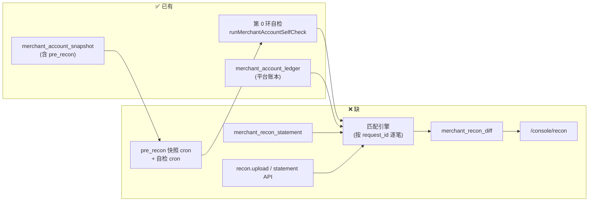
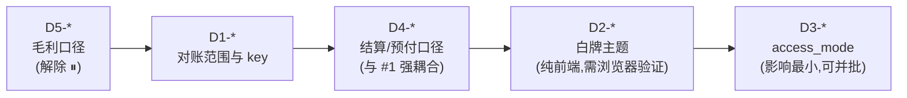

# 商户模块待决设计项（1–5）

> **状态：仅设计讨论，本文件未改动任何代码。**
> 复核日期 2026-10-05，代码为权威；行号取自当前工作区。
> 上游：`apps/merchant/content/design/merchant-module-review-and-design.md`（§0 状态复核、§3.6、§3.7、§5.6、§6.5–6.6）、`docs/business/merchant-product-plan.md`（Q1–Q18）、`docs/design/audit/p0-p1-audit.md`

## 怎么读

每节结构固定：

| 段 | 含义 |
|---|---|
| **现状** | 已经存在/不存在的代码事实（带证据） |
| **缺口** | 为什么还不能收工 |
| **需拍板** | 编号决策点 `D<节>-<序号>`，每条给 A/B/C 选项 |
| **拟定方案** | 我建议的实现路径（**待你确认，不会先动手**） |
| **影响面与验证** | 会动到哪些表/页面/契约，怎么验 |
| **风险与依赖** | 卡点 |

回复时可直接写编号，例如「D1-1 选 A，D5-3 选复用」。

---

# 1. 对账中心 `/console/recon` + `recon.*` API

## 1.1 现状

**已存在**

| 能力 | 证据 |
|---|---|
| 账户三件套 | `merchant_account`（`merchant-schema.ts:1294`）、`merchant_account_pool_balance`（`:1340`）、`merchant_account_ledger`（`:1370`） |
| 对账基线快照 | `merchant_account_snapshot`（`:1424`），`trigger` 枚举含 `pre_recon`（`:1431-1432`，`MERCHANT_ACCOUNT_SNAPSHOT_TRIGGERS`） |
| **第 0 环实时值自检（算法已实现）** | `packages/billing/src/merchant-account.ts:774 runMerchantAccountSelfCheck`、`:879 listMerchantPoolTotalMismatch` |
| 快照的手动入口 | `routers/account.ts:92 takeSnapshot` —— **但 `pre_recon`/`hourly` 会抛 FORBIDDEN「由平台定时任务生成，不可手动触发」（`:94-98`）** |
| 自检的 tRPC 出口 | `routers/account.ts:58 selfCheck`、`:71 selfCheckRange` |
| scope 枚举 | `MERCHANT_API_KEY_SCOPES` 含 `recon:write`（`merchant-schema.ts:1519`） |
| 快照/自检的 dataaccess | `dataaccess/account/account.ts:143 selfCheck` / `:149 selfCheckRange`、`dataaccess/account/snapshot.ts:50 takeSnapshot` |
| 流水幂等键（可当比对 key） | `balance_transaction.idempotencyKey`（`gpus-consumer-schema.ts:211`）—— **可选列，存量大量 NULL** |

**不存在**

- `merchant_recon_statement` / `merchant_recon_diff` 两张表：`merchant-schema.ts` 的 `pgTable` 清单（共 37 张）里没有；
- `apps/api` 无 `routes/recon.ts`、无 `webhooks` 路由（现有 routes：account/agent/bare-metal/consumption/health/hello/recharge/subjects/sync-purchase-prices/tasks/vouchers）；
- `/console/recon` 页面（`console/` 下只有 `_components account billing pricing promo recharge settings settlement subjects tenants vouchers`）；
- **没有 recon/self-check 的 cron**：`init-cron-jobs.ts` 现注册 12 个（`:42-53`），无 `pre_recon` 快照、无自检、无对账；
- ⇒ **`pre_recon` 快照目前无法产生**：既不能手动触发（`account.ts:94-98` FORBIDDEN），也没有任何 cron 调 `takeSnapshot(..., 'pre_recon')`（`rg "'pre_recon'" apps/web/src/lib/server/jobs` 无输出）。`runMerchantAccountSelfCheck` 要求基线快照存在，否则直接抛错（`merchant-account.ts:799`）。
- 通用 webhook 出站设施（全仓只有飞书**入站** webhook）。

## 1.2 缺口



0. **`pre_recon` 快照根本产不出来**（手动被禁 + 无 cron）——自检入口天然断链；
1. 自检算法有，但**从不自动跑**（无 cron、无告警）——第 0 环等于没接线；
2. 三方对账的两张表、匹配引擎、上传/确认、API、控制台页全部为零；
3. 比对 key 不确定：设计写 `request_id`，但平台侧落库的是**可选** `idempotency_key`。

## 1.3 需拍板

| 编号 | 问题 | 选项 |
|---|---|---|
| **D1-1** | 对账范围 | **A.** 只做第 0 环（快照 cron + 自检 + 漂移告警 + 自检面板），三方对账下一期<br>**B.** 一步到位：两张表 + 匹配引擎 + 上传/确认 + API + 控制台 |
| **D1-2** | 比对 key | **A.** 把 `request_id` 设为**必填**并贯穿消费/扣减链路（需迁移 + 改上游写入）<br>**B.** 沿用 `idempotencyKey`，接受存量 NULL，NULL 行进「不可比对」桶<br>**C.** 用 `(refType, refId)` 组合键 |
| **D1-3** | 「商户账本」从哪来 | **A.** 商户上传文件（`POST /recon/upload`，CSV/JSON）<br>**B.** 商户系统定时推送（需先有 `request_id` 约定）<br>**C.** 本期不比商户账本，只比**平台账本 ↔ 资源计量**两方 |
| **D1-4** | 调度落点 | **A.** `apps/web`（与其他 12 个 cron 同处，复用 `CRON_SECRET` / `MERCHANT_VOUCHER_EXPIRY_*` 同款 env 约定）<br>**B.** `apps/merchant` 的 `api/internal/cron/*`（商户域自治） |
| **D1-5** | 差异处理动作 | **A.** 只开工单（`merchant_recon_diff.status`），调账人工触发<br>**B.** 差异可一键「接受平台口径」，直接写 `merchant_account_ledger` `refType='adjust'`（该枚举已存在，`merchant-schema.ts:1234`）+ 幂等键 |
| **D1-6** | `webhooks.register` 是否本期做 | **A.** 做（需先设计出站投递、签名、重试、注册表）<br>**B.** 不做，控制台轮询即可 |
| **D1-7** | `match_rate < 99%` 告警渠道 | **A.** 站内信 `site_messages`（已有）<br>**B.** 飞书（复用 `integrations/feishu`）<br>**C.** 两者都要 |

## 1.4 拟定方案（待确认）

**倾向 D1-1 = A 先做第 0 环，B 作为第二期**：

**P1（低风险、无新表）**
1. `init-cron-jobs.ts` 注册 `merchant-account-selfcheck` cron：日频 00:10 落 `daily` 快照，对账启动前落 `pre_recon` 快照，再调 `runMerchantAccountSelfCheck`；
2. 漂移 → `crmError` + 站内信 +（若 D1-7=C）飞书；
3. `/console/recon` 第一版只做：**当前自检状态 + 快照基线列表 + 触发手动 `takeSnapshot`**。

**P2（依赖 D1-2/D1-3 定稿）**
1. 迁移新增 `merchant_recon_statement` / `merchant_recon_diff`（列取设计 §5.6 原文）；
2. `dataaccess/recon/{statement,diff,match,self-check}.ts` + `routers/recon.ts`（DB 级分页）；
3. `apps/api` 加 `GET /recon/statements`、`POST /recon/upload`（scope `recon:write`，强制幂等键，复用 `vouchers.ts` 的错误码风格）；
4. `/console/recon` 完整页（周期选择 / 三方金额 / 匹配率 / 差异表 / 上传 / 确认）。

## 1.5 影响面与验证

- **新表 2 张 + 迁移**：`pnpm --filter @workspace/db run db:generate`（禁止手写 SQL，参照 P1-22 教训）；
- **新 tRPC router 1 个**：需 `requireMerchantPermission` 新增 `recon:read`/`recon:write` 权限键（改 `merchant-permissions.ts` 四角色矩阵）；
- **新 API 路由 2 个**：`apps/api` typecheck 基线 35 错全在 `src/routes/agent.ts`，验证时须 `grep -v routes/agent.ts`；
- **前端页 1 个**：`apps/merchant/**` 用户可见，AGENTS 要求浏览器验证；若本期只做 P1，可先做只读面板降低验证成本。

## 1.6 风险与依赖

- **强依赖 D1-2**：`request_id` 不定，匹配引擎写不出来；
- 与 **#4 M-2** 边界重叠（月度账目确认 vs 跨系统逐笔对账），需一并定；
- `runMerchantAccountSelfCheck` 要求基线快照存在，否则抛「没有基线快照」（`merchant-account.ts:799`）—— cron 必须保证先落 `pre_recon` 快照。

---

# 2. 白牌主题接线（`resolveBrandingTheme()` 零调用方）

## 2.1 现状

**读侧**

```ts
// apps/merchant/src/lib/server/branding-resolver.ts:17
export async function resolveBrandingTheme(): Promise<MerchantBrandingTheme | null>
// 读 resolveRequestHostname() → merchant_branding.customDomain → { brandName, logoUrl, faviconUrl, primaryColor, themeConfig }
```

- **rg 全仓只有定义与一条注释引用，零调用方** —— 白牌外观功能实际未接线；
- `resolveRequestHostname()`（`lib/server/request-hostname.ts`）只认请求头 `host`，去端口小写，`localhost`/`::1`/`127.*`/`192.168.*`/`*.local` 返回 null。

**写侧（齐全）**

| 功能 | 入口 |
|---|---|
| 品牌主题 | `components/settings/decoration-settings.tsx:604 trpc.oem.get`、`:618 updateBranding`（brandName / logoUrl / faviconUrl / primaryColor / themeColor / themeMode / pageTemplate / banners） |
| 自定义域名 | `components/settings/domain-section.tsx` → `oem.updateCustomDomain`（撞 `merchant_branding_custom_domain_uk` 回 409） |
| 数据表 | `merchant_branding`（`merchant-schema.ts:1051`），`merchant_branding_merchant_uk` + `merchant_branding_custom_domain_uk` 部分唯一索引（`0012_serious_tyrannus.sql:85-86`） |

**展示侧（全硬编码，无一处消费 branding）**

| 位置 | 现状 |
|---|---|
| `components/console-sidebar.tsx:171,173` | `<GPURunFullIcon />` + `t('brand')`（i18n 常量） |
| `components/site-header.tsx:26` | `<span>{t('brand')}</span>` |
| `app/[locale]/layout.tsx:27` `generateMetadata` | `icons` 写死 `/logo/favicon-*.png` |
| 主题色 | `primaryColor` 只在表单里存，**无 CSS 变量消费方** |
| `console/layout.tsx` | 已有 session + `merchant.fundingMode` 查询，**未取 branding** |

## 2.2 缺口

Q17=A「一套 merchant 部署按客户域名多租户**路由与主题**」—— 路由（数据）已闭合（P1-15），**主题半边未做**：商户绑定域名后，控制台仍显示平台品牌。

## 2.3 需拍板

| 编号 | 问题 | 选项 |
|---|---|---|
| **D2-1** | 注入范围 | **A.** 只做外壳：侧栏品牌名/Logo、站点标题、favicon<br>**B.** A + 主题色（`--brand-primary` 覆盖 shadcn `--primary`）<br>**C.** B + 模式（light/dark）/ banner / 页面模板（`pageTemplate`） |
| **D2-2** | 注入点 | **A.** `console/layout.tsx` 顺带查一次（已有多次 DB 查询，边际成本低），用 CSS 变量下传<br>**B.** 独立 `<BrandingProvider>`（client）走 tRPC<br>**C.** 根 `app/[locale]/layout.tsx`（这样营销页也白牌） |
| **D2-3** | 主题色落地 | **A.** `style={{ '--primary': primaryColor }}` 挂在根容器（Tailwind v4 CSS 变量）<br>**B.** 注入 `<style>` 覆盖 `@workspace/ui/globals.css` 的 token |
| **D2-4** | 回退策略 | **A.** 无 branding / 本地开发 → 保持平台默认（现状 `null`）<br>**B.** 报错提示「域名未绑定品牌」 |
| **D2-5** | favicon 是否做 | **A.** 做：`generateMetadata` 改为按请求解析 `faviconUrl`（Server Component 每请求执行）<br>**B.** 不做，favicon 留平台默认 |
| **D2-6** | 数据源 | **A.** 每请求查 `merchant_branding`（一次索引查询）<br>**B.** 进程内缓存（按域名，TTL 5 分钟）——改品牌后需等 TTL |

## 2.4 拟定方案（待确认）

倾向 **D2-1=B、D2-2=A、D2-3=A、D2-4=A、D2-5=B（先不做 favicon）、D2-6=A**：

1. `console/layout.tsx` 里在现有 `merchantRow` 查询同批次取 `merchant_branding`（按 `customDomain = resolveRequestHostname()`）；
2. 拿到 branding → 在 `SidebarProvider` 外层容器挂 `style={{ '--primary': primaryColor, ... }}`，侧栏 Logo/品牌名改读 props；
3. 拿不到 → 完全走现状（零行为变化，便于灰度）。

## 2.5 影响面与验证

- **纯前端/布局改动**，无表结构变更、无 API 契约变更；
- AGENTS 要求：`apps/merchant/**` 用户可见变更**需在浏览器验证完整流程**——验证需要一个绑定到非 `localhost` 域名的 `merchant_branding` 行 + `/etc/hosts` 或反代透传 Host；
- 回退路径必须可验证：无 branding 时页面与改动前逐像素一致。

## 2.6 风险与依赖

- `resolveRequestHostname()` 直接读 `Host`：**反代必须透传**，否则线上恒 null（需在部署文档里写明）；
- 每请求 +1 次 DB 查询，放在 layout 里只有 1 次，可接受；若 D2-2=C 则营销页也会查，需按 D2-6=B 加缓存；
- 与 P1-15 的安全口径一致：**域名只决定外观**，`merchant-resolver` 的数据主体仍只认 session，本次改动不得触碰后者。

---

# 3. P2-24 `access_mode` 降只读派生

## 3.1 现状

| 事实 | 证据 |
|---|---|
| 列定义 | `merchant.access_mode varchar(16) NOT NULL DEFAULT 'oem'`（`merchant-schema.ts:52`；建表 `0000_eminent_the_renegades.sql:2046`） |
| 实际枚举 | `oem` / `api` / `iframe`（**运营侧** `apps/web/src/lib/server/routers/merchant/schemas.ts:25 z.enum(['oem','api','iframe'])`；`apps/merchant` 无该入参） |
| 同一语义的三重表达 | `access_mode`（`:52`）、`promo_enabled`（`:63`）、`oem_enabled`（`:64`）、外加**权威源** `funding_mode`（`:75`，DEC-F9） |
| 运营可写 | `apps/web/.../merchant-edit-dialog.tsx:74,163,215` 下拉三选一 |
| 同步写死 | `merchant-platform-sync.ts:86,107` 写 `'oem'` |
| 展示 | `merchant-list-content.tsx:256`、`merchant-detail-content.tsx:84` |
| **行为消费方** | **`access_mode` 没有任何行为消费方**。真正参与行为的是 `oem_enabled`：`merchant-purchase-price-sync.ts:134`、`apps/api/src/lib/task-service.ts:64` |
| 侧栏闸门已换 | `console-sidebar.tsx` 用 `requiresFundingMode`（commission/prepay），**不看 access_mode** |
| flag 甚至不读 DB | `settings-page-client.tsx:246-247` 由 `fundingMode` **推导** `promoEnabled`/`oemEnabled` 展示 |
| 本该用却没用 | `tenant-data.ts:144` 注释「OEM 判断需要 accessMode，当前只区分推广 / 其余」（P2-25 同源） |

## 3.2 缺口

1. **默认值 `oem` 与 Q11=B（独立 feature flag 显式开通）冲突** —— 新建商户天然"已 OEM"；
2. 枚举值 `api`/`iframe` 与 flag 语义**天然对不齐**（`promo` 在枚举里根本没有对应值）；
3. 三处可写（编辑弹窗、平台同步、默认值），互相可能打架；
4. 一个没有任何行为消费方却可被编辑的字段，是纯粹的认知负担与 bug 温床。

## 3.3 需拍板

| 编号 | 问题 | 选项 |
|---|---|---|
| **D3-1** | 派生规则 | **A.** `oem_enabled → 'oem'`，`promo_enabled && !oem_enabled → 'api'`，否则 `'iframe'`（补映射表）<br>**B.** 干脆只保留 `'oem'`/`'none'` 两态<br>**C.** 不派生，**删列** |
| **D3-2** | 落地形态 | **A.** 保留列，应用层禁止写（router 去掉入参，读时现算）<br>**B.** Postgres **generated column**（`GENERATED ALWAYS AS (...) STORED`，DB 层就写不进去）<br>**C.** 删列（迁移 drop，需同步改运营 UI/导出） |
| **D3-3** | `promo_enabled` / `oem_enabled` 与 `funding_mode` 是否合并 | **A.** 保持现状：`funding_mode` 管资金与导航，两个 flag 管能力开关，`access_mode` 派生<br>**B.** flag 也废弃，全部由 `funding_mode` 推导<br>**C.** 保持现状但明确写进文档「谁管什么」 |
| **D3-4** | 运营 UI | **A.** `merchant-edit-dialog` 移除「接入模式」下拉，改为只读文案 + 展示推导依据<br>**B.** 保留可编辑 |
| **D3-5** | 平台同步 | `merchant-platform-sync.ts:86,107` 写死 `'oem'` —— 是否改为按 `funding_mode` 写 |
| **D3-6** | 品牌站侧 | 是否需要同步调整（fork 不在本仓，Q6'=B），本仓只能改平台库口径 |

## 3.4 拟定方案（待确认）

倾向 **D3-1=A、D3-2=A（先应用层收口，不动生成列）、D3-3=C、D3-4=A、D3-5=A**：

1. `routers/merchant/schemas.ts` 删 `accessMode` 入参；`dataaccess/merchant/merchant.ts:256` 改为服务端派生；
2. `merchant-edit-dialog` 下拉改只读展示，附「依据：资金模式 X + OEM 开关 Y」；
3. `merchant-platform-sync` 按 `funding_mode` 写而非硬编码 `'oem'`；
4. 文档补一条字段职责表（`funding_mode` / `oem_enabled` / `promo_enabled` / `access_mode` 各管什么）。

> 若选 D3-2=B/C，属于 **schema 变更**，需 `db:generate` 并回归运营侧所有引用点。

## 3.5 影响面与验证

- 主要动 `apps/web`（运营平台）的商户编辑/列表/详情 + `packages/db`（若选 B/C）；
- 无资金逻辑变更，风险低；
- 验证：`turbo lint typecheck --filter=web`（web typecheck 需 `NODE_OPTIONS=--max-old-space-size=8192`），运营页浏览器验证编辑流程。

---

# 4. M-1 / M-2 / M-3

## 4.1 M-1 自助预付 —— **原文「零实现」已过时，需确认剩余口径**

### 现状

| 原文指控 | 复核结论 |
|---|---|
| `paymentOrder.scene` 无 `merchant_prepay` | ❌ 过时：`PAYMENT_SCENES` 已含 `merchant_prepay` / `voucher_purchase`（`packages/billing/src/types.ts:19-27`） |
| `apps/merchant` 零引用 | ❌ 过时：`routers/prepay.ts` 已有 `overview/list/create/bankAccounts/submitTransferProof/transferProofs/constants` |
| 无自助预付页 | ❌ 过时：`/console/account` 含 `account-prepay-orders.tsx`，`/console/settings` 有预付 Tab（P1-20 复核） |
| 商户想预充只能找运营 | ⚠️ **双轨仍并存**：`merchant_recharge_record`（运营手工登记）在 `apps/web` 仍有 4 处在用（`dataaccess/merchant/merchant-recharge.ts`、`merchant-payment-node.ts`、`merchant-scope-helpers.ts`、`mappers/merchant.ts`） |
| P0-5 应改「单商户单行账户」 | ⚠️ **未按原文改**：`merchant_account` 单行表**已存在且在用**（`merchant-schema.ts:1294`），但充值页余额仍走 `getMerchantAggregateBalance()`（`recharge-data.ts:39`）聚合 `tenant_balance` |

`prepay.create` 的现有护栏（可直接复用，无需重做）：最低额 `MERCHANT_PREPAY_MIN_AMOUNT = 100`（`packages/billing/src/merchant-prepay.ts:48`，`routers/prepay.ts:79` 再校验一次）、上限 ¥10,000,000、两位小数、`NoReceivingAccountError`→428、`PaymentChannelUnavailableError`→428、对公转账**专用**收款账户（拒绝平台通用账户，防串号）。

### 缺口 / 需拍板

| 编号 | 问题 | 选项 |
|---|---|---|
| **D4-1** | 运营手工登记何去何从 | **A.** 废弃 `merchant_recharge_record`，运营只做「代客建单/补录凭证」<br>**B.** 保留双轨，明确「线上自助为主、手工为例外」并做审计 |
| **D4-2** | **余额口径（P0-5 最终口径）** | **A.** 维持聚合 `tenant_balance`（现状，已修越权）<br>**B.** 切到 `merchant_account` 单行 + `merchant_account_pool_balance` 逐池实时值（设计 §3.2 原意，需迁移存量余额）<br>**C.** 双写过渡期 |
| **D4-3** | 自动充值与预付的关系 | **A.** 打通：`MERCHANT_AUTO_RECHARGE_*` cron 的触发条件与 `prepay` 单据/到账状态联动展示<br>**B.** 保持独立（预付是下单、自动充值是兜底），仅在同一页面并列展示 |

> **D4-2 是资金口径决策，不拍板不能动**：切 B 涉及存量余额迁移与「聚合 vs 单行」两个真值源。

## 4.2 M-2 结算语义（月结 → 对账凭证）

### 现状

| 原文指控 | 复核结论 |
|---|---|
| `merchant_bill.status: pending/confirmed` 是付款依据 | ⚠️ 仍是两态：`settlement-data.ts:252-268` 只有 `pending → confirmed`（不可逆），无 `open/reconciled/closed/disputed` |
| `settlement: payable→paid` 表示平台向商户付款 | ❌ **该状态机不存在**：`merchant-schema.ts` 无 settlement 表，`settlement-data.ts` 实际读 `merchant_bill` / `merchant_bill_daily` —— 「删除 payable→paid」自然满足 |
| `merchant_payment_node.due_date` 催款语义 | ⚠️ 仍在：`merchant_payment_node`（`merchant-schema.ts:163`）保留 `due_date`/`expected_amount`，未改成充值计划 |
| `pendingSettlement: '0'` 硬编码 | ⚠️ **仍硬编码**：`settlement-data.ts:99`、`dashboard-data.ts:68` |
| rollup 离线日结 | ⚠️ 仍离线：`registerMerchantRollupCron`（每日 03:00） |

### 缺口

「月结」在 UI 上仍被读作付款依据（`/console/settlement` 的 `pendingSettlement` KPI、`merchant_payment_node` 催款），与预付模式**方向相反**。

### 需拍板

| 编号 | 问题 | 选项 |
|---|---|---|
| **D4-4** | `merchant_bill.status` 状态机 | **A.** 引入 `open → reconciled → confirmed → closed`（+ `disputed`）<br>**B.** 保持 `pending/confirmed`，只改文案为「账目已确认（非付款）」 |
| **D4-5** | `pendingSettlement` 口径 | **A.** 改 `Σ ledger(debit) WHERE pool IN (voucher,cash) AND occurred_at IN 本月`<br>**B.** 保持 0 并隐藏该 KPI |
| **D4-6** | `merchant_payment_node` | **A.** 重定义为 `prepay_plan`（建议充值额/建议日期/预警阈值），语义反转<br>**B.** 保留催款语义（仅佣金模式适用），预付模式不展示 |
| **D4-7** | 与 #1 对账中心的边界 | **A.** 本期一起做（M-2 的「确认」= 月度账目确认；#1 = 跨系统逐笔）<br>**B.** 分开，M-2 只改状态机与口径 |
| **D4-8** | DEC-4 / DEC-5 是否仍按原文锁定 ① | **DEC-4**：① 商户系统权威（原文选定） / ② 平台权威<br>**DEC-5**：① 回滚不扣用户（原文选定） / ② 先扣后补偿<br>两者决定 #1「差异」的判定与调账方向，需确认原文 ① 仍有效 |

## 4.3 M-3 双记账对账

- **现状：即 #1 的三方对账，零实现**（表、引擎、页面全缺）；
- 三方权威归属见 §5.6：平台账本 ✅ 可独立判定 / 商户账本 ❌ / 资源计量 ✅；
- 关键前提同 **D1-2**（比对 key）与 **D4-8**（差异定义）；
- **无需单独设计**，随 #1 落地即可。

---

# 5. P0-9 毛利公式缺 3 项成本（⏸ 挂起）

## 5.1 现状（含对原文证据的修正）

**公式与实现**

- 文档口径（`merchant-billing-system-design.md:87-91,434-441`）：`毛利 = 收入 − 支出 − 券成本 − 折扣成本`；
- 实际（`apps/web/src/lib/server/jobs/merchant-rollup/run-merchant-rollup.ts:180`）：
  ```ts
  const grossProfit = totalAmount - platformCost
  ```
  **只减了「支出」一项。**

**成本侧其实已有一项（原文说「零」是过时的）**

| 事实 | 证据 |
|---|---|
| `merchant_purchase_price` 存在 | `merchant-schema.ts:575`，含 `productLine` / `billingUnit` / `effectiveFrom` / `status` |
| rollup 已按它算成本 | `run-merchant-rollup.ts:59-157`：`platformCost += cardHours × convertPriceToHourlyRate(purchasePrice, billingUnit)`，key = `dataCenterId::gpuCardTypeId::productLine` |

**真正的三个缺口**

| # | 缺口 | 证据 |
|---|---|---|
| ① | **非卡时产品线成本恒 0** | `run-merchant-rollup.ts:147 if (!detail.totalCardHours) continue` —— `bare_metal` / `serverless` / 存储类明细被整条跳过；`:171-179` 只 `crmLog('merchant-rollup.costWarning')`，**不阻断** |
| ② | **券成本未减，且无法折算** | rollup Step 2 已聚合 `couponAmount`（券**面值**口径），但不参与 `grossProfit`；`merchant_coupon_cost` 表不存在；`merchant_voucher_batch` **不存在** ⇒ 无法按 `Σ(核销面值 × 批次采购单价/批次面值)` 折算 |
| ③ | **折扣成本未减** | `merchant_discount_cost` 表不存在，`rg merchantDiscountCost` 无输出 |

**券侧已有但缺折算字段**：`packages/billing/src/merchant-voucher.ts`（purchase/grant/redeem/expire，含幂等与并发抢占）+ `apps/api/routes/vouchers.ts` —— 但**没有批次、没有采购单价**，所以算不出券成本。

## 5.2 缺口本质

不是「少写一个加法」，而是**缺三个数据源**：券批次采购单价、折扣定义、非卡时计量单位成本。这三项都是资金口径，**不能由代码侧自行发明**（§0 已标 ⏸）。

## 5.3 需拍板

| 编号 | 问题 | 选项 |
|---|---|---|
| **D5-1** | 券成本口径 | **A.** 批次采购单价折算（需先建 `merchant_voucher_batch` + 采购单价字段，工作量最大、口径最准）<br>**B.** 统一折扣率（例如按采购折扣固定 65%，`券成本 = Σ couponAmount × rate`，rate 由商务给）<br>**C.** 本期不减，但在报表/API 显式标注「毛利未扣券成本」并加告警字段 |
| **D5-2** | 折扣成本的定义 | **A.** 平台侧促销：数据源 `discount_template`（`crm-schema.ts:573`，平台算力券模板，每日同步）<br>**B.** 商户侧让利：数据源 = 刊例价 − 销售价（`merchant_sales_price`）<br>**C.** 两者都算，分列两项<br>**必须由你定义，代码侧不猜** |
| **D5-3** | 非卡时产品线成本 | **A.** 复用 `merchant_purchase_price`（它已有 `productLine`+`billingUnit`），改为不再 `continue`，改用 `quantity × convertPriceToHourlyRate(...)` 的通用口径<br>**B.** 新建 `merchant_product_purchase_price`（原文建议）<br>**C.** 保持恒 0，但升级为阻断式告警 |
| **D5-4** | `missingPrice` 告警级别 | **A.** 保持 warn 日志<br>**B.** 升级为运营阻断告警（飞书/站内信），缺价当天不出毛利 |
| **D5-5** | 存量回填 | **A.** 回填历史 `merchant_bill_daily.grossProfit`（需评估数据量与已确认账单的影响）<br>**B.** 只改新数据，历史行加 `grossProfitLegacy` 标记<br>**C.** 不回填 |

## 5.4 拟定方案（待确认）

- **过渡（本期可做，无需新表）**：**D5-1=C + D5-3=A + D5-4=B**
  1. rollup 不再 `continue`，非卡时按 `merchant_purchase_price` 的 `billingUnit` 换算；
  2. `grossProfit` 增加字段 `grossProfitBeforeCoupon`（现状）与 `couponCostUnpriced` 标记；
  3. `missingPrice` 走飞书 + 站内信。
- **正式（需 D5-1=A）**：先定 `merchant_voucher_batch` 模型（批次、面值、采购单价、有效期），再改公式。**在此之前不动 `grossProfit`。**

## 5.5 影响面与验证

- 全部落在 `apps/web`（rollup job + 报表展示），无 API 契约变更；
- 若引入新表 → `db:generate` + 检查受影响 apps 编译；
- 验证：`turbo lint typecheck --filter=web`（typecheck 需 8GB heap），rollup 可用单条日期数据做定点回归。

## 5.6 风险

- 任何未经确认的折算率都会**直接错账**（预付模式下毛利→额度扣减）；
- D5-5 回填会改历史账，需运营与财务确认。

---

# 附 A：建议的确认顺序



| 批次 | 决策点 | 预估改动面 |
|---|---|---|
| 1 | D5-1 ~ D5-5 | `apps/web` rollup + 报表；可能 1 张新表 |
| 2 | D1-1 ~ D1-7 | 2 张新表 + cron + 1 个 tRPC router + 2 个 API 路由 + 1 个页面 |
| 3 | D4-1 ~ D4-8 | 结算状态机（或仅文案）+ 余额口径（若选 D4-2=B 则涉及余额迁移） |
| 4 | D2-1 ~ D2-6 | 1 个 layout + 2 个组件，浏览器验证 |
| 5 | D3-1 ~ D3-6 | `apps/web` 商户编辑/列表/详情（或 1 次迁移） |

# 附 C：决策记录（2026-10-05 你已拍板）

> 以下为**已确认、无遗留歧义的决策**，后续实现以本表为准。
> 冲突项已由 2026-10-05 的 Q1–Q8 澄清收敛，结论见文末「澄清收敛」与「最终资金口径」。

## #1 对账中心

| 决策点 | 结论 | 落地含义 |
|---|---|---|
| **D1-1** | **B 一步到位** | 两张表 + 匹配引擎 + 确认流 + API + 控制台页，一期交付 |
| **D1-2** | **B 沿用 `idempotencyKey`** | 不改列、不强制 `request_id`；存量 NULL 行进「不可比对」桶，单独列出 |
| **D1-3** | **平台自动推送 → 商户确认** | **平台 cron 生成对账单 → 站内信通知 → 商户在控制台确认**；**不做商户上传**（`recon.upload` 取消），见 Q1 |
| **D1-4** | **A `apps/web`** | cron 与现有 12 个注册在一起，复用 `CRON_SECRET` 约定 |
| **D1-5** | **B 一键接受平台口径** | 差异可直接写 `merchant_account_ledger` `refType='adjust'` + 幂等键 |
| **D1-6** | **B 不做 webhooks** | 控制台 + 站内信轮询/通知 |
| **D1-7** | **A 站内信** | `site_messages`，不接飞书 |
| **全局原则** | **商户平台的出账与数据均由 `apps/web` 提供并推送** | 对账单生成、推送、调账发起均在 `apps/web`；`apps/merchant` 只做展示与确认 |

## #2 白牌主题

| 决策点 | 结论 | 落地含义 |
|---|---|---|
| **D2-1** | **C 全量** | 外壳品牌 + 主题色 + 模式(light/dark) + banner + `pageTemplate` |
| **D2-2** | **C 根 layout** | `app/[locale]/layout.tsx` 注入，营销页同样白牌 |
| **D2-3** | **A CSS 变量** | `style={{ '--primary': ... }}` 覆盖 shadcn token，不注入 `<style>` |
| **D2-4** | **A 回退默认** | 无 branding / 本地开发 → 平台默认，零行为变化 |
| **D2-5** | **B 不做 favicon** | favicon 从 D2-1=C 范围中**剔除**（见 Q2），只做品牌名/Logo/主题色/模式/banner/`pageTemplate` |
| **D2-6** | **A 每请求查** | 与 D2-2=C 组合 = 每次页面渲染 +1 次 `merchant_branding` 索引查询，**按 Q3 先直上，量大再加缓存** |

## #3 `access_mode` 只读派生

| 决策点 | 结论 | 落地含义 |
|---|---|---|
| **D3-1** | **4 常量：`direct` / `promo` / `oem` / `iframe`** | 枚举补 `direct`、去掉 `api`；**新增 `iframe_enabled` 列**（迁移）。派生优先级见 Q4 收敛：`oem > iframe > promo > direct`（三 flag 全 false → `direct`） |
| **D3-2** | **A 保留列，`apps/merchant` 禁止写，读时现算** | 「应用层」经 Q5 收敛为**商户侧**：`access_mode` 列保留不删，`apps/merchant` 无入参，展示取派生值 |
| **D3-3** | **C 保持现状 + 写清职责** | `funding_mode` 管资金/导航，两个 flag 管能力开关，`access_mode` 派生；文档补字段职责表 |
| **D3-4** | **B 保留可编辑（仅 `apps/web`）** | `merchant-edit-dialog` 编辑区保留，编辑对象是 **3 个 flag 勾选 + 展示派生的 `access_mode`**；商户侧只读（见 Q5） |
| **D3-5** | **A 按 `funding_mode` 写** | `merchant-platform-sync.ts:86,107` 不再硬编码 `'oem'`；`commission → 'promo'`，`prepay →` 保留既有 flags 派生（不改写 `access_mode`，因 D3-2=A） |
| **D3-6** | （不适用） | 品牌站 fork 不在本仓，本期不动 |

## #4 M-1 / M-2 / M-3

| 决策点 | 结论 | 落地含义 |
|---|---|---|
| **D4-1** | **B 保留双轨** | 明确「线上自助为主、手工为例外」，手工登记补审计字段 |
| **D4-2** | **B 切 `merchant_account` 单行** | 余额真值源切到 `merchant_account` 单行 + `merchant_account_pool_balance` 逐池；**按 Q6 不写存量迁移**（系统未上线，无历史数据要迁） |
| **D4-3** | **A 打通** | 自动充值 cron 触发条件与 `prepay` 单据/到账状态联动展示 |
| **D4-4** | **A 新状态机** | `merchant_bill.status`：`open → reconciled → confirmed → closed`（+`disputed`） |
| **D4-5** | **A 改口径** | `pendingSettlement = Σ ledger(debit) WHERE pool IN (voucher,cash) AND 本月` |
| **D4-6** | **B 保留催款语义** | `merchant_payment_node` 不改语义；预付模式下**不展示** |
| **D4-7** | **A 与 #1 一起做** | M-2 的月度确认 + #1 的逐笔对账同批交付 |
| **D4-8** | **按原文** | DEC-4=① 商户系统权威；DEC-5=① 实时扣减失败回滚不扣用户 |

## #5 P0-9 毛利成本

| 决策点 | 结论 | 落地含义 |
|---|---|---|
| **D5-1** | **本期按面值口径，批次表推迟** | 你选定「先按面值口径，批次表推迟」：**不建 `merchant_voucher_batch`**，券成本 = **`merchant_account_ledger` 中 `refType='voucher_redeem'` 的核销面值**（Q9 复确认）。折价采购出现时再建批次表 |
| **D5-2** | **B 数据源 + Q8=A 不计入毛利** | 让利额 = `Σ max(0, 平台刊例价 − 商户售价) × 数量`，**仅报表单列展示，不进 `grossProfit`**（Q8：收入已按销售价计，再减就是同一笔钱扣两次） |
| **D5-3** | **B 按设计 §3.2 建表，两模型都实现** | `merchant_product_purchase_price`（粒度 商户 × 产品线），`fixed_price` → 单价 × 数量；`revenue_share` → 收入 × (1 − rate)，服务 promo 模式（Q11） |
| **D5-4** | **B 只站内信** | 不接飞书。`missingPrice` 升级为 `userSiteMessage`（收件人 `user.role='admin'`，复用 `notifyBareMetalSyncFailureToAdmins` 模式），缺价当天不出毛利 |
| **D5-5** | **B 不兼容历史数据** | 系统未上线：直接按新公式算，无需 legacy 标记/回填 |

---

## 澄清收敛（2026-10-05 Q1–Q11 已答，**无遗留阻塞**）

| # | 原冲突 | 你的答复 | 收敛后的落地口径 |
|---|---|---|---|
| **Q1** | D1-1=B 含「上传」vs D1-3=平台推送 vs D1-6=B 不做 webhook | **控制台生成 + 站内信通知** | 平台 cron 在 `apps/web` 生成对账单 → 写 `site_messages` 通知 → 商户在 `/console/recon` 确认。**不做商户上传，`recon.upload` 端点从 D1-1 范围中删除**（`D1-1=B` 的「上传/确认」收敛为仅「确认」）。比对仍是两方：平台账本 ↔ 资源计量 |
| **Q2** | D2-1=C 含 favicon vs D2-5=B 不做 | **确认不做** | favicon **剔除**；范围 = 品牌名/Logo/主题色/模式(light-dark)/banner/`pageTemplate` |
| **Q3** | D2-2=C（根 layout 全站）+ D2-6=A（每请求查） | **按建议（先直上）** | 每次页面渲染 +1 次 `merchant_branding` 索引查询，**先不做缓存**；后续量大再加（可加在 `resolveBrandingTheme` 内，调用方零改动） |
| **Q4** | 「4 个常量」只列了 3 个 + `iframe_enabled` 列不存在 | **`direct` / `promo` / `oem` / `iframe`，`iframe` = 新增 `iframe_enabled` 列** | ① `access_mode` 枚举改为 4 值，**去掉 `api`**（改 `apps/web/src/lib/server/routers/merchant/schemas.ts:25` 与读取方，改前先 `rg "'api'"` 确认无依赖）；② 迁移新增 `iframe_enabled boolean NOT NULL DEFAULT false`；③ 派生优先级 `oem > iframe > promo > direct`（三 flag 全 false → `direct`） |
| **Q5** | D3-2=A「应用层禁止写」vs D3-4=B「保留可编辑」 | **只有运营 `apps/web` 可写，商户侧只读** | 「应用层」= **`apps/merchant`**。`access_mode` 列**保留**；`apps/merchant` 无入参、展示取派生值；`apps/web` 的 `merchant-edit-dialog` 编辑区保留，编辑 3 个 flag 勾选并展示派生 `access_mode`。二者不冲突：一个管写源，一个管读法 |
| **Q6** | D4-2=B 切单行账户的存量迁移 | **不考虑历史数据，系统未上线** | **不写存量余额迁移**，也不做双写过渡：直接把读源切到 `merchant_account` 单行 + `merchant_account_pool_balance`；存量脏数据按未上线口径重置 |

### 追加收敛（Q7–Q11，2026-10-05）

| # | 原冲突 | 你的答复 | 收敛后的落地口径 |
|---|---|---|---|
| **Q7** | `merchant-billing-system-design.md:170`（商户获得 70%）与 `:106`（支出 = 收入 × (1 − 平台毛利率)）方向相反 | 业务原文：**OEM/iFrame 按比例折扣拿进货价、自主定价；promo 只有分成，平台按真实消费按分成比例结算** | 按 `funding_mode` 分流，见下「最终资金口径」 |
| **Q8** | D5-2 折扣成本与已按销售价计的收入重复扣减 | **A 本期不减，仅报表单列展示让利额** | `grossProfit` **不含**让利额；`merchant_bill_daily.discount_amount` 只用于展示 |
| **Q9** | 券成本：采购金额 vs 核销面值（差未用完的券） | **券成本 = 核销面值（面值口径）** | `Σ merchant_account_ledger.amount WHERE refType='voucher_redeem' AND 日期=rollupDate`；未核销/过期退回的不计成本 |
| **Q10** | promo 分成公式 | **选 1 + 减去其租户的券消费** | `毛利 = 收入 × 分成比例 − Σ tenant_bill_daily.couponAmount` |
| **Q11** | `merchant_product_purchase_price` 实现方式 | **按设计 §3.2 建表，两模型都实现** | `fixed_price` 与 `revenue_share` 两条分支都实现 |

### 最终资金口径（写死，实现以此为准）

按 `merchant.funding_mode` 分流，两条公式互不混用：

**A. `prepay`（`oem` / `iframe` / `direct`）**

```
收入     = Σ tenant_bill_daily.total_amount                    // 已按商户销售价计（Q8 前提）
进货成本 = Σ (卡时 × merchant_purchase_price 换算时价)           // GPU 卡时类，现状已有
         + Σ (非卡时数量 × merchant_product_purchase_price)     // D5-3=B 新表
券成本   = Σ merchant_account_ledger.amount
             WHERE ref_type='voucher_redeem' AND 日期 = rollupDate   // Q9 核销面值
毛利     = 收入 − 进货成本 − 券成本
让利额   = Σ max(0, 平台刊例价 − 商户售价) × 数量               // 仅展示，不入毛利（Q8=A）
```

> 即你给的：`毛利 = (商户售价 − 平台进货价) × 卡时 − 券成本`，按产品线求和展开。

**B. `commission`（`promo`）**

```
收入     = Σ tenant_bill_daily.total_amount
成本     = 收入 × (1 − 分成比例)                                 // 分成比例见 Q11 revenue_share
券消费   = Σ tenant_bill_daily.coupon_amount                     // 其租户的券消费（含平台券）
毛利     = 收入 − 成本 − 券消费   =  收入 × 分成比例 − 券消费     // Q10
```

> promo 商户**不走** `merchant_purchase_price`（不预付、无进货），缺 `revenue_share` 价即 `missingPrice`。

**分模式的实现要点**

| 维度 | prepay | promo |
|---|---|---|
| 进货价来源 | `merchant_purchase_price`（卡时）+ `merchant_product_purchase_price`（非卡时） | `merchant_product_purchase_price.revenue_share` |
| 券成本 | 商户券**核销面值** | 其租户 `coupon_amount`（总抵扣） |
| 让利额 | 展示 | 展示 |
| 缺价 | `missingPrice` 告警 + 当日不出毛利 | 同 |

### 由此产生的全局约束（写码前复述）

1. **商户平台的出账与数据均由 `apps/web` 提供并推送**（用户定的最高原则）——对账单生成、站内信、调账发起都在 `apps/web`，`apps/merchant` 只展示 + 确认。
2. `recon.upload` **不做**；`D1-1=B` 的交付物 = 2 表 + 匹配引擎 + **确认流** + API（仅读）+ 控制台页。
3. 白牌主题**先不加缓存**；favicon **不做**。
4. `access_mode` 4 常量、`iframe_enabled` 新列、**只写 `apps/web`**、**不迁存量余额**。
5. 资金口径按 附 B-3：**先定口径再写代码**——已由 D5-1~D5-5 + D4-8 + Q7~Q11 收敛为上方「最终资金口径」，实现不得偏离。

# 附 B：本文件的约束

1. **未修改任何代码、表结构、API 契约**；
2. 所有「现状」结论均带行号证据，可 `rg` 复核；发现与实际不符请直接指出，我会先修文档再谈实现；
3. 资金相关（#1 对账、#4 结算/余额、#5 毛利）一律**先定口径再写代码**，不做「看起来合理」的默认值；
4. 确认后按仓库既有节奏推进：改代码 → `turbo lint typecheck --filter=<pkg>` → 前端浏览器验证 → **全部完成后统一跑测试**。
