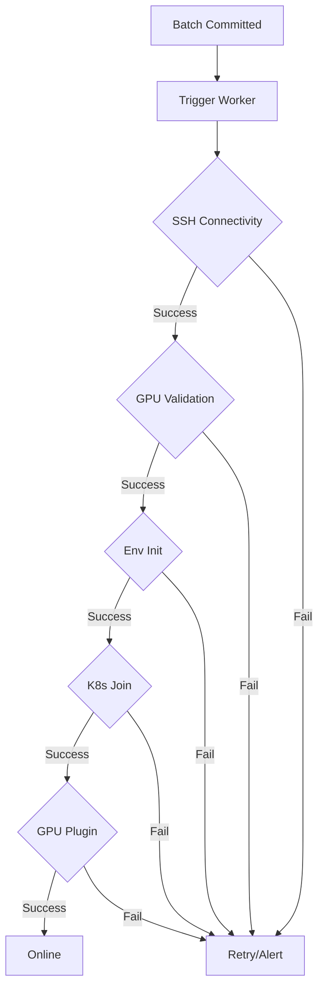

# Onboarding Pipeline P2 Design

## Overview

P1 MVP creates device records with `pending_onboarding` status visible in portal. P2 will implement automated SSH→K8s onboarding pipeline.

## P1 Delivered

- ✅ Device upload creates draft `onboarding_batch`
- ✅ Parse (stub) validates device data
- ✅ Commit sets batch status to `onboarding`
- ✅ Portal shows device lifecycle status (`pending_onboarding`, `onboarding`)
- ✅ Change log records device state transitions
- ✅ Documented P2 trigger point in `device-upload.ts` commit function

## P2 Automated Onboarding Pipeline

### Architecture



### Pipeline Stages

#### 1. SSH Connectivity Check
- Connect to device via `internal_ip` + `login_username` + `login_password`
- Validate SSH access
- Record result in `supplierDeviceChangeLog`
- Status: `pending_onboarding` → `onboarding` (ssh_verification stage)

#### 2. GPU Validation
- Run `nvidia-smi` to verify GPU count and card type
- Compare with declared `gpu_count` and `gpu_card_type_id`
- Alert on mismatch (wrong card type, GPU count off)
- Status: `onboarding` (gpu_check stage)

#### 3. Environment Initialization
- Install required packages (Docker, K8s tools)
- Configure network
- Set up monitoring agents
- Status: `onboarding` (env_init stage)

#### 4. K8s Cluster Join
- Generate kubeadm join token
- Join device to appropriate cluster based on datacenter
- Verify node registration
- Status: `onboarding` (k8s_join stage)

#### 5. GPU Plugin Installation
- Deploy NVIDIA device plugin
- Verify GPU resources visible in K8s
- Status: `onboarding` (gpu_plugin stage)

#### 6. Final Verification
- Run validation checks
- Mark device as ready for scheduling
- Status: `onboarding` → `online`
- Ready for `list` action (public scheduling pool)

### Worker Implementation

P2 onboarding worker:

```typescript
// apps/worker/src/jobs/device-onboarding.ts

export async function processDeviceOnboarding(batchId: string) {
  const batch = await getBatch(batchId)
  const devices = await getBatchDevices(batchId)

  for (const device of devices) {
    try {
      // Stage 1: SSH
      await validateSSH(device)
      await updateDeviceStage(device.id, 'ssh_verification', 'success')

      // Stage 2: GPU
      await validateGPU(device)
      await updateDeviceStage(device.id, 'gpu_check', 'success')

      // Stage 3: Env Init
      await initEnvironment(device)
      await updateDeviceStage(device.id, 'env_init', 'success')

      // Stage 4: K8s Join
      await joinK8sCluster(device)
      await updateDeviceStage(device.id, 'k8s_join', 'success')

      // Stage 5: GPU Plugin
      await installGPUPlugin(device)
      await updateDeviceStage(device.id, 'gpu_plugin', 'success')

      // Stage 6: Final
      await markDeviceOnline(device.id)
      await logChangeEvent(device.id, 'onboarding_completed')
    } catch (error) {
      await handleOnboardingError(device.id, error)
      await notifyOnboardingFailure(device.supplierId, device.sn, error.message)
    }
  }

  await updateBatchStatus(batchId, 'completed')
}
```

### Trigger Mechanism

P2 adds trigger in `device-upload.ts`:

```typescript
// After commit, trigger onboarding worker
await db.insert(jobQueue).values({
  id: createId(),
  jobType: 'device_onboarding',
  payload: { batchId },
  status: 'pending',
  priority: 'high',
  createdAt: new Date(),
})
```

Or use cron/scheduled task:

```typescript
// Check for batches in 'onboarding' status
// Process devices in batches to avoid overwhelming SSH/K8s
```

### Status Tracking

P1 schema already supports:

- `supplier_device.lifecycle_status`: `pending_onboarding`, `onboarding`, `online`
- `supplier_device.ops_status`: Detailed stage info
- `supplier_device_change_log`: Audit trail

P2 adds structured pipeline stages:

- `onboarding_device_pipeline_stage` table (optional)
- Track current stage, timestamps, error messages per device

### Error Handling

- **Transient failures**: Retry with exponential backoff (SSH timeout, network issues)
- **Persistent failures**: Alert ops team, mark device as `failed_onboarding`
- **Partial success**: Some devices online, others failed → batch status `partial`
- **Notification**: Site message to supplier for failed devices

### Monitoring & Metrics

- **SLA**: 90% of devices online within 30 minutes of commit
- **Dashboard**: Show onboarding success rate, avg time per stage
- **Alerts**: Slack/email on high failure rate (>10% fail rate)

### P1→P2 Migration

P1 delivered:
- Batch status tracking
- Device lifecycle status
- Change log structure
- Portal visibility

P2 adds:
- Automated worker
- SSH/GPU validation scripts
- K8s join automation
- Error retry logic
- Real-time status updates

### Gap Honesty

P1 MVP does NOT implement:
- ❌ Automated SSH connectivity
- ❌ GPU validation scripts
- ❌ K8s cluster join
- ❌ Pipeline stage progression
- ❌ Error retry mechanism

P1 shows devices as `onboarding` but does not change status automatically.
Manual intervention required to mark devices `online` until P2 worker implemented.

Portal correctly shows device status without pretending automation exists.
