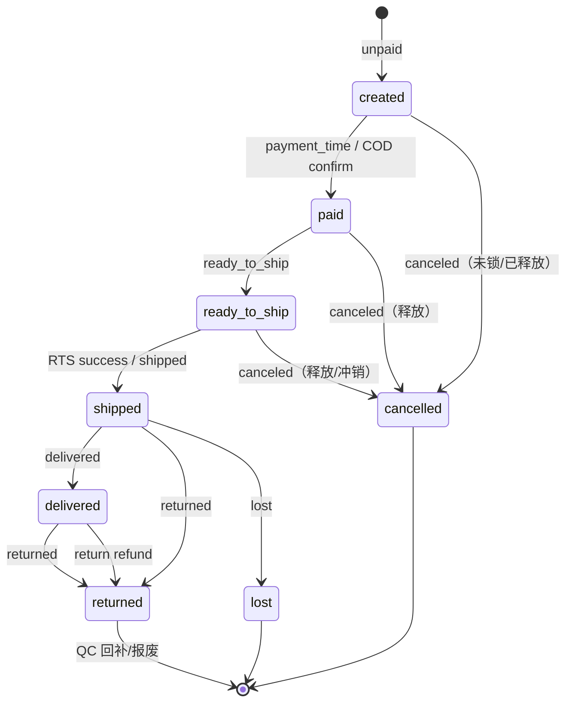
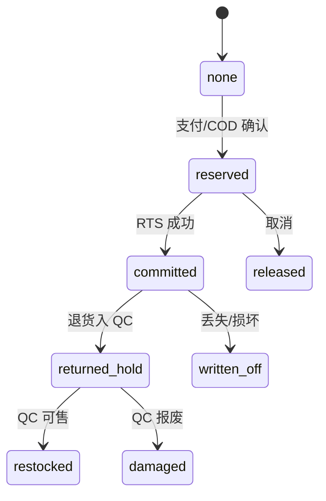

# Lazada 订单状态与 ERP 库存节点映射

> 核验日期：2026-11-05。来源：Lazada 官方 API Reference（Order `cid=8`、Fulfillment `cid=44`、Return & Refund `cid=26`）。
> 本文是接入建议，不是官方规则。官方未提供“订单状态 → 库存动作”映射。
> 通用约定见 `lazada-common-conventions.md`。

## 1. 数量口径

Lazada 订单项官方字段没有 `quantity` / `qty`，但**每个最小订单项对象代表一个独立商品实例（Unit/Line Item）**：

- 同一 SKU 购买 N 件 → 返回 N 条记录；
- N 条记录 SKU 相同、`order_item_id` 不同；
- 单条记录物理件数 = **1**；
- 数量 = 去重 `order_item_id` 计数；
- `items_count` 应与该计数一致，可用于校验。

库存建议：

| 方案 | `order_lines` | 数量 |
|---|---|---|
| 单位行（推荐） | 每个 `order_item_id` 一行 | `qty=1` |
| 聚合行 | 每个 SKU 一行 | `qty=count(order_item_id)`，另存 unit 映射 |

- 本映射按“单位行”描述：锁/扣/放/补均针对一个 `order_item_id`，每次 1 件。
- 若采用聚合行，库存动作仍必须按 `order_item_id` 幂等，不能按聚合行整体重复执行。
- 该口径同样适用于 Daraz：Daraz 也按每个商品单位返回一条记录。

## 2. 内部状态模型

### 2.1 现有 `orders.status`

`packages/db/src/commerce-schema.ts` 当前枚举：

```text
created | paid | ready_to_ship | shipped | delivered | cancelled | unknown
```

### 2.2 建议扩展（仅设计建议，不改代码/迁移）

```text
created | paid | ready_to_ship | shipped | delivered
| cancelled | returned | lost | failed | unknown
```

同时保留：

- `orders.platform_status`：Lazada 原始 `status` 或订单头状态集合，原样存。
- `orders.fulfillment_status`：更细的履约状态，见 2.3。
- `order_lines.fulfillment_status`：订单项级状态。

### 2.3 `fulfillment_status` 建议值

```text
unfulfilled | awaiting_pack | packed | ready_to_ship_pending
| ready_to_ship | shipped | in_transit | delivered
| cancel_pending | cancelled | return_pending | returned
| failed | lost | damaged
```

## 3. Lazada 订单头状态映射

> 下表中的 `qty`：单位行模型固定为 1；聚合行模型为本次动作涉及的 `order_item_id` 条数。

| Lazada `status` | 内部 `orders.status` | `fulfillment_status` | 库存动作 | 说明 |
|---|---|---|---|---|
| `unpaid` | `created` | `unfulfilled` | 不锁库 | 未支付 |
| `pending` | `created` 或 `paid` | `unfulfilled` | 预付费：有 `payment_time` 后锁库；COD：确认后锁库 | 不能仅凭 `pending` 判定已支付 |
| `topack` | `paid` | `awaiting_pack` | 保持锁库 | 白名单/特殊流程 |
| `toship` | `paid` | `packed` | 保持锁库 | 白名单/特殊流程 |
| `ready_to_ship` | `ready_to_ship` | `ready_to_ship` | 保持锁库，RTS 成功后转扣减 | 以 RTS 接口结果为准 |
| `shipped` | `shipped` | `shipped` / `in_transit` | 已扣减则不再扣 | 交物流商 |
| `shipping` | `shipped` | `in_transit` | 已扣减则不再扣 | 官方枚举 |
| `delivered` | `delivered` | `delivered` | 无 | 妥投 |
| `canceled` | `cancelled` | `cancelled` | 未扣减则释放；已扣减按退货处理 | 官方拼写单 L |
| `returned` | `returned`（建议新增） | `returned` | 质检后回补/报废 | 不能直接回补 |
| `failed` | `failed`（建议新增） | `failed` | 看货物是否回仓 | 配送失败 |
| `lost` | `lost`（建议新增） | `lost` | 不回补；走理赔/报损 | 官方枚举 |

> 若暂不扩展枚举：`returned` / `lost` / `failed` 先落 `unknown`，并写 `platform_status` 与 `fulfillment_status`；不要错误映射成 `cancelled` 或 `delivered`。

## 4. 订单项状态映射

`GetOrders.statuses[]` 与 `/order/items/get.status` 可能包含订单项级值：

| Lazada 订单项状态 | `order_lines.fulfillment_status` | 库存动作 |
|---|---|---|
| `unpaid` | `unfulfilled` | 不锁 |
| `pending` | `unfulfilled` | 按支付/COD 策略锁 |
| `repacked` | `packed` | 保持锁 |
| `packed` | `packed` | 保持锁 |
| `ready_to_ship_pending` | `ready_to_ship_pending` | 保持锁 |
| `ready_to_ship` | `ready_to_ship` | 保持锁，待 RTS 结果 |
| `shipped` | `shipped` | 扣减（幂等） |
| `shipping` | `in_transit` | 扣减（幂等） |
| `delivered` | `delivered` | 无 |
| `canceled` | `cancelled` | 释放/冲销 |
| `returned` | `returned` | 质检后回补 |
| `failed` | `failed` | 看回仓 |
| `lost` | `lost` | 报损，不回补 |
| `damaged_by_3pl` | `damaged` | 理赔，不回补/报废 |
| `lost_by_3pl` | `lost` | 理赔，不回补 |

## 5. 库存动作节点

### 5.1 锁库（reserve）

触发条件（按优先级）：

1. 订单项出现 `payment_time`（预付费）；
2. 或 `payment_method=COD` 且订单进入 `pending` / `topack`（COD 无预付，需尽早锁库）；
3. 或订单从 `unpaid` 进入任何可履约状态。

动作：

```text
inventory_balances.reserved += 1
inventory_reservations: order_line_id, qty=1, status=active
```

幂等键：`shop_id + order_item_id`。

> 单位行模型下每个 reservation 固定 1 件；聚合行模型下按 `order_item_id` 逐一累加，仍不得重复。

### 5.2 扣减（commit）

推荐节点：**RTS 成功**（`/order/package/rts` 返回 `item_err_code=0`），或订单项首次进入 `shipped`/`shipping`。

动作（同一事务）：

```text
reserved -= qty
on_hand   -= qty
reservation.status = committed
inventory_movements: type=sale_commit
```

- 不要在下单/支付时直接扣 `on_hand`。
- RTS 与 `shipped` Webhook 可能重复到达；用 reservation 状态保证只扣一次。
- 若 RTS 成功但订单项状态未更新，以 RTS 结果为准并记录来源。

### 5.3 释放（release）

触发：

- `canceled` 且未 commit；
- 取消申请通过；
- 超时未支付关闭。

动作：

```text
reserved -= qty
reservation.status = released
```

已 commit 后取消：不释放 reserved，走退货/回补或报损。

### 5.4 回补（restock）

触发：

- 退货退款且 `whqc_decision` 为 `return_to_merchant` / `return_to_warehouse`，并已实际收货；
- 发货前取消已 commit 的异常场景，货物确认未出库。

动作：

```text
qc_hold -= qty（如曾入 QC 暂存）
on_hand  += qty（可售）
或 damaged += qty（不可售）
```

幂等键：`reverse_order_line_id + qc_decision + received_at`。

- 仅退款（`ONLY_REFUND`）不回补。
- `scrap` / `not_returned` / `return_to_customer` 不回补。
- 必须先质检再回补，不能以退款成功作为回补依据。

## 6. 状态机



库存状态独立：



## 7. 与 Daraz 的差异

| 维度 | Daraz | Lazada | 统一处理 |
|---|---|---|---|
| 状态枚举 | 官方订单状态枚举 | 更多状态（`shipping`、`lost`、`topack`、`toship`） | 保留 `platform_status`，映射到统一内部状态 |
| 件数口径 | 每个商品单位一条记录 | 每个 Unit/Line Item 一条记录 | 去重 `order_item_id` 计数；单条 = 1 件 |
| 支付时间 | 需实测 | 订单项 `payment_time`，订单头无 | 统一取订单项/支付事件 |
| COD | 存在 | `payment_method=COD` | 统一“确认即锁库”策略 |
| 履约 | 自有/RTS | Pack → RTS → AWB，DBS/EPIS/FBL | 统一 `shipments` 抽象，平台动作适配 |
| 退货 | 退货/退款 | 逆向单 + QC 结论 | 统一 `reverse_orders` + `qc_records` |
| 丢失 | 不一定有 | `lost` / `lost_by_3pl` | 统一 `lost` + 报损，不回补 |

## 8. 实现检查清单

- [ ] 已按单位行落库，或聚合行另有 `order_item_id` 映射表。
- [ ] 件数由去重 `order_item_id` 计数得出，未把 `items_count` 直接当扣减依据。
- [ ] `order_lines` 有唯一 `(order_id, external_line_id)`。
- [ ] `inventory_reservations` 对 `order_line_id` 唯一。
- [ ] RTS 成功、`shipped` 事件、Webhook 重放不会重复扣减。
- [ ] 取消/退货/丢失/损坏分别走 release / QC / write-off，不共用一个“回补”函数。
- [ ] `platform_status` 原样保存，未知状态不丢弃。
- [ ] 所有库存动作写 `inventory_movements`，含来源与操作者。

## 9. 官方来源

| 资源 | URL |
|---|---|
| GetOrders | <https://open.lazada.com/handler/share/apidoc/getApi.json?path=%2Forders%2Fget&methodType=GET&categoryId=8> |
| GetOrderItems | <https://open.lazada.com/handler/share/apidoc/getApi.json?path=%2Forder%2Fitems%2Fget&methodType=GET&categoryId=8> |
| ReadyToShip | <https://open.lazada.com/handler/share/apidoc/getApi.json?path=%2Forder%2Fpackage%2Frts&methodType=POST&categoryId=44> |
| GetReverseOrdersForSeller | <https://open.lazada.com/handler/share/apidoc/getApi.json?path=%2Freverse%2Fgetreverseordersforseller&methodType=GET%2FPOST&categoryId=26> |
