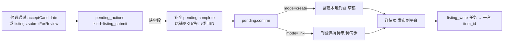

# 模块11：店铺平台映射与刊登主路径（tRPC → DB）

> 状态：已在 `apps/shop` 落地生产路径。分支 `feat/shop-trpc-listing-mapping`。
> 基线：`feat/shop-related-info-real-data`（PR #47 栈，含 #46/#45/#44）；**不依赖 / 不合并** 售后 #43。

## 范围

| 已接 PostgreSQL / 平台链路 | 仍缺口 / 边界（非本模块） |
| --- | --- |
| `shops` 下拉（mappings/listings meta；`trpc.shops`） | TikTok 刊登写（`createListing` 简化 payload，待联调）；平台无商品 activate 端点 |
| `seller_sku_mappings` 列表/详情/绑定/解绑/确认 | （已迁模块12）供应商货号 / 履约异常 |
| `mapping_exceptions` 列表 KPI + resolve/ignore（mappings 主路径） | — |
| `listings` 列表/详情/新建/编辑/上下架/加映射行 | — |
| **平台写闭环**：`listings.publish` / `setShelf`(下架) → 同步任务 `resource=listing_write` → `connector.createListing/updateListing/deactivateListing` → 回执回写 | — |
| **待审链路**：候选通过 / `listings.submitForReview` → `listing_submit` 待审 → `pending.confirm` 创建/放行本地刊登 | — |
| seed `db:seed:commerce-listings`（依赖 products） | — |
| 内部 SKU 详情注入真实刊登+映射 related | — |

> 2026-11-08：`/console/sync-tasks`（模块13）、候选选品（模块14）、财务成本（模块13）、店铺连接（`trpc.shops`，`shop-connection-store` 已删）、Dashboard KPI 均已接库。

无新 migration（复用既有 `listings` / `seller_sku_mappings` / `mapping_exceptions` / `shops`，均在 `0000` 基线；2026-11-08 迁移重生成后编号为 `0000`/`0001`/`0002`）。

## 架构

```
console/mappings | listings
  → trpc.mappings.* / trpc.listings.*（React Query）
  → /api/trpc
  → routers/{mappings,listings}（tenantProcedure）
  → dataaccess/{mappings,listings} (+ mappers/listings)
  → Drizzle → shops / listings / seller_sku_mappings / mapping_exceptions
```

`mapping-store` **已删除**（2026-11-08）；`listing-store` 主路径已停用（仅余类型/助手，listings 页仍 import 其 helper）。

## 状态映射

| 域 | UI | DB |
| --- | --- | --- |
| 刊登 status | 草稿/待审/在售/失败/下架 | draft/pending_review/live/failed/offline |
| 刊登 publishState | 未发布/待同步/已发布/同步失败 | unpublished/pending_sync/published/sync_failed |
| 映射 status | 待确认/启用/异常/停用 | pending/active/exception/disabled |
| 异常 status | 开放/已修复/已忽略（阻断扣库=open+blocks） | open/resolved/ignored |
| 异常 reason | 未映射/冲突/停用 SKU/重复 Seller SKU | unmapped/conflict/disabled_variant/duplicate_seller_sku |

**平台回执兼容值**（`mappers/listings` 读侧归一，写侧透传不误归 draft）：
`submitted/reviewing → 待审`；`rejected → 失败`；`paused/suspended/archived/sold_out → 下架`；publishState `synced → 已发布`。
apps/api 读同步用 `toLocalListingStatus`（`@workspace/marketplace`）归一平台状态，`publishState` 统一写 `published`。

## 平台同步（读 / 写）

### 读同步

`listings.requestPlatformSync` → 同步任务 type=`刊登同步` → apps/api `resource=listings` →
`sync-listings` upsert（状态归一 + `mergeListingPayload` 本地键优先 + seller_sku_mappings 反查回填
`externalItemId`/`primaryVariantId`），成功清 `lastError`，失败写 `publishState=同步失败`。

### 平台写（`resource=listing_write`）

| 入口 | 同步任务 target | connector | 回执回写 |
| --- | --- | --- | --- |
| `listings.publish`（详情页「发布到平台 / 更新到平台」） | `listing:<id>` | 无 item_id → `createListing`；有 → `updateListing` | item_id、status、publishState=published、submittedAt/liveAt、映射行 itemId |
| `listings.setShelf(onShelf=false)` | `listing:<id>#deactivate` | `deactivateListing`（Daraz/Lazada `/product/deactivate`） | status=offline、lastError 清空 |
| `listings.setShelf(onShelf=true)` | — | **不调平台**（平台无 activate 端点） | 仅本地 status=live，文案如实说明 |

执行体：`apps/api/src/lib/marketplace/listing-write.ts`（`runListingWrite`）——解析 target → 载 listing/shop/映射行 →
组装官方 `Request.Product` payload（`buildListingInput`）→ connector → 成功/失败均回写 listings +
`sync_tasks` + `integration_logs`；**成功以平台 item_id（create）/ 明确状态（update/deactivate）为准，不以 HTTP 200 为准**。

### 待审链路（listing_submit）



- `mode=create`（候选自动生成）：payload 缺店铺/SKU/Seller SKU/标题/售价时 `confirm` 报错并列出缺失字段，先 `pending.complete` 补全。
- `mode=link`（`listings.submitForReview` 生成）：confirm 只放行；拒绝会把关联刊登回退 draft/unpublished。

## 本地环境

```bash
docker compose up -d
pnpm --filter @workspace/db db:migrate
pnpm --filter @workspace/db db:seed:commerce-products
pnpm --filter @workspace/db db:seed:commerce-listings
# SHOP_DEV_ORGANIZATION_ID=org_shop_dev_demo
pnpm --filter shop dev
```

## tRPC 过程

### `mappings`

`list` / `stats` / `meta` / `listShops` / `get` / `create` / `update` / `confirm` / `unbind`

异常：`listExceptions` / `exceptionStats` / `getException` / `resolveException` / `ignoreException`

### `listings`

`list` / `stats` / `meta` / `get` / `create` / `update` / `setShelf` / `publish` / `submitForReview` / `addMappingLine` / `requestPlatformSync`（读同步）

### `pending`（模块16，与本模块联动）

`list` / `stats` / `get` / `confirm` / `reject` / `complete`（补全 listing_submit payload）

写操作（create/update/setShelf/publish/submitForReview/requestPlatformSync、pending confirm/reject/complete）
均落 `appendAuditEvent`（entityType=listing / pending_action）。

## 关键文件

| 文件 | 说明 |
| --- | --- |
| `apps/shop/src/lib/server/routers/listings.ts` | 刊登 tRPC（含 publish / submitForReview + 审计） |
| `apps/shop/src/lib/server/routers/mappings.ts` | 映射 / 异常 tRPC |
| `apps/shop/src/lib/server/routers/pending.ts` | 待审 tRPC（confirm/reject/complete + 审计） |
| `apps/shop/src/lib/server/dataaccess/listings.ts` | 刊登 DB（publishListing / setListingShelfStatus / submitForReview） |
| `apps/shop/src/lib/server/dataaccess/pending.ts` | 待审 DB（listing_submit confirm 创建刊登 / 补全） |
| `apps/shop/src/lib/server/dataaccess/mappings.ts` | 映射 / 异常 DB |
| `apps/shop/src/lib/server/mappers/listings.ts` | 中文状态映射（含平台回执兼容值） |
| `apps/shop/src/lib/server/marketplace/api-client.ts` | `publish/status → listing_write` 资源映射 |
| `apps/api/src/lib/marketplace/listing-write.ts` | 平台写执行体（runListingWrite） |
| `apps/api/src/lib/marketplace/listing-merge.ts` | 读同步 payload 合并 / liveAt 纯函数 |
| `packages/marketplace/src/adapters/listing-payload.ts` | 官方 `Request.Product` payload 组装 |
| `packages/marketplace/src/mappers/listing-status.ts` | 平台状态 → 本地五态归一 |
| `packages/db/src/scripts/seed-commerce-listings.ts` | 演示种子 |
| `apps/shop/src/lib/crossborder/listing-store.ts` | 主路径停用；类型保留 |
| `apps/shop/src/lib/crossborder/mapping-store.ts` | **已删除**（2026-11-08） |
| `docs/design/shop-module11-listing-mapping-trpc.md` | 本文档 |

## 本 PR 不做

合并售后 #43；TikTok 刊登写联调（payload 简化，见 `packages/marketplace/src/adapters/tiktok.ts`）；
OAuth 换票/回调；供应商门户 / `supplier-skus` 新表；改左侧菜单；财务成本 / 候选选品接库。
