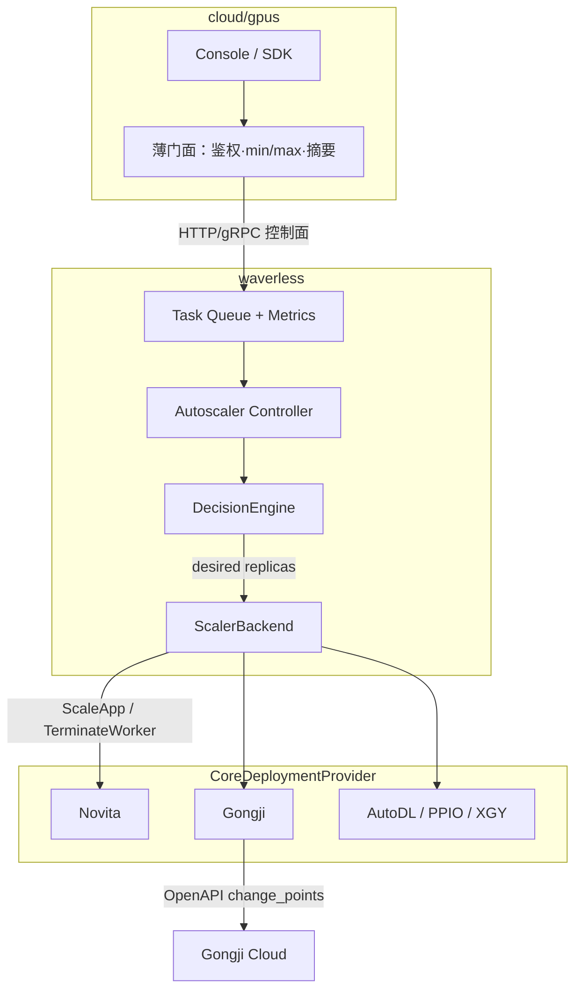

# Waverless Autoscaler 与 Provider 解耦方案（Gongji 独立 Provider）

> **日期**: 2026-10-17（Asia/Shanghai）；同日清理回写。  
> **性质**: 权威设计方案（可编码）；覆盖产品拍板 #2 / #6 的澄清与落地计划。  
> **范围**: 仅文档；不改应用代码。  
> **权威**: 本文件为「Gongji 作为独立 CoreDeploymentProvider」与「Autoscaler 不依赖 K8s.Enabled」的**实现权威源**；与其它设计文在本主题冲突时以本文件为准。一期范围仍以 [`waverless-product-decisions-2026-10-17.md`](./waverless-product-decisions-2026-10-17.md) 为准。  
> **关联**: 拍板记录、`waverless-cn-provider-code-design-review.md` §3.1–3.3、推荐文 §10.2 / §10.6 / §10.18、实施计划 W2。

---

## 0. 一句话结论

把 **共绩云（Gongji）**（以及后续 AutoDL / PPIO / 仙宫云）做成与 **RunPod / Novita 同级的独立 `CoreDeploymentProvider`**；**waverless 拥有扩缩容决策循环**，只通过 `provider.ScaleApp(desired)` 调厂商 OpenAPI；**禁止**把 Gongji 当成 Kubernetes 云后端或仅 SkyPilot cloud。P0 同时让 **WaitingTime / wait-age** 进入扩容决策（与队列深度 OR）。

---

## A. Provider 模型（对齐 RunPod / Novita）

### A.1 定位：独立 CoreDeploymentProvider，不是 K8s / 不是仅 SkyPilot

| 错误理解 | 正确模型 |
|----------|----------|
| Gongji = 某套 K8s 集群的后端 | Gongji = 外部 HTTP OpenAPI 厂商，与 Novita 同构 |
| Gongji 只挂在 SkyPilot `clouds=` 里 | Gongji 在 **waverless** 内有一等 Provider 包；SkyPilot 路径与之**并行**，互不替代 |
| 平台「关厂商弹性」后靠 K8s HPA | 平台关厂商弹性后，由 **waverless Autoscaler** 调 `ScaleApp` |

对照现有代码（独立仓 `gpurun/waverless`，联调路径 `apps/waverless`）：

- `pkg/interfaces/deployment.go` 已定义窄接口 `CoreDeploymentProvider`：`Deploy` / `GetApp` / `ListApps` / `DeleteApp` / **`ScaleApp`** / `GetAppStatus` / `UpdateDeployment`。
- `pkg/provider/novita` 通过 HTTP 实现该接口（含 `ScaleApp`），**不调用 K8s API**。
- `pkg/provider/factory.go` 当前注册：`k8s` | `kubernetes` | `docker` | `novita`。**P0 新增 `gongji`**；后续 `autodl` | `ppio` | `xgy`。

### A.2 waverless 侧：`GongjiProvider`

包路径建议：`pkg/provider/gongji`（或 `suanli`）。

| 方法 | Gongji OpenAPI（旧版 v1，实现前与供应商确认） | 说明 |
|------|-----------------------------------------------|------|
| Deploy | `POST /api/deployment/task/create` | 创建时 **关闭** `dynamic_pod_strategy`（`switch: false` 或省略） |
| ScaleApp | `POST /api/deployment/task/change_points` `{task_id, points}` | **唯一**扩缩执行面；绝对目标副本 |
| GetApp / GetAppStatus | `.../detail` 等 | desired ≠ observed ≠ ready |
| ListWorkers（或轮询 points） | `.../points` | 映射 `worker_id` ↔ `point_id` |
| TerminateWorker | `POST /api/deployment/task/delete_pod` `{point_id}` | 定点摘除 |
| DeleteApp | 删除 deployment/task | 生命周期收尾 |

**硬约束**：Gongji adapter **零 K8s client**（无 kubectl、无 Deployment informer、无 SpecManager）。可选能力（`PodProvider` / `WatchReplicas`）用「不支持」或厂商轮询实现，不得假扮 K8s。

### A.3 cloud/gpus 侧：双路径

```
用户创建 Endpoint
        │
        ├─ orchestratorType = waverless  ──► gpus → waverless HTTP/gRPC
        │                                      │
        │                                      ├─ Deploy / ScaleApp / Terminate
        │                                      └─ 经 GongjiProvider → Gongji OpenAPI
        │                                      （不经 SkyPilot launch）
        │
        └─ orchestratorType = skypilot  ──► 既有 SkyServe / K8s 路径（legacy）
```

- **P0 只做 waverless 路径**（产品拍板 #4）。
- SkyPilot 保留为 legacy 入口；**不得**用「是否启用 K8s」一把闸关掉两条路径的弹性。
- gpus 对 waverless Endpoint：只下发 min/max/target、读队列与副本摘要；**不**在 gpus 内再实现一套扩缩决策。

### A.4 按名注册

```
providers.deployment / Endpoint.providerId ∈ {
  runpod,   // 海外对照；若未落地可占位
  novita,   // 已有
  gongji,   // P0
  autodl,   // P1+
  ppio,     // P1+
  xgy       // P1+（仙宫云）
}
```

每个名字对应：**adapter 包 + 凭据配置 + Region Registry 物理区映射 + SKU/specs 映射**。全局工厂可同时持有多个 Provider 实例；Endpoint 绑定其中一个 `providerId`（P0 单厂；P1+ 再拆 shard）。

---

## B. 问题陈述：当前 Autoscaler 为何离开 K8s 就废

### B.1 人话

今天平台如果关掉 Kubernetes（国内 Gongji 场景本来就不该依赖自有 K8s），**自动扩缩容整条链路不会启动**。结果是：厂商侧弹性已经关掉（正确），但平台侧也没人喊「多开几个点位」——队列里的任务只能干等，用户觉得「弹性坏了」。

### B.2 技术证据（本地 checkout）

1. **初始化硬闸**（`cmd/initializers.go` → `initAutoScaler`）  
   - 开头：`if !app.config.K8s.Enabled { skip; return }`  
   - 随后强制从 `*k8s.K8sDeploymentProvider` 取 `SpecManager`；否则再次 skip。  
   - 含义：即便工厂已选 `novita`/`gongji`，只要未开 K8s，**Controller 根本不挂**。

2. **执行器 / 资源账本的 K8s 味道**（评审文 §3.3）  
   - `executor.go` 历史上偏向 K8s drain label / Deployment 副本；外部厂应走 `ScaleApp` / `TerminateWorker`。  
   - `resource_calculator` + 集群 GPU 静态上限适合自有池，**不适合** Gongji 库存/配额。

3. **决策引擎未读等待时长**（`decision_engine.go` → `shouldScaleUp`）  
   - 只用 `PendingTasks` / `RunningTasks` / min/max / cooldown。  
   - `WaitingTime` 仅在状态输出里出现；`FirstPendingTime` 在 `metrics_collector` 里于「首次观察到 pending」时设为 `time.Now()`，**不是**任务入队年龄，且**不参与**扩容条件。

4. **产品后果**  
   - Gongji Endpoint：`orchestratorType=waverless` + `provider=gongji` + `K8s.Enabled=false` → **无 Autoscaler** → **从不调用 `ScaleApp`** → 厂商弹性关闭后副本永久卡在初始值。

---

## C. 目标架构（可实施计划）

### C.1 所有权：waverless 拥有 scale loop（首选）

| 角色 | 职责 |
|------|------|
| **waverless** | 对 `provider∈{gongji,novita,...}` 或 `orchestratorType=waverless` 的 Endpoint：**采集指标 → 决策 → `ScaleApp` / TerminateWorker → 对账 desired/observed/ready** |
| **cloud/gpus** | 薄控制：创建/删除 Endpoint、设 min/max/阈值、展示摘要、计费与 ownership；**不**本地 kubectl / 不直连 Gongji |
| **厂商** | 只接受平台写下的副本数；原生弹性关闭 |

备选（不推荐作 P0）：cloud 薄调度器周期性调 waverless `ScaleApp` API——仍须保证决策在一处，避免双控。

类比：RunPod Serverless 控制面自己根据队列调 worker 数；我们把「控制面」放在 waverless。



### C.2 决策输入（P0 验收）

**扩容触发（OR）**：

```text
scaleUpTrigger =
  (pendingCount >= scaleUpThreshold)
  OR
  (waitAgeKnown && oldestPendingAge >= scaleUpWaitSeconds)
```

再与下列门禁 AND：

- `currentDesired < maxReplicas`
- 不在 scale-up cooldown
- 未超 endpoint/provider 配额（外采池：**不用** K8s 集群静态 GPU 账本卡住）
- 指标可判定（查询失败 → `waitAgeKnown=false` / pending unknown → **不**误当队列空而缩容；扩容侧保守并告警）

**缩容**：无 pending、worker idle ≥ `scaleDownIdleTime`，可到 `minReplicas`（含 0）。

**WaitingTime 语义（纠偏）**：

| 字段 | 现状 | P0 目标 |
|------|------|---------|
| `WaitingTime` / `FirstPendingTime` | 观测用；`FirstPendingTime≈首次看见非空` | 决策用 **`oldestPendingAge`** = now − min(pending 任务入队/`pending_since`) |
| 持久化 | 内存易丢 | 以任务表时间为准；控制面重启后年龄连续 |

#### 伪代码（决策核心）

```go
func shouldScaleUp(ep EndpointRuntime, now time.Time) *ScaleDecision {
    if ep.Desired >= ep.MaxReplicas { return nil }
    if inCooldown(ep.LastScaleUp, ep.ScaleUpCooldown, now) { return nil }

    pending := ep.PendingCount          // 权威：queue/DB
    age, ageOK := ep.OldestPendingAge(now) // 来自 min(pending_since)；失败则 ageOK=false

    byQueue := pending >= int64(ep.ScaleUpThreshold)
    byWait  := ageOK && ep.ScaleUpWaitSeconds > 0 &&
               age >= time.Duration(ep.ScaleUpWaitSeconds)*time.Second

    if !byQueue && !byWait { return nil }

    // 目标副本：P0 可假设每 worker 并发 1；须在 runtime 显式声明
    target := min(ep.MaxReplicas, max(ep.MinReplicas, ceil(pending+ep.RunningTasks)))
    if byWait && target <= ep.Desired {
        // 单条长等待：至少唤醒到 Desired+1（或 max(Min,1)）
        target = min(ep.MaxReplicas, max(ep.Desired+1, ep.MinReplicas, 1))
    }
    if target <= ep.Desired { return nil }

    reason := "queue"
    if byWait && !byQueue { reason = "wait-age" }
    if byWait && byQueue { reason = "queue+wait-age" }

    return &ScaleDecision{Desired: target, Reason: reason, Pending: pending, OldestAge: age}
}
```

#### 验收用例（自动化）

| # | 场景 | 期望 |
|---|------|------|
| T1 | pending=0，无等待 | 不扩 |
| T2 | pending ≥ threshold，age 未到 | **扩**（queue 路径）；reason 含 queue |
| T3 | pending=1 < threshold，age ≥ waitThreshold，min=0 | **扩**（wait-age）；至少 Desired≥1 |
| T4 | age 未到且 pending < threshold | 不扩 |
| T5 | 已达 maxReplicas | 不扩 |
| T6 | cooldown 内 | 不重复扩 |
| T7 | 进程重启后同一 pending 任务 | oldest age **连续**（不从 0 重算） |
| T8 | pending 查询失败 | 不把队列当空去缩；告警；不盲目扩 |

### C.3 执行器（Actuators）

- **唯一写路径（Gongji）**：`provider.ScaleApp(endpoint, desired)` → `change_points`。  
- **定点缩/摘**：`TerminateWorker` → `delete_pod`；禁止 `kubectl scale` / 改 K8s Deployment。  
- 持久化：`desiredGeneration`、命令 ID、受理时间、observed/ready；超时先 **GetStatus/ListWorkers** 对账，再决定是否重发（幂等键）。

### C.4 挂载条件（Attach）——取代 `K8s.Enabled` 总闸

```text
shouldAttachAutoscaler(ep) =
  ep.AutoscalerEnabled
  AND (
    ep.ProviderId IN {gongji, novita, autodl, ppio, xgy, runpod}
    OR ep.OrchestratorType == "waverless"
    OR (legacyK8sPath && K8s.Enabled && provider == k8s)
  )
```

进程级：

```text
InitAutoscaler() 可在「任一 provider 后端可用」时启动；
禁止：if !K8s.Enabled { return } 作为唯一门槛。
```

### C.5 SkyPilot 共存

- `orchestratorType=skypilot`：继续既有 SkyServe /（若有）K8s Autoscaler。  
- **两套 init 不得共用一把 `K8s.Enabled` 总开关**导致 waverless/Gongji 也被跳过。  
- 文档与代码注释明确：SkyPilot ≠ Gongji Provider。

### C.6 Init 重构草图

**方案 A（推荐，清晰）**：

```go
func (app *Application) initAutoScaler() error {
    if !app.config.AutoScaler.Enabled { return nil }

    var backends []ScalerBackend
    if app.config.K8s.Enabled {
        if b, err := app.newK8sScalerBackend(); err == nil {
            backends = append(backends, b) // InitK8sAutoscaler 逻辑
        }
    }
    // Provider 驱动：不依赖 K8s.Enabled
    for _, name := range app.enabledExternalProviders() { // novita, gongji, ...
        if b, err := app.newProviderScalerBackend(name); err == nil {
            backends = append(backends, b)
        }
    }
    if len(backends) == 0 {
        log.Info("no scaler backend; skip")
        return nil
    }
    app.autoscalerMgr = autoscaler.NewManagerMulti(backends, ...)
    return nil
}
```

**方案 B**：单一 Controller + `ScalerBackend` 接口：

```go
type ScalerBackend interface {
    ListManagedEndpoints(ctx) ([]EndpointRef, error)
    ReadMetrics(ctx, EndpointRef) (Metrics, error)
    ApplyScale(ctx, EndpointRef, desired int) error // → provider.ScaleApp 或 k8s scale
    QuotaHint(ctx, EndpointRef) (Quota, error)      // 外采≠集群静态资源
}
// K8sBackend | WaverlessProviderBackend(gongji|novita|...)
```

Executor / ResourceCalculator 对 `WaverlessProviderBackend`：**跳过** K8s SpecManager；配额来自 Region Registry + platform quota + in-flight。

### C.7 Gongji 专项

1. 创建任务：**禁用**原生弹性（`dynamic_pod_strategy.switch=false`）。  
2. 平台通过 create/update（`change_points`）设定副本数。  
3. 轮询 task/points 状态得到 ready 数；API 受理 ≠ Ready。  
4. Worker 映射表：`worker_id` ↔ `(task_id, point_id)`，重启可查。  
5. 成本：供应商账单按 point 时长；与客户收入账分离（拍板 #8）。

---

## D. P0 实施顺序（工程师清单）

1. **冻结契约**：`CoreDeploymentProvider` + Endpoint runtime 字段（`providerId`、`scaleUpWaitSeconds`、desired/observed/ready、generation）。  
2. **实现 `pkg/provider/gongji`**：Deploy/ScaleApp/GetStatus/List points/Terminate/Delete；契约测试（sandbox）。  
3. **拆 Autoscaler 初始化**：去掉「唯 `K8s.Enabled`」闸；引入 `ScalerBackend`（至少 `ProviderBackend`）；Gongji/Novita 不经 SpecManager。  
4. **wait-age**：任务 `pending_since` → `oldestPendingAge`；决策 OR 条件；事件 reason；T1–T8 单测。  
5. **gpus 双路径**：`orchestratorType=waverless` 只打 waverless；创建时写 provider=`gongji`；UI 可配 wait 阈值。  
6. **关闭 Gongji 原生弹性** + 文档/配置校验。  
7. **集成验收**：K8s.Enabled=false 下，Gongji Endpoint 队列扩 + wait-age 扩 + ScaleApp 到账 + 缩容；与 K8s legacy 回归互不影响。  
8. **计费两账入口**（并行，见实施计划 D 章）——不阻塞弹性联调，但上线收费前门禁。

---

## E. 一期非目标

- **WarmPlanner / ImagePreHeat / ephemeral warm**（拍板 #1/#5）。  
- **多 Provider 同 AZ 拼池 / CapacityPlanner / 90s failover 对外承诺**（目标保留在 P1+，拍板 #7）。  
- 把 Gongji 接到 SkyPilot 作为「唯一」弹性引擎。  
- 在 gpus 内复制一份决策引擎。  
- 联邦厂商原生弹性作真相源。

---

## F. 代码锚点速查（实现时打开）

| 主题 | 路径 |
|------|------|
| Autoscaler 被 K8s 闸住 | `waverless/cmd/initializers.go` → `initAutoScaler` |
| 决策未读 WaitingTime | `waverless/pkg/autoscaler/decision_engine.go` → `shouldScaleUp` |
| FirstPendingTime 观测语义 | `waverless/pkg/autoscaler/metrics_collector.go` |
| Core 接口 | `waverless/pkg/interfaces/deployment.go` → `CoreDeploymentProvider` |
| Novita 对照实现 | `waverless/pkg/provider/novita/provider.go` → `ScaleApp` |
| 工厂注册 | `waverless/pkg/provider/factory.go` |
| 评审问题陈述 | `docs/waverless-cn-provider-code-design-review.md` §3.1–3.3 |

---

## G. 文档回写清单

| 文档 | 回写内容 |
|------|----------|
| `waverless-product-decisions-2026-10-17.md` | #2 验收句；#6 澄清「独立 Provider + 本方案链接」 |
| `waverless-cloud-skypilot-integration-recommendation.md` | §10.2 / §10.6 / §10.18 → 指向本文 |
| `waverless-cn-provider-implementation-plan.md` | W2 / P0 任务：wait-age、backend 拆分、Gongji peer |

---

## 文档元信息

- **作者**: Grok Bot（按用户 2026-10-17 follow-up 决策落设计；同日清理回写去掉过期副本路径）
