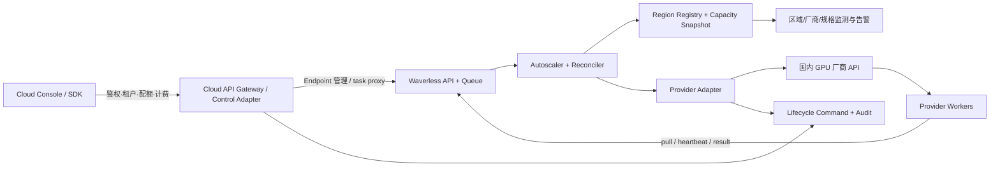

# Waverless 国内 GPU Provider 与区域弹性设计评审

> 日期：2026-10-17（Asia/Shanghai）；同日清理回写。  
> **性质**：**代码/设计快照评审**。现行一期范围以 [`waverless-product-decisions-2026-10-17.md`](./waverless-product-decisions-2026-10-17.md) 为准；Autoscaler/Gongji 实现以 [`waverless-autoscaler-provider-decoupling-2026-10-17.md`](./waverless-autoscaler-provider-decoupling-2026-10-17.md) 为准。本文保留当时证据，**不作为开工范围**。  
> 评审范围：国内 GPU 云厂商区域映射、Provider 接入、队列长度/等待时长弹性、统一请求入口、按 worker ID 终止异常节点。  
> 评审对象：推荐文 §10、parity 文档，以及 waverless 当时实现（路径 `apps/waverless` = 独立仓 checkout，非 monorepo 合并）。  
> 状态：架构评审意见；没有修改应用代码。  
>
> **拍板后对照（勿再按「推荐文未改」理解）**：WaitingTime 现状已在推荐文 §10.2 改为「待实现」；WarmPlanner 已移出 P0；Gongji = 独立 Provider；90s/拼池标为 P1+。下文 §4 修订建议多数已落地，剩余工程见实施计划 W2/W3。

## 1. 结论

**方向成立，但当前设计与代码尚不能完整实现所述产品目标。** Waverless 已有 RunPod 兼容任务入口、基于队列长度的 Autoscaler、worker 数据模型及失败 worker 自动清理能力；因此它适合作为统一任务入口和编排基座。国内厂商 Provider、规范逻辑 AZ、按区域库存/健康监测、多 Provider 同区选路与故障切换、按 worker ID 的人工终止 API，以及 Cloud 租户权限接入均未完成。

尤其要修订三项设计判断：

1. ~~§10.1/§10.6 表述“等待时长扩容已有实现”~~（**文档已改**；代码仍未入决策）：`WaitingTime` 被计算并出现在 Autoscaler 状态中，但决策引擎没有用它触发 scale-up；`FirstPendingTime` 还是控制循环观测到 pending 后才在内存对象中设置，不能代表队列中最老任务的真实等待年龄。P0 须按解耦方案实现真实 wait-age。
2. §10.3 的“多厂商同逻辑区调度/拼池/failover”不是新增一个 Provider 就自然获得的能力。当前工厂选择一个全局 deployment provider，Endpoint/Scaler/Executor 也均依赖单个 Provider；Autoscaler 还使用集群资源上限和 K8s SpecManager。需要先把“单厂商 Endpoint”做稳，再独立设计多 Provider 编排与容量账本。
3. §10.7 的 worker 终止仍是方案，不是已有 API 能力。现有公开路由没有按 worker ID 的终止操作；管理 API 代码注释为可选内网认证，且全局 API Key 不能落实租户归属隔离、运维角色及审计要求。

**建议定位：** P0 做“单逻辑 AZ + 共绩 Provider + Waverless Autoscaler + 统一任务 API + worker 管理内部 API”，并以 Cloud 薄门面完成租户鉴权、API Key 与计费映射。把区域 Registry 做成明确的控制面数据模型，但先只启用单供应商的已验证 AZ。P1 才实现同逻辑区多 Provider 拼池及自动 failover。除非第二家供应商和真实切换场景进入 P0 验收，否则不要将 failover/90 秒切换承诺写成 P0 已具备能力。

## 2. 目标拆解与当前可实现性

| 产品目标 | 当前代码基础 | 判断 | 必要工作 |
|---|---|---|---|
| 国内物理 Region 映射到平台逻辑区域，并按区域适配/监测 | Provider Spec 中存在厂商字段；Novita 的规格映射是配置级。没有逻辑 AZ Registry，也没有统一的 region/provider/physical-region 标签贯穿 Endpoint、Worker 和监控 | **未实现** | 定义 AZ 和物理区域绑定模型、配置校验、库存/价格/健康采集、资源状态与指标维度 |
| 接入国内 GPU 云 Provider | Provider 工厂支持注册；现有内置 Provider 是 k8s/docker/novita，无 Gongji | **未实现，但扩展点存在** | 国内 Provider 客户端、请求/响应映射、鉴权签名、错误分类、限流/重试、异步任务轮询、worker 映射与契约测试 |
| 根据队列长度自动弹性 | `decision_engine.go` 根据 `PendingTasks`、RunningTasks、min/max 和 cooldown 计算 scale-up | **部分具备** | 当前 Executor/Manager 对 K8s 和本地资源假设较强；需解除这些耦合并验证外部厂商扩容最终一致性、幂等与限流 |
| 根据等待时长自动弹性 | `metrics_collector.go` 计算 `FirstPendingTime`；`manager.go` 输出 WaitingTime；`decision_engine.go` 不读取等待时长 | **未实现** | 使用任务创建/入队时间算 oldest pending age；增加独立 wait 阈值策略、配置持久化、事件原因及测试 |
| 统一请求入口，不让用户关注节点调度 | `/v1/:endpoint/run|runsync|status`、Worker pull API 已存在 | **入口已有，商业接入未完成** | 生产级 API Key/租户鉴权、Cloud Endpoint 生命周期桥接、状态同步、统一 URL/域名、速率限制和可观测性 |
| 以 worker ID 定点终止异常节点 | 有可选 `WorkerTerminator` 接口和内部 ResourceReleaser 自动清理；K8s 实现终止；Novita 目前提供 drain API而不是统一的人工终止路径 | **自动清理部分存在，用户/运维定点操作未实现** | 定义 Drain→等待/超时→Terminate 命令、Provider 能力、持久映射、鉴权、审计、幂等和结果查询 API |
| 逻辑 AZ 内多厂调度、拼池、failover | 无 Region Registry、无多 Provider 绑定或容量规划；Provider factory 返回单个实例 | **未实现** | 多 Provider endpoint 分片/部署模型、容量/价格预留、调度仲裁、故障域状态机、切换预算与补偿流程 |

## 3. 代码核查证据与重要问题

### 3.1 Provider 扩展点适合做单厂适配，但整体接口不利于能力差异

- `apps/waverless/pkg/provider/factory.go` 注册并返回单个 `interfaces.DeploymentProvider`。初始化流程按 `providers.deployment` 选择一种实现；当前注册只有 `k8s`、`kubernetes`、`docker`、`novita`。
- `pkg/interfaces/deployment.go` 将 `CoreDeploymentProvider` 与可选接口分开定义，但兼容别名 `DeploymentProvider = FullDeploymentProvider` 又要求包括 K8s Pod、PVC、Preview、Watch 等全部能力。Novita 通过返回“不支持”错误实现这些方法。国内 Serverless Provider 最好依赖窄接口，避免把云厂商适配器伪装为 K8s。
- `DeployRequest` 的 `Labels` 是任意字符串，`AppInfo`/`AppStatus` 只有副本数和状态；Provider 契约没有第一类 `LogicalRegion`、`Provider`、`PhysicalRegion`、SKU/库存、实际计费副本或 worker 外部 ID 字段。仅将区域塞入 labels 不足以支持严谨调度、审计和监控。
- `cmd/initializers.go:initAutoScaler` 首先要求 `K8s.Enabled`，只从 K8s Provider 取 `SpecManager`，非 K8s Provider 会跳过 Autoscaler。即使把 Gongji 注册到 Factory，现状下也不会自动获得目标中的弹性。

**建议：** 把 Endpoint 的期望配置与每个供应商 deployment 的运行状态分开。定义窄的 `CoreDeploymentProvider`、`SpecProvider`、`WorkerProvider`、`WorkerDrainer/Terminator`、`CapacityProvider` 等可选能力，核心控制回路只依赖平台接口。Provider 的缺少能力应显式表示/不可用，而不是返回含糊的空列表或“成功”。

### 3.2 Autoscaler 有队列长度基础，但等待时长路径是“观测值”，不是策略

- `pkg/autoscaler/metrics_collector.go` 查询 pending 数量；当数量首次大于 0 时将 `FirstPendingTime` 设为 `time.Now()`，队列清空时重置。
- `pkg/autoscaler/manager.go` 根据该字段计算 `WaitingTime` 并放进状态输出。
- `pkg/autoscaler/decision_engine.go:shouldScaleUp` 仅根据当前/最大副本、cooldown、`PendingTasks + RunningTasks`、以及零副本时的 `ScaleUpThreshold` 判断；没有读取 `WaitingTime` 或 wait threshold。
- 首次 pending 时间只在一次 metrics collect 中临时更新，若未保存到 autoscaler config/任务原始入队时间，后续 collect 仍可能再次从零开始；控制面重启、任务迁移和并发 pending 到达也会造成等待年龄不可靠。`FirstPendingTime` 代表“首次观察到队列非空”，不等于最老任务等待时长。
- 扩容目标假设每副本处理一个任务（`ceil(PendingTasks + RunningTasks)`），未使用 Spec 并发度或任务执行时间估计；长任务/多并发场景可能高估或低估所需副本。
- Autoscaler 的集群 GPU/CPU/内存可分配和公平分配逻辑适用于平台掌控的 K8s 资源池，外部云库存不是已分配的静态集群容量。对外部 Provider，要区分“供应商报告库存”“平台配额”“在途创建”“实际 Ready”，防止本地预算误判或并发超卖。

**建议策略定义：** `scaleUp = queueThresholdReached OR oldestPendingAge >= waitThreshold`，仅在可用副本不足且不超过 max/区域配额时触发。每次 scale 调用写目标版本/幂等键，单 Endpoint 串行化扩缩；以 Provider 的期望副本和确认副本分别记录，不用一次 API 成功直接等同 Worker Ready。必要时先 scale 一个批次，再按观察窗口继续补容。

### 3.3 外部 Provider 的缩容语义与当前 Autoscaler 执行器存在 K8s 耦合

- `pkg/autoscaler/executor.go` 保存 `*k8s.K8sDeploymentProvider`，scale-down 选 idle worker 后使用 K8s pod draining label、deletion cost，再运行 K8s Deployment 副本更新。
- `pkg/autoscaler/resource_calculator.go` 与 K8s SpecManager/cluster capacity 对接；在初始化环节已要求 K8s。Novita 自有 `ScaleApp` 有自己的 drain 选择，但 Autoscaler 通用路径不以 Provider 能力接口驱动定点缩容。
- `internal/service/endpoint/scaler.go` 调 Provider `ScaleApp` 后更新本地期望副本；外部 API 超时但实际上已受理时，重试或本地状态写入失败会导致云端与本地副本数不一致。

**建议：** 抽象统一的 scale command/reconciliation loop：持久化目标副本、命令 ID、请求时间和结果；周期性比较 Cloud/Waverless desired 与 Provider observed 状态；支持超时后查询确认而不是盲目重发。每个 Provider 自己实现 `PlanScaleDown` 或 `DrainWorker`/`TerminateWorker`，避免 Executor 直接依赖 K8s。

### 3.4 Worker 定点终止的接口有了，但对外入口、权限、审计均缺失

- `pkg/interfaces/image_validation.go` 定义 `WorkerTerminator.TerminateWorker(ctx, endpoint, workerID, reason)`，`pkg/provider/k8s/provider.go` 有 K8s 实现。
- `pkg/resource/releaser.go` 只在 ImagePull/Crash/WAITING_NODE 超时等自动恢复流程调用该接口；这不是一个供运维或租户发起的 worker 管理 API。
- `app/router/admin_routes.go` 目前有查询 Worker、Worker 列表和描述路由，没有 `POST .../workers/:worker_id/terminate` 或 drain 操作。`portal_routes.go` 只有 Worker 读取，没有写操作。
- `AuthMiddleware` 使用全局单一 Bearer API Key；当未配置 Key 时会跳过认证。PortalAuth 也只是同一 Bearer Key + cluster/request header。无法区分租户所有权和平台运维身份。
- Waverless `WorkerMetadata` 中没有 `provider`、物理区和原厂 worker/point/instance ID。数据库的 Worker ID 与 Provider 资源 ID 映射没有可靠的持久化模型。对 Gongji `point_id`，只靠重启后重查列表临时匹配有竞态和复用风险。

**建议：** P0 实现仅 Cloud service-to-service 可调用的受限终止控制面，Cloud 在自身鉴权后校验 tenant→endpoint 所有权；Waverless 暂不直接承担终端租户授权。命令应先将 worker 标记 `DRAINING`（阻止 pull），再等待任务完成或达到明确 deadline，之后 Provider terminate；记录操作者主体、租户、endpoint、平台 worker ID、vendor resource ID、原因、请求/确认时间、命令结果和 request ID。自动清理与人工操作共用幂等生命周期服务。

### 3.5 “区域映射和监测”需要拆成供给目录、调度约束与运行监控

当前配置规格文件适合开发期静态映射，不适合作为多区域、多供应商运行态唯一真相。文档没有明确以下定义：

- 逻辑 AZ 的生命周期（可售、维护、暂停、退役）和区域级合规标签；物理 location 到 AZ 的归属审批及变更生效方式。
- 厂商规格跨厂归一化方式（GPU 型号别名、显存、卡数/节点、互联、CPU/RAM、驱动/CUDA、实例/Endpoint 限制）。同名 GPU 并不代表性能、镜像支持或可调度语义等价。
- 库存和价格的时间戳、新鲜度、置信等级、API 不可用时的 fail-closed/fail-open 策略。库存只是信号，不是资源预留；部署成功率也不能替代库存监测。
- 指标标签和归属：Endpoint 逻辑 AZ、provider、physical region、SKU、deployment ID、worker ID；健康、排队、ready/desired、创建延时、失败率、单位成本、配额与流控。
- 用户“区域”到底是数据驻留/网络时延承诺还是供应商机房别名；相邻城市或不同机房不可默认映射同一个 AZ。建议以可售、合规、服务能力、网络边界划分 AZ，而非简单省市别名。

**建议：** 用版本化 Region Registry 作为控制面真相，配置至少包含 `logical_az_id`、`compliance_domain`、`enabled/schedulable`、provider binding、physical region code、SKU capability、quota、priority、health/freshness、更新时间和来源。资源发现以异步采集快照写入，不在每次用户请求中直接调用厂商库存接口。P0 单一 Gongji 也要记录 provider 与物理区维度，避免未来迁移数据模型。

### 3.6 统一入口还需要隔离“任务 API”与“控制面管理 API”

`v1_routes.go` 暴露 RunPod 风格 `/v1/:endpoint/run|runsync|status`，`v2_routes.go` 提供 Worker pull 接口。这能支撑客户端不关心节点调度，但不等于已经形成 Cloud 产品入口。设计中的“Cloud 只发 Endpoint 创建与 API Key”需要补齐控制面契约：创建幂等、Cloud/Waverless ID 映射、生命周期状态同步、删除补偿、租户级 API Key/配额、请求计量和失败响应归一化。

建议 Cloud 是客户身份/权限/账单的权威，Waverless 是任务队列与 Worker 运行态的权威。部署创建采用事务外箱或重试安全的 Saga，不能假设跨 PostgreSQL、Waverless MySQL、Redis 与厂商 API 存在原子事务。API Key 不应暴露 Waverless 的平台全局 key；每租户 Endpoint credential 由网关校验或映射到 Waverless 隔离凭证。若用户直接请求 Waverless URL，则应确保凭证有 endpoint scope、限流和撤销机制。

## 4. 对设计文档的修订建议

### 4.1 修订“当前已有”的准确性

在 `waverless-cloud-skypilot-integration-recommendation.md` §10.2、§10.6 和 parity 文档中，将下列文字由“已有/实现”调整为“有基础字段/尚未实现策略”：

- `WaitingTime` 当前是观测与状态展示；不是扩容条件。
- `FirstPendingTime` 当前是首次观测非空时间，不是任务最老等待时长，也未证明其在扩缩容循环/重启中可靠持久化。
- `WorkerTerminator` 是可选 provider 接口，自动清理调用链已有；按 worker ID 的平台/租户管理操作尚无路由、授权和审计。
- 当前 Provider 是全局单实例选择。单一 Gongji Provider 与多供应商拼池/Failover 是两个不同阶段。
- “区域内监测”不只是队列指标增加 region label，还需 Provider inventory、worker/deployment 状态、区域数据新鲜度和容量配额模型。

### 4.2 将“同区多厂调度”下放到 P1，而不阻塞 P0

当前 P0 被定义为仅启用 Gongji，故“同 AZ 多厂商调度/拼池/Failover ≤90s”在 P0 没有可切换的第二目标。建议：

- P0：单厂商、单逻辑 AZ 的真实创建→扩容→排队处理→缩容→终止闭环；Provider/worker 元数据从首版开始带 provider/physical region。
- P0.5：Region Registry 运维只读/配置能力、库存/健康监测和对客区域可售状态。
- P1：第二家国内供应商进入同一逻辑 AZ，并通过故障注入验证调度、切换、回退、排空、数据/镜像约束和审计。
- 只有在第二 Provider 已可售且预热/镜像条件、配额、API 可用性满足时，才定义 failover SLO。90 秒需拆为“故障检测 + 决策 + 创建受理/副本 Ready”，不能把“Scale API 返回成功”当作容量 Ready。

### 4.3 重新界定区内“并池”语义

Waverless 的一个逻辑 Endpoint 现有实现假设一套部署和一个副本总数。多 Provider 拼池应选用清晰模型之一，不要把 `ScaleApp(endpoint, replicas)` 直接重复调用给多个厂商：

1. **Endpoint → 多 Provider Deployment Shards（推荐）**：统一逻辑 Endpoint 下每个 Provider/physical AZ 有独立 child deployment、desired/ready/failed 副本；全局容量规划器把总目标副本拆给 shards，所有 Worker pull 同一有权限的逻辑队列。
2. Provider 级权重/优先级只影响新增副本分配；队列 worker 自竞争天然完成负载分担，不承诺按请求粘性分流。
3. 为每个 shard 建立独立上限、配额、价格和失败状态；逻辑 Endpoint 汇总状态不能掩盖某 provider 的持续故障。
4. 任一厂商扩缩操作需有并发锁、版本号、幂等键和重试状态。Failover 是“为后续/新容量重分配”，不是迁移正在运行的任务或会话。
5. 不能拆分的多卡单机工作负载必须在创建时验证单个 provider/物理区具备满足完整拓扑的 SKU；严禁把逻辑 GPU 数跨厂商拼成单个机器。

若 MVP 不需要多 Provider，先不实现该模型，但要明确 `ProviderBinding` 是固定单选，不能在 UI 或文案中声称“同区自动拼池/Failover”。

## 5. 建议目标架构与责任边界

权威边界：

| 数据/能力 | 权威系统 | 说明 |
|---|---|---|
| 租户、用户身份、Endpoint 所有权、用户 API Key、余额/账单 | Cloud | Waverless 不应通过共享全局密钥替代租户授权 |
| Task queue、任务状态、worker pull 协议、Autoscaler 决策 | Waverless | 单一任务/队列事实源；Cloud 只同步必要摘要 |
| Worker lifecycle、desired/observed replicas、provider 映射 | Waverless 控制面 | 厂商是物理状态来源；Waverless 负责归一化与对账 |
| 逻辑 AZ / 合规域 / 可售状态 / provider binding | Region Registry（建议 Waverless 控制面先拥有） | Cloud 读取同一受控目录；不能各自维护互相漂移的映射 |
| 厂商原始库存、价格、配额和错误码 | Provider adapter 采集快照 | 必须带采集时间、有效期、来源和单位 |
| 人工终止授权 | Cloud 授权后端 + Waverless lifecycle operation | Cloud 判租户边界；Waverless 执行幂等 drain/terminate 并记录技术审计 |

## 6. 分阶段执行与验收

### P0：单 Provider 端到端最小商用闭环

1. **先锁定厂商 API 合同**：确认共绩 v1 的 create/change_points/detail/points/delete_pod 行为、签名、错误码、请求限频、最大副本、异步生效、删除是否计费、幂等/重试语义；以真实沙箱录制契约样例。厂商文档与接口版本应在实现前由供应商确认，不把文档中的旧 API 路径当作稳定保证。
2. 定义精简 Provider contract；创建/更新/查询/扩缩/worker 列表/定点 drain & terminate 全有契约测试。注册 Gongji，并将配置、凭据、超时、重试和密钥轮换纳入运行手册。
3. 加 `ProviderBinding`/worker external ID 映射，含 Endpoint、逻辑 AZ、provider、physical region、vendor task/deployment ID、vendor worker/point ID。写入应在发现/创建时持久化，更新幂等，处理“厂商已创建但本地写入失败”的孤儿资源。
4. 修复 Autoscaler 初始化对 `K8s.Enabled` 和 `*k8s.SpecManager` 的硬依赖；拆分本地 K8s 资源预算与外部 Provider 配额/库存约束。Autoscaler 目标副本和 Provider observed 副本分字段保存。
5. 实现真实的最老 pending age（从任务入队时间或持久化 pending_since 取最早值），增加 `scaleUpWaitSeconds`，验证队列长度与等待时长 OR 条件。至少覆盖：零副本单任务长等触发、等待阈值未到不扩、达到 max 不扩、cooldown 不重复扩、重启后等待年龄保留、指标查询失败不误判为队列空。
6. 同一 Worker lifecycle 服务支持自动回收和人工定点终止。先停止拉取、保护在途任务、按 deadline 再终止；异常状态、接口重放、Provider 超时的状态可查询。
7. Cloud 薄门面提供租户级 Endpoint 创建/删除、凭证/请求路由、状态摘要和计量；建立失败补偿/定期对账，不把 Waverless API key 直接交给租户。

**P0 验收门槛：**

- 用户只需 Cloud/Endpoint URL 与 endpoint scope credential 完成异步/同步请求；不需要了解厂商 worker ID、点位 ID或供应商控制台。
- 单条 pending 请求达到等待阈值时可以触发 Provider 扩容；队列长度路径也能触发；min/max、scale-to-zero、cooldown 生效且有事件记录。
- Provider API 返回受理、实际副本尚未 Ready 时，界面与 API 不能报告 Ready；故障与库存不足有可区分状态和错误原因。
- 运维可按 worker ID 对异常 Worker 发起 drain/terminate；Cloud 在归属鉴权后允许租户只操作自有 Endpoint；跨租户拒绝；重复请求幂等；完整记录审计事件。
- 逻辑 AZ → 厂商物理区映射可被查询；Endpoint/Worker/Autoscaler 状态都携带逻辑与物理区域维度。
- 扩缩容、任务失败和 Provider API 超时均可对账，不能因单次数据库写入失败造成永久 Cloud/provider 状态分叉。

### P0.5：区域供给监控与运行运维

- Region Registry 管理逻辑 AZ、物理位置、合规域、供应商 SKU、配额、可售状态及变更审计。
- Inventory/price poller 具备成功率、数据新鲜度和 provider API 限流保护；过期库存不作为实时可售保证。
- 看板支持按逻辑 AZ → provider → physical region → Endpoint → worker 下钻；最低监测：队列长度、最老等待 P50/P95/P99、扩缩请求及完成时延、desired/ready/failed、worker heartbeat/失败、供应商 API 错误/限流、库存和成本。
- 配置变更/供应商维护可将物理区域置为不可新建，但不误删运行中的 Worker；明确已有工作负载如何排空。

### P1：第二国内 Provider、多厂商调度与 Failover

- 先选与 Gongji 语义接近、具备可重复调用扩缩与 worker 级停止能力的第二厂商；在能力矩阵基础上确认 API 不等价点。
- 引入 child deployment shard 和全局容量规划；以模拟容量、真实沙箱和故障注入验证多厂并发扩缩、局部限流、provider 不可用、单 AZ 全部不可用、region inventory 过期、镜像不可用、worker 终止后补容等场景。
- Failover 预算拆成 detection/selection/provider acceptance/worker readiness；将“决策+扩容受理”和“Ready 容量恢复”分别量化。合规域作为硬约束，不能因供应不足跨域降级。
- 通过历史请求/价格/库存复盘校准调度策略，再决定最低价、首选厂、温启动、比例分配等策略；不要先写固定的简单贪心而忽略库存竞态、费用和冷启动成本。

## 7. 必须补充的故障与一致性场景

1. **Create 超时不确定**：供应商已创建但响应丢失；通过 idempotency key 或 tag 搜索认领，不重复创建付费资源。
2. **Scale API 接受但延迟生效**：desired 已变化，observed 仍旧；控制循环不能重复叠加增量或误报告 Ready。
3. **Terminate 部分成功/重复操作**：先持久化 command，再向 Provider 发送；重复命令返回原操作状态；不存在的 worker 采用幂等成功还是 404 需统一定义。
4. **Waverless/Provider 状态不同步**：poll 暂时失败、限流、未知 worker、worker ID 重用；不能立刻把资源标为删除或释放计费。
5. **Worker drain 时有进行中任务**：等待超时策略应明确任务重排/幂等和重复执行风险；避免以“用户请求成功”掩盖任务可能重复运行。
6. **队列等待时间**：任务优先级、重试/重新入队要保留最初等待年龄或明确重置规则；否则高优先级/重试任务可能被错误评估。
7. **库存和配额变化**：创建前读到库存不构成预留；并发 Endpoint 需基于平台限额与厂商响应调节，失败后能回退到排队/限流。
8. **区域合规变更**：创建 Endpoint 时记录合规策略版本；后续 failover 依据该快照及最新强制规则，不能意外跨到海外或未经批准的机房。
9. **计费与节点终止**：明确供应商计费起止与 Waverless worker 创建/ready/删除时间的差异；人工终止、失败副本和暖机资源均需有费用归属与对账口径。

## 8. 设计文档与实现文档建议落位

本评审属于跨模块设计评审，当前仓库路径暂保留在 `docs/`：

- [Waverless + Cloud/SkyPilot 结合建议](waverless-cloud-skypilot-integration-recommendation.md) §10：国内区域、Provider 和镜像设计（目标架构；一期范围以拍板为准）。§10.2 WaitingTime / 阶段边界已按本评审修订。
- [RunPod UI parity & 优先级](waverless-runpod-ui-parity-and-priority.md)：产品控制台/优先级评估；等待时长已标「待实现」。
- 本文件：针对“评审当时代码是否能支撑目标”的独立快照；**不改上述设计源，也不覆盖拍板后的范围**。

评审引用的代码路径（`apps/waverless` = 独立仓 checkout）：

- `apps/waverless/pkg/provider/factory.go`
- `apps/waverless/pkg/interfaces/deployment.go`
- `apps/waverless/pkg/interfaces/image_validation.go`
- `apps/waverless/cmd/initializers.go`（Provider 初始化、`initAutoScaler`）
- `apps/waverless/pkg/autoscaler/{metrics_collector.go,decision_engine.go,executor.go,manager.go}`
- `apps/waverless/internal/service/endpoint/{scaler.go,deployment.go,metadata.go}`
- `apps/waverless/internal/service/worker_service.go`
- `apps/waverless/pkg/resource/releaser.go`
- `apps/waverless/app/router/{v1_routes.go,admin_routes.go,portal_routes.go}`
- `apps/waverless/app/middleware/auth.go`

## 9. 最终判断

当前代码足以支撑**单 Provider 弹性任务编排的技术验证**，而且队列长度扩缩、统一任务入口和部分自动失败节点回收已有可复用实现；但还不足以承诺“按逻辑区域适配监测 + 国内厂商生产 Provider + 等待时长自动扩容 + worker ID 人工定点终止 + 同区多厂商自动拼池/切换”的完整产品能力。

最重要的下一步不是先加很多地区或铺开第二、第三家厂商，而是将单一国内 Provider 闭环中的**区域/Provider 身份建模、真实 wait-age 触发、外部资源状态对账、worker 映射与带权限审计的生命周期操作**做成可验收基础。随后再以第二家国内供应商验证多厂调度和 failover。否则设计会把接口层的可扩展性误认为运行时的多厂能力，也容易把观测到的等待时间误判为已经具有等待时长弹性。
