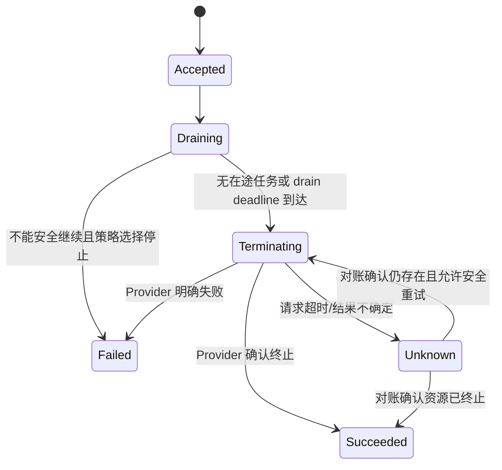
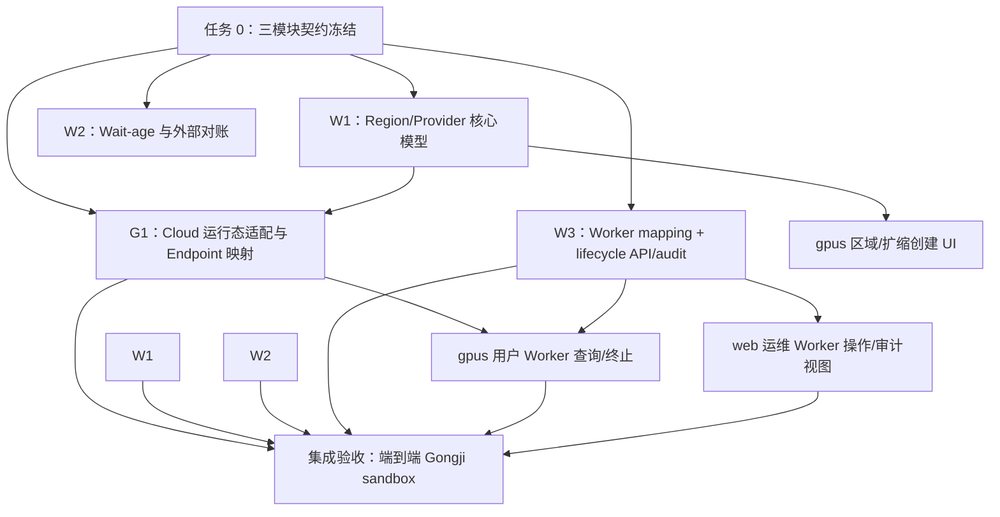
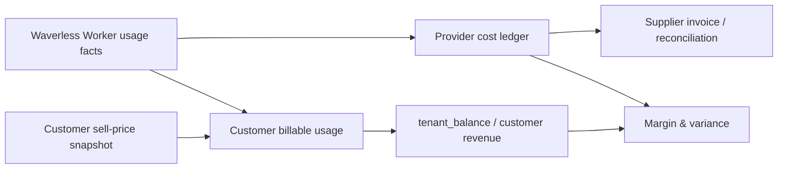
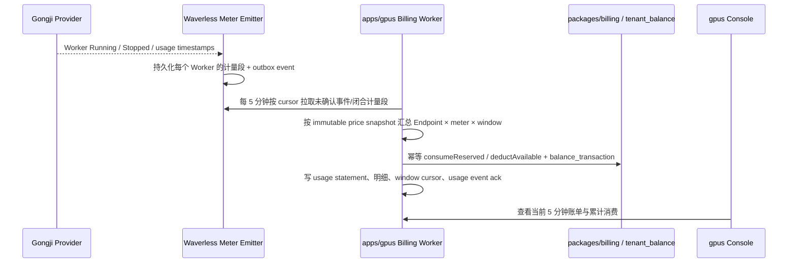
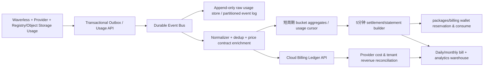

# 国内 GPU Provider 单厂闭环实施任务清单

> 日期：2026-10-17（Asia/Shanghai）；同日清理回写。  
> 状态：供并行 Agent 实施的跨模块设计与任务拆分；未修改代码。计费方案于 2026-10-17 增补。  
> **一期范围权威**：`waverless-product-decisions-2026-10-17.md`（与推荐文 §10.18 同步）。  
> **Autoscaler / Gongji Provider 权威方案**：`waverless-autoscaler-provider-decoupling-2026-10-17.md`（拍板 #2/#6）。  
> 模块路径：`apps/waverless` = 独立仓库 `gpurun/waverless` 在 cloud 工作区的 **clone/checkout 联调目录**（**不是**把 waverless 源码永久 monorepo 进 cloud）；另有 `apps/gpus`、`apps/web`。  
> 决策：Waverless 拥有 Provider / worker / 逻辑 AZ 运行时真相；gpus 管租户产品接口与归属鉴权；web 管平台运营操作和审计查看。

## 1. 目标、范围和非目标

### 1.1 本期目标

以共绩云（Gongji）为首个国内 Provider，实现一个可验收的**单厂商、单逻辑 AZ 闭环**：

1. 统一区域与 Provider 身份：逻辑 AZ → Gongji 物理 region / sku；Endpoint 和每个 Worker 保留逻辑区、Provider、物理区及厂商资源 ID。
2. 真实等待年龄扩容：以最老的当前 pending 任务入队时间计算 wait-age，满足 `queueLength >= threshold OR oldestPendingAge >= waitThreshold` 时产生扩容决策。
3. 外部资源状态对账：desired 与 provider observed 状态分开；创建/扩缩/终止超时后可查询、重试、恢复，不因 API 请求成功或单次本地写失败误报 Ready/丢失资源。
4. Worker 身份映射：Waverless `worker_id` 可稳定映射 Gongji `task_id + point_id`，支持重启后查询及审计。
5. 生命周期操作有授权、有审计：终止走 drain → 等待在途任务或到期 → Provider terminate；gpus 校验租户 Endpoint 所有权，web 的运营操作校验平台管理权限；审计主体与结果可查询。
6. 用户使用统一 Endpoint 请求入口，不接触供应商节点 ID/控制台。
7. 建立可按秒计量、每 5 分钟出账单/核销的 Serverless 计费；**客户收入账与供应商成本账分离（两账，P0）**；**一期商用按量 + 连续时长包**（拍板 #11）；预约保留只建产品/数据契约，不自动保证容量。镜像/预热/对象存储等独立收费项在目录中预留，**预热一期不实现收费链路**。
8. **先走 waverless 路径**（第三方算力部署镜像）；与 gpus 共同落地弹性、入口、账单与成本（拍板 #4）。

### 1.2 本期不做

- 同一 AZ 的多家 Provider 拼池、容量分配和自动 failover；先把接口/数据模型留出 Provider 维度，不对外宣称已支持。（**拼池仍为目标/P1+，见拍板 #7**；一期不承诺 90s failover。）
- 第二家国内厂商、海外 RunPod/Novita 混合调度、跨合规域迁移。
- **镜像预热 / 暖机一期不做**：含 Image Materializer / WarmPlanner / ImagePreHeat / ephemeral warm（拍板 #1/#5）；目标能力清单可保留，实现放到主流程之后。
- Model Store。
- 重做 Cloud VM、裸金属、SkyPilot 其他产品线；旧 SkyPilot Serverless 与 waverless 路径并行时须 `orchestratorType` 分流（拍板 #4：先做 waverless 路径）。
- 本期不要求采用下文的大数据量账单架构；它是规模化方案，单独分期落地。
- 在 Waverless 内直接实现租户身份系统；Cloud 为用户授权权威。Waverless 的运营/控制 API 只能经受信任的服务端身份调用。

### 1.3 本期必须纳入 P0（相对原文的拍板加严）

- **真实 wait-age 扩容**（决策引擎读取最老 pending 年龄；验收 = `pending>=threshold` **OR** `oldestPendingAge>=scaleUpWaitSeconds`；文档不得再称 WaitingTime「已参与决策」）——拍板 #2；详见解耦方案 §C.2。
- **Autoscaler 中立化 + Gongji 独立 Provider**：Gongji 为与 Novita/RunPod 同级的 **CoreDeploymentProvider**（非 K8s、非仅 SkyPilot）；Endpoint 在 **`K8s.Enabled=false`** 时仍可启动 Provider 驱动的 Autoscaler；init 拆分 / `ScalerBackend` 见解耦方案 §C.4–C.6——拍板 #6。
- **计费两账**（客户收入账 ≠ 供应商成本账）+ 旧 `billServerlessStop`/cron 缺陷 **旁路或修复** 后方可上线 Waverless 计费——拍板 #8。
- **一期 purchaseType**：按量 + 时长包商用；预约只建契约——拍板 #11。
- **租户终止契约**：gpus ownership + service identity；drain 默认「标记失败可重试 + 事件可见」；preheat worker 不对租户暴露（即使本期无预热）——拍板 #9。

## 2. 模块边界与数据权威

| 事项 | apps/waverless | apps/gpus | apps/web |
|---|---|---|---|
| Gongji API / Provider 生命周期 | **实现与维护** | 不直连厂商 | 只读运营数据，不直连厂商 |
| 逻辑 AZ Registry 和 Provider binding | **唯一运行时真相源**，对外提供受控目录/状态 API | 查询可售逻辑 AZ；提交逻辑 AZ ID | 查询区域供给与健康，可执行平台级启停/维护操作（若纳入 MVP） |
| Task / queue / wait-age / Autoscaler | **权威** | 展示产品所需队列摘要，避免实现另一套弹性决策 | 运营观察、诊断 |
| Endpoint Cloud 租户/订单/计费归属 | 接收 Cloud 外部 ID 与 tenant 关联，不决定账单 | **权威**：租户鉴权、Endpoint 所有权、API credential、产品状态和计费映射 | 只读支持诊断，不修改用户账单归属 |
| Worker ID 映射和运行状态 | **权威**：platform worker ↔ Provider resource | 读取受控 Worker DTO；只允许对所属 Endpoint 操作 | 运维查询/操作全局 Worker |
| 生命周期命令 | 执行 drain/terminate、持久命令状态和技术审计 | 执行前校验当前用户对 Endpoint 的权限，记录 Cloud actor/tenant | 执行前校验管理员角色，记录操作 staff |
| 审计 | 保存不可变的执行事实/命令状态 | 保存业务身份/请求关联，展示租户操作历史 | 展示平台全局审计并发起运维操作 |
| 计费价格/钱包/账单 | 发出可验证的运行态计量事实，不写用户钱包 | **计费权威**：价格快照、余额/冻结、账单、时长包/预约订单和租户欠费策略 | 运营查价、成本/收入报表、价格配置权限按现有系统管理 |

### 安全规则

- Browser 从不直连 Waverless 管理 API 或 Provider API；`apps/gpus` 和 `apps/web` 的 Server 端 Adapter 调用 Waverless。
- Waverless 管理 API 使用独立 service-to-service 凭据（建议 HMAC/JWT，短时效、audience、issuer、key rotation）；不能复用面向 Worker 的全局 API key，也不能在空 key 时跳过管理 API 鉴权。
- 租户 Worker 终止：gpus 从可信 session/DB 获取 actor、organization、tenant，按 `computeBaseId ↔ Waverless endpoint` 映射验证拥有权；禁止接受客户端传入 tenantId / actorRole 作为授权依据。
- 平台 Worker 终止：web 仅允许 `adminProcedure` 或经明确授权的专用角色/权限；审计 actor 由服务端 session 得出。
- Waverless 技术审计的 actor 元信息由已认证 service identity 携带；只有签名验证通过后才能信任 Cloud `actorId/actorType/tenantId`，并记录原始 service principal。
- 所有写操作使用 `requestId/idempotencyKey`，避免重放导致重复终止或重复外采。

## 3. 跨模块共享契约（先冻结再并行）

下列 DTO/状态名由 Waverless 提供 API Schema，三个模块共用同一份契约文档/fixtures；未经协调不要在 TS 与 Go 内各自发明不兼容字段。

### 3.1 Region / Provider 身份

```json
{
  "logicalAzId": "cn-hebei-az1",
  "displayName": "华北·河北一区",
  "complianceDomain": "domestic",
  "availability": "schedulable",
  "providers": [{
    "providerId": "gongji",
    "physicalRegionId": "hebeif-1",
    "providerSkuId": "vendor-mark",
    "capabilities": ["gpu-serverless-worker", "scale", "worker-terminate"],
    "inventory": {"available": 0, "observedAt": "...", "freshUntil": "..."},
    "status": "healthy"
  }]
}
```

- 面向租户只下发 `logicalAzId`、名称、合规/可售状态及规范 GPU SKU，不下发供应商凭据、point ID、成本价等内部字段。
- `inventory.available=0` 与 `unknown/stale` 必须可区分；容量/库存状态需要 `observedAt/freshUntil`。不可把库存快照承诺成预留。
- 本期区域 Registry 可以先由受版本控制的配置文件加载，但必须有配置校验、版本/来源和只读 API；不要要求 gpus/web 各自维护静态列表。若后续改 DB，API 形状保持稳定。

### 3.2 Endpoint 绑定 / Desired 与 Observed

Waverless Endpoint 运行配置至少要含：

- `externalEndpointId`（Cloud `compute_base.id`，唯一、不可变）
- `logicalAzId`、`providerId`、`physicalRegionId`、`providerSkuId`
- `providerDeploymentId`（Gongji `task_id`）
- `desiredReplicas`、`observedReplicas`、`readyReplicas`、`failedReplicas`
- `desiredGeneration`、`observedGeneration`、`lastProviderSyncAt`、`providerSyncStatus`
- autoscaling `minReplicas/maxReplicas/scaleUpThreshold/scaleUpWaitSeconds/idleTimeout/cooldowns`

控制面语义：

- `desiredReplicas` 是 Waverless Autoscaler 确认的目标；Provider API 返回成功只说明已受理，不等同 observed/ready。
- 外部请求以绝对目标副本数为主，避免仅依赖增量命令；每个目标变更携带 generation/idempotency key。
- Cloud 计算实例状态由 Waverless 运行态映射，不可仅凭写入本地 DB 或 Provider 接受创建就设为 `running`。

### 3.3 Worker DTO 与映射

对 Cloud 的 Worker API 至少返回：

```json
{
  "workerId": "wvr_...",
  "endpointId": "ep-...",
  "status": "READY|STARTING|BUSY|DRAINING|TERMINATING|TERMINATED|FAILED|UNKNOWN",
  "logicalAzId": "cn-hebei-az1",
  "providerId": "gongji",
  "physicalRegionId": "hebeif-1",
  "skuId": "gpu-l20-48g",
  "currentJobs": 0,
  "lastHeartbeatAt": "...",
  "createdAt": "...",
  "readyAt": "...",
  "terminatedAt": null,
  "failure": {"code": "...", "message": "sanitized"}
}
```

- `workerId` 是平台持久标识；Gongji `task_id + point_id` 是外部映射，不暴露为终止请求的主键。
- Worker ID 不得仅靠 endpoint + 局部序号生成；需要避免删除后重用。Provider 事件/轮询以 mapping 表做 upsert，唯一约束至少包括 provider/resource ID。
- Cloud 不必持久复制完整 worker 表；可按需读 API、短暂缓存；必要的审计和产品事件留 Cloud。

### 3.4 生命周期命令 API

建议 Waverless 服务端 API（最终路径可在契约冻结时微调）：

- `GET /control/v1/regions?complianceDomain=domestic&gpuSku=...`
- `GET /control/v1/endpoints/{externalEndpointId}/runtime`
- `GET /control/v1/endpoints/{externalEndpointId}/workers`（分页）
- `POST /control/v1/endpoints/{externalEndpointId}/workers/{workerId}/drain`
- `POST /control/v1/endpoints/{externalEndpointId}/workers/{workerId}/terminate`
- `GET /control/v1/lifecycle-commands/{commandId}`
- `GET /control/v1/audit-events`（仅运营 scope；按时间/Endpoint/Worker/actor/command 过滤）

命令请求示例：

```json
{
  "idempotencyKey": "uuid",
  "reasonCode": "suspected_hung_worker",
  "reason": "可读说明",
  "actor": {"type": "tenant_user", "id": "user-id", "tenantId": "tenant-id"},
  "source": "gpus-console",
  "requestId": "trace-id",
  "drainTimeoutSeconds": 120
}
```

返回 `commandId` 和 `state=accepted|draining|terminating|succeeded|failed|timed_out`。POST 为异步接受，不等同终止已完成。Waverless 需校验 worker 属于路径 Endpoint、Provider capability 支持 terminate、请求来源身份 scope 允许此操作。

生命周期固定序列：



终止不直接释放正在执行的 task。若 drain deadline 到期仍有任务，**产品已拍板（2026-10-17）默认语义：标记失败可重试 + 事件可见**；禁止静默杀进程丢结果。重新入队/重试前须保证任务执行幂等或向用户暴露「可能重复执行」语义；lifecycle/audit 必须落事件。**preheat worker 不对租户 list/terminate 暴露**（即使一期无 WarmPlanner）。

### 3.5 错误、分页、追踪与审计契约

- 统一错误码：`REGION_UNAVAILABLE`、`CAPACITY_EXHAUSTED`、`PROVIDER_RATE_LIMITED`、`PROVIDER_TIMEOUT_UNKNOWN`、`WORKER_NOT_FOUND`、`WORKER_NOT_TERMINATABLE`、`ENDPOINT_FORBIDDEN`、`IDEMPOTENCY_CONFLICT`。
- 所有列表服务端分页，游标或 page/pageSize 上限 100；必须返回 total/next cursor 与数据更新时间。
- `traceId/requestId` 从 Cloud UI → gpus → Waverless → Gongji client 全链路传递；日志不记录 secret、registry password 或签名。
- Lifecycle audit append-only，字段含 eventId、commandId、occurredAt、actor(service principal + asserted actor)、tenantId、externalEndpointId、workerId、provider/resource ID、action、reason code、result、error code、requestId。运营查询 API 不提供修改/删除审计事件接口。

## 4. 并行实施依赖图



推荐工作分配：

| 工作包 | 推荐独立 Agent | 是否可并行 | 需先冻结的输入 |
|---|---|---:|---|
| T0 跨模块契约与状态词汇 | 协调 Agent/负责人 | 否，最先 | 本文 §3、现有 Endpoint/UI 产品范围 |
| W1 Provider/Region/规格模型和 Gongji | Waverless Agent | T0 后与 Cloud Adapter 并行 | Provider DTO、logical AZ ID、配置/DB 版本策略 |
| W2 Wait-age Autoscaler 与外部 reconciliation | Waverless Agent（可与 W1 分 Agent，但先共享 core DTO） | 可并行，需冲突避让 | autoscaling 字段、状态机、外部配额语义 |
| W3 Worker map、lifecycle command、审计 API | Waverless Agent | 可并行，单独文件/包 | Worker DTO、命令状态和认证契约 |
| G1 gpus control adapter + Endpoint 生命周期 | gpus Agent | T0 后并行 | Waverless create/runtime/regions API，Cloud ID 映射 |
| G2 gpus 区域/弹性/Worker UI + 租户终止 | gpus Agent | G1、W3 契约后 | UI DTO、tRPC procedure、租户归属模型 |
| WEB1 web 运维 Worker/区域/审计 | web Agent | W3 契约后与 G2 并行 | 服务端 admin auth、Waverless control APIs |
| INT 集成验收 | 集成负责人 | 最后 | W1/W2/W3/G1/G2/WEB1 可部署版本、厂商沙箱 |

**避免并行冲突：** Waverless 的 DB model/repository、autoscaler DTO、Provider interface 属于高冲突文件；由 Waverless Agent 负责人拥有这些接口定义和迁移合并。gpus/web Agent 使用冻结的 OpenAPI/TS 类型样例，不直接读取 Waverless MySQL 或访问 Gongji。

## 5. 按模块实施任务

# A. `apps/waverless`：控制面与运行时真相

## W0 — 契约骨架与兼容边界（P0，阻塞其他模块联调）

> 代码落在独立仓 `gpurun/waverless`；本清单中的 `apps/waverless` 指 cloud 工作区内的 checkout 路径。

- [ ] 新增 control API 契约文档/OpenAPI 或等价 schema，定义 Region/Provider、Endpoint runtime、Worker DTO、Lifecycle command、Audit DTO、错误码、分页和 auth scopes。
- [ ] 区分现有 `/api/v1` 内部管理 UI 路由、`/portal/v1` Cloud service API 与新 control API 的权限；不将无认证的 legacy admin 路由暴露到公网。
- [ ] 为 cloud 的 `compute_base.id` 定义稳定 external endpoint identity；现有 `Endpoint.Name` 仍作内部/兼容标识，避免重命名导致已有任务查询断裂。
- [ ] 产出 contract fixtures：区域、ready/pending/failed Worker、操作成功/超时、租户越权、幂等重放。

**验收**：Go API schema 与 gpus/web 客户端 fixtures 一致；没有 Provider secret 或厂商 worker ID 出现在租户 Region DTO；control endpoints 默认要求服务身份认证。

## W1 — Region/Provider/规格身份模型与 Gongji Provider

- [ ] 在 Waverless 运行时引入逻辑 AZ、合规域、Provider binding、物理 region、SKU/capability 和启停状态模型。P0 可从 `config/regions.yaml` 加载；配置解析时验证 ID 唯一、provider 已注册、物理 region/SKU 不空、AZ 合规域合法、无重复 binding。
- [ ] 将 Endpoint 运行配置扩展为 `externalEndpointId + logicalAzId + providerId + physicalRegionId + providerSkuId`；旧 Endpoint 字段/labels 迁移期继续读取，需有显式兼容逻辑。
- [ ] 扩展 Provider 窄接口：Deploy、Get/List/Status、Scale absolute replicas、ListWorkers、DrainWorker、TerminateWorker、ListSpecs/Capacity（可选能力）。避免要求 Serverless Provider 实现 K8s Pod/PVC 操作。
- [ ] 实现 `pkg/provider/gongji` 与 Provider Factory 注册；配置独立 `gongji.enabled/base_url/token/signing_key/key_id/request_timeout/poll_interval`，密钥从 Secret/env 注入；禁止写入 configmap、响应或日志。
- [ ] Gongji adapter 实现 v1 API mapping（经供应商确认）：创建任务、读取状态、扩至目标 points、列举 points、删除单个 point、删除 deployment。提交 `dynamic_pod_strategy` 时显式关闭/省略，确保 Autoscaler 单一真相。**定位**：与 Novita 同构的 **CoreDeploymentProvider**（OpenAPI only，无 K8s client）；见解耦方案 §A。
- [ ] 实现 HTTP 超时/重试分类、限流/backoff、签名时间窗、请求 ID、错误码脱敏；对 POST 创建不能盲目重试，先幂等键或按外部 tag/task 查询认领。
- [ ] Region inventory/price poller 记录原始 provider/physical region/SKU、available、价格、observedAt/freshUntil、采集结果；本期失败时区域标为 `unknown/stale` 并告警，不谎报无库存或可售。
- [ ] 将区域/API 状态纳入 Waverless control API：租户只取可售字段，运维可读详细 provider/physical 状态。

**验收**：Gongji sandbox 完成 create→query→scale→list points→terminate→delete；签名/鉴权错误、限流、库存未知、未知响应字段有稳定处理；无效/冲突 Region config 阻止启动或进入明确 degraded 状态，不能静默选择默认海外厂商。

## W2 — 真实 wait-age 扩容和 Autoscaler Provider 中立化

> **权威设计**：`waverless-autoscaler-provider-decoupling-2026-10-17.md`（§B 问题、§C 目标架构、§D 顺序）。  
> **代码锚点**：`cmd/initializers.go` `initAutoScaler`（K8s 闸）；`pkg/autoscaler/decision_engine.go` `shouldScaleUp`（未读 WaitingTime）；`pkg/provider/novita`（HTTP ScaleApp 对照）。

- [ ] **Gongji 作为 peer Provider 注册**：`RegisterDeploymentProvider("gongji", ...)`；与 `novita`/`runpod` 同级；**禁止**经 K8s API 或「仅 SkyPilot cloud」实现 Gongji worker 生命周期。
- [ ] 为 Autoscaler config/接口增加 `scaleUpWaitSeconds`（0 明确表示禁用 wait-age trigger）；更新保存/读取/DTO/UI API，并验证旧数据使用安全默认值。
- [ ] **决策条件（P0 验收）**：`pending >= queueThreshold OR (waitAgeKnown && waitAge >= scaleUpWaitSeconds)`；wait-age 路径要能在单条 pending、`minReplicas=0` 时唤醒。scale reason/event 记录触发路径、pending 数、oldest age、threshold。
- [ ] `oldestPendingAge` 取自当前 pending 任务的入队/`pending_since` 最小值；**禁止**用「首次观察到队列非空」的 `FirstPendingTime` 冒充。
- [ ] 基于可用并发/每 Worker concurrency 计算目标，而非默认每 Worker 一个任务；P0 可固定单并发假设，但需在 Endpoint runtime 显式声明并测试，不允许隐藏硬编码。
- [ ] **Autoscaler 初始化拆分（必做）**：去掉「唯 `if !K8s.Enabled { return }`」总闸。按解耦方案实现其一：
  - `InitK8sAutoscaler()`（legacy）与 `InitWaverlessAutoscaler()`（provider 驱动）分闸；或
  - 单一 Controller + `ScalerBackend`：`K8sBackend | WaverlessProviderBackend`。
  - 挂载条件：`providerId ∈ {gongji,novita,...} || orchestratorType==waverless` → **不要求** `K8s.Enabled`。
- [ ] 按 Endpoint Provider capability 加载规格及可用容量；外部资源区分 reported inventory、platform quota、in-flight、desired、observed、ready；**外采池不用 K8s 集群静态 GPU 预扣卡住 Gongji**。
- [ ] **执行器**：Gongji/Novita 路径只调用 `provider.ScaleApp(desired)` / `TerminateWorker`；**禁止** kubectl scale。
- [ ] cloud/gpus：`orchestratorType=waverless` 只打 waverless 控制面；不经 SkyPilot launch 创建 Gongji worker（双路径并存，P0 只建 waverless）。
- [ ] wait-age 排序与 ScaleDecision 的资源公平逻辑兼容；与 SkyPilot/K8s legacy Autoscaler **回归互不影响**。

**验收**：

- 多条任务以最老 `pending_since` 计算；任务重试/重入队按定义保留或重置 age。
- Waverless 重启前后 wait-age 连续；DB 查询失败→unknown 并告警，不把队列误当空。
- **T_queue**：pending 达阈值触发 ScaleApp；**T_wait**：单条 pending 超 wait 阈值亦触发（OR）。
- K8s 未启用时 Gongji Endpoint 仍可启动 Autoscaler；K8s 原 Provider 的既有 Autoscaler 行为回归。
- Gongji 创建时原生弹性关闭；副本变化均可在厂商侧用 task/points 对账。


## W3 — 外部状态对账、worker 映射与 lifecycle command/audit

- [ ] 设计并创建 Provider deployment binding 与 worker external resource mapping：`externalEndpointId/internalEndpoint/providerId/physicalRegionId/vendorDeploymentId/platformWorkerId/vendorWorkerId/providerObservedStatus/lastSeenAt`；唯一约束、索引、保留/删除策略明确。
- [ ] ListWorkers/Provider poller 稳定 upsert：处理 provider 新发现、状态变更、消失、已删除、分页、API 部分失败；mapping 不因单次 poll 失败删除，超 TTL 采用 `UNKNOWN` 而不是推断终止。
- [ ] 实现 desired/observed generation reconcile job：查询创建/扩缩/终止命令不确定结果；按明确超时和最大重试策略收敛状态；孤儿 vendor deployment 可发现并告警，未经授权不自动删除。
- [ ] 创建生命周期命令存储和 append-only audit event store；命令记录 idempotency key、request hash、state、attempt、lastError、actor claim、service principal、requestId、timestamps。
- [ ] 实现 `DrainWorker`：校验 Endpoint/Worker/provider mapping；原子将 Worker 置 DRAINING，worker pull 在下一次取任务时拒绝新任务；等待运行任务完成；deadline 到期按已批准的任务重试策略处置，再执行 Provider terminate。
- [ ] 实现 `TerminateWorker`：只使用持久 mapping 解析 vendor `point_id`；operation 幂等；按 Provider API 结果更新 TERMINATING/TERMINATED/UNKNOWN/FAILED；Autoscaler 观察实际副本后决定补容。
- [ ] 内部自动回收器（ResourceReleaser）和人工操作复用 lifecycle service；自动原因与操作者来源不同但审计模型一致。
- [ ] 实现 control API 身份中间件及 scopes：`regions:read`、`endpoint-runtime:read/write`、`worker:read`、`worker:terminate`、`audit:read`；拒绝缺失/过期/错误 audience 凭据；运营 API scope 不可由用户 token 获得。
- [ ] API 的 endpoint path 与 worker ID 双重归属验证；operation 查询也检查请求身份/授权 scope，避免 commandId 越权读取。
- [ ] 提供审计分页查询和 retention 配置；审计中 reason 文本长度/字符集校验，敏感信息 scrub，operator write/read 有安全日志。

**验收**：

- 使用 Waverless worker ID 终止时能够命中 Gongji point ID；服务重启后仍可查、可终止。
- worker 终止 API 先 drain、不再接新任务；存在运行任务时按 deadline 策略处理并能查 command status。
- 并发/重复相同幂等键返回同一 command；相同 key 不同 body 返回冲突；Provider 结果未知时不报告成功、不重复创建命令。
- Waverless API 直接调用方缺少 service token / scope 时一律拒绝；伪造 actor 字段不被当作已认证用户。
- 每个成功、失败、重试、超时/未知操作均有不可变审计，包含 Cloud 请求 ID、actor、tenant、Endpoint、worker、provider resource、reason、最终状态。

# B. `apps/gpus`：租户 Serverless 产品面和权限入口

## G0 — Cloud ↔ Waverless service client 与凭据

- [ ] 新增 Waverless server-side client（service 路径下，不从 UI 组件直接 fetch）；服务端配置 `WAVERLESS_CONTROL_API_URL`、`WAVERLESS_PUBLIC_API_URL`、`WAVERLESS_SERVICE_ISSUER/KEY_ID/SECRET`，secret 只从部署 Secret 读取。
- [ ] 每次调用生成/传递 request ID、签名认证、超时、有限重试；POST lifecycle command 必须传稳定 idempotency key，不能自动重试非幂等操作。
- [ ] 统一错误码→tRPCError/用户提示映射；Provider 原始错误消息不能直接透给租户。
- [ ] Client 单元测试使用 Waverless contract fixture/mock HTTP，覆盖错误、超时未知和 schema mismatch。

**验收**：浏览器网络请求不含 Waverless service secret；服务端日志不输出密钥；未配置 service credentials 时写操作 fail closed 并提示服务暂不可用。

## G1 — Endpoint 创建、逻辑 AZ 读取及 Waverless 运行态关联

- [ ] 更新 `compute.serverlessDeployOptions`：区域从 Waverless Region Registry 查询可售 `logicalAzId`；GPU 规格与 Cloud 可计费/展示 SKU 做稳定映射，不再给用户暴露 vendor region/mark。映射不存在时不可部署。
- [ ] 定义 Cloud serverless Detail 中的 control-plane 字段或独立映射：`orchestratorType=waverless`、`waverlessEndpointId/externalEndpointId`、`logicalAzId`、`providerStatus`、`desiredGeneration`、`lastSyncedAt`；不复用 `skyServeId` 表达 Waverless ID。
- [ ] 版本化 DB migration/Drizzle schema 变更：保持已有 SkyPilot 字段兼容；`region` 保存逻辑 AZ ID，避免直接把原来 SkyPilot region 语义覆盖造成旧数据错读。需要区分 deployment backend/region kind。
- [ ] `createServerless` 设定幂等创建 Saga：校验 region/SKU 可售→余额 freeze→写 Cloud creating+outbox/idempotency key→请求 Waverless 创建 Endpoint→存 command/external ID→按 Waverless 状态更新。失败执行补偿/待人工恢复状态，禁止后台 Promise 丢失错误。
- [ ] 不在仍为 SkyPilot 的实例上误发 Waverless scale/stop/delete；迁移期按 `orchestratorType` 路由，对已有 SkyPilot 服务继续走原路径，新部署按已启用 feature/config 决定。
- [ ] 提供状态同步/对账逻辑：Waverless 创建接受为 `provisioning`，只有 ready policy 成立才标 `running`；查询失败保留 last known 状态并标 stale，不静默当成功。
- [ ] 明确请求入口：用户 API 使用 Cloud 稳定 URL（建议反向代理到 Waverless `/v1/:endpoint/*`），或有明示的 Waverless public endpoint 与 endpoint-scoped credential；不可将 global worker/admin API key返回给用户。
- [ ] Cloud 账户/Endpoint credential 与 Waverless 认证契约打通：公开推理调用需 endpoint scoped，可撤销、限速、带组织归属；若短期采用 Gateway proxy，Gateway 负责限流和计量。

**验收**：创建新国内 Serverless endpoint 会绑定 Waverless 且逻辑 AZ 正确；无库存/区域不可售、Waverless 超时、重复创建分别可恢复；用户拿一个 Cloud endpoint URL/key 完成请求，不知道实际厂商/worker。

## G2 — wait-age 参数、Endpoint/Worker 查询与租户定点终止

- [ ] 创建向导/配置页暴露 `scaleUpWaitSeconds`（label 用“最长排队等待触发扩容”或同义文案），说明这是触发器，不承诺达到阈值后 Worker 已 Ready；校验 0 禁用及合理上限。
- [ ] 增加 Endpoint overview 显示 `desired/observed/ready/failed`、队列长度、最老等待时间及数据新鲜度、逻辑 AZ。Worker 数据使用 Waverless DTO，避免 mock Pod 数组作为运行态真相。
- [ ] 为租户 Worker 查询实现 tRPC `protectedProcedure`，先查本组织拥有的 serverless instance/computeBase，再用外部 Endpoint ID 调 Waverless；不能仅用客户端传来的 endpoint name。
- [ ] 实现租户终止 mutation：输入 `computeBaseId + workerId + reasonCode + reason + idempotencyKey`；读 Cloud session/user/organization/tenant，服务端验证 endpoint 所有权与允许状态，再构造 Waverless actor claim；actor type 只能由服务端设置。
- [ ] 权限校验不以 `protectedProcedure` 认证登录代替 ownership check；跨组织 ID 统一返回 NOT_FOUND 或 FORBIDDEN（按平台防枚举口径）。
- [ ] UI 展示确认操作、Drain/Terminating 状态、活动任务数、reason；API 返回 accepted 后提示“正在排空/终止”，按 commandId 轮询或刷新；禁止显示即时成功。
- [ ] Cloud 业务审计写入 operation history 或记录 Waverless commandId/requestId，用户可查看本人 Endpoint 操作，不能读取其他租户审计。
- [ ] 对 Serverless 数据列表分页继续走后端分页；Worker 列表也必须由 Waverless 服务端分页。

**验收**：组织 A 可读/终止自己的 Endpoint Worker；组织 B 使用 A 的 computeBase/endpoint/worker ID 时拒绝；成功操作能从 UI 追踪到终态和审计；等待阈值及 wait-age 与 Waverless runtime 值一致。

## G3 — 用户侧故障/状态文案与计量关联

- [ ] 映射 Waverless endpoint/task/worker 状态到 Cloud 产品词汇，保留 provider error code 仅内部可见。
- [ ] Cloud Endpoint 详情显示 region logical ID/名称，若区域供给 `stale/maintenance` 显示状态和影响，不显示内部 cost/inventory 细节。
- [ ] 将 Endpoint 请求统计/计量关联到 `computeBaseId + tenantId + requestId`；Waverless task summary 拉取失败不回退成 0 usage。
- [ ] 明确终止 Worker 产生的任务重试、失败及费用计量文案；不因“用户按下终止”伪装为正常任务成功。

**验收**：Waverless unavailable/Provider unavailable/容量不足/区域维护可区分；Endpoint URL 在 scale 与 Worker replacement 时保持稳定。

# C. `apps/web`：平台运营和全局审计面

## WEB0 — Web 后端 Waverless 管理客户端

- [ ] 新增服务端 Waverless control client 与 gpus 共用同一 wire contract，但使用独立 service identity/scopes；不得把 Cloud 管理服务密钥放到客户端 bundle。
- [ ] 使用 `adminProcedure`（或经过授权的专用 `adminProcedure` 细粒度角色），所有 write endpoints 从 `ctx.user` 获取 operator id。
- [ ] 只访问 Waverless control API；禁止直接连接 Waverless MySQL、调用 Gongji 或访问 gpus 用户 tRPC 内部 caller 绕过鉴权。
- [ ] 错误码脱敏与 requestId 返回；运营操作审计可与 Waverless 技术 audit 通过 commandId/traceId 关联。

**验收**：非 admin 无法读取全局 worker/provider 映射或执行 terminate；Web API 未授权请求无 Waverless side effect。

## WEB1 — 区域/Provider 运营监控

- [ ] 运营区域列表从 Region Registry 读取：logical AZ、compliance domain、可售/维护状态、Provider 健康、inventory freshness、同步时间、最近错误。敏感物理字段只对授权运维显示。
- [ ] 区域详情按 provider/physical region/SKU 展示库存快照、数据新鲜度、部署/Worker desired/ready/failed、scale latency、Provider API error/rate-limit。
- [ ] P0 可以只读 + 维护状态切换（若需要）；若允许修改 registry，必须实现变更审计、配置版本、审批/校验与回滚。严禁从 web 直接编辑文件或静态维护另一份 AZ 映射。
- [ ] 区域禁售/维护切换只阻止新建/新增副本，需展示存量 Endpoint 影响与迁移/排空选择；默认不可自动 terminate 存量资源。

**验收**：运营看板能区分 inventory=0、inventory stale、Provider API unavailable；对区域改状态可追溯版本和操作人；状态源和 gpus 下拉区域同源。

## WEB2 — 全局 Worker 运维操作与审计

- [ ] 新增按 `externalEndpointId/Cloud computeBaseId/workerId/Provider/status/logical AZ` 筛选 Worker 的服务端分页表格。
- [ ] 运维人员可查看 provider/resource mapping（仅运营面）、心跳、在途任务、失败诊断；用户敏感字段/registry credentials 不返回。
- [ ] 终止前确认 Endpoint/Worker/Provider ID、运行任务、reason code；mutation 由 web server 校验管理员权限并调用 Waverless；得到 commandId 后显示异步状态。
- [ ] 命令状态页可查看 requested/draining/terminating/unknown/succeeded/failed、attempts、sanitized errors 和 requestId；对 `unknown` 状态要求先 reconcile，不提供盲目再次终止按钮。
- [ ] 新增 Lifecycle Audit 浏览页，按时间范围/actor/tenant/Endpoint/Worker/action/result/requestId 搜索；由 Waverless audit API 作事实源，Cloud audit 中可关联 staff session。
- [ ] 失败/超时可从页面复制 requestId、commandId；禁止通过编辑/删除审计来“修正”记录。

**验收**：管理员可定位任一 Worker 并发起受控操作、确认最终结果和不可变审计；普通用户/非授权 staff 被拒绝；Web 不会把 command accepted 显示成终止完成。

# D. 跨模块 Serverless 计费设计与任务（新增）

## D1. 先裁决产品语义：时长包与预约保留是两种产品

用户确认两种都需要，必须拆成不同的 `purchaseType`，不能把 `commitment=hour/daily/weekly/monthly` 同时解释成“买时长”和“预约容量”。两者都可选择小时/天/周/月结算周期，但权益和计量对象不同。

| 维度 | 按量（on-demand） | 连续使用时长包（duration pack） | 预约保留（capacity reservation） |
|---|---|---|---|
| 购买对象 | 实际分配并计费的 GPU Worker 秒数 | 一段连续可运行期限；固定 SKU/卡数/逻辑 AZ | 一段时间内可使用/保留的 GPU 容量（可指定卡数/规格/区域） |
| 结算 | 每个 worker 按 Provider 确认的计费秒数累计，5 分钟封账 | 下单/续期时预付；到期时间固定，运行中也不得超过包期；按秒可用于剩余期内用量计数/展示 | 按预订容量 × 保留时长按期预付，资源实际忙闲不影响预约费；超额用量可另走按量 |
| 停止/缩到 0 | 停止计费；余额按实际秒结算 | 资源停止后不消耗 GPU 秒，但连续期限仍流逝且不暂停/不退还（除依法/服务 SLA 约定退款） | 容量仍被平台保留并收费；用户可选择是否释放预约，释放规则按取消窗口/合同计算 |
| 到期 | 不适用 | 到期前提醒；到期若未续期，阻止新任务、排空并停止 GPU Worker；不允许悄悄转按量 | 到期回收 reservation，预留容量释放；已有任务进入停止/续约流程 |
| 计费单位/报价 | CNY / GPU-second，小时牌价换算 | CNY / pack（按 SKU、GPU 数、duration unit、区域、有效期） | CNY / reserved GPU-hour (capacity-hour)，支持利用率 SLA/取消规则 |
| 弹性限制 | min/max 在余额许可内扩缩；无资源时排队 | 包期内可在已购买的总 GPU 数及 maxReplica 上限内弹性扩缩；不能扩出包权益，超出需显式购买/选按量 | 最低保证容量由 reservation 覆盖；超过保留量的 Worker 可按量计费或拒绝/排队，由用户明确选择 |

**已拍板 #11：** 一期商用按量 + 连续时长包；预约保留只先建产品/数据契约。若后续要容量保证再实现预约锁池和违约赔付，不要用“预付包时”冒充容量 reservation。三个模式不可互相静默降级。无 hold 能力时不得把预约标成自动保证容量。

### D1.1 计量和价税规则

- GPU 时长从 Provider 对单个 Worker 的 `billingStartedAt` 开始，到 Provider 对账确认的 `billingStoppedAt` 结束。只有 Waverless 收到可验证 Running/Ready 事件或轮询确认该 Worker Running 后启动计费；排队、无 Worker 的 provisioning 等待不收 GPU 费。若厂商实际收费早于 Ready，差额放平台成本/启动损耗，不向租户暗中加收；例外需单独成为明确显示的 startup/预热费用。
- Provider 每个 Worker 的起止时间为 UTC 毫秒精度；段为 `[start,end)`，重叠/重复事件用 external resource ID + event sequence 去重。供应商只提供 Endpoint aggregate 时须按实际分配 GPU seconds 归一化；不能把 `replica_count × cron_interval` 当成事实源。
- 按量金额用整数微元/纳元或定点 decimal 计算；禁止 JS `number` 浮点金额累加。统一在账务事件/余额落账时按最小货币精度舍入，5 分钟批次及 stop 尾账使用相同规则；不得每秒先四舍五入再相加。
- 价格按创建/订购时的 immutable `priceSnapshotId` 锁定到计费 contract/order；平台后续改价只影响新购或显式续费，不重算已经发生的历史用量。
- 价格 snapshot 包含 `listPrice/costReference/discount/taxRule/currency/unit/provider SKU/logical AZ/effectiveAt/version`；租户成交价格与供应商成本必须分开存。
- 展示和事件区分 `usage period`、账单生成时间、扣款时间；每五分钟“出账单”定义为生成可审阅的消费明细/结算批次并核销预冻结余额，不意味着付款渠道每 5 分钟扣款，也不取代月度正式对账/发票。

## D2. 计费权威、事实来源与资源分类

### 权威边界

1. **Waverless/Provider 是运行计量事实源**：Worker/计量段、逻辑 AZ/provider/SKU、真实 Running/Ready、terminated 时间、source event ID、校正/迟到标记。
2. **apps/gpus 是用户计费权威**：读取受认证的 usage events，按 Cloud `tenantId + computeBaseId + priceSnapshotId + purchaseType` 核价；余额仍只能由 `@workspace/billing` 在事务内读写 `tenant_balance`/`balance_transaction`。
3. **apps/web 是运营/财务查询面**：查询账单批次、差异、资源成本/收入、调整审核；不在运营页面直接修改钱包或删 usage event。
4. **不以 Waverless MySQL 作为租户钱包，也不让 Waverless 访问 Cloud PostgreSQL。** 跨服务以 durable outbox/API 拉取或推送计量事件，不共享数据库事务。

### 成本账与收入账分离（强制）

Serverless 账务必须明确是两条不同的链：



- **平台成本**：共绩等 Provider 实际资源消耗 × 采购/合同成本价格。依赖 Provider bill/export 或经双方校准的供应商计量账单。Waverless Worker 秒可作为预估成本分摊因子，但不是供应商应付发票事实的替代品。
- **客户收入**：平台实际向租户销售价 × 可计费 Worker 秒/其他 meter，依据创建时锁定的客户价格快照；钱包核销、券/优惠、退款、税费遵循现有 Cloud 余额/财务账务系统。
- **不能复用同一价格字段/账单明细表达两者**。supplier 的进货价、合同价/结算价是成本侧；`platformCardPriceRecord` 或 Serverless 专属 sell-price snapshot 是收入侧。即使租户 sell price 与采购价暂时相等，仍需分别留存，不能把供应商成本直接记为收入。
- 两侧用稳定维度对账：`providerId + providerDeploymentId + vendorWorker/pointId + SKU + physicalRegion + interval + currency + sourceStatementId` ↔ `tenantId + computeBaseId + platformWorkerId + customerPriceSnapshotId + meter interval`。以日/账期 reconciliation 产生差异条目，不覆盖原始成本或用量。
- 成本与收入可能有不同计量边界：Provider 可能从资源分配/创建时开始收费，租户政策是确认 Worker Running 后才开始计费；这段差额必须落平台 `startup/idle/unbilled` 成本项，不能强行篡改租户 usage event。
- 平台净收入/毛利按 `customer net revenue - provider cost - platform-owned preheat/storage/network cost - applicable fees` 分析；充值/冻结不是收入确认，收入确认时点由现有财务口径决定。账单系统不得把余额流水金额直接等同会计收入。

### 能否复用现有 supplier 设计

**可以复用供应商主数据、合同/机房/设备关联、供应商价格/账单导入与对账能力；不应把 Serverless 外采用量硬塞进“供应商闲时卡设备”或自有库存结算流程。** 当前 supplier 域主要表达供应商合作关系、数据中心、设备台账、设备成本/单位成本、供应商账单/结算等；Gongji Serverless 是平台通过 Provider API 按需创建的外采弹性服务，通常没有逐张物理卡的供应商设备归属，也没有与 idle_time/whole_rent 闲时设备相同的分成、利用率和设备交付语义。

建议的复用边界：

| 可复用 supplier 能力 | 当前仓库证据 / 使用方式 |
|---|---|
| `supplier` 主体、合作状态、合同/账期、结算账户及运营审批 | `packages/db/src/supply-schema.ts` 有 `supplier`、`supplier_contract`、`supplier_terms_version`；将 Gongji 作为 API/Serverless 供给类型登记，新增 supply type/capability 时保持闲时设备流程原义 |
| supplier datacenter / 逻辑机房或其外部编码 | `data_center`、supplier 外部 code、`supplier_contract_capacity_line` 可作为物理成本位置参考；Region Registry 仍是 Waverless 运行时 AZ/provider binding 权威，不用 supplier 地理字典替代 |
| unit-cost/平台进货价、价格历史/有效期 | `supplier_unit_cost`、`supplier_pricing_record/history` 已有供应商×机房×卡型、成本和生效时间模型；可复用审计/运营入口，但需新增 Serverless API 服务成本来源/更细 meter unit，不得把它直接等同客户售价 |
| supplier invoice/bill attachment、审批及结算周期 | `supplier_bill/detail/daily` 及现有导入/定时生成流程可复用账期和供应商应付框架；新增 Provider usage line → invoice line 的映射，不伪造 supplier_device |
| 供应商账单 reconciliation / dispute 工作流 | `apps/web/.../supplier/supplier-reconciliation.ts` 已按供应商账单、日/月明细、租户消费、毛利和发票做核对；可新增 Serverless cost reconciliation 适配器及单独差异规则 |
| supplier contact / account owner / operating status | 用于配额、API 故障、账单争议运营处理 |

不应直接复用/错误复用：

- 不把每个 Serverless Worker 虚构成一行 `supplier_device`/库存设备，也不把 API 可用容量当作 `idle_time`/`whole_rent` 已采购卡库存。
- 不把 Provider API 报价自动当最终成本；合同优惠、免费启动/预热、税费、按点/按实例的舍入、最低消费和账期修正需按供应商账单验证。
- 不用供应商成本表存客户售价，不让变更 supplier 单位成本反向改写已经创建的租户价格快照。
- 不让 supplier settlement 直接修改租户 `tenant_balance`；成本结算与客户钱包是不同账本、不同授权和不同对账链。

**实施方式建议：** 在 Cloud 增加 Serverless 外采成本子域（如 `external_compute_cost_usage`、`external_provider_statement`、`external_provider_statement_line`、`external_cost_reconciliation`），引用现有 `supplierId`、contract/terms version、price history、账单导入和对账工作流；区分实时成本估算、供应商原始账单、最终应付成本。现有 `supplier_contract_capacity_line` 明确是合同×机房×卡型供给能力且有 `cooperationType=idle_time|whole_rent`、capacity line 和日期字段；`supplier_device` 是逐台设备台账并含 SN、资产号、生命周期/运维状态，**不适合**虚构按需 Serverless Worker 物理设备。必要时扩展一个外采服务 capacity/usage 合约表，而非强行造 `supplier_device` 记录。

对账/报表要至少同时展示三条金额：

| 金额 | 主来源 | 例子 |
|---|---|---|
| 供应商账单成本 | Supplier invoice 或签约成本模型 | Gongji 实际计费 points/秒 × 成本价 + 供应商列明的存储/流量/预热费 |
| 客户账单收入 | Cloud sell-price snapshot + billable usage | 用户 GPU-second 售价 + 用户自行触发的存储/流量/预热收费 |
| 平台承担/差异 | 两侧边界差异与平台政策 | Provider Ready 前成本、平台 SLA 预热、促销抵扣、供应商对账差异、坏账/退款 |

成本与收入按 `supplierId + contractId + providerDeploymentId + vendor resource/point + physical DC + SKU + usage interval` 和 `tenantId + computeBaseId + Waverless workerId + sell snapshot + usage interval` 作映射；同一 usage event 可用于解释对应关系，但不可将一条金额同时作为 supplier payable 和 tenant receivable。

### 可计费 Meter catalog

| Meter | 单位 | 计费表达 | 来源与边界 |
|---|---|---|---|
| GPU Worker | GPU-second（或 Worker-second × GPU 数） | `seconds × gpuCount × unitPricePerGpuSecond` | Provider 已确认 Running/Ready 到实际停止；按 worker/SKU/区域切段 |
| Endpoint 保底/容量 reservation | reserved GPU-second 或 capacity-second | `reservedGpuSeconds × reservationRate` | 仅预约保留产品；即使 GPU 空闲仍收费，需显示占用与可用时段 |
| 镜像仓库存储 | GB-hour 或 GB-month | digest 当前存储字节 × 存储时间 × 区域单价 | 镜像 digest/tenant/project；重复层去重的收费归属规则需透明定义 |
| 镜像仓库流量 | GB（出站/跨区按差异 meter） | 每租户/区域实际字节 × egress 单价 | registry usage log；租户 push ingress 默认是否免费需产品定价裁决 |
| 镜像预热 | warm-worker GPU-second + 可选 warm transfer GB | warm job 实际运行资源秒 + 明示的数据传输费 | 按触发 source（租户主动/平台 SLA/故障切换）及责任归属计费；平台 SLA 自担的预热不转嫁 |
| 对象存储容量 | GB-hour / GB-month | 存储字节时间积分 | bucket/key/tenant/storage class/region；低频/归档单价不同 |
| 对象存储请求 | request count（按 1K/10K 单位） | PUT/GET/LIST 等分别按量 | 存储服务 usage log；如 MVP 不可得可先不收费，但不得伪造计量 |
| 对象存储流量 | GB egress / inter-region GB | 出站字节 × 区域/方向单价 | 需区分同区内网访问、跨区流量、互联网出网 |
| 容量超额/专属支持等 | 明确 contract item | order/line item | 只有产品定义、用户可见价格和计量证据齐全后收费 |

所有 Meter event 必须带 `tenantId, organizationId, computeBaseId/resourceId, meter, quantity, unit, startAt/endAt, region, SKU, provider, priceSnapshotId 或待核价标记, sourceEventId, idempotencyKey, usageVersion`。额外资源费用不可塞进 GPU 单价或用不可解释的固定“管理费”。

## D3. 方案一：MVP 计费（适用于单 Provider、少量 Endpoint）

### D3.1 MVP 账务流



1. **创建时**：`apps/gpus` 先写 `compute_base`、计费 contract/price snapshot 和 `billing_status=authorizing`；按量模式冻结可配置安全额度（如预计 1 小时 GPU 费 + 可选存储缓冲），再经 outbox 调 Waverless。无有效单价/价格快照一律禁止创建；开发模式如需免计费只能使用显式 `billingMode=internal_test`，不可默默按 0 元商用。
2. **运行时**：Waverless 收到 Provider Worker 状态变化时记录计量段；若 API 只 polling，至少每 10 秒/Provider SLA 采样，收费起点/终点使用供应商时间戳而不是轮询处理时刻；每段要有 `eventId` 和 `sequence`。
3. **每 5 分钟结算窗**：使用固定 UTC 窗口（例如 `windowStart=floor(eventTime/5m)`）；消费已结束计量段和窗口 watermark 前的事件。窗口内仍运行的 Worker 以累计确认游标切割出已确认部分，尾差在 stop/reconcile 时结清。不得使用“当前仍 running 的实例 × 5 分钟”简单估算，否则漏计中途启动/终止且重跑重复扣费。
4. **资金核销**：按量先从 reserved 核销；预冻结不足时在同一余额事务中尝试按规则补冻 available（可用余额须满足安全阈值），失败则立即进入 `billing_suspended`：禁止 Autoscaler 扩容、停止新任务接收、drain/停止 GPU Worker；已完成用量仍写欠费/结算记录，绝不丢弃账单。
5. **时长包**：创建/续期按包价一次 `deductAvailable`（或明确购买订单），锁 `priceSnapshotId`、`validFrom/validUntil`、GPU 数、SKU、region、可扩容额度；到期前 24h/1h 通知。用量按秒展示并执行权益边界；到期没有新付款则 drain + stop，不能将到期 GPU 自动转按量。
6. **预约保留**（**一期不商用**，拍板 #11）：只建 `purchaseType` / 状态机 / 表结构契约。若后续发行：预定时间窗开始前收取预约费或按协议预授权；资源 planner 同时写 capacity reservation，未成功预留则全额退回。无 hold 能力时只许「预约申请/人工确认」，不得标成自动保证容量。
7. **额外用量**：一期优先实现有可靠 meter 的 GPU Worker 秒；registry GB-hour、对象存储 GB-hour 和 egress GB 有可靠数据再开，否则目录预留、不估值扣款。**镜像预热一期不实现收费链路**（拍板 #1）；预热启动后才作为独立明细（warm job GPU 秒 + 传输量），默认用户显式点击/授权，平台 SLA 预热由平台承担。
8. **停止/删除/worker terminate**：停止先拿可靠的 Waverless/provider billing stop time，结算最后一个不足 5 分钟的尾窗（按秒，不凑整 5 分钟），再释放预冻结余额；结算 API 幂等且需覆盖 endpoint 中途重启/region 变化/worker 重复事件。

### D3.2 MVP Cloud 数据和任务

建议在 `packages/db` 增加可审计的最小结构（字段按 schema 实施时定稿）：

- `compute_billing_contract`：computeBaseId、tenant/org、purchaseType (`on_demand|duration_pack|capacity_reservation`)、status、currency、priceSnapshotId、commitment window、included/excluded meters、payment/settlement policy。
- `compute_price_snapshot`（或有 immutable version 的现有价格快照）：GPU SKU、logical AZ、provider cost reference、tenant sell price、billing unit、discount、valid interval、source price record。
- `compute_usage_event`：上游 Waverless event ID/版本、resource/worker、meter、quantity 或 start/end、单位、区/provider/SKU、事件时间、接收时间、核算状态；唯一约束 `(source, source_event_id, usage_version)`。
- `compute_billing_window`：computeBaseId、windowStart/windowEnd、status、quantity/amount、source cursor/watermark、settled transaction ID、idempotency key、retry/error metadata；唯一约束 `(contract_id, window_start, window_end, version)`。
- `compute_bill_line`：账单/窗口明细，保存 meter、quantity、unit price、price snapshot、gross/discount/tax/net、region、source usage interval；ledger 可追溯。
- `compute_pack_order`：套餐订单、GPU 秒权益/期限、购买数量、退款/过期状态、消费量与 policy version。按日维护 remaining snapshot，但消费事实不可只存 counter。
- `capacity_reservation` + reservation events：仅预约模式需要，含 SKU/AZ/Provider/资源数、start/end、hold/confirmed/released、取消费用和容量证明。
- `resource_usage_snapshot` 或统一 usage_event meter：镜像仓库、对象存储周期用量，保存计量水位/版本及账单周期。

余额现金流水仍调用 `@workspace/billing`；`compute_usage_event/compute_bill_line` 是计量/账单证据，不替代 `balance_transaction`。每次扣余额必须把 `refType/refId/idempotencyKey` 关联到唯一 billing window 或 pack order。

### D3.3 MVP 缺陷修复与验收（**P0 门禁，拍板 #8**）

- **Waverless 计费上线前必须**：修复或**旁路**当前 `billServerlessStop`（实际只 `consumeReserved(min(totalConsumed, 0.01))`、却返回全额 `consumed`）及无 cursor 的 cron；新路径仅服务 `orchestratorType=waverless`，禁止与旧缺陷交织。
- 修复时：使用精确用量、检查 consume 失败并保证 consume/unfreeze 原子或可重试。
- 当前 cron 查询全部 `running + on_demand` 并无 billing cursor/window 幂等，也没有 tenantId/外部实际 Running 时间；改为按 due window 和游标分页处理，使用固定价快照及实际 worker intervals。
- `computeBase.createdAt` 不能作为 billingStartedAt；endpoint 的多 Worker / scale-to-zero / min replicas 不可按一个 Endpoint 创建时间结算。逐 Worker/slice 计费再汇总账单。
- `scaleServerless` 变更 min/max 不应默认为额外消费；实际 worker Running 才增长用量。包时/预约模式下要检查权益/容量额度。
- 金额以 4 位小数 balance 原语精度或更高内部精度计算，舍入规则在账单行固定；创建、5 分钟窗、尾结算遵循同一规则。
- 并发 cron 重跑、多个实例同时 settle、上游 event replay、Provider 事件晚到、worker 时钟偏差、服务停机漏跑等场景均有自动化测试。

**MVP 验收：**

1. 单 Worker Running 127 秒后 stop：按 127 秒出 GPU usage，stop 时尾结算，不按 5 分钟凑整；重放 stop/event 不重复扣款。
2. 同 Endpoint 3 个 Worker 不同时间启动/停止/缩容：按每个 worker 的真实计费段累计；Endpoint scale-to-zero 后不再有 GPU usage。
3. cron worker 在一个 window 处理后崩溃，重跑同窗不会重复 balance transaction；余额事务成功但窗口状态写失败可通过 idempotency 查回原结果。
4. GPU 秒/registry 存储/object storage/egress/warm job 分别有独立明细与可回溯 meter，不混成单一 GPU 小时价格。
5. 按量余款不足：告警、billing_suspended、停止新增/运行 GPU 容量，存在最后尾账；恢复充值后按明确用户/平台恢复策略。
6. duration pack 购买时价格锁定，包期到期准确停止或续购；停止服务不暂停连续包期。
7. capacity reservation：**一期不验收商用路径**；契约/表可先建。若后续开放，只有 inventory 真正 hold 成功才回执 confirmed，不满足时不扣/退回付款。
8. 已确认 Running 才对用户计 GPU 费；Provider API 早于 Ready 开始计费部分作为成本差异单列运营指标。

## D4. 方案二：大数据量计费（高事件量、多 Provider、多租户）

当计量事件超过单个 Postgres cron 可可靠处理、需要接近实时控制、账单数据按月达到千万级明细，或 Provider/对象存储/镜像 usage 来源明显增多时，采用此方案。保留同一商业规则和 bill line contract，替换 ingestion/aggregation/storage 机制。

### D4.1 架构



- **Outbox/事件总线**：Waverless 本地事务同时写 lifecycle/usage outbox，异步 publisher 至 Kafka/Pulsar/NATS JetStream/托管队列（选型按现有平台，不预设 Kafka）；保证至少一次投递，不依赖同步 HTTP 事务。消息 envelope 含 eventId/source/sequence/occurredAt/ingestedAt/schemaVersion/traceId。
- **Raw immutable events**：原始 usage 保留到分区数据库或对象存储（按财务/合规 retention）；校正用新版本/反向 adjustment event，不覆盖历史事实。高吞吐存储可以 ClickHouse/BigQuery 等用于查询，不将 OLAP 作为余额事务权威。
- **Normalizer/Deduplicator**：按 source event id 和 usage version 幂等，事件乱序按 worker sequence/occurredAt/watermark 归一；缺 start 或 stop 时开 reconciliation job，不擅自推算为零。
- **5 分钟 Bucket**：对 `(tenant, contract, computeBase, resource, meter, priceSnapshot, region, bucketStart)` 计算 quantity/amount，维护 source watermark、late-event count 和 settled version。每个 bucket 对 wallet 只结算一次；晚到差额写 adjustment line/下个周期 debit/credit，不改已出具账单的原单。
- **Wallet 不做无限小流水承压**：wallet API 仍以原子 balance transaction 做 5 分钟消费；可按租户/合同聚合成一个窗口扣款，细粒度 usage 明细保留在独立账单 ledger。低余额进行 per-tenant reservation/capability lease，确保事件积压时也不会无限超用。
- **并行化与顺序**：按 tenantId/contractId 分区，单租户钱包更新保持串行/锁定；不同租户并行。账单批处理按租户 cursor 续跑，支持 backpressure、DLQ、replay、schema evolution 和高水位追赶。
- **存储附加 meter**：容量使用事件与 snapshot reconcile 两路：event 用于实时，日 snapshot 用于纠偏；按 GB-hour 积分，月底做累计差异。对象存储请求/egress 使用账单导出/日志作为最终月账事实来源。
- **Provider 成本对账**：每日导入 Gongji 实际账单成本，以 provider deployment/point/region/SKU/request id 映射到 tenant usage；租户售价与供应商成本分账，误差超阈值触发审计工单，禁止为了平账修改租户原始用量。
- **归档与冷热分层**：raw usage/账单明细按账期分区、压缩归档到对象存储；hot aggregates 保留交互查询周期；账单出具后通过汇总表/数据仓库做长周期报表。partition lifecycle 与法定留存/退款追溯策略明确。

### D4.2 大数据量数据域

1. `usage_event_raw`：原始 append-only 事件，tenant/contract/resource/meter/time/source/event id/schema version/quantity/price reference。
2. `usage_event_normalized`：标准单位、provider 归一、可信计费起止、校正版本、validation result。
3. `usage_bucket_5m`：窗口状态、累计数量/金额、watermark、settled version、source cursor。
4. `billing_ledger_entry`：不可变 debit/credit/accrual/adjustment line，source bucket id 唯一，定价 snapshot 固定；能关联 `balance_transaction`。
5. `bill_statement` / `bill_statement_line`：对客账单版本、账单周期、税额、折扣、币种、状态（draft/issued/partially_paid/paid/adjusted/void）；已 issued 不原位修改，只能 supplementary/credit note。
6. `billing_cursor` / `event_dedup_key` / `settlement_outbox`：每租户消费/发布进度，保证 crash/replay 下恢复。
7. `meter_daily_aggregate`：按 tenant/computeBase/region/SKU/meter/day 聚合，支撑运营成本和用量趋势；聚合不是扣款事实。

### D4.3 伸缩/可靠性验收

- 事件摄取可以至少一次；同一事件投递 100 次，最终 raw 可追溯、normalized quantity 和 wallet consumption 只计一次。
- 支持按 tenant partition 扩消费者，单分区顺序一致；慢租户/坏消息不阻塞所有租户，DLQ 可安全 replay。
- 关掉 event bus/consumer 30 分钟后恢复，账单窗口补齐且不重复扣款；超过 watermark 的晚到事件通过 adjustment 纳入后续账单。
- 任何金额都能从 statement line → billing ledger → 5m bucket → raw meter event → Waverless/provider event 追溯；余额 transaction 能反查 statement/window。
- 消费 backlog、source freshness、dedup ratio、late event、unmatched resource、unbilled accrued amount、cost/revenue variance、wallet insufficiency 都有 SLO/告警。
- 压测量化目标在容量规划时定（events/sec、tenant partitions、单窗完成时间、账单查询延迟、重放追赶倍数），不得以“用了消息队列”代替容量指标。

## D5. 镜像仓库、预热和对象存储收费政策

### 镜像仓库

- 建议区分平台提供的基础镜像（平台承担）、用户自有镜像及用户可见平台仓库私有存储（按 GB-month）、出站/跨区传输（按 GB）、保留/固定 pin 镜像容量（仍按存储收费）。不要按“镜像数量”粗略收费替代实际存储。
- Harbor 镜像层去重时成本是共享物理 layer，租户计费规则需避免双收：可按 tenant logical image referenced bytes 计费，明确共享 layer 的账单分摊及删除后的 reference retention；不能按每个 tag 重复算完整物理 bytes 又叠加平台总成本。
- 统计每日对象/manifest/blob bytes 快照或 registry quota usage，积分成 GB-hour；月账可展示 GB-month。镜像删除后按 GC 真正释放或 retention policy 结束时间停止收费，显示软删除/保留状态。
- 平台发起的跨 Provider 复制/按 SLA 的预热由平台承担；用户点选“预热到指定逻辑 AZ”时，预览可能的临时 GPU 秒、传输 GB、仓库物化存储费，用户确认后触发收费。

### 镜像预热

- 区分 `preheat_transfer`（拉取/跨区复制流量）、`preheat_storage`（目标 Provider 私有镜像存储）、`preheat_compute`（专用运行 Worker 的 GPU/CPU 秒）。普通 Worker 在创建后自身拉镜像属于 Worker runtime；只有平台为缓存而额外创建 warm worker 时才记 warm compute。
- 每次 warm job 用独立 id/source/tenant/endpoint/digest/region/provider/startedAt/endedAt/bytes/costOwner；失败也有实际成本归属，不按计划量收费。
- 若缓存是平台共用、由平台策略自动预热，则 platform cost center 支付；不能因为某个租户恰好是 first hit 就默认把共享 warming 全部记给该 tenant。

### 对象存储

- 容量按实际存储字节时间（GB-hour/GB-month）；请求按 operation class（PUT/GET/LIST 等）；流量按来源/去向（同区内网、跨区、公网 egress）；生命周期/归档单独 class。
- 支持的每一项都需要可导入、可复核的 meter；上游服务不能提供可靠请求/流量数据时，初期可以只收容量费并明确免费项，后续开新 meter 前公告，不得估值扣款。
- 账单展示时间范围、平均/峰值用量（合同决定取哪种）、单价、免费额度、超额档位和区域；bucket/key 级明细只向有权限用户展示，避免泄露其他租户资源名。

## D6. 按量、包时和预约的 API/状态机要求

- `purchaseType` 字段单独表达 `on_demand|duration_pack|capacity_reservation`；`commitment` 只表达收费周期/合同期，不再同时决定“产品权益”。保留旧 `compute_base.commitment` 作迁移字段，逐步转 canonical contract。
- `durationUnit` 采用固定产品规则：hour=3600s、day=24h、week=7×24h；month 必须明确自然月（到相同本地账期日）或固定 30×24h，推荐自然月并以 `validUntil` 时间戳为准，展示到期时区采用用户/合同约定 Asia/Shanghai。不能把 720h 固定月与自然月价格混用。
- 包时 price 可是整包固定价或 rate × GPU 数 × period；折扣来自 immutable price snapshot，不在客户端按固定系数推算。hour/day/week/month 可有独立成交价格。
- Reservation order 状态：`requested→capacity_held→confirmed→active→released|expired|cancelled|failed`；hold 要有 TTL，创建资源与账务扣款协调使用 Saga；失败撤销 hold/退款；容量不履约有补偿与 SLA 规则。
- 预约资源转为正在运行后避免“双收费”：reservation 可以作为包含用量额度的最低消费/保留费，实际 GPU usage 从 reservation included units 抵扣；超额才按量加收。客户账单显示保留费与超额，不同时对同一 GPU-second 收预约费和按量费。
- Worker lifecycle `billingStartedAt/billingStoppedAt` 的账务冻结与 Provider desired/observed 状态解耦；租户主动停服、自动 scale-to-zero、worker 异常、Provider 故障、人工 terminate 均采用同一计量 cutoff 规则。
- 余额不足保护属于 Cloud billing policy：提前阈值告警→禁新建/扩容→停止新任务受理→宽限期 drain→stop；不能让 Waverless 直接读取余额。预约已付款、包期已付与按量余额不足的行为分别定义。

## D7. 三模块计费工作拆分

### `apps/waverless`（运行计量，不碰钱包）

- [ ] 实现 Worker billing event/usage outbox：Ready/Running 开始、terminated/provider billing cutoff 结束；event ID、worker mapping、Provider/physical/logical region、SKU、GPU 数、source timestamp 与精度。
- [ ] 提供可分页、按 event cursor 拉取和 ack 的 authenticated Usage API；不能只提供当下状态列表，不可静默丢迟到/重复事件。
- [ ] 计量状态与 Worker 状态分离，能够处理重复、乱序、Provider correction、停机重启；支持 usage reconciliation 和 export metrics。
- [ ] 支持 Endpoint/Worker ID 对账但不持有 Cloud price/wallet；服务端 API 禁止接受租户 price 参数。
- [ ] 镜像预热 job 记录实际资源秒与 bytes；若对象存储/registry 在 Cloud 之外，由对应服务发出标准 usage events。

### `apps/gpus`（租户账单、资金与 API）

- [ ] 统一创建/扩缩/stop/delete/terminate 的 billing contract、immutable price snapshot 和 outbox saga；创建失败释放冻结，重复 API 请求幂等。
- [ ] 实现 MVP usage ingestion、5 分钟 window settlement、tail settlement、balance idempotency 和 reconciliation；不按 endpoint status 每五分钟固定扣款。
- [ ] 修复现有 billing stop/periodic cron 的实质缺陷，采用 Worker meter interval；cron 任务服务端分页、claim/lease、批次 watermark，余额不足状态执行可审计保护动作。
- [ ] duration pack 商品、购买/续期订单、权益总量/剩余量、到期提醒、超额阻止；reservation 只在容量 hold contract 确认后开放。
- [ ] Registry/Object storage/egress/preheat meter 分别入账；免费额度、分层价、税/券/折扣、refund/credit adjustment 使用账单 line，不覆盖 raw usage。
- [ ] 用户账单页显示近 5 分钟暂估/已结算、今日/月累计、GPU 使用明细、包时余量/截止时间、预约资源/时段、存储和流量分项、价格快照、尾差/修正行。
- [ ] 按量余额安全阈值、耗尽 grace policy、BillingSuspended 状态与 restore policy；账务 API 故障时 fail closed，不无界继续扩容。

### `apps/web`（平台运维/财务运营）

- [ ] Serverless 定价管理：按产品/规范 GPU SKU/逻辑 AZ/purchaseType/meter/unit/effective interval/version 配价；按量价与 hour/day/week/month 包价分开。
- [ ] 审批及审计：价格版本发布、折扣、免费额度、reservation 取消条款与 usage adjustment 都有操作人/生效区间/原因；禁止原地修改已经被 contract 引用的价格快照。
- [ ] **成本侧复用 supplier 域**：通过现有 supplier 主体、合同/terms version、supplier pricing/unit-cost/history、supplier bill/import/reconciliation 做供应商成本管理；为 Serverless API usage 新增成本 adapter/statement-line mapping，禁止把每个外采 worker 伪装为 `supplier_device`。
- [ ] **收入侧继续走 Cloud billing**：租户 sell-price snapshot、`compute_bill_line`、余额核销和退款只由 gpus/`@workspace/billing` 负责；web 是只读财务运营入口，adjustment 必须调用受权限保护的专门 workflow，不直写 tenant balance。
- [ ] 运营账单窗口页面：usage received/normalized/settled/pending/late/reconciled，按 tenant/Endpoint/meter/provider/region 搜索；并列显示 tenant revenue、supplier cost、platform-owned cost、gross margin/variance；缺成本账单时收入可出账，但成本须显示 estimate/unreconciled，不能伪装最终毛利。
- [ ] 欠费/异常工单：失败扣费、负向调整、成本高于售价、Provider bill 缺映射、预热成本 owner unknown；支持经授权的补偿流水而不是编辑原始用量。
- [ ] 大数据方案启用后看 event lag/DLQ/replay、watermark、窗口结算 SLA、分区容量、月账生成完整性和 reconciliation variance。

### 计费跨模块依赖顺序

1. **BILL0 产品口径/数据契约冻结**：purchaseType、计费 cutoff、meter catalog、5 分钟窗口、价格锁、late event、更正和欠费策略。
2. **W-BILL** Waverless usage event + outbox/Usage API，与 W3 worker mapping 同一 external worker ID。
3. **G-BILL core** gpus Cloud schema + `@workspace/billing` 窗口幂等扣款、价格快照和账单行；先 fake usage events 验证。
4. **G-BILL UI / WEB-BILL** gpus 用户账单、WEB 定价/运营批次并行接同一 DTO。
5. **WEB-SUPPLIER** 接入既有 supplier 账单/成本/对账域；真实账单 cost line 映射到 Provider deployment/worker usage；不变更闲时设备台账/结算语义。
6. **INT-BILL** 故障/乱序/重复/欠费/套餐到期/对象存储计量集成验收；实际 Gongji invoice 对账后才开放成本毛利正式报表与正式收费。

## 6. 端到端验收计划（集成任务 INT）

### 6.1 前置环境

- Gongji 沙箱账号/API key/签名密钥，由供应商安全交付给部署环境 Secret；fixture 测试不含真实秘密。
- Waverless test 环境 MySQL/Redis 持久化；部署实例至少两个，验证命令并发/幂等和服务重启。
- gpus test organization A/B、用户与管理员账号、足够测试余额；web admin 与普通角色。
- Region Registry 至少一个国内 AZ 映射到已确认的 Gongji physical region 和 SKU，测试一组不可售/库存 stale 状态。

### 6.2 验收流程

1. gpus 下拉显示 Waverless 返回的 `cn-hebei-az1`，页面无 Gongji `physicalRegionId/mark`；选择 SKU、wait-age 阈值后创建。
2. Cloud 创建记录进入 provisioning；Waverless 返回 external ID 与 Provider binding；只有实际 Ready 后产品才显示 running。
3. 保持 minReplicas=0，提交一个任务并保证 queue threshold 不触发；超过 wait threshold 后 observed desired 增加，Gongji 提供 Worker 并拉取任务。查看扩容 reason 为 wait-age。
4. 另一次以 pending 数跨过 queue threshold 验证长度触发；验证 cooldown/max 上限和同 endpoint 不重复 scale。
5. Cloud / Waverless / Gongji 分别模拟 API timeout/429/暂不可用。检查 desired/observed 状态、command reconciliation 和区域 freshness，不得误报 ready/zero/terminated。
6. 对一个无在途任务 Worker 发起租户终止：Waverless mapping 找到 Gongji point，执行 drain→terminate，最终命令状态与 Cloud Worker DTO 变为 TERMINATED；三处日志均可按同一 requestId/commandId 关联。
7. 对有在途任务 Worker 发起终止：确认停止派发新任务；在途任务按约定等待/超时处置，task history 记录重试/失败，不默认为成功。
8. 组织 B 访问组织 A Endpoint 的 Worker 列表和终止均被拒绝；非 admin 访问 web 运维 API 被拒绝。
9. 管理员执行另一个终止，验证 staff actor 与 Waverless service principal 均入审计；重放同 idempotency key 不会再次调用 Provider。
10. 滚动重启 Waverless，再查 Endpoint、Worker、command、mapping、audit；映射和 wait-age 不丢失，uncertain command 可对账。

### 6.3 量化通过条件

- `queueLength` 与 `wait-age` 两条扩容策略均通过独立自动化测试（OR 验收）；Waverless autoscaler 对 Gongji 启动**不依赖** K8s；Provider backend 与 K8s backend 分闸（解耦方案 §C/§D）。
- 控制面服务身份验证、gpus Endpoint ownership、web 管理员鉴权的正反向测试全部通过。
- 对账测试中 provider 已创建/已扩容/已终止但响应超时的情况均收敛到真实 observed 状态；不重复产生付费 deployment、不漏掉 worker mapping。
- worker 终止操作的 accepted 与 terminal state 在 API/UI 中明确区分；100% 操作有 audit event。
- 用户区域列表与运营页面区域状态来自同一 Registry；过期数据不会被呈现为健康可售。
- Cloud 与 Waverless 之间无同步删除/修改对方数据库；跨系统通过 API 和补偿任务闭环。

## 7. 数据持久化、迁移与发布策略

### Waverless MySQL

- Waverless 需先确认生产 schema 的权威迁移机制：现存 `model`、deploy `init.sql`/ConfigMap 与代码可能存在双源；新增表/字段不得只改 GORM model，也不得只改 init SQL。
- 推荐向前兼容发布：先加 nullable 字段/新表→部署可双读/双写代码→回填已有 worker/endpoint→验证→再按独立迁移收紧约束。不得在启动时未经审批自动执行破坏性 migration。
- Worker mapping 至少持久化；Region Registry 配置版本、Provider deployment binding、lifecycle command、audit event、scale command/generation 有明确 retention/备份策略。
- 对旧 K8s/Novita Worker：provider 信息可标 `legacy/unknown`，不可伪造 Gongji mapping；旧 Worker 仍走原管理逻辑。

### Cloud PostgreSQL

- 保持 `compute_base` 产品归属与余额账本语义；新增 orchestrator 字段/外部 endpoint ID/逻辑 region/wait threshold 时用 Drizzle schema + 生成迁移。
- 保存控制面关联与状态快照，不将 Cloud 表当作 Worker/Provider 运行态事实源。
- 为旧 `serverless_detail.sky_serve_id` 继续保留；按 backend discriminator 路由 SkyPilot 或 Waverless，禁止用空 ID 猜后端。
- 计费 schema 使用新增的 contract/snapshot/usage/window/statement/pack/reservation 结构；余额只经 `@workspace/billing` 更新，`compute_usage_event` 不是替代钱包流水的另一个余额真相。
- 数据库迁移先保持兼容旧 `commitment`/目前 cron，再逐步启用 canonical `purchaseType`；已有 SkyPilot 实例须继续使用自己的计费 cutoff，不能自动映射为 Gongji Worker Usage。

### 灰度

1. Contract/mock 环境只启用 fake Gongji adapter；生产凭据未配置时 Gongji 不可用且 fail closed。
2. 内部组织/白名单先走 Waverless 国内 AZ；SkyPilot 旧实例与旧 API 不受影响。
3. 对比 Worker、副本、费用观测至少一个完整试点周期；先停止扩量而非自动 failover。
4. 明确 rollback：禁止新建 Waverless endpoint；已有 endpoint 保持请求入口稳定，恢复服务要采用受支持的控制面停止/迁移，不可直接改 DB 指向 SkyPilot。

## 8. 测试和质量门槛（按模块 Agent 提交时必须附证据）

| 模块 | 最低验证 |
|---|---|
| apps/waverless | 相关 Go package unit/contract tests；`go test ./...`（在 `apps/waverless`）；DB migration upgrade test；provider fake server integration；`go vet ./...` 如仓库 CI 支持 |
| apps/gpus | `pnpm --filter <gpus 包名> run lint`、定向 typecheck/test；服务端 tRPC ownership 测试；按 AGENTS.md 用户可见改动在浏览器验证创建/详情/worker终止完整流程 |
| apps/web | `pnpm --filter <web 包名> run lint`、定向 typecheck/test；admin/非 admin 授权测试；浏览器验证区域/worker/audit 运营流程 |
| DB schema/migration | `pnpm --filter @workspace/db run db:generate`；复核生成迁移；受影响 app 编译。生成迁移不得手改 |
| 集成 INT | 按 §6.2 流程提供自动化结果/沙箱操作记录；注明哪些真实厂商测试因 sandbox/配额限制未运行 |

每个 Agent 交付说明：变更文件、API/schema 假设、测试命令与摘要、未完成依赖、对共用契约的任何偏差。不得声称未运行的集成验收已通过。

## 9. 推荐执行批次与 Agent 领任务指南

### Batch 0 — 冻结接口（串行，负责人）

交付 `docs/waverless-cn-provider-control-api.md` 或在此文档 §3 的批准版本，完成 Route/Auth/DTO/错误码状态机和 schema fixture。三个模块 Agent 以此为唯一 API 契约。

### Batch 1 — 可并行实现

- Waverless Agent A：W1 Region/Provider/Gongji adapter。
- Waverless Agent B：W2 Wait-age/autoscaler 解耦。须与 A 协调共享 interface/model 文件；优先独立测试/决策代码，禁止平行改同一 model。
- Waverless Agent C：W3 Worker mapping + lifecycle/audit API。
- gpus Agent：G0 client 与 G1 Endpoint mapping/state saga；在 Waverless endpoint API 未合并前用 contract mock。
- web Agent：WEB0 服务端 client + WEB UI skeleton/mock query；W3 API 冻结后接真接口。

### Batch 2 — 契约集成后并行

- gpus Agent：G2/G3 tenant Worker APIs、控制台区域/Autoscaling/Worker 操作。
- web Agent：WEB1/WEB2 区域/Worker/全局审计。
- Waverless Agent：按集成反馈补 reconcile、provider 错误处理和 lifecycle edge cases。

### Batch 3 — 联调与灰度

执行 INT，先 fake Provider 自动化，再 Gongji sandbox，再内部租户灰度。只有 Waverless/Gpus/Web 的安全与生命周期验收均通过，才发布租户 worker 终止操作。

## 10. 完成定义

本批次完成需同时满足：

- Gongji 单 Provider + 一个国内逻辑 AZ 的真实请求、扩容、Ready、缩容/终止闭环可运行。
- wait-age 由任务真实时间戳计算并能独立触发扩容，持久化/重启/故障路径验证通过。
- Provider 外部运行态可对账，Endpoint desired 与 observed 状态分离，worker external mapping 重启后稳定存在。
- 用户操作由 gpus 验证 Endpoint 所有权，运营操作由 web 验证 staff 权限；Waverless 服务端只信任经过验证的 service identity，所有生命周期动作有不可变审计。
- 用户只能看到平台逻辑 AZ 与统一 Endpoint URL；运营可按授权下钻真实 Provider/physical region。
- 每个租户扣款可追溯至价格快照和源用量；按量每 5 分钟结算且按 Worker 确认运行秒计费；时长包到期按契约停止/续购（**不**悄悄转按量）；预约仅契约层、一期不履约自动保证容量；镜像/预热/对象存储收费仅基于可复核独立 meter（预热一期不收费）。
- 所有模块的针对性检查有真实执行摘要；未完成的厂商/生产验收项明确列为 blocker。

## 11. 相关文档与代码现状基线

- [设计评审：国内 Provider 与区域弹性](waverless-cn-provider-code-design-review.md)
- [产品拍板](waverless-product-decisions-2026-10-17.md)（一期范围权威，含 #11 purchaseType）
- [Autoscaler 与 Provider 解耦](waverless-autoscaler-provider-decoupling-2026-10-17.md)
- [Waverless + Cloud/SkyPilot 结合建议](waverless-cloud-skypilot-integration-recommendation.md) §9–§10（目标架构；§1–§8 为早期分析）
- [RunPod 功能对照与优先级](waverless-runpod-ui-parity-and-priority.md)
- `apps/waverless/pkg/provider/factory.go`、`pkg/interfaces/deployment.go`
- `apps/waverless/pkg/autoscaler/{metrics_collector.go,decision_engine.go,executor.go}`
- `apps/waverless/pkg/store/mysql/model/{task.go,worker.go,autoscaler_config.go}`
- `apps/waverless/app/router/{v1_routes.go,admin_routes.go,portal_routes.go}`、`app/middleware/auth.go`
- `apps/gpus/src/lib/server/routers/compute.ts`、`services/skypilot.ts`、`dataaccess/compute/serverless.ts`
- `apps/gpus/src/app/[locale]/console/serverless/instances/[id]/_components/workers-panel.tsx`
- `apps/web/src/lib/server/routers/trpc.ts`（`adminProcedure`）
- `packages/db/src/compute-schema.ts`（`compute_base` / `serverless_detail`）
- `apps/gpus/src/lib/server/services/billing.ts`、`apps/gpus/src/app/api/cron/billing/route.ts`（现有计费雏形与需修复点）
- `packages/billing`、`packages/db/src/gpus-consumer-schema.ts`（钱包/余额流水权威实现）
- [租户余额模型权威定义](design/cloud/tenant-balance-unification.md)
- [Serverless 实现与存储计费引用](design/cloud/serverless-implementation.md) §6、[存储配额与 S3 卷](design/cloud/storage-quota-and-s3-volume.md)
