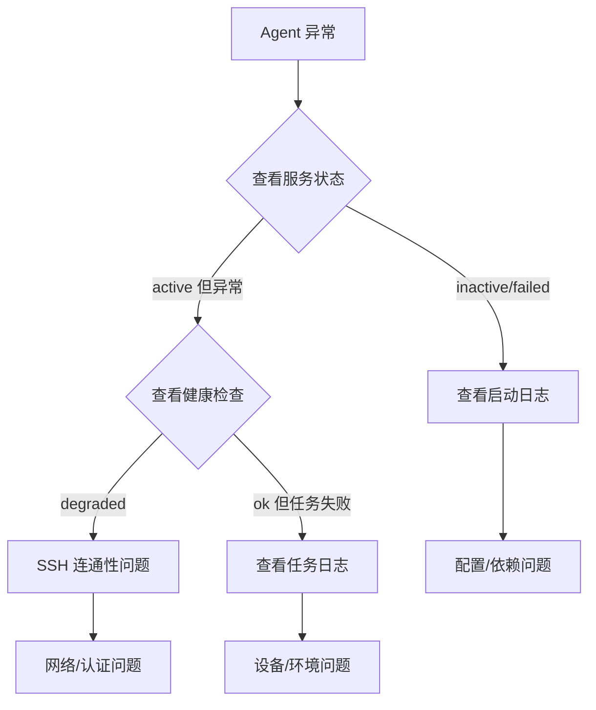

# GPURun Edge Agent 故障排查手册

## 1. 排查流程总览



---

## 2. 常见问题速查

### 2.1 服务启动失败

**症状：** `systemctl status GPURun-agent` 显示 `inactive (dead)` 或 `failed`

**排查步骤：**

```bash
# 1. 查看详细错误日志
sudo journalctl -u GPURun-agent -n 50 --no-pager

# 2. 检查配置文件语法
sudo cat /etc/GPURun/agent.yaml

# 3. 手动运行测试
sudo /usr/local/bin/GPURun-agent --config /etc/GPURun/agent.yaml

# 4. 检查二进制是否可执行
file /usr/local/bin/GPURun-agent
ls -la /usr/local/bin/GPURun-agent

# 5. 检查状态目录权限
ls -la /etc/GPURun/
```

**常见原因及解决：**

| 原因 | 错误信息 | 解决 |
|------|----------|------|
| 配置文件缺失 | `no such file or directory` | 检查 `--config` 路径 |
| YAML 格式错误 | `yaml: unmarshal errors` | 修正 YAML 语法 |
| 权限不足 | `permission denied` | `chmod +x` 二进制 |
| 端口被占用 | `address already in use` | 修改 `listen_addr` 或停止占用进程 |
| SQLite 目录不存在 | `unable to open database` | `mkdir -p /etc/GPURun` |

---

### 2.2 Agent 注册失败

**症状：** 日志显示 `failed to register with platform`

**排查步骤：**

```bash
# 1. 检查网络连通性
curl -v https://api.GPURun.cn/api/agent/version

# 2. 检查 Token 是否正确
grep agent_token /etc/GPURun/agent.yaml

# 3. 检查 DNS 解析
nslookup api.GPURun.cn

# 4. 检查防火墙/代理设置
echo $http_proxy $https_proxy
curl -x "" https://api.GPURun.cn/api/agent/version
```

**常见原因及解决：**

| 原因 | 解决 |
|------|------|
| Token 无效或已过期 | 联系平台运营重新生成 |
| DNS 无法解析 | 检查 `/etc/resolv.conf` |
| 出站 443 被阻断 | 联系 IDC 运维开放出站 HTTPS |
| 平台 API 不可达 | 确认 `api_url` 配置正确 |
| 证书问题 | 检查系统 CA 证书：`update-ca-certificates` |

---

### 2.3 心跳超时

**症状：** 平台显示 Agent 离线，但本地 `systemctl status` 显示 running

**排查步骤：**

```bash
# 1. 查看心跳日志
sudo journalctl -u GPURun-agent | grep heartbeat

# 2. 检查本地健康端点
curl http://localhost:9090/health

# 3. 检查时钟是否同步
timedatectl status

# 4. 检查网络延迟
curl -w "@-" -o /dev/null -s https://api.GPURun.cn/api/agent/version <<'EOF'
     time_namelookup:  %{time_namelookup}s\n
        time_connect:  %{time_connect}s\n
     time_appconnect:  %{time_appconnect}s\n
    time_pretransfer:  %{time_pretransfer}s\n
       time_redirect:  %{time_redirect}s\n
  time_starttransfer:  %{time_starttransfer}s\n
                     ----------\n
          time_total:  %{time_total}s\n
EOF
```

---

### 2.4 任务执行失败

**症状：** 日志显示 `stage_failed` 或任务状态为 `failed`

**排查步骤：**

```bash
# 1. 查看任务日志
sudo journalctl -u GPURun-agent | grep -E "task_started|stage_completed|stage_failed"

# 2. 查看 SQLite 中的任务记录
sqlite3 /etc/GPURun/state.db \
  "SELECT id, type, status, error FROM tasks WHERE status='failed' ORDER BY created_at DESC LIMIT 5;"

# 3. 查看审计日志
sqlite3 /etc/GPURun/state.db \
  "SELECT task_id, action, details, created_at FROM audit_log ORDER BY created_at DESC LIMIT 20;"
```

---

## 3. 各阶段故障排查

### 3.1 SSH 验证阶段失败

**错误信息：** `SSH connect failed`

**排查：**

```bash
# 1. 手动测试 SSH 连通性
ssh -o ConnectTimeout=10 root@10.0.1.101 "echo ok"

# 2. 检查 SSH 密钥/密码
ssh -vvv root@10.0.1.101

# 3. 检查端口是否开放
nc -zv 10.0.1.101 22

# 4. 如果使用跳板机
ssh -J ops@跳板机IP:22 root@10.0.1.101 "echo ok"

# 5. 检查 SELinux/AppArmor
sudo getenforce
aa-status
```

**常见原因：**

| 原因 | 解决 |
|------|------|
| 设备 SSH 未启用 | 在设备上 `systemctl enable --now sshd` |
| 密码错误 | 联系供应商确认凭据 |
| 防火墙规则 | 检查管控节点 → 设备的 22 端口 |
| 跳板机不通 | 确认跳板机配置和密钥 |
| SSH 版本不兼容 | 检查 `/etc/ssh/sshd_config` 中 `PubkeyAcceptedAlgorithms` |

---

### 3.2 GPU 对账阶段失败

**错误信息：** `GPU count mismatch` 或 `GPU type mismatch`

**排查：**

```bash
# 1. 手动执行 nvidia-smi
ssh root@10.0.1.101 "nvidia-smi --query-gpu=name,count,memory.total --format=csv,noheader"

# 2. 检查 NVIDIA 驱动
ssh root@10.0.1.101 "nvidia-smi"

# 3. 检查驱动版本
ssh root@10.0.1.101 "cat /proc/driver/nvidia/version"

# 4. 重启 NVIDIA 驱动
ssh root@10.0.1.101 "sudo rmmod nvidia_uvm nvidia_drm nvidia_modeset nvidia && sudo modprobe nvidia"
```

**常见原因：**

| 原因 | 解决 |
|------|------|
| NVIDIA 驱动未安装 | 安装驱动：`apt install nvidia-driver-535` |
| 驱动版本过低 | 升级到推荐版本 |
| GPU 硬件故障 | 检查 `lspci \| grep -i nvidia` |
| 数量不匹配 | 联系供应商确认设备配置 |
| nvidia-smi 不在 PATH | 使用绝对路径 `/usr/bin/nvidia-smi` |

---

### 3.3 环境初始化阶段失败

**错误信息：** `env init failed`

**排查：**

```bash
# 1. 检查操作系统
ssh root@10.0.1.101 "cat /etc/os-release"

# 2. 检查磁盘空间
ssh root@10.0.1.101 "df -h /"

# 3. 检查网络连通（安装脚本需要下载依赖）
ssh root@10.0.1.101 "curl -s https://deb.debian.org/debian/dists/stable/Release | head -1"

# 4. 检查 sudo 权限
ssh root@10.0.1.101 "sudo whoami"
```

---

### 3.4 K8s Join 阶段失败

**错误信息：** `kubeadm join failed`

**排查：**

```bash
# 1. 在设备上检查 kubeadm
ssh root@10.0.1.101 "kubeadm version"

# 2. 检查 kubelet 状态
ssh root@10.0.1.101 "systemctl status kubelet"

# 3. 检查是否已加入集群
ssh root@10.0.1.101 "kubectl get nodes 2>/dev/null || echo 'not in cluster'"

# 4. 重置后重试
ssh root@10.0.1.101 "sudo kubeadm reset -f && sudo rm -rf /etc/cni/net.d && sudo iptables -F"

# 5. 检查集群 API Server 连通性
ssh root@10.0.1.101 "curl -k https://10.0.1.1:6443/healthz"

# 6. 检查 Token 是否过期（默认 24h）
# 在 K8s Master 上重新生成 token：
# kubeadm token create --print-join-command
```

**常见原因：**

| 原因 | 解决 |
|------|------|
| Token 过期 | 在 Master 上 `kubeadm token create` |
| 网络不通 | 检查设备 → Master 的 6443 端口 |
| swap 未关闭 | `sudo swapoff -a && sudo sed -i '/swap/d' /etc/fstab` |
| 防火墙阻断 | 开放 6443、10250 端口 |
| kubelet 未启动 | `sudo systemctl enable --now kubelet` |

---

### 3.5 GPU 标签阶段失败

**错误信息：** 标签设置不生效

**排查：**

```bash
# 1. 检查 Node 标签
kubectl get node <node-name> --show-labels

# 2. 手动设置标签
kubectl label node <node-name> GPURun.io/gpu-node=true --overwrite

# 3. 检查 taint
kubectl describe node <node-name> | grep -A5 Taints

# 4. 检查 GPU Device Plugin
kubectl get pods -n kube-system | grep nvidia
```

---

## 4. 性能排查

### 4.1 Agent 内存/CPU 使用

```bash
# 查看进程资源使用
ps aux | grep GPURun-agent

# 查看线程数
ls /proc/$(pgrep GPURun-agent)/task | wc -l

# 持续监控
top -p $(pgrep GPURun-agent)
```

### 4.2 SSH 并发连接数

```bash
# 查看当前 SSH 连接数
ss -tnp | grep :22 | wc -l

# 查看到设备的连接
ss -tnp | grep 10.0.1
```

### 4.3 SQLite 锁等待

```bash
# 检查 WAL 模式
sqlite3 /etc/GPURun/state.db "PRAGMA journal_mode;"

# 检查锁等待
fuser /etc/GPURun/state.db

# 查看数据库大小
ls -lh /etc/GPURun/state.db
```

---

## 5. 日志分析

### 5.1 日志格式

Agent 使用结构化 JSON 日志：

```json
{"time":"2026-07-20T10:00:00Z","level":"INFO","msg":"task_started","task_id":"task-001","type":"device_onboard","device_sn":"SN2026A10001"}
{"time":"2026-07-20T10:00:01Z","level":"INFO","msg":"stage_completed","task_id":"task-001","stage":"ssh_verify","status":"success","duration_ms":1234}
{"time":"2026-07-20T10:00:05Z","level":"INFO","msg":"stage_completed","task_id":"task-001","stage":"gpu_check","status":"success","duration_ms":3412}
{"time":"2026-07-20T10:00:50Z","level":"INFO","msg":"stage_completed","task_id":"task-001","stage":"env_init","status":"success","duration_ms":45234}
{"time":"2026-07-20T10:01:00Z","level":"INFO","msg":"task_completed","task_id":"task-001","status":"completed","stages":5}
```

### 5.2 常用日志查询

```bash
# 查看所有失败任务
sudo journalctl -u GPURun-agent | grep '"status":"failed"'

# 查看特定任务的执行过程
sudo journalctl -u GPURun-agent | grep "task-001"

# 查看 SSH 连接问题
sudo journalctl -u GPURun-agent | grep -i "ssh"

# 查看心跳状态
sudo journalctl -u GPURun-agent | grep heartbeat

# 统计任务执行情况
sudo journalctl -u GPURun-agent | grep "task_completed" | \
  jq -r '.status' | sort | uniq -c | sort -rn

# 查看特定时间段的错误
sudo journalctl -u GPURun-agent --since "2026-07-20 10:00" --until "2026-07-20 11:00" | grep error
```

---

## 6. 网络诊断

### 6.1 连通性检查

```bash
# 平台 API
curl -v https://api.GPURun.cn/api/agent/version

# 设备 SSH
nc -zv 10.0.1.101 22

# K8s API Server
nc -zv 10.0.1.1 6443

# 跳板机
nc -zv 跳板机IP 22
```

### 6.2 防火墙规则检查

```bash
# iptables
sudo iptables -L -n | head -20

# firewalld
sudo firewall-cmd --list-all

# ufw
sudo ufw status
```

### 6.3 代理配置检查

```bash
# 检查环境变量
env | grep -i proxy

# 检查系统代理
cat /etc/environment | grep -i proxy

# 绕过代理测试
curl --noproxy '*' https://api.GPURun.cn/api/agent/version
```

---

## 7. 恢复操作

### 7.1 重置 Agent 状态

```bash
# 停止服务
sudo systemctl stop GPURun-agent

# 备份并删除 SQLite
sudo cp /etc/GPURun/state.db /etc/GPURun/state.db.bak
sudo rm /etc/GPURun/state.db

# 重新生成 agent_id
NEW_ID=$(cat /proc/sys/kernel/random/uuid)
sudo sed -i "s/agent_id:.*/agent_id: \"${NEW_ID}\"/" /etc/GPURun/agent.yaml

# 重启（会重新注册）
sudo systemctl start GPURun-agent
```

### 7.2 清理卡住的任务

```bash
# 查看卡住的任务
sqlite3 /etc/GPURun/state.db \
  "SELECT id, type, status, created_at FROM tasks WHERE status='running';"

# 手动重置为 pending
sqlite3 /etc/GPURun/state.db \
  "UPDATE tasks SET status='pending' WHERE status='running';"

# 或删除特定任务
sqlite3 /etc/GPURun/state.db \
  "DELETE FROM tasks WHERE id='卡住的任务ID';"
```

### 7.3 强制重连跳板机

```bash
sudo systemctl restart GPURun-agent

# 或仅重置 SSH 连接（无需重启）
# Agent 会在下次任务时自动重连
```

---

## 8. 监控告警建议

### 8.1 关键监控指标

| 指标 | 采集方式 | 告警阈值 |
|------|----------|----------|
| Agent 进程存活 | `systemctl is-active GPURun-agent` | 不等于 `active` |
| 本地健康端点 | `curl localhost:9090/health` | 非 200 或 status ≠ ok |
| 心跳延迟 | 日志 `heartbeat` 时间戳 | > 2 倍 heartbeat_interval |
| 任务失败率 | 日志 `task_completed` 统计 | 失败率 > 10% |
| SQLite 文件大小 | `ls -lh state.db` | > 100MB |
| 内存使用 | `ps aux` RSS 列 | > 512MB |

### 8.2 日志转发配置

建议将 Agent 日志转发到集中日志系统：

```bash
# Fluentd / Filebeat 采集路径
/var/log/journal/
```

或使用 journald 转发：

```bash
# /etc/systemd/journald.conf
[Journal]
ForwardToSyslog=yes
ForwardToSyslog=yes
```

---

## 9. 联系支持

遇到无法解决的问题时，请收集以下信息：

```bash
# 一键收集诊断信息
echo "=== Agent Version ===" && /usr/local/bin/GPURun-agent --version
echo "=== Service Status ===" && systemctl status GPURun-agent --no-pager
echo "=== Config ===" && cat /etc/GPURun/agent.yaml
echo "=== Health ===" && curl -s http://localhost:9090/health
echo "=== Recent Logs ===" && journalctl -u GPURun-agent -n 50 --no-pager
echo "=== System Info ===" && uname -a
echo "=== Network ===" && ip addr show | grep "inet "
echo "=== Disk ===" && df -h /etc/GPURun
```

将输出发送给平台支持团队。
